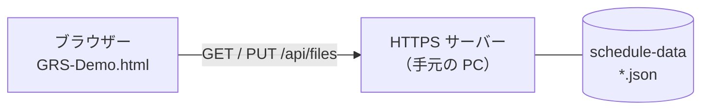

# GRS サーバー連携デモ（Windows）

[English](README.md) | 日本語

GoodRelax Scheduler（GRS）は 1 つの HTML ファイルで、サーバーを持ちません。このデモは GRS の別のビルドで、ファイルを HTTPS サーバーの先のフォルダ（**Dummy Server**）にも置けます。開く・保存は、PC のファイルとまったく同じ操作です。GRS 本体は変えていません。



## 3つのステップ

| ステップ | すること | 時間 | 分かること |
|---|---|---|---|
| 1. 見る | zip のデモを動かす | 10 分 | サーバーがするのは JSON ファイルの一覧・読み・書きだけ |
| 2. 自分のデータ | 自分の日程を GRS JSON にして、デモのサーバーに置く | 30 分 | 自分のデータがサーバー経由で GRS に出る |
| 3. 自分のサーバー | 同じ 3 つの口を、自分のサーバーに作る | 半日 | 自分のシステムをつなぐのに何が要るか |

## 1. 見る

1. `grs-server-sync-demo.zip` をダウンロードし、右クリック →「プロパティ」→「許可する」に印を付けて OK。
2. 展開し、`grs-server-sync-demo` フォルダの `start-server.cmd` をダブルクリック。
3. 初回だけ、Windows が `localhost` の証明書をインストールするかを問います。**[はい]** ならブラウザーは警告しません（**[いいえ]** なら、ブラウザーの警告で「詳細設定 → localhost に進む」を押す）。
4. Edge か Chrome で `https://localhost:8443/` が開きます。左上のロゴは **Demo** です。
5. **開く → Dummy Server** でファイルを選び、編集して `Ctrl`＋`S` ⇒ サーバーのファイルが更新されます。**ファイルに保存 → Dummy Server**（赤い 6 つ目）で名前を付けて保存します。
6. 黒い窓を見てください。`GET` と `PUT` の 1 行ずつが、ブラウザーがファイルを読んだ・書いた記録です。窓を閉じるとサーバーが止まります。

証明書を消すには `start-server.cmd -RemoveCertificate`。

## 2. 自分のデータ

1. AI に 3 つを渡します: 自分のシステムの日程データの出力形式の仕様（あればスキーマ）、そのサンプルデータ、[GRS JSON のスキーマ](https://goodrelax.github.io/gr-scheduler/spec/_source/grs-document.schema.json)。
2. 次のように頼みます。合わない所は、対話を続けて直させます。

   ```text
   添付のサンプルデータを、添付の GRS JSON スキーマに合う JSON に変換してください。
   写せない項目は、どう扱うか私に聞いてください。
   ```

3. できた JSON を `schedule-data` に入れて、**開く → Dummy Server**。

## 3. 自分のサーバー

[SERVER-API-ja.md](SERVER-API-ja.md) を読みます（3 つの口と、ページを同じサーバーから配ること）。それと自分のシステムの API を AI に渡し、自分の言語でサーバーを書かせます。`server/` の PowerShell のサーバーが見本です。

## 注意

- このデモは、JSON ファイルを丸ごと GRS に読み書きさせるところまでです。1 件ずつのスケジュール編集をサーバーと GRS の間で同期するなら、GRS が AI 向けに提供している Agent API を使えます。
- ステップ 1・2 は Windows だけ。ステップ 3 は OS を問いません。

## 詳細

- [本デモの仕様とビルドの手順](https://github.com/GoodRelax/gr-scheduler/blob/main/demo/server-sync/DEVELOPING-ja.md)
- [GRS の仕様書](https://goodrelax.github.io/gr-scheduler/spec-html/)
- [Agent API の仕様書](https://github.com/GoodRelax/gr-scheduler/blob/main/docs/spec/_assets/tbl-agent-api-members.md)
- [GRS のソースコード](https://github.com/GoodRelax/gr-scheduler/tree/main/src)
- [GRS のテストコード](https://github.com/GoodRelax/gr-scheduler/tree/main/tests)
