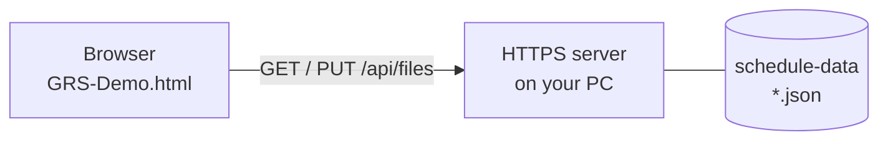

# GRS server-sync demo (Windows)

English | [日本語](README-ja.md)

GoodRelax Scheduler (GRS) is one HTML file and has no server.  
This demo, `GRS-Demo.html`, is a separate build from GRS.  
`GRS-Demo.html` can also keep files in a folder on an HTTPS server, called **Dummy Server**.  
Open and save work the same way as with files on your PC.



## Three steps

| Step | What you do | Time | What you find out |
|---|---|---|---|
| 1. See it | Run the demo from the zip | 10 min | The server only lists, reads and writes JSON files |
| 2. Your data | Put your own schedule, as GRS JSON, on the demo server | 30 min | Your data travels through a server into GRS |
| 3. Your server | Build a server with the same four APIs | half a day | What connecting your system takes |

## 1. See it

1. Download `grs-server-sync-demo.zip`, then right-click it: **Properties > Unblock > OK**.
2. Extract it and double-click `start-server.cmd` in the `grs-server-sync-demo` folder.
3. The first time, Windows asks whether to install a certificate for `localhost`. Answer **Yes** and the browser will not warn. (With **No**, the browser warns once: press **Advanced > Continue to localhost**.)
4. Edge or Chrome opens `https://localhost:8443/`. The logo reads **Demo**.
5. **Open > Dummy Server**, pick a file, edit it, press `Ctrl` + `S`: the file on the server is updated. **Save As > Dummy Server** (the red sixth choice) saves under a new name.
6. Watch the black window: each `GET` and `PUT` is the browser reading or writing a file. Close the window to stop the server.

To remove the certificate: `start-server.cmd -RemoveCertificate`.

## 2. Your data

1. Give an AI three things: the output format of your system's schedule data (its schema, if there is one), a sample of that data, and the [GRS JSON schema](https://goodrelax.github.io/gr-scheduler/spec/_source/grs-document.schema.json).
2. Ask as below. Where the result does not fit, keep the dialogue going and have it fixed.

   ```text
   Convert the attached sample data into JSON that fits the attached GRS JSON schema.
   For any item that cannot be carried over, ask me how to handle it.
   ```

3. Put the JSON into `schedule-data`, then **Open > Dummy Server**.

## 3. Your server

Build an HTTPS server with the four APIs below.

| Purpose | API | Responsibility |
|---|---|---|
| Page | `GET /` | Return `GRS-Demo.html` (the page and the API come from one server) |
| List | `GET /api/files` | Return the names, sizes and modified times of the JSON files in `schedule-data` |
| Read | `GET /api/files/{name}` | Return the content of one file (GRS JSON) |
| Write | `PUT /api/files/{name}` | Replace that file with the GRS JSON that was sent |

For details, see [DEMO-SERVER-API.md](DEMO-SERVER-API.md) and [`server/grs-demo-server.ps1`](server/grs-demo-server.ps1).

## Notes

- This demo goes as far as having GRS read and write whole JSON files. To sync schedule edits one by one between a server and GRS, use the Agent API that GRS provides for AI.
- Steps 1 and 2 run on Windows only. Step 3 runs on any OS.

## Details

- [This demo's design and build steps](https://github.com/GoodRelax/gr-scheduler/blob/main/demo/server-sync/DEVELOPING-ja.md) (Japanese)
- [GRS specification](https://goodrelax.github.io/gr-scheduler/spec-html/)
- [Agent API specification](https://github.com/GoodRelax/gr-scheduler/blob/main/docs/spec/_assets/tbl-agent-api-members.md)
- [GRS source code](https://github.com/GoodRelax/gr-scheduler/tree/main/src)
- [GRS test code](https://github.com/GoodRelax/gr-scheduler/tree/main/tests)
