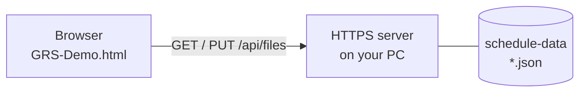

# GRS server-sync demo (Windows)

English | [日本語](README-ja.md)

GoodRelax Scheduler (GRS) is one HTML file and has no server. This demo is a separate build of GRS that can also keep its files in a folder behind an HTTPS server, called **Dummy Server**. Open and save work just as they do with files on your PC. GRS itself is not changed.

## Three stages

| Stage | What you do | Time | What you find out |
|---|---|---|---|
| 1. See it | Run the demo from the zip | 10 min | The server only lists, reads and writes JSON files |
| 2. Your data | Put your own schedule, as GRS JSON, on the demo server | 30 min | Your data travels through a server into GRS |
| 3. Your server | Build the same three endpoints on your own server | half a day | What connecting your system takes |

## 1. See it

1. Download `grs-server-sync-demo.zip`, then right-click it: **Properties > Unblock > OK**.
2. Extract it and double-click `start-server.cmd` in the `grs-server-sync-demo` folder.
3. The first time, Windows asks whether to install a certificate for `localhost`. Answer **Yes** and the browser will not warn. (With **No**, the browser warns once: press **Advanced > Continue to localhost**.)
4. Edge or Chrome opens `https://localhost:8443/`. The logo reads **Demo**.
5. **Open > Dummy Server**, pick a file, edit it, press `Ctrl` + `S`: the file on the server is updated. **Save As > Dummy Server** (the red sixth choice) saves under a new name.
6. Watch the black window: each `GET` and `PUT` is the browser reading or writing a file. Close the window to stop the server.

## 2. Your data

1. Turn your schedule data into GRS JSON with an AI, as in tab 05 of the [GRS overview page](https://goodrelax.github.io/gr-scheduler/about/?lang=en#trial).
2. Copy the file into `schedule-data`, then **Open > Dummy Server**.

## 3. Your server

Read [SERVER-API.md](SERVER-API.md): three endpoints, and the page served by the same server. Give it to an AI together with your system's API and ask for a server in your language. The PowerShell server in `server/` is the sample.

## Good to know

- **File level first, edit level later.** This demo moves whole files. To sync edit by edit, GRS has an Agent API, the same one AI agents use. That is the next step, not part of this demo.
- Stages 1 and 2 run on Windows only. Stage 3 runs on any OS.
- To remove the certificate: `start-server.cmd -RemoveCertificate`.
- For the details, see the [specification](https://goodrelax.github.io/gr-scheduler/spec-html/) and the [code](https://github.com/GoodRelax/gr-scheduler). Notes for building the demo are in [DEVELOPING-ja.md](DEVELOPING-ja.md) (Japanese).
