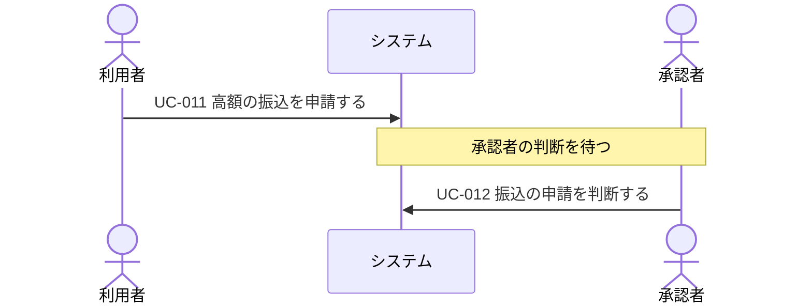
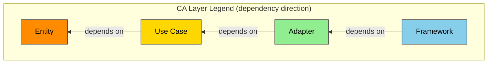

# ANMS v0.36 — AI-Native Minimal Spec Template

ANMS（AI-Native Minimal Spec）は、人が示したコンセプトから AI が仕様書を書き、書き手と別のセッションの AI が仕様書をレビューするための、最小の仕様書のテンプレートである。

人と AI の役割と、作業の進め方は、本テンプレートの後ろの「運用」に書く。

## 仕様書の設計原則: STFB (Stable Top, Flexible Bottom) — 上剛下柔

章は安定依存の原則（SDP）に従い、上ほど変わりにくく、下ほど変わりやすく並べる。下の章の変更は上の章に及ばない。

---

## 全章の決まり (Common Rules)

次の 4 節は、全章に当てる書き方の決まりを示す。

### 文の決まり

- 「など」「等」を使わない。例は「例:」で示す。
- 指示代名詞（例: これ、その）を使わず、指す物の名前を書く。
- 命令文を除き、文には主語と動詞を書く（要求文にも主語を書く）。動詞が他動詞なら、目的語も書く（目的と課題の動詞句、見出し、表の項目名は文ではないので対象外）。
- 1 つの要求文に、動作（`shall`）は 1 つだけ置く。
- 受動態を使わない。
- 次の場合を除き、否定形を使わず、代わりの行動を書く（例: 「システムは、パスワードを伏せ字にしてからログに書くこと」）。

否定形を使ってよい場合:

- 対象の全体と否定する部分が決まっていて、否定形のほうが分かりやすい（例: 「システムは、管理者のほかの利用者に管理画面を表示しないこと」）。
- テストで、起きないことを確かめる（例: Gherkin の `But`）。

### ID と双方向トレーサビリティ

- ID の振り方:
  - `頭文字-3桁`（例: `CH-001`）。999 を超えたら 4 桁にする。
  - 振ったら変えない。欠番は使い回さない。番号は並び順と無関係。
  - 設計と詳細仕様は、仕様書の中で一意の名前を ID にしてよい（例: コンポーネント名、API のパス、ステートマシンの名前と状態名の組）。第 5 章の実装仕様には IMPS の ID を振る。
  - コードは ID を持たない。
- 鎖（左が親）:
  - 目的 ← 要問 ← 課題 ← 目標 ← ユースケース ← 要求 ← 設計（第 4 章）・詳細仕様（第 5 章）・実装・テスト（実装とテストは、詳細仕様の IMPS も親にできる）。
  - つながるユースケースをまとめるときだけ、目標とユースケースの間にユースケースの流れ（UCF）を置く。
  - 背景、分析、解決方針、範囲、制約事項、制限事項、用語集、表記規約、4.1 アーキテクチャ方式、4.3 ファイル構成、5.x Configuration、設計判断（ADR）、未決の問いは鎖の外で、親を持たない。
  - 裁定や決定の ID は親にならない。
- 親と子:
  - 子は、導いた元の親の ID を 1 つ以上持つ。
  - 親は子の ID を持たない（UCF の図に描くユースケースを除く）。
  - 要求文が表の項目名か JSON のキーを引くのは参照で、親子のつながりではない。
  - 設計と詳細仕様の親は、ユースケースか要求である。実装とテストの親は、ユースケース、要求、実装仕様（IMPS）のどれかである。IMPS の traces は、要求を 1 つ以上含める。IMPS を親に持つ実装とテストは、IMPS の traces の先の要求の実装とテストにも数える。ユースケースの印（`UC-xxx.OK`、`UC-xxx.RJn`。n は 1 から）も親の ID になる。
  - 子をすべて満たせば親も満たすように、親を書く。
- 子の数:
  - 目的からユースケースまで（UCF を置くなら UCF も）は、子を 1 つ以上持つ。
  - 子の要求を持たない要求は、実装を 1 つ以上持ち、テストか、6.1 の検証方法の表の行を 1 つ以上持つ。
  - MAY か SHOULD の要求の実装を見送るときは、要求を第 3 章に残し、1.10 制限事項の本文に要求の ID と見送る理由を書く。1.10 の本文に ID と理由がある要求は、子の要求を持たない要求の決まり（実装とテスト）の例外になる。例外を数えるときは、1.10 を ID の全体に一致する形で検索する。
  - 実装仕様（IMPS）は、実装とテストを 1 つ以上ずつ持つ。
  - 検査、解析、実演で確かめる要求は、6.1 の検証方法の表に、検証方法と検証者を書く。
- 子の見つけ方: すべてのファイルを、親の ID の全体に一致する形（例: `\bFR-001\b` は `FR-001` だけに当たり、`NFR-001` と `FR-0012` を外す）で検索し、親の ID を書く所（次の一覧）に当たった物を子と数える。
- 親の ID を書く所:
  - 第 1 章: 親の ID の欄。
  - ユースケース: intent の欄の末尾の `traces:`。
  - 要求: 表の traces の列。
  - UCF と 4.5 の図: 見出しの直下の `traces:`。
  - 4.2 と 4.4: 図の要素の一覧表の traces の列（図には書かない）。
  - 第 5 章: 定義の表（5.x Configuration を除く）と実装仕様の表の traces の列（JSON Schema と OpenAPI では `description` の末尾の `traces: <ID>`、`CREATE TABLE` では直前の SQL のコメントの `traces: <ID>`）。
  - 6.1 の検証方法の表: 要求の ID の列。
  - コード: 仕様の振る舞いを実装する所（例: UseCase の公開の関数、コンポーネントの公開面の関数、実装仕様を実装する関数）とテストのコメント（例: `// Spec: FR-012`）。ほかのコードは、呼ぶ側の親を受け継ぐ。
  - シナリオ: タグ（例: `@UC-001.OK`）。
- 親の ID が 2 つ以上なら、`, ` で区切る（例: `UC-010.OK, GL-004`）。

### 機械が読む原本（JSON）

- JSON は仕様書と別のファイルに置き、表を置く節に場所を書く。表を置かない JSON（例: ID の登録簿、UI の文言）は、付録 A.x に場所を書く。JSON と表が両方あるなら、JSON が正。表は JSON から作る。キーは camelCase。言語ごとの文は、言語のタグ（BCP 47）をキーにする（例: `{ "en": …, "ja": … }`）。`en` は必ず置き、英語を正とする。
- 必須の JSON:
  - 保存・交換するデータの形式: JSON Schema（API は OpenAPI でもよい）。データベースの表の形は、表か `CREATE TABLE` で書く。JSON Schema は要らない。JSON のほかの形式は、形式のスキーマの言語（例: XML は XSD、CSV は列の表）で書く。
  - UI の文言: 言語が 2 つ以上のとき。
  - 用語集、ID の登録簿、状態遷移表: 製品のコード（テスト、コメント、空行、生成したコードを除く）が 10,000 行を超える見込みのとき。見込みの行数と、JSON を持つかの判断は、1.7 に書く。
- 推奨の JSON:
  - 用語集、ID の登録簿、状態遷移表: 製品のコードが 10,000 行以下の見込みのとき。
  - 設定の定義（名前、既定値、範囲）。
  - 用語集、ID の登録簿、状態遷移表の JSON Schema。
- 用語集、ID の登録簿、状態遷移表は、それぞれ別の JSON に置く。
- 用語集 `terms[]`:
  - 必須のキー: `key`（用語を指す英語の語。camelCase。一意。番号の ID は振らない）、`label`（文書と画面に出す名前。言語ごとの文）、`definition`（言語ごとの文）。
  - 任意のキー: `avoid`（使わない言い換え）、`renames[]`（改名の履歴）。
  - `renames[]` は 1 回の改名を 1 つの要素にし、`from`（古い key）、`version`（変えた仕様書のバージョン）、`reason`（言語ごとの文）、`basis`（変更を求めた記録の ID。例: 変更要求、レビューの指摘、ADR、未決の問い）を持つ。
  - 改名したら、`key` を新しい名前に変え、古い key を `renames[]` に残す。古い key は、別の用語に使い回さず、`avoid` に書かない（古い key は `renames[]` が持ち、1 つの事実は 1 か所に書くため。手順は ANMS の運用の「用語の改名の手順」）。
  - 保存・交換するデータの形式か公開する境目（例: API）で名前を変えたら、形式のバージョンを上げ、古い名前の扱い（新しい名前に読み替えるか、エラーで知らせるか）を 5.x Data Schema か 5.x API Definition に書く。
- ID の登録簿 `prefixes[]`:
  - 必須のキー: `prefix`、`standsFor`（頭文字が表す英語）、`meaning`、`section`（ID を使う節）。
  - 任意のキーは無い。
- 状態遷移表 `stateMachines[]`:
  - 必須のキー: `name`、`states`（状態名の配列）、`transitions[]`（`source`、`target`、`trigger`。`trigger` は初期の遷移のほかで必須）。
  - 任意のキー: `transitions[]` の `guard` と `effect`、`unhandled[]`（遷移の無い状態とイベントの組。`source`、`trigger`、`handling`。`handling` は `ignore` か `error`）。値があるときだけ書く。
  - 状態とイベントのすべての組を、`transitions[]` か `unhandled[]` に書く。JSON から作った表の凡例は `ignore` と `error` を示す。JSON を持たないときも、表に全交点と凡例を書く。`states` には `initial` を含めない。
  - `name` は `〜StateMachine` とする。字はコードの定義の名と同じにし、言語で記法が決まっている場合を除き、型なら大文字、値なら小文字で始める。型と値の両方があるときにどちらの名に合わせるかは、プロジェクトが決めて 1.12 表記規約に書く。
  - 識別子は英語で書く。キーの名前と初期の擬似状態 `initial` は UML 2.5.1 に合わせ、初期の遷移は `source` を `initial` にして `trigger` を書かない。
  - 状態名は形容詞か分詞、イベント名は過去形。

### 未決の問い

- 仕様が決めていない点に当たったときの扱いは、ANMS の運用の「未決の問いの進め方」に書く。
- 未決の問いは付録 A.3 に、1 行に 1 つ、「ID / 決まっていないこと / 探した所 / 決める人 / 仮の扱い（推奨と根拠） / 覆したときに直すテスト」の列で書く。ID は `OPQ-xxx`。未決の問いの ID は使い回さない。
- 止めた所と仮に決めた所には、未決の問いの ID を書く。
  - 仕様: 仮に決めた文の末尾に `（仮: OPQ-003）` を、止めた所の文か値の末尾に `（未決: OPQ-004）` を書く。
  - コードとテスト: 止めた所の直前に `// Unimplemented: OPQ-xxx` を、仮に決めた所の直前に `// Provisional: OPQ-xxx` を、コメントで書く。コメントには未決の問いの ID を 1 つだけ書き、決まっていないこと、探した所、仮の扱いは付録 A.3 の行に書き、コメントに写さない。
  - 6.2 のシナリオ: シナリオのタグの行の直前に、`#` のコメントで `# Unimplemented: OPQ-xxx` か `# Provisional: OPQ-xxx` を書く。
- `// Spec:` には、仕様の本文の ID だけを書く。

---

## Chapter Structure

| # | English | 日本語 | 主な記法 | 安定度 |
| --- | -------------------------------- | ------------------- | ----------------------------------- | ------------------------ |
| H | **Header** | 冒頭 | 3 行（バージョン、テンプレート、変更履歴） | 変更のたびに更新 |
| 1 | **Foundation** | 基本事項 | 自然言語 + テーブル | 最も安定 |
| 2 | **Use Cases** | ユースケース | テーブル + シーケンス図 | 安定 |
| 3 | **Requirements** | 要求 | EARS + 数式 + テーブル + 図 | 安定 |
| 4 | **Architecture** | アーキテクチャ | Mermaid + テーブル | やや安定 |
| 5 | **Specification** | 仕様 | テーブル + コードブロック | よく変わる |
| 6 | **Test** | テスト | テーブル + Gherkin | よく変わる |
| 7 | **Design Principles Compliance** | SW設計原則 準拠確認 | テーブル | 可変（レビュー時に更新） |
| A | **Appendix** | 付録 | 自由形式（A.3 は表） | — |

仕様書を分けるとき（ANPS: AI-Native Plural Spec。分ける時期は ANMS の運用の「仕様書の分割」）は、次の括弧の外側から順に分ける。外側の 3 つは要求、設計・実装・テスト、仕様書の内容の確認である。外側の 3 つで分けてもファイルが大きいときは、1 つ内側の括弧で分ける。

`( ( ( Ch1, Ch2 ), Ch3 ), ( ( Ch4, Ch5 ), Ch6 ), Ch7 )`

- Ch3 を分けるときは、2.2 のユースケースの流れ（UCF）の単位で分ける。2 つ以上の流れに出る要求と、どの流れにも入らない要求（非機能要求を含む）は、共通のファイルに置く。
- ファイルの名前は、入っている章で付ける（例: `spec-ch1-3.md`、`spec-ch4-6.md`、`spec-ch7.md`）。Ch3 を UCF で分けたら、UCF の ID を添える（例: `spec-ch3-ucf-001.md`、共通は `spec-ch3-common.md`）。
- バージョン、テンプレート、変更履歴の行は最初のファイルに、付録は最後のファイルに置く。2 つ目から後のファイルの冒頭に、最初のファイルの名前を書く。ID は振り直さない。

---

## Section Structure

第 1〜4 章の節は、表の番号のまま使う。書くことが無い節は、見出しを残して「—」と書く（2.2 は除く）。

### 仕様書の冒頭

仕様書の冒頭に、次の 3 行を書く。

```markdown
**バージョン:** 20261115T120000Z
**テンプレート:** ANMS v0.36
**変更履歴:** spec-changelog.md
```

| 項目 | 決まり |
| ----------- | --------- |
| バージョン | 変更を終えた時刻を、ISO 8601 の基本形式の UTC で書く。仕様書の中では、今のバージョンを冒頭だけに書く |
| テンプレート | 従う ANMS のバージョンを書く |
| 変更履歴 | 変更履歴のファイルの場所を書く。変更履歴は仕様書と別のファイルにする（必須） |

変更履歴のファイルは、次の決まりに従う。

- 1 行に 1 つの変更を、「バージョン / 変更 / 変えた ID / 根拠」の列で書く。
- 「変えた ID」には、足した ID、変えた ID、消した ID を分けて書く（例: 足した `FR-031`、変えた `FR-012`、消した `FR-050`）。
- 「根拠」には、変更を求めた記録の ID を書く（例: 変更要求の `CR-001`、レビューの指摘の `RVF-001`、ADR の ID、未決の問いの `OPQ-001`）。初版のレビューを終えるまでの変更は 1 行にまとめ、根拠を「初版」と書く。
- 初版のレビューを終えた後に、1 回のレビューで第 7 章の判定だけを変えたときは、変えた判定を 1 行にまとめ、根拠にレビューの指摘の ID（例: `RVF-001`）をすべて書く。指摘が無いときは、根拠に「第 7 章のレビュー」と書く。バージョンは、ほかの変更と同じく、変更を終えた時刻にする。
- 行は書き換えない。新しい行は末尾に足す。
- 最後の行のバージョンは、仕様書の冒頭のバージョンと同じにする。

### Chapter 1. Foundation (基本事項)

プロジェクトの「北極星」。すべての後続章の前提となる。最も安定し、最も変わりにくい層。

| Section | English | 日本語 | 記述内容 | ID | 親の ID |
| ------- | ----------- | -------- | ------------------------------------------------------------------------------------------------------- | ----------------------------- | -------------------------- |
| 1.1 | Background | 背景 | ドメインの現状と、ドメインの問題の事実。自由な文で書く | BG-xxx | 書かない（トレースしない） |
| 1.2 | Purposes | 目的 | 取り組む理由。動詞句で書く | PUR-xxx | 書かない（最上位） |
| 1.3     | Analysis    | 分析     | 要問を導くための観察・整理・比較・推測。自由な文で書く                                                  | AN-xxx                        | 書かない（トレースしない） |
| 1.4     | Issues      | 要問     | 目的を果たすために答えを出す価値のある、本質的な問い。疑問文で書く                                      | ISS-xxx                       | 目的の ID                  |
| 1.5     | Challenges  | 課題     | 要問を解くために挑むこと（戦略）。動詞句で書く                                                          | CH-xxx                        | 要問の ID                  |
| 1.6     | Goals       | 目標     | 目標は、親の課題を乗り越えた状態で、要問の答えの一部になる。達したかを観察で判定できる平叙文で書く                            | GL-xxx                        | 課題の ID                  |
| 1.7 | Approach | 解決方針 | 目標を満たし、プロジェクト全体に影響する技術の選定（例: 見込みの行数と、JSON を持つかの判断）。ほかの設計判断は 4.6 に書く。1 つの判断は、1.7 か 4.6 の一方だけに書く | APR-xxx | 書かない（トレースしない） |
| 1.8 | Scope | 範囲 | 本プロジェクトでやること (In-scope) とやらないこと (Out-of-scope) | SCP-xxx | 書かない（トレースしない） |
| 1.9 | Constraints | 制約事項 | プロジェクトが必ず守る制約（例: 技術、法規、倫理、特許） | CST-xxx | 書かない（トレースしない） |
| 1.10 | Limitations | 制限事項 | 要求を一部だけ満たし、許容できる既知の妥協点。実装を見送る MAY と SHOULD の要求も、要求の ID と理由を書く | LM-xxx | 書かない（トレースしない） |
| 1.11 | Glossary | 用語集 | プロジェクト固有の用語定義。AIと人間で用語の解釈を揃える。表の列は key / 用語（label） / 定義 / 使わない言い換え / 改名の履歴 | 振らない（`key` で用語を指す） | 書かない（トレースしない） |
| 1.12 | Notation | 表記規約 | 要求の強さは RFC 2119 に合わせ、要求文の小文字の `shall`、`should`、`may` も RFC 2119 の意味を持つ（RFC 8174 の例外）。日本語の文末と EARS の `shall` は、第 3 章の強さの表で対応させる | NTN-xxx | 書かない（トレースしない） |

1.1〜1.6 は、背景 → 目的 → 分析 → 要問 → 課題 → 目標の順に筋道を立てる。目標を満たす手段は、1.7 の解決方針、第 2 章のユースケース、第 3 章の要求、第 4 章のアーキテクチャが定める。作業の計画は仕様書に書かない。

目的と目標は次のように使い分ける。目的は、取り組む理由と向きを表す。目標は、達した状態を表し、数値か観察できる事実で、達したかを判定できる。

第 2 章のユースケースの intent（意図）は、アクターが 1 回の作業で成し遂げたいことで、目的（PUR）とも目標（GL）とも別の物である。intent は traces で目標か UCF を指す。

**例（第 2 章の UC-010 と UCF-001 につながる）:**

| ID | 親の ID | 文 |
| ----- | ---------- | ----- |
| PUR-001 | — | 利用者が時と場所を選ばずに送金できるようにする |
| ISS-001 | PUR-001 | 利用者が自分の端末だけで安全に送金できる、最適なシステムは何か |
| CH-001 | ISS-001 | 送金の手続きを、利用者の端末だけで終える仕組みを作る |
| GL-004 | CH-001 | 利用者は自分の端末だけで振込を終えられる |
| CH-002 | ISS-001 | 高額の振込の誤りと不正を、実行の前に人が止める仕組みを作る |
| GL-005 | CH-002 | 承認者は、高額の振込を実行の前に認めるか退けるかを決められる |

### Chapter 2. Use Cases (ユースケース)

アクターがシステムで成し遂げたいこと（intent）を、システムの外から書く。要求（第 3 章）と設計（第 4 章）は、ユースケースに合わせる。

| Section | English | 日本語 | 書くこと | ID | 親の ID |
| ------- | ------- | ------ | -------- | -- | ------- |
| 2.1 | Use Cases | ユースケース | 下の決まりと例のとおり（必須） | UC-xxx | UCF の ID（流れに入らないなら目標の ID） |
| 2.2 | Use Case Flows | ユースケースの流れ | ほかの人の判断を待つ所か、アクターが作業をいったん終え、後で続ける所で分けた、ユースケースの連なりを、シーケンス図（Mermaid）で示す。2.2 は、分けたユースケースがあるときだけ置く | UCF-xxx | 目標の ID |

**決まり:**

1. 見出し:
   - 「#### UC-<3 桁> <目的語>を<動詞の終止形>（<英語の PascalCase の名前>）」（例: `#### UC-010 代金を振り込む（TransferMoney）`）。
   - 4.2 の UseCase には、同じ英語の名前を付ける。UseCase の名には、接尾辞 `UseCase` か `Interactor` を付けてよい。
2. 欄: intent、trigger、precondition、postcondition、steps、rejection の 6 つ。
3. intent:
   - 1 ユースケースは 1 intent にする。
   - intent は、アクターが 1 回の作業で成し遂げたいこと。成し遂げたら、アクターは作業を終えてよい。
4. precondition:
   - 始める前に成り立つ状態を書く。
   - 先のユースケースか、全体に当てる要求（例: 認証）が保証し、手順の中では確かめない。
   - 無ければ「—」と書く。
5. steps:
   - 1 人のアクターが待たずに続ける、システムとのやり取りだけを書く。
   - システムの内部の処理（例: 記録、計算）の結果は、postcondition に書く。
   - 1 手順に主語 1 つ、動作 1 つ。
   - 画面と操作の手段は書かず、意図で書く（例: 伝える、選ぶ）。
   - 条件は rejection に書く。
6. rejection:
   - システムが規則か入力に照らして拒むことを書く。
   - `RJn（手順 m）` は、手順 m への応答として拒む。
   - 無ければ「—」と書く。
   - 故障（例: 通信の途絶）は、非機能要求に書く。
7. 印: 正常に終わる道は `UC-xxx.OK`、拒む道は `UC-xxx.RJn`。要求とシナリオは印を指す。
8. ユースケースの分け方とつなぎ方:
   - ほかの人の判断を待つ所と、アクターが作業をいったん終え、後で続ける所（例: 翌日に続ける所）で、ユースケースを分ける。
   - 後の precondition に前の印を書いてつなぐ（例: UC-009.OK の postcondition が成り立っている）。
   - つながるユースケースを 2.2 の UCF にまとめて描く。UCF に入るユースケースは、`traces:` で UCF を指す。UCF の図には、ユースケースを ID で描く。
9. ユースケースにしない操作:
   - アクターが目的にしない操作（例: ログイン、手順の中で選ぶための一覧）は、ユースケースにしない。
   - ログインは precondition に、一覧は機能要求に書く。
   - 照会が intent なら（例: 残高を確かめる）、ユースケースにする。
10. 人が判断するユースケース（例: 申請を承認するか却下するか決める）:
    - 判断の結果ごとに分けない。
    - アクターは steps で判断を伝え、postcondition にシステムが判断を記録したことを書く。
    - rejection は、システムが拒むときだけに使う。

**例（次の形で書く）:**

```markdown
#### UC-010 代金を振り込む（TransferMoney）

| 欄 | 内容 |
| -- | ---- |
| intent | 利用者は振込先の口座へ代金を送る。 traces: GL-004 |
| trigger | 利用者が送金を始めたとき |
| precondition | システムは利用者の認証を保持している。 |
| postcondition | システムは振込を記録し、振込元の残高から金額を引いている。 |

**steps**

1. 利用者はシステムに振込先の口座と金額を伝える。
2. システムは振込の内容を利用者に示す。
3. 利用者はシステムに暗証番号を伝える。
4. システムは振込の受付番号と振込の後の残高を利用者に示す。

**rejection**

- RJ1（手順 1）もし金額が残高を超える場合、システムは残高の不足を利用者に知らせる。
- RJ2（手順 3）もし暗証番号が登録した暗証番号と異なる場合、システムは暗証番号の誤りを利用者に知らせる。
```

**UCF の例:**

````markdown
#### UCF-001 高額の振込を承認して実行する

traces: GL-005


````

### Chapter 3. Requirements (要求)

システムが満たすべき要求を、EARS 構文で書く。細部は数式・テーブル・図で定めてよい。

| Section | English | 日本語 | 記述内容 | ID | 親の ID |
| ------- | --------------------------- | ---------- | ---------------------------------- | ----- | ---------- |
| 3.1 | Functional Requirements | 機能要求 | システムが提供する機能の要求 | FR-xxx | ユースケースの印（`UC-xxx.OK` か `UC-xxx.RJn`）、目標の ID、親の要求の ID のうち 1 つ以上 |
| 3.2 | Non-Functional Requirements | 非機能要求 | 機能以外の品質の要求（例: 性能、セキュリティ、可用性、故障の扱い） | NFR-xxx | 目標の ID、ユースケースの印、親の要求の ID のうち 1 つ以上 |

**要求の決まり:**

- 要求は階層にしてよい。子の要求は、親の要求の ID を traces に書く。親の要求は、システムが子の要求をすべて満たせば親の要求も満たすように書く。
- ユースケースから導いた要求は、traces の列でユースケースの印を指す。rejection から導いた要求は、Unwanted Behavior（もし〜場合）で書く。
- ほかの要求が作る状態を前提にする要求は、前提の状態を While の条件に書き（前提の状態は、動いている間に続く状態として書く）、traces には導いた元の親だけを書く。
- 閾値、率、期限の値は、5.x Configuration の表か JSON に置き、要求文からは表の項目名か JSON のキーで参照する。同じ値を 2 か所に書かない。
- ユースケースの intent を、拒まずに別の道で成し遂げる場合（例: 未登録の振込先なら、先に登録を求める）は、ユースケースに書かず、機能要求に書く。
- 非機能要求に、故障でユースケースを終えられなかったときの扱いを書く（例: 途中の状態を始める前の状態に戻す、再び動いたときに直前の依頼の結果を示す、同じ依頼の繰り返しで状態を 1 回だけ変える）。

**書き方（例のとおりに書く）:**

| ID | 要求文 | traces |
| -- | ------ | ------ |
| FR-012 | もし金額が残高を超える場合、システムは残高の不足を利用者に知らせること。 | UC-010.RJ1 |
| FR-013 | 利用者が登録した暗証番号と同じ暗証番号を伝えたとき、システムは振込を記録すること。 | UC-010.OK |
| NFR-003 | システムは振込の記録を、設定表の「記録の上限時間」以内に終えること。 | UC-010.OK |
| NFR-004 | もしシステムが振込の途中で故障した場合、システムは振込元の残高と振込の記録を振込の前の状態に戻すこと。 | UC-010.OK |

EARS構文パターン:

| パターン          | 構文                                                                                                               | 日本語の型                                                                                                    |
| ----------------- | ------------------------------------------------------------------------------------------------------------------ | ------------------------------------------------------------------------------------------------------------- |
| 常時（Ubiquitous） | `The <system name> shall <system response>.`                                                                       | `<システム名>は<システムの応答>すること。`                                                                    |
| イベント（Event-driven） | `When <trigger>, the <system name> shall <system response>.`                                                       | `<トリガー>とき、<システム名>は<システムの応答>すること。`                                                    |
| 状態（State-driven） | `While <precondition(s)>, the <system name> shall <system response>.`                                              | `<状態>の間、<システム名>は<システムの応答>すること。`                                                        |
| 異常（Unwanted Behavior） | `If <trigger>, then the <system name> shall <system response>.` | `もし<トリガー>場合、<システム名>は<システムの応答>すること。` |
| 任意機能（Optional Feature） | `Where <feature is included>, the <system name> shall <system response>.` | `<機能>がある場合、<システム名>は<システムの応答>すること。` |
| 組み合わせ（Complex） | `Where <feature is included>, while <precondition(s)>, when <trigger>, the <system name> shall <system response>.` | `<機能>がある場合、<状態>の間、<トリガー>とき、<システム名>は<システムの応答>すること。` |

- Complex の条件は Where → While → When の順に置く。If を組むときは、When の位置に置く（日本語の型: `<機能>がある場合、<状態>の間、もし<トリガー>場合、<システム名>は<システムの応答>すること。`）。
- Where には、製品の構成（積む機能、動かす前に決める設定の値）を書く。設定の値なら、日本語の型を `<設定>が<値>の場合、` にする（例: 設定の表示言語が英語の場合、システムは日付を月・日・年の順で示すこと）。
- While の `<precondition(s)>` には、動いている間に続く状態を書く。ユースケースの precondition（始める前に成り立つ状態）と別の物。

**強さの書き分け:**

| 強さ   | 英語  | 日本語の文末        |
| --------- | -------- | ---------------------- |
| SHALL  | shall    | 〜すること             |
| SHOULD | should   | 〜することが望ましい   |
| MAY    | may      | 〜してもよい           |
| SHALL NOT | shall not | 〜しないこと |
| SHOULD NOT | should not | 〜しないことが望ましい |

- EARS の型の文末「〜すること」を、強さに応じて上の表の文末に置き換える。
- SHALL NOT と SHOULD NOT は、文の決まりの否定形の例外にだけ使う。
- 条件の印は、EARS構文パターンの表の日本語の型の語だけを使う。「とき」はひらがなで書く。「場合」は「もし〜場合」（異常。拒む道と故障を含む）と「〜がある場合」「〜が〜の場合」（任意機能）にだけ使う。

**例文（各型 1 つ）:**

| 型         | 例文                                                                                                                                     |
| ---------- | ---------------------------------------------------------------------------------------------------------------------------------------- |
| 常時 | システムは操作の記録を、設定表の「記録の保持日数」の間保持すること。 |
| イベント   | 利用者がタスクを日付の列にドロップしたとき、システムはタスクの開始日を列の日付にすること。                                               |
| 状態       | システムが文書を読み込んでいる間、システムは利用者の編集の操作をキューに入れること。                                                     |
| 異常       | もしシステムがファイルの中に壊れた行を見つけた場合、システムは壊れた行の番号を表示すること。                                             |
| 任意機能 | 製品に透かし機能がある場合、システムは今の利用者の名前を画面に描くこと。 |
| 組み合わせ | 製品に透かし機能がある場合、システムが印刷を準備している間、利用者が書き出しを選んだとき、システムは書き出しの画像に透かしを描くこと。 |

### Chapter 4. Architecture (アーキテクチャ)

SWの構造と設計判断。Chapter 2 のユースケースと Chapter 3 の要求を実現するための技術的な構造を定義する。

| Section | English              | 日本語               | 記述内容                                                                 |
| ------- | -------------------- | -------------------- | ------------------------------------------------------------------------ |
| 4.1  | Architecture Concept | アーキテクチャ方式   | 採用するアーキテクチャの種類（例: CA, Hexagonal, Layered）と凡例の定義 |
| 4.2 | Components | コンポーネント | コンポーネントと責務の分割。コンポーネント図（4.1の凡例で色分け）。Chapter 2 のユースケースごとに、同じ PascalCase の名前の UseCase を 1 つ置く（接尾辞 `UseCase` か `Interactor` は付けてよい）。照会の UseCase は機能要求から足してよい。AI/LLM連携がある場合はプロンプトテンプレートの配置（例: `src/prompts/`）・入出力スキーマ・テスト方針・ハルシネーション対策も定義する |
| 4.3  | File Structure       | ファイル構成         | ディレクトリ構成。コンポーネントとフォルダの対応                         |
| 4.4 | Domain Model | ドメインモデル | 構造・関係・状態の定義。クラス図（4.1の凡例で色分け）、ER図、状態遷移図（状態遷移表は 5.x State Management に置く） |
| 4.5  | Behavior             | 振る舞い             | 処理フロー・相互作用。コンポーネントのシーケンス図、アクティビティ図          |
| 4.6 | Decisions | 設計判断 | ADR（Architecture Decision Records）。1.7 に書く選定（プロジェクト全体に影響する技術）のほかの設計判断を書く。ID は ADR-xxx。ADR-000 は必ず置き、最小構成と、増やした要素と理由を書く。増やした要素が 1.7 の選定なら、ADR-000 には APR の ID だけを書く。判断理由・代替案・決定者。記録形式は Michael Nygard の ADR フォーマット（Status / Context / Decision / Consequences）を推奨 |

4.2 には図の要素の一覧表（名前、責務、公開面、traces）を、4.4 には図の要素の一覧表（名前、責務、traces）を置く。公開面には、ほかのコンポーネントが使ってよい物（例: 関数の署名、API のパス、受けるイベント）を書く。4.5 の図は、図ごとに見出しの直下に `traces:` を書く。

コンポーネント図・クラス図にはアーキテクチャレイヤーに基づく色分けを必須とする。デフォルトはClean Architectureの4層（下記凡例）を使用する。他のアーキテクチャを採用する場合は、採用したアーキテクチャの凡例を4.1に定義すること。

**デフォルト凡例: Clean Architecture レイヤー (コンポーネント図・クラス図 共通):**



| CAレイヤー | 役割                         | 色       | Hex       |
| ---------- | ---------------------------- | -------- | --------- |
| Entity     | ドメインデータ・コアロジック | 橙       | `#FF8C00` |
| Use Case   | ビジネスロジック調整         | ゴールド | `#FFD700` |
| Adapter    | 外部IF適合                   | 緑       | `#90EE90` |
| Framework  | UI・デバイス・外部サービス   | 青       | `#87CEEB` |

### Chapter 5. Specification (仕様)

具体的で、よく変わる層。AIがコードに直接変換できるレベルの定義。

- 第 4 章は構造を、第 5 章は値と形式と、振る舞いの実装仕様を定める。
- 外から見える振る舞いは第 3 章の要求に、要求を満たす内部の決め事は第 5 章に書く。
- データの構造と値は、表、JSON Schema、OpenAPI で書く。
- 振る舞いの実装仕様は、EARS の型の文で書き、「ID / 実装仕様 / traces」の表に置く。ID は `IMPS-xxx`。
  - 実装仕様の主語は、設計で名前と責務が決まっている要素（例: コンポーネント、ステートマシン、クラス）にしてよい。第 3 章の要求の主語は、システム名のままにする。
  - ほかの節に属さない実装仕様は、5.x 自然言語による実装仕様に置く。
  - ほかの節に属する実装仕様（例: エラー処理、アルゴリズム）は、属する節の中に同じ表で書く。
- 節は、下のセクション候補から選び、5.1 から番号を振る。

**例（5.x 自然言語による実装仕様）:**

IMPS = Implementation Specification（自然言語による実装仕様）。

| ID | 実装仕様 | traces |
| -- | ---- | ------ |
| IMPS-001 | TransferMoneyUseCase が振込を記録するとき、TransferMoneyUseCase は振込の記録と振込元の残高の更新を 1 つのトランザクションで確定すること。 | NFR-004 |

#### セクション候補

| Section候補 | English          | 日本語         |
| ----------- | ---------------- | -------------- |
| 5.x | Natural Language Implementation Specification | 自然言語による実装仕様 |
| 5.x      | UI Elements Map  | UI要素マップ   |
| 5.x      | Configuration    | 設定定義       |
| 5.x      | API Definition   | API定義        |
| 5.x      | Data Schema      | データスキーマ |
| 5.x      | State Management | 状態管理       |
| 5.x      | Algorithm        | アルゴリズム   |
| 5.x      | Error Handling   | エラー処理     |

### Chapter 6. Test (テスト)

6.1 と 6.2 は必ず置く。6.3 から後は、章の末尾の候補から選ぶ。

#### 6.1 Test Strategy (テスト戦略)

テストレベル別の方針。個別テストケースの詳細はAIに委任し、6.1 では「何をどのレベルでテストするか」を定義する。

テストマトリクス（テンプレート例。プロジェクトに応じて行を追加・削除する）:

| テストレベル | 対象                 | 方針                               | ツール/フレームワーク | 合格基準         |
| ------------ | -------------------- | ---------------------------------- | --------------------- | ---------------- |
| ユースケーステスト | 第 2 章のすべての印 | 6.2 のシナリオ | [例: Playwright]      | 全シナリオが passed |
| 性能テスト | [対象API/処理] | 第 3 章の非機能要求が指す 5.x Configuration の値に基づく | [例: k6] | [目標値] |
| 結合テスト   | [結合ポイント列挙]   | [方針]                             | [例: Vitest]          | 合格率 100%      |
| 単体テスト   | 全ビジネスロジック   | AIが自動生成。カバレッジ目標: [X]% | [例: Vitest]          | 合格率 100% |

- 機能要求と非機能要求は、単体テスト・結合テスト・性能テストで確かめる。
- 検査、解析、実演で確かめる要求は、テストマトリクスと別の検証方法の表（列: 要求の ID / 検証方法 / 検証者）に、1 行ずつ書く。
- 各テストに、確かめる親の ID（例: 要求、ユースケースの印、IMPS）をコメントで書く（例: `// Spec: FR-012`）。
- 単体テスト・結合テスト・性能テストのケースは、テストのコードに置く。人が前もってケースを確かめる必要があるとき（例: 金銭の計算、法規、外部との約束）だけ、6.3 から後の節に書く。

**人が確かめるテスト:** 人が確かめるべきテスト（例: 見た目、使い勝手）には、`@manual` のタグを付ける（誰がいつ確かめるかは、ANMS の運用の「テストの進め方」）。

**テスト記録:** テストの結果は、仕様書と別のファイル（テスト記録）に書く。テスト記録の場所は 6.1 に書く（例: `test-results/`）。

#### 6.2 Use Case Tests (ユースケーステスト)

第 2 章のユースケースを、具体的な値で確かめる。シナリオは Gherkin で書き、受入基準を兼ねる。シナリオの原本は 6.2 に置き、ツールが読む `.feature` のファイルは 6.2 から作る。シナリオを直すときは、6.2 を直してから `.feature` を作り直す。

- すべてのユースケースのすべての印に、シナリオを 1 つ以上置く。
- precondition は `Given` に、trigger と intent は 1 つの `When` に、postcondition と rejection の応答は `Then` に写す。
- RJn のシナリオでは、拒む条件に当たる値を `Given` か `When` に書く（例: Given 残高は 1,000 円、When 利用者は 2,000 円を送る）。

Result には、Cucumber の結果の値（passed、failed、skipped、pending、undefined、ambiguous）を使う。passed のほかは、Remark に理由を書く。

`@manual` のテストのテスト記録の書式（表はテスト記録のファイルに置く）:

| シナリオ | Result | Remark |
| ----------- | --------- | --------- |
| SCN-001 | passed | |
| SCN-002 | failed | 理由を書く |

Gherkin のキーワード（Feature、Rule、Background、Scenario、Scenario Outline、Examples、Given、When、Then、And、But、データの表、Doc Strings、タグ）は、必要に応じて使う。シナリオの書式の決まりは次の 3 つで、例のとおりに書く。

- シナリオ名の頭に、シナリオの ID（`SCN-xxx`）を書く。
- タグに、確かめるユースケースの印を 1 つ書く（例: `@UC-010.OK`、`@UC-010.RJ1`）。確かめる機能要求の ID（例: `@FR-012`）と `@manual` は、要るときに足す。タグの要求の ID は、要求を確かめるテストに数える。
- 未決の問いのコメント（`#`）は、ANMS の全章の決まりの「未決の問い」に従って書く。

```gherkin
Feature: UC-010 代金を振り込む

  @UC-010.RJ1 @FR-012
  Scenario: SCN-002 システムは残高を超える金額の振込を拒む
    Given 残高は 1,000 円
    When 利用者は 2,000 円を送る
    Then システムは残高の不足を利用者に知らせる
```

#### 6.3 以降のセクション候補

人が前もってケースを確かめる必要があるとき（6.1）だけ、確かめる章の順に置く:

| Section候補 | English | 日本語 | 確かめる章 | 書くこと |
| -------------- | ---------- | --------- | ------------- | ----------- |
| 6.x | Performance Tests | 性能テスト | 第 3 章の非機能要求 | 条件と値の表 |
| 6.x | Integration Tests | 結合テスト | 第 4 章 | コンポーネントの境目のケース |
| 6.x | Unit Tests | 単体テスト | 第 3 章の機能要求、第 5 章 | ケースの表 |

### Chapter 7. Design Principles Compliance (SW設計原則 準拠確認)

アーキテクチャおよび実装がSW設計原則に準拠しているかを確認する。Chapter 1-6 の「定義・設計・検証」とはメタレベルが異なる、品質保証の層。

確認する原則は、プロジェクトの性質に応じて足してよい。非該当の原則は、行を残して NA と判定し、根拠に理由を書く。

判定には PASS、FAIL、NA のどれかを、根拠には確かめた所を書く。NA は非該当だけを表す。アーキテクチャか実装が原則に反するときは、原則に反する理由があっても、FAIL と判定する。判定はレビュアーがレビューのたびに書き、FAIL はレビューの指摘にする。FAIL の指摘を修正の無いまま残すときは、次のレビューでも判定を FAIL にし、新しい指摘の代わりに、同じ指摘の ID を根拠に書く。コードを確かめる行は、コードができるまで判定を空けておく。

| カテゴリ | 識別名 | 正式名称 | 確認観点 | 判定 | 根拠 |
| -------- | -------------------- | ------------------------------------- | -------------------------------------------------------------------------- | ---- | ---- |
| 名前と値 | NEIM | Name Explaining Its Meaning | 名前から対象の意味・機能・責務を読み取れるか。ドメイン語彙（Chapter 1.11）と一致するか |  |  |
| 名前と値 | OKPN | One Kind Per Name | 1 つの名前（例: 変数、引数、キー、API の項目）が 1 種類の値だけを取るか |  |  |
| 名前と値 | OMPV | One Meaning Per Value | 1 つの値が 1 つの意味だけを持つか（例: -1 や空文字に別の意味を載せていないか） |  |  |
| 名前と値 | Null Trap | — | 値を省いた場合と null の場合の扱いが、仕様に定まっているか |  |  |
| 命名 | NDD | Naming Driven Development | 名前を、何を指すかに照らした適切さだけで選んでいるか |  |  |
| 依存関係 | Dependency Direction | — | 依存方向が Chapter 4.1 のアーキレイヤーに従っているか |  |  |
| 依存関係 | SDP | Stable Dependencies Principle | 依存先が自分より安定（変更頻度が低い）モジュールか |  |  |
| 簡潔性 | KISS | Keep It Simple, Stupid | 動作する最も単純な解決を選んでいるか |  |  |
| 簡潔性 | YAGNI | You Aren't Gonna Need It | 今必要でない機能を作っていないか。オーバーエンジニアリングしていないか |  |  |
| 簡潔性 | Minimal Comparison | — | 4.6 の ADR-000 で最小構成と比べ、増やした理由を示しているか |  |  |
| 簡潔性 | Design Patterns | — | 要求が求めるときだけパターンを使い、やりすぎの兆しが無いか |  |  |
| 簡潔性 | DRY | Don't Repeat Yourself | コード・ロジック・定義に重複がないか |  |  |
| 責務分離 | SoC | Separation of Concerns | UI、業務の規則、データの読み書きを、別の要素に分けているか |  |  |
| 責務分離 | SRP | Single Responsibility Principle | 各クラス・モジュールが単一の責務を持つか |  |  |
| 責務分離 | SLAP | Single Level of Abstraction Principle | 関数の中で抽象度のレベルをそろえているか |  |  |
| SOLID | OCP | Open-Closed Principle | 拡張に開き修正に閉じているか |  |  |
| SOLID | LSP | Liskov Substitution Principle | 親クラスを子クラスに差し替えても正しく動作するか |  |  |
| SOLID | ISP | Interface Segregation Principle | 各インターフェースが、使う側に要るメソッドだけを持つか |  |  |
| SOLID | DIP | Dependency Inversion Principle | 具象ではなく抽象に依存しているか |  |  |
| 結合 | LoD | Law of Demeter | オブジェクトの内部構造を掘り下げてアクセスしていないか（直接の協調者のみ利用） |  |  |
| 結合 | CQS | Command-Query Separation | コマンドとクエリを分けているか |  |  |
| 可読性 | POLA | Principle of Least Astonishment | 読み手が予想する通りに動作するか |  |  |
| 可読性 | PIE | Program Intently and Expressively | 意図が明確に伝わるコードか |  |  |
| テスト | Testability | — | 単体テストがしやすいか。Mock・スタブを容易に差し込める設計か |  |  |
| 純粋性 | Pure / Semi-pure-immutable / Semi-pure-mutable / Non-pure | — | 各関数を pure / semi-pure-immutable / semi-pure-mutable / non-pure に分類できるか。副作用と外部読み取りを外側へ寄せているか（functional core / imperative shell） |  |  |
| 構造 | Collect-Process Separation | 収集後処理 | 関数/クラス内で、入力の収集（全読取）を処理（変換）より前に完結させ、結果がタイミング依存にならないか |  |  |
| 状態遷移 | State Transition | — | 状態遷移の条件の取得と遷移の実行を分けているか |  |  |
| 状態遷移 | State Machine | — | ステートマシンごとに図と状態遷移表が組になり、定義と今の状態の命名が分かれ、1 つのイベントで動く遷移が多くても 1 つ（例外は、複数のステートマシンがイベントを共有し、どの順序でも結果が同じ場合）で、故障のときの遷移が決まっているか |  |  |
| 並行性 | Concurrency Safety | — | デッドロック・競合状態・グリッチが発生しないか |  |  |
| エラー | Error Propagation | — | エラーを握りつぶさず、伝えて処理しているか |  |  |
| 資源管理 | Resource Lifecycle | — | リソース（接続・ファイル・メモリ）の取得と解放が対になっているか |  |  |
| 不変性 | Immutability | — | 変える必要の無い値を不変（immutable）にしているか |  |  |
| データ | Compatibility | — | 保存・交換する形式がバージョンを持ち、互換と非互換を分けているか |  |  |
| セキュリティ | Least Privilege | Principle of Least Privilege | 各処理が、要る最小の権限だけで動いているか |  |  |
| 資源効率 | Resource Efficiency | — | 資源の使用量（例: CPU負荷、メモリ使用量、ストレージ摩耗）が、第 3 章の非機能要求の値に収まるか |  |  |

### Appendix (付録)

| Section | English    | 日本語       | 記述内容                       |
| ------- | ---------- | ------------ | ------------------------------ |
| A.1     | References | 参考文献     | 標準規格、外部資料へのリンク   |
| A.2     | Licenses   | ライセンス   | 依存ライブラリのライセンス情報 |
| A.3 | Open Questions | 未決の問い | 仕様が決めていない点の一覧（ANMS の全章の決まりの「未決の問い」） |
| A.x     | (その他)   | (その他)     | プロジェクト固有の補足資料     |

---

> 以下の「運用」「Design Rationale」「変更履歴（本テンプレート）」「References」は、本テンプレート自体の運用、設計根拠、変更履歴、参考文献である。プロジェクト仕様書には、仕様書の冒頭（3 行）と第 1 章から付録までの節だけを書き、全章の決まり、Chapter Structure、各章の決まりの表と例、運用から後は写さない（第 7 章の表は写す）。AI は、仕様書を書くときも仕様書に従って作るときも、ANMS を読む。

## 運用 (Operations)

運用は、仕様書を書くときと、仕様書に従って作るときの進め方を示す。

### 人と AI の役割

全自動開発においても、次の 3 つは人が主導する。仕様書は書き手の AI が書き、書き手と別のセッションのレビュアーの AI がレビューする。人は、AI のレビューの結果、未決の問い、`@manual` を付けたシナリオの選び方、用語集の名前を確かめる。

1. **コンセプトの提示** — 何のために、誰のために、何を、どうしたいか。
2. **重要な意思決定** — 1.7 Approach の判断と、4.6 Decisions のうち「未決の問いの進め方」で止まる選択に当たる判断（例: 技術選定、アーキテクチャ方針）。4.6 のほかの判断は、AI が仮に決め、決定者に AI と書く
3. **受入の判定**（Ch6 Test）— テスト記録にあるユースケーステストの結果から、完成物が目標を満たすかを判定する。AI が頼んだ `@manual` のテストを人が確かめる

### 仕様書の分割

- 仕様書は 1 ファイルを既定とする。
- ファイルがおよそ 100 KB を超え、1 つのセッションで仕様を検討しにくくなったら、Chapter Structure の分け方で分ける。
- Ch3 だけのファイルが上の条件に当たったら、Ch3 も分ける（分け方は Chapter Structure）。

### 未決の問いの進め方

- 未決の問いを足す前に、仕様、用語集、ADR を、問おうとする語と ID で検索する。答えが在れば、答えに従う。
- 仕様を書くときも、仕様に従って作るときも、決まっていない点に当たったら、AI は黙って決めない。次の選択では、AI は決めずに人に問い、決まっていない点に頼る作業だけを止めて、ほかの作業を続ける。
  - 取り消しにくい選択: 保存・交換するデータの形式、公開する境目（例: API、コンポーネントの公開面）、入力を受け付けるか拒むかの境、ほかの決まりの正しさが頼る値（例: 5.x Configuration の閾値と上限）、仮の決定の上に積む仮の決定。
  - 誤ると被害が大きい振る舞い: 安全、サイバーセキュリティ、法令、金銭、権利、復旧が困難な損失。
- ほかの選択では、AI は仮に決めて進む。止まったときも、仮に決めたときも、AI は未決の問いを足す。
- ただし、4.6 で AI が決めた判断は、AI が ADR に決定者を AI と書き、未決の問いを足さない（OPQ の ID も書かない）。
- 止めた所と仮に決めた所は、ID の検索で見つける。4.6 で AI が決めた判断は、決定者が AI の ADR を検索して見つける。
- 答えが出たら、答えを仕様の本文に書き、仕様の文の `（仮: OPQ-xxx）` か `（未決: OPQ-xxx）` と、付録 A.3 の行を消す。変更履歴には、根拠に未決の問いの ID を書き、変更の列に問いと答えを 1 文ずつ書く。コードとテストのコメントの `Unimplemented` か `Provisional` を `Spec` に、ID を仕様の本文の ID に書き換える（例: `// Spec: FR-031`）。6.2 のシナリオでは、`#` のコメントを消し、要るときは機能要求の ID をタグに足す。

### 用語の改名の手順

1. 改名する前に、古い名前の `key`、`label`、コードの識別子の形（例: camelCase、PascalCase）で、すべてのファイル（例: 仕様、コード、テスト、JSON）を検索し、名前が現れる所を洗い出す。
2. 洗い出した所を新しい名前に直し、用語集の `key`、`renames[]`、形式のバージョンを、全章の決まりの「機械が読む原本（JSON）」の用語集の決まりのとおりに直す。
3. 改名した後に古い名前で検索し、当たりが `renames[]`、古い名前の扱い、変更履歴、変更要求、レビューの指摘、ADR、未決の問いだけであることを確かめる。

### テストの進め方

- テストは、どのレベルでも、できる限り AI がツールで確かめる。
- AI は、人が確かめるべきシナリオ（例: 見た目、使い勝手）を書くときに、`@manual` を付ける。
- 人は、レビュアーの AI のレビューの結果を確かめるときに、`@manual` を付けたシナリオの選び方を確かめる。
- AI は、`@manual` のテストが確かめる機能の自動のテストがすべて passed になった後に、`@manual` のテストをまとめて人に頼む。
- 自動のテストは、ツールが出す報告（例: Cucumber の JSON、JUnit の XML）をテスト記録にする。
- `@manual` のテストは、確かめた人が、テスト記録に Result と Remark を書く（書式は 6.2）。

---

## Design Rationale (本構成の設計根拠)

| 判断                                    | 根拠                                                                                         |
| --------------------------------------- | -------------------------------------------------------------------------------------------- |
| 上向きのIDと検索で双方向トレーサビリティを保つ | 下向きの一覧も書くと、同じつながりを2か所に持つことになり、ずれるため。設計と詳細仕様はユースケースか要求を、実装とテストはユースケース、要求、IMPS のどれかを親にし（IMPS を親に持つ物は IMPS の traces の先の要求にも数え）、子の要求を持たない各要求が（1.10 の本文に ID と理由がある MAY と SHOULD の要求を除き）1つ以上の実装と、テストか6.1の検証方法の表の行を持つようにして、実装していない要求と確かめていない要求（テストも 6.1 の検証方法の表の行も持たない要求）を数えられるようにする |
| 用語集・ID登録簿・状態遷移表をJSONで持つ | 1つの原本から表・コード・テストを生み、整合を機械で確かめるため。製品のコードが10,000行（約10万トークン）を超えると、AIは全体を一度に読めず、名前の正を本文から探せなくなるので必須にする |
| 変更履歴を別のファイルにする         | AIが仕様書を読むたびに履歴でコンテキストを使わないようにするため。今のバージョンは仕様書の冒頭が持つ |
| EARSの日本語の型と要求文の決まり     | AIごとの書き方の揺れを無くし、合否を判定できる文にするため。例文は各型1つに絞り、誤りの例は載せない（AIが誤りの形をまねるのを避ける） |
| 否定形を条件付きで許す              | 肯定の形のほうが、すべきことを示し、テストで確かめやすい。対象の全体と否定する部分が決まっていれば、否定形でも合否が揺れず、否定形のほうが分かりやすい場合がある |
| Mermaid レイヤー色分け必須              | Mermaidはレイアウト制御が弱い。色分けがないと責務の境界が視覚的に判別不能                     |
| 結果をテスト記録に分ける             | テストを回すたびに仕様書のバージョンと変更履歴が増えるのを避けるため（変更履歴を別のファイルにしたのと同じ理由）。Gherkinの標準もシナリオのファイルに結果を持たず、ツールの報告に結果を出す。人が確かめるテストのために、テンプレートにはResultとRemarkの書式を残す |
| シナリオにユースケースの印をタグで付ける | ユースケーステストは利用者が目標を達成できるかを確かめるため、ユースケースの印（`.OK`、`.RJn`）と対応させる。タグはGherkinの標準の機能で、道具で絞り込める。機能要求は単体テストと結合テストで確かめる |
| ユースケースを独立の第2章にする      | ビジネス要求→ユーザー要求（ユースケース）→機能要求の3段（Wiegers & Beatty）を第1〜3章に合わせ、章の境とファイルの境をそろえるため。画面と操作を書かないことで、UIが変わってもユースケースが残る |
| ユースケースをintentの単位で6欄に書く | アクターの側から粒度を決め、システムの都合を入れないため。intentは目的（PUR）・目標（GL）と別の語にした（OKPN）。待たずに続くやり取りは手順にし、ほかの人を待つ所で分ける。ユースケースごとに4.2のUseCaseが1つずつあり、ユースケースに合わせてコンポーネントを設計できる |
| precondition と rejection を分ける    | 先のユースケースか全体に当てる要求が保証する前提はprecondition、システムが規則か入力に照らして拒む条件はrejectionとし、境を1つにするため（Design by Contract）。認証のように毎回確かめることは、全体に当てる要求が持つ |
| ユースケースの流れ（UCF）を2.2にシーケンス図で示す | 複数のアクターと前後のあるユースケースの連なりを、Mermaidでどこでも描けるようにするため（Mermaidはレーン付きのアクティビティ図を描けない）。UCFにIDを振り、流れに入るユースケースの親にして、流れの単位でたどれるようにする。UCFは親だがユースケースの後に置く。個々のユースケースを並べてから、全体の流れを直せるようにするため。ユースケースがつながるときだけ描くので、書くか書かないかで迷わない |
| 仕様書を100 KBの境で分ける | AIが1回で読める大きさに収めるため。分け目は、要求、設計・実装・テスト、仕様書の内容の確認の3つの境に置く |
| 未決の問いを付録 A.3 に置き、答えが出たら消す | AIは迷っても迷ったと言わず、それらしく決めて進むため。迷いを1か所に出し、答えを本文に移して一覧を短く保ち、同じ迷いを二度問わないようにする。取り消しにくい選択と被害が大きい振る舞いだけ止まり、ほかは仮に決めて進んで、開発を止めない |
| 改名を用語集の `renames[]` に残す | 名前は第1級の識別子で、改名は概念の正体を変えるため。古い名前が出たときに改名済みの語と見分け、同じ改名を戻さないようにする。使われている所は検索で得る（下向きの一覧を持たないのと同じ理由） |
| 運用を本文から分ける | 書き手への決まりと進め方を 1 つの節に混ぜると、節の名が 2 種類の物を指すため（OKPN）。仕様書に写さない進め方は、テンプレートの後ろの運用にまとめる |
| テストはできる限りAIが回す           | 人の手を、人の判断が要るテストだけに絞るため。`@manual` のタグで人のテストを管理し、自動のテストがすべてpassedになった後にまとめて頼んで、人が確かめるのを1回で済ませる |

---

## 変更履歴（本テンプレート）

各版の主な変更と、既存の仕様が直すことの要約を書く。1 行ずつの差分は、GitHub で本ファイル（`process-rules/spec-template-ja.md`）の履歴を開き、各版を入れたコミットで見る。

| バージョン | 主な変更 | 既存の仕様が直すこと |
| ------------- | ----------- | ----------------------- |
| v0.36 | 第2章ユースケースを新設し、要求を第3章へ移した（第3章から後は1つずつ繰り下げ）。第1章を背景→目的→分析→要問→課題→目標の筋道にした。章の前に「全章の決まり」（文の決まり、ID と双方向トレーサビリティ、機械が読む原本（JSON）、未決の問い）を置き、未決の問いの一覧を付録 A.3 に置いた。用語集に改名の履歴 `renames[]` を足した。第 3 章と第 5 章の境を決め、第 5 章の実装仕様に IMPS の ID を振った。進め方をテンプレートの後ろの運用に分けた。EARSの型を公式の語に合わせ（Complex は先頭に Where を足す）、日本語の型と、要求の書き方の例を足した。Gherkinを第6章（Test）へ移し、結果を別のテスト記録に分けた | 節番号を新しい章立てに合わせて振り直す。第1章〜第3章の項目にIDと親のIDを付ける。ユースケースを第2章に書く。要求を「ID / 要求文 / traces」の表で書く。Complex の要求の条件を Where → While → When の順に並べる。シナリオにユースケースの印のタグを付け、結果をテスト記録へ移す。冒頭の3行を書き、変更履歴を別のファイルへ移す。第4章と第5章の表に traces の列を足す。未決の点を付録 A.3 に移す。用語集の JSON に `renames[]` を足す。第5章の実装仕様に ID（`IMPS-xxx`）を振る。第7章の判定を PASS / FAIL / NA に直し、NDD、Minimal Comparison、Design Patterns、State Machine、Compatibility、Least Privilege の行を足す |

---

## References

1. Martin, R.C. "[The Clean Architecture](https://blog.cleancoder.com/uncle-bob/2012/08/13/the-clean-architecture.html)" — Stable Dependencies Principle (SDP), Stable Abstractions Principle (SAP)
2. Mavin, A., et al. "[EARS: Easy Approach to Requirements Syntax](https://ieeexplore.ieee.org/document/5328509)" — IEEE, 2009
3. Cucumber. "[Gherkin Reference](https://cucumber.io/docs/gherkin/reference/)"
4. Starke, G. "[arc42 Architecture Template](https://arc42.org/)"
5. ISO/IEC/IEEE. "[29148:2018 — Requirements Engineering](https://www.iso.org/standard/72089.html)"
6. Bradner, S. "[RFC 2119 — Key words for use in RFCs to Indicate Requirement Levels](https://datatracker.ietf.org/doc/html/rfc2119)" — IETF, 1997
7. Leiba, B. "[RFC 8174 — Ambiguity of Uppercase vs Lowercase in RFC 2119 Key Words](https://datatracker.ietf.org/doc/html/rfc8174)" — IETF, 2017
8. Nygard, M. "[Documenting Architecture Decisions](https://cognitect.com/blog/2011/11/15/documenting-architecture-decisions)" — ADR format reference
