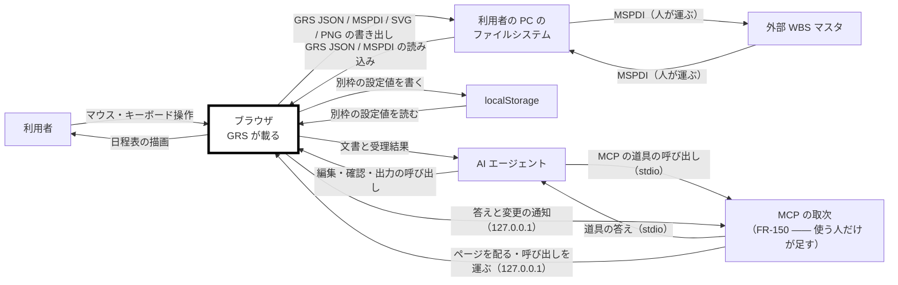

# gr-scheduler 仕様書 — 要求

**Grammar**: spec.sgra
**UID**: DOC-REQUIREMENTS
**Version**: 0.4

本書は第 1 部（Chapter 1 〜 4）である。  
仕様形式は **ANPS-part**（4 枚）。  
書き方の規則は `docs/development-rules/08-spec-template/spec-writing-rules.md`、要望の入力は `studies/user-order.md` が正である。

> **未記入の節は引用で始まる行を持つ。**  
> `grep -n "^> 未記入" docs/spec/*.md` で残りを引ける。

## Chapter 1. Foundation (基本事項)

### 1.1 Background (背景)

**Type**: SECTION

日程表は、複数の対象と複数の工程が絡む仕事で最も広く使われる図の 1 つである。  
ところが、それを描く道具は 2 つに割れている。  
作図ソフト（`PowerPoint` など）と表計算ソフト（`Excel` など）は自由に描けるが、成果物は画像であって構造を持たない。  
日程管理ソフトは構造を持つが、調査した範囲ではいずれも 1 つの行に複数のタスクやマイルストーンを置けない。

そのため「1 対象を 1 行に置き、その対象の全工程を 1 枚で俯瞰する」形式の日程表は、実際には作図ソフトで描かれている。  
描いた図は日付が動くたびに人が引き直すことになり、他の日程管理ソフトへ渡すこともできない。

**問題は道具の出来ではなく、用途の違う道具が使われていることにある。**  
現状を表 T-001 に示す。

**表 T-001 — 現状**

| 行 ID | 現状 | 何が起きるか |
| --- | --- | --- |
| PLM-1 | 日程表を作図ソフト（`PowerPoint` など）や表計算ソフト（`Excel` など）で描いている | 日付が 1 つ動くたびに、図形と線を人が引き直す。 更新が滞り、図と実態が離れる。 他の日程管理ソフトへ日程をデータとして渡せず、機械が読めない |
| PLM-2 | （欠番） | —— |
| PLM-3 | 日程管理ソフトは 1 行に 1 つのタスクしか置けない | 対象ごとの俯瞰ができない。 行数が対象数と工程数の積まで膨らむ |
| PLM-4 | 全体日程が 1 画面に収まらない | スクロールしながら記憶で繋ぐことになり、工程の前後関係を見落とす |
| PLM-5 | 操作感が重たいソフトがある | 日程を検討するあいだ待たされるので、良い日程を引くことに集中できない |
| PLM-6 | 初見者に使いづらいソフトがある | 日程の検討とは別に習熟の工数がかかり、使う人の賛同を得た導入が難しい |
| PLM-7 | ソフト自体が重く、配布が難しい場合がある | 導入と初期設定の手間が、使う人の賛同を得る妨げになる |
| PLM-8 | 日程表を画像や資料として配ると、誰がいつ持ち出したか追えない | 秘密を含む日程が外へ出たとき、出どころが辿れない |
| PLM-9 | 日程表は遅れているタスクを示すが、その遅れがどこで生まれたかは示さない | 遅れているタスクの多くは先行の遅れに巻き込まれたタスクであり、読み手は依存と WBS を自分で辿って原因を探すことになる。 実績が入力されていないタスクがあると、遅れの像そのものが歪む。 ⇒ 支援の差し向け先を誤る |

### 1.2 Challenges (課題)

**Type**: SECTION

**背景の現状を解くために何を成すかを表 T-054 に示す。**  
どこまで成せば足りるかは 1.3 の目標が持つ。

**表 T-054 — 課題**

| 行 ID | 課題 | 価値のことば | 受ける目標 |
| --- | --- | --- | --- |
| CH-1 | 作図ソフトと同じ操作感で描きながら、構造化した日程データを出す | —— | `GL-008` / `GL-004` |
| CH-2 | 縮めたときに出す情報を絞り、全体を 1 枚で俯瞰させる | **ペライチ** | `GL-001` / `GL-002` |
| CH-3 | 軽快に動かす | **ぬるサク** | `GL-003` |
| CH-4 | 説明を読まずに操作できるようにする | **すぐわか** | `GL-006` |
| CH-5 | 単一の `.html` で完結させ、特定の業種にも製品にも依存しない | —— | `GL-005` |
| CH-6 | 秘密の日程を画面に出したとき、誰がいつ出したかを絵の中に残す | —— | `GL-007` |
| CH-7 | 遅れの発生源と、数字が信用できないタスクを、読み手が判断せずに受け取れるようにする | **遅延診断** | `GL-009` |

価値のことばの語義は `_assets/tbl-glossary.md` の表 T-106 が持つ。

### 1.3 Goals (目標)

#### 1 つのタスクグループに複数のタスクを置いて俯瞰できる

**Type**: GOAL
**UID**: GL-001

**STATEMENT**: 利用者が、1 つのタスクグループに複数のタスクとマイルストーンを置き、1 つの対象の全工程を 1 つのタスクグループで見渡せる状態になること。

#### 全体日程を 1 画面で見られる

**Type**: GOAL
**UID**: GL-002

**STATEMENT**: 利用者が、プロジェクトの全体日程をスクロールせずに 1 画面で見られる状態になること。

#### 操作が引っかからない

**Type**: GOAL
**UID**: GL-003

**STATEMENT**: 利用者が、**どの操作を行っても**、操作が引っかからずに追従する状態（**ぬるサク**）になること。  
**外部の応答を待つ時間と、大量のデータを読み書きする時間はこれに含めない。**

#### 成果物が構造化データである

**Type**: GOAL
**UID**: GL-004

**STATEMENT**: 描いた日程表が、画像ではなく機械が読める構造化データとして出し入れでき、外部 WBS マスタとの間を情報を落とさずに往復できる状態になること。

#### 1 つのファイルだけで動く

**Type**: GOAL
**UID**: GL-005

**STATEMENT**: 利用者が、1 つの `.html` をブラウザで開くだけで、サーバーもインストールも無しに日程表を編集できる状態になること。

#### マニュアルを読まずに使える

**Type**: GOAL
**UID**: GL-006

**STATEMENT**: 初めて触る利用者が、マニュアルを読まずに主要な操作へ到達できる状態になること。

#### 秘密の日程を画面に出した証跡が残る

**Type**: GOAL
**UID**: GL-007

**STATEMENT**: 利用者が秘密の日程を画面に出すとき、誰がいつ出していたかが画面上に残る状態になること。

#### 描いたものを直接掴んで日程を変えられる

**Type**: GOAL
**UID**: GL-008

**STATEMENT**: 利用者が、画面に描かれたタスクとマイルストーンを直接掴んで動かすことで日程を変えられ、握っているあいだその結果が絵に出る状態になること。

#### 遅れの発生源を、掘り下げるだけで特定できる

**Type**: GOAL
**UID**: GL-009

**STATEMENT**: 基準日の時点で、遅れのうち最優先で対処すべきタスク（ボトルネック）を、折りたたんだ画面から掘り下げる操作だけで特定できる状態になること。  
数字が信用できないタスクは、それと分かる形で示されること。  
⭐ 読み手には、日程を描いた人でない者（全体を見て支援を差し向ける立場の人）と、画面を見ない AI が含まれる。  
どちらも依存と WBS を自分で辿らない。  
読み手の行動は「信用できないタスクを無くさせ、そのうえでボトルネックから支援する」の 2 手で足りること —— 読み手が数手の掘り下げで届くことが本目標の要件であり、詳しさを足す要求はこの要件で測る。

### 1.4 Approach (解決方針)

**Type**: SECTION

実装言語は TypeScript とする。  
ビルドは Vite で行い、生成した JavaScript と CSS を 1 つの `.html` へ埋め込んで出力する。  
テストは、値だけで決まる層を Vitest で、利用者の操作を通した確認と性能の計測を Playwright で行う。  
テストコードの置き場と Chapter 8 〜 10 の対応は Chapter 7 が定める。

⚠️ **Vite は型を検査しない。**  
TypeScript から型注釈を落とすだけなので、型エラーがあってもビルドは通る。  
型検査は `tsc --noEmit` として別に実行する。

描画方式と層の分け方は本章では決めない。  
Chapter 5 で決める。  
方式の理由と代償は `studies/04-performance/performance-notes-ja.md` §1 E-1 にあり、Chapter 5.1 はそれを読んだうえで決める。

**性能は骨格の段階で実測してから機能を積む。**  
骨格で 1 度測っただけでは、完成版の性能は分からない。  
Chapter 10 の非機能テストは節目ごとに再計測して結果を足す。

### 1.5 Scope (範囲)

**Type**: SECTION

本プロジェクトの範囲を表 T-002 に示す。

**表 T-002 — 範囲**

| 行 ID | 区分 | 内容 |
| --- | --- | --- |
| SO-1 | In-scope | 日程表の作成・編集・表示。 1 つのタスクグループに複数のタスクを置くこと（マルチバー）。 タスクグループの階層と折りたたみ。 異方性ズームと表示量の増減 |
| SO-2 | In-scope | 予定と実績の管理・表示。 進捗の可視化 |
| SO-3 | In-scope | タスク間の依存関係の表現と自動配線 |
| SO-4 | In-scope | 注記・強調・カーソル・透かし |
| SO-5 | In-scope | `GRS JSON` と MSPDI XML の双方向 Import / Export。 複数ファイルの合流（形式は問わない） |
| SO-6 | In-scope | SVG と PNG の出力 |
| SO-7 | In-scope | 人間向け UI と同格の `Agent API` |
| SO-8 | Out-of-scope | 資源管理（工数・割当率・稼働率）。 ただし担当の表示と割当の追加・編集・解除は行う |
| SO-9 | Out-of-scope | コスト管理・EVM・出来高管理・資源平準化 |
| SO-10 | Out-of-scope | クリティカルパス計算とスケジューラ。 日付は人が決める |
| SO-11 | Out-of-scope | カスタムフィールドの汎用機構 |
| SO-12 | Out-of-scope | サーバー通信・認証・共同編集。 **設計の余地を残す判断は `NFR-012` が持つ** |
| SO-13 | Out-of-scope | 絵文字アイコンの対応。 アイコンの外部からの取り込み |
| SO-14 | Out-of-scope | タッチ操作とモバイル表示 |

### 1.6 Constraints (制約事項)

**Type**: SECTION

破ることのできない制約を表 T-003 に示す。

**表 T-003 — 制約事項**

| 行 ID | 制約 | 内容 |
| --- | --- | --- |
| CN-1 | 単一ファイル | 成果物は 1 つの `.html` とする。 サーバーを必要とせず、ネットワークから切り離した状態で全機能が動くこと。 ⚠️ 例外 —— `FR-150`（`Agent API` を MCP の道具として呼ばせる）だけは、MCP を使う人が足す取次（表 T-007 の `DEV-6`）を要する。 取次は `.html` とは別に配り（形は 表 T-035 の `AG-12` の ①）、利用者の PC の中の `127.0.0.1` だけで待ち受けて `GRS` のページを配る（表 T-008 の `CHN-10` 〜 `CHN-14`）。 取次を足さない人の `GRS` は、1 つの `.html` だけで動く（`GL-005` を動かさない —— `FR-150` の RATIONALE） |
| CN-2 | 対応ブラウザ | Chromium 系（Chrome / Edge）を基準とする。 Firefox は動作確認に留め、Safari は対象外とする |
| CN-3 | 対応 OS | 問わない。 単一ファイルでネットワークを持たないため、OS 差は実質フォントだけである |
| CN-4 | 入力機器 | マウスとキーボードのみとする。 タッチは対象外とする |
| CN-5 | 文字コード | **書き出すものは UTF-8・BOM なしとする（MUST）。 ** JSON は RFC 8259 が BOM の付加を禁じており、MSPDI XML も同じ扱いとする。 ⚠️ **読む側の規則は本行ではない** —— 受け入れる入力の範囲は `FR-023` が持つ |
| CN-6 | 外部通信 | 実行時に外部へ通信しない。 外部から取得する資源を持たない。 ⚠️ 人が押したリンクで、閲覧環境が別の頁を新しいタブに開くことは、本行の通信に当たらない —— 開くのは閲覧環境であり、成果物は何も送らず、何も取得しない（`FR-073`）。 ⚠️ `FR-150` の取次が配ったページと、同じ PC の取次とのあいだの通信（表 T-008 の `CHN-12` 〜 `CHN-14`）も、本行の通信に当たらない —— 取次は `127.0.0.1` だけで待ち受け、ページも取次も PC の外へは何も送らず、PC の外から何も取得しない。 ページが繋げる先は、内容セキュリティ方針が同じ origin に限る（表 T-232 の `PO-7`）。 取次から先で AI のアプリが何と通信するかは、本ソフトウェアの外である（表 T-007 の `DEV-5`） |
| CN-7 | 第三者著作物 | **第三者の素材**（フォント・アイコン・画像・データ）を成果物にもリポジトリにも同梱しない。 実行時に必要な第三者ライブラリは、許諾条件を満たす帰属表示を成果物へ埋め込んだうえで同梱してよい（`FR-069`）。 例外 —— 交換相手のスキーマのうち、本ソフトウェアが実際に読み書きする要素名と列挙値は、本仕様書に引用してよい。 引用するときは出典をファイル名と行番号で書くこと（MUST）。 読み書きしないものを網羅的にコピーしてはならない（MUST NOT）。 例外 —— 交換相手のスキーマの、要素の道筋ごとの子の名と順の表（表 T-033 の `EX-10`）は、スキーマから道具で作って同梱してよい。 型・説明・列挙値は含めない |
| CN-8 | 内容セキュリティ方針 | 単一 HTML に対する内容セキュリティ方針（`CSP`）を持つ。 `img-src` は `data:` とする。 **指令の全数は 表 T-232 が持つ** |
| CN-9 | **画面とデータモデルの分離** | **画面（GUI）とデータモデルを層として分離する。 ** 層の具体は Chapter 5 が決めるが、**分離すること自体は破れない制約**とする。 **同じものを 2 つの語で呼ばない命名の規則は 1.9 が持つ** |

### 1.7 Limitations (制限事項)

**Type**: SECTION

要求を完全には満たさないが、許容すると決めた既知の妥協点を表 T-004 に示す。

**表 T-004 — 制限事項**

| 行 ID | 制限 | なぜ許容するか |
| --- | --- | --- |
| LM-1 | 透かしの除去は暗号的に防げない。 クライアント単体で動く単一 HTML であるため、DOM を直接編集すれば透かしは消せる | 目的は撮影されたときの証跡であり、弱い抑止で足りる。 強制するにはサーバー配備が要る |
| LM-2 | 「WCAG 2.1 AA 適合」とは名乗らない | 支援技術による読み上げを対象外にしたため。 条文に部分適合の概念が無く、1 つでも外せば適合とは言えない。 AA は指針として使い、**色覚とコントラスト・フォーカスの判別・文字サイズと言語・エラー表示**に絞る |
| LM-2b | **すべての操作をキーボードだけで完了することはできない**（WCAG 2.1 の 2.1.1 を適合範囲から外す） | **中核がドラッグで日程を描くことだからである**（`CN-4` はマウスとキーボード）。 バーを引く・範囲を囲う・依存線を結ぶは、いずれもポインタの連続した位置を入力とする操作であり、鍵に写しても同じ道具にならない。 **キーボードは速さの手段として残す**（`FR-070` の表 T-036）。 ⚠️ **これにより、ポインタを使えない利用者は本ツールを使えない。 ** 受け入れたうえで名乗らない |
| LM-2a | 1.4.12（行間・字間の上書き）は**参考に留め、適合範囲に数えない** | **ラベル幅を概算する方針（実測もキャッシュもしない）と両立しない。 ** 概算は文字の実寸を見ないので、読む人が字間を広げた瞬間に見積もりが外れる。 実測へ切り替えると描画のたびに計測が走り、`GL-003`（操作が引っかからない）を直接崩す。 **最優先事項を守るほうを選ぶ** |
| LM-3 | 書き出した担当を外部ツールがどう扱うかは未検証である | 実機での確認が要る。 開発を止める理由にはならないが、検証するまで断定しない |
| LM-4 | 扱える文書の大きさはブラウザのメモリに収まる範囲に限られる | サーバーもデータベースも持たない構成の帰結である。 上限に達したときは人に通知する |
| LM-5 | 往復無損失を保証するのは、1 つのファイルを合流させずに未編集で往復した場合に限る | 範囲を限定する理由は `FR-021` が持つ。 **合流の利点（`FR-056`）と引き換えに受け入れる** |
| LM-6 | **別枠で持つ設定値は、同じ機の他のローカルページからも読める** | 単一ファイルをローカルで開く形では、保管庫が機ごとに 1 つしかない。 **共有 PC では他者が読みうる。 ** 全数は `_assets/tbl-settings.md` の表 T-206 の別枠の行である |
| LM-7 | 完了率が 100 を超える値を相手のツールがどう扱うかは**未検証である** | 丸めない方針（`FR-012`）は本ツール側の決定であり、相手側の挙動は実機で確かめるまで断定しない |
| LM-8 | 書き出した SVG / PNG にも透かしが載るため、**開いた者の名前が第三者へ伝わりうる** | 透かしの目的（誰がいつ画面に出していたか）と、画像を配る用途が衝突する。 **利用者に示したうえで可否を選ばせる**（`FR-020`） |
| LM-11 | **異常終了すると、最後に保存してからの編集がすべて失われる** | 書き込むのは人が求めたときだけと決めたことの帰結である（`FR-060` ／ 表 T-036 の `SK-11`）。 ⛔ **自動保存を持てば数秒ぶんに縮むが、それを承知で持たない。 **⭐ **タブを閉じる側は `FR-100` が塞ぐ** —— 塞げないのはブラウザや OS ごと落ちたときだけである |
| LM-10 | 再取り込みの照合が成り立つ前提は、1 つの対向ツールでの実機挙動でしか確かめられていない | 特定製品で確かめた挙動を役割名で書いているので、一般論のように読めてしまう。 **接続先ごとに実機確認が要る**（表 T-032 の MG-3） |
| LM-9 | **文書を開き直したとき、取り消しの履歴は戻らない** | 履歴を文書にもファイルにも入れないと決めたことの帰結である。 入れると容量と書き込み量が跳ね上がる。 **引き継がない規則は表 T-024a の `OP-4` が持つ** |
| LM-12 | **既定の透かし解除パスワードは秘密として機能しない** | **既定値そのものが本仕様書に書いてある**（表 T-207 の `S-100`）。 成果物に埋め込まれるのは SHA-256（`S-101`）だが、既定値が公開されている以上どちらにせよ秘密として機能しない。 **透かしはアクセス制御ではなく証跡である**（`FR-020` が画面上でもそう示すことを求めている）。 **この機能が意味を持つのは将来サーバーと接続したときである** |
| LM-14 | ファイルを直接開いた状態（`file://`）では、上書き保存が働かないことがある | 単一ファイルをローカルで開く形では保存先への権限が保たれず（`FR-060`）、保管庫の読み出しを拒否するブラウザもある（`FR-038`）。 表 T-003 の `CN-1` と `NFR-004` の「全機能が動く」判定からは、上書き保存に加えて、`localStorage` を保管先とする値（表 T-206 の別枠）も除く —— 全数は表 T-206 の別枠の行、すなわち「別枠。`localStorage` に置く。」と明記した行である。  ⛔ **復帰の申し出は無い**（`FR-060`）—— 上書きの相手を覚えないと決めたので、起動ごとに一度、人が保存先を選ぶことになる。  |
| LM-15 | 表示量のしきい値を変えると、日程データの群の刻を動かさずに書き出した画像からタスクとタスクグループが消える | しきい値は見せ方の群であり（`FR-063`）、`FR-077` は可読の下限を割るときタスクグループの量を減らすと定める。 ⚠️ **`WY-1` は破れていない** —— 同じ JSON を往復させれば同じ絵に戻る。 破れるのは「同じ刻印なら同じ絵」という別の読みであり、本仕様書はそれを約束していない |
| LM-13 | **透かしはコントラストの適合範囲に数えない** | 透かしは薄く重ねると定めており（`FR-020`）、`NFR-007` の 4.5 : 1 と両立しない。 外す判断とその理由は `NFR-007` が持つ。 濃さは表 T-207 の `watermarkOpacity` |
| LM-18 | **テーマ色の明度は色相ごとに寄り、暗いテーマでは実績が予定より明るく描かれる** | ⭐ 表 T-236 の値は前プロジェクトの試作から採ったものであり、色相 214 では寄せずに 表 T-017a を満たす。 ⭐ ほかの色相は `FR-041` の 表 T-366 で明度を寄せて満たす —— 2026-10-04 に 360 の色相で測ると、寄せた後に地（`S-146`）に対して `CT-3` 〜 `CT-5` を割る色相は無い（最悪は `CT-3` の 3.01、`CT-4` の 3.00）。 ⚠️ 寄せる前は、明るいテーマで 88 の色相が `CT-3` を、131 の色相が `CT-4` を割っていた（最悪 2.49）。 比の測り方は 表 T-366 の `CF-6` である。 ⛔ 暗いテーマでは実績が予定より明るく描かれ、`FR-007` の求める向きと逆になる。 ⚠️ この限界は承知のうえで採った —— 見た目を試作に揃えることを優先し、測り直しは 表 T-026 の `RC-1` の対象として残す |
| LM-19 | 1 フレームの予算を満たしていない。 ⭐ ほかの不具合が無くなるまで、いまの値を是とする —— **フレーム時間の実測は中央値 16.67 ミリ秒、95 パーセンタイル 24.4 ミリ秒であり、上限は 16.7 ミリ秒である**（`NFR-002` の平均 60fps と `NFR-003` の p95、第 7 章の合否では 表 T-043 の `PG-2` / `PG-3` / `PG-8` / `PG-10` / `PG-12` が外側）。 フレーム時間は届いたフレームとフレームの間隔であり（`05-07-design.md` の 表 T-043 の前文）、95 パーセンタイルが上限を超えているので満たしていない。 測り方は出荷ビルド（コミット `5c1b915`）、Edge 153.0.4234.32、1920 × 1080、`Task` 1000 件、表 T-025 の `MC-8` の区間 4 つで 240 フレームずつ間隔を測った 960 個、2026-09-14 である。 道具は `tools/probe/examples/lm-19-frame-time-baseline.mjs`、生の数は `docs/development-records/measurements/frame-time-stage0-2026-09-14.json`、要約は `docs/development-records/history/refactor-plan-report-2026-09-13.md` の 16 節が持つ。 ⚠️ 構えているあいだのドラフトを描くので、マイルストーンの道で 240 フレーム中 3 枚が予算を超える（ドラフトを描かなければ 0 枚。 中央値の差は機械のばらつきに埋もれる） | ⭐ ほかの不具合を無くすことを性能の改善より先に置き、それまではいまの性能を是とする。 ⛔ **`NFR-002` / `NFR-003` の条項は下げない** —— 満たしていないことを本行が記す。 ⛔ 条項を実測に合わせて書き換えてはならない（`RISK-001` が名指す関門であり）。 ⛔ **この期間、性能の最適化を進めない** —— **ほかの不具合を先に無くす**。 ⭐ **耐えられなくなったら再検討する。 **⭐ **行き先は測り分けてある** —— ⚠️ 次の数は参考であり、フレーム時間ではない —— `tools/probe/examples/frame-attribution.mjs` の trace で、描き直しの呼び出しの中の仕事を割ったものである。 `showSvg` の書き込みと解析が 3.12 ミリ秒、1,376 要素を丸ごと差し替えたことに続く style / layout / paint が 6.11 ミリ秒で、合わせて 9.2 ミリ秒は絵の受け渡しが文字列であること（`05-07-design.md` の 表 T-065 の `IF-1`）から来る。 ⇒ 残りを全部取り返しても届かないので、直すなら継ぎ目そのものを変えることになり、それは別の判断である |
| LM-16 | **同じ語を名乗る呼び手どうしは見分けられず、互いの書き込みで起きない** | 書き手は 1 つの文字列であり（表 T-229 の `ED-2`）、`AG-6` はその等値だけで「自分以外か」を判定する。 **語が重なった 2 体は、互いの書き込みを自分のものと読む。 ** ⭐ **画面と起動テンプレートについては起きない** —— 同表がその 2 語を予約している。 ⚠️ 閉じるには監視の継ぎ目に書き手の識別を別で持たせることになり、それは別の判断である ⚠️ 同じ語で監視を購読できるのも 1 体だけである —— 後から購読した呼び手が先の購読を置き換え（表 T-035 の `AG-6`）、先の呼び手は知らされないまま監視を失う |
| LM-20 | 明るいテーマでは、非稼働日の塗り（`FR-054` の 表 T-343）の上で、カーソル（`_assets/tbl-settings.md` の `S-195`）とイナズマ線（`S-160`）が `NFR-007` の 3 : 1 を割る | 利用者が触れる見本を見て、割ることを知ったうえで塗りの濃さを選んだ。 ⭐ カーソルは塗りが無くてもタスクグループの帯の上で 3.01 : 1 しかなく、どの灰色を重ねても割る。 測った最悪は、タスクグループの帯（`S-164`）の上でカーソル 2.64 : 1、イナズマ線 2.88 : 1（塗りの無い帯の上では 3.01 : 1 と 3.29 : 1）である。 測り方は、表 T-236 の色（`S-195` 明 `#f500f5`、`S-160` 明 `#d66400`）と、表 T-236 の式に 表 T-305 の 10 色相を入れた地を sRGB へ換算し、`S-450` を重ねた地との WCAG 2.1 の比の最悪を取った（`studies/24-pause-glyph-and-weekend-shade/weekend-shade-sample.html`）。 ⭐ 線は塗らない列を通って続くので、線そのものを見失うことはない |
| LM-21 | 予定の塗りは、タスクグループの地（`_assets/tbl-settings.md` の `S-166`・`S-167`）とタスクグループの帯（`S-164` と 表 T-294 のタスクグループの帯）の上では、表 T-017a の `CT-5` の 1.3 : 1 に届かないことがある —— 暗いテーマで、塗りがタスクグループに溶けて帯として読みにくい | ⭐ 利用者が、`CT-5` の床を地（`S-146`）に対してだけ掛け、タスクグループの上で溶けることを既知の限界とすると定めた。 ⭐ 測った最小（2026-10-04、`FR-041` の 表 T-366 で寄せた後、360 の色相）: テーマの予定の塗り ÷ タスクグループの地は、暗いテーマで `S-166` の上 1.22、`S-167` の上 1.39、明るいテーマで `S-166` の上 1.29、`S-167` の上 1.33。 パレット色の暗いテーマの塗り ÷ タスクグループの地は、赤 1.01、紫 1.00、青 1.05、薄い灰色 1.12、オレンジ 1.18、緑 1.37、黄 1.39（2026-09-22 の測り）。 ⚠️ 満たすには塗りを明るい側へ大きく寄せる要があり、見た目が変わる。 |
| LM-22 | 予定の端を文書の暦の非稼働日に置いたタスクに限り、書き出す `PercentComplete` は `ActualDuration ÷ Duration` と一致しない —— `FR-011` と `FR-012` は端の日を非稼働日でも 1 日と数え、交換相手へ書く `Duration`（`_assets/fig-erd-detail.md` の `DV-8`）は非稼働日を数えない | 利用者が、端を非稼働日に置いても `GRS` は問わず、文書の暦も変えないと定めた —— 置くたびに問うと手が止まる。 休日に働くとき、その日を稼働日にするかは利用者が決め、暦の編集面（`FR-088` の 表 T-344）で変える —— 変えればその日が `Duration` の数えに入り、ずれは消える。 ⚠️ 端を稼働日へ寄せて揃えることはしない（`FR-103` の結び） |
| LM-23 | 依存線の続きの印（`FR-009` の 表 T-303 の `EL-9`）の 3 つの点のうち、印を描ける場所（`Task Group Area` —— ピン止めしたタスクグループ（`FR-098`）があるときは帯の下の残り）の外に出る点は、描かれず、押しても応えない —— 描かれた最上段のタスクグループから上へ向かう線と、帯のすぐ下のタスクグループから帯の側へ向かう線で起きる | ⭐ 利用者が、触れる見本（`studies/44-continuation-mark-at-the-edge/`）で、押せる範囲だけ広げる・横へ折り返す・上向きのまま縮めるの 3 つの描き方と見比べたうえで、今のままを既知の限界とすると定めた。 ⭐ `EL-7` の「上に折れてすぐ」は変えない。 測った数（2026-10-08、縦の倍率 1）: 格納したタスクグループを木の頭に置き、その下の描かれた最上段のタスクグループのタスクから格納したタスクグループのタスクへ FS を結ぶと（`EL-20`）、`Task Group Area` の上端 99.125 に対して点の中心の縦の位置は 99.19・95.19・91.19 であり、2 つの点の中心が上端より上に在る。 縦の倍率 0.6 でも同じで、2 では 3 つとも中に在る。 測り方は `change-request/CR-703-two-known-limitations-the-mark-at-the-edge-and-ct-4.md` の 7 節である |
| LM-24 | 予定の輪郭線（`_assets/tbl-settings.md` の `S-156`）は、明るいテーマで、タスクグループの地（`S-166`・`S-167`）とタスクグループの帯（`S-164`）の上では、表 T-017a の `CT-4` の 3 : 1 をわずかに割ることがある | ⭐ 利用者が、`CT-4` を地（`S-146`）に対してだけ解き、タスクグループの地の上でわずかに割ることを既知の限界とすると定めた —— もう一方の択は、寄せを強めることであった。 ⭐ 測った数（2026-10-08、`FR-041` の 表 T-366 で寄せた後、360 の色相、比の測り方は `CF-6`）: 明るいテーマで、`S-156` ÷ `S-166` は 80 の色相が 3 : 1 を割り、最悪は色相 123 の 2.84 である。 表 T-305 の色相では、`TH-4`（95）が 2.92、`TH-5`（50）が 2.99 である。 `S-156` ÷ `S-167` は 23 の色相が割り、最悪は 2.94 である（表 T-305 の色相では割らない）。 `S-156` ÷ `S-164` は 110 の色相が割り、最悪は 2.80 である。 暗いテーマではどれも割らない（最悪は `S-164` の上の 4.10）。 ⚠️ 満たすには輪郭線を暗い側へさらに寄せる要があり、見た目が変わる |

### 1.8 Glossary (用語集)

**Type**: SECTION

確定名の全数は `_assets/tbl-glossary.md`（`DOC-TBL-GLOSSARY`）が持つ。  
本書と合わせて、そこが用語の正である。  
表 T-101 〜 T-106・表 T-109 と 図 F-019 からなる。  
表 T-107 は `_assets/tbl-agent-api-members.md` が、表 T-108 は `_assets/tbl-document-commands.md` が持つ。  
**他所で違う名前を見たら、あちらが勝つ。**

辞書を開かずに本書の散文を読むための語だけを表 T-005 に示す。  
表 T-005 は辞書からの抜粋であり、正ではない。  
食い違ったら辞書が勝つ。

**表 T-005 — 本書を読むための語**

| 行 ID | 語 | 意味 |
| --- | --- | --- |
| G-1 | `Task` | 日程要素。 バーもマイルストーンも `Task` である。 マイルストーンかどうかは `Task.milestone`（真偽値）が持ち、これを交換相手へ書き出す。 どう描くかは `TaskVisual.shapeKind` が持ち、書き出さない。  2 つは別の概念であり、**形を変えても `Task.milestone` は変わらない** |
| G-2 | `TaskGroup` | `Task` が載る器。 入れ子で階層になる（**深さの上限は `FR-004` が持つ**）。 画面に描いたものはタスクグループ（`Task Groups`）。 ⚠️ **WBS の深さはこれと別物で、上限を持たない** |
| G-3 | `TaskGroupMember` | どの `Task` がどの `TaskGroup` に載るかの対応 |
| G-4 | 積み順 | 1 つの `TaskGroup` の中で縦に積む順。 **決めるのは表 T-014 の `ST-2` の自動割当だけであり、文書は段を持たない**（人は指定できない —— `ST-6`） |
| G-5 | マルチバー | 1 つのタスクグループに複数の `Task` が載っている状態。 `TaskGroup` と `TaskGroupMember` がその実体である |
| G-6 | WBS | 親タスクと子タスクの木。 `Task.parentTaskUid` が持つ。 MSPDI へ書き出す |
| G-7 | 外部 WBS マスタ | 本ソフトウェアの外側で WBS を持ち、MSPDI を生成・再取り込みする対向ツール。 特定の製品を指す語ではない |
| G-8 | MSPDI | 外部 WBS マスタとの交換に用いる XML 形式。 事実の正は公式スキーマ（XSD）である |
| G-9 | 予定 / 実績 | 同じ 1 つの `Task` が両方を持つ。 別の `Task` にも別のタスクグループにもしない |
| G-10 | `Progress Status Mark`（進捗マーカー） | 実績バーの右端の外側に出る、状態を変える入口。 形が意味を担う |
| G-11 | `Progress Line`（イナズマ線） | 遅れの分布を 1 本の折れ線で示す重ね描き。 ボトルネックの可視化に使う |
| G-12 | LOD | ズームに応じて描く要素を増減させる仕組み。 **2 つある**（時間軸 LOD / グループ LOD）。 表 T-005a で言い分ける |
| G-13 | Carry | 取り込んだ MSPDI の項目を、そのまま持ち回って書き戻す仕組み。 対象は、**本ソフトウェアが使わない項目**と、**算出で置き換えうるが原値を保つ項目**（`ActualDuration`）である。 後者の規則は表 T-019 の注記が持つ |
| G-14 | `GRS JSON` | 本ソフトウェア自身の文書形式（JSON）。 単独で `JSON` と書いたらこれを指す。 交換相手のものは必ず `MSPDI` と書く。 ⚠️ 1 つの文書を指すときは「`GRS JSON`」ではなく「JSON」と書いてよい —— 形式の名であってファイルの名ではない |

LOD は 2 つある。  
混ぜて書いてはならない（MUST NOT）。  
内訳を表 T-005a に示す。  
⚠️ 形状の幅が狭いことを理由に `Task` を描かないでおく LOD は無い —— 幅の狭い `Task` も最小の幅で描く（`FR-018`）。

**表 T-005a — LOD の 2 種**

| 行 ID | 名前 | 何を増減するか | 駆動 |
| --- | --- | --- | --- |
| L-1 | 時間軸 LOD | `Time Ruler` の粒度（年 → 年 ＋ 月 → 年 ＋ 月 ＋ 週 → 年 ＋ 月 ＋ 日 ＋ 曜日） | 横（`zoomX`） |
| L-3 | グループ LOD | 深い **`TaskGroup`** を描かない | 縦（`zoomY`）＝ 高さ |

### 1.9 Notation (表記規約)

**Type**: SECTION

本書は RFC 2119 / RFC 8174 に従う。  
SHALL / MUST は必須、SHOULD は推奨、MAY は任意を表す。  
規範語として扱うのは大文字で書かれた場合に限る。

**例外:** EARS 構文中の小文字 `shall` は、本書では大文字の SHALL と同じ拘束力を持つものとする。

本書の書き方は、冒頭が名指す `spec-writing-rules.md` に従う。  
同書が EARS の構文、文体、要求の粒度、席番号、表と図の参照、規則と理由の置き場を持つ。  
**ここにはコピーしない。**

**図:** 大きな図を外へ出す判定の閾値を同書から変えた場合はここに記す。

**`[System]` の定義。**  
EARS の `[System]` は `GRS`（`GoodRelax Scheduler`。  
名前の正は `_assets/tbl-glossary.md` の `U-45`） であり、**Chapter 2.2 で「対象ソフトが載る」と記した機器の上で動く。**

⚠️ 本規約は名前と値についての規約（「名前と値を 2 か所で管理しない」）の続きである。  
名前の正は `_assets/tbl-glossary.md`、値の正は `_assets/tbl-settings.md`、**規則と理由の正は要求**である。

**命名の規約。**

**モデルの語彙に一本化する（MUST）。**  
UI の名前とデータの名前が食い違ったら、**UI の名前を変える**。  
同じものを画面側とデータ側で別の語で呼ぶと、不具合が止まらなくなる。  
1 つの概念には 1 つの語しか与えない。  
`type` `data` `info` `value` のような無意味な汎用語を使ってはならない（MUST NOT）。

面ごとの記法を表 T-006a に示す。  
同じ概念でも面が違えば記法が違う。  
矛盾ではない。  
ただし語幹は必ず一致させること（MUST） —— `taskGroupId` ↔ `group_id` は正しく、`rowId` ↔ `group_id` は禁止である。

**同表が縛るのは、本仕様書が定めるソフトウェアの中の名前である（MUST）** —— `src/` のコードと、本ソフトウェアが読み書きする鍵（`GRS JSON` と、交換相手に由来して `W-8` が記法を与えるもの）である。  
⚠️ **本仕様書を組み立てる道具は同表の対象外とする** —— `_source/` の原稿と生成器、および検査のスクリプトである。  
**それらは成果物ではなく、本書を作るための足場だからである。**

**表の行 ID の接頭辞の正は `_assets/tbl-row-id-prefixes.md` が持つ。**  
同書が接頭辞ごとに、元の語と、何を指すかと、持ち主の木と、定義する表と、行数を持つ。  
**ここにはコピーしない。**

**表 T-006a — 面ごとの記法**

| 行 ID | 面 | 記法 | 例 |
| --- | --- | --- | --- |
| W-1 | 型・クラス | PascalCase | `TaskGroup` |
| W-2 | 関数・変数・JSON プロパティ | camelCase | `taskGroupId` |
| W-3 | 定数 | SCREAMING_SNAKE_CASE | `MAX_GROUP_DEPTH` |
| W-4 | 文字列判別値・`data-role`・CSS クラス | 文字列判別値は camelCase（`W-2` と同じ記法 —— 命令の種類は命令の名そのものである）。 `data-role`・CSS クラスは kebab-case。 ⚠️ ただし UI パーツの確定名を運ぶ `data-role` は `W-6` の形とする —— 表 T-103 の名をそのまま書く。 訳すと同じものに 2 つ目の綴りができる。 ⚠️ 名を運ぶ要素の箱は、その UI パーツの範囲と同じとは限らない —— `Schedule Canvas` の要素はウィンドウ全体を覆う描画の層であり、範囲は `App Header` の下の縁から始まる（`_assets/tbl-glossary.md` の `U-32`） | `temporarilyExpanded` ／ `toggle-plan` ／ `Schedule Canvas` |
| W-5 | i18n キー | snake_case | `group_id` |
| W-6 | UI パーツ（散文で指すとき） | PascalCase の複合語（空白あり） | `Task Group Panel` |
| W-7 | データの属性（散文で指すとき） | `Entity.field` 形式 | `TaskGroupMember.taskGroupId` |
| W-8 | 交換相手に由来する列 | **語幹は相手のまま、記法は `W-2` に従う** | `StatusDate` → `statusDate` |
| W-9 | `carry` / `carryElements` の中身 | **相手の綴りをそのまま保つ** | `Cost` / `SaveVersion` |
| W-10 | 真偽値 | 本ソフトウェア固有のものは `is` / `has` / `can` で始める。 交換相手に由来するものは語幹を変えない | `isPlanVisible` / `milestone` |
| W-11 | ファイル名・ディレクトリ名 | kebab-case（`W-4` と同じ記法）。 語幹は中身の型名・層名と一致する | `ScheduleLayout` → `schedule-layout.ts` ／ `UseCase` → `use-case/` |

`GRS` は、表 T-103 にも表 T-109 にも行を持たない要素の DOM の印を、仮に決めた形で扱う（仮: OPQ-8）。

⛔ **プロパティパネルの項目名の英語の綴りは `W-2` に従うこと（MUST）**。  
⭐ **項目名は画面の言語に従う（`FR-038`、表 T-016 の前文）**。  
⛔ **ここに書き写してはならない（MUST NOT）**⛔ 同じ面が文書の設定を出すときも、これに従うこと（MUST）。  
内部の綴りや識別子をそのまま出してはならない（MUST NOT）。  
`FR-038` の辞書が 表 T-016 と同じ行 ID で持つ、画面の言語の綴りが画面に出る。  
⛔ 項目名を `W-5` の snake_case で綴らない —— その綴りはデータモデルの列名でもあり、`W-2` が JSON のプロパティを camelCase と定めるため両立しない。  
⭐ **`W-5` は i18n キーだけを受け持つ。**

> `W-8` で相手の名前が禁止語（`type` `data` `info` `value`）になるときは、意味を足した複合語にすること（MUST）。  
> 交換相手には `Type` という名の要素が複数あり、そのままコピーすると何の種別かが読めなくなる。
>
> 交換相手の綴りが現れてよいのは `carry` と `carryElements` の内側だけである（MUST）。  
> 本ソフトウェアが解釈する列に相手の綴りを混ぜてはならない（MUST NOT） —— 混ぜると、どこまでを本ソフトウェアが理解しているのかが読めなくなる。

**大文字の略語を識別子に入れてはならない（MUST NOT）。**  
camelCase に落ちた瞬間に意味が消えるためである。  
`LOD` は識別子では `LevelOfDetail` と全部書く（`Lod` は無意味な語になる）。  
裸の `H` / `W` も同じで、`Height` / `Width` と書く。  
**散文では `LOD` と書いてよい**（大文字なら読める）。

接続語は意味で使い分ける。  
`Of` は比率（X ÷ Y）に限ること（MUST）。  
変換と導出は `From`、引き当ては `By` を使うこと（MUST） —— `Of` を変換にも使うと、`actualOfPlan`（実績 ÷ 予定）と同じ形が別の意味を持つ。  
例 —— `jsonFromDocument`（変換）／ `taskByUid`（引き当て）／ `fontOfActual`（比率）。

> ⚠️ `LevelOfDetail` は略語を展開した綴りであり、接続語の `Of` ではない（すぐ上の規則が `LOD` を全部書くよう定めている）。
>
> ⚠️ `Of` の直後にドットが来る形は、比の値を鍵で引く連想であり、接続語の `Of` ではない —— `_assets/tbl-glossary.md` の表 T-104 の `K-13` 〜 `K-17`（`shapeHeightOf.<形状>`）がこれである。  
> **比率の名は 1 つもドットを持たないので、形で見分けられる。**

**概念に記号のラベルを与えてはならない（MUST NOT）。**  
比較しているあいだの一時的な番号（案 A / 案 B）と比較表の行ラベルは許すが、**決着したあとの散文では中身の名前で呼ぶ**。  
却下案も同じである。  
判定は 1 つ —— **その記号を知らない者が、その 1 文だけを読んで意味が取れるか。**  
取れないなら記号ではなく中身で呼ぶ。

**曖昧な日本語を単独で使ってはならない（MUST NOT）。**  
同じ日本語が複数の概念を指す語がある。  
単独で書いたら誤りとする。  
全数を表 T-006b に示す。  
⭐ **本表が縛るのは本仕様書の散文である**（1.9 の表記規約）。  
⛔ **画面に刷る語は対象外とする** —— あちらの正は `FR-038` が定める言語ごとの辞書であり、画面では併記しようのない語がある。  
⚠️ **`A-17` だけは複合語であっても使ってはならない。**  
併記では曖昧さが解けないためである（理由は同行が持つ）。

**表 T-006b — 単独で使ってはならない日本語**

| 行 ID | 語 | 書き方 |
| --- | --- | --- |
| A-1 | 段 | **8 義ある。 ** ①積み順 ②WBS の深さ ③タスクグループ（`TaskGroup`）の深さ ④ズームのノッチ ⑤目盛の帯の中の段（`rulerHeightPx` の内訳）⑥取り消しの 1 段（`FR-031`）**⑦文字サイズの段（`fontSizeStep` の S / M / L）**。 ⑧線だけの形（表 T-012 の `SH-3` / `SH-4`）の縦の段（`FR-109` の 表 T-271）。 必ずどれかを併記する。 「N 段」と単独で書かない |
| A-3 | レベル | `OutlineLevel` / タスクグループの深さ / LOD のどれかを明示する |
| A-4 | 深さ | WBS（親タスクと子タスクの木）かタスクグループかを必ず併記する |
| A-5 | マーカー | 単独で書いたら `Progress Status Mark` を指す。 期限の印は「期限の印」（`deadline`）、マイルストーンの図形は「マイルストーン形状（`milestoneGlyph`）」と書く。 「マーク」とも書かない |
| A-6 | 進捗 | **3 つが別物。 ** `Progress Status Mark`（状態の記号）／ `Progress Line`（イナズマ線）／ 完了率（`percentComplete`）。 ラベルを指すなら「完了率ラベル」 |
| A-7 | ベースライン | **2 義ある。 ** ①変更前の予定（`isBaselineVisible`）②文字のベースライン（`labelBaseline`）。 前者は「変更前の予定」と書く |
| A-8 | キャンバス | `Schedule Canvas`（UI 領域）／ 出力サイズ（`exportCanvas`）／ 余白（`canvasPadding`）を区別する |
| A-9 | 基準線 | 変更前の予定の訳語に限る。 性能の実測値は「基準値」と書く |
| A-10 | 太さ | 英語は用途で分かれる。 `Width` は寸法（幅）に使い、太さには使わない。 日本語で「幅」と「太さ」を取り違えない |
| A-11 | 幅 | 「日付の幅」と「占有幅」（ラベル込み）を区別する |
| A-12 | 期間 | 「予定の期間」／ 実績期間（`actualDuration`）／ 表示期間 を明示する |
| A-13 | 端点 | 単独で書いたら**バーの端の掴み点**（全形状が持つ）。 形状名は必ず「ダンベル」と 4 文字で書く。 ⚠️ フェードの掴み点（`FR-104` の 表 T-266 の `GA-7` / `GA-8`）は別物なので「フェードの掴み点」と書く |
| A-14 | バー | `Task Bars`（総称）／ `Plan Bar` ／ `Actual Bar` のどれかを明示する。 形状の 1 値は矩形（`rectangle`）であって「バー」ではない |
| A-15 | カーソル | 単独で書いたら `Cursor`（日付を指す線の総称）を指す。 マウスが指す点は必ず「ポインタ」と書く |
| A-16 | 頂点 | 単独で書いたら `Progress Line Vertex`（イナズマ線の頂点）を指す。 描くものの座標点は `ScheduleGeometry` が持つものであり、「描くものの頂点」と書く |
| A-17 | 部品 | ⚠️ 複合語であっても使ってはならない（MUST NOT）。 本表で唯一、単独か否かを問わない行である。  名指しできる語が 4 つあるので、どれかを書く —— **構造の単位**なら「コンポーネント」「モジュール」「ユニット」のどれか（定義と入れ子は Chapter 5.3 の表 T-074。 ⚠️ **本設計にモジュールは 0 である**）、**画面の要素**なら「UI パーツ」（記法は `W-6`）。 ⚠️ **出典の語を引くときは出典の語のままとする** —— 引用を本仕様書の確定名に置き替えると、出典が意味する範囲と表 T-103 の全数がずれる。 ⚠️ **本行のように禁止語として名指しする箇所は対象外である** |

**文中で属性に触れるときは所属を付ける（MUST）** —— `taskGroupId` ではなく `TaskGroupMember.taskGroupId` と書く。  
表 T-006a により、形で面が見分けられる。

**条件の列と結論の列で組んだ表（決定表）は、条件の取りうる値をすべて覆い、かつ 2 行が同じ条件の組で重ならないように書くこと（MUST）。**  
条件の列の「—」と「（問わない）」は、その列のどの値でも当たることを表す略記とすること（MUST） —— 略記を開いて読んだとき、条件のどの組にもちょうど 1 行が当たること。  
⭐ 開いた先に隙間が残れば、その組で何が起きるかを仕様が決めていないことになり、重なりが残れば、同じ組に 2 つの結論が立つ。

### 1.10 Direct Manipulation Principles (直接操作の原則)

**Type**: SECTION

形を直接掴んで動かす振る舞いが、なぜその形に決まっているのかを表 T-274 に示す。  
⛔ 本節は理由だけを持ち、規則は持たない —— 規則は `FR-104` 〜 `FR-110` が持つ。  
⚠️ 本節の「直接操作の原則」は、`V-13a` が指す「作り方の原則」（進め方の原則）とは別のものである。

**表 T-274 — 直接操作の原則**

| 行 ID | 原則 | 仕様が言う理由 | 覆う行 |
| --- | --- | --- | --- |
| PP-1 | どれも指せる | どの形も、ズームのどの段でも、それだけが応える領域を持つ。 縮めた画面こそ日程を動かす画面だからである | `GA-1` ／ `GA-2` ／ `GA-3` ／ `GA-4` ／ `GA-5` ／ `GA-6` ／ `GA-7` ／ `GA-8` ／ `GA-9` ／ `GA-10` ／ `GA-11` ／ `GA-12` ／ `GA-13` ／ `GA-14` ／ `GA-15` ／ `GA-16` ／ `GA-17` ／ `GA-18` ／ `GA-19` ／ `GA-20` ／ `GA-21` ／ `GA-22` ／ `GA-24` ／ `HT-1` ／ `HT-2` ／ `HT-3` ／ `HT-4` ／ `TY-1` ／ `TY-2` ／ `TY-3` ／ `TY-4` ／ `TY-5` ／ `TY-6` ／ `TY-7` ／ `TY-8` ／ `TY-9` ／ `XS-1` ／ `XS-2` ／ `XS-3` ／ `XS-4` ／ `XS-5` ／ `XS-6` ／ `XS-7` ／ `XS-8` ／ `XS-9` ／ `XS-10` ／ `XS-12` |
| PP-2 | 実績は事実 | 実績は起きたことの記録である。 軽い操作のついでに変わってはならず、変えるのは実績の端を掴む意図した操作に限る | `PE-1` ／ `PE-3` ／ `PE-6` ／ `PE-7` ／ `PE-8` ／ `PE-10` |
| PP-3 | 見えないものは掴めない | 画面に無いものが指の下で動けば、利用者は原因を知りようがない | `RF-3` |
| PP-4 | 被らせない | 中心線を共有する形は札を横へ逃がし、段で分かれた形は札を動かさない。 札は線より手前に描く | `LP-1` ／ `LP-2` ／ `LP-3` ／ `LP-4` ／ `LP-5` ／ `LP-6` ／ `LP-7` ／ `LP-8` ／ `ZO-5` |
| PP-5 | ダミーはまだ始まっていない実績 | ダミーに独自の規則を持たせない。 規則の数が減る | `RF-1` |
| PP-6 | ポインタの形で、何を掴むかが分かる | 押す前に結果が分かるようにするためである。 理由の全文は `FR-106` の RATIONALE が持つ | `PK-1` ／ `PK-3` ／ `PK-4` ／ `PK-5` ／ `PK-7` ／ `PK-8` ／ `PK-9` ／ `PK-10` ／ `PK-11` ／ `PK-12` ／ `PK-13` ／ `PK-14` ／ `PK-15` ／ `PK-16` ／ `PK-17` ／ `PK-18` |
| PP-7 | 描く前後は 1 つの表で決める | 前後の決まりを 1 か所に集めるためである。 理由の全文は `FR-110` の RATIONALE が持つ | `ZO-1` ／ `ZO-1a` ／ `ZO-2` ／ `ZO-3` ／ `ZO-4` ／ `ZO-6` ／ `ZO-7` ／ `ZO-8` ／ `ZO-9` ／ `ZO-10` ／ `ZO-11` ／ `ZO-12` ／ `ZO-13` ／ `ZO-14` ／ `ZO-15` ／ `ZO-16` |

⭐ 本表のどの行も覆わない行は `PE-0`・`PE-11`・`PE-12`・`PE-13` であり、それぞれの理由は宿主の要求の RATIONALE が持つ —— `PE-0` は `FR-105`、`PE-11` は `FR-075`、`PE-12` は `FR-049`、`PE-13` は `FR-044` である。  
⛔ 本表の「覆う行」の欄にも上の段にも名の無い行を、表 T-266 ／ 表 T-267 ／ 表 T-268 ／ 表 T-269 ／ 表 T-270 ／ 表 T-271 ／ 表 T-272 ／ 表 T-273 ／ 表 T-020 へ足してはならない（MUST NOT）。

## Chapter 2. System Overview (システム概要)

### 2.1 Overview Diagram (概要図)

**Type**: SECTION

本ソフトウェアの名称と略称は `_assets/tbl-glossary.md` の `U-45` が持つ。  
以降 EARS の主語はすべてその略称である（1.9 の `[System]` の定義）。

構成の概要を図 F-001 に示す。  
対象ソフトが載る機器を太枠で示す。  
色は使わない。  
線のラベルには何が流れるかを書く。

**図 F-001 — 構成の概要**

**外部 WBS マスタとの間にネットワークの線は無い。**  
ファイルを人が運ぶ。  
これは制約 CN-1 と CN-6 の帰結である。

### 2.2 Devices (機器)

**Type**: SECTION

構成する機器を表 T-007 に示す。

**表 T-007 — 機器**

| 行 ID | 機器 | 種別 | 対象ソフトが載るか | 供給元 | こちらで変えられるか |
| --- | --- | --- | --- | --- | --- |
| DEV-1 | 利用者の PC のブラウザ | Chromium 系 Web ブラウザ | **載る** | 既存 | 変えられない |
| DEV-2 | 利用者の PC のファイルシステム | ローカル記憶 | 載らない | 既存 | 変えられない |
| DEV-3 | ブラウザの localStorage | ブラウザ内蔵の記憶 | 載らない | 既存 | 変えられない |
| DEV-4 | 外部 WBS マスタが動く環境 | 対向ツール | 載らない | 既存 | 変えられない |
| DEV-5 | AI エージェントの実行環境 | 自動化の主体。 利用者の PC 上で動く | 載らない | 既存 | 変えられない |
| DEV-6 | MCP の取次の実行環境 | JavaScript の実行環境。 利用者の PC 上で動き、AI のアプリが持つものか、取次をインストールした人がコマンド行に用意したものである（表 T-035 の `AG-12` の ①） | 載らない。 **`FR-150` の取次が載る** —— 取次は EARS の主語ではなく、振る舞いは 表 T-035 の `AG-12` が持ち、`FR-150` が `GRS` にそれを守らせる | 既存 | 変えられない |

> **EARS の `[System]` は `GRS` である** —— DEV-1 の上で動く単一 `.html` の本ソフトウェアを指す。
> 以降の要求で主語となるのはこれだけである。  
> DEV-2 から DEV-5 は本ソフトウェアの外側にあり、
> **こちらで挙動を変えられない**。  
> それらに対する要求を書いてはならない（MUST NOT）。

### 2.3 Routes (経路)

**Type**: SECTION

機器の間を流れるものを表 T-008 に示す。

**表 T-008 — 経路**

| 行 ID | from | to | 運ぶもの | 方式 | 入力として信頼できるか |
| --- | --- | --- | --- | --- | --- |
| CHN-1 | DEV-2 | DEV-1 | `GRS JSON` / MSPDI XML / 単一 `.html` | ファイル選択またはドラッグ＆ドロップ | **信頼できない** |
| CHN-2 | DEV-1 | DEV-2 | `GRS JSON` / MSPDI XML / 単一 `.html` / SVG / PNG / `GRS JSON` のスキーマ（表 T-024 の `IO-10`） | ダウンロード | 該当なし（送信のみ） |
| CHN-3 | DEV-3 | DEV-1 | 別枠で持つ設定値（`_assets/tbl-settings.md` の表 T-206 の別枠）| Web Storage の読み出し | **信頼できない** |
| CHN-4 | DEV-1 | DEV-3 | 同上 | Web Storage の書き込み | 該当なし（送信のみ） |
| CHN-5 | DEV-5 | DEV-1 | 編集・確認・出力の指示 | 単一 `.html` が公開する関数の呼び出し | **信頼できない** |
| CHN-6 | DEV-1 | DEV-5 | 文書と受理結果 | 同上の戻り値 | 該当なし（送信のみ） |
| CHN-7 | DEV-4 | DEV-2 | MSPDI XML | 人が運ぶ（共有フォルダ・メール等） | 該当なし（本ソフトウェアの外） |
| CHN-9 | DEV-1 | OS のクリップボード（機器ではない。 経路の相手として書く） | 画像、日程の画像をデータ化するプロンプト（`FR-068`）、および操作と描画の記録（`FR-102`） | 書き出し（`FR-033` / 表 T-024 の IO-6） | **送信のみ・読まない**（検証の対象にならない）。 ⚠️ 出て行く経路なので `LM-8`（透かしに載る名前が第三者へ伝わりうる）はここにも効く |
| CHN-8 | DEV-2 | DEV-4 | MSPDI XML | 同上 | 該当なし（本ソフトウェアの外） |
| CHN-10 | DEV-5 | DEV-6 | 道具の呼び出し（表 T-107 のメンバの名と引数） | MCP の stdio —— 取次の標準入力であり、ネットワークを通らない（`_assets/design-mcp-relay.md` の 3.1） | 該当なし —— 取次は中身を検めずに `CHN-13` へ運ぶ（表 T-035 の `AG-12` の結び） |
| CHN-11 | DEV-6 | DEV-5 | 道具の答え（`CHN-14` で届いた答えと、ページが繋がっていないときの拒否の値） | MCP の stdio —— 取次の標準出力 | 該当なし（送信のみ） |
| CHN-12 | DEV-6 | DEV-1 | `GRS` のページ（同じ版で作った単一 `.html` のバイト列） | HTTP —— 取次が `127.0.0.1` だけで待ち受けるので、ほかの機器からは繋げない（表 T-035 の `AG-12` の ①） | 該当なし —— 運ぶのは `GRS` そのものであり、文書は運ばない |
| CHN-13 | DEV-6 | DEV-1 | 編集・確認・出力の指示（`CHN-10` で届いた呼び出し） | WebSocket —— `CHN-12` で配ったページと同じ origin（表 T-035 の `AG-12` の ① ⑦、表 T-232 の `PO-7`） | **信頼できない** —— `CHN-5` と同じ `Agent API` への入力であり、同じ検証を通る（表 T-035 の `AG-5`） |
| CHN-14 | DEV-1 | DEV-6 | 起動ごとの鍵、`CHN-13` の呼び出しへの答え、購読した変更の通知 | 同上 | 該当なし（送信のみ） |

> **ほかの機器へ出るネットワークの経路は 1 本も無い** —— 取次の経路（`CHN-10` 〜 `CHN-14`）も、標準入出力か `127.0.0.1` だけを通る（方式の欄）。  
> **自分が書いたものを読み戻す CHN-3 も「信頼できない」に数える。**  
> localStorage は
> 同じブラウザの他のページからも書き換えられるので、出所を自分だと仮定できない。

### 2.4 Exclusions (持たないもの)

**Type**: SECTION

構成に含まれないものを表 T-009 に示す。

**表 T-009 — 持たないもの**

| 行 ID | 持たないもの | 理由 |
| --- | --- | --- |
| XO-1 | サーバーとネットワーク通信 | 範囲外である（表 T-002 の `SO-12`）。 単一 `.html` で完全にオフラインで動くこと（`CN-1` / `CN-6`）。 ⚠️ 待ち受けるプロセスとして持つのは `FR-150` の取次（表 T-007 の `DEV-6`）だけである —— 取次は利用者の PC の中の `127.0.0.1` だけで待ち受け、文書も名簿も持たず、呼び出しと答えを運ぶだけなので、`SO-12` のサーバー通信に当たらない（表 T-035 の `AG-12`） |
| XO-2 | 利用者アカウントと認証 | XO-1 と同じ。 共同編集と権限設定は将来拡張である |
| XO-3 | データベース | 文書はファイル（DEV-2）と localStorage（DEV-3）だけで持つ |
| XO-4 | AI 推論の実行系 | 本ソフトウェアは AI を持たない。 `Agent API` を持つだけである |
| XO-5 | 日付を自動で決める計算系 | 日付は人が決める。 クリティカルパス計算は範囲外であり（表 T-002 の `SO-10`）、資源平準化も範囲外である（表 T-002 の `SO-9`） |
| XO-6 | タッチ入力とモバイル表示 | 入力機器をマウスとキーボードに限る（CN-4） |

## Chapter 3. Use Cases (ユースケース)

### 3.1 Actors (アクター)

**Type**: SECTION

アクターを表 T-010 に示す。  
人は 2 種いる。  
**同じ `.html` を開くが、達成したいことが違う。**

**表 T-010 — アクター**

| 行 ID | アクター | 種別 | 対応する機器 | 何を得たいか |
| --- | --- | --- | --- | --- |
| AC-1 | 作成者 | 人 | DEV-1 | 日程を描き、動いたら直し、他者へ配りたい |
| AC-2 | 閲覧者 | 人 | DEV-1 | 全体を俯瞰し、どこが遅れているかを見つけたい |
| AC-3 | AI エージェント | 外部システム | DEV-5 | 人が UI で行える編集・確認・出力を、API で行いたい |
| AC-4 | 外部 WBS マスタ | 外部システム | DEV-4 | WBS と日付を MSPDI で受け渡し、自分の側の構造を保ちたい |

> **AC-4 は自動では動かない。**  
> 表 T-008 の CHN-7 / CHN-8 のとおり、両者の間はファイルを人が運ぶ。

### 3.2 Use Cases (ユースケース)

**Type**: SECTION

ユースケースは、要望の項目を機能ごとに 1 件ずつ立てず、アクターが 1 度に達成する目標の単位でまとめたものである。  
どのユースケースがどの要望を吸収したかを表 T-011 に示す。  
**この表が要望の取りこぼしを防ぐ唯一の手段である。**

各ユースケースは、6 つの欄 `INTENT`・`TRIGGER`・`PRECONDITION`・`POSTCONDITION`・`STEPS`・`REJECTION` を持つ。  
正常に終わる道の印は `UC-xxx.OK`、拒む道の印は `UC-xxx.RJn` であり、要求の `ORIGIN` は印を指す。  
見出しの括弧の中の英語の名は、同じユースケースを実装する UseCase の名である。  
拒まずに意図を別の道で果たす場合は、ユースケースに書かず、機能要求に書く。

**表 T-011 — ユースケースと要望の対応**

項番はすべて要望の入力（[`user-order.md`](../../studies/user-order.md)）の該当節へのリンクである。  
⚠️ **このリンクが解決するのは `.md` を直に読むときだけである** —— 宛先は `docs/spec` の外にあり、StrictDoc は `_assets/` の外を出力へ複製しないので、書き出した HTML では開けない。

| 行 ID | ユースケース | 吸収した要望の項番 | 主なアクター |
| --- | --- | --- | --- |
| V-1 | UC-001 タスクを置いて期間を決める | [10](../../studies/user-order.md#アイテムタスク--マイルストーン) / [15](../../studies/user-order.md#アイテムタスク--マイルストーン) / [17](../../studies/user-order.md#アイテムタスク--マイルストーン) / [18](../../studies/user-order.md#アイテムタスク--マイルストーン) / [30](../../studies/user-order.md#行と階層)（一部） / [31](../../studies/user-order.md#行と階層)（一部） | AC-1 |
| V-2 | UC-002 タスクグループを階層で組み立てる | [26](../../studies/user-order.md#行と階層) / [27](../../studies/user-order.md#行と階層) / [28](../../studies/user-order.md#行と階層) | AC-1 |
| V-3 | UC-003 タスクの属性を編集する | [12](../../studies/user-order.md#アイテムタスク--マイルストーン) / [13](../../studies/user-order.md#アイテムタスク--マイルストーン) / [16](../../studies/user-order.md#アイテムタスク--マイルストーン) / [19](../../studies/user-order.md#プロパティ) / [20](../../studies/user-order.md#プロパティ) / [21](../../studies/user-order.md#プロパティ) / [22](../../studies/user-order.md#プロパティ) / [23](../../studies/user-order.md#色) / [24](../../studies/user-order.md#色) / [25](../../studies/user-order.md#色) / [69](../../studies/user-order.md#プロパティ) | AC-1 |
| V-4 | UC-004 タスク間の依存を示す | [46](../../studies/user-order.md#依存関係) / [47](../../studies/user-order.md#依存関係)（**表 T-026 の `RC-6` により 2 種へ縮小**） / [48](../../studies/user-order.md#依存関係) / [49](../../studies/user-order.md#依存関係) | AC-1 |
| V-5 | UC-005 実績を記録する | [50](../../studies/user-order.md#予定と実績) / [51](../../studies/user-order.md#予定と実績) / [39](../../studies/user-order.md#時間軸ズーム)（暦。 `FR-054`） / [52](../../studies/user-order.md#予定と実績)（モード切替のみ取り下げ。 重ね順と局所分離は `FR-110` の 表 T-020 と `FR-011` が受ける） | AC-1 |
| V-6 | UC-006 遅れを見つける | [53](../../studies/user-order.md#予定と実績) / [54](../../studies/user-order.md#予定と実績) / [40](../../studies/user-order.md#カーソル)（基準日線。 `FR-046`） | AC-2 |
| V-7 | UC-007 見たい範囲を出す | [6](../../studies/user-order.md#画面)（6-1・6-2 のみ） / [8](../../studies/user-order.md#画面) / [9](../../studies/user-order.md#画面) / [29](../../studies/user-order.md#行と階層) / [32](../../studies/user-order.md#時間軸ズーム) / [33](../../studies/user-order.md#時間軸ズーム) / [34](../../studies/user-order.md#時間軸ズーム) / [35](../../studies/user-order.md#時間軸ズーム) / [36](../../studies/user-order.md#時間軸ズーム)（素の左ドラッグは範囲選択へ変更。 パンは `Ctrl`・中ボタン・スクロールバーに残す） / [37](../../studies/user-order.md#時間軸ズーム) / [38](../../studies/user-order.md#時間軸ズーム) / [41](../../studies/user-order.md#カーソル) / [42](../../studies/user-order.md#カーソル) / [43](../../studies/user-order.md#カーソル) | AC-2 |
| V-8 | UC-008 注記で伝える | [44](../../studies/user-order.md#注記強調) / [45](../../studies/user-order.md#注記強調) | AC-1 |
| V-9 | UC-009 秘密の日程を画面に出す | [55](../../studies/user-order.md#透かし) | AC-1 / AC-2 |
| V-10 | UC-010 外部 WBS マスタとやりとりする | [56](../../studies/user-order.md#入出力) / [62](../../studies/user-order.md#入出力) | AC-1 / AC-4 |
| V-11 | UC-011 文書を保存して配る | [57](../../studies/user-order.md#入出力) / [58](../../studies/user-order.md#入出力) / [59](../../studies/user-order.md#入出力) / [60](../../studies/user-order.md#入出力) / [63](../../studies/user-order.md#入出力) | AC-1 |
| V-11a | UC-014 複数の日程を 1 つにまとめる | [61](../../studies/user-order.md#入出力)（合流は形式に依らないため、`UC-010` にも `UC-011` にも属さない） | AC-1 |
| V-12 | UC-012 AI エージェントに編集させる | （要望の項番に対応するものは無い。 前プロジェクトの AI 共同編集トライアルの成果から起こした） | AC-3 |
| V-12a | UC-013 AI と相談しながら日程を直す | （要望の項番に対応するものは無い。 前プロジェクトの AI 共同編集トライアルの成果から起こした） | AC-1 / AC-3 |
| V-14 | UC-015 遅れの発生源を見つける | （要望の項番に対応するものは無い。 利用者の指示から起こした） | AC-2 / AC-3 |
| V-13a | （ユースケースを持たない項番。 将来の拡張） | [65](../../studies/user-order.md#作り方の原則)（5 つ。 `NFR-012` が受ける） | — |
| V-13 | （ユースケースを持たない項番） | [1](../../studies/user-order.md#最優先事項ここを外すと作る意味がない) 〜 [5](../../studies/user-order.md#最優先事項ここを外すと作る意味がない)（最優先事項）／ [66](../../studies/user-order.md#作り方の原則) / [67](../../studies/user-order.md#作り方の原則) / [68](../../studies/user-order.md#作り方の原則)（作り方の原則）／ [6](../../studies/user-order.md#画面)（6-3 〜 6-6。 **`GL-006` 配下の横断要求が受ける**） / [7](../../studies/user-order.md#画面)（コマンドパレットの薄さ。 `FR-053`） / [64](../../studies/user-order.md#入出力)（ショートカット。 `FR-070`）／ [11](../../studies/user-order.md#アイテムタスク--マイルストーン) / [14](../../studies/user-order.md#アイテムタスク--マイルストーン) / [52](../../studies/user-order.md#予定と実績)（欠番） | — |

> **V-13 は取りこぼしではない。**  
> 最優先事項のうち **1 〜 4 は目標**として Chapter 1.3 が、**5（WYSIWYG）は `FR-080`** が受ける（同要求の `ORIGIN` がそう宣言している）。  
> 作り方の原則は**表記と命名の規約**として Chapter 1.9 が、**層の分離**は制約として表 T-003 の CN-9 が、**提案すること（項 68）**は製品への要求ではなく**進め方**なので、仕様書のどの要求も受けない —— 本プロジェクトの進め方として、レビューのたびに提案を出すことで果たす。  
> ⚠️ **受け手を要求側に作らないこと（MUST NOT）** —— 製品の振る舞いではないので、要求に置くと検証できない項目が増える。  
> 欠番 3 件のうち [11](../../studies/user-order.md#アイテムタスク--マイルストーン) と [14](../../studies/user-order.md#アイテムタスク--マイルストーン) は取り下げられたもの、[52](../../studies/user-order.md#予定と実績) は本文の決定が生きている（`V-5` を見よ）。

> ⚠️ **リンクは節の見出しを指しており、項番そのものを指してはいない。**  
> 要望の入力は番号付きの箇条書きで書かれていて、項ごとの錨を持たないためである。  
> **錨が外れた場合でもファイルの先頭には着く**ので、リンクが黙って壊れることはない。

#### タスクを置いて期間を決める（PlaceTask）

**Type**: USE_CASE
**UID**: UC-001

**INTENT**: 作成者は、タスクグループの上に期間を持つタスクかマイルストーンを置き、名称を付ける。

**TRIGGER**: 作成者がタスクかマイルストーンの形状を構えたとき

**PRECONDITION**: —

**POSTCONDITION**: `GRS` はタスクかマイルストーンを文書に記録し、名称ラベルを形状が隠れない位置に置き、同じタスクグループで時間が重なるタスクを決まった順で縦に積んでいる。

**STEPS**:

1. 作成者は `GRS` にタスクグループと期間を示す。
2. `GRS` は構えた形状のタスクを作成者に示す。
3. 作成者は `GRS` にタスクの名称を伝える。
4. `GRS` は名称を付けたタスクを作成者に示す。

**REJECTION**:

- RJ1（手順 1）もし時間が重なるタスクの積み順が安全弁の上限に達する場合、`GRS` は上限に達したことを作成者に知らせる。

**Relations**:

- **Type**: `Parent`
  **ID**: `GL-001`
  **Role**: `Satisfies`

#### タスクグループを階層で組み立てる（ArrangeTaskGroups）

**Type**: USE_CASE
**UID**: UC-002

**INTENT**: 作成者は、タスクグループを階層の木に組み、配下を畳んで見たい階層だけを出す。

**TRIGGER**: 作成者がタスクグループの並びを組み直すとき

**PRECONDITION**: —

**POSTCONDITION**: `GRS` はタスクグループの階層と元データの階層を `UID` を保ったまま組み替え、畳んだ `TaskGroup` の配下のタスクグループを隠し、格納したタスクグループを戻す入口（表 T-015 の `HR-6`）を出している。

**STEPS**:

1. 作成者は `GRS` に新しいタスクグループの名前を伝える。
2. `GRS` は新しいタスクグループを作成者に示す。
3. 作成者は `GRS` にタスクグループの移し先の親を伝える。
4. `GRS` は組み替えた階層を作成者に示す。
5. 作成者は `GRS` に畳む階層を伝える。
6. `GRS` は畳んだ階層を作成者に示す。

**REJECTION**:

- RJ1（手順 3）もし移した後の配下が深さの上限を超える場合、`GRS` は、掴んで運ぶ道（`HF-15` が問う）のほかの入口から来た移動を受け付けず、深さの上限に達したことを作成者に知らせる（`HM-3a`）。

**Relations**:

- **Type**: `Parent`
  **ID**: `GL-001`
  **Role**: `Satisfies`

#### タスクの属性を編集する（EditTaskProperties）

**Type**: USE_CASE
**UID**: UC-003

**INTENT**: 作成者は、選んだタスクの日付・形状・色・線の太さ・担当と、日程表の表示と書式を整える。

**TRIGGER**: 作成者がタスクの属性か日程表の表示を変えるとき

**PRECONDITION**: —

**POSTCONDITION**: `GRS` は変えた属性と表示の設定を文書に記録し、担当ラベルと完了率ラベルを表示の設定に従って描いている。

**STEPS**:

1. 作成者は `GRS` に編集するタスクを伝える。
2. `GRS` はタスクの属性を画面の言語の項目名で作成者に示す。
3. 作成者は `GRS` に属性の新しい値を伝える。
4. `GRS` は新しい値で描いたタスクを作成者に示す。
5. 作成者は `GRS` に表示の切り替えとテーマを伝える。
6. `GRS` は指定に従って描き直した日程表を作成者に示す。

**REJECTION**:

- RJ1（手順 3）もし作成者が塗りと輪郭を同時に透明にする場合、`GRS` は受け付けない理由を作成者に知らせる。

**Relations**:

- **Type**: `Parent`
  **ID**: `GL-004`
  **Role**: `Satisfies`

#### タスク間の依存を示す（LinkTasks）

**Type**: USE_CASE
**UID**: UC-004

**INTENT**: 作成者は、2 つのタスクの間に依存を結び、ラグを決める。

**TRIGGER**: 作成者が依存線を構えたとき

**PRECONDITION**: 文書はタスクを 2 つ以上持っている。

**POSTCONDITION**: `GRS` は、引き出した辺と引き入れた辺の組合せで決めた種別と、作成者が決めたラグの依存を文書に記録し、種別に応じた経路で線を引いている。

**STEPS**:

1. 作成者は `GRS` に先行タスクの辺と後続タスクの辺を伝える。
2. `GRS` はラグを既定値にした依存の線を作成者に示す。
3. 作成者は `GRS` に依存のラグを伝える。
4. `GRS` は引き直した依存の線を作成者に示す。

**REJECTION**:

- RJ1（手順 1）もし後続タスクの辺が依存を受け付けない場合（全数は `FR-009`）、`GRS` は引きかけの矢印を捨て、受け付けない理由を作成者に知らせる。

**Relations**:

- **Type**: `Parent`
  **ID**: `GL-004`
  **Role**: `Satisfies`

#### 実績を記録する（RecordActuals）

**Type**: USE_CASE
**UID**: UC-005

**INTENT**: 作成者は、タスクの実績の日付と状態を記録する。

**TRIGGER**: 作成者がタスクの実績を入れるとき

**PRECONDITION**: —

**POSTCONDITION**: `GRS` は実績開始日・実績期間・状態を文書に記録し、日付から算出した完了率を格納し、予定と同じ形状で実績を描いている。

**STEPS**:

1. 作成者は `GRS` に実績の開始日と終了日を伝える。
2. `GRS` は実績のバーと完了率を作成者に示す。
3. 作成者は `GRS` にタスクの次の状態を伝える。
4. `GRS` は新しい状態を、形が意味を担う記号で作成者に示す。

**REJECTION**: —

**Relations**:

- **Type**: `Parent`
  **ID**: `GL-004`
  **Role**: `Satisfies`

#### 遅れを見つける（FindDelays）

**Type**: USE_CASE
**UID**: UC-006

**INTENT**: 閲覧者は、基準日の時点でどのタスクがどれだけ遅れているかを見つける。

**TRIGGER**: 閲覧者が基準日を置いたとき

**PRECONDITION**: —

**POSTCONDITION**: `GRS` は基準日の位置にイナズマ線を引き、遅れているタスクの印を遅れを表す形で描いている。

**STEPS**:

1. 閲覧者は `GRS` に基準日を伝える。
2. `GRS` はイナズマ線と遅れているタスクの印を閲覧者に示す。
3. 閲覧者は `GRS` に遅れの量を知りたいタスクを伝える。
4. `GRS` はタスクの遅れの量を日数で閲覧者に示す。
5. 閲覧者は `GRS` に重ねる変更前の予定を伝える。
6. `GRS` は変更前の予定を重ねた日程表を閲覧者に示す。

**REJECTION**: —

**Relations**:

- **Type**: `Parent`
  **ID**: `GL-002`
  **Role**: `Satisfies`

#### 見たい範囲を出す（ShowRange）

**Type**: USE_CASE
**UID**: UC-007

**INTENT**: 閲覧者は、日程表の見たい範囲を 1 画面に出す。

**TRIGGER**: 閲覧者が日程表の別の範囲を見るとき

**PRECONDITION**: —

**POSTCONDITION**: `GRS` はタイムルーラーの粒度を 1 日あたりの表示幅から決めた段階にし、描くタスクグループの量を表 T-005a のグループ LOD に合わせ、描いているタスクグループに載るタスクをすべて描いている。

**STEPS**:

1. 閲覧者は `GRS` に拡大か縮小の中心と向きを伝える。
2. `GRS` は中心の日付とタスクグループを保った倍率の日程表を閲覧者に示す。
3. 閲覧者は `GRS` に見たい位置を伝える。
4. `GRS` は見たい位置まで等倍で動かした日程表を閲覧者に示す。
5. 閲覧者は `GRS` に見比べたいタスクグループを伝える。
6. `GRS` はピン止めしたタスクグループを縦のスクロールによらず閲覧者に示す。

**REJECTION**: —

**Relations**:

- **Type**: `Parent`
  **ID**: `GL-002`
  **Role**: `Satisfies`
- **Type**: `Parent`
  **ID**: `GL-003`
  **Role**: `Satisfies`

#### 注記で伝える（AnnotateSchedule）

**Type**: USE_CASE
**UID**: UC-008

**INTENT**: 作成者は、日程表の任意の場所にコメントボックスとハイライトボックスを置いて読み手に伝える。

**TRIGGER**: 作成者がコメントボックスかハイライトボックスを置くとき

**PRECONDITION**: —

**POSTCONDITION**: `GRS` はコメントボックスの位置を日付とタスクグループの識別子で、吹き出しのずれを画面上の距離で、ハイライトボックスの範囲を日付の範囲とタスクグループの範囲で文書に記録している。

**STEPS**:

1. 作成者は `GRS` にコメントボックスの指す先と本文を伝える。
2. `GRS` はコメントボックスを作成者に示す。
3. 作成者は `GRS` に強調する範囲を伝える。
4. `GRS` は範囲を囲むハイライトボックスを、ズームによらず同じ大きさの角丸で作成者に示す。

**REJECTION**: —

**Relations**:

- **Type**: `Parent`
  **ID**: `GL-002`
  **Role**: `Satisfies`

#### 秘密の日程を画面に出す（ShowConfidentialSchedule）

**Type**: USE_CASE
**UID**: UC-009

**INTENT**: 作成者は、誰がいつ出していたかを画面に残して、秘密の日程を画面に出す。

**TRIGGER**: 作成者が日程表を開いたとき

**PRECONDITION**: —

**POSTCONDITION**: `GRS` は開いた者の名前と実行時の日時を、薄く斜めに `Task Group Area` へ繰り返し重ねている。

**STEPS**:

1. 作成者は `GRS` に開く日程表を伝える。
2. `GRS` は開いた者の名前と日時の透かしを重ねた日程表を作成者に示す。
3. 作成者は `GRS` に透かし解除パスワードを伝える。
4. `GRS` は透かしを外した日程表を作成者に示す。

**REJECTION**:

- RJ1（手順 3）もし透かし解除パスワードのハッシュが登録したハッシュと異なる場合、`GRS` は透かしを重ねたまま保つ。

**Relations**:

- **Type**: `Parent`
  **ID**: `GL-007`
  **Role**: `Satisfies`

#### 外部 WBS マスタとやりとりする（ExchangeWithWbsMaster）

**Type**: USE_CASE
**UID**: UC-010

**INTENT**: 作成者は、外部 WBS マスタの日程を取り込んで直し、取り込んだときに持っていた情報を落とさずに書き戻す。

**TRIGGER**: 作成者が MSPDI ファイルを開くとき

**PRECONDITION**: —

**POSTCONDITION**: `GRS` は使わない項目も保持して取り込み、保持した項目を戻した MSPDI ファイルを書き出している。  
編集していない文書の書き出しは、取り込んだファイルと同じ内容である。

**STEPS**:

1. 作成者は `GRS` に開く MSPDI ファイルを伝える。
2. `GRS` は今の文書を置き換えるか合流させるかを作成者に問う。
3. 作成者は `GRS` に置き換えを伝える。
4. `GRS` は取り込んだ日程を作成者に示す。
5. 作成者は `GRS` に日程の変更を伝える。
6. 作成者は `GRS` に MSPDI での書き出しを伝える。
7. `GRS` は書き出しを終えたことを作成者に示す。

**REJECTION**:

- RJ1（手順 1）もし入力が壊れているか想定した構造でない場合、`GRS` は受け付けなかった箇所を作成者に示す。

**Relations**:

- **Type**: `Parent`
  **ID**: `GL-004`
  **Role**: `Satisfies`

#### 複数の日程を 1 つにまとめる（MergeSchedules）

**Type**: USE_CASE
**UID**: UC-014

**INTENT**: 作成者は、別の日程のファイルを今の文書へ足し、同じ物が両側にあるときの扱いを決める。

**TRIGGER**: 作成者が開いたファイルの合流を選んだとき

**PRECONDITION**: —

**POSTCONDITION**: `GRS` は取り込んだファイルの出自を判別し、作成者が選んだ扱いで取り込んだ物を今の文書へ足している。

**STEPS**:

1. 作成者は `GRS` に合流させるファイルを伝える。
2. `GRS` は対応するかもしれないタスクと選べる扱いを作成者に示す。
3. 作成者は `GRS` に扱いを伝える。
4. `GRS` は上書きした物、残した物、届かなかった物を作成者に示す。

**REJECTION**: —

> **合流は `UC-010`（外部 WBS マスタとやりとりする）には属さない。**
> **合流は形式に依らない** —— 入口は「開く」1 つで、`MSPDI` も `GRS JSON` も同じ経路から入る（`FR-087` の `OP-2`）。
> `UC-010` に置くと、`GRS JSON` の合流まで「外部 WBS マスタとのやりとり」に紐づいてしまう。
> `UC-010` を形式に依らない書き方へ広げる案は採らない —— 広げると `FR-021`（往復無損失）・`FR-057`・`FR-058` が
> 持っていた「外部 WBS マスタとの往復が目的」という根拠が薄くなる。

**Relations**:

- **Type**: `Parent`
  **ID**: `GL-004`
  **Role**: `Satisfies`

#### 文書を保存して配る（SaveAndShareDocument）

**Type**: USE_CASE
**UID**: UC-011

**INTENT**: 作成者は、日程表を同じ見た目を再現できる形で保存し、画像として配る。

**TRIGGER**: 作成者が日程表を保存するか書き出すとき

**PRECONDITION**: —

**POSTCONDITION**: `GRS` は同じ見た目を再現できるだけの情報を JSON に書き、同じ文書から同じ絵になる画像を書き出している。

**STEPS**:

1. 作成者は `GRS` に JSON での保存を伝える。
2. `GRS` は保存を終えたことを作成者に示す。
3. 作成者は `GRS` に画像での書き出しを伝える。
4. `GRS` は書き出しを終えたことを作成者に示す。

**REJECTION**:

- RJ1（手順 3）もし絵の高さが書き出せる高さの上限を超える場合、`GRS` は書き出しを止め、止めた理由を作成者に知らせる。

**Relations**:

- **Type**: `Parent`
  **ID**: `GL-005`
  **Role**: `Satisfies`

#### AI エージェントに編集させる（OperateThroughAgentApi）

**Type**: USE_CASE
**UID**: UC-012

**INTENT**: AI エージェントは、人が UI で行えるのと同じ編集・確認・出力を `Agent API` で行う。

**TRIGGER**: AI エージェントが文書を扱うとき

**PRECONDITION**: 人が `Agent API` を有効にしている。

**POSTCONDITION**: `GRS` は受理した編集を文書に記録している。

**STEPS**:

1. AI エージェントは `GRS` に `Agent API` の版数を尋ねる。
2. `GRS` は版数を AI エージェントに返す。
3. AI エージェントは `GRS` に文書を読む要求を伝える。
4. `GRS` は文書を AI エージェントに返す。
5. AI エージェントは `GRS` に編集を申し込む。
6. `GRS` は受理したことと今の文書を値で AI エージェントに返す。

**REJECTION**:

- RJ1（手順 5）もし申し込みが受け付けられない内容である場合、`GRS` は受理しなかった理由と今の文書を、再試行に使える構造化した拒否の値で AI エージェントに返す。

**Relations**:

- **Type**: `Parent`
  **ID**: `GL-004`
  **Role**: `Satisfies`

#### AI と相談しながら日程を直す（ConsultAiOnSchedule）

**Type**: USE_CASE
**UID**: UC-013

**INTENT**: 作成者は、AI のアプリの会話で AI に相談し、AI が申し込んだ変更を画面で確かめて受け入れる。

**TRIGGER**: 作成者が AI のアプリの会話で直したいことを伝えたとき

**PRECONDITION**: 作成者が開いた `GRS` のページは、AI のアプリと `Agent API` でつながっている。

**POSTCONDITION**: `GRS` は受け入れた変更を文書に記録し、会話のうち変更の理由だけを文書に残している。

**STEPS**:

1. 作成者は AI に直したいことを伝える。
2. AI は `GRS` に変更を申し込む。
3. `GRS` は変更を適用した日程表を作成者に示す。
4. 作成者は `GRS` に受け入れない変更の取り消しを伝える。

**REJECTION**:

- RJ1（手順 2）もし申し込みが受け付けられない内容である場合、`GRS` は `UC-012.RJ1` と同じ値を AI に返す。

**Relations**:

- **Type**: `Parent`
  **ID**: `GL-004`
  **Role**: `Satisfies`

#### 遅れの発生源を見つける（RunDelayDiagnostics）

**Type**: USE_CASE
**UID**: UC-015

**INTENT**: 閲覧者か AI は、信用できない数字と、最優先で支援を差し向けるボトルネックを見つける。

**TRIGGER**: 閲覧者が遅延診断を実行したとき

**PRECONDITION**: —

**POSTCONDITION**: `GRS` は、矛盾と記載漏れを持つ `Task` のマーカーを紫（`?`）、ボトルネックを赤（炎）、ボトルネックの祖先をボトルネック経路の印（`!!`）、ほかの遅れを黄（`!`）で描き、レポートを出している（`FR-131`・`FR-132`・`FR-133`）。

**STEPS**:

1. 閲覧者は `GRS` に遅延診断の実行を伝える。
2. `GRS` は塗り分けた進捗マーカーとレポートを閲覧者に示す。
3. 閲覧者は `GRS` にボトルネック経路の印（`!!`）のタスクの掘り下げを伝える。
4. `GRS` は掘り下げたタスクの配下と配下の印を閲覧者に示す。

**REJECTION**:

- RJ1（手順 1）もし基準日が置かれていない場合、`GRS` は基準日が要ることを閲覧者に知らせる。

> ⛔ 全体表示を診断の前提にしてはならない（MUST NOT） —— 全体表示は読み手の都合で行う操作であり、診断はその前でも後でも走る。

**Relations**:

- **Type**: `Parent`
  **ID**: `GL-009`
  **Role**: `Satisfies`

## Chapter 4. Requirements (要求)

### 4.1 Functional Requirements (機能要求)

**Type**: SECTION

細目は表に置き、要求は表を指す（1.9）。  
本節の件数を散文に書かない —— 数は増減するので、書くと必ず腐る。

#### 形状を選んでタスクを作る

**Type**: FUNC_REQ
**UID**: FR-001

**STATEMENT**: 作成者がタスク形状を構えている間、作成者がどのアイテムにも当たらない場所をドラッグしたとき、`GRS` は構えている形状で引いた期間のタスクを作ること（表 T-023a の PTD-4）。

**表 T-239 — タスクを作る手つきの規則**

| 行 ID | 何についてか | 規則 | traces |
| --- | --- | --- | --- |
| TC-1 | 形状と `milestone` | `GRS` は、構えている形状がマイルストーンのとき `Task.milestone` を真に、ほかの形状のとき偽にしてタスクを作ること。 `GRS` は、作ったタスクの `Task.milestone` の真偽値だけを変える入口を持たないこと。 | FR-001 |
| TC-2 | 新しい `UID` の採り方 | `GRS` は、新しい `Task` の `UID` を `Project.uidHighWaterMark` に従って採ること。 `GRS` は、実在する `UID` の最大値から新しい `UID` を採らないこと。 | FR-001 |
| TC-3 | 載せるタスクグループ | `GRS` は、作ったタスクを、ドラッグを始めた縦位置が指す `TaskGroup` に載せること。 もしドラッグを始めた縦位置が `TaskGroup` を指さない場合、`GRS` はタスクグループを 1 つ作って、作ったタスクグループへ作ったタスクを載せること。 `GRS` は、縦位置が `TaskGroup` を指さないときに作るタスクグループを最も浅い段の末子にすること。 | FR-001 |
| TC-4 | 形状の全数 | `GRS` は、タスク形状の全数を表 T-012 に従わせること。 | FR-001 |
| TC-5 | ドラッグとクリックの境目 | `GRS` は、`_assets/tbl-settings.md` の 表 T-206 の `S-208` を超えて動いた押下をドラッグとし、超えない押下をクリックとすること。 `GRS` は、`S-208` の境目（引いた／押しただけ）を、「引いたか」を判じるためだけに使うこと。 | FR-001 |
| TC-6 | バーの形状を引いたとき | バーの形状（表 T-012 の `SH-1` 〜 `SH-4`）を構えている間、ドラッグしたとき、`GRS` は引いた期間のタスクを作ること。 `GRS` は、押した点を開始、離した点を終了とし（左へ引けば入れ替える）、`FR-103` の 表 T-378 の単位で寄せた瞬間として、引いた期間を読むこと。 寄せの単位が日のとき、`GRS` は、書く時刻を `FR-103` の 表 T-350 の規則に従わせること。 寄せた開始と終了が同じ瞬間になるとき、`GRS` は、引いた期間を引いた向きへ 1 単位ぶん伸ばすこと。 | FR-001 |
| TC-7 | バーの形状を押しただけのとき | `GRS` は、クリックではバーの形状のタスクを作らないこと。 | FR-001 |
| TC-8 | 作らなかったときの理由 | もしクリックでバーの形状のタスクを作らなかった場合、`GRS` は、作らなかった理由として 表 T-233 の `RS-53` を `FR-029` の運び方で運ぶこと。 ⭐ 運ぶのは、出し分けを同表の欄の値 1 つで変えられるようにするためである —— 運ばなければ、欄を変えても何も出ない。 | FR-001 |
| TC-9 | 作った直後の選択 | タスクを作ったとき、`GRS` は作ったタスクを選択にすること。 | FR-001, FR-091 |
| TC-10 | マイルストーンの置き方 | マイルストーンの形状を構えている間、押したとき、`GRS` は押しただけでマイルストーンを置くこと。 マイルストーンの形状を構えている間、引いたとき、`GRS` は押した点にマイルストーンを置くこと。 `GRS` は、引いたことを理由にマイルストーンを置く操作を拒まないこと。 寄せの単位が日より細かいとき（表 T-378 の `SG-2`）、`GRS` は、押した点を寄せの単位で寄せた瞬間にマイルストーンを置くこと。 | FR-001 |
| TC-11 | 親タスク | `GRS` は、作ったタスクに親タスクを与えないこと。 `GRS` は、作ったタスクの `parentTaskUid` を `null`（根、`AT-25`）にすること。 | FR-001 |
| TC-12 | その場で作ったタスクグループ名 | `GRS` は、その場で作ったタスクグループの名前の導出元を、載せたタスクにすること。 | FR-001 |
| IMPS-1879 | 形状の読み替え | `GRS` は、タスクの形状を勝手に読み替えないこと（期間が短いタスクも含む）。 | FR-001 |
| IMPS-1880 | 期間の短いタスクの幅 | `GRS` は、期間の短いタスクを表 T-201 の `S-49`（`minShapeWidth`）以上の幅で描くこと。 | FR-001 |
| IMPS-1881 | マイルストーンの印と綴り | `GRS` は、表 T-012 の `SH-5` が並べる 15 の印と `TaskVisual.milestoneGlyph` の綴りを、次の対応で結ぶこと —— 〇 ＝ `circle` ／ 六角形 ＝ `hexagon` ／ 五角形 ＝ `pentagon` ／ ◇ ＝ `diamond` ／ □ ＝ `square` ／ ☆ ＝ `star` ／ △ ＝ `triangleUp` ／ ▽ ＝ `triangleDown` ／ ファイル ＝ `file` ／ ボックス ＝ `box` ／ フロッピー ＝ `floppyDisk` ／ 円筒 ＝ `cylinder` ／ 会議の人 ＝ `person` ／ 嬉しい顔 ＝ `smile` ／ ビールジョッキ ＝ `beerMug`。 | FR-001 |
| IMPS-1882 | 刷る順 | `GRS` は、`IMPS-1881` の印と綴りを、刷る順が同じであることに頼って結ばないこと。 | FR-001 |
| IMPS-1883 | 名称ラベルの縦位置 | `GRS` は、名称ラベルの縦位置を表 T-012 の「名称ラベルの縦位置」の欄に従って置くこと。 | FR-001 |
| IMPS-1884 | 名称ラベルをずらす量 | `GRS` は、上へずらす名称ラベルを `_assets/tbl-settings.md` の 表 T-206 の `S-196` の量だけずらすこと。 | FR-001 |
| IMPS-1885 | 名称ラベルの横の置き場所 | `GRS` は、名称ラベルの縦位置の規則（`IMPS-1883`）で、名称ラベルの横の置き場所（`FR-109` の 表 T-273）を変えないこと。 | FR-001 |
| IMPS-1886 | 予定の長さの下限 | `GRS` は、予定の長さに下限を置かないこと。 `GRS` は、開始日と終了日が同じタスクを許すこと。 | FR-001 |
| IMPS-1887 | 描いた直後の `Delete` | 描いた直後の焦点が表 T-016 の `PR-1` の欄に在る間、`Delete` を押したとき、`GRS` は、タスクを消さないこと。 描いた直後の焦点が表 T-016 の `PR-1` の欄に在る間、`Delete` を押したとき、`GRS` は、`Delete` を欄の文字に効かせること。 `Esc` で `PR-1` の欄を離れてから `Delete` を押したとき、`GRS` はタスクを消すこと。 | FR-001 |

**ORIGIN**: UC-001.OK ／ GL-008

**RATIONALE**: 形状は 1 つずつが別の要求ではなく、同じ描き分けの値である。  
表で持つ。  
作るものはコマンドパレットで構えているものが決める。  
期間が短くてもタスクはタスクである（`IMPS-1879`）。  
開始日と終了日が同じタスクは、開始日の列を 1 つ覆う（`05-07-design.md` の 表 T-069 の `RV-6`）。  
⭐ 開始日と終了日が同じ `Task` を縮めた画面でも描き続けることは `FR-018` が定める —— 定めないと、STATEMENT が MUST で作らせるものが、縮めた画面に出ない。  
⭐ 文書は必ず `TaskGroup` を 1 つ以上持つ（表 T-050 の直下の不変条件）が、いちばん下のタスクグループより下はタスクグループの無い縦位置である（`TC-3`）。  
⚠️ 注記はタスクと同じ扱いにしない —— `FR-019` はタスクグループが無いときに拒む。  
作った `Task` は新しいタスクグループの導出元になれるが、注記はなれないからである（`_assets/fig-erd-detail.md` の `AT-54` と `FR-058`）。  
—— `TaskGroupMember` を作る契機は `TC-3` である。  
`TC-7` —— 押しただけで、目盛の 1 単位ぶんのタスクを作る形は採らない。  
押しただけの押下は期間を言っておらず、1 稼働日の長さが要るのは実績を入れるダミーのほうである（`_assets/tbl-settings.md` の `S-129`、`FR-043`）。  
`TC-7` —— マイルストーンは `TC-7` の禁止の対象外である。  
`TC-10` の「押すだけで置くこと」がそのまま生きる。  
`IMPS-1886` —— 開始日と終了日が同じタスクは在りうる。  
日付を編集して同じ日にできる。  
⭐ 開始日と終了日が同じタスクで掴めるのは終了日である —— 規則は `FR-105` の 表 T-267 の `HT-4` が持つ。  
`TC-7` —— 禁じたのは「引かずに作る道」だけである。  
⇒ 予定の長さに下限を置かず（`IMPS-1886`）、重なった端点をどう掴むかを定めてある。  
⭐ 開始日と終了日が同じタスクの予定の期間は 1 日である（`FR-012`） —— `FR-012` の「予定の期間が 0 の `Task` では割り算を行ってはならない（MUST NOT）」が語る相手はマイルストーンである。  
`IMPS-1887` —— 焦点の在る欄で `Delete` が消さないことは欠陥ではない。  
`FR-091` が作った直後に名前を打てることを求めており、欄に焦点が在るあいだ `Delete` が文字に効くのは `FR-091` の求めの裏側である。  
`TC-1` —— 形の乗り換えは `FR-083` が禁じており、真偽値だけを変えられると、形と事実がずれた状態を人が作れる。  
`TC-2` —— 最大値から採ると、取り消しで消えた `UID` を採り直すことになり、やり直したときに同じ `UID` が 2 つになる。  
`TC-3` —— 下へドラッグすれば、タスクグループの無い縦位置を指せる。  
`TC-3` —— タスクグループの無い縦位置は描かれた最下段の下であり、最下段の下に描かれるのは最も浅い段の末子である（表 T-051 の `HF-17` が段 0 へ足すタスクグループも同じ所に置く）。  
`TC-5` —— 同じ手の動きに同じ値を使い、タスクグループの掴みと別に持たない。  
`TC-6` —— 掴んで端を引くときと同じ単位である。  
`TC-6` —— 長さの無いバーは見えない。  
`TC-7` —— タスクは期間を持つものであり、引いていない押下は期間を言っていない。  
`TC-9` —— 描いたあとに選択がどうなるかは `FR-083` が持つ。  
選択にしないと `FR-091`（作った直後に入力できること）が果たせない。  
名前を出す道は、何かが選ばれているときにしか進まないからである。  
`TC-10` —— マイルストーンは長さを持たないので、引いた長さに意味が無い。  
`TC-10` —— バーの癖でつい引く。  
`TC-10` —— `TC-6` と同じ読みである。  
`TC-11` —— タスクグループと WBS は別の軸であり（表 T-015a の `HM-3`）、階層を与える入口は `FR-005` が持つ。  
`TC-12` —— その場で作ったタスクグループは名前の指定を持たない。  
名前も導出元も無いタスクグループの禁止は `FR-058` が持つ。  
`IMPS-1882` —— 順だけで結ぶと、片方を並べ替えれば誰にも気づかれずに壊れる。  
⭐ 綴りそのものは `_source/erd.json` が正である（Chapter 6.2）—— `IMPS-1881` が持つのは印との対応だけである。  
`IMPS-1883` —— 上下の幅を持つ形状（`SH-1` / `SH-2`）とマイルストーン（`SH-5`）は、予定と実績を合わせた高さの中心に置く。  
線だけの形状（`SH-3` / `SH-4`）は、予定と実績の上へずらす —— 線には内側が無いので、中心に置いたラベルは予定の線と実績の線の両方に重なる。  
⚠️ 「名称ラベルの縦位置」の欄は「実績の置き方」の欄とは別の話である —— 「実績の置き方」の欄は実績バーをどこへ描くかであり、`SH-3` / `SH-4` の「下へずらす」は実績の話であって、ラベルの話ではない。  
⭐ ラベルを上へ、実績を下へ置くことで、予定の線を挟んで三者が重ならない。  
`IMPS-1884` —— ずらす量は `_assets/tbl-settings.md` の 表 T-201 の `S-33` が持つベースライン補正とは別である。  
`S-33` は字形の中でのずれであり、`IMPS-1884` が求めるのは形状に対するずれである。  
⭐ ずらしたラベルのぶんをタスクグループの帯高に数えることは 表 T-038 の `OC-10` が持つ —— 数えないと、最上段のタスクグループではラベルが `Task Group Area` の上へ出て目盛の下に隠れ、ほかのタスクグループでは上のタスクグループの帯へ入る。  
`IMPS-1885` —— 表 T-273 は「基準の中に書く」か「基準の外に出す」かを決める規則であり、縦位置とは独立である。  
⭐ `SH-3` / `SH-4` の名称ラベルは基準の開始から書く —— 規則は `FR-109` の 表 T-273 の `LP-5` / `LP-6` が持つ。

**表 T-012 — タスク形状（`shapeKind`）**

| 行 ID | 表記 | 値 | 日本語 | 上下の幅 | 実績の置き方 | 名称ラベルの縦位置 |
| --- | --- | --- | --- | :--: | --- | --- |
| SH-1 | `===` | `'rectangle'` | 矩形 | あり | 内側に重ねる | 予定と実績を合わせた高さの中心 |
| SH-2 | `>===>` | `'chevron'` | 矢羽根 | あり | 内側に重ねる | 予定と実績を合わせた高さの中心 |
| SH-3 | `--->` | `'arrow'` | 矢印 | なし | 下へずらす | 予定と実績の上へずらす |
| SH-4 | `*----*` | `'endpointSpan'` | ダンベル | なし | 下へずらす | 予定と実績の上へずらす |
| SH-5 | 〇 六角形 五角形 ◇ □ ☆ △ ▽ ファイル ボックス フロッピー 円筒 会議の人 嬉しい顔 ビールジョッキ | `'milestone'` | マイルストーン | なし | 実績日の位置へ横にずらす | 予定と実績を合わせた高さの中心 |

**Relations**:

- **Type**: `Parent`
  **ID**: `UC-001`
  **Role**: `Satisfies`
- **Type**: `Parent`
  **ID**: `GL-008`
  **Role**: `Satisfies`

#### 実績を予定と同じ形状で描く

**Type**: FUNC_REQ
**UID**: FR-160

**STATEMENT**: `GRS` は、タスクの実績を予定と同じ形状で描くこと。

**表 T-452 — 実績の形状の実装仕様**

| 行 ID | 何についてか | 実装仕様 | traces |
| --- | --- | --- | --- |
| IMPS-1888 | 実績だけの矩形 | `GRS` は、実績だけを矩形で描かないこと。 | FR-160 |

**RATIONALE**: 予定が矢羽根なら実績も矢羽根である。

**Relations**:

- **Type**: `Parent`
  **ID**: `FR-001`
  **Role**: `Satisfies`

#### 置いたあとで形状を変える

**Type**: FUNC_REQ
**UID**: FR-083

**STATEMENT**: 作成者がタスクかマイルストーンを選んでいる間、作成者がパレットの形状を押したとき、`GRS` は、表 T-012 の `SH-1` 〜 `SH-4` と `SH-5`（マイルストーン）の間で変える場合を除き、選んでいるものすべての形状を押した形状に変えること。

**ORIGIN**: UC-001.OK / UC-003.OK

**RATIONALE**: 形は最初から決まっているとは限らず、描いてから読み直して変える作業は普通に起きる。  
実績の形状は変えられない。  
実績の形状は予定と必ず同じである（`FR-001` の子の `FR-160`）。

**表 T-453 — パレットの形状を押したときの結果**

| 行 ID | 選択の状態 | 押したときの結果 | traces |
| --- | --- | --- | --- |
| SP-1 | 何も選んでいない | 何も選ばずにパレットの形状を押したとき、`GRS` は押した形状を構えること（表 T-023b）。 | FR-083 |
| SP-2 | 1 つ選んでいる | 1 つ選んでパレットの形状を押したとき、`GRS` は選んでいる 1 つの形状を押した形状に変えること（`FR-161` の場合を除く）。 `GRS` は押した形状を構えること。 | FR-083 |
| SP-3 | 複数選んでいる | 複数選んでいるとき、`GRS` は、押した形状を選んでいる全部に当てること（`FR-161` の場合を除く）。 `GRS` は押した形状を構えること。 | FR-083 |
| SP-4 | 構えている入口を再び押した | 構えている入口を再び押したとき、`GRS` は、選択の有無によらず構えを解除すること（表 T-023b の注）。 `GRS` は、選択が在ることを理由に `SP-4` の解除を拒まないこと。 | FR-083 |
| IMPS-1889 | 構えている入口を再び押したときの形状 | 何かを選んで構えている入口を再び押したとき、`GRS` は、選んでいるものの形状を押した形状に変えること（`SP-2` `SP-3` の「形状を変える」半分、`FR-161` の場合を除く）。 | FR-083 |
| IMPS-1890 | `SP-1` 〜 `SP-3` が効くとき | `GRS` は、`SP-1` 〜 `SP-3` を、押した入口が構えている入口ではないときにだけ当てること。 | FR-083 |
| IMPS-1891 | どの選択の状態でも | 構えている入口ではない入口を押したとき、`GRS` は、選択の有無によらず押した入口の形状を構えること。 `GRS` は、選んでいるものが在ることを理由に構えを拒まないこと。 | FR-083 |
| IMPS-1892 | 形状の変更を拒んだとき | もし `GRS` が形状の変更を拒んだ場合（`CM-20`）、`GRS` は押した入口の形状を構えること。 | FR-083 |
| IMPS-1893 | 拒んだことの告げ方 | もし `GRS` が形状の変更を拒んだ場合、`GRS` は拒んだことを `FR-029` の作法で告げること。 | FR-083 |
| IMPS-1894 | 押したときの意味の決まり方 | `GRS` は、パレットの形状を押したときの意味を、選択の有無で決めること。 | FR-083 |

`SP-4` —— 構えを解除するかどうかを人が選べるようにする。  
既に構えている入口を再び押したなら、何を選んでいても構えは解除になる。  
`IMPS-1889` —— `SP-2` `SP-3` の「形状を変える」半分は、`SP-4` の押しでも残る。  
構えを解除することと、選んでいるものの形状を変えることは、同じ押しの 2 つの結果であり、どちらかを選ぶものではない。  
⇒ `SP-4` が言うのは構えの側だけである。  
`IMPS-1892` —— `CM-20` は期間を持つタスクとマイルストーンを入れ替えられないと拒むが、`CM-20` の拒否は選んでいるものの話であって、次に置くものの話ではない。  
⚠️ 描いた直後のタスクは選択のまま残らない —— 名前を確定した時点で選択は外れる（`FR-091`）。  
⇒ 続けて別の形を描きたいときは、パレットを押すだけでよい。  
⛔ バーの形を構えたまま引かずに離した押下が何を作るかは、`FR-001` が定める —— `FR-083` には書き写さない。  
同じ MUST が 2 か所に載ると必ず離れていく。  
⭐ 禁止そのものは 表 T-051 の `HF-14` が既に持っているので、`FR-083` で立て直さない。  
⭐ `FR-083` の側の話は「どの構えで押したか」だけである —— パレットで構えた形がバーかマイルストーンかで、同じ手つきの答えが分かれる。  
⇒ 分かれ目が読めることが、`FR-083` で求めるものである。  
`MK-11` は構えていないときにだけ効く。  
選択していることは色以外の手掛かりでも見えている（`FR-081` の `SL-8`）ので、押す前に何が起きるかを読める。

**Relations**:

- **Type**: `Parent`
  **ID**: `UC-001`
  **Role**: `Satisfies`
- **Type**: `Parent`
  **ID**: `UC-003`
  **Role**: `Satisfies`

#### バーの形状とマイルストーンの間の変更を拒む

**Type**: FUNC_REQ
**UID**: FR-161

**STATEMENT**: もし選んでいるものと押した形状の一方がマイルストーン（表 T-012 の `SH-5`）で他方がバーの形状（`SH-1` 〜 `SH-4`）である場合、`GRS` は形状の変更を拒むこと。

**RATIONALE**: マイルストーンとタスクを跨がせないのは、点と期間で持つデータが違うためである —— 期間を持つタスクをマイルストーンにすると終了日の行き先が無く、逆は期間が決まらない。

**Relations**:

- **Type**: `Parent`
  **ID**: `FR-083`
  **Role**: `Satisfies`

#### マイルストーンの図形を選ぶ

**Type**: FUNC_REQ
**UID**: FR-078

**STATEMENT**: 作成者がマイルストーンを置くとき、`GRS` は、表 T-012 の `SH-5` が挙げる図形から選べるようにすること。

**表 T-454 — マイルストーンの図形の実装仕様**

| 行 ID | 何についてか | 実装仕様 | traces |
| --- | --- | --- | --- |
| IMPS-1895 | 図形を選んでいないとき | もし図形を選んでいない場合、`GRS` は 表 T-058 の `AT-101` が持つ既定の図形でマイルストーンを置くこと。 | FR-078 |

**ORIGIN**: UC-001.OK / UC-003.OK

**RATIONALE**: マイルストーンは日程表で最も注目される印であり、種類を描き分けられないと、節目の意味の違いを形で伝えられない（`FR-030` が求める「色だけで伝えない」の実現手段でもある）。  
⚠️ 既定の値を `FR-078` に書き写さない—— 値の正は `AT-101` ただ 1 か所であり、`AT-101` から `GRS JSON` のスキーマと型を起こす。  
仕様の書き方の決まり（1 つの値は 1 か所）であり、製品の振る舞いではない。  
⛔ `SH-5` の並びは既定を表さない —— はじめの 8 つは面積順である（`S-48`）。  
⚠️ あとの 7 つは面積の順を持たない —— 同じ円に内接する幾何の形ではないので、面積で並べようがない。

**Relations**:

- **Type**: `Parent`
  **ID**: `UC-001`
  **Role**: `Satisfies`
- **Type**: `Parent`
  **ID**: `UC-003`
  **Role**: `Satisfies`

#### ズームしても形が歪まない

**Type**: FUNC_REQ
**UID**: FR-079

**STATEMENT**: 縦と横で別々の倍率が掛かっている間、`GRS` は、マイルストーンの図形・矢じり・角丸・破線・透かしを歪ませないこと。

**ORIGIN**: UC-007.OK ／ GL-002

**RATIONALE**: 異方性ズームは本ツールの機能なので、素直に図形へ倍率を掛けると、◇ が潰れて菱形になり、円が楕円になる。  
形が意味を担う（`FR-030`）以上、形が歪むことは意味が壊れることである。

**Relations**:

- **Type**: `Parent`
  **ID**: `UC-007`
  **Role**: `Satisfies`
- **Type**: `Parent`
  **ID**: `GL-002`
  **Role**: `Satisfies`

#### 描画の寸法を 1 つの表から決める

**Type**: FUNC_REQ
**UID**: FR-094

**STATEMENT**: `GRS` は、日程表を描くときの寸法 —— バーの縦幅・形状ごとの縦幅の比・段とタスクグループの間隔・依存線・進捗マーカーと再開アイコン・ラベル・形状の細部・イナズマ線・余白 —— を、`_assets/tbl-settings.md` の表 T-201 に従って決めること。

**表 T-455 — 描画の寸法の実装仕様**

| 行 ID | 何についてか | 実装仕様 | traces |
| --- | --- | --- | --- |
| IMPS-1896 | 表に無い寸法 | `GRS` は、表 T-201 に無い描画の寸法を独自に持たないこと。 | FR-094 |
| IMPS-1897 | 進捗マーカーと再開アイコンの寸法 | `GRS` は、進捗マーカーの径を表 T-201 の `S-22` の固定値に、再開アイコンの寸法を表 T-201 の `S-25` 〜 `S-29` に従わせること。 | FR-094 |
| IMPS-1898 | 縦の寸法の床 | `GRS` は、縦の寸法を止める床を、形状の比を掛ける前の予定の縦幅に 1 度だけ当てること。 `GRS` は、実績の縦幅に別の床を当てないこと。 | FR-094 |
| IMPS-1899 | 文字の床 | `GRS` は、文字の床（`S-8`）を、`IMPS-1898` の床と別に当てること。 | FR-094 |
| IMPS-1900 | 線だけの形状の進捗マーカーの径 | `GRS` は、表 T-012 の `SH-3` / `SH-4` の進捗マーカーの径を、表 T-201 の `S-22` に代えて、タスクの名称ラベルの字の大きさにすること。 | FR-094 |
| IMPS-1901 | 線だけの形状の再開アイコン | `GRS` は、`SH-3` / `SH-4` の再開アイコンの広がり（`S-26` / `S-27`）を、`IMPS-1900` の径から導くこと。 | FR-094 |
| IMPS-1902 | 形と形の縦の隙間 | `GRS` は、上下に積んだタスクの形と形の縦の隙間を、表 T-259 に従って空けること。 | FR-094 |

**ORIGIN**: UC-007.OK ／ GL-002

**RATIONALE**: 寸法の正は表 T-201 であり、要求が表 T-201 を名指しで指さないと、実装が独自の値を持つ余地が残る。  
同じ図が場所によって違う寸法で描かれたとき、原因を表からも要求からも辿れなくなる。

**とくに次の 3 つが宙に浮いていた。**

| 浮いていたもの | 無いと何が決まらないか |
| --- | --- |
| 形状ごとの縦幅の比（`shapeHeightOf.*`） | 表 T-012 は「上下の幅 あり / なし」しか持たないので、**段の高さが求まらない**（`FR-003` の `ST-9`） |
| 予定の縦幅（`basePlanHeight`） | **ラベルの文字サイズがバーの高さから導かれること**（`FR-077`） |
| 依存線の寸法（太さ・矢じり・走り） | 太さ・矢じり・走りの値を持つのは表 T-201 だけであり、ここを指さないと非追随の対象が決まらない（`FR-079`） |

⚠️ 寸法の正を表 T-201 に置くことは、1.9 の「細目は表に置き、要求は 1 文で表を指す」を表 T-201 にも適用しただけである。  
`IMPS-1898` —— 2 か所で止めると、止まった側と止まらない側で実績 ÷ 予定が `S-5` から離れる。  
`IMPS-1899` —— 細線の倍率（`S-9`）が掛かるので、比のままでは可読の下限を割る。  
床に届いてなお縮めるときの扱いは `FR-077` が持つ。  
`IMPS-1900` —— 線だけの形状の名前の字は細線の倍率（`S-9`）で矩形より小さく、`S-22` のままではマーカーが名前より一回り大きく浮く。  
⚠️ 名前の字は `zoomY` に従うので、線だけの形状のマーカーと再開アイコンは `FR-162` の例外として字と一緒に動く —— 字の床（`S-8`）で止まるので、低いズームで潰れることはない。  
⭐ 表 T-201 から決めた寸法に表示の倍率を掛けることは、`FR-039` の 表 T-252 が持つ。  
`IMPS-1902` —— 隙間が段と段のあいだとタスクグループをまたぐところで違うと、どこまでが 1 つのタスクグループかが読めない。

**表 T-259 — 形と形の縦の隙間**

| 行 ID | 何について | 規則 | traces |
| --- | --- | --- | --- |
| VG-1 | どこに空けるか | `GRS` は、同じタスクグループの上下の段のあいだと、上のタスクグループのいちばん下の段と下のタスクグループのいちばん上の段のあいだに、隙間を空けること。 `GRS` は、`VG-1` の 2 つの場所の隙間を同じ大きさにすること。 | FR-094 |
| VG-2 | 大きさ | `GRS` は、隙間の大きさを、`_assets/tbl-settings.md` の 表 T-201 の `S-11` と、描いた依存線の太さ（`VG-4`）と、もう 1 つの `S-11` を足した長さにすること。 `GRS` は、`zoomX` / `zoomY` と表示の倍率（`FR-039`）の、どの組でも `VG-2` の式で隙間の大きさを求めること。 | FR-094 |
| VG-3 | `S-11` の単位 | `GRS` は、`S-11` を、表示の倍率の描く比も `zoomY` も掛けない画面の px で数えること。 | FR-094 |
| VG-4 | 依存線の太さ | `GRS` は、隙間に数える依存線の太さを、`_assets/tbl-settings.md` の 表 T-201 の `S-18` に `FR-039` の描く比を掛けた太さにすること。 `GRS` は、選ばれた線と、続きの印で送った先の線（`FR-009` の 表 T-303 の `EL-16`）を、表 T-206 の `S-447` を足した太さで隙間に数えないこと。 | FR-094 |
| VG-5 | 測る端 | `GRS` は、上の形の描いた下端と、下の形の描いた上端のあいだで隙間を測ること。 `GRS` は、描いた端を、表 T-038 の `OC-6` を含めて形が縦に取る広がりの端とし、枠線を持つ形では枠線の外側の縁とすること —— 枠線（その形の枠線の太さの列 `AT-104` の値、`null` のときは `S-39` に、描く比を掛けた太さ）は形の端を中心に引くので、その半分が形の外へ出る。 `GRS` は、線だけの形（表 T-012 の `SH-3` / `SH-4`）の 1 段目を、描いた字の箱ではなく字の大きさで数えること（`FR-109` の 表 T-271 の `XS-4`）。 `GRS` は、再開アイコンの縦棒が下の隙間へ出るぶんを、`VG-5` の端に数えないこと。 | FR-094 |
| VG-6 | 同じ段に高さの違う形があるとき | `GRS` は、段で縦にいちばん広く取る形の端から隙間を測ること。 | FR-094 |
| VG-7 | タスクグループの帯の床 | `GRS` は、タスクグループをまたぐ隙間の下限を `VG-2` の大きさにすること。 | FR-094 |

`VG-1` —— タスクグループをまたいでも、同じタスクグループの中と同じ隙間で読める。  
`VG-3` —— 依存線の上と下の余白は、線と形が接して見えないための幅であり、絵を縮めても縮めない（`FR-039` の 表 T-252 の `DS-10`）。  
`VG-4` —— `S-447` を足した太さで数えると、選ぶたび、送るたびに段とタスクグループの位置が動く。  
`VG-4` —— ⚠️ 選んでいるあいだは、太く描いた線と形のあいだが `S-11` より狭くなる。  
`VG-5` —— 数えると、中断にするたびに段が動く。  
`VG-6` —— 段の高さは `05-07-design.md` の 表 T-221 の `LF-2` がいちばん広い形で採るので、段どうしの位置はいちばん広い形で決まる。  
`VG-7` —— ⚠️ タスクグループの帯は、矩形が縦に取る高さと、タスクグループ名の字の箱を下回らない（`LF-3`）ので、段の合計と隙間より床が高いタスクグループでは、いちばん下の段の下が `VG-2` より広く空く。  
`VG-7` —— ⚠️ タスクグループの操作子の格子は帯の床に数えない（`HF-19`）—— 矩形の 1 段だけのタスクグループの帯は、矩形が縦に取る高さと `VG-2` の和まで詰まる。

**Relations**:

- **Type**: `Parent`
  **ID**: `UC-007`
  **Role**: `Satisfies`
- **Type**: `Parent`
  **ID**: `GL-002`
  **Role**: `Satisfies`

#### 依存線と進捗マーカーと再開アイコンをズームに追随させない

**Type**: FUNC_REQ
**UID**: FR-162

**STATEMENT**: `GRS` は、依存線と進捗マーカーと再開アイコンの寸法をズームに追随させないこと（線だけの形状の進捗マーカーと再開アイコンは、表 T-455 の `IMPS-1900`・`IMPS-1901` のとおり名称ラベルの字と一緒に動く）。

**RATIONALE**: 低いズームで潰れると、線の種別も状態の記号も読めなくなる。  
例外は線だけの形状の進捗マーカーと再開アイコン（表 T-455 の `IMPS-1900`・`IMPS-1901`）である。  
⚠️ 表示の倍率はズームではない —— `FR-162` の「ズームに追随させない」は表示の倍率を禁じない。

**Relations**:

- **Type**: `Parent`
  **ID**: `FR-094`
  **Role**: `Satisfies`

#### 日付の曖昧さを端のぼかしで表す

**Type**: FUNC_REQ
**UID**: FR-075

**STATEMENT**: `Task` にフェードイン日数かフェードアウト日数が入っているとき、`GRS` は、表 T-012a の形でバーの端を細らせて描くこと。

**表 T-456 — フェードの掴み点と既定値の実装仕様**

| 行 ID | 何についてか | 実装仕様 | traces |
| --- | --- | --- | --- |
| IMPS-1903 | 日数を編集する掴み点 | `GRS` は、作成者がフェードイン日数とフェードアウト日数を `FR-104` の 表 T-266 の `GA-7` / `GA-8` の掴み点で編集できるようにすること（引いたときの効果は `FR-107` の 表 T-270 の `PE-11`）。 | FR-075 |
| IMPS-1904 | 掴み点を出すタスク | `GRS` は、`IMPS-1903` の掴み点を、選択しているタスクにだけ出すこと。 | FR-075 |
| IMPS-1905 | 既定値 | `GRS` は、フェードイン日数とフェードアウト日数の既定値を `null` とし、`null` を `0` と区別すること。 | FR-075 |
| IMPS-1906 | 掴み点の色 | `GRS` は、掴み点の面と縁を、`_assets/tbl-settings.md` の 表 T-236 の `S-527` と `S-528` の色で描くこと。 | FR-075 |
| IMPS-1907 | 端を未設定へ戻す道 | `GRS` は、端を未設定へ戻す道を、プロパティパネルのフェードの欄（表 T-016 の `PR-14`）を空にして確定することにすること。 | FR-075 |
| IMPS-1908 | 空にして確定したときに書く値 | `PR-14` の欄を空にして確定したとき、`GRS` は `0` ではなく `null` を書くこと。 | FR-075 |

**ORIGIN**: UC-001 / UC-003

**RATIONALE**: 「この辺りから始まる」「この辺りで終わる」という**確定していない日付**を表す唯一の手段である。  
表 T-016 の PR-14 がデータ項目として持ち、拡張領域を使う 2 つはフェードイン日数とフェードアウト日数だけである。  
⚠️ 「ぼかす」は視覚効果（blur）とも読めるが、視覚効果ではない。  
端を斜めに落として細らせる —— **形が意味を担う**ので、ぼかしでは低いズームやモノクロで消える（`FR-030`）。  
寸法と条件の値は表 T-210 が持つ。  
`IMPS-1904` —— 常時出すと、フェードを使っていないタスクにも点が並ぶ。  
`IMPS-1905` —— `null` は「元のファイルに無い」を表し、書き出しで拡張領域を出さない。  
`0` は明示的なゼロである。  
掴み点の寸法は `_assets/tbl-settings.md` の表 T-210 が持つ。  
`IMPS-1906` —— 掴み点は明暗とテーマ色に追随する。  
⭐ 矢羽根では、`null` と `0` の区別が形に出る（`FD-5`）。

**表 T-012a — フェードの形**

`start` / `end` は日、`上` / `下` はバーの上端 / 下端とする。  
多角形を結ぶ点の順は `IMPS-1909` が持つ。

| 点 | 横（日） | 縦 |
| :--: | --- | :--: |
| 1 | `start` | 下 |
| 2 | `end − fadeOut` | 下 |
| 3 | `end` | 上 |
| 4 | `start + fadeIn` | 上 |

| 行 ID | 状態 | 形 | traces |
| --- | --- | --- | --- |
| FD-1 | フェードインのみ | `Task` がフェードインだけを持つとき、`GRS` は、開始側の左辺が下から上へ傾く**台形**でバーを描くこと。 | FR-075 |
| FD-2 | フェードアウトのみ | `Task` がフェードアウトだけを持つとき、`GRS` は、終了側の右辺が上から下へ傾く**台形**でバーを描くこと。 | FR-075 |
| FD-3 | 両方 | `Task` がフェードインとフェードアウトの両方を持つとき、`GRS` は、**平行四辺形**（`fadeIn` = `fadeOut` のとき厳密に平行四辺形）でバーを描くこと。 | FR-075 |
| FD-4 | 矩形で、どちらも 0 または未設定 | 矩形の `Task` のフェードイン日数とフェードアウト日数がどちらも 0 か未設定のとき、`GRS` は矩形でバーを描くこと。 `GRS` は、フェードがあるときだけ、矩形のバーを多角形に切り替えること。 | FR-075 |
| FD-5 | 適用する形状 | `GRS` は、フェードを矩形と矢羽根（表 T-012 の SH-1 / SH-2）だけに当てること。 `GRS` は、矢羽根では、開始側の切り込みの深さを `fadeIn` に、終了側の先端の深さを `fadeOut` に、端ごとに置き換えること。 `GRS` は、一方の端のフェード長で、もう一方の端の形を変えないこと。 `GRS` は、フェード長が未設定（`null`）の矢羽根の端を、フェードの無い矢羽根と同じ深さ（`_assets/tbl-settings.md` の 表 T-201 の `S-43` ／ `S-44`）のまま描くこと。 `GRS` は、フェード長が 0 の矢羽根の端を、平ら（深さ 0）に描くこと。 | FR-075 |
| FD-6 | 切り詰め（矩形） | `GRS` は、矩形では、`fadeIn` を `[0, 期間]` に丸めた後、`fadeOut` を `[0, 期間 − fadeIn]` に丸めること（**`fadeIn` が勝つ**）。 `GRS` は、表 T-012a の「期間」を、稼働日ではなく暦日で数えること。 `GRS` は、表 T-220 の `IV-12` の期間も、`FD-6` と同じ暦日で数えること。 | FR-075 |
| FD-6b | 切り詰め（矢羽根） | `GRS` は、矢羽根では、`fadeIn` と `fadeOut` を同じ比で縮めること。 | FR-075 |
| FD-6a | 実績バー | `GRS` は、実績バーにフェードを当てないこと。 予定が平行四辺形のときも、`GRS` は実績を矩形で描くこと。 `GRS` は、矢羽根の実績バーを、フェードを未設定として描くこと。 | FR-075 |
| FD-7 | 取り込み時 | 取り込むとき、もし入力が「フェードを持つタスクは終了日を持つこと」「`fadeIn + fadeOut` が期間を超えないこと」「いずれも 0 以上」に反する場合、`GRS` は入力を丸めずに拒むこと（`FR-023`）。 | FR-075 |
| IMPS-1909 | 多角形の点の順 | `GRS` は、フェードの多角形を、点の表の 4 点を点 1 から点 4 の順に結んで描くこと。 | FR-075 |

`FD-5` —— 2 つの端は別々の日付の曖昧さを表す（`FD-1` ・ `FD-2` と同じ）。  
`FD-5` —— 0 は明示的なゼロであり（`IMPS-1905`）、掴み点を 0 日まで寄せた人は、端の切り込みを消したいのである。  
`FD-5` —— ⚠️ 両端とも 0 の矢羽根は、外形が矩形になる。  
`FD-6` —— フェードは**予定の日付が確定していない**ことを表す印であり、非稼働日をまたぐかどうかで許される長さが変わる根拠が無い。  
`FD-6` —— 一方が暦日、他方が稼働日だと、`FR-016` の掴み点が許した日数を不変条件が拒む。  
`FD-6b` —— ⚠️ 矩形と規則が違うことに根拠は無い（表 T-026 の `RC-7`、骨格で実物を見て揃える）。  
`FD-6a` —— フェードは**予定の日付が確定していない**ことを表す印であり、実績は起きた事実なので曖昧さを持たない。  
`FD-6a` —— ⚠️ `FR-160` の「実績は予定と同じ形状」は表 T-012 の 5 形状についての規定であり、フェードは形状ではない。  
`FD-6a` —— 既定の深さのままであり、予定の端を 0 にしても実績の端は平らにならない（`FD-5`）。  
`IMPS-1908` —— 空は `null` を書く。

**Relations**:

- **Type**: `Parent`
  **ID**: `UC-001`
  **Role**: `Satisfies`
- **Type**: `Parent`
  **ID**: `UC-003`
  **Role**: `Satisfies`

#### タスクの名称を入力し、変更する

**Type**: FUNC_REQ
**UID**: FR-091

**STATEMENT**: 作成者がタスクを作った直後と、作成者があとから求めたとき、`GRS` は、タスクの名称をその場で入力・変更できるようにすること。

**表 T-457 — タスクの名称の入力の実装仕様**

| 行 ID | 何についてか | 実装仕様 | traces |
| --- | --- | --- | --- |
| IMPS-1910 | 作った直後の `Enter` とプロパティパネル | 作った直後の名称を `Enter` で確定したとき、`GRS` は、同じ 1 回の押下でプロパティパネルを閉じること。 `GRS` は、確定に `Enter` の 2 度押しを求めないこと。 | FR-091 |
| IMPS-1911 | 作った直後の `Enter` と選択 | 作った直後の名称を `Enter` で確定したとき、`GRS` は、同じ 1 回の押下で作ったタスクの選択を解除すること。 | FR-091 |
| IMPS-1912 | 選択を解除する場面 | `GRS` は、`IMPS-1911` の選択の解除を、作った直後の場面だけに当てること。 | FR-091 |
| IMPS-1913 | 構え | `GRS` は、`IMPS-1910` の押下で構えを解除しないこと。 | FR-091 |
| IMPS-1914 | 入口の道 | `GRS` は、名称を入れる入口の道を `FR-085`（タスクグループ名）と同じ道にすること。 | FR-091 |

**ORIGIN**: UC-001.OK

**RATIONALE**: **名前の無いタスクは日程表として読めない。**  
入口は表の行（表 T-023 の `MK-13`、表 T-023d の `GR-10`）と表 T-016 の `PR-1` である。  
`IMPS-1911` —— 選択を解除するのは、作ったタスクの選択がそもそも名前の欄を運ぶために立っているからである。  
`FR-001` の 表 T-239 の `TC-9` が、作ったタスクを選択にし、選択にする理由を `FR-091`（作った直後に入力できること）に置いている。  
⇒ 名前が着地した時点で、`TC-9` の選択は役目を終える。  
`IMPS-1912` —— `FR-072` の「パネルを出すのをやめても、選択を解除してはならない（MUST NOT）」は、あとから名前を変える場面では生きている。  
⭐ `IMPS-1912` と `FR-072` は衝突していない —— `FR-072` は人が選んだ選択を守り、`IMPS-1911` は道具が立てた選択を片づける。  
⭐ 選択を解除することで、次の形をパレットから押す道がそのまま開く（`FR-083` の `SP-1`）。  
`IMPS-1913` —— 構えの持続は 表 T-023b が定めており、解除は `Esc` と同じ入口の再押下だけである。  
作った直後に入力できること（STATEMENT）—— `UC-001` は「置く → 名前を付ける」を 1 つの流れとしており、選び直してからプロパティパネルを開く 2 手にしない。  
`IMPS-1914` —— 同じ機能の入口を増やさない（`FR-029`）。  
⛔ 入口の道を `FR-091` に書き写さない—— 規則を持つのは `FR-085` の側だけである。  
⭐ 書き写さないので、`FR-085` が動けば `FR-091` は黙って追随する。  
⚠️ 名称ラベルをどこへ描くかは `FR-109` が定める。  
`FR-091` は値を入れる手段だけを定める。

**Relations**:

- **Type**: `Parent`
  **ID**: `UC-001`
  **Role**: `Satisfies`

#### 名称ラベルを形状が隠れない位置へ置く

**Type**: FUNC_REQ
**UID**: FR-002

**STATEMENT**: `GRS` は、タスクの名称ラベルの字そのもの —— 打ち切りと、添える予定日 —— を、表 T-458 と表 T-251 のとおりに書くこと。

**表 T-458 — 名称ラベルの打ち切りの実装仕様**

| 行 ID | 何についてか | 実装仕様 | traces |
| --- | --- | --- | --- |
| IMPS-1915 | 打ち切りの順序 | `GRS` は、打ち切りを、置き場所を決める前の前処理として行うこと。 | FR-002 |
| IMPS-1916 | 幅に収まらないラベル | もしラベルがタスクの幅に収まらない場合、`GRS` は、`truncateUnits`（`_assets/tbl-settings.md` の表 T-201 の `S-35`）で打ち切ってから `FR-109` の 表 T-273 を評価すること。 | FR-002 |
| IMPS-1917 | 打ち切りの記号 | もし `GRS` がラベルを打ち切った場合、`GRS` は、打ち切ったことが読める記号を末尾に添えること。 `GRS` は、打ち切ったラベルを記号無しで切りっぱなしにしないこと。 | FR-002 |
| IMPS-1918 | 記号を含めた長さ | `GRS` は、記号を含めた長さを `S-35` に収めること。 | FR-002 |
| IMPS-1919 | 記号の綴り | `GRS` は、記号の綴りを言語によらず同じものにすること。 `GRS` は、記号の綴りを `FR-038` の辞書に持たないこと。 | FR-002 |
| IMPS-1920 | 字を書き出す位置の長さ | `GRS` は、`FR-109` の 表 T-273 が与える長さ（`_assets/tbl-settings.md` の 表 T-201 の `S-31` ／ `S-32` ／ `S-301` のいずれか 1 つ）を 2 回数えないこと。 | FR-002 |
| IMPS-1921 | 打ち切る対象 | `GRS` は、打ち切りを表示だけに当てること。 `GRS` は、データを切らないこと。 | FR-002 |
| IMPS-1922 | 全文 | `GRS` は、打ち切った名前の全文を読めるようにすること。 | FR-002 |
| IMPS-1923 | 全文を出す先 | `GRS` は、打ち切った名前の全文を、表 T-040 の `EZ-6` の説明に出すこと。 | FR-002 |
| IMPS-1924 | 別のツールチップ | `GRS` は、打ち切った名前の全文のために別のツールチップを起こさないこと。 | FR-002 |
| IMPS-1925 | 位置を指定する手段 | `GRS` は、名称ラベルの位置を人が指定する手段を持たないこと。 | FR-002 |

**ORIGIN**: UC-001.OK

**RATIONALE**: 考え方は「ラベルを表示しても形状が見える、触れる」である。  
順序が決まっていないと配置が非決定になる。  
置き場所は `FR-109` が定める（表 T-272 ・ 表 T-273 ・ 表 T-271）。  
`IMPS-1915` —— 打ち切りを置き場所の表の行にしない。  
行にすると、**打ち切ったら収まる**という最も普通の場合に、どの行も成立せず、置き場所が決まらなくなる。  
`IMPS-1917` —— 短い名前と、切られた長い名前が見分けられない。  
`IMPS-1918` —— `S-35` は「ここまで出す」という上限であり、記号は `S-35` の内側である。  
⭐ 字を書き出す位置は `FR-109` の 表 T-273 が持つ（`S-31` ／ `S-32` ／ `S-301` のいずれか 1 つを、基準の端か進捗マーカーの右端に足した位置）。  
`IMPS-1920` —— 表 T-273 が与えるのは基準の端から**字そのもの**までの長さであり、箱の内側の余白ではない。  
2 回足すと、入ると判じたラベルが基準の右端を越える。  
`IMPS-1921` —— 切ると往復無損失が壊れる。  
`IMPS-1924` —— 同じタスクの上に説明が 2 つ立つ。  
⭐ `EZ-6` が名前を全文で出すので、引き金は 1 つでよい（`FR-085` が同じ形で引き金から外れている、表 T-028 の `IN-3`）。  
`ND-3` —— 開始日と終了日が同じ日のタスクの日を 1 つにすると、マイルストーンと読み分けられない。  
`IMPS-1925` —— 置き場所は `FR-109` だけが決める。  
⚠️ 位置を指定する列を持っていた文書を読むときの扱いは、`05-07-design.md` の 表 T-297 が持つ。

⭐ `_assets/tbl-settings.md` の 表 T-202 の `S-232` が真のとき、名称ラベルの文字は、打ち切った後の名前に半角空白 1 つを続け、その後に 表 T-251 の予定日の文字を続けたものとすること（MUST）。  
`FR-109` の 表 T-273 が「入る」を判ずるラベルは、予定日の文字を含めたこの文字とすること（MUST） —— 含めずに判じると、入ると判じたラベルが基準の右端を越える。  
⛔ 予定日の文字を打ち切ってはならず、`S-35` の長さに数えてもならない（MUST NOT） —— 打ち切りの記号は名前の末尾に立つ印であり、日付を途中で切ると別の日に読める。  
名前が空のときは、半角空白を置かず、予定日の文字から書くこと（MUST）。  
⭐ 予定日の文字（その前に置く半角空白を含む）は、名前の字の大きさに `_assets/tbl-settings.md` の 表 T-206 の `S-325` を掛けた大きさで描くこと（MUST） —— 日付は名前を補う字であり、名前より目立たせない。  
⭐ `FR-109` の 表 T-273 が「入る」を判ずる幅と、表 T-038 の `OC-1` が数える幅は、名前の部分と予定日の部分をそれぞれの大きさで測った和とすること（MUST） —— 1 つの大きさで測ると、入ると判じたラベルが基準の右端を越えるか、入るラベルを外へ出す。  
⛔ 予定日の文字を、表示している範囲・基準日・実行日から決めてはならない（MUST NOT） —— 外へ出したラベルは表 T-038 の `OC-1` で占有幅に入っているので、スクロールや日付の移り変わりでラベルの幅が変わると、見ているだけでタスクの段が組み替わる。  
⭐ 予定の表示（表 T-202 の `S-227`）を隠していても、予定日の文字を添えるかどうかは `S-232` だけで決めること（MUST） —— 2 つを結ぶと、隠した予定の占有と名称ラベルを動かさないという `FR-049` の定めに反して、予定を隠すたびにラベルの幅が変わる。  
予定の終了日は `finish` の日そのものとし、翌日にずらしてはならない（MUST NOT） —— 予定の終了点を離した日が `finish` になる（表 T-245 の `GO-2`）ので、書いた日と掴んで置いた日を同じにする。  
⚠️ `S-232` を切り替えると、外へ出したラベルの幅が変わるので段が組み替わりうる —— 担当と完了率の札（表 T-038 の `OC-2`）を表示したときと同じであり、既定を隠す理由も同じである（`FR-049`）。  
⚠️ 予定日の文字は語ではない —— 数字と `/` と `-` は言語によらず同じであり、`FR-038` の辞書は持たない。  
⛔ 予定日の文字に曜日を添えてはならない（MUST NOT） —— 曜日の語は言語で幅が変わるので、添えると表示の言語を切り替えるたびに外へ出したラベルの幅が変わり、段が組み替わる（表 T-038 の `OC-1`）。  
⚠️ 日の書き方は、`EZ-6` の説明の日（`FR-092` の 表 T-348 の `TL-10`）と違う —— 説明は日を縦に並べて読み比べるので、年を常に書き月と日を 2 桁に埋める。  
名称ラベルは日程表の上で幅を取るので、埋めずに短く書く。  
曜日を添えるのは説明だけである（同表の `TL-11`）。

**表 T-251 — 名称ラベルに添える予定日の文字**

| 行 ID | 何を | 書き方 | traces |
| --- | --- | --- | --- |
| ND-1 | マイルストーン | マイルストーンのとき、`GRS` は予定日 1 つ —— `start` の日 —— を書くこと。 | FR-002 |
| ND-2 | タスク | タスクのとき、`GRS` は、予定の開始日、半角空白 1 つ、`-`、半角空白 1 つ、予定の終了日 の順に書くこと。 | FR-002 |
| ND-3 | 予定の開始日と終了日 | `GRS` は、開始日を `start` の日にし、終了日を `finish` の日そのもの（利用者が見る最後の日であり、`finish` の日を含む）にすること。 `GRS` は、開始日と終了日が同じ日のタスクにも、開始日と終了日の 2 つとも書くこと。 | FR-002 |
| ND-4 | 1 つの日 | `GRS` は、1 つの日を 月、`/`、日 の順に書くこと。 `GRS` は、月も日も 0 で埋めないこと。 時刻を表示するとき（`FR-158`）、`GRS` は、日の形を 表 T-375 の `TX-1` に従わせること。 | FR-002 |
| ND-5 | 年 | 文書のすべてのタスクとマイルストーンの `start` と `finish` が 1 つの暦年に収まるとき、`GRS` は年を書かないこと。 文書のタスクとマイルストーンの日が 2 つ以上の暦年にまたがるとき、`GRS` は、すべての日を 年（西暦の 4 桁）、`/`、月、`/`、日 の順で書くこと —— 年の有無を日ごとに変えると、どの日に年が付くかを日ごとに読み分けさせることになる。 年を下 2 桁に縮めないのは、カーソルの札と読み出し・検索の表・遅延診断レポートの表の日（表 T-029 の `CU-3`・表 T-029a の `DC-3`・表 T-331 の `SQ-3`・表 T-347 の `DT-5`）と同じ 4 桁の年で読ませるためである。 ⚠️ 月と日は `ND-4` のとおり 0 で埋めない —— それらの日が 0 を詰めて `yyyy/mm/dd` と書くのとは違う形のまま残す。 利用者が 2 つの形を見比べたうえで残した（`EZ-6` の説明の日も本行の年の書き方に従う —— `FR-092` の 表 T-348 の `TL-10`） | FR-002 |

⭐ `ND-1` と `ND-2` のどちらで書くかは、`Task.milestone` だけで決めること（MUST） —— 描いた形（`TaskVisual.shapeKind`）で決めてはならない（MUST NOT）。  
マイルストーンかどうかの正は `Task.milestone` である（表 T-005 の `G-1`）。  
⚠️ 2 つが食い違う文書は作らせない —— `GRS JSON` から来た食い違いは `05-07-design.md` の 表 T-220 の `IV-22` が取り込みで拒み、MSPDI の上書きで生まれる食い違いは 表 T-032 の `MG-8` が形を揃えて消す。

**Relations**:

- **Type**: `Parent`
  **ID**: `UC-001`
  **Role**: `Satisfies`

#### ラベルの幅を概算で求める

**Type**: FUNC_REQ
**UID**: FR-093

**STATEMENT**: `GRS` は、ラベルが占める幅を、全角 2・半角 1 で数えた単位数 × フォントサイズ × `labelCoef` で概算すること。

**表 T-459 — ラベルの幅の概算の実装仕様**

| 行 ID | 何についてか | 実装仕様 | traces |
| --- | --- | --- | --- |
| IMPS-1939 | 文字の実寸 | `GRS` は、文字の実寸を測らないこと。 | FR-093 |
| IMPS-1940 | 測った結果 | `GRS` は、測った結果を蓄えないこと。 | FR-093 |

**ORIGIN**: UC-001.OK ／ GL-003

**RATIONALE**: 概算の方針は `LM-2a`・表 T-026 の `RC-3`・`_assets/tbl-settings.md` の `S-30` の 3 か所が前提としている。

⚠️ とくに `LM-2a` は、WCAG 2.1 の 1.4.12（行間・字間の上書き）を適合範囲から外す唯一の根拠として概算の方針を挙げている。

**実測へ切り替えてはならない理由と、実測へ切り替えない代償は `LM-2a` が持つ。**  
`IMPS-1940` —— 蓄えることも禁じるのは、蓄えると最初の 1 回で必ず計測が走るからである。

⚠️ **係数 `labelCoef` の 1 値がレイアウト精度を単独で決める**ので、骨格で測って選び直す（表 T-026 の `RC-3`）。

**Relations**:

- **Type**: `Parent`
  **ID**: `UC-001`
  **Role**: `Satisfies`
- **Type**: `Parent`
  **ID**: `GL-003`
  **Role**: `Satisfies`

#### 重なるタスクを縦に積む

**Type**: FUNC_REQ
**UID**: FR-003

**STATEMENT**: 1 つの `TaskGroup` の中で時間が重なる `Task` があるとき、`GRS` は、**表 T-014 の規則**で重なる `Task` を縦に積むこと。

**ORIGIN**: UC-001.OK、UC-001.RJ1

**RATIONALE**: マルチバーは本ツール最大の差別化である。  
勝手に重ねてはならない。  
`IMPS-1941` —— 利用者が「見える分で積み直す」と定めた。  
⚠️ 代償: 日程抽出の入切で、同じタスクの段が変わることがある。  
`IMPS-1942` —— `FR-049` は表 T-202 のうち表示の可否を持つ項目だけを扱い、積む向きを明示的に対象から外している。  
外した側を受ける要求が無いと、値だけがあって変える手段の無い設定になる。  
`IMPS-1943` —— ⭐ 文字サイズ（`FR-039`）と同じ置き場である。  
`ST-2` —— 決定的でないと再描画のたびに段が入れ替わる。  
`ST-4` —— 1 か所へ集めたいときは、人が専用のタスクグループを作る（`FR-085`）。  
`ST-5` —— ⭐ 向きを選べるのは、日程を描く向きが 2 つあるからである。  
`'up'` は右上のゴールへ積み上げる図、`'down'` は右下のゴールへ積み下げる図にする。  
`ST-6` —— ⚠️ 人が指定した段を優先する形は採らない（表 T-011 の `V-1` は要望 30 を一部だけ吸収する）。  
日付が動くたびに破綻する指定であり、ST-2 の決定的な順序があれば足りる。  
`ST-6` —— `_assets/fig-erd-detail.md` の `TaskGroupMember` は載せるタスクグループだけを持つ。  
`ST-7` —— 投げると捕まえる者が要り、`FR-028` が `Agent API` に課した禁止と同じ安全弁が 2 つの機構を持つことになる。  
`ST-7` —— ⭐ 綴りが `Cap` （上限）であることが根拠であり、ほかの設定値の `Cap` もすべて許される値を含む。  
`ST-7` —— ⭐ 書き出しは画面と別に配置を組むので、「画面で既に告げた」は成り立たない。  
`ST-7` —— 折りたたんだ配下は描かないので（表 T-015 の `HR-1a`）、折りたたみで段数が増えることはない。  
`ST-7` —— 段が最も膨らむのは深い WBS を取り込んだときであり、人が置いたものに限ると安全弁が働かなくなる。  
`ST-10` —— 画素で見れば接触は重なるので、`ST-10` が無いと直列に並ぶ工程が必ず 2 段になる。

**表 T-014 — 積み順の自動割当**

| 行 ID | 規則 | traces |
| --- | --- | --- |
| ST-1 | `GRS` は、重なり判定を**描画上の占有幅**で行うこと。 `GRS` は、占有に算入するものを表 T-038 に従わせること。 | FR-003 |
| ST-2 | `GRS` は、積む順序を決定的に `start` 昇順 → `finish` 降順 → `uid` 昇順とすること。 | FR-003 |
| ST-3 | `GRS` は、各 `Task` を、段の既存 `Task` と重ならない**最も浅い段**へ置くこと（貪欲割当）。 | FR-003 |
| ST-4 | `GRS` は、マイルストーンを特別扱いしないこと。 | FR-003 |
| ST-5 | `GRS` は、積む向きを文書全体で 1 つ持つこと（`stackDirection`、既定は表 T-202 の `S-58`）。 | FR-003 |
| ST-6 | `GRS` は、積み順を自動割当だけとすること。 `GRS` は、人が段を手で指定する手段を設けないこと。 `GRS` は、文書に段を持たないこと。 | FR-003 |
| ST-7 | `GRS` は、段数に機能上の上限を設けないこと。 ただし、`GRS` は、1 つの `TaskGroup` あたりの段数に安全弁を置くこと。 段数が安全弁に達したとき、`GRS` は、達したところで処理を止めること。 段数が安全弁に達したとき、`GRS` は、達したことを判別できる値で返すこと。 段数が安全弁に達したとき、`GRS` は、達したことを人に通知すること。 段数が安全弁に達したとき、`GRS` は例外を投げないこと。 `GRS` は、安全弁の値（`_assets/tbl-settings.md` の `S-89`）を「許される段数の上限」として扱うこと。 `GRS` は、同時に重なる段が `S-89` に等しいところまでは積むこと。 `GRS` は、`S-89` を超える段を置こうとしたときに止まること。 `GRS` は、安全弁の通知を `FR-076` の作法に従わせること。 `GRS` は、安全弁の通知先を画面を描く経路に限らないこと。 絵を書き出す経路（`FR-080`）で安全弁に達したとき、`GRS` は、書き出しを終えたあとで同じ通知を画面に上げること。 段数が安全弁に達したとき、`GRS` は、黙って切り捨てることも、重ねて押し込むこともしないこと。 `GRS` は、安全弁で数える段数を、`TaskGroup` のタスクグループに載っている `Task` が同時に重なる段数とし、人が置いたものに限らず、取り込みで載せたもの（`FR-058`）を含めて数えること。 | FR-003 |
| ST-8 | `GRS` は、最終段を再利用して重なりを許す挙動を持たないこと。 | FR-003 |
| ST-9 | `GRS` は、タスクグループの帯高を段数で決めること。 `GRS` は、タスクグループの高さの固定を前提にしないこと。 | FR-003 |
| ST-10 | 前のタスクの終了日と次のタスクの開始日が同じ日のとき、`GRS` は、重なりと見なさないこと。 `GRS` は、区間の判定に終端を含めないこと。 | FR-003 |
| IMPS-1941 | 日程抽出（`FR-151` の 表 T-353）している間、`GRS` は、描くタスクだけで段を割り当てること。 日程抽出している間、`GRS` は、タスクグループの高さを描くタスクの段数で決めること。 | FR-003 |
| IMPS-1942 | `GRS` は、積む向き（表 T-014 の `ST-5`）を文書全体で選べるようにすること。 | FR-003 |
| IMPS-1943 | `GRS` は、積む向きを選ぶ入口を `Command Palette` に置くこと。 | FR-003 |
| IMPS-1944 | `GRS` は、積む向きを 表 T-108 の `CM-56` で書き換えること。 | FR-003 |

**表 T-038 — 占有幅に算入するもの**

| 行 ID | 算入するもの | 向き | traces |
| --- | --- | --- | --- |
| OC-1 | 名称ラベル（形状の外へ出したぶん） | 左右 | FR-003 |
| OC-2 | 担当と完了率の札（**2 枚ではなく 1 枚である**、繋ぎ方と右寄せは `FR-090`、置き場は `FR-109` の 表 T-273）| 左（バーの外側へ張り出す） `GRS` は、札を表示しているときだけ算入すること。 `GRS` は、札を非表示のときは算入しないこと。 | FR-003 |
| OC-3 | 進捗ステータスマーク | `GRS` は、進捗マーカーを算入しないこと。 | FR-003 |
| OC-4 | 再開アイコン | `GRS` は、再開アイコンを算入しないこと。 | FR-003 |
| OC-5 | 予定の範囲から外れた実績バー | **左右** | FR-003 |
| OC-7 | 予実の補助線（`FR-084`） | 左右 | FR-003 |
| OC-8 | 遅れの日数（`FR-047`） | `GRS` は、遅れの日数を算入しないこと。 | FR-003 |
| OC-9 | 期限の印（`FR-045` の 表 T-304） | **左右** `GRS` は、期限の印の数える幅を、印の軸を中心とした矢じりの幅（表 T-304 の `DA-2`）とすること。 `GRS` は、形状から離れて立つ期限の印も、形状とのあいだを含めて 1 つの占有として数えること。 | FR-003 |
| OC-6 | 下へずらした実績バー（矢印・端点スパン） | `GRS` は、下へずらした実績バーを横に算入しないこと。 `GRS` は、下へずらした実績バーを縦の占有としてだけ数えること。 `GRS` は、重なり判定（`ST-1`）に `OC-6` を当てはめないこと。 | FR-003 |
| OC-10 | 上へずらした名称ラベル（矢印・端点スパン、表 T-012 の `SH-3` / `SH-4`） | `GRS` は、上へずらした名称ラベルを横に算入しないこと（形状の外へ出したぶんは `OC-1` が数える）。 `GRS` は、上へずらした名称ラベルを縦の占有としてだけ数え、名称ラベルが縦に取る高さと `_assets/tbl-settings.md` の 表 T-206 の `S-196` を、予定の縦幅（形状の比を掛けた予定の帯）の上端の上に数えること。 `GRS` は、形状を、上へずらした名称ラベルの縦の占有として数えたぶん段の上端から下げて置くこと。 `GRS` は、名称ラベルが縦に取る高さを、字の大きさ（`FR-094` の縦の寸法）そのものとすること。 `GRS` は、名称ラベルが縦に取る高さに表 T-206 の `S-233` の比を掛けて数えないこと。 `GRS` は、ラベルの下端（数えた高さの下端）から `S-196` だけ下に、予定の線の上の縁を置くこと。 `GRS` は、矢じりや端点の点が線より高いぶんを、ラベルの下端から予定の線の上の縁までの測りに数えないこと。 `GRS` は、字の基線を、数えた高さの縦の中央から、字の大きさに `_assets/tbl-settings.md` の 表 T-201 の `S-33` を掛けたぶん下に置くこと。 `GRS` は、矢じりや点が予定の縦幅を越える設定の組で、越えたぶんを `OC-10` に数えないこと。 `GRS` は、段割当の重なりに `OC-10` を当てはめないこと（`OC-6` と同じ）。 `GRS` は、`OC-10` の高さを、名前の有無によらず数えること。 | FR-003 |
| IMPS-1945 | 同じ表を使うこと | `GRS` は、段割当（`FR-003`）と全体表示の測定（`FR-055`）に、表 T-038 を同じく使うこと。 `GRS` は、段割当と全体表示の測定で占有幅を別々に数え上げないこと。 | FR-003, FR-055 |
| IMPS-1946 | 日付の範囲 | `GRS` は、占有幅を日付の範囲だけで数えないこと。 | FR-003 |
| IMPS-1947 | 占有幅の算入の設計 | `GRS` は、占有幅の算入を、影響範囲を限定する形に設計すること（設計の基準は `FR-092` の `EZ-5`）。 | FR-003 |

`IMPS-1946` —— 算入を漏らすと、段割当では重なりを見逃し、全体表示では画面外へ切り落とす。  
`OC-3` —— 場所は `FR-109` の 表 T-273 が持つ。  
`OC-4` —— `OC-3` と同じ表示の切り替えに従うため。  
場所は `FR-109` の 表 T-273 の結びが持つ（実績の右）。  
`OC-5` —— 予定より早く終われば左へ、着手が遅れれば右へ出る（`FR-084`）。  
`OC-8` —— 日数は日程表に描かず、ポインタを止めたときの説明（`FR-092` の 表 T-348 の `TL-12`）だけが出す。  
`OC-9` —— 期限は終了日とは別の約束なので、`finish` より前に置くことが本来の用途上ふつうに起きる。  
そのとき印はバーの左に出る。  
`OC-9` —— あいだに別の `Task` を置くと、印がどの `Task` のものかが読めない。  
`OC-6` —— 重なり判定（`ST-1`）は横の量である。  
`OC-10` —— `FR-109` の 表 T-271 の `XS-4` が 1 段目を同じ数え方で積む。  
`OC-10` —— 掛けると 1 段目が 表 T-271 の積み方より高くなり、同じ段を 2 通りに数えることになる。  
`OC-10` —— ⚠️ 描いた字の箱は書体の上下の張り出しのぶん字の大きさより高い（量と導出は `S-233` の注）—— 越えたぶんはタスクグループと段の隙間（`FR-094` の 表 T-259 の `VG-2`）が受ける。  
`OC-10` —— `FR-109` の 表 T-271 の `XS-5` と同じ測り方である。  
`OC-10` —— 矢じりや点と線の差の半分は段と段の間へはみ出す（表 T-271 の結び）。  
`OC-10` —— 形状そのものの縦の広がりも、予定の縦幅を越えたぶんは帯高に数えていない。  
`OC-10` —— ⭐ `S-196` と `S-233` を持って他のコンポーネントへ渡すのは `05-07-design.md` の 表 T-064 の `PI-5` である。  
`OC-10` —— 名前を打つたびにタスクグループの帯高が変わると、見ている場所が動く（`FR-049` が実績ぶんの高さを常に確保するのと同じ理由である）。  
⚠️ `S-233` が持つのは、描いた字の箱が字の大きさの何倍になるかの見積もりであり、`OC-10` が数える高さではない —— 箱の高さは書体で決まるので、文書の値からは導けない。

**算入するかどうかは、表示の切り替えでタスクの位置が動くかどうかで決めている。**

| | なぜ |
| --- | --- |
| 進捗マーカーと再開アイコン（`OC-3` / `OC-4`） | **表示を切り替えてもタスクの位置が動かないようにするため。 ** イナズマ線を占有幅に数えないのと同じ考え方である |
| 担当と完了率の札（`OC-2`） | 担当名・完了率・タスク名は重要な情報であり、重なると極端に読みにくくなる。  出しているあいだは場所を確保する。 ⭐ **1 枚に繋いであるので、算入するのも 1 枚ぶんの幅である**（`FR-090`） |

**形状の外へ出すものの並びは `FR-109` の 表 T-273 が持つ。**  
`OR-2` —— 再開アイコンを並びに入れると、立つ日付と、進捗マーカーの外側・名称ラベルの内側という並びの位置が衝突する。  
⭐ `LF-13` が持つのはアイコンの形と縦の高さだけであり、横の位置は `FR-109` の 表 T-271 の `XS-10` ／ `XS-12` が持つ。

**表 T-243 — 形状の外へ出すものの並び**

| 行 ID | 何についてか | 規則 | traces |
| --- | --- | --- | --- |
| OR-2 | 再開アイコンは並びに従わない | `GRS` は、再開アイコン（`OC-4`）を `FR-109` の 表 T-273 の並びに従わせないこと。 `GRS` は、再開アイコンを実績の右に立てること（立てる場所は表 T-273 の結びが定める —— 再開日があれば再開日、未定なら停止日の翌日）。 `GRS` は、再開日が未定の再開アイコンも、並びに入れないこと。 | FR-003 |
| IMPS-1948 | 表示の切り替え | `GRS` は、進捗マーカーと再開アイコンの表示を、`_assets/tbl-settings.md` の 表 T-202 の `S-63` の 1 つの切り替えで切り替えること。 | FR-003 |
| IMPS-1949 | 隠したものの占有 | `GRS` は、隠した予定・実績・ダミーの占有とタスクグループの帯の高さを、描いたときの値で残すこと。 | FR-003 |
| IMPS-1950 | 算入する範囲 | `GRS` は、算入する範囲を、形状の右端から名称ラベルの右端までとすること。 | FR-003 |
| IMPS-1951 | 再開アイコンの場所 | `GRS` は、再開アイコンのために、札の並びの中に場所を空けないこと。 | FR-003 |

⭐ 名称ラベルと進捗マーカーの左右の位置は `FR-109` の 表 T-273 が持ち、表 T-243 は持たない。  
⚠️ 予実の表示を切り替えると、札は 表 T-272 の基準に付いて動く —— 代償として段が組み替わりうる。  
`IMPS-1949` —— 理由は `FR-109` の 表 T-273 の結びが持つ。  
⇒ `OC-3` / `OC-4` の MUST NOT は 1 文字も変わらない。  
`IMPS-1951` —— アイコンは並びの外に立つので（`OR-2`）、空けても何も描かれず、名称ラベルが形状から離れるだけである。  
⚠️ 隠したものの扱い（占有はそのまま・描かない・掴めない）は `FR-049` が持つ。  
⚠️ 占有幅の算入はレイアウトの中で最も複雑になる部分である（`IMPS-1947`）。

**Relations**:

- **Type**: `Parent`
  **ID**: `UC-001`
  **Role**: `Satisfies`

#### タスクグループを作り、名前を付け、名前を変える

**Type**: FUNC_REQ
**UID**: FR-085

**STATEMENT**: 作成者がタスクグループパネルで操作したとき、`GRS` は、`TaskGroup` を新しく作り、名前を付け、あとから名前を変えられるようにすること。

**表 T-460 — タスクグループの作成と名前の実装仕様**

| 行 ID | 何についてか | 実装仕様 | traces |
| --- | --- | --- | --- |
| IMPS-1952 | 作ったタスクグループの親 | `GRS` は、作ったタスクグループを既存のどの `TaskGroup` の子にもでき、どこにも属さない最上位にもできるようにすること。 | FR-085 |
| IMPS-1953 | 深さの上限 | `GRS` は、作るタスクグループの深さの上限を `FR-004` に従わせること（値は表 T-211 の `S-125`）。 | FR-085 |
| IMPS-1954 | 上限に達している親 | `GRS` は、上限に達している親の下にタスクグループを作らせないこと。 | FR-085 |
| IMPS-1955 | タスクグループの選択 | `GRS` は、タスクグループパネルでタスクグループ（`TaskGroup`）を選べるようにすること。 | FR-085 |
| IMPS-1956 | 複数の選択 | `GRS` は、タスクグループを複数選べるようにすること。 | FR-085 |
| IMPS-1957 | 選択の解除 | `GRS` は、タスクグループの選択を解除できるようにすること。 | FR-085 |
| IMPS-1958 | 文書に無いタスクグループ | `GRS` は、タスクグループの選択に、文書に在るタスクグループだけを含めること。 書き込みが着地して選んでいたタスクグループが文書から消えたとき、`GRS` は、消えたタスクグループを選択から外すこと（`_assets/tbl-state-machines.md` の 表 T-293 の `selectionPruned`）。 | FR-085 |
| IMPS-1959 | 名前のダブルクリックとプロパティパネル | タスクグループパネルでタスクグループ名をダブルクリックしたとき（表 T-023 の `MK-13`）、`GRS` はプロパティパネルを出すこと。 | FR-085 |
| IMPS-1960 | 名前の欄の焦点 | タスクグループ名をダブルクリックしたとき、`GRS` は、名前の欄（`_assets/fig-erd-detail.md` の `AT-53`）を編集できる状態にして焦点を置くこと。 | FR-085 |
| IMPS-1961 | 名前の欄の文字の選択 | タスクグループ名をダブルクリックしたとき、`GRS` は、名前の欄に既にある文字をすべて選んだ状態にすること。 | FR-085 |
| IMPS-1962 | 幅に収まらない名前 | もしタスクグループ名がタスクグループパネルで名前に使える幅に収まらない場合、`GRS` は、末尾を打ち切り、`…` を置くこと。 | FR-085 |
| IMPS-1963 | 打ち切った名前の全文 | `GRS` は、打ち切ったタスクグループ名の全文を説明として出さないこと。 | FR-085 |
| IMPS-1964 | 名前に使える幅 | `GRS` は、名前に使える幅を、`taskGroupPanelWidthPx`（`_assets/tbl-settings.md` の表 T-203 の `S-79`）から、タスクグループの深さぶんのインデント（`taskGroupTitleIndent`、表 T-201 の `S-37`）と、タスクグループの操作子（`Task Group Expander` / `Task Group Pin`、置き方は表 T-051 の `HF-4` 〜 `HF-6`）に確保した場所と、タスクグループの掴み代（表 T-023d の `GR-20`）に確保した場所（`_assets/tbl-settings.md` の 表 T-206 の `S-138`）と掴み代の隔たり（表 T-206 の `S-218`） を引いた残りとすること。 | FR-085 |
| IMPS-1965 | 掴み代と名前 | `GRS` は、掴み代を名前の上へ重ねて描かないこと。 | FR-085 |
| IMPS-1966 | 操作子に確保する場所 | `GRS` は、操作子に確保する場所（`_assets/tbl-settings.md` の 表 T-206 の `S-140`）を、操作子を描くかどうか（ポインタが乗っているあいだだけ描く形を含む）で変えないこと。 | FR-085 |
| IMPS-1967 | 幅の判定 | `GRS` は、タスクグループ名の幅の判定を `FR-093` の概算で行うこと。 | FR-085 |
| IMPS-1968 | 描く側の打ち切り | `GRS` は、タスクグループ名を `IMPS-1962` の打ち切りだけで切ること。 `GRS` は、描く側で字の実寸で重ねて切って打ち切りの記号を足さないこと。 | FR-085 |
| IMPS-1969 | 実寸が概算より広い名前 | もし概算より実寸が広い名前が、名前に使える幅をはみ出した場合、`GRS` は、はみ出したぶんを隠すだけにすること。 | FR-085 |
| IMPS-1970 | `truncateUnits` | `GRS` は、タスクグループ名を `truncateUnits`（表 T-201 の `S-35`）で打ち切らないこと。 | FR-085 |
| IMPS-1971 | 名前の縦の置き場所 | `GRS` は、タスクグループ名を、タスクグループパネルのタスクグループの箱の上端に寄せて置くこと（タスクグループが名前の 1 行より高いときも同じ）。 | FR-085 |

**ORIGIN**: UC-002.OK

**RATIONALE**: **タスクグループを作れなければタスクを置く場所が無い。**  
1 つのタスクグループ ＝ 1 対象がマルチバーの中核であり、器を作る手段が無ければ日程表が始まらない。  
表 T-014 の `ST-4`（1 か所へ集めたいときは人が専用のタスクグループを作る）と `FR-058`（上限が掛かるのは人が階層を作るとき）は、`FR-085` が与える経路を前提にしている。  
順序と範囲での選択は定めない（実装の裁量とする）。  
⚠️ タスクグループの選択は、表 T-023c が定める描画領域の選択とは別の集合である（表 T-023c の `SL-1` がタスクグループを対象から外している）。  
⚠️ 別の集合でも、`Esc` と `Enter` はタスクグループの選択を対象の選択と一緒に解除する —— 規則は 表 T-028 の `IN-4` と 表 T-036 の `SK-19` が持つ。  
`IMPS-1958` —— 外さないと、貼り付け（`FR-033`）が在らないタスクグループを貼り付け先に渡す。  
表 T-015 の `HR-3` 〜 `HR-5`・`FR-032`・`FR-033`・`FR-042` が前提にしている「選ばれたタスクグループ」は `IMPS-1955` 〜 `IMPS-1958` が与える。  
`IMPS-1959` 〜 `IMPS-1961` —— ⭐ タスクの名前を変えるのと同じ振舞いである（`MK-13` のタスクの項）。  
⚠️ `Enter` でパネルが閉じるのは 表 T-036 の `SK-19` の 2 段目であり、`FR-085` は規則を何も足さない —— 編集を確定させる `Enter` が 1 度目、確定していないその場の編集が 1 つも無くなった `Enter` が 2 度目で、2 度目でパネルを出すのをやめる。  
⛔ `FR-085` に `Enter` の規則を書き写さない—— 同じ MUST が 2 か所に載ると、必ず離れていく。  
⭐ どの欄を出すかは `FR-042` が持つ —— `FR-042` がタスクグループの属性をパネルに出す規則そのものを持っている。  
⚠️ `GR-20` は 表 T-051 の `HF-15` が常に描くと定めており、置き場所は「インデントの後、名前のすぐ前」である。  
⚠️ `IMPS-1964` の式が引く `S-79` と `S-37` は、いずれも描いたときの幅である（`FR-039` の 表 T-252 の `DS-1` / `DS-9`）。  
⇒ 引かないと、式が名前に与える幅と、実際に与えられる幅が食い違う。  
`IMPS-1965` —— 重ねる形は `HF-6` が操作子について採っている形だが、掴み代は常に描くので、重ねると名前の頭が常に隠れる。  
`IMPS-1966` —— 書き出しでは操作子を描かないので（表 T-076 の `EP-4`）、変えると画面と書き出しで打ち切りの位置が食い違う。  
描いていないあいだも場所は確保したままにする（表 T-051 の `HF-6`）。  
`IMPS-1968` —— `IMPS-1967` が幅の判定を概算に定め、`FR-093` が字の実寸を測ることを禁じている。  
重ねて切ると、概算より実寸が広い名前に記号が 2 つ並び、書き出し（表 T-076 の `EP-3`）とも打ち切りの位置が食い違う。  
⚠️ 代償: `IMPS-1969` のとき、`IMPS-1962` が置いた `…` の一部か全部が隠れうる —— 係数（`S-30`）を選び直す義務は 表 T-026 の `RC-3` が持つ。  
`IMPS-1970` —— `truncateUnits` は名称ラベルがタスクの幅に収まらないときの前処理であり（`FR-002`）、パネルの幅で決まる `IMPS-1962` とは基準が違う。  
パネルの幅は文書に保存するので（`S-79`）、渡した相手も同じ位置で打ち切った絵を見る。  
全文を見たい者はパネルを広げる（`FR-052`）。  
`IMPS-1971` —— タスクグループの高さは載るタスクの段の数で変わる（`FR-003`）ので、縦の中ほどに置くと、名前がどの段の横に立つかがタスクグループごとに変わる。  
⭐ 上端に寄せれば、名前は常にタスクグループのいちばん上の段の横に立つ。  
書き出しは `IMPS-1971` の置き方に式で揃える —— 規則は 表 T-076 の `EP-3` が持つ。

**Relations**:

- **Type**: `Parent`
  **ID**: `UC-002`
  **Role**: `Satisfies`

#### タスクグループを階層で編集する

**Type**: FUNC_REQ
**UID**: FR-004

**STATEMENT**: 作成者がタスクグループパネルを操作したとき、`GRS` は、**表 T-015 の操作体系**で `TaskGroup` の階層の折りたたみ・展開・表示を切り替えること。

**表 T-461 — 階層の深さと操作面の実装仕様**

| 行 ID | 何についてか | 実装仕様 | traces |
| --- | --- | --- | --- |
| IMPS-1972 | タスクグループごとの操作面 | `GRS` は、タスクグループごとの操作面を表 T-051 に従わせること。 | FR-004 |
| IMPS-1973 | 階層の深さの上限 | `GRS` は、階層の深さに上限を課すこと。 `GRS` は、上限と推奨の深さを `_assets/tbl-settings.md` の表 T-211 の `S-125` に従わせること。 | FR-004 |
| IMPS-1974 | 深さの呼び方 | `GRS` は、「大 / 中 / 小」という専用語を持たないこと。 `GRS` は、階層を深さで表すこと。 | FR-004 |
| IMPS-1975 | WBS の深さ | `GRS` は、WBS の深さをクランプしないこと。 | FR-004 |
| IMPS-1976 | 6 段以上の WBS | 取り込んだ元データが 6 段以上でも、`GRS` は、階層を `Task.parentTaskUid` にそのまま持たせ、書き出すときに深さから算出して戻すこと。 | FR-004 |
| IMPS-1977 | `S-125` で頭打ちにする場面 | `GRS` は、`S-125` での頭打ちを LOD の判定のとき（`FR-018`）だけ行ってもよい。 | FR-004 |
| IMPS-1978 | グループ罫線の太さ | `GRS` は、非表示が増えてもグループ罫線を太くしないこと。 | FR-004 |

**ORIGIN**: UC-002.OK

**RATIONALE**: 折りたたみの操作体系は編集器のツリーと同じにする。  
初見で使えることが目標 `GL-006` の中身である。

⭐ 展開する操作は 2 つ置く —— 配下をすべて展開する 表 T-015 の `HR-3` と、1 階層だけ展開する `HR-7` である。  
1 階層だけ展開する操作しか無いと、折りたたむ操作子（`HR-4`）が折りたたんだものを 1 手で元へ戻す組み合わせが無くなる。  
すべて展開する操作しか無いと、直下の子だけを確かめたいときに孫より下まで広がる。  
⇒ 2 つは対として在る。  
どちらか一方を取り除く変更は、もう一方が抱える理由を先に崩す。

⭐ 表 T-051 の `HF-14` で足したタスクグループを空の名前で立てず、既定の名前で立ててプロパティパネルで名づけさせるのは、改名と同じ道で名づけるためである。  
空で立ててその場で打たせる形にすると、改名と別の入力の道が 1 つ増え、空のまま確定されたときにタスクグループをどうするかという別の規則まで要る。  
⭐ 既定の名前の綴りを仕様書に刷らないのは、表示語の置き場が `FR-038` の辞書だからである。

**表 T-015 — 階層の操作**

| 行 ID | 操作 | 効果 | traces |
| --- | --- | --- | --- |
| HR-1 | 全展開 | 全展開を押したとき、`GRS` は、すべての `TaskGroup` を展開すること。 全展開を押したとき、`GRS` は、`HR-3` と同じく、`HR-6` が格納したタスクグループもすべて戻すこと。 | FR-004 |
| HR-2 | 全折りたたみ | 全折りたたみを押したとき、`GRS` は、すべての `TaskGroup` を閉じること。 全折りたたみを押したとき、`GRS` は、最も浅い段のタスクグループも折りたたむこと。 `GRS` は、パネルの頭を最も浅い段のさらに上、すなわち段 0 として扱うこと。 `GRS` は、全折りたたみで最も浅い段を残さないこと。 `GRS` は、段 0 が折りたたまれているかを `_assets/tbl-settings.md` の 表 T-203 の `S-418` に持つこと。 `GRS` は、段 0 のために `TaskGroup` の列を足さないこと。 | FR-004 |
| HR-3 | 子を全展開 | 子を全展開を押したとき、`GRS` は、選択した `TaskGroup` と配下のすべてから、折りたたみと格納を取り除くこと。 子を全展開を押したとき、`GRS` は、押したタスクグループ自身の折りたたみも解くこと（見本と同じ動作に揃える）。 子を全展開を押したとき、`GRS` は、`HR-6` が格納したタスクグループを、配下のどこにあろうともすべて戻すこと。 子を全展開を押したとき、`GRS` は、折りたたみだけを解いて格納を残すことをしないこと。 | FR-004 |
| HR-4 | 子を全折りたたみ | 子を全折りたたみを押したとき、`GRS` は、選択した `TaskGroup` を折りたたむこと（見本と同じ動作に揃える）。 子を全折りたたみを押したとき、`GRS` は、押したタスクグループ自身を親に格納しないこと。 子を全折りたたみを押したとき、`GRS` は、配下のタスクグループだけを折りたたんで押したタスクグループ自身を折りたたまずに残すことをしないこと。 | FR-004 |
| HR-5 | 自分を折りたたむ | `GRS` は、`HR-5` を `HR-4` と同じ操作として行うこと（見本と同じ動作に揃える）。 `GRS` は、`HR-4` と `HR-5` の入口を 1 つだけ置くこと（表 T-051 の `HF-11`）。 | FR-004 |
| HR-8 | 配下に足す | 配下に足すを押したとき、`GRS` は、選択した `TaskGroup` の同じ段ではなく配下にタスクグループを 1 つ足すこと。 | FR-004 |
| HR-7 | 子を 1 階層展開 | 子を 1 階層展開を押したとき、`GRS` は、選択した `TaskGroup` の折りたたみだけを解くこと（見本と同じ動作に揃える） —— 直下の子が描かれ、孫より下は折りたたまれたままになる。 直下の子が `HR-6` で格納されているとき、子を 1 階層展開を押したとき、`GRS` は、直下の子の格納も解くこと。 子を 1 階層展開を押したとき、`GRS` は、孫より下の折りたたみに触れないこと。 子を 1 階層展開を押したとき、`GRS` は、押したタスクグループが取る値を `_assets/tbl-state-machines.md` の 表 T-328 に従わせること。 | FR-004 |
| HR-1a | 折りたたんだときの中身 | `GRS` は、折りたたんだタスクグループの配下を、配下自身も折りたたんだ状態にすること。 `GRS` は、折りたたむ前の形を覚えて、展開したときに戻すことをしないこと。 `GRS` は、折りたたむ操作で必ず配下ごと状態を書き換えること。 `GRS` は、折りたたんだ `TaskGroup` の配下のタスクグループと、配下のタスクグループに載っている `Task` を描かないこと。 `GRS` は、配下の `Task` を親のタスクグループに載せ替えて描かないこと。 `GRS` は、手で折りたたんだ絵を、縦ズームが駆動するグループ LOD（表 T-005a の `L-3`）と同じ絵にすること。 `GRS` は、段割当（`FR-003`）と全体表示の測定（`FR-055`）を、**描いているタスクグループだけ**を対象に行うこと。 | FR-004 |
| HR-6 | 親に格納 | 親に格納を押したとき、`GRS` は、タスクグループを親に格納すること。 親に格納を押したとき、`GRS` は、格納するタスクグループと配下を折りたたんだ状態にすること（見本と同じ動作に揃える）。 `GRS` は、格納したタスクグループに `hidden` を、配下に `collapsed` を取らせること。 格納したタスクグループを戻したとき、`GRS` は、戻したタスクグループを `collapsed` へ移すこと（`_assets/fig-erd-detail.md` の `AT-153`、`_assets/tbl-state-machines.md` の 表 T-328 の `hidePressed` と `oneLevelOpenPressed`）。 `GRS` は、配下だけを折りたたんで、格納するタスクグループ自身を折りたたまずに格納することをしないこと。 `GRS` は、何も折りたたまずにタスクグループを親に格納することをしないこと。 `GRS` は、格納したタスクグループを、親のタスクグループの「配下を 1 階層展開する」操作子（表 T-051 の `HF-13`）で戻せるようにすること。 `GRS` は、格納したタスクグループを、「配下を展開」操作子（表 T-051 の `HF-2`）でも戻せるようにすること —— 違いは範囲だけである —— 1 本は直下の子だけ、2 本は配下のすべて。 `GRS` は、親を持たない最上位のタスクグループを、段 0 の同じ操作子（表 T-051 の `HF-16`）で戻せるようにすること。 `GRS` は、格納したタスクグループを戻すための専用の面や札を設けないこと。 `GRS` は、格納した状態を文書に保存すること。 `GRS` は、格納したタスクグループの配下のタスクグループと、配下のタスクグループに載っている `Task` を描かないこと。 `GRS` は、格納したタスクグループを倍率で戻さないこと。 | FR-004 |

⚠️ 表 T-015 は操作が何をするかを言い、各タスクグループが取る値は `_assets/tbl-state-machines.md` の 表 T-328 が言う —— 2 つが食い違うときは 表 T-328 が正である。  
`HR-1` —— `HR-1` は `HR-3` の段 0 である（`HR-2`）。  
⚠️ 全体表示（`FR-055`）は `HR-1` と別の操作であり、格納したタスクグループを残す（表 T-051 の `HF-8`）。  
`HR-2` —— `HR-2` と `HR-4`（配下をすべて折りたたむ）は同じ動作の範囲違いであり、頭に置いた入口が段 0 の `HR-4` である。  
⇒ 押すとタスクグループが 1 つも描かれない状態になりうる。  
⭐ `HR-7`（子を 1 階層展開）を頭で押せば最も浅い段が戻る。  
`HR-2` —— ⚠️ 実測で、残す読みだと頭の「1 階層展開する」入口が押したあと常に効かなくなる（下に折りたたまれたタスクグループが在るのに、展開できる段が無い）。  
⛔ 効かない入口を常に見せることになる（`FR-029`）。  
`HR-2` —— ⛔ タスクグループの折りたたみでは `HR-2` を満たせない。  
タスクグループの折りたたみが隠すのは配下であり、最も浅い段のタスクグループは親を持たないので誰にも隠されない。  
⇒ 段 0 そのものが折りたたまれてはじめて、タスクグループが 1 つも描かれない状態になりうる。  
⭐ `HR-1a` がそのまま効く —— 折りたたまれた段 0 の配下は描かれない。  
`HR-2` —— 段 0 はタスクグループではないので、段 0 の値は見せ方の群の鍵（`S-418`）が持つ。  
`HR-3` —— `HR-4` が折りたたむのは押したタスクグループ自身なので、解く側が同じタスクグループを解かなければ対にならない。  
`HR-3` —— 格納することは親へ 1 歩折りたたみ込むことであり、「配下を展開」は格納の折りたたみも解く。  
実測で、格納したタスクグループが `HR-7`（1 階層）では戻るのに `HR-3`（すべて）では戻らないという、範囲が広いほうが少なく戻る状態になった。  
`HR-4` —— ⇒ 直下の子から下が描かれなくなる。  
⭐ `HR-1a` により、配下も折りたたまれた状態になる。  
⭐ 同じ動作を段 0 で押すのが `HR-2` である。  
`HR-4` —— 格納するのは `HR-6` である。  
`HR-4` —— 押しても直下の子が描かれたまま残り、見本と違う絵になる。  
`HR-5` —— `HR-5` と `HR-4` は 1 つの動作を 2 つの名前で呼んでいた。  
⛔ `HR-5` を消していない —— `HF-1` が「`HR-4` を 1 度押せば同じ絵になる」と述べており、一致が成り立つのは `HR-5` が表 T-015 に在るからである。  
`HR-8` —— ⚠️ 同じ段へ置きたいときは、足したあと動かす（表 T-051 の `HF-15`）。  
⛔ 深さの上限の扱いは `FR-085` が持つ —— `HR-8` では繰り返さない。  
⭐ `HR-3` （配下をすべて）とは別の操作である —— `HR-3` は一度に全階層を展開する。  
⭐ `HR-7` を置く理由は `FR-004` の RATIONALE が持つ。  
`HR-7` —— 触れると `HR-7` と `HR-3` の違いが消える。  
`HR-7` —— 押したタスクグループは `expanded` になり、直下の子が `FR-018` の倍率で落ちているときも、押したあとは描かれる。  
`HR-1a` —— ⭐ 状態が 1 つのタスクグループにつき 1 つの意味しか持たなくなり、「折りたたまれた親の下に展開しているタスクグループが在る」という状態そのものが作れなくなる。  
⛔ 覚える形では配下が壊れる —— タスクグループを 1 つ折りたたんでも配下は「展開している」まま残り、見えていないだけなので、親を戻した瞬間に全階層が一度に展開する。  
⚠️ 代償は、展開するときに 1 階層ずつ（`HR-7`）か一度に全部（`HR-3`）かのどちらかになることである —— 折りたたむ前の形には戻せない。  
⭐ 戻せないことが覚えないということである。  
`HR-1a` —— 折りたたみ / 展開は編集器のツリーと同じ操作体系であり（`HR-1` 〜 `HR-5`）、格納することが折りたたみの意味である。  
`HR-1a` —— 載せ替えると、全折りたたみや縦ズームの縮小で 1 つのタスクグループに文書中のほぼ全 `Task` が集まり、`ST-7` の安全弁に達する。  
`HR-1a` —— 手で折りたたんだときと自動で折りたたまれたときで絵が違うと、どちらの状態か読めない。  
`HR-6` —— 配下だけを折りたたんで格納すると、戻したときに直下の子が付いてきて、戻るのが 1 つのタスクグループにならない。  
何も折りたたまずに格納すると、戻した瞬間に配下が一度に展開され、`HR-1a` が採らない「折りたたむ前の形を覚えて戻す」と同じ絵になる。  
`HR-6` —— タスクグループは値を 1 つしか持たない（`_assets/fig-erd-detail.md` の `AT-153`）。  
⭐ 戻すのは親の 1 階層展開（`HR-7`）であり、`HR-7` は孫より下の折りたたみに触れないので、戻るのは格納したタスクグループだけになる。  
`HR-6` —— `FR-085` が最上位のタスクグループを許しているためである。  
`HR-6` —— `HR-2` が頭を段 0 と定めた以上、格納することは親へ 1 歩折りたたみ込むことであり、戻すのは親を 1 階層展開することである。  
`HR-6` —— 保存しないと、書き出して読み直したときに格納したタスクグループが戻り、`WY-1` が成立しない。  
`HR-6` —— 配下の `Task` の載せ替えの禁止は `HR-1a` が持つ —— `HR-6` が折りたたんだ状態を求めるので、そのまま及ぶ。  
`HR-6` —— ⚠️ 折りたたみと違い、グループ LOD と同じ絵になることを求めない —— 格納は人が駆動する。

**表 T-051 — タスクグループごとの折りたたみの操作面**

| 行 ID | 規則 | traces |
| --- | --- | --- |
| HF-1 | `GRS` は、タスクグループパネルの各タスクグループに、親に格納する操作子と、配下を 1 階層展開する操作子と、配下をすべて折りたたむ操作子と、配下をすべて展開する操作子を 1 つずつ置くこと。 `GRS` は、`HF-1` の 4 つの操作子を 2 × 2 の格子に並べること —— 左の列を上から 親に格納・1 階層展開する、次に右の列を上から 配下をすべて折りたたむ・配下をすべて展開する（列を先に読む）。 `GRS` は、1 本と 2 本を混ぜて並べないこと。 `GRS` は、操作子の字で、山の向き（`∧` / `∨`）に動作を、山の本数（1 本 / 2 本）に範囲を運ばせること。 `GRS` は、格子を線や枠で囲まないこと。 `GRS` は、`HR-5`（自分を折りたたむ）の操作子を `HF-1` の並びに入れないこと。 | FR-004 |
| HF-2 | `GRS` は、展開する操作子の職務を 表 T-015 の `HR-3` にすること。 展開する操作子を押したとき、`GRS` は、タスクグループが取る値を `_assets/tbl-state-machines.md` の 表 T-328 の `allBelowOpenPressed` の行に従わせること。 `GRS` は、展開する操作子を、押しても何も変わらないときだけ `FR-029` に従って薄く描くこと。 `GRS` は、押したタスクグループの配下に `FR-018` の 表 T-329 で描かれていないタスクグループが 1 つでもあるとき、展開する操作子の押しが何かを変えると判ずること —— そのため、構えの条件は `HF-18` の数と同じではない —— `HF-18` は人が折りたたんだ分だけを数え、倍率が落としたタスクグループを数えない。 | FR-004 |
| HF-3 | `GRS` は、親に格納する操作子の職務を 表 T-015 の `HR-6` にすること。 `GRS` は、親に格納する操作子を薄く描かないこと —— 描かれているタスクグループはいつでも親に格納できるので、本操作子を薄く描く場面は無い。 親に格納する操作子を押したとき、`GRS` は、タスクグループが取る値を `_assets/tbl-state-machines.md` の 表 T-328 の `hidePressed` の行に従わせること。 | FR-004 |
| HF-4 | `GRS` は、タスクグループ名の長さにかかわらず、操作子をタスクグループパネルの右端に揃えること。 `GRS` は、ピン止めの操作子（表 T-109 の `IC-60`）を、並びのいちばん外（右端）に置くこと。 `GRS` は、折りたたみの 4 つ（`HF-1` の格子）、消すと足すの縦の対、ピン止めの順に、左から右へ操作子を置くこと。 `GRS` は、消すを上、足すを下に置くこと。 `GRS` は、足すと消すを横に 1 列ずつ並べないこと。 `GRS` は、足すと消すのあいだに他の操作子を挟まないこと —— 縦に隣り合うので、この禁止は縦に読む。 `GRS` は、並びのいちばん右の操作子の外形と、タスクグループパネルの右端とのあいだを、`_assets/tbl-settings.md` の 表 T-206 の `S-313` とすること。 | FR-004 |
| HF-5 | `GRS` は、操作子の「大きさ」を操作子自身の箱とすること。 `GRS` は、操作子の「大きさ」を格子の段としないこと。 `GRS` は、操作子の大きさを、コマンドパレットの入口と同じ考え方に揃えること。 `GRS` は、操作子の大きさを、読む人の文字サイズや宿主の行ボックスに追随させないこと。 `GRS` は、タスクグループ名の文字サイズにかかわらず、操作子を同じ大きさで描くこと。 名前が操作子より大きいとき、`GRS` は、操作子を名前の上端に揃えること。 名前が操作子より大きいとき、`GRS` は、操作子を中央で揃えないこと。 名前が操作子より大きいとき、`GRS` は、操作子を上端から下げないこと。 | FR-004 |
| HF-6 | `GRS` は、操作子を、タスクグループ名か、タスクグループのために描いた操作子の群（地を敷く範囲）にポインタが乗っているあいだだけ描くこと。 `GRS` は、一度あるタスクグループのために描いた群を、ポインタが群から外れて群が消えるまで、描き始めたタスクグループの操作子のままにすること。 群が下のタスクグループに重なっているとき、`GRS` は、群の上にあるポインタを、下のタスクグループ名に乗っていると数えないこと。 ポインタが群からもタスクグループ名からも外れたとき、`GRS` は群を消すこと。 群を消したときにポインタが別のタスクグループ名に乗っていれば、`GRS` は、別のタスクグループの群を描くこと。 `GRS` は、操作子を描かないあいだも、確保する場所を変えないこと（規則と理由は `FR-085` が持つ）。 `GRS` は、操作子をタスクグループ名の上へ重ねて描くこと。 操作子を描いている間、`GRS` は、操作子の下に地を 1 枚敷くこと。 `GRS` は、操作子の下の地の色を `_assets/tbl-settings.md` の 表 T-236 の `S-150` とすること。 `GRS` は、操作子ごとに別々の地を敷かないこと。 `GRS` は、地を敷く範囲を、いちばん左の操作子の左端からタスクグループの右端までとし、縦はタスクグループの上端から、タスクグループの下端と格子（`HF-1`）の下端のうち下にあるほうまでとすること。 格子がタスクグループの下端より下へはみ出すとき（`HF-19`）、`GRS` は、格子の下端まで地を敷くこと。 `GRS` は、`HF-6` の「群」を地の範囲とし、操作子と操作子のあいだの地の上も群の上に数えること。 タスクグループをピン止めしている間、`GRS` は、ピン止めしているタスクグループの `IC-60` を、ポインタが乗っていなくても描くこと（`HF-6` の唯一の例外）。 `GRS` は、`IC-60` のほかの操作子を常時描かないこと。 `GRS` は、ピン止めしているタスクグループの `IC-60` を、地とは別に、地の上に載る状態の印として `FR-029` の 表 T-237 の `EN-3` に従って塗ること。 タスクグループを運んでいる間（`HF-15`）、`GRS` は、ポインタが乗っていても操作子と地を描かないこと（規則と理由は `HF-15` が持つ）。 | FR-004 |
| HF-7 | `GRS` は、人が折りたたんだ状態を、表示量の増減（`FR-018`）より優先すること。 `GRS` は、人の指定を倍率で上書きしないこと。 `GRS` は、人が展開したタスクグループと、人が足したタスクグループ（`HF-14`）も、表示量の増減より優先すること（`FR-018` の 表 T-329 の `TD-6`・`TD-7` に従う）。 | FR-004 |
| HF-8 | 人が全体表示（`FR-055`）を求めたとき、`GRS` は、タスクグループと段 0 の値を `_assets/tbl-state-machines.md` の 表 T-328 の `fitPressed` の行と根の升に従って戻すこと。 `GRS` は、起動のときに `HF-8` を働かせないこと（表 T-024a の `OP-10`）。 人が全体表示を求めたとき、`GRS` は、格納した状態（`hidden`）を残すこと。 | FR-004 |
| HF-9 | もし操作子を並べた結果が画面に収まらない場合、`GRS` は、タスクグループパネルを縦にスクロールできるようにすること。 | FR-004 |
| HF-10 | `GRS` は、タスクグループパネルの最上部の右寄せに、すべてのタスクグループを展開する操作子を 1 つ置くこと（表 T-015 の `HR-1`）。 `GRS` は、頭の並びを、左から すべて折りたたむ・1 階層展開する・すべて展開する・足す・すべて消すの順に、1 行に並べること。 ⭐ 2 段に積まないのは、パネルの頭の高さが 2 段に足りない倍率で、下の段の操作子が隠れて押せなくなるからである。 `GRS` は、頭の並びのいちばん右の操作子（すべて消す）の外形と、タスクグループパネルの右端とのあいだを、タスクグループの並び（`HF-4`）と同じく `_assets/tbl-settings.md` の 表 T-206 の `S-313` とすること。 `GRS` は、`HF-12` の折りたたみ込んだタスクグループの数を、頭の並びのいちばん左の操作子（すべて折りたたむ）のすぐ左に置き、数の右端を操作子の外形の左端に接すること。 `GRS` は、焦点が `Tab` で進む順を、頭の並びの左から右とすること。 `GRS` は、`HF-10` の「配下を展開」を並びのいちばん外へ置かないこと。 `GRS` は、`HF-10` の操作子をピン止めの操作子と重ねないこと。  `HF-10` の操作子を押したとき、`GRS` は、倍率も表示位置も動かさないこと。  `HF-10` の操作子を押したとき、`GRS` は、タスクグループと段 0 が取る値を 表 T-328 の `everyTaskGroupOpenPressed` の行と根の升に従わせること。 `GRS` は、描かれていないタスクグループ（`FR-018` の 表 T-329）が 1 つも無いときだけ、`HF-10` の操作子を `FR-029` に従って薄く描くこと。 `GRS` は、`HF-10` の操作子が薄いときの理由を 表 T-233 の `RS-31` とすること。 | FR-004 |
| HF-11 | `GRS` は、配下をすべて折りたたむ操作子で、表 T-015 の `HR-4` を行うこと（見本と同じ動作に揃える）。 配下をすべて折りたたむ操作子を押したとき、`GRS` は、タスクグループが取る値を 表 T-328 の `allBelowFoldPressed` の行に従わせること。 `GRS` は、配下をすべて折りたたむ操作子を `HF-3`（親に格納）と同じ働きにしないこと。 | FR-004 |
| HF-15 | `GRS` は、タスクグループを掴んで動かせるようにすること（掴み代は 表 T-023d の `GR-20`）。 `GRS` は、1 回のドラッグで、タスクグループの位置と段の両方を決めること。 `GRS` は、向きで軸を分けないこと。 押した点から `_assets/tbl-settings.md` の 表 T-206 の `S-208` を超えて動かしたとき、`GRS` は、タスクグループを運び始めること。  `S-208` を超える前に離したとき、`GRS` は、タスクグループを選ぶだけにすること（`FR-085`）。 タスクグループを運んでいる間、`GRS` は、縦の位置で隙間を選ぶこと。 `GRS` は、隙間を、いまパネルに描かれている上下 2 つのタスクグループのあいだとし、いちばん上のタスクグループの上と、いちばん下のタスクグループの下も数えること。 `GRS` は、掴んでいるタスクグループと配下を、隙間に数えないこと。 `GRS` は、隙間を、行の高さの中点がポインタより上にある行の数で決めること（行の高さは `FR-042` でタスクグループごとに違う）。 タスクグループを運んでいる間、`GRS` は、横の位置で段を選ぶこと。 タスクグループを運んでいる間、`GRS` は、押した点からの横の移動を、描く字下げ（表 T-201 の `S-37` に描く比を掛けた幅）で割って四捨五入した数だけ、元の段から動かすこと。 `GRS` は、隙間に置ける段を、下限を下のタスクグループの段（無ければ 1）、上限を上のタスクグループの段 ＋ 1（無ければ 1）とすること。 `GRS` は、下限より浅く置かないこと。 `GRS` は、上限を、掴んでいるタスクグループ自身が `FR-004` の深さの上限を超えないところまで下げること。 範囲の外へ引いたとき、`GRS` は、端の段で黙って止めること。 `GRS` は、配下が深さの上限を超える段も選べるようにすること。 配下が深さの上限を超える段を選んでいる間、`GRS` は、差し込み線を破線で描くこと。 配下が深さの上限を超える段で離したとき、`GRS` は、書き込む前に 表 T-234 の `QN-16` で問うこと。 配下が深さの上限を超える段で離したとき、`GRS` は、黙って止めないこと。 `QN-16` の答えが `proceed` のとき、`GRS` は、深すぎる配下を上限の段へ引き上げて移動すること。 `QN-16` の答えが `cancel` のとき、`GRS` は書き込まないこと。 `GRS` は、移動のあと上限より深くなるタスクグループを、上限 − 1 の段の祖先の子として引き上げること。 `GRS` は、引き上げたタスクグループを、上限の段の祖先の直後へ、木の順（親の次に子）のまま並べること。 `GRS` は、引き上げたタスクグループに載っている `Task` を、引き上げたタスクグループに載せたままにすること（`HM-3`）。 `GRS` は、移動と引き上げを、取り消しの 1 手とすること（`UN-4`）。 `GRS` は、段 d の親を、上のタスクグループから木を上へたどって最初に出会う段 d − 1 のタスクグループとすること。 d ＝ 1 のとき、`GRS` は、親を持たせないこと。 `GRS` は、並びを、親の子のうち、上のタスクグループを含む枝の次とすること（上のタスクグループが親そのものなら長子）。 `GRS` は、折りたたまれたタスクグループの真下の隙間では、折りたたまれたタスクグループの段 ＋ 1 を選べるようにすること。 折りたたまれたタスクグループの段 ＋ 1 を選んで離したとき、`GRS` は、運んだタスクグループを折りたたまれたタスクグループの末子にすること。 `GRS` は、折りたたまれたタスクグループを畳んだまま保つこと（`HM-6`）。 `GRS` は、描かれていないタスクグループ（`HR-6` で格納したもの、`FR-018` の表示量が落としたもの、`FR-098` がパネルの先頭へ上げた行）を、隙間の数に入れないこと。 描かれていないタスクグループのあいだへ落としたとき、`GRS` は、上のタスクグループの直後に入れること。 `GRS` は、運んだタスクグループを配下ごと動かすこと。 複数のタスクグループを選んでいる間も、`GRS` は、掴んだ 1 つだけを動かすこと。 `GRS` は、キーボードやコマンドでタスクグループの位置と段を変える入口を持たないこと。 元の場所と同じ所で離したとき、`GRS` は書き込まないこと。 元の場所と違う所で離したとき、`GRS` は、表 T-108 の `CM-73` を 1 回書くこと（取り消しの 1 手、`UN-4`）。 運んでいる間に `Esc` を押したとき、`GRS` は運ぶのをやめること（`IN-4`）。 タスクグループを握っている間、`GRS` は落ち先を描くこと。 タスクグループを握っている間、`GRS` は、選んだ隙間に、選んだ段の字下げの位置からパネルの右端まで、差し込み線を引くこと。 `GRS` は、差し込み線を、選んだ隙間の境目（上下 2 つのタスクグループのあいだ）に立てること。 `GRS` は、差し込み線をポインタの高さに付いて行かせないこと。 `GRS` は、差し込み線の左端に丸を立てること。 `GRS` は、丸の中心を線の左端（選んだ段の字下げの位置）に置くこと。 段が変わったとき、`GRS` は、丸を線とともに動かすこと。 `GRS` は、丸を中の抜けた輪とし、外径を 表 T-206 の `S-620`、輪の太さを線と同じ `S-213`、中をパネルの地（表 T-236 の `S-150`）とすること。 差し込み線を破線で描く段でも、`GRS` は、輪を実線で描くこと。 折りたたまれたタスクグループの中へ落とす間、`GRS` は、折りたたまれたタスクグループの行の真下の隙間に、1 段深い字下げから線を引いて示すこと。 `GRS` は、落ち先を示すために、タスクグループを枠で囲まないこと。 `GRS` は、差し込み線と丸の色を 表 T-236 の `S-151`、太さを 表 T-206 の `S-213` とすること。 タスクグループを握っている間、`GRS` は、掴んでいるタスクグループと配下に地を敷くこと。 `GRS` は、掴んでいるタスクグループと配下に敷く地の色を 表 T-236 の `S-151`、濃さを 表 T-206 の `S-215` とすること。 タスクグループを握っている間、`GRS` は、掴み代の印とタスクグループ名の写しを、ポインタから 表 T-206 の `S-599` だけ右と下へずらして付いて行かせること。 `GRS` は、差し込み線と名前の写しを、パネルの行と操作子より前に描くこと。 タスクグループを運んでいる間、`GRS` は、ポインタが動いただけでパネルの行を描き直さないこと。 タスクグループを運んでいる間、`GRS` は、差し込み線と写しだけを描き直すこと。 タスクグループを運んでいる間、`GRS` は、どの行にも操作子（`HF-6`）と操作子の地を描かないこと。 タスクグループを運んでいる間も、`GRS` は、ピン止めしているタスクグループの `IC-60` の常時の印（`HF-6`）を残すこと。 離すか `Esc` でやめたとき、`GRS` は、操作子を `HF-6` のとおりに戻すこと。 掴んだまま、ポインタがタスクグループパネルの上の縁か下の縁から 表 T-206 の `S-597` の内に入ったとき、`GRS` は、パネルと日程表を縦に送ること。 `GRS` は、縦に送る速さを、縁に近いほど速くし、縁と縁の外では 表 T-206 の `S-598` とすること。 タスクグループを握っている間も、`GRS` は、ホイールで縦に送れるようにすること。 握っている間に縦に送ったとき、`GRS` は、落ち先を送ったあとの行で選び直すこと。 タスクグループを掴んでいない間、`GRS` は、掴み代の印を 表 T-236 の `S-231` で描くこと。 タスクグループを握っている間、`GRS` は、掴み代の印を 表 T-236 の `S-151` で描くこと。 タスクグループを握っている間、`GRS` は、掴み代の上のポインタの形を「掴んでいる」ものに変えること（見本と同じ動作に揃える）。 `GRS` は、掴み代を `HF-6`（操作子はポインタが乗っているあいだだけ）の対象にしないこと。 `GRS` は、掴み代を常に描くこと。 `GRS` は、掴み代を、掴めることを表す小さな印として描くこと。 `GRS` は、掴み代の印を、縦に並べた 2 本の三点リーダ（`⋮⋮` U+22EE を 2 つ）とすること。 `GRS` は、掴み代の印を図 F-019 の図形にしないこと。 `GRS` は、掴み代の印を `FR-038` の辞書に載せないこと。 `GRS` は、掴み代の帯の地を塗らないこと。 `GRS` は、掴み代の印を帯の中央に置くこと。 `GRS` は、掴み代の幅を `S-138` のままとすること。 `GRS` は、押せる幅を変えないこと。 `GRS` は、掴み代の印をタスクグループ名と同じ高さに描くこと。 `GRS` は、掴み代の印をタスクグループの箱の高さいっぱいに広げないこと。 `GRS` は、操作子で掴み代を覆わないこと。 `GRS` は、段の深さによって、操作子の並び・員数・振る舞いを変えないこと。 もしタスクグループパネルの幅が足りない場合、`GRS` は、名前より先に、名前と操作子のあいだの余白を詰めること。 もしタスクグループパネルの幅が足りない場合、`GRS` は、名前に与える幅を先に削らないこと。 | FR-004 |
| HF-14 | `GRS` は、配下にタスクグループを足す操作子を、タスクグループごとに 1 つ置くこと（表 T-015 の `HR-8`）。 `GRS` は、足したタスクグループを末子とすること。 配下に足す操作子を押したとき、`GRS` は、押した瞬間に既定の名前でタスクグループを立てること。 配下に足す操作子を押したとき、`GRS` は、立てたタスクグループのプロパティパネルを出し、名前の欄で名づけさせること。 `GRS` は、名づけの道を、`FR-085` が改名について定める道と同じものにすること。 `GRS` は、改名と別の名づけの道を作らないこと。 `GRS` は、既定の名前を表示語として持つこと（置き場は `FR-038` の辞書）。 仕様書が規則として綴りを刷ってはならない（MUST NOT） —— 置き場は `FR-038` の辞書である。 ⛔ 綴りを規則として書くこと、すなわち「既定の名前は 〜 とする」の形で書くことを禁じる。 `GRS` は、立てたタスクグループを見えるようにすること。 `GRS` は、立てたタスクグループを `_assets/fig-erd-detail.md` の `AT-153` のとおり `temporarilyExpanded` で立て、押した親を `_assets/tbl-state-machines.md` の 表 T-328 の `childTaskGroupAddPressed` の行のとおり、`auto` か `collapsed` なら `temporarilyExpanded` にすること。 ⇒ `FR-018` の 表 T-329 の `TD-6`・`TD-7` が、いまの倍率のまま、立てたタスクグループとその兄弟とその祖先を描く。 `GRS` は、立てたタスクグループを見せるために、縦の倍率を書き換えないこと。 縦を縮める最初の入力をしたとき、`GRS` は、立てたタスクグループと押した親を `auto` へ戻すこと（表 T-328 の `verticalZoomShrinkPressed`）。 `GRS` は、立てたタスクグループを見せるのに、表示位置を送るだけで済ませないこと。 ⭐ これは `HF-17` の「タスクグループが見える位置まで送ること（MUST）」と同じ 1 つの約束である —— 木の状態で描かせ、描いたタスクグループが画面の外なら送る。 `GRS` は、展開するタスクグループを押した親 1 つだけとすること。 `GRS` は、押した親の先祖を書き換えないこと。 ⚠️ `HF-7` の折りたたみは人が自分でしたことなので、製品が動かすのは押した親の折りたたみを展開するこの 1 つの場合に限る。 押したタスクグループの深さが `FR-085` の上限に達しているとき、`GRS` は、配下に足す操作子を `FR-029` に従って薄く描くこと。 もし薄い配下に足す操作子を押した場合、`GRS` は、押したタスクグループの配下に新しいタスクグループを立てないこと。 もし薄い配下に足す操作子を押した場合、`GRS` は、運ぶ理由を 表 T-233 の `RS-46` とすること。 `GRS` は、タスクグループを立ててからパネルを開き、パネルで拒むことをしないこと。 `GRS` は、配下に足す操作子の入口を 表 T-109 の `IC-91` とし、図形を枠つきの `＋` とすること（表 T-026 の `RC-13`）。 | FR-004 |
| HF-13 | `GRS` は、1 階層だけ展開する操作子を、タスクグループごとに 1 つ置くこと。 `GRS` は、1 階層だけ展開する操作子の職務を 表 T-015 の `HR-7` にすること（見本と同じ動作に揃える）。 `GRS` は、1 階層だけ展開する操作子を `HF-2`（配下をすべて展開する）と別の入口とすること。 `GRS` は、1 つの入口に `HF-13` と `HF-2` を兼ねさせないこと。 展開できる直下の子が 1 つも無いとき、`GRS` は、1 階層だけ展開する操作子を `FR-029` に従って薄く描くこと。 `GRS` は、1 階層だけ展開する操作子の入口を 表 T-109 の `IC-90` とし、図形を単一の下向きとすること（表 T-026 の `RC-13` の「向きが動作、本数が範囲」）。  1 階層だけ展開する操作子を押したとき、`GRS` は、押したタスクグループと格納した直下の子が取る値を 表 T-328 の `oneLevelOpenPressed` の行に従わせること。 `GRS` は、展開できる直下の子を、`FR-018` の 表 T-329 で描かれていない子と、`temporarilyExpanded` のタスクグループがあるから描かれているだけの子とすること。 `GRS` は、1 階層だけ展開する操作子を描いた濃さと、押して起きることを食い違わせないこと。 | FR-004 |
| HF-12 | `GRS` は、`HF-10` の操作子の並びに、すべてのタスクグループを折りたたむ操作子を 1 つ置くこと（表 T-015 の `HR-2`）。 すべて折りたたむ操作子を押したとき、`GRS` は、`HR-2` に従い、最も浅い段のタスクグループも折りたたむこと。 `GRS` は、パネルの頭（段 0）の入口を、各タスクグループの入口と同じ論理で働かせること。 描かれるタスクグループが 0 になったとき、`GRS` は、頭にいまいくつのタスクグループを折りたたみ込んでいるかを示すこと。 `GRS` は、`HF-12` を `HF-8` と別の操作にすること。 | FR-004 |
| HF-16 | `GRS` は、`HF-10` の操作子の並びに、最も浅い段を 1 階層だけ展開する操作子を 1 つ置くこと（表 T-015 の `HR-7` を段 0 で押すもの）。 `GRS` は、`HF-16` の操作子を `HF-10`（すべて展開する）に兼ねさせないこと。 展開できる段が無いとき、`GRS` は、`HF-16` の操作子を `FR-029` に従って薄く描くこと。 | FR-004 |
| HF-17 | `GRS` は、`HF-10` の操作子の並びに、最も浅い段へタスクグループを 1 つ足す操作子を 1 つ置くこと（表 T-015 の `HR-8` を段 0 で押すもの）。 `GRS` は、`HF-17` で足したタスクグループを最も浅い段の末子とすること。 `GRS` は、`HF-17` で足したタスクグループの名前の扱いを `HF-14` に従わせること。 足したタスクグループが描かれていないとき、`GRS` は、足したタスクグループが見える位置まで表示位置を送ること。 `GRS` は、打ち込み口だけを送らないこと。 `GRS` は、表示位置の送り方を `HF-9` に従わせること。 `HF-14`（配下に足す）で足したタスクグループが描かれていないときも、`GRS` は、足したタスクグループが見える位置まで表示位置を送ること。 `HF-17` でタスクグループを足すとき、段 0 が折りたたまれていれば（`_assets/tbl-settings.md` の `S-418`）、`GRS` は、段 0 を 1 階層だけ展開すること。 `HF-17` でタスクグループを足すとき、`GRS` は、段 0 をすべて展開しないこと。 | FR-004 |
| HF-20 | `GRS` は、`HF-10` の操作子の並びに、すべてのタスクグループを消す操作子を 1 つ置くこと（タスクグループごとの削除（表 T-109 の `IC-82`）を段 0 で押すもの、入口は 表 T-109 の `IC-106`）。 ⭐ 置き場の規則は `HF-10` の並びが持つ —— 並びの最後、`HF-17`（最も浅い段へ足す）の右隣である。 すべて消す操作子を押したとき、`GRS` は、消える範囲を 表 T-050 の `CD-6` に、問い方を 表 T-037 の `NT-7` と `FR-032` に従わせること（示す文は 表 T-234 の `QN-10`）。 すべて消すとき、`GRS` は、段 0 の折りたたみ（`_assets/tbl-settings.md` の `S-418`）を展開すること（`_assets/tbl-state-machines.md` の 表 T-328 の `everyTaskGroupDeletePressed` の根の升）。 `GRS` は、段 0 の展開を、消す書き込みと同じ段に入れること（取り消し 1 回で、消す前のタスクグループと折りたたみへ戻る —— 表 T-027 の `UN-14`）。 すべて消すとき、`GRS` は、倍率と表示位置を書かないこと。 | FR-004 |
| HF-19 | `GRS` は、`HF-1` の格子（`HF-4` の並び、2 段）が縦に取る高さを、タスクグループの帯高の下限にしないこと。 帯高が格子より低いタスクグループでは、`GRS` は、描いた格子と格子の地（`HF-6`）を、下のタスクグループの帯の上へはみ出して重ねてもよい。 `GRS` は、最後のタスクグループの格子が画面の下端（タスクグループパネルと `Task Group Area` の下端）で切れないよう、タスクグループの並びの下に余白を置くこと（量は 表 T-221 の `LF-16`）。 `GRS` は、格子の側を縮めて余白に合わせないこと。 `GRS` は、`HF-1` の 2 × 2 を崩して余白に合わせないこと。 `GRS` は、格子の高さを閲覧者の文字サイズに追随させないこと。 | FR-004 |
| HF-18 | 配下に折りたたみ込んでいるタスクグループがあるとき、`GRS` は、折りたたみ込んでいるタスクグループの数をタスクグループに示すこと。 `GRS` は、数えるのを人が折りたたんだ分だけとすること。 `GRS` は、表示量（`FR-018`）が落としたタスクグループを数えないこと。 `GRS` は、`HR-6` が格納したタスクグループも数に入れること（見本と同じ動作に揃える）。 `GRS` は、数をタスクグループ名の隣に語として置くこと。 `GRS` は、数を、地を塗った札にしないこと。 `GRS` は、数を置く先をタスクグループの右端とすること。 `GRS` は、数を名前の途中に置かないこと。 `GRS` は、数の前に、折りたたみ込みを表す印を 1 つ置くこと。 `GRS` は、数を裸の数字にしないこと。 `GRS` は、数の前の印を下向きの三角（`▾` U+25BE）とすること。 `GRS` は、数の前の印を `FR-038` の辞書に載せないこと。 配下に折りたたみ込んでいるタスクグループがあるとき、`GRS` は、折りたたみ込んでいるタスクグループ自身にも印を付けること。 `GRS` は、折りたたみ込んでいるタスクグループ自身の印として、タスクグループの左の辺に帯を 1 本引くこと。 `GRS` は、左の辺の帯の太さを `_assets/tbl-settings.md` の 表 T-206 の `S-213` とすること。 `GRS` は、左の辺の帯の色を 表 T-236 の `S-153` とすること。 `GRS` は、数と左の辺の帯を `HF-6` の対象にしないこと。 `GRS` は、数と左の辺の帯を常に描くこと。 | FR-004 |
| IMPS-1979 | `GRS` は、`HF-2` / `HF-3` / `HF-10` / `HF-11` / `HF-12` / `HF-13` / `HF-16` の対象を、いま描かれているタスクグループとすること（`IMPS-1981` の例外を除く）。 `GRS` は、描かれていないタスクグループの折りたたみを数えないこと（`IMPS-1981` の例外を除く）。 | FR-004 |
| IMPS-1980 | `IMPS-1979` の操作で、描かれるタスクグループが 1 つも増減しないとき、`GRS` は、対象が 1 つも無いものとして扱うこと（数えるのは配下のタスクグループの数ではなく、操作の前後で描かれるタスクグループの差である）。 | FR-004 |
| IMPS-1981 | ただし、`GRS` は、`HF-2` と `HF-10` では、`IMPS-1979` の例外として、倍率で描かれていないタスクグループ（`FR-018` の 表 T-329 が描かないタスクグループ、スクロールで画面の外にあるだけのタスクグループは数えない）を描かせることも、行うことに数えること。 | FR-004 |
| IMPS-1982 | `GRS` は、折りたたみの 4 つの操作子のどれでも、押したタスクグループそのものの状態を書き換えること（見本と同じ動作に揃える）。 | FR-004 |
| IMPS-1983 | `GRS` は、描かない向きへ働く値を、タスクグループ自身も描かない `hidden` と、タスクグループの配下を描かない `collapsed` の 2 つだけとすること（どちらも `_assets/fig-erd-detail.md` の `AT-153`）。 | FR-004 |
| IMPS-1984 | `GRS` は、押したタスクグループの状態を書き換えずに、配下の状態だけを書き換えないこと。 | FR-004 |
| IMPS-1985 | `GRS` は、`expanded` と `temporarilyExpanded` を描く向きにだけ働かせること。 `GRS` は、`expanded` と `temporarilyExpanded` を `hidden` と `collapsed` に勝たせないこと（`FR-018` の 表 T-329）。 | FR-004 |
| IMPS-1986 | `GRS` は、段 0 に、`collapsed` に当たるものを `_assets/tbl-settings.md` の 表 T-203 の `S-418` に持たせること。 `GRS` は、段 0 に、`hidden` に当たるものを持たせないこと。 | FR-004 |
| IMPS-1987 | `GRS` は、頭が持つ入口を 5 つ、タスクグループが持つ入口を 7 つとすること。 | FR-004 |
| IMPS-1988 | `GRS` は、頭に、親に格納する入口とピン止めの入口を置かないこと。 | FR-004 |
| IMPS-1989 | 頭の削除（`HF-20`）を押したとき、`GRS` は、段 0 そのものを消さないこと。 頭の削除（`HF-20`）を押したとき、`GRS` は、段 0 の配下のすべてのタスクグループを消すこと（表 T-050 の `CD-6`、`FR-032`）。 | FR-004 |
| IMPS-1990 | `GRS` は、`HF-16` で `HF-13` を、`HF-12` で `HF-11` を、`HF-10` で `HF-2` を、`HF-17` で `HF-14` を、`HF-20` でタスクグループごとの削除（表 T-109 の `IC-82`）を、それぞれ段 0 に対して行うこと。 | FR-004 |
| IMPS-1991 | `GRS` は、段 0 に、`expanded` と `temporarilyExpanded` に当たるものを持たせないこと。 | FR-004 |

`HF-1` —— 上下に読めば動作、左右に読めば範囲、という格子が崩れる。  
`HF-1` —— 字が同じことを二重に運ぶ。  
⇒ 押す人は格子の形を見なくても中身を予測できる。  
`HF-1` —— 線を引くと操作子 1 つぶんの幅が要り、`HF-15` の掴み代を覆いに行く。  
形は字が運んでいるので線は要らない。  
⚠️ `HF-1` より後の並びは `HF-4` が持つ。  
`HF-1` —— `HR-4` を 1 度押せば同じ絵になり、単一の上向きは 表 T-015 の `HR-6`（親に格納）が持つ。  
`HF-2` —— ⛔ `HR-3` の効果を表 T-051 に書き写さない—— 同じ MUST が 2 か所に載ると、必ず離れていく。  
`HF-2` —— 押したタスクグループと配下は次に縦を縮めるまで全段が描かれ、1 階層展開したタスクグループ（`expanded`）はそのまま残る。  
⇒ 1 階層だけ展開する操作は 表 T-015 の `HR-7`、`HR-7` の入口は `HF-13` が持つ。  
⭐ 展開する操作を 2 つ置く理由は `FR-004` の RATIONALE が持つ。  
⭐ `HF-3` は `HF-13`（配下を 1 階層展開する）と対になる —— 1 本の上向きで親に格納し、親の 1 本の下向きで戻る。  
⚠️ 最上位のタスクグループを親に格納したときに戻す先は段 0 である —— `HF-16` が救う。  
⭐ `HR-5`（タスクグループ自身を折りたたむ）は表に残る —— 入口を持たないだけであり、`HR-4` を 1 度押せば同じ絵になる。  
`HF-4` —— 名前ごとに位置が変わると狙えない。  
`HF-4` —— ⭐ 理由は 2 つある: ① 削除（`IC-82`）がいちばん外に在ると、右から流し込んだポインタが最初に触るのが削除になる ② 押す頻度はピンのほうが高く、削除は一度きりである。  
⚠️ `HF-4` が定めるのはピン止めの操作子の置き場の 1 つだけであり、ほかの操作子の前後は定めない —— ⛔ 全部の順を書くと、入口が 1 つ増えるたびに `HF-4` を直すことになる。  
`HF-4` —— ⭐ 縦に読むと系統が揃う: 1 列目が山 1 本、2 列目が山 2 本、3 列目が枠つきの対、4 列目がピン止めである。  
`HF-4` —— 並びが 5 列になり、上の段が 5 つ、下の段が 2 つになるので、`HF-1` の格子が格子として読めない。  
⭐ 4 列に収まるので `HF-15` の掴み代も空く。  
`HF-4` —— 枠つきの `＋` と `×` は対として読ませるものである（表 T-026 の `RC-13`）。  
`HF-5` —— 操作子の大きさはマウスで押しやすいことから決まる量であり、読む字の大きさとは無関係である。  
`HF-5` —— 追随させると、字を大きくした人ほど押す的が動く。  
⚠️ 大きさの在り処は 表 T-206 の `S-138` と、タスクグループパネルの入口の隙間の `S-243` であり、どちらも閲覧者の文字サイズに追随しない（`S-243` は `S-138` と同じ扱いである）。  
`HF-5` —— 中央にすると名前の文字サイズが変わるたびに操作子の位置が動き、`HF-4` が横で禁じたことを縦で許すことになる。  
上端から下げると、名前の大きさは深さで変わるので（表 T-201 の `S-36` と `S-38`）、タスクグループごとに操作子の高さが食い違って見える。  
`HF-6` —— 常に描くと、日程より操作子が目立ち、タスクグループ名ともぶつかる。  
`HF-6` —— 群の上でポインタを動かしても、群が指すタスクグループは変わらない（開いたメニューと同じ振る舞いである）。  
`HF-6` —— 数えると、押そうとして群の下段へ動かしたポインタで群が下のタスクグループのものに替わり、押しが下のタスクグループへ届く（`HF-19` の実測）。  
⚠️ `HF-6` の群の規則は重なったときだけの例外ではなく、群のふだんの振る舞いである —— 群が自分のタスクグループの中に収まっているときも、同じ規則で描き、同じ規則で消す。  
`HF-6` —— 確保する場所は 0 だからである（`_assets/tbl-settings.md` の 表 T-206 の `S-140`）。  
⚠️ 重なって読めなくなった末尾は、パネルを広げて見る（`FR-052`）—— ⛔ 打ち切りの位置そのものは動かないので、画面と書き出しの一致は崩れない。  
`HF-6` —— 操作子はタスクグループ名の上に重なるので、地が無いと図形が同じ色の名前の文字に載り、重なった所で見分けがつかなくなる。  
`HF-6` —— 操作子のあいだに名前の文字のかけらが残る。  
`HF-6` —— 右端は `HF-4` が操作子を留める端と同じものであり、縦を操作子の高さにすると、`HF-5` が名前の上端に揃えるぶん、名前の大きいタスクグループで文字の脚が下からのぞく。  
`HF-6` —— 敷かないと、はみ出した操作子のあいだから下のタスクグループ名がのぞき、どのタスクグループの操作子かが読めない。  
⛔ 操作子どうしの間隔を `HF-6` に書かない—— 間隔の量を持つ行はどこにも無く、まだ裁定を受けていない。  
⚠️ 地は書き出しには出ない —— 表 T-076 の `EP-4` が操作子を描かないと定めており、地は操作子を描くときだけ在る。  
⛔ `S-140` は動かない —— 敷いた地は場所を取らず、`FR-085` が名前に与える幅を変えない。  
`HF-6` —— 描かなければ、どのタスクグループが留まっているかはすべてのタスクグループを撫でるしか読む手が無い。  
⚠️ 例外が当たるのは留まっているあいだだけであり、外せばほかの操作子と同じに戻る。  
`HF-6` —— `HF-6` の理由（日程より目立つ）がそのまま当たる。  
`HF-6` —— ⛔ `EN-3` の塗りは、`HF-6` が禁じる「操作子ごとの地」ではない —— 地は `HF-6` の 1 枚（`S-150`）のままであり、`EN-3` の塗りは地の上に載る状態の印である。  
⚠️ 禁じているのは、1 枚の地の代わりに操作子ごとの地を敷くことである —— そうすると操作子のあいだに名前の文字のかけらが残る。  
⭐ 状態の印は 1 つの操作子にしか立たないので、かけらの残りようがない。  
`HF-8` —— `hidden` 以外の値は `auto` へ戻り、段 0 は展開した状態になる。  
`HF-8` —— `HF-8` が倍率と表示位置ごと自動へ戻す唯一の操作である。  
⚠️ 折りたたみだけを戻す操作子は `HF-10` が別に持つ —— `HF-10` は倍率も表示位置も動かさないので、同じ操作ではない。  
`HF-10` —— ⭐ 折りたたみの 3 つは、タスクグループの格子（`HF-1`）を上の段から横に読んだ順から、頭に無い親に格納（`HF-3`）を除いたものである —— 折りたたむ向きが先、展開する向きが後で、展開は範囲の狭いほう（山 1 本）から広いほう（山 2 本）へ進む。  
折りたたみが先で、足すと消すが折りたたみの外である。  
`HF-10` —— 頭とタスクグループのいちばん右の操作子が、パネルの右端から同じ距離に立つ。  
`HF-10` —— 並びの外に立つので、どの操作子の札とも読み違えない。  
`HF-10` —— 見た目と違う順で焦点が飛ぶと、次に押すのがどれかを読めない。  
`HF-10` —— 頭もタスクグループも、折りたたみの外に立つのはタスクグループを足す入口と消す入口である。  
⛔ 最上位のタスクグループが自分を折りたたむと、展開する操作子がどこにも無くなる（`HF-3`）。  
`HF-10` —— `FR-098` はピン止めしたタスクグループを画面の上端に置き、`HF-4` はピン止めの操作子を右端に寄せるので、置き場が衝突する。  
`HF-10` —— 倍率と表示位置を動かすのは `FR-055` であり、`HF-10` とは別の操作である。  
`HF-10` —— 倍率を動かさずに、いまの倍率ですべての段を描く。  
⭐ `HF-11` は `HF-2` と対になる。  
`HF-11` —— 同じ操作の入口が 2 つになる（`FR-029`）。  
⭐ 押したタスクグループ自身も折りたたむので、`HF-1` の「`HR-4` を 1 度押せば `HR-5` と同じ絵になる」も、`HR-2` の「`HR-2` と `HR-4` は同じ動作の範囲違い」も成り立つ。  
⚠️ `HR-1a` は折りたたんだタスクグループの配下を描かないので、折りたたんだタスクグループの下でさらに折りたたんでも絵は変わらない —— ⭐ 折りたたんだタスクグループの下で `HF-11` の操作子が構えるかどうかは `FR-029` が定める。  
⛔ `HF-11` が定めるのは、構えているときに何をするかである。  
`HF-15` —— 分けると、段を変えるのに別のドラッグが要り、離れた親の下へ入れるのに 2〜3 回かかる。  
`HF-15` —— ⇒ 自分の子孫の下へは届かない（`HM-4`）。  
`HF-15` —— 下限より浅く置くと、下のタスクグループが、運んだタスクグループの子に化ける。  
`HF-15` —— 触れば限りが分かる。  
`HF-15` —— 黙って止めると、配下を畳んでいるときに、なぜ動かないのかが見えない。  
`HF-15` —— 丸の位置で、上の段へ上げるか、同じ段で並べ替えるか、下の段へ下げるかが読める。  
`HF-15` —— ポインタの高さに付いて行かせると、どこに落ちるかが 1 行単位で読めなくなる。  
`HF-15` —— 親になるタスクグループ（固定した行を含む）を囲むと、境目の近くで名前の全体に枠が出て、何を指すかが読めない。  
`HF-15` —— 敷かないと、どれを持っているかが読めなくなる。  
`HF-15` —— 手が何を運んでいるかが、手元で読める。  
`HF-15` —— ポインタの下の行が前に来ると、写しと線がポインタの下の行の下に隠れたり出たりして、ちらつく。  
⚠️ 実測（出荷ビルド、掴み代から 2px ずつ 60 回動かし、描画ごとに写しの上の点に在る要素を読んだ）: 写しを描いた 206 描画のうち 156 回、写しはポインタの下の行の下に在った。  
`HF-15` —— 描き直すたびにポインタの下の行が作り替わり、操作子と前後の順が点滅する（同じ実測で、60 回の移動のうち 57 回、行をすべて作り直していた）。  
`HF-15` —— 運ぶ最中に操作子は押せず、描くと行を渡るたびに点いたり消えたりする。  
`HF-15` —— ⛔ 送らないと、画面の外の場所へは運べない —— 長い文書では「自由に動かす」が成り立たない。  
`HF-15` —— 罫の色（`S-149`）のままでは、掴めることが読みにくい。  
`HF-15` —— 掴み代は普段は `S-231` で描くので、色が変わること自体が「いま掴んでいる」の印になる。  
`HF-15` —— 掴める場所と、いま掴んでいる場所は、同じ形では区別できない。  
`HF-15` —— 掴めることが読めなければ、掴もうとする手が動かない。  
`HF-15` —— 図 F-019 が持つのは入口の図形であり（`FR-029`）、掴み代は押す入口ではなく、掴める場所を指す印である。  
`HF-15` —— 理由は `HF-18` の印と同じである。  
`HF-15` —— タスクグループの高さいっぱいに地を塗ると、日程より掴み代が目立つ。  
`HF-15` —— タスクグループの高さは `FR-042` でタスクグループごとに違い、広げると印が名前の行から離れていく。  
`HF-15` —— 覆うと、掴もうとした押しを別の操作子が取る。  
⚠️ 実測（出荷ビルド、既定幅 170px）: 5 段のうち深さ 4 と 5 の 2 段で、操作子が掴み代を覆う。  
`HF-15` —— 同じ印が段によって違う結果を出すと、読む人はどの段で何が起きるかを覚えるほかなくなる。  
⭐ 幅が足りないときは、読む人がパネルを広げる（`FR-052`、幅は `_assets/tbl-settings.md` の 表 T-203 の `S-79` が持ち、境界を引いて変えられる）。  
`HF-15` —— 名前は読むためのものである。  
`HF-14` —— ⛔ 長子にすると既存の並びが押し下がる。  
⚠️ 位置は足したあとに動かせる（`HF-15`）ので、並びを毎回ずらす害のほうが大きい。  
⛔ `FR-085` の名づけの作法を `HF-14` に書き写さない—— 同じ MUST が 2 か所に載ると必ず離れていく。  
⭐ タスクグループを空の名前で立てず、既定の名前で立てる理由は `FR-004` の RATIONALE が持つ。  
`HF-14` —— 倍率は人が選んだ見る量であり、タスクグループを 1 つ足しただけで絵の詳しさが変わると、足す前に見ていたものが読めなくなる。  
`HF-14` —— ⚠️ 展開するのは暫定である。  
`HF-14` —— 送っても、詳しさが落としたタスクグループは現れない。  
`HF-14` —— 押した親が描かれていたので、先祖はどれも `collapsed` でも `hidden` でもない（表 T-329 の `TD-3`）。  
先祖を描き続けるのは `TD-7` である。  
`HF-14` —— ⭐ `HF-13` が「展開できる直下の子が 1 つも無いとき」に採るのと同じ形である。  
`HF-14` —— 押した人には、名づけを求められたうえで捨てられたようにしか見えない。  
`HF-14` —— ⛔ 素の `＋` にしない —— `IC-74` が素の `＋` の図形である。  
⭐ 枠の有無で分ける先例は `IC-52` と `IC-82` が既に持っている。  
`HF-13` —— 押すたびに違う量を展開する入口は、何が起きるかを押す前に読めない。  
⚠️ 表 T-026 の `RC-13` が挙げる残り 3 つの描き直しは当てていない —— 当てると 1 つの面に見分けのつかない図形が 2 組できる。  
`HF-13` —— 押すと押したタスクグループが `expanded` になり、縦を縮めた後も子が描かれ続ける。  
`HF-13` —— 濃く描いた入口を押して `RS-30` が返ると、`FR-029` が薄さで防ごうとする「押しても何も起きない入口」になる。  
`HF-12` —— ⭐ パネルの頭は段 0 である。  
⚠️ `HR-2` のとおり、描かれるタスクグループが 0 になりうる。  
`HF-12` —— ⛔ 示さないと、タスクグループが消えたのか折りたたまれたのかが読めない。  
⭐ `HF-12` は `HF-10` と対であり、置き場の規則は `HF-10` が持つ。  
`HF-12` —— `HF-8` は人が折りたたんだ状態を**捨てる**ものであって、折りたたむものではない。  
⭐ `HR-2` が `HF-16` の入口を戻り道として名指している —— `HR-2` は全折りたたみがタスクグループを 1 つも描かれない状態にしうると定めたうえで、`HF-16` で最も浅い段が戻ると書く。  
`HF-16` —— 理由は `HF-13` がタスクグループについて述べたもの（`HF-13`）と同じである。  
`HF-17` —— 口だけ送ると、確定したあとにタスクグループがどこへ行ったか読めない。  
`HF-17` —— 押したタスクグループが画面の下端に在るときに同じことが起きる。  
⛔ `HF-17` が無いと、最も浅い段のタスクグループを作る道が画面から消える —— `FR-085` は最上位のタスクグループを作れることを求めており、`HR-8` は足す先を配下と定めるので、タスクグループが 1 つも無い文書では押す相手が存在しない。  
`HF-17` —— 展開しなければ、`HF-17`（打ち込み口だけを送らない）が破れる。  
⭐ すべて展開すれば `HF-10` と同じになり、人が折りたたんだ意思を捨てることになる。  
`HF-20` —— 足すと消すを隣り合わせ、あいだにほかの操作子を挟まないのは、`HF-4` がタスクグループについて定める対と同じ読み方である（枠つきの `＋` と `×` は対として読ませる、表 T-026 の `RC-13`）。  
⚠️ タスクグループと違い、頭では消すが並びのいちばん外に立つ —— 段 0 は留められないので（`FR-098`）、タスクグループが消すの外に置くピン止めの操作子（`HF-4`）を頭は持たない。  
右から流し込んだポインタが最初に触るのは消すになるが、押しても消す前に問う（`HF-20` の `NT-7`）。  
`HF-20` —— ⛔ 展開しないと、表 T-050 の後の段が作る 1 つのタスクグループが `FR-018` の 表 T-329 の `TD-1` で描かれず、何が残ったか読めない。  
`HF-20` —— 表示位置の指すタスクグループが消える（表 T-050 の `CD-2`）ので、表 T-024a の `OP-10` が全体表示の絵にする。  
`HF-19` —— 帯高は `05-07-design.md` の 表 T-221 の `LF-2` と `LF-3` が決める。  
下限にすると、`Task` が 1 段しかないタスクグループでも帯が格子の高さまで広がり、日程ではなく操作子がタスクグループの高さを決める。  
`HF-19` —— 重なるタスクグループは 1 つとは限らない。  
どのタスクグループの操作子として描き、押しをどのタスクグループへ届けるかは `HF-6` が決める（描き始めたタスクグループのまま、群が消えるまで）。  
⚠️ 実測（出荷ビルド）: `Task` を 1 つも持たないタスクグループは 22〜28px、格子は 48px。  
`Task` を持たないタスクグループの `IC-90` と `IC-58` の中心は次のタスクグループのものであり、押しは次のタスクグループへ届いた —— 重なりを許したうえで押しの取り違えを起こさないのが、`HF-6` の群の規則である。  
⚠️ 重なっているあいだ、下のタスクグループ名と折りたたんだ数（`HF-18`）は群の地に隠れる —— 群が消えれば戻る。  
`HF-19` —— 操作子の大きさは `HF-5` が持つ。  
`HF-19` —— `HF-1` は理由（上下に読めば動作、左右に読めば範囲）を持つ。  
⚠️ 格子の高さの算式は 表 T-221 の `LF-16` が持つ。  
数は `HF-19` に書かない —— 操作子 1 つの外形は `_assets/tbl-settings.md` の 表 T-206 の `S-138` と `S-243` が決めており、格子は操作子 2 段ぶんである。  
`HF-19` —— `S-138` が入口についてそう定めている。  
⚠️ `FR-039` はタスクグループの名前の大きさを動かすが、入口の大きさは動かさない（`HF-5`）。  
`HF-18` —— ⭐ `HF-12` が段 0 について定めるものを、タスクグループについて定めたものであり、示さないと何が読めなくなるかも `HF-12` が持つ。  
`HF-18` —— 折りたたんでいないタスクグループに数が出ると、人は自分が折りたたんだ覚えの無いものを探すことになる。  
`HF-18` —— `HR-6` は格納することを「親へ 1 歩折りたたみ込むこと」と述べており、`HF-2` が格納したタスクグループを戻す入口だからである。  
⛔ 数に入れないと、格納したタスクグループを抱えて `HF-2` が構えているのに数が 0 になる場面ができる。  
`HF-18` —— タスクグループ名より目立つと、何のタスクグループかを読む前に数が目に入る。  
`HF-18` —— `HF-4` が操作子を留めるのと同じ端である。  
名前はタスクグループの右端まで伸びる（`FR-085`）ので、「名前の隣」とは右端のことである。  
`HF-18` —— タスクグループに現れる数は `HF-18` の数だけではなく（`FR-042` の高さも `FR-018` の倍率も数で読める）、何の数かを言わない数字は、読む者にタスクグループを数えさせて確かめさせることになる。  
`HF-18` —— `FR-085` の `…` と同じく、どの言語でも同じ 1 文字だからである。  
`HF-18` —— 数だけでは、どのタスクグループが抱えているかを目で追うのに読む必要がある。  
`HF-18` —— 注意であって不良ではない。  
`HF-18` —— ポインタが乗っているあいだだけでは、抱えているタスクグループを探して回ることになる。  
`IMPS-1979` —— `HR-1a` は折りたたんだタスクグループの配下を描かないので、描かれていないタスクグループに残る状態を数えると、押しても絵の動かない操作子が構えることになる（構えるかどうかの規則は `FR-029` が持つ）。  
`IMPS-1980` —— 折りたたむ相手が描かれていても、相手が配下を持たなければ、折りたたんで隠れるタスクグループは 1 つも無い。  
`IMPS-1984` —— ⚠️ 配下も書き換わることそのものは禁じていない —— `HR-1a` は折りたたむ操作に配下ごとの書き換えを求め、`HR-3` は配下から折りたたみと格納を取り除き、`HR-7` は直下の子の格納を解く。  
⛔ 禁じているのは、押したタスクグループを書き換えない代わりに配下を書き換える形である。  
⚠️ 押したタスクグループがすでに `expanded` か `temporarilyExpanded` のとき、`HF-2` が値を変えないのは `IMPS-1984` の形に当たらない —— 押したタスクグループはすでに展開しており、描く絵は押したタスクグループから展開する（`_assets/tbl-state-machines.md` の 表 T-328 の `allBelowOpenPressed` の行）。  
⚠️ `IMPS-1984` の形を許すと、`HF-11` が直下の子を残し、`HF-13` が孫を展開するように 1 階層ずれ、頭に置いた同じ入口とは別の絵になる。  
⭐ パネルの頭は段 0 であり、タスクグループではない（`HR-2`）。  
`IMPS-1987` —— 頭とタスクグループの入口の数の違いは、`IMPS-1986` の 1 つの違いから出る —— 段 0 には格納する先の親が無いので格納できず（`HF-3`）、タスクグループでないので留められない（`FR-098`）。  
`IMPS-1989` —— ⚠️ 段 0 は実体が無い。  
`IMPS-1991` —— 段 0 の直下は最も浅い段であり、`FR-018` は深さ 1 を倍率で落とさないので、展開したままにする必要が無い。  
⇒ `HF-10` は `HF-2` を段 0 に対して行う —— すべてのタスクグループが `_assets/tbl-state-machines.md` の 表 T-328 の同じ升に従う。

**`HF-7` と `HF-8` は対である。**  
人の指定を倍率より強くする以上、**人の指定を捨てる操作を 1 つ用意しなければ、折りたたんだまま戻れなくなる。**  
⭐ 人が展開したタスクグループ（`FR-018` の 表 T-329 の `TD-6`）も同じ対に入る —— `HF-7` の側で倍率より強くし、`HF-8` の側で捨てる。

⚠️ `S-125` は `TaskGroup` の深さである。  
WBS の深さではない（表 T-006b の A-4 に従って併記する）。  
`IMPS-1976` —— 浅くすると往復で構造が壊れ、`FR-021` と正面から衝突する。

**Relations**:

- **Type**: `Parent`
  **ID**: `UC-002`
  **Role**: `Satisfies`

#### 階層の移動を元データへ反映し、タスクグループの移動は反映しない

**Type**: FUNC_REQ
**UID**: FR-005

**STATEMENT**: 作成者がタスクグループパネルで階層を移したとき、`GRS` は、**表 T-015a の規則**に従うこと。

**表 T-015a — 階層の移動の規則**

| 行 ID | 規則 | traces |
| --- | --- | --- |
| HM-1 | `GRS` は、階層の変更を WBS へ反映すること。 `GRS` は、移したタスクグループの `Task` が WBS のどの親の下に入るかを `HM-12` に従わせること。 | FR-005 |
| HM-2 | `GRS` は、移しても `UID` を保つこと。 | FR-005 |
| HM-3 | `GRS` は、タスクバーを別のタスクグループへ移す操作で、親タスクを変えないこと。 ⭐ 禁止の対象は親タスクと子タスクの関係である。 同じ親の下での順序は `HM-9` に従い、タスクグループの位置で決まる。 | FR-005 |
| HM-3a | `GRS` は、移動後の深さが `FR-004` の上限を超える移動を受け付けないこと。 `GRS` は、部分木の深さを**移動後の最深部**で測ること。 もし `GRS` がタスクグループパネルで掴んで運ぶ入口のほかから来た移動を `HM-3a` で拒んだ場合、`GRS` は、拒んだことを人に通知すること（`FR-076` の NT-1）。 | FR-005 |
| HM-4 | `GRS` は、自分の子孫を親にする移動を受け付けないこと。 | FR-005 |
| HM-5 | `GRS` は、階層を移すときにタスクグループを作り直さないこと。 `GRS` は、階層を移すときに、タスクグループの親だけを更新すること。 | FR-005 |
| HM-6 | `GRS` は、タスクグループ名・色・高さ・折りたたみ状態を保つこと。 | FR-005 |
| HM-7 | `GRS` は、人が手で作った器を WBS の移動に追随させないこと。 | FR-005 |
| HM-8 | `GRS` は、兄弟どうしを並べ替えられるようにすること。 `GRS` は、兄弟どうしの並べ替えの入口をタスクグループパネルでのドラッグにすること（表 T-023a は日程の描画領域だけに当たる）。 | FR-005 |
| HM-9 | `GRS` は、並べ替えた順序も WBS へ伝えること。 `GRS` は、各 `Task` の、同じ親タスクを持つ兄弟の中での順位を、`Task` を描いているタスクグループの、タスクグループの木における位置で決めること。 `GRS` は、順位を画面に描いた位置で決めないこと。 同じタスクグループに兄弟が複数いるとき、`GRS` は、兄弟の順位を 表 T-014 の `ST-2` の順とすること（`ST-2` の第 1 キーは予定の開始であり、同着まで解いている）。 `GRS` は、導出元を持たないタスクグループに描いている `Task` の順位も、`HM-9` のとおり WBS へ伝えること。 `GRS` は、順位を決めるタスクグループを、`Task` を描いているタスクグループとすること。 `GRS` は、`Task` から導出したタスクグループで順位を決めないこと。 `GRS` は、移した後のタスクグループのバーを、もともと移した先のタスクグループに在ったバーと導出元で区別しないこと。 | FR-005 |
| HM-10 | タスクバーを別のタスクグループへ移したとき、`GRS` は、子タスクを元のタスクグループに残すこと（`HM-3` の帰結）。 タスクバーを別のタスクグループへ移したとき、`GRS` は、掴んだ `Task` だけを移すこと。 | FR-005 |
| HM-11 | `GRS` は、別の `editPermission` のタスクグループへタスクバーを移す操作を受け付けないこと。 `GRS` は、別の `editPermission` のタスクグループへ持ってくる道をコピー（`FR-033`）だけにすること。 | FR-005 |
| HM-12 | 導出元を持つタスクグループ（`derivedFromTaskUid` が文書の `Task` を指すタスクグループ）を、別の親のタスクグループの下か、いちばん上の段へ移したとき、`GRS` は、移したタスクグループの `Task` の親タスクを次の 2 文のとおりに決めること。 `GRS` は、移した先の親のタスクグループからタスクグループの木を根の側へたどり、最初に出会う導出元を持つタスクグループの `Task` を親とすること（移した先の親のタスクグループが導出元を持てば、移した先の親のタスクグループの `Task`）。 たどっても導出元を持つタスクグループが無いとき（いちばん上の段へ移したときを含む）、`GRS` は、移した `Task` を根（親なし）とすること。 `GRS` は、同じ親の下の並べ替え（`HM-8`）で親タスクを変えないこと。 もし `HM-12` で決めた親が、移した `Task` の子孫タスクである場合、`GRS` は、`HM-4` により移動を受け付けないこと。 | FR-005 |

**ORIGIN**: UC-002.OK

**RATIONALE**: **階層の移動を反映し、タスクグループの移動を反映しない非対称が要である。**  
WBS は外部 WBS マスタと共有する構造であり、`TaskGroup` は本ツール専用の器で export しない。  
`UID` を保持しないと相手ツールで新規タスクとして現れる。  
`HM-3` —— タスクグループの移動と階層の移動は別の操作である。  
`HM-3a` —— ⚠️ タスクグループパネルで掴んで運ぶときは、離したときに 表 T-234 の `QN-16` で問い、答えが Yes なら深すぎる配下を上限の段へ引き上げてから移す（表 T-051 の `HF-15`）—— 引き上げたあとは上限を超えないので、`HM-3a` は破られない。  
`HM-4` —— 循環になる。  
外から来た循環は `FR-023` が別に弾く。  
`HM-5` —— 作り直すと、階層を 1 段動かすたびに見た目が失われる。  
`HM-7` —— ⚠️ 手で作ったタスクグループは `Task` を持たないので、手で作ったタスクグループの下へ移したタスクグループの `Task` の親にはなれない —— 親は `HM-12` が持つ。  
`HM-8` —— 親子の変更だけでは、同じ親の下の順番を直せない。  
`HM-9` —— ピン留め（`FR-098`）と折りたたみは画面からタスクグループを動かすが、書き出しは動かない。  
`HM-9` —— 起動時の文書には `derivedFromTaskUid` を持つタスクグループが無いことがあり、導出元を持たないタスクグループは何も伝えないと読むと、どのタスクグループも何も伝えず、`HM-9` の MUST が空になる。  
`HM-10` —— タスクグループは 1 つの `Task` ごとに紐づくためであり、子には子自身の紐づけがある。  
`HM-11` —— ⭐ 断り方と運ぶ理由は `FR-111` の表 T-275 の `IMPS-1993`・`IMPS-1994` が持つ。  
`HM-12` —— ⭐ 移した後のタスクグループのバーは、移した後のタスクグループのバーである —— 親タスクを、タスクグループの木の上で最も近い導出元に合わせる。  
⚠️ 手で作ったタスクグループそのものを移しても、WBS は変わらない（`HM-7`）。

**Relations**:

- **Type**: `Parent`
  **ID**: `UC-002`
  **Role**: `Satisfies`

#### タスクグループに編集グループを持ち、別のグループのタスクグループを書き換えさせない

**Type**: FUNC_REQ
**UID**: FR-111

**STATEMENT**: タスクグループが編集グループを名乗っているとき、`GRS` は、**表 T-275 の規則**に従うこと。

**表 T-275 — 編集グループの規則**

| 行 ID | 規則 | traces |
| --- | --- | --- |
| GP-1 | `GRS` は、`editPermission` が `null` でないタスクグループに載るタスクの編集を受け付けないこと。 `GRS` は、`editPermission` が `null` でないタスクグループに載る `Task` を 1 つずつ消すこと（表 T-108 の `CM-7`）も、`GP-1` の編集として断ること。 `GRS` は、`editPermission` が `null` でないタスクグループそのものの値のうち、名前（`_assets/tbl-property-items.md` の 表 T-016 の `PR-18`）と色（表 T-016 の `PR-19`）の書き換えも断ること。 `GRS` は、`editPermission` が `null` でないタスクグループの並び・親・木の状態（`_assets/fig-erd-detail.md` の `AT-153` の `treeState` —— 折りたたみ・展開・格納を 1 つの値で持つ）・高さ・ピン止めの書き換えを受け付けること。 `GRS` は、`editPermission` そのもの（表 T-016 の `PR-33`）を、`null` でないタスクグループでも、人がプロパティパネルで入れ・消せるようにすること。 `GRS` は、`null` のタスクグループでも、`editPermission` を `Agent API` から書き換えさせないこと。 もし `Agent API` が `editPermission` を書き換えようとした場合、`GRS` は、断る理由を 表 T-233 の `RS-62` とすること。 `GRS` は、表 T-275 の規則を、画面からの書き込みにも `Agent API`（`FR-028`、MCP で運ぶときも同じ —— `FR-150`）からの書き込みにも同じく効かせること。 もし AI の書き込みが `GP-1` の断りに当たった場合、`GRS` は、拒否を値で返し（`AG-9a`）、理由を 表 T-233 の `RS-61` とすること。 | FR-111 |
| GP-2 | `GRS` は、親のタスクグループの `editPermission` を子のタスクグループへ継承しないこと。 `GRS` は、各タスクグループの `editPermission` を、タスクグループ自身の値だけから読むこと。 | FR-111 |
| GP-3 | まとめて入れる操作をしたとき、`GRS` は、値を各タスクグループに書き込むこと。 まとめて入れる操作をしたとき、`GRS` は、親に 1 つ置いて子から参照させないこと。 | FR-111 |
| GP-4 | `GRS` は、タスクグループをまたぐ移動の可否を `editPermission` で決めること（条は 表 T-015a の `HM-11` が持ち、表 T-275 は持たない）。 | FR-111 |
| GP-5 | `FR-032` の削除の確認で、`GRS` は、別の `editPermission` のタスクグループに載るタスクが、消そうとしているタスクを先行としているとき、先行としていることを挙げること。 `GRS` は、`GP-5` の場合に削除を止めないこと。 | FR-111 |
| GP-6 | `GRS` は、派生値の作り直しを編集としないこと。 `GRS` は、派生値の作り直しを `GP-1` の対象にしないこと。 | FR-111 |
| GP-7 | `GRS` は、タスクグループ（`TaskGroup`）そのものの削除を、`editPermission` が `null` でないタスクグループでも受け付けること。 `GRS` は、タスクグループそのものの削除に `GP-1` の断りを当てないこと。 `GRS` は、タスクグループを消すとき一緒に消えるものを 表 T-050 の `CD-2` に従わせること。 `GRS` は、配下のタスクグループが別の `editPermission` を名乗っていても消すこと。 消す連鎖（表 T-050 の `CD-1` の子孫タスク）が、`editPermission` が `null` でない別のタスクグループに載る `Task` に届くときも、`GRS` は、届いた `Task` を消すこと（画面から `Task` を消すときも同じ）。 消す連鎖が別のタスクグループに載る `Task` に届くとき、`GRS` は、確認で、届いた `Task` と、載っているタスクグループ名を挙げること（挙げ方は `FR-032` の 表 T-050 の直下の段が持つ）。 消す連鎖が別のタスクグループに載る `Task` に届くとき、`GRS` は、削除を止めないこと。 `GRS` は、`Agent API` からの削除を、消すものが `editPermission` が `null` でないタスクグループか、`null` でないタスクグループに載る `Task` に届くとき、受け付けないこと。 もし `GRS` が `Agent API` からの削除を断った場合、`GRS` は、束ごと断り（表 T-035 の `AG-3`）、理由を 表 T-233 の `RS-61` とすること。 `GRS` は、`editPermission` が `null` でないタスクグループを消すことを、人の操作とすること。 | FR-111 |
| IMPS-1992 | `GRS` は、名乗りを `TaskGroup` の `editPermission` に持たせること。 `GRS` は、`editPermission` の `null` を「誰でも編集できる」と読むこと。 | FR-111 |
| IMPS-1993 | もし `GRS` が表 T-275 か表 T-015a の `HM-11` の規則で断った場合、`GRS` は、表 T-037 の `NT-1` の作法で断ること。 | FR-111 |
| IMPS-1994 | もし `GRS` が表 T-275 か表 T-015a の `HM-11` の規則で断った場合、`GRS` は、運ぶ理由を 表 T-233 の `RS-61` とすること（`GP-1` の `editPermission` の書き換えを断るときの `RS-62` を除く）。 | FR-111 |

**ORIGIN**: UC-002.OK

**RATIONALE**: 複数人で 1 つの日程を編集するとき、誰がどのタスクグループを書き換えてよいかを決める場所が要る。  
⭐ **`FR-111` は単体で動く `GRS` だけで完結する** —— タスクグループが名乗れば読み取り専用になる。  
⛔ **名簿・認証・閲覧の制限は `FR-111` が持たない** —— どれもサーバーの仕事であり、単体の `GRS` には相手が無い。  
⚠️ **同時に書き込まれたときの扱いも `FR-111` が持たない** —— `FR-063` と 表 T-035 の `AG-2` の楽観ロックが既に持っており、**「そもそも触ってよいか」と「触ってよい者が 2 人同時に書いたら」は別の問いである。**  
`GP-1` —— ⭐ `GP-1` が「タスクグループ単位で読み取り専用にする」の中身である —— タスクグループに名前を書けば、タスクグループは読み取り専用になる。  
⚠️ サーバーと連携したときは「自分のグループと一致するときは受け付ける」を足す —— 断りに例外を足すだけなので、既にある文書の読み方は 1 つも変わらない。  
⛔ いま「自分のグループ」を仕様に持たない—— `GL-005` の単体で動く `GRS` には、名乗る相手が無い。  
`GP-1` —— 切り離しの単位はタスクグループであり、タスクグループごと消す道は `GP-7` が持つ。  
`GP-1` —— どれも載る `Task` の日程も名乗りも変えず、`GP-2` により、タスクグループを動かしても誰の可否も変わらない。  
`GP-1` —— 消せなければ、名乗ったタスクグループを人が戻す道が無い。  
`GP-1` —— 読み取り専用のタスクグループは、AI に触らせない柵を兼ねる。  
`GP-1` —— 同じ検証と同じ制限を通ることは 表 T-035 の `AG-5` が求めている。  
`GP-2` —— 根へ遡って読む造りだと、タスクグループを別の親の下へ動かすだけで、編集できるかどうかが黙って変わる。  
`GP-3` —— `GP-2` の帰結である。  
⭐ 親を選ぶのは選択の取っ手としてであって、値の置き場としてではない。  
`GP-4` —— 移動の規則は 表 T-015a の主題である。  
`GP-5` —— 依存の記録は後続のタスクの中にあるので、先行を消すと相手のタスクグループの線が消える。  
`GP-5` —— 止めると、別のグループの都合で自分のタスクグループが消せなくなる。  
`GP-6` —— 対象にすると、読み取り専用のタスクグループが 1 つ在るだけで巻き上げが止まる。  
`GP-7` —— 自分の業務に関係の無いタスクグループを切り離すのが、タスクグループそのものの削除の用途である。  
`GP-7` —— 名乗りはタスクグループごとである（`GP-2`）。  
`GP-7` —— 削除を止めない理由は `GP-5` と同じである。  
`GP-7` —— `Agent API` には `FR-032` の確認の面が無く、人が一覧を読まないまま他人のタスクグループが消える。  
`GP-7` —— AI が切り離したいときは、人に頼む。

**Relations**:

- **Type**: `Parent`
  **ID**: `UC-002`
  **Role**: `Satisfies`

#### タスクの属性を編集する

**Type**: FUNC_REQ
**UID**: FR-006

**STATEMENT**: プロパティパネルが選択を出している間、`GRS` は、表 T-016 の項目のうち表 T-016 が読み取り専用と記した項目を除く項目を、プロパティパネルで編集できるようにすること。

**表 T-381 — プロパティパネルの項目の実装仕様**

| 行 ID | 何についてか | 実装仕様 | traces |
| --- | --- | --- | --- |
| IMPS-1 | 出す項目 | プロパティパネルが選択を出している間、`GRS` は、表 T-016 の項目をプロパティパネルに出すこと。 | FR-006 |
| IMPS-2 | 画面上で動かしたときの日付 | 画面上でタスクを動かしたとき、`GRS` は、プロパティパネルの日付を動かしたタスクの日付に追随させること。 | FR-006 |
| IMPS-3 | 日付の欄の `Delete` と `Backspace` | 日付の欄（表 T-016 の入力の型が `日付` か `日時` の行）を編集している間、`Delete` か `Backspace` を押したとき、`GRS` は、日付の欄の字をすべて消して欄を空にすること。 | FR-006 |
| IMPS-4 | `start` ／ `finish` の欄を空のまま確定した | `start` か `finish` の欄を空のまま確定したとき、`GRS` は、値を書かずに欄を元の値へ戻すこと。 | FR-006 |
| IMPS-5 | ほかの日付の欄を空のまま確定した | `start` ／ `finish` のほかの日付の欄を空のまま確定したとき、`GRS` は、欄の列に `null` を書くこと。 | FR-006 |
| IMPS-6 | 見た目の行の置き場 | `GRS` は、見た目の行（表 T-016 の入力の型に `色` を含む行と、塗りの透過率・枠線の幅の行）を、対象ごとの行の並びの末尾に置くこと。 | FR-006 |
| IMPS-7 | 見た目の行どうしの順 | `GRS` は、どの対象でも、見た目の行を 枠線の幅 → 枠線の色 → 塗りの色 → 塗りの透過率 → 字の色 の順に並べること。 | FR-006 |
| IMPS-8 | 見た目の行の色の数 | `GRS` は、見た目の行の 1 行に色を 1 つだけ持たせること。 | FR-006 |
| IMPS-9 | コメントボックスの字の大きさの行 | `GRS` は、コメントボックスの字の大きさ（表 T-016 の `PR-50`）の行を、見た目の行に数えずに、本文の欄（`PR-21`）のすぐ下に置くこと。 | FR-006 |
| IMPS-10 | 対象が持たない項目 | `GRS` は、見た目の行を並べるとき、対象が持たない項目を飛ばすこと。 | FR-006 |
| IMPS-11 | 項目の全数 | `GRS` は、プロパティ項目の全数を `_assets/tbl-property-items.md` の 表 T-016 に従わせること。 | FR-006 |
| IMPS-12 | 画面に出す名 | `GRS` は、プロパティ項目の名を、`FR-038` の辞書が表 T-016 の行 ID で持つ語で出すこと。 | FR-006 |
| IMPS-13 | 列名と画面に出す名 | 表 T-016 が項目の名として持つのは `GRS JSON` の列名であり、`GRS` は、画面に出す名を表 T-016 に持たないこと。 | FR-006 |
| IMPS-14 | 行ごとの名の数 | `GRS` は、`IMPS-16`・`IMPS-17` の行を除き、表 T-016 の行ごとに名を 1 つだけ出すこと（列ごとに名を出さない）。 | FR-006 |
| IMPS-15 | 列名を繋いだ名 | `GRS` は、列名を繋いだものを名にしないこと。 | FR-006 |
| IMPS-16 | 何の名かを言う行の名 | `GRS` は、タスクとマイルストーンの両方に出す行のうち名が何の名かを言う行（表 T-016 の `PR-1`）を、`FR-038` の辞書が `PR-1` の行 ID でタスクとマイルストーンの種類ごとに持つ名のうち、選んでいるものの種類の名で出すこと。 | FR-006 |
| IMPS-17 | タスクグループの最小の高さの行 | `GRS` は、タスクグループの最小の高さの行（表 T-016 の `PR-20`）を、`FR-042` の 表 T-338 の `MH-1` 〜 `MH-3` の行に分けて出すこと。 | FR-006 |
| IMPS-18 | 分けた 3 つの行の名 | `GRS` は、`PR-20` を分けた 3 つの行のうち数の行を `FR-038` の辞書が `PR-20` の行 ID で持つ名で出し、ほかの 2 つの行を辞書が 表 T-338 の `MH-2`・`MH-3` の語として持つ名で出すこと。 | FR-006 |
| IMPS-19 | 出す行の対象 | `GRS` は、いま選んでいるものと等しい「対象」（表 T-016 の `対象` の欄）を持つ行だけを出すこと。 | FR-006 |
| IMPS-20 | 絞った行の相対順 | `GRS` は、対象で絞った行どうしの相対順を、表 T-016 の並びのまま保つこと。 | FR-006 |
| IMPS-21 | マイルストーンに出す `Task` の行 | `GRS` は、`Task.milestone`（`_assets/fig-erd-detail.md` の `AT-30`）が真のタスクには、表 T-016 の `出す種類` の欄が `milestone` か `both` の行だけを出すこと。 | FR-006 |
| IMPS-22 | タスクに出す `Task` の行 | `GRS` は、`Task.milestone` が偽のタスクには、表 T-016 の `出す種類` の欄が `task` か `both` の行だけを出すこと。 | FR-006 |
| IMPS-23 | 行を絞る鍵 | `GRS` は、行を絞る鍵を、図形の列ではなく、名称ラベルの `ND-1` ・ `ND-2` の書き分けの鍵（表 T-251 の下の段）にすること。 | FR-006 |
| IMPS-24 | `Task` の欄に続くタスクグループの欄 | プロパティパネルが `Task` を出している間、`GRS` は、`Task` が載るタスクグループ（`TaskGroup`）の欄と、タスクグループパネルで選んだタスクグループの欄を、`Task` の欄に続けて出さないこと。 | FR-006 |
| IMPS-25 | タスクグループの欄を出すとき | `GRS` は、タスクグループの欄を、プロパティパネルがタスクグループを出している間（`FR-042`、`FR-072` の最後の操作がタスクグループを選んだとき）にだけ出すこと。 | FR-006 |
| IMPS-26 | 項目の順 | `GRS` は、表 T-016 の行を印刷順に出すこと。 | FR-006 |
| IMPS-27 | よく触る値とスクロール | `GRS` は、最も頻繁に触る値のためにスクロールさせないこと。 | FR-006 |
| IMPS-28 | 入力の形 | `GRS` は、入力の形を表 T-016 の「入力の型」の欄に従わせること。 | FR-006 |
| IMPS-29 | `HighlightBox` の数値の範囲 | `GRS` は、`_assets/tbl-settings.md` の 表 T-217 がキーを持つ `HighlightBox` の数値の列（`_assets/fig-erd-detail.md` の `AT-122` ・ `AT-145` ・ `AT-147`）の下限と上限を、表 T-217 に従わせること。 | FR-006 |
| IMPS-30 | パネルの寸法 | `GRS` は、パネルの寸法・余白・配置を `_assets/tbl-settings.md` の 表 T-206 の `S-186` 〜 `S-193` と `S-197` / `S-198` に従わせること。 | FR-006 |
| IMPS-31 | 項目名の置き場 | `GRS` は、項目名を値の欄の左に置くこと。 | FR-006 |
| IMPS-32 | 項目名の寄せ | `GRS` は、項目名を右詰めにすること。 | FR-006 |
| IMPS-33 | 色の行の項目名 | `GRS` は、色の行（入力の型が `色` の行）の項目名を、色の欄の 1 段目の左に置くこと（表 T-017b の `CV-9`）。 | FR-006 |
| IMPS-34 | 色の欄の 2 つの段の始まり | `GRS` は、色の欄の 2 つの段を、値の欄の左端から始めること。 | FR-006 |
| IMPS-35 | `真偽` の操作子の置き場 | `GRS` は、入力の型が `真偽` の操作子（チェック）を、ほかの操作子と同じく値の欄の左端に置くこと。 | FR-006 |
| IMPS-36 | 項目名を折る所 | 項目名が項目名の欄の 1 行に収まらないとき、`GRS` は、`FR-038` の辞書が語に持つ折り目でだけ項目名を折ること（折り目を持たない語は `IMPS-38`、1 つの区切りが欄より長いときは `IMPS-39` を除く）。 | FR-006 |
| IMPS-37 | 折り目の選び方 | 項目名が項目名の欄の 1 行に収まらないとき、`GRS` は、折った行の長さがなるべくそろう折り目を選ぶこと。 | FR-006 |
| IMPS-38 | 折り目を持たない語 | `GRS` は、折り目を持たない語（英語の語）を空白で折ること。 | FR-006 |
| IMPS-39 | 区切りの中で折る | 1 つの区切りが項目名の欄より長いときに限り、`GRS` は、区切りの中で項目名を折ってもよい。 | FR-006 |
| IMPS-40 | 項目名のはみ出し | `GRS` は、項目名を項目名の欄の外へはみ出させないこと。 | FR-006 |
| IMPS-41 | 操作子の幅の下限 | `GRS` は、1 つの操作子に、値を出すのに要る幅（`FR-093` の概算に、操作子の字の大きさへ `_assets/tbl-settings.md` の 表 T-206 の `S-199` を掛けた幅を足した幅）より狭い幅を割らないこと（`IMPS-55`・`IMPS-61` の操作子を除き、日付の欄の要る幅は `IMPS-43` で決める）。 | FR-006 |
| IMPS-42 | `S-199` の足し方 | `GRS` は、`S-199` を px の定数として足さないこと。 | FR-006 |
| IMPS-43 | 日付の欄の要る幅の決め方 | `GRS` は、日付の欄の要る幅を、`FR-093` の概算によらず、画面に出ている欄の形で決めること。 | FR-006 |
| IMPS-44 | 日付だけの欄の幅 | `GRS` は、`IMPS-45` の欄を除き、日付だけの欄（時刻を表示していないときの 表 T-016 の `日時` の操作子、文書の設定・休日の設定・検索・遅延診断の日付の欄）を、操作子の字の大きさに `_assets/tbl-settings.md` の 表 T-206 の `S-589` を掛けた幅とすること。 | FR-006 |
| IMPS-45 | 時刻を伴う欄の幅 | `GRS` は、`FR-158` の 表 T-375 の `TX-3` で時刻を伴う日付と時刻の欄になった欄だけを、操作子の字の大きさに表 T-206 の `S-590` を掛けた幅とすること。 | FR-006 |
| IMPS-46 | 値が空の日付の欄の幅 | `GRS` は、値が空の日付の欄にも、`IMPS-44`・`IMPS-45` の幅を割ること。 | FR-006 |
| IMPS-47 | 書式の字の測り方 | `GRS` は、日付の欄の書式の字を `FR-093` の概算で測らないこと。 | FR-006 |
| IMPS-48 | ほかの日付の欄の幅 | `GRS` は、`IMPS-44`・`IMPS-45` の日付と日時の要る幅を、`GRS` が描くほかの日付の欄 —— 休日の設定の例外日（`FR-088` の 表 T-344 の `WC-4`）・検索パネルの日付の絞り込み（`FR-151` の 表 T-330 の `SV-7`）・遅延診断の直す案の日付の候補（`FR-133` の 表 T-374 の `FM-8`） —— にも当てること。 | FR-006 |
| IMPS-49 | 行の折り返し | 1 つの行に並ぶ操作子（例: 表 T-016 の `PR-14` は操作子を 2 つ以上持つ）をすべて要る幅で並べ切れないとき、`GRS` は、行を折り返すこと。 | FR-006 |
| IMPS-50 | 文字を縮めて収める | `GRS` は、文字を縮めて操作子をパネルに収めないこと。 | FR-006 |
| IMPS-51 | `labelCoef` の渡し方 | `GRS` は、`labelCoef`（`S-30`）を概算する側で求め、操作子と一緒にパネルを描く側へ渡すこと。 | FR-006 |
| IMPS-52 | 描く側の係数 | `GRS` は、パネルを描く側に自前の係数を持たせないこと。 | FR-006 |
| IMPS-53 | 実績の長さの欄の幅 | `GRS` は、実績の長さの欄（表 T-016 の `PR-5`）の入力を、並ぶ日付の欄の入力と等しい幅（時刻を表示しているときは `S-590` の幅）にすること。 | FR-006 |
| IMPS-54 | 実績の長さの欄の単位 | `GRS` は、実績の長さの欄の入力の右に単位の語を置くこと。 | FR-006 |
| IMPS-55 | `文字` と `複数行` の操作子の幅 | `GRS` は、表 T-016 の `入力の型` が `文字` と `複数行` の操作子に `IMPS-41` を当てず、操作子をパネルの幅の中に収めること。 | FR-006 |
| IMPS-56 | `文字` と `複数行` の操作子のはみ出し | `GRS` は、`文字` と `複数行` の操作子をパネルの右へはみ出させないこと。 | FR-006 |
| IMPS-57 | 入り切らない値の折り返し | `GRS` は、`文字` と `複数行` の欄の幅に入り切らない値を欄の中で折り返し、欄を縦に伸ばすこと。 | FR-006 |
| IMPS-58 | `複数行` の欄の行数 | `GRS` は、`複数行` の欄が見せる行数の下限を `_assets/tbl-settings.md` の 表 T-206 の `S-193` にすること。 | FR-006 |
| IMPS-59 | 折り返しと値 | `GRS` は、欄の中の折り返しで値に改行を足さないこと。 | FR-006 |
| IMPS-60 | 閉じる入口と欄 | `GRS` は、パネルの閉じる入口（`_assets/tbl-glossary.md` の 表 T-109 の `IC-52`）を、どの欄にも重ねないこと。 | FR-006 |
| IMPS-61 | 文書の中の名から候補を集める選択の幅 | `GRS` は、表 T-016 の `入力の型` が `選択` の操作子のうち、候補を文書の中の名から集めるもの（候補がスキーマの選択肢でないもの）に `IMPS-41` を当てず、操作子をパネルの幅の中に収めること。 | FR-006 |
| IMPS-62 | 名から集める選択のはみ出し | `GRS` は、候補を文書の中の名から集める選択の操作子をパネルの右へはみ出させないこと。 | FR-006 |
| IMPS-63 | 入り切らない名の省き方 | `GRS` は、候補を文書の中の名から集める選択の欄の幅に入り切らない名を、欄の中で後ろを省き、省いたことを「…」で示すこと。 | FR-006 |
| IMPS-64 | 開いた候補の一覧の名 | `GRS` は、開いた候補の一覧に名を省かずに出すこと。 | FR-006 |
| IMPS-65 | 省くことと値 | `GRS` は、名を省くことで値を変えないこと。 | FR-006 |
| IMPS-66 | 候補が決まった一覧の選びの幅 | `GRS` は、候補が決まった一覧の選び（表 T-016 の `入力の型` が `選択` で `IMPS-61` に当たらないもの、と文書の設定の面の選び）に、要る幅より狭い幅を割らないこと。 | FR-006 |
| IMPS-67 | 狭めたパネルの横の送り | パネルを `_assets/tbl-settings.md` の 表 T-206 の `S-248` まで狭めて選びが値の欄に入らないとき、`GRS` は、選びを縮めずに、パネルを横に送って見せること。 | FR-006 |
| IMPS-68 | 既定の幅での選び | パネルが中身ごとの既定の幅（`FR-052`）である間、`GRS` は、パネルを横に送らずに選びを収めること。 | FR-006 |
| IMPS-69 | 現在の値の重ね描き | `GRS` は、現在の値を、現在の値を示す操作子の手前に重ねて描かないこと。 | FR-006 |
| IMPS-70 | パネルの文字と宿主の既定の大きさ | `GRS` は、パネルの文字を宿主の既定の大きさで描かないこと。 | FR-006 |
| IMPS-71 | パネルの文字の大きさ | `GRS` は、パネルの文字の大きさを、`S-197` を宿主が与える地の文字の大きさに掛けて求めること。 | FR-006 |
| IMPS-72 | 項目名の文字の大きさ | `GRS` は、項目名の文字の大きさに、`IMPS-71` の大きさへさらに `S-198` を掛けること。 | FR-006 |
| IMPS-73 | パネルの文字の大きさの持ち方 | `GRS` は、パネルの文字の大きさを px の定数として持たないこと。 | FR-006, FR-039 |
| IMPS-74 | `S-197` を掛ける相手 | `GRS` は、`S-197` を 表 T-215 の `fontSizeStepSizes[fontSizeStep]` に掛けないこと。 | FR-006 |
| IMPS-75 | 外枠の文字と `fontMin` | `GRS` は、`_assets/tbl-settings.md` の 表 T-201 の `S-8`（`fontMin`）を、外枠の文字に当てないこと。 | FR-006 |
| IMPS-76 | 辞書が持つ名の作り方 | `GRS` は、`FR-038` の辞書が持つ名を、`GRS JSON` の列名を人が読む語に置き換えた語とすること。 | FR-006 |
| IMPS-77 | 値を見れば分かる語 | `GRS` は、値を見れば分かる語を名に重ねないこと。 | FR-006 |
| IMPS-78 | 英語の名の綴り | `GRS` は、英語の側の名を、列名に近い綴りにしてもよい。 | FR-006 |
| IMPS-79 | `GRS JSON` の列名 | `GRS` は、`GRS JSON` の列名を変えないこと。 | FR-006 |
| IMPS-80 | `stop` の列 | `GRS` は、`stop` をモデルの列として持つこと。 | FR-006 |

**ORIGIN**: UC-003.OK

**RATIONALE**: 細目は表に置く（1.9）。  
`IMPS-2` —— 同じ値を 2 つの面から編集できる以上、片方だけが動く状態を作らない。  
`IMPS-3` —— 1 字ずつ消すと、途中の字が日付として読めない。  
⚠️ `IMPS-3` の消し方は欄の中の編集であり、表 T-028 の `IN-5a`（確定していないあいだはショートカットが効かない）とは別のことである。  
`IMPS-4` —— 予定の開始と終了を空にすると、形を描く日が無くなる。  
`IMPS-6` —— 日付と名前を先に読ませ、見た目の設定を後ろへ寄せる。  
`IMPS-7` —— 枠線の幅 → 枠線の色 → 塗りの色 は利用者が色の欄を 2 段に詰めた絵で示した並びであり、ボックスの欄も同じ並びで読ませる。  
透過率は塗りの性質なので塗りの色のすぐ後ろに、字の色はコメントボックスだけが持つ行なので最後に置く。  
`IMPS-9` —— 打った本文と、本文の字の大きさを並べて読ませる（利用者が定めた）。  
⛔ 本書は表 T-016 を書き写さないこと —— 表 T-016 は `_source/property-items.json` から生成される（規則 02 と、`_assets/tbl-settings.md` ・ `display-words.json` ・ `erd.json` の 3 例と同じ形である）。  
書き写すと正が 2 か所になる。  
`IMPS-13` —— 列名をそのまま出すと、`strokeColor` のように値を見れば分かる語が名の側で場所を食い、`fadeInDays` / `fadeOutDays` のように 1 行に入らないものが出る。  
`IMPS-14` —— 列を 2 つ以上持つ行がある（例: 表 T-016 の `PR-14`）。  
`IMPS-16` —— 「名称」だけでは何の名かが読めない。  
⛔ 本書は、本文で表 T-016 の `対象` の欄の値を数え上げないこと —— 数え上げると、表に行を足すたびに 2 か所を直すことになり、必ず片方が遅れる。  
`IMPS-19` —— 表 T-016 の並びは `IMPS-26` のとおり印刷順そのものなので、対象を見ないと `TaskGroup` の `minHeightPx` が `Task` のパネルにも出る。  
`IMPS-20` —— 絞るだけであって、並べ替えではない。  
`IMPS-23` —— 行の出し分けも、名称ラベルの書き分けも、1 つの鍵で決める。  
`IMPS-24` —— 1 つのパネルに 2 つの対象の欄が並ぶと、タスクグループの名前・最小の高さ・編集権限が `Task` の色の行とタスクグループの色のあいだに挟まり、色の行が 2 か所に分かれ、どの欄がどちらの対象のものかも読めない。  
`IMPS-26` —— よく使う項目を上に置いてある。  
⚠️ 選択の候補・数値の下限と上限・日付である列は `_source/grs-document.schema.json` と `DATE_COLUMNS` が既に持つ。  
本書は、選択の候補・数値の下限と上限・日付である列を表 T-016 へ書き写さないこと —— 書き写した瞬間に正が 2 か所になる。  
`IMPS-29` —— 利用者が試して動かす見せ方の範囲であり、表 T-217 の該当の行を直すだけで済むようにする。  
表 T-016 が新たに持つのは、色である列・複数行である列・押してほかの `Task` へ辿るだけの列（入力の型 `タスクの参照`）の 3 つだけである。  
`IMPS-31` —— 名前と値の境目が縦に揃っていないと、目が行ごとに境目を探し直すことになる。  
`IMPS-33` —— 名前と値の境目を、色の行でもほかの行と同じ縦の線に揃える。  
項目名の欄の幅は `S-189` が持つ。  
`IMPS-35` —— 値の欄の中ほどや右に置くと、名と値の境目の縦の線から離れ、どの名のチェックかを目で探し直すことになる。  
`IMPS-36` —— 折り目は語の切れ目に置いてあり、長い行が最も短くなる折り目で折ると、欄の幅が狭くても読める。  
`IMPS-42` —— `IMPS-70` 〜 `IMPS-73` が字の大きさについて定めているのと同じ理由である（WCAG 2.1 の 1.4.4）。  
px で足すと、読む人が文字を 2 倍にしたとき要る幅が 2 倍にならず、欄だけが取り残される。  
⭐ `S-199` が持つのは、値そのものではなく、枠と内側の余白と、宿主が入力の型に応じて付ける入力補助（`number` の上下の釦、選びの矢印）が取るぶんである。  
`IMPS-46` —— 宿主は日付の欄に値の字ではなく自分の書式の字（空なら年月日の桁の形、時刻つきなら時分の桁も）と暦を開く釦を描くので、要る幅は値によらない。  
`IMPS-47` —— 半角の字を 0.5 字と見る概算は書式の字では小さく、暦の釦も `S-199` に収まらない（実測）。  
`IMPS-50` —— 大きさは `IMPS-71`・`IMPS-72` が `S-197` と `S-198` で定めており、幅が足りないことを理由に大きさを割ると、パネルだけを読めない字で描くことになる。  
`IMPS-51` —— `labelCoef`（`S-30`）は文書の設定であり、パネルを描く側は文書を読まない（表 T-061）。  
`IMPS-52` —— 描く側が係数を持つと同じ概算が 2 か所に現れ、`FR-093` の「係数の 1 値がレイアウト精度を単独で決める」が成り立たなくなる。  
`IMPS-53` —— 実績の開始日・終了日の欄と縦に並ぶので、幅が揃うと 3 つが 1 組に読める。  
`IMPS-56` —— 名称も備考も人が書く長さの決まらない文であり、要る幅を割ると、値が長いほど欄が右へ伸びてパネルの外へ出る。  
`IMPS-59` —— 折り返しは見せ方である。  
`IMPS-60` —— 重なると、押した先が欄なのか入口なのかが読めず、欄の値の一部も隠れる。  
`IMPS-62` —— 候補はタスクの名や人の名であり、名称と同じく人が書く長さの決まらない文なので、要る幅を割ると、文書にいちばん長い名が 1 つ在るだけで欄がパネルの外へ出る。  
`IMPS-63` —— 選択の欄は 1 行であり、`文字` の欄のように折り返して縦に伸ばせない。  
`IMPS-65` —— 省くのは見せ方である。  
`IMPS-68` —— 横に送るのは、人が既定より狭めたときだけである。  
`IMPS-69` —— 色を選ぶ操作子は現在の色を自ら示すので、操作子の手前に色見本を置くと同じ色が 2 つ並ぶ。  
⭐ `_assets/tbl-settings.md` の `S-188` が持つのは見本の寸法であって、何回描いてよいかではない。  
`IMPS-70` —— 宿主の既定の大きさで描くと、画面のほかのどこよりも大きい字でパネルだけを描くことになり、同じ幅に入る項目が減る。  
`IMPS-73` —— 読む人がブラウザで文字を大きくしたとき、パネルだけが取り残される（WCAG 2.1 の 1.4.4。  
要求としては `FR-039` が持つ）。  
`IMPS-74` —— `fontSizeStep` が決めるのは日程表そのものの文字であり（`S-3` の `rulerFontSizePx` と表 T-201 のラベル群）、パネルは日程表ではなく外枠である。  
`fontSizeStepSizes` に掛けると、いちばん大きい `L` でも 11.2px にしかならず、`S` では 8.4px になる。  
`IMPS-75` —— `S-8` は日程表の文字の下限である。  
`S-8` が住むのは「描画の設定」の表であり、読む人はブラウザの倍率で外枠ごと大きくできる。  
⭐ 参考実装も外枠に別の地（17px）を持ち、地の 0.7 倍で 11.9px を描いている。  
`IMPS-77` —— 色の設定であることは値の部分を見れば分かる。  
`IMPS-80` —— `stop` は進行中と中断のあいだの実績の最後の日であり、交換相手の `Stop` と同じ日である（`FR-011`、`_assets/fig-erd-detail.md` の `AT-141`）。  
⚠️ 取り込んだ `ActualDuration` の原値の扱いは表 T-019 の注記が持つ。

**Relations**:

- **Type**: `Parent`
  **ID**: `UC-003`
  **Role**: `Satisfies`

#### プロパティパネルが出す中身を決める

**Type**: FUNC_REQ
**UID**: FR-072

**STATEMENT**: 利用者がプロパティパネルを出す入口を操作したとき、`GRS` は、プロパティパネルに出す中身を最後の操作で決めること。

**表 T-382 — プロパティパネルが出す中身の実装仕様**

| 行 ID | 何についてか | 実装仕様 | traces |
| --- | --- | --- | --- |
| IMPS-81 | 選択が外れたときの中身 | 選択が外れたとき、`GRS` は、プロパティパネルに直前に出していた中身を残すこと。 | FR-072 |
| IMPS-82 | 設定を開いたときの選択 | 文書の設定を開いたとき、`GRS` は、選択を解除しないこと。 | FR-072 |
| IMPS-83 | 設定を出す入口を再び押した | プロパティパネルが文書の設定を出している間、設定を出す入口を再び押したとき、`GRS` は、直前の選択物の有無によらず、中身を選択物へ戻さずにプロパティパネルを閉じること（`_assets/tbl-state-machines.md` の 表 T-280 の `propertiesPanelContentStateMachine`）。 | FR-072 |
| IMPS-84 | 閉じたあとに設定を出す入口を押した | 文書の設定を出したままプロパティパネルを閉じたあとに設定を出す入口を押したとき、`GRS` は、文書の設定を出すこと（閉じたあとの押しは `IMPS-83` の「再び押した」に数えない）。 | FR-072 |
| IMPS-85 | 閉じたあとの押しと選択物 | 文書の設定を出したままプロパティパネルを閉じたあとに設定を出す入口を押したとき、`GRS` は、中身を直前の選択物へ切り替えないこと。 | FR-072 |
| IMPS-86 | 選択の解除と設定 | 選択が外れたとき、`GRS` は、中身を文書の設定へ移さないこと。 | FR-072 |
| IMPS-87 | 出しているものの示し方 | `GRS` は、いま何を出しているかを、入口の押下状態で示すこと。 | FR-072 |
| IMPS-88 | 押下状態の見せ方 | `GRS` は、押下状態の見せ方を `FR-029` の 表 T-237 の `EN-4` に従わせること。 | FR-072 |
| IMPS-89 | タイトルバー | `GRS` は、プロパティパネルの先頭にタイトルバーを置かないこと。 | FR-072 |
| IMPS-90 | 閉じる入口だけの行 | `GRS` は、プロパティパネルが文書の設定と選択物のどちらを出していても、パネルの先頭に、閉じる入口（`_assets/tbl-glossary.md` の 表 T-109 の `IC-52`）だけの行を置くこと（表 T-369 の行の上）。 | FR-072 |
| IMPS-91 | 閉じる入口の置き場 | `GRS` は、閉じる入口を、閉じる入口だけの行の右端に置くこと。 | FR-072 |
| IMPS-92 | 閉じる入口とほかの行 | `GRS` は、閉じる入口を、欄の行や、ほかの入口・見本の並びに置かないこと。 | FR-072 |
| IMPS-93 | 選択が動いただけのとき | `GRS` は、表 T-023c の選択が動いたことだけを理由に、プロパティパネルを出し始めないこと。 | FR-072 |
| IMPS-94 | パネルを出し始めるとき | `GRS` は、パネルを出すことを求める要求が名指した押下のときだけ、プロパティパネルを出し始めること。 | FR-072 |
| IMPS-95 | 出している間に選択が動いた | プロパティパネルを出している間、選択が動いたとき、`GRS` は、中身を動いた先の選択へ移すこと（STATEMENT の「最後の操作」）。 | FR-072 |
| IMPS-96 | 文書の設定を出している間に選択が動いた | プロパティパネルが文書の設定を出している間、選択が動いたとき、`GRS` は、中身を選んだものへ移すこと（表 T-280 の `propertiesPanelContentStateMachine`）。 | FR-072 |
| IMPS-97 | パネルを出すのをやめたときの選択 | プロパティパネルを出すのをやめたとき、`GRS` は、選択を解除しないこと。 | FR-072 |
| IMPS-98 | 文書の設定の欄 | プロパティパネルが文書の設定を出している間、`GRS` は、`IMPS-100` の欄を除き、文書の設定の欄を読むだけの欄とすること。 | FR-072 |
| IMPS-99 | 編集できる示し | プロパティパネルが文書の設定を出している間、`GRS` は、`IMPS-100` の欄を除き、文書の設定の欄を編集できると示さないこと。 | FR-072 |
| IMPS-100 | 別の要求が置いた欄 | 別の要求が設定を変える入口を文書の設定の面の欄として置いたとき、`GRS` は、別の要求が置いた欄を、置いた要求が定めるとおりに選ばせること（例: `FR-041` のテーマ色の欄）。 | FR-072 |
| IMPS-101 | 欄の並びと名 | `GRS` は、文書の設定の面の欄の並びと欄の名を 表 T-369 に従わせること。 | FR-072 |
| IMPS-102 | 直前の中身の示し | 選択が外れたとき、`GRS` は、パネルの中身が直前のものであることを示さないこと。 | FR-072 |
| IMPS-103 | 押下状態が担うこと | `GRS` は、入口の押下状態に、選択物と設定のどちらを出しているかだけを担わせ、選択物がまだ選ばれているかを担わせないこと。 | FR-072 |
| IMPS-104 | 文書の設定の面の欄の順 | `GRS` は、文書の設定の面の欄を、上から 表 T-369 の行の順に並べること。 | FR-072 |
| IMPS-105 | 欄と欄のあいだの区切り | `GRS` は、文書の設定の面の欄と欄のあいだの区切りを、プロパティパネルの項目のあいだの区切り（`FR-006`）と等しくすること。 | FR-072 |
| IMPS-106 | 表 T-369 に行を持たない設定の値 | `GRS` は、表 T-369 に行を持たない設定の値を、読むだけの行として `FO-16` の後に、表 T-380 の組と並びで置くこと。 | FR-072 |
| IMPS-107 | 読むだけの行の見出し | `GRS` は、読むだけの行の前に、`FR-038` の辞書の `readOnlySettings` の `heading` の語の 1 行を置くこと。 | FR-072 |
| IMPS-108 | 組の見出し | `GRS` は、読むだけの行の組ごとに、`FR-038` の辞書の `readOnlySettings` が組ごとに持つ語の見出しを置くこと。 | FR-072 |
| IMPS-109 | 組の見出しを押した | 組の見出しを押したとき、`GRS` は、見出しの組を畳むこと。 | FR-072 |
| IMPS-110 | 組の初めの状態 | `GRS` は、初めはどの組も開いて出すこと。 | FR-072 |
| IMPS-111 | 読むだけの行の名 | `GRS` は、読むだけの行の名を 表 T-380 の「名の語」とすること。 | FR-072 |
| IMPS-112 | 読むだけの行の値 | `GRS` は、読むだけの行の値を 表 T-380 の「値の見せ方」の字で見せること。 | FR-072 |
| IMPS-113 | 保存の字 | `GRS` は、読むだけの行の値を保存の字のまま（例: `true`・`auto`・`0.8666666666666667`・`2026-03-29T00:00:00`）見せないこと。 | FR-072 |
| IMPS-114 | 読むだけの行の操作子 | `GRS` は、読むだけの行に操作子を置かないこと。 | FR-072 |
| IMPS-115 | 読むだけの組と行の順 | `GRS` は、読むだけの組と、組の中の行を、上から 表 T-380 の順に並べること。 | FR-072 |
| IMPS-116 | 表の見え方の組の小見出し | `GRS` は、`RN-6` 〜 `RN-8` を 1 つの組とし、窓の名（`FR-038` の辞書の `surfaces` の語）を小見出しにすること。 | FR-072 |
| IMPS-117 | 表の見え方の組の行の名 | `GRS` は、`RN-6` 〜 `RN-8` の行の名に窓の名を付けないこと。 | FR-072 |
| IMPS-118 | 日程表の左端と上端の読むだけの行 | `GRS` は、日程表の左端と上端を、保存の持ち方（`K-69` と `K-121`、`K-70` と `K-120` の 2 つずつの値）を変えずに、読むだけの行では 1 行ずつにまとめて見せること。 | FR-072 |
| IMPS-119 | 真偽の行の設定の鍵 | `GRS` は、真偽の行（`RN-1`・`RN-2`・`RN-4` の `xxxVisible`）の設定の鍵を替えないこと。 | FR-072 |

⛔ **その入口を本要求が数え上げてはならない（MUST NOT）** —— **員数を 2 か所に置けば必ず離れていく。**

**ORIGIN**: UC-003.OK

**RATIONALE**: 1 枚のパネルが選択物の属性と文書の設定の両方を出すので、どちらを出しているかの規則が無いと、押すたびに違うものが出る道具になる。  
後勝ちにすると規則が 1 つで済み、利用者は「最後に触ったもの」だけを覚えていればよい。  
`IMPS-83` —— 戻す先の有無で結果を分けると、同じ押しが 2 つの違う結果を持ち、押す前に読めない —— 押下状態の立った入口をもう一度押せば押す前へ戻る、というほかの表示の入口と同じ形にする。  
`IMPS-85` —— 押した入口の職務は設定を出すことであり、選択物が出ると、押した入口と違うものが出る。  
`IMPS-89` —— 押下状態が同じことを既に示しており、見出しは同じ答えを 2 か所で言っていた。  
⭐ 落とした高さは、最も頻繁に触る項目が上へ来るぶんである（表 T-016 の刷る順）。  
⚠️ 見出しを落とした代償は `IMPS-102` である —— それを承知で見出しを置かない（`IMPS-89`）。  
`IMPS-103` —— 「選択物を出しているか、設定を出しているか」と「選択物がまだ選ばれているか」は別の問いである。  
`IMPS-90` —— 閉じる入口だけの行は題を持たないので、`IMPS-89` の「タイトルバーを置かない」に当たらない。  
閉じる入口だけの行は欄ではないので、表 T-369 に行を持たない。  
`IMPS-92` —— 名称の行に置くと名称の欄が入口のぶん狭くなり、文書の設定の `GRS` リセットの行や色の見本の並びに置くと、閉じる入口がリセットの入口や見本の 1 つに見える。  
⭐ ウィンドウ（`FR-036` の 表 T-335）と、題の行を持つ面の閉じる入口は、`IMPS-90`・`IMPS-91` に従わず、題の行の右端に置く（同表の `WB-7`・`WB-10`、`FR-088` の 表 T-257 の `RR-6` が規則を持つ） —— プロパティパネルは題の行を持たないので、閉じる入口だけの行を置く。  
どちらも右上の角である。  
⭐ 同じ形の先例が 表 T-103 の `U-47` である —— 員数を置かず、規則を持つ行を指すだけにしている。  
`IMPS-96` —— 設定へ戻す道は `IC-17` をもう一度押すことである。  
`IMPS-99` —— 設定を変える道は、それぞれの要求が置く入口（`Command Palette` ほか）だけであり、欄に書き換える手段が無い。  
`IMPS-101` —— 並びを持つのは表 T-369 だけであり、欄の中身の規則は、表 T-369 の `規則` の列が指す要求が持つ。  
⛔ 本書は、欄を置く要求に、ほかの欄を錨にして置き場を言わせないこと —— 並びを 2 か所に置けば、1 つを動かしたときに 2 つの欄が同じ場所を名乗る。  
⚠️ 代償: 入口を持たない設定の値は、画面からは変えられない。  
`IMPS-114` —— 面に入口を持たない値は、画面からは変えられない（本要求の代償）。  
`IMPS-104` 〜 `IMPS-114` —— 利用者が並びと名を指示した。  
`FO-17` —— 利用者の指示である。  
`IMPS-115` —— 人が自分で切り替える回数が多く、いまどうなっているかを確かめたくなるものを上に置いた（利用者が見本で認めた並び）。  
`IMPS-118` —— 何の・どこかを 1 行で読ませる（利用者の判断）。

**表 T-369 — 文書の設定の面の並び**

| 行 ID | 欄 | 名の語 | 規則 | traces |
| --- | --- | --- | --- | --- |
| FO-1 | GRS リセットの入口（欄ではない） | `_assets/tbl-glossary.md` の 表 T-109 の `IC-139` | `FR-153` | FR-072 |
| FO-2 | テーマ色 | 表 T-104 の `K-60` | `FR-041` の 表 T-305 | FR-072 |
| FO-3 | 表示の倍率 | 表 T-104 の `K-125` | `FR-039` | FR-072 |
| FO-4 | 文字サイズ | 表 T-104 の `K-85` | `FR-039` | FR-072 |
| FO-5 | タスクグループパネルの幅を固定する | 表 T-104 の `K-143` | `FR-052` の 表 T-368 の `WF-1` | FR-072 |
| FO-6 | タスクグループパネルの幅 | 表 T-104 の `K-71` | 同表の `WF-2` | FR-072 |
| FO-7 | 現在のタスクグループパネルの幅 | 辞書の `taskGroupPanelWidthField` の `currentName` | 同表の `WF-3` | FR-072 |
| FO-8 | 基準日 | 表 T-109 の `IC-44` | `FR-046` | FR-072 |
| FO-9 | 全体表示時の期間を固定する | 表 T-104 の `K-142` | `FR-055` の 表 T-367 の `FX-4` | FR-072 |
| FO-10 | 全体表示時の期間 | 表 T-104 の `K-141` | 同表の `FX-5` | FR-072 |
| FO-11 | 現在表示中の期間と、それをコピーする入口（1 つの欄） | 辞書の `fitSpanField` の `currentName` と `copyCurrent` | 同表の `FX-6`・`FX-7` | FR-072 |
| FO-12 | 遅延診断時に親タスクの進捗の疑義を許す日数 | 表 T-104 の `K-140`（単位は辞書の `propertyField` の `workingDaysUnit`） | `FR-131`。 `GRS` は、親タスクの進捗の疑義を許す日数の欄を文書の設定の面だけに置き、タスクを選んだときのパネルに出さないこと（表 T-016 に行を持たない）。 `GRS` は、日数の数の欄の右に単位の語を置くこと。 `GRS` は、日数の欄の名から単位を外し、名を 2 行（`FR-006` の折り方）に収めること。 | FR-072 |
| FO-13 | 時刻を表示する | 表 T-104 の `K-146` | `FR-158` | FR-072 |
| FO-14 | 本プロジェクトの基準タイムゾーン（標準時の行を選ぶ欄 —— いまの見せる基準と違うタイムゾーンを選んだときだけ、その下に「スケジュールデータの時刻:」と 3 つの答え、2 つの答えには前と後の時刻の 2 行） | 表 T-104 の `K-144`（答えの語は辞書の `timeZoneField` の `baseChangeQuestion`・`keepGlobalTime`・`keepLocalTime`・`cancelBaseChange`・`beforeLine`・`afterLine`） | `FR-156` | FR-072 |
| FO-15 | 表示するタイムゾーン 1 〜 4（選ぶ欄を 1 行に 1 つずつ 4 行、どれも「なし」とすべての行を選べる） | 表 T-104 の `K-145` に番号を添える | `FR-156` | FR-072 |
| FO-17 | 全体日程シフト（上の段に最初のタスクの開始日、下の段に新しい開始日の日付の欄と、字だけの適用のボタン） | 辞書の `wholeScheduleShiftField` の `name` | `FR-159` の 表 T-379 の `WH-1`・`WH-2`・`WH-12`。 `GRS` は、全体日程シフトの欄を `FO-16` の上に置くこと。 | FR-072 |
| FO-16 | タイムシフト（ずらす量と実行の入口） | 表 T-109 の `IC-162` | `FR-157` | FR-072 |

`FO-17` —— ⚠️ 行 ID の順と表 T-369 の並びが食い違う —— 並びは表 T-369 の行の順であり、ID は一度使ったら振り直さない  
⚠️ 「欄」の列の語は欄を指す説明であり、画面の語ではない —— 画面の語は「名の語」の列が指す辞書の語である（`K-71`・`K-143`・`taskGroupPanelWidthField` の `currentName` の語は「タスクグループパネル」で始まる）。

**表 T-380 — 文書の設定の面の読むだけの行**

組と行の並びは 表 T-382 の `IMPS-115`、組の見出しと小見出しは `IMPS-108`・`IMPS-116`・`IMPS-117` が持つ。  
「値の見せ方」の列の語は、どれも `FR-038` の辞書の `readOnlySettings` の部分の名である。

| 行 ID | 組 | 行（設定の鍵、上から） | 名の語 | 値の見せ方 |
| --- | --- | --- | --- | --- |
| RN-1 | 表示の切り替え（`groupShowHide`） | `isPlanVisible`・`isActualVisible`・`isProgressMarkerVisible`・`isDependencyVisible`・`isProgressLineVisible`・`isBaselineVisible` | 表 T-104 の `K-122`・`K-123`・`K-78`・`K-77`・`K-79`・`K-84` | 真偽 → `shown` ／ `hidden`。 `isBaselineVisible` だけ `overlaid` ／ `notOverlaid` |
| RN-2 | ラベル（`groupLabels`） | `isAssigneeVisible`・`isPercentCompleteVisible`・`isPlanDatesVisible` | 表 T-104 の `K-75`・`K-76`・`K-124` | 真偽 → `shown` ／ `hidden` |
| RN-3 | 見えている範囲（`groupView`） | `zoomX`・`zoomY`・`scrollDate` と `scrollDateFraction`（1 行）・`scrollTaskGroupId` と `scrollTaskGroupFraction`（1 行）・`pinnedTaskGroupIds`・`levelZeroTreeState` | 表 T-104 の `K-67`・`K-68`、`viewLeftEdge`・`viewTopEdge`（`readOnlySettings` の部分の名）、表 T-104 の `K-110`・`K-138` | 倍率 → `percent`（1 は 100）。 左端 → `yyyy/mm/dd hh:mm`（`scrollDate` の日付と、`scrollDateFraction` の日の中の比を 0:00 からの時刻にした字で、時は 2 桁）、日付が `null` は `notSet`。 上端 → `groupFromTop`（`scrollTaskGroupId` のタスクグループの名と、`scrollTaskGroupFraction` の `percent`）、id が `null` か文書に無いときは `notSetFromTop`。 配列 → `itemCount`、空は `none`。 `auto` → `expandedAuto`、`collapsed` → `collapsed` |
| RN-4 | 罫線と色（`groupGridLinesAndColor`） | `isDateGridLinesVisible`・`isGroupGridLinesVisible`・`isThemeMonochrome` | 表 T-104 の `K-82`・`K-83`・`K-61` | 真偽 → `shown` ／ `hidden`。 `isThemeMonochrome` だけ `monochrome` ／ `color` |
| RN-5 | 目盛と積む向き（`groupRulerAndStack`） | `rulerFontSizePx`・`rulerHeightPx`・`stackDirection` | 表 T-104 の `K-3`・`K-2`・`K-73` | 数 → `pixels`。 `up` → `stackUp`、`down` → `stackDown` |
| RN-6 | 表の見え方（`groupTableViews`） —— 小見出しは `Search Panel` | `tableViews.searchPanel` の `isScheduleFilterApplied`・`shownTaskUids`・`columnFilters`・`sort` | `scheduleFilter`・`shownTasks`・`columnFilters`・`sortOrder` | 真偽 → `filterOn` ／ `filterOff`。 配列 → `itemCount`、`columnFilters` は `columnCount`（1 は `columnCountOne`）、空は `none`。 `null` → `defaultOrder`、ほかは `sortAscending` ／ `sortDescending`（列の名はその表の見出しの語） |
| RN-7 | 同じ組 —— 小見出しは `Resource List` | `tableViews.resourceList` の `isScheduleFilterApplied`・`shownResourceUids`・`isUnassignedShown`・`columnFilters`・`sort` | `scheduleFilter`・`shownResources`・`unassignedRow`・`columnFilters`・`sortOrder` | `RN-6` と同じ。 `isUnassignedShown`（表示か）→ `shown` ／ `hidden` |
| RN-8 | 同じ組 —— 小見出しは `Delay Diagnostics Report` | `tableViews.delayDiagnosticsReport` の、`RN-6` と同じ 4 つの鍵 | `RN-6` と同じ | `RN-6` と同じ |

⚠️ 「組」の列の語は組を指す説明であり、画面の語ではない —— 画面の語は括弧の中の辞書の部分の名が指す。  
⭐ 日程表の左端と上端は、保存では 2 つずつの値（`K-69` と `K-121`、`K-70` と `K-120`）で持ち、読むだけの行では 1 行ずつにまとめる（`IMPS-118`）。  
⚠️ 真偽の行（`RN-1`・`RN-2`・`RN-4` の `xxxVisible`）の英語の名は物の名であり、値と並べて読む（設定の鍵は `IMPS-119` のとおり替えない）。

**Relations**:

- **Type**: `Parent`
  **ID**: `UC-003`
  **Role**: `Satisfies`

#### 色と線の太さを選ぶ

**Type**: FUNC_REQ
**UID**: FR-007

**STATEMENT**: 作成者が色を選ぶとき、`GRS` は、表 T-017 のパレット色から選ばせること。

**表 T-383 — 色と線の太さの実装仕様**

| 行 ID | 何についてか | 実装仕様 | traces |
| --- | --- | --- | --- |
| IMPS-120 | 線色と塗り色 | 作成者が色を選ぶとき、`GRS` は、線色と塗り色を個別に指定できるようにすること。 | FR-007 |
| IMPS-121 | パレットに無い色 | 色を選ぶとき、`GRS` は、パレットに無い色をカスタムカラーとして選ばせること。 | FR-007 |
| IMPS-122 | カスタムカラーの持ち方と描き方 | `GRS` は、カスタムカラーの持ち方と描き方を 表 T-017b に従わせること。 | FR-007 |
| IMPS-123 | 塗りと輪郭の透明 | `GRS` は、塗りと輪郭を同時に透明にすることを許さないこと。 | FR-007 |
| IMPS-124 | 原色 | `GRS` は、パレット色の値（表 T-294 の値）に原色を使わないこと。 | FR-007 |
| IMPS-125 | 原色のカスタムカラー | `GRS` は、作成者が選んだカスタムカラー（表 T-017b の `CV-2`）を、原色であることを理由に拒まないこと（`CV-8`）。 | FR-007 |
| IMPS-126 | 色を指定していないとき | 色を指定していない間、`GRS` は、色をテーマ色に追随させること。 | FR-007 |
| IMPS-127 | パレットから選んだ色 | パレットから色を選んだとき、`GRS` は、選んだ色でテーマ色を上書きし、`themeHue` が変わっても選んだ色を動かさないこと。 | FR-007 |
| IMPS-128 | 明暗を変えたとき | 明暗を変えたとき、`GRS` は、選んだ名が変えた後の明暗で持つ値で描くこと（表 T-017b の `CV-6`）。 | FR-007 |
| IMPS-129 | テーマ色の解き方 | `GRS` は、テーマ色を `themeHue` から算出すること。 | FR-007 |
| IMPS-130 | テーマ色が満たす条件 | `GRS` は、`themeHue` から算出したテーマ色に、表 T-017a の条件をすべて満たさせること。 | FR-007 |
| IMPS-131 | 条件を満たせない色相 | もし `CT-1` / `CT-2` を満たせない色相がある場合、`GRS` は、縁取り（`labelHaloOfFont`）で `CT-1` / `CT-2` を外すこと。 | FR-007 |
| IMPS-132 | 実績の色相 | `GRS` は、実績の色を予定と等しい色相から導くこと。 | FR-007 |
| IMPS-133 | 実績の濃さ | `GRS` は、実績を予定より濃く描くこと（例外は表 T-017b の `CV-10` の ③）。 | FR-007 |
| IMPS-134 | 予定と実績の色相 | `GRS` は、予定と実績で別の色相を選べるようにしないこと。 | FR-007 |
| IMPS-135 | テーマ追随へ戻す | `GRS` は、指定した色 —— `Task` の線色・塗り色とタスクグループの色のいずれも —— を、テーマ追随へ戻せるようにすること。 | FR-007 |
| IMPS-136 | 透明を選んだとき | 透明を選んだとき、`GRS` は、透明を選んだ値として持ち、色をテーマ追随へ戻さないこと。 | FR-007 |

**ORIGIN**: UC-003.OK、UC-003.RJ1

**RATIONALE**: 色弱の利用者のため原色を使わない（`IMPS-124`）。  
線の太さは色に頼らない識別手段として必須である。  
`IMPS-125` —— カスタムカラーは作成者が選んだ値である。  
`IMPS-128` —— 1 つの名でも、明るいテーマと暗いテーマで描く値が違う。  
モノクロの効き方は `FR-041` が持つ。  
`IMPS-129` —— 解き方は `FR-041` の 表 T-366 が持つ（`studies/08-poc/poc-integrated.html` の「色と縁取り」タブが参照実装である）。  
`CT-4` —— 縁取りを描かない形は塗りの面を持たないので、形を担保するのは予定の線である。  
`CT-4` —— 明るいテーマでタスクグループの地とタスクグループの帯の上でわずかに割ることは `LM-24` の限界である（縁取りを描かない形の線も同じ）。  
`CT-5` —— タスクグループの地とタスクグループの帯の上で溶けることは `LM-21` の限界である。  
⚠️ `NFR-007` は表 T-017a を測る。  
⭐ パレット色の値（`_assets/tbl-settings.md` の 表 T-294）も表 T-017a で測る —— 当てる行と外す色は 表 T-017b の `CV-8` が持つ。  
`IMPS-134` —— 青い予定に緑の実績のような組は、1 つのタスクの 2 つの面に見えない。  
⚠️ カスタムカラーの実績を逆の向きへずらす（`CV-10` の ③）のは、1 つの色相と `CT-3` の見分けを、向きより先に守るためである。  
`IMPS-135` —— 戻す入口が無いと色は片道になり、一度でも触った要素はテーマを変えても永久に取り残される。  
`IMPS-136` —— 「透明」は選んだ値であって「指定していない」とは別物である。

**表 T-017 — パレット色と線の太さ**

| 行 ID | 種別 | 値 | traces |
| --- | --- | --- | --- |
| CL-1 | パレット色 | 白 / 黒 / 濃い灰色 / 薄い灰色 / 赤 / 青 / 黄 / 緑 / オレンジ / 紫 / **透明**。 保存する綴りと、明暗それぞれで描く値は `_assets/tbl-settings.md` の 表 T-294 が持つ | FR-007 |
| CL-2 | 線の太さ | 整数の px。 受ける下限と上限は列の定義（`AT-104`）に書く。 線の太さが `null` のとき、`GRS` は、`_assets/tbl-settings.md` の 表 T-201 の `S-39` の太さで線を描くこと。 | FR-007 |

**表 T-017b — 選んだ色の持ち方と描き方**

| 行 ID | 事項 | 規則 | traces |
| --- | --- | --- | --- |
| CV-1 | パレット色を保存する | パレット色を選んだとき、`GRS` は、`_assets/tbl-settings.md` の 表 T-294 の「保存する綴り」の欄の名（例: `red`）を保存すること。 パレット色を選んだとき、`GRS` は、描いた値（`#rrggbb`）を保存しないこと。 `GRS` は、保存する綴りを CSS の色として描かず、表 T-294 が綴りに持つ値で描くこと。 | FR-007 |
| CV-2 | カスタムカラーの持ち方 | `GRS` は、カスタムカラーに、明るいテーマの値と暗いテーマの値の 2 つを持たせること。 `GRS` は、カスタムカラーの 2 つの値を、どちらも `#rrggbb`（16 進 6 桁）か未定義とすること。 `GRS` は、カスタムカラーの 2 つの値を 2 つとも未定義にしないこと。 | FR-007 |
| CV-3 | 未定義の側 | 未定義の側の明暗で描くとき、`GRS` は、もう一方の側の値で描くこと。 | FR-007 |
| CV-4 | カスタムカラーを選んだとき | カスタムカラーを選んだとき、`GRS` は、いま描いている明暗（`FR-041`）の側の値だけを、選んだ値にすること。 カスタムカラーを選んだとき、`GRS` は、もう一方の側を、選ぶ前の色がカスタムカラーなら選ぶ前の値に保ち、カスタムカラーでなければ未定義とすること。 | FR-007 |
| CV-5 | パレット色へ戻す | カスタムカラーを持つ欄でパレット色（透明を含む）を選んだとき、`GRS` は、2 つの値を両方捨てること。 カスタムカラーを持つ欄をテーマ追随へ戻したとき（表 T-383 の `IMPS-135` の「戻す入口」）、`GRS` は、2 つの値を両方捨てること。 | FR-007 |
| CV-6 | 描く値 | `GRS` は、パレット色を、表 T-294 が選んだ名に持つ、いま描いている明暗の値で描くこと。 `GRS` は、`fillColor` の色で、予定バーの塗りを塗りの値で、実績バーの塗りを実績の塗りの値で描くこと。 `GRS` は、`strokeColor` の色で予定バーと実績バーの縁を、`HighlightBox.strokeColor` の色で枠の線を、縁の値で描くこと。 `GRS` は、`TaskGroup.color` の色を、タスクグループの帯の値で描くこと。 暗いテーマの間、`GRS` は、白と黒を 表 T-294 の `S-314` ・ `S-315` のとおり入れ替えて描くこと。 `GRS` は、カスタムカラーを、実績バーの塗りを除くどの所にも、`CV-3` で決まった値のまま使うこと。 `GRS` は、カスタムカラーの実績バーの塗りを、`CV-3` で決まった値から `CV-10` で導くこと。 `GRS` は、カスタムカラーの実績バーの塗りを導くとき、選んだ値（予定の塗り）を動かさないこと。 | FR-007 |
| CV-7 | モノクロ | `FR-041` のモノクロの間、`GRS` は、`CV-6` で決まった値を無彩色にして描くこと。 `GRS` は、モノクロの無彩色を、明暗の値を選んだ後に効かせること。 モノクロの間、`GRS` は、カスタムカラーの実績の塗りを、無彩色にした値どうしで `CV-10` の比を測って導くこと。 | FR-007 |
| CV-8 | 満たす条件 | `GRS` は、表 T-294 の値を、白（`S-314`）と透明（`S-324`）を除き、表 T-017a の `CT-4` と `CT-5` を地（`_assets/tbl-settings.md` の `S-146`）に対して満たす値とすること。 `GRS` は、表 T-294 のうち実績の塗りの欄が自分の値を持つ行を、`CT-3` も満たす値とすること。 `GRS` は、`CT-1` / `CT-2` をラベルの縁取り（`S-169`）で担うこと。 `GRS` は、カスタムカラーの値を、明暗のどちらの側でも自動で補正しないこと。 `GRS` は、未定義の側を `CV-3` で描いたことを通知しないこと。 | FR-007 |
| CV-9 | 色の欄 | `GRS` は、プロパティパネルの色の欄で、表 T-294 の名とカスタムカラーの入口を並べて選ばせること。 `GRS` は、色の欄を見本の 2 段だけとすること（項目名は `FR-006` の `IMPS-33` のとおり 1 段目の左に置く）。 `GRS` は、色の欄の 1 段目に、透明を除く名を 表 T-294 の行の順に前から `_assets/tbl-settings.md` の 表 T-206 の `S-338` 個並べ、名の後ろにテーマに戻す入口を置くこと。 `GRS` は、色の欄の 2 段目に、1 段目に並べなかった名を 表 T-294 の行の順に並べ、名の後ろに透明の入口、カスタムカラーの入口の順に置くこと。 `GRS` は、色の欄の入口をどれも、名の見本と等しい寸法の見本とすること。 `GRS` は、色の欄の入口の語を見本の外に書かないこと。 `GRS` は、テーマに戻す入口の見本に字「T」を置くこと。 `GRS` は、カスタムカラーの入口の見本に字「O」を置くこと。 `GRS` は、透明の入口の見本を、1 辺を 表 T-206 の `S-335` 個のますに割り、ますを 表 T-236 の `S-336` と `S-337` で交互に塗った市松とすること。 `GRS` は、名の見本が何であるかを、名の見本のツールチップ（表 T-028 の `IN-3`）で、名の語として示すこと。 `GRS` は、テーマに戻す入口のツールチップを、欄の `null` が描く色の 表 T-236 の行の色相の欄が ○ ならテーマの色に従うことを言う語、— なら既定の色に従うことを言う語とすること。 `GRS` は、透明の入口のツールチップを、塗りの欄（`fillColor` と `TaskGroup.color`）では塗りの無いことを言う語、線の欄（`strokeColor`）では線の無いことを言う語とすること。 `GRS` は、カスタムカラーの入口のツールチップを、パレットに無い色を選ぶことを言う語とすること。 `GRS` は、欄の値を示す見本 —— 値が `null` ならテーマに戻す入口、透明なら透明の入口、パレット色なら名の見本、カスタムカラーならカスタムカラーの入口 —— を、太い縁で囲むこと。 `GRS` は、欄の値を示す見本を囲む縁の太さを 表 T-206 の `S-530`、見本との隔たりを表 T-206 の `S-531`、色を 表 T-236 の `S-147` とすること。 `GRS` は、選んでいることを支援技術向けの属性だけで示さないこと。 欄の値がカスタムカラーのとき、`GRS` は、カスタムカラーの入口の見本を、`CV-3` で決まった、いま描いている明暗の値で塗ること。 欄の値がカスタムカラーのとき、`GRS` は、カスタムカラーの入口のツールチップに値を添えること。 `GRS` は、テーマに戻す入口の見本を、欄の `null` がいま描いている色（テーマの色か既定の色）で塗ること。 テーマに戻す入口（`CV-5` の「戻す入口」、表 T-383 の `IMPS-135`）を押したとき、`GRS` は、欄の色をテーマ追随（`null`）へ戻すこと（カスタムカラーなら `CV-5` のとおり 2 つの値を両方捨てる）。 `GRS` は、閲覧環境の色の入力（`input type=color`）を、カスタムカラーの入口を押したときにだけ出すこと。 `GRS` は、欄に並べない名と入口（コメントボックスの線の欄と字の欄の透明、タスクグループの色の欄の黒）の場所を空けたままとし、後ろの名や入口を詰めないこと。 `GRS` は、名の見本を、欄が描く形（`CV-6`）の、いま描いている明暗の値で塗ること。 `FR-041` のモノクロ（`_assets/tbl-settings.md` の 表 T-203 の `S-74`）が入っている間、`GRS` は、名の見本と、テーマに戻す入口・カスタムカラーの入口の見本を、モノクロでないときに塗る色を `CV-7` で無彩色にした値で塗ること（透明の入口の市松を除く）。 `GRS` は、ハイライトボックスの枠の欄にも透明（線なし）を並べること。 `GRS` は、コメントボックスの線の欄と字の欄に透明を並べないこと（`FR-019`）。 `GRS` は、コメントボックスの線の欄と字の欄では、② の透明の場所を空けたままとし、カスタムカラーの入口を前へ詰めないこと。 `GRS` は、タスクグループの色の欄に黒を並べないこと（表 T-294 の `S-315`）。 `GRS` は、タスクグループの色の欄では、① の黒の場所を空けたままとすること。 `GRS` は、タスクグループの色の欄が並べる名 —— 表 T-294 の名のうち、タスクグループの帯の欄が「—」でないもの（透明は「描かない」を持つので一覧に入る） —— を、`TaskGroup.color` が受ける名の唯一の一覧とすること。 `GRS` は、タスクグループの色の欄が並べる名の一覧の外の名（黒）を、`CM-30`（`FR-042`）でも、`GRS JSON` の取り込み（`05-07-design.md` の 表 T-220 の前文のスキーマ、拒んだときの理由は 表 T-233 の `RS-25`）でも受けないこと。 `GRS` は、タスクグループの色の欄が並べる名の一覧を列の形（`_assets/fig-erd-detail.md` の `AT-58`）から生成すること。 `GRS` は、タスクグループの色の欄が並べる名の一覧を、欄・命令・取り込みのどれにも手で書き写さないこと。 `GRS` は、色の欄の語と字を `FR-038` の辞書の語とすること。 | FR-007 |
| CV-10 | カスタムカラーの実績の塗り | `GRS` は、選んだ値（`CV-3` で決まった値）を HSL で読み、色相を変えずに、次の ① 〜 ④ の順で実績の塗りを導くこと。 `GRS` は、実績の塗りの比を、実績の塗りと選んだ値（予定の塗り）のコントラスト比とし、`_assets/tbl-settings.md` の 表 T-294 の前文と同じく `#rrggbb` に丸めた値で測ること（モノクロのときは `CV-7`）。 ① `GRS` は、実績の塗りの彩度を、選んだ値の彩度に、`_assets/tbl-settings.md` の 表 T-236 の実績の塗り `S-157` と予定の塗り `S-155` の、いま描いている明暗の彩度の差を足し、0 〜 100 に収めた値とすること。 `GRS` は、彩度 0 の値（`#rrggbb` の 3 成分が等しい灰）に ① の彩度の差を足さないこと。 ② `GRS` は、実績の塗りの明度を、選んだ値の明度に `S-157` と `S-155` の明度の差を足し、`_assets/tbl-settings.md` の 表 T-206 の `S-415` 以上 `S-416` 以下に収めた値とすること。 もし ② の値の比が 表 T-017a の `CT-3` を満たす場合、`GRS` は、② の値で実績の塗りを決めること。 ③ もし ② の値の比が `CT-3` を満たさない場合、`GRS` は、選んだ値の明度から ② の差を引き（逆の向きに同じ量）、`S-415` 以上 `S-416` 以下に収めた値を求めること。 もし ③ の値の比が `CT-3` を満たす場合、`GRS` は、③ の値で実績の塗りを決めること。 ④ もし ② と ③ のどちらの値の比も `CT-3` を満たさない場合、`GRS` は、`S-415` と `S-416` のうち比の大きいほうで実績の塗りを決めること。 | FR-007 |

`CV-1` —— 1 つの名が明暗で違う値で描かれるので、描いた値を保存すると、もう一方の明暗で何を描くかが文書から読めなくなる（`FR-041` の、派生する色を保存しない規則と同じ理由である）。  
`CV-1` —— 綴りは CSS の色の名と同じ字であるが、CSS の色ではない —— 描く値は 表 T-294 だけが持つ。  
`CV-1` —— 列の形は `_assets/fig-erd-detail.md` の `AT-58` ・ `AT-102` ・ `AT-103` ・ `AT-121` ・ `AT-146` ・ `AT-148` ・ `AT-150` ・ `AT-152` が持つ。  
`CV-2` —— 2 つとも未定義にすると描く値が無くなる。  
`CV-2` —— 綴りは `_assets/fig-erd-detail.md` の `AT-102` が持つ。  
`CV-3` —— 例: 明るいテーマの値だけを持つ色は、暗いテーマでも明るいテーマの値で描く。  
`CV-4` —— ⭐ 明るいテーマで決めた色に暗いテーマの値を足すには、暗いテーマに切り替えてから選び直す。  
`CV-6` —— 導くのは実績という別の形であり、`CV-8` の補正ではない。  
`CV-7` —— 色で測って決めた値を無彩色にすると、2 つの明度の差が変わって `CT-3` を割ることがある。  
`CV-7` —— ⚠️ 赤・青・オレンジ・紫・薄い灰色は、モノクロでは同じ灰になる —— 見分けは線の太さ（`CL-2`）と `FR-030` の色以外の手段が担う。  
`CV-8` —— 白は地と同じ色なので外す —— 白は、別の色の塗りの縁、または別の色の縁の中の塗りとして使う色である。  
`CV-8` —— 選んだのは作成者である。  
`CV-9` —— 名だけの行・明暗の値の行・語の入口の行を持つと、1 つの欄が 6 行を超え、パネルの縦を色が占める。  
`CV-9` —— 語の釦は見本より幅を取り、段の並びを崩す。  
`CV-9` —— ⭐ 1 つの「透明」でも、塗りの欄では塗らないこと（後ろが見える）、線の欄では線を引かないことを選んでいる。  
`CV-9` —— 色相に従わない固定の色（ボックスの線の `S-312`、字の `S-147`）を「テーマ」と呼ぶと、押して出る色と語が食い違う。  
`CV-9` —— 支援技術向けの属性は目に見えず、どれを選んでいるかが読めない。  
`CV-9` —— 値を示す行が無いので、選んだ色を読む所はカスタムカラーの入口の見本だけになる。  
⭐ 色の欄の並べ方を触って確かめる見本は `studies/39-property-panel-compact/index.html` である。  
`CV-9` —— 常に出すと、並べた名と入力のどちらで選ぶのかが読めない。  
`CV-9` —— 欄によって 1 つの色や入口の場所が変わると、場所で覚えられない。  
`CV-9` —— 見本と描かれる色が食い違わない。  
`CV-9` —— 作者はモノクロでどう見えるかで色を選び、色を確かめるならカラーへ戻せばよい。  
`CV-9` —— 線が透明でも枠は掴める（`FR-016` の 表 T-246 の `HB-12`）。  
`CV-9` —— パネルが出さない名を命令と取り込みが受けると、どの見本も選ばれていない欄と、テーマの帯で描かれるタスクグループが残る。  
`CV-10` —— 灰の色相は 0（赤）と読まれ、足すと赤みが付く。  
`CV-10` —— ⭐ 明度を収めるのは、黒や白に潰れて色相を失わないためである（表 T-017a の結び）。  
`CV-10` —— ③ で逆の向きへ振るのは、`CT-3` の見分けを向きより先に守るためである —— 濃い色を選ぶと、明るいテーマでも実績は予定より淡く描かれる。  
`CV-10` —— ⚠️ ④ に落ちる値が残る —— 2026-09-24 に `studies/17-custom-actual-fill/` の見本の「全体の数」（測り方は数の横に書いてある）で測ると、明るいテーマで 3 色、暗いテーマで 2 色が `CT-3` に届かず、最悪は 2.92 : 1 であった（モノクロでは 0 色）。  
④ に落ちる値を選んだのは作成者であり、選んだ値は補正しない（`CV-8`）。

**表 T-017a — テーマ色が満たす条件**

| 行 ID | 条件 | traces |
| --- | --- | --- |
| CT-1 | 文字 ÷ 予定バー ≧ 4.5 : 1 | FR-007 |
| CT-2 | 文字 ÷ 実績バー ≧ 4.5 : 1（ラベルは予定と実績の両方にまたがって載る） | FR-007 |
| CT-3 | 実績 ÷ 予定 ≧ 3 : 1 | FR-007 |
| CT-4 | 予定の輪郭線 ÷ 地（`_assets/tbl-settings.md` の `S-146`） ≧ 3 : 1（形を担保するのは線である）。 `GRS` は、縁取りを描かない形（表 T-012 の `SH-3` / `SH-4`）の予定の線・矢じり・端点を、予定の輪郭線と等しい色（表 T-017b の `CV-6` の縁の値、テーマに従うときは `_assets/tbl-settings.md` の `S-156`）で描くこと。 `GRS` は、縁取りを描かない形の線の比を、予定の輪郭線 ÷ 地で測ること。 `GRS` は、輪郭線の比（縁取りを描かない形の線を含む）を、地に対してだけ解くこと。 | FR-007 |
| CT-5 | 予定の塗り ÷ 地（`_assets/tbl-settings.md` の `S-146`） ≧ 1.3 : 1（塗りが地に溶けると帯として読めない）。 `GRS` は、予定の塗りの比を、地に対してだけ解くこと。 | FR-007 |

**Relations**:

- **Type**: `Parent`
  **ID**: `UC-003`
  **Role**: `Satisfies`

#### 文書のテーマ色を選ぶ

**Type**: FUNC_REQ
**UID**: FR-041

**STATEMENT**: 作成者がテーマ色・明暗・モノクロを選んだとき、`GRS` は、色を指定していない `Task` と `TaskGroup`・タスクグループの帯・地の色を、選んだテーマ色・明暗・モノクロに追随させて描くこと。

**表 T-384 — 文書のテーマ色の実装仕様**

| 行 ID | 何についてか | 実装仕様 | traces |
| --- | --- | --- | --- |
| IMPS-137 | 画面の色 | `GRS` は、画面の色を `_assets/tbl-settings.md` の 表 T-236 に従わせること。 | FR-041 |
| IMPS-138 | テーマ色に追随する行 | `GRS` は、表 T-236 の行がテーマ色に追随するかどうかを、表 T-236 の色相の欄で決めること。 | FR-041 |
| IMPS-139 | 注記の固定色 | `GRS` は、注記の固定色をテーマ色に追随させないこと。 | FR-041 |
| IMPS-140 | 依存線とイナズマ線の追随 | `GRS` は、依存線とイナズマ線をテーマ色に追随させないこと。 | FR-041 |
| IMPS-141 | 依存線とイナズマ線の色 | `GRS` は、依存線とイナズマ線を、どちらもテーマ色と別の固定色で描くこと。 | FR-041 |
| IMPS-142 | 依存線とイナズマ線の色の保存 | `GRS` は、依存線の色もイナズマ線の色も文書に保存しないこと。 | FR-041 |
| IMPS-143 | 派生する色の保存 | `GRS` は、派生する色を保存しないこと。 | FR-041 |
| IMPS-144 | 保存する値 | `GRS` は、色について `themeHue` / `isThemeMonochrome` の 2 つだけを文書に保存すること。 | FR-041 |
| IMPS-145 | 明暗の値 | `GRS` は、明暗（`themePreference`）を、文書に保存しない画面の値とすること（`FR-039`）。 | FR-041 |
| IMPS-146 | 解いて求める色 | `GRS` は、地の彩度・予定と実績と輪郭線の明度の寄せ幅・タスクグループの帯の色を、`themeHue` / `isThemeMonochrome` / `themePreference` から規則で解いて求めること。 | FR-041 |
| IMPS-147 | 解き方 | `GRS` は、`IMPS-146` の色を 表 T-366 に従って解くこと（数は `_assets/tbl-settings.md` の 表 T-236 と、`_assets/tbl-settings.md` の 表 T-206 の `S-520` 〜 `S-526` が持つ）。 | FR-041 |
| IMPS-148 | 地の色 | `GRS` は、地の色を自分で塗ること。 | FR-041 |
| IMPS-149 | 閲覧環境のシステム色 | `GRS` は、地の色を閲覧環境のシステム色に委ねないこと。 | FR-041 |
| IMPS-150 | `color-scheme` | `GRS` は、選んだ明暗を `color-scheme` として閲覧環境へ伝えること。 | FR-041 |
| IMPS-151 | モノクロを選ぶ入口の置き場 | `GRS` は、モノクロを選ぶ入口を、`App Header` の、明暗テーマの入口（`_assets/tbl-glossary.md` の 表 T-109 の `IC-16`）の左に置くこと。 | FR-041 |
| IMPS-152 | モノクロを書き換える命令 | `GRS` は、モノクロを 表 T-108 の `CM-64` で書き換えること。 | FR-041 |
| IMPS-153 | モノクロの保存 | `GRS` は、モノクロを、明暗テーマ（`themePreference`）と別の値として文書に保存すること（`_assets/tbl-settings.md` の 表 T-203 の `S-74` と 表 T-206 の `S-72`）。 | FR-041 |
| IMPS-155 | テーマ色の欄の並べ方 | `GRS` は、テーマ色の欄に、表 T-305 の行を表 T-305 の順に、1 段に `_assets/tbl-settings.md` の 表 T-206 の `S-368` 個ずつ並べること。 | FR-041 |
| IMPS-156 | テーマ色の行を押した | テーマ色の欄の行を押したとき、`GRS` は、押した行の色相で 表 T-108 の `CM-5` を 1 回発行すること。 | FR-041 |
| IMPS-157 | テーマ色の取り消しの段 | `GRS` は、`CM-5` の取り消しの段を 表 T-027 の `UN-13` に従わせること。 | FR-041 |
| IMPS-158 | テーマ色の見本の塗り | `GRS` は、テーマ色の欄の各行の見本を、行の色相で解いた `_assets/tbl-settings.md` の 表 T-236 の `S-151` の、いま描いている明暗の値で塗ること。 | FR-041 |
| IMPS-159 | モノクロのテーマ色の見本 | モノクロ（`S-74`）が入っている間、`GRS` は、テーマ色の欄の見本も `IMPS-168` のとおり灰で描くこと。 | FR-041 |
| IMPS-160 | モノクロの間に選んだ色相 | `GRS` は、モノクロの間に選んだ色相を、色に戻したときに描く色に効かせること。 | FR-041 |
| IMPS-161 | テーマ色の欄の名 | `GRS` は、テーマ色の欄の名を、`FR-038` の辞書が 表 T-104 の `K-60` に持つ語とすること。 | FR-041 |
| IMPS-162 | テーマ色の欄の段 | `GRS` は、テーマ色の欄を見本の段だけとして、見本の外に行の語を書かないこと。 | FR-041 |
| IMPS-163 | 文書の色相の行の囲み | `GRS` は、文書の `themeHue` と等しい行の見本を、`_assets/tbl-settings.md` の 表 T-206 の `S-530` の太さの縁で、`S-531` だけ隔てて囲むこと。 | FR-041 |
| IMPS-164 | テーマ色の見本のツールチップ | `GRS` は、テーマ色の欄の各見本のツールチップを、`FR-038` の辞書の `themeHues` が行に持つ語とすること。 | FR-041 |
| IMPS-165 | 等しい行が無いときの囲み | もし文書の `themeHue` と等しい行が無い場合（例: `Agent API` やファイルが置いた値）、`GRS` は、どの見本も囲まないこと。 | FR-041 |
| IMPS-166 | 等しい行が無いときの値 | もし文書の `themeHue` と等しい行が無い場合、`GRS` は、見本の段の下に `themeHue` の値を数で示すこと。 | FR-041 |
| IMPS-167 | テーマ色の欄に並べないもの | `GRS` は、テーマ色の欄に、カスタムカラーの入口・透明・テーマ追随へ戻す入口（表 T-017b の `CV-9` と `FR-007` の「戻す入口」）を並べないこと。 | FR-041 |
| IMPS-168 | モノクロの画面の色 | モノクロ（`_assets/tbl-settings.md` の 表 T-203 の `S-74`）が入っている間、`GRS` は、`_assets/tbl-settings.md` の 表 T-236 のすべての行を（色相の欄が ○ の行も — の行も）、日程の図の中にも画面の枠（罫 `S-149`・パネルの地 `S-150`・強調 `S-151`・掴み代の印 `S-231`・文字 `S-147`・押下の緑 `S-183` ほか）にも、例外を置かずに無彩色にして描くこと。 | FR-041 |
| IMPS-169 | 画面と書き出した絵の色 | `GRS` は、表 T-236 の行のどれも、画面と書き出した絵とで等しい値で塗ること。 | FR-041 |
| IMPS-170 | 既定へ戻す入口 | `GRS` は、テーマ色を既定へ戻す入口を `TH-1` と別に置かないこと。 | FR-041 |

⭐ テーマ色を選ぶ入口は、文書の設定の面（`FR-072`、面を出す入口は `_assets/tbl-glossary.md` の 表 T-109 の `IC-17`）の欄とし、置き場は `FR-072` の 表 T-369 の `FO-2` とすること（MUST） —— 色相は日程データの群の値であり（表 T-052 の `DR-5`）、`App Header` に読む人の明暗（`IC-16`）と並ぶ入口を別に立てると、2 つを同じ種類の選びと読ませる。

**ORIGIN**: UC-003

**RATIONALE**: 色のテーマはプロジェクトのテーマカラーであり、作った人の決めごとである。  
モノクロも同じ枠に入るので文書に保存する（`IMPS-153`）。  
明暗は読む人の値であり、この枠に入らない —— 色はプロジェクトによって変わり、明暗は人によって変わる。  
モノクロは描画の段で効くので、人が指定した色も無彩色で描かれる。  
保存値は変わらないので、戻せば色も戻る（`IMPS-160`）。  
⭐ 人が指定した色は、明暗の値を選んでから無彩色にする（表 T-017b の `CV-7`）。  
`IMPS-139` —— `FR-019` がテーマ色から離した色を求めている。  
⭐ `FR-019` も依存線とイナズマ線をテーマ色と別のものとして扱っている。  
`IMPS-143` —— 解いた結果を保存すると、規則を直したときに古い値が残って規則と絵が食い違う。  
`IMPS-149` —— システム色は OS の明暗に追随し、読む人が選んだ `themePreference` には追随しない。  
⛔ 委ねると、暗いテーマを選んでも地が明るいままになる。  
`IMPS-150` —— `color-scheme` が無いと、スクロールバーや選択色のように閲覧環境が自分で描く部分だけが取り残される。  
⚠️ 地を塗るだけでは足りない。  
`IMPS-151` —— 明暗とモノクロはどちらも描く色の選び方であり、並べると見比べて選べる。  
⚠️ 面の頭に置く GRS リセットの入口（`FR-153`）は欄ではない —— テーマ色の欄は、リセットの入口の下で欄の先頭に立つ（表 T-369 の `FO-1`・`FO-2`）。  
`IMPS-158` —— パネルの地（`S-150`）に対して、どの色相でも 3 : 1 を割らない。  
`IMPS-159` —— 灰は HSL の明度を保つので（`_assets/tbl-settings.md` の 表 T-294 の前文）、どの行の見本も `S-151` の明度の同じ灰になり、モノクロの絵が色相で変わらないことをそのまま見せる（色の欄の見本と同じ、表 T-017b の `CV-9`）。  
`IMPS-162` —— 色の欄（表 T-017b の `CV-9`）と同じ形で読ませる。  
`IMPS-163` —— 色の欄の選んでいる見本と同じ囲みである。  
`IMPS-167` —— 色相は 0 〜 359 の数であって色ではなく、透明にも追随にも意味が無い。  
`IMPS-168` —— モノクロは白黒で見たときの見え方を確かめる表示であり、画面の一部だけが色を残すと、白黒の見え方もモノクロが効いているのかも読めない。  
⚠️ `IMPS-168` に例外を置かない —— テーマ色の欄の見本も灰で描く（`IMPS-159`）。  
⚠️ `IMPS-168` は、色相の欄を問わず 表 T-236 のすべての行を灰にする —— 色相の欄が決めるのはテーマ色に追随するかだけである（`IMPS-138`）。  
⚠️ 色だけで分けていたもの（良・注意・不良の `S-152` 〜 `S-154`、依存線 `S-159` と基準日線 `S-163`、カーソル `S-195` と強調 `S-151`）は、モノクロでは明度と形でしか分からない —— 色で確かめるときは色に戻す。  
人が指定した色をモノクロで描く規則は 表 T-017b の `CV-7` が持つ。  
`IMPS-169` —— 書き出した絵は画面と同じ値で描く絵であり（`FR-080`）、モノクロで片方だけが色を残すと、2 つが別の絵になる。  
⭐ 画面で選べる色相は 表 T-305 の行である（`IMPS-155`）。  
行と順は、試作の色相の選び（`studies/08-poc/poc-integrated.html` の `HUES`、`:700-711`、選ぶ入口は `selHue`、`:940` ・ `:2777-2783`）の 10 行である。  
語は `FR-038` の辞書（`_source/display-words.json` の節 `themeHues`）が 表 T-305 の行 ID で持つ。  
`IMPS-170` —— `TH-1` は `_assets/tbl-settings.md` の `S-73` の既定と同じ色相を指す —— `TH-1` を押せば既定へ戻る。  
⭐ 表 T-366 で解くと、どの色相も 表 T-017a の `CT-3` 〜 `CT-5` を地に対して満たす —— 寄せの量と、残る限界は `LM-18`・`LM-21`・`LM-24` が持つ。

**表 T-305 — テーマ色の選択肢**

| 行 ID | 色相 |
| --- | --: |
| TH-1 | `S-73` の既定に同じ |
| TH-2 | 190 |
| TH-3 | 140 |
| TH-4 | 95 |
| TH-5 | 50 |
| TH-6 | 28 |
| TH-7 | 6 |
| TH-8 | 330 |
| TH-9 | 285 |
| TH-10 | 250 |

**表 T-366 — テーマ色の解き方**

| 行 ID | 段 | 規則 | traces |
| --- | --- | --- | --- |
| CF-1 | 解くとき | テーマ色（`themeHue`）・明暗（`themePreference`）・モノクロ（`isThemeMonochrome`）のどれかが変わったとき、`GRS` は、描く前に `CF-2` → `CF-3` → `CF-4` の順に 1 回解くこと（解いた値は表 T-384 の `IMPS-143` のとおり保存しない）。 `GRS` は、画面と書き出す絵に、1 回解いた同一の解を使うこと（表 T-384 の `IMPS-169`）。 | FR-041 |
| CF-2 | 明度の寄せ | `GRS` は、`_assets/tbl-settings.md` の 表 T-236 の `S-155`・`S-156`・`S-157`・`S-151` を、表 T-236 の値の明度に「向き × k × 行の比」を足した明度で描くこと。 `GRS` は、明度の寄せの比を`_assets/tbl-settings.md` の 表 T-206 の `S-522` 〜 `S-525` とし、向きを明るいテーマで −1（暗くする）、暗いテーマで ＋1（明るくする）とすること。 `GRS` は、明度の寄せで足した明度を 0 〜 100 に収め、小数第 1 位に丸めること。 `GRS` は、明度の寄せで明度だけを動かし、色相と彩度を動かさないこと。 | FR-041 |
| CF-3 | k の選び方 | `GRS` は、k を 0 から 表 T-206 の `S-520` 刻みで `S-521` まで増やし、表 T-017a の `CT-3`・`CT-4`・`CT-5` をすべて満たす最小の k を選ぶこと。 `GRS` は、k を選ぶために比を測るとき、地を 表 T-236 の `S-146` の値を彩度 0 にした色で測ること。 もし k が `S-521` でも k の条件を満たさない場合、`GRS` は、k を `S-521` とすること。 | FR-041 |
| CF-4 | 地の彩度 | モノクロでない間、`GRS` は、`S-146` の彩度を次の文のとおり解くこと。 `GRS` は、地の彩度の上限を 表 T-236 の `S-146` の値の彩度とし、地の明度を `S-146` の値の明度のまま動かさないこと。 もし上限の彩度で `CF-5` の組をすべて満たす場合、`GRS` は、地の彩度を上限とすること。 もし上限の彩度で `CF-5` の組を満たさない場合、`GRS` は、0 と上限のあいだを 表 T-206 の `S-526` 回 2 つに割って探し、満たす側の端を小数第 1 位に切り捨てた値を地の彩度とすること。 モノクロの間、`GRS` は、地の彩度を 0 とすること（表 T-384 の `IMPS-168`）。 | FR-041 |
| CF-5 | 地を測る組 | `GRS` は、地を測る組を、`CF-2` の後の値での 表 T-017a の `CT-4` と `CT-5`、表 T-017b の `CV-8` の組（`_assets/tbl-settings.md` の 表 T-294 の値）、`S-151` ÷ 地 ≧ 3 : 1、表 T-236 の `S-147`・`S-148`・`S-503` ÷ 地 ≧ 4.5 : 1、表 T-236 の `S-159`・`S-160`・`S-163`・`S-195`・`S-312`・`S-364` ÷ 地 ≧ 3 : 1 とすること。 | FR-041 |
| CF-6 | 測り方 | `GRS` は、比を WCAG 2.1 のコントラスト比とし、HSL を 8 ビットの sRGB に丸めた値から求めること（`_assets/tbl-settings.md` の 表 T-294 の前文と同じ）。 モノクロの間、`GRS` は、比を、両方を無彩色にした値（表 T-017b の `CV-7`）で測ること。 | FR-041 |

`CF-2` —— ⭐ 表 T-236 の値は k が 0 のときの値である。  
`CF-3` —— ⭐ 色相 214 では k が 0 であり、表 T-236 の値のまま描く —— 寄せは要るだけしか動かさない。  
⭐ 実測（2026-10-04、`change-request/CR-683-the-theme-colours-are-solved-per-hue.md` の 7 節）: 明るいテーマで 360 の色相のうち 131 が k ＞ 0（最大 6）、暗いテーマで 15（最大 2）。  
表 T-305 では `TH-3`・`TH-4`・`TH-5`（明るいテーマ）と `TH-10`（暗いテーマ）が 2 である。  
`CF-4` —— ⭐ 実測（`CF-3` と同じ）: いまの上限では、どの色相でも上限で満たす —— 描く地は 表 T-236 の値と同じである。  
`CF-5` —— ⭐ 地の上に直に描く線と字である（`NFR-007`） —— 地を濃くして、線と字の比を割らない。

**Relations**:

- **Type**: `Parent`
  **ID**: `UC-003`
  **Role**: `Satisfies`

#### タスクグループに色を指定する

**Type**: FUNC_REQ
**UID**: FR-042

**STATEMENT**: 作成者がタスクグループパネルでタスクグループ（`TaskGroup`）を選んだとき、`GRS` は、選んだタスクグループの色と最小の高さを、プロパティパネルに出して編集できるようにすること。

**表 T-385 — タスクグループの色と高さの実装仕様**

| 行 ID | 何についてか | 実装仕様 | traces |
| --- | --- | --- | --- |
| IMPS-171 | 指定した色と最小の高さ | タスクグループの色か最小の高さを指定したとき、`GRS` は、指定した色と最小の高さで帯を描くこと。 | FR-042 |
| IMPS-172 | 最小の高さの扱い | `GRS` は、指定した最小の高さを下限として扱うこと。 | FR-042 |
| IMPS-173 | 段数が高い帯を要するとき | 段数が指定した最小の高さより高い帯を要するとき、`GRS` は、帯を指定を超えて広げること。 | FR-042 |
| IMPS-174 | 段を落とすこと | `GRS` は、段を落として帯を指定した最小の高さに収めないこと。 | FR-042 |
| IMPS-175 | 欄の出し方 | `GRS` は、タスクグループの最小の高さの欄を 表 T-338 に従って出すこと。 | FR-042 |
| IMPS-176 | タスクグループ名の欄 | `GRS` は、タスクグループ名（`_assets/fig-erd-detail.md` の `AT-53`）もプロパティパネルで編集できるようにすること。 | FR-042 |
| IMPS-177 | 名前の欄への焦点 | `GRS` は、名前の欄へ焦点を、表 T-023 の `MK-13` のダブルクリックをしたときだけ移し、タスクグループを選んだだけでは移さないこと。 | FR-042 |
| IMPS-178 | 色の指定が無いタスクグループ | 色を指定していない間、`GRS` は、タスクグループを、深さとタスクグループの位置からテーマ色に基づいて解いた帯色で描くこと。 | FR-042 |
| IMPS-179 | 最小の高さの指定が無いタスクグループ | 最小の高さを指定していない間、`GRS` は、タスクグループの帯高を段数から自動で決めること（`FR-003` の ST-9）。 | FR-042 |
| IMPS-180 | タスクグループ罫線 | `GRS` は、`TaskGroup` の境界にグループ罫線を描くこと。 | FR-042 |
| IMPS-181 | タスクグループパネルの境界の線 | `GRS` は、境界の線を、日程の側（`Task Group Area`、`U-50`）に加えて、タスクグループパネル（`U-22`）のタスクグループの境にも引くこと。 | FR-042 |
| IMPS-182 | 境界の線の形 | `GRS` は、タスクグループパネルの境界の線を、`Task Group Grid Lines`（`U-18`）と太さ・色・縦の位置の等しい線とすること。 | FR-042 |
| IMPS-183 | 境界の線の長さ | `GRS` は、タスクグループパネルの境界の線を、タスクグループパネルの左端から右端まで引くこと。 | FR-042 |
| IMPS-184 | 境界の線の続き | `GRS` は、タスクグループパネルの境界の線を、日程の側の線と切れ目なく続けること。 | FR-042 |
| IMPS-185 | 両側に引くかの決め方 | `GRS` は、境界の線を両側に引くかどうかを、表 T-202 の `S-68` 1 つで決めること。 | FR-042 |
| IMPS-186 | 最小の高さの持ち方 | `GRS` は、指定した最小の高さを、表示の倍率（`_assets/tbl-settings.md` の 表 T-202 の `S-234`）が 100 のときの画面の px として持つこと。 | FR-042 |
| IMPS-187 | 最小の高さの描き方 | `GRS` は、最小の高さを描くとき、`FR-039` の 表 T-252 の `DS-13` のとおり、表示の倍率に比例して伸縮させること。 | FR-042 |
| IMPS-188 | 縦のズームと最小の高さ | `GRS` は、最小の高さを縦のズーム（`_assets/tbl-settings.md` の 表 T-203 の `S-76`）で縮めないこと。 | FR-042 |
| IMPS-189 | 縞の数え方 | `GRS` は、縞をタスクグループの位置で数えること。 | FR-042 |
| IMPS-190 | 縞と上書き | `GRS` は、縞を上書きの有無で数えないこと。 | FR-042 |
| IMPS-191 | 欄の語 | `GRS` は、最小の高さの欄の名・単位・現在の高さ・空の欄・タスクグループを描いていないときの語を、`FR-038` の辞書の語とすること。 | FR-042 |

**ORIGIN**: UC-002.OK

**RATIONALE**: `IMPS-180` —— 1 つのタスクグループ ＝ 1 対象がマルチバーの中核なので、境界が見えないとどこまでが 1 つのタスクグループか読めない。  
`IMPS-184` —— 題の列で線が途切れると、どの題がどの帯のタスクグループかを境で読めない。  
⛔ 本書は、両側に引くための新しい確定名も新しい設定値のキーも作らない（`IMPS-185`）。  
⚠️ 本パネルで名前を扱っても、入口は 1 つである —— 名前を付ける・変える入口は `FR-085` のタスクグループパネル 1 つであり（`FR-029`）、タスクグループパネルでのダブルクリック（表 T-023 の `MK-13`）がプロパティパネルを出す。  
`IMPS-187` —— 表示の倍率は字も形もまとめて縮め・拡げるので、床も一緒に伸び縮みさせないと、字の小さい絵の中で最小の高さを持つタスクグループだけが太る。  
`IMPS-188` —— 最小の高さは作成者が入れた床であり、縦のズームを引いてタスクグループを多く見ようとしたときにも、入れた数より低い帯を描かない。  
⚠️ 代償: 最小の高さを持つタスクグループは縦のズームを引いても低くならないので、1 画面に入るタスクグループの数は、最小の高さを持たないタスクグループだけのときより増えにくい。  
`IMPS-186` —— 基準を画面の px に置くのは、作成者が欄の横の現在の高さ（表 T-338 の `MH-3`）で読んだ数と同じ単位で打てるようにするためである。  
`IMPS-172` —— 下限として扱うのは、保存した値が後から不正にならないようにするためである —— 段数はタスクを足せば増えるので、指定を上限や固定値として受け取ると、開いた時点では正しかった高さが、編集しただけで拒まれる値に変わる。  
表 T-014 の `ST-9` が「タスクグループの帯高は段数で決まる」と定めているのと、下限の扱いで両立する。  
色の解決に使う入力は 2 つある —— 深さは構造（見出しのタスクグループかどうか）、タスクグループの位置は縞である。  
`IMPS-190` —— 指定の無いタスクグループだけで数えると、1 つのタスクグループに色を付けた瞬間に下のすべてのタスクグループの縞が反転し、操作と結果が対応しなくなる。

**表 T-338 — タスクグループの最小の高さの欄**

| 行 ID | 何について | 規則 | traces |
| --- | --- | --- | --- |
| MH-1 | 値と単位 | `GRS` は、欄の値を、表示の倍率が 100 のときの画面の px の整数とすること。 `GRS` は、値の入力の右に単位の語を置くこと。 `GRS` は、欄の名を 1 行に収まる短い語とすること。 `GRS` は、基準（表示の倍率が 100 のときの px であること）を、値の入力のツールチップ（表 T-028 の `IN-3`）で示すこと。 `GRS` は、欄の名にタスクグループを主語として付けないこと。 | FR-042 |
| MH-2 | 設定するか | `GRS` は、値の入力の上の行に、最小の高さを設定するかのチェックを置くこと。 `GRS` は、チェックが外れていることを `null`（下限なし）とすること。 チェックを外したとき、`GRS` は、`null` を書くこと。 チェックを外したとき、`GRS` は、値の入力を空にして打てなくすること。 チェックを入れたとき、`GRS` は、タスクグループのいまの帯高（`MH-3` が示す数）を表示の倍率が 100 のときの px の整数へ直して（`MH-1`）書くこと。 チェックを入れたとき、`GRS` は、書いた帯高の値を値の入力に示すこと。 `GRS` は、下限の無いことを語（例: 「なし」・`null`）や `0` で示さないこと。 `GRS` は、下限の有無をチェックで示すこと。 チェックが入っている間、値を空にして確定したとき、`GRS` は、チェックを外したときと同じく `null` を書くこと。 チェックが入っている間、値を空にして確定したとき、`GRS` は、チェックを外すこと。 | FR-042 |
| MH-3 | 現在の高さ | `GRS` は、値の入力の下の行に、読み取り専用の 1 行として、タスクグループのいまの帯高を単位を添えて示すこと。 `GRS` は、現在の高さの値を、タスクグループの帯高（`05-07-design.md` の 表 T-221 の `LF-2`・`LF-3`）とし、タスクグループとタスクグループのあいだ（`taskGroupGap`）を含めないこと。 `GRS` は、現在の高さの値を px の整数へ四捨五入して示すこと。 `GRS` は、欄が空のときも、帯高が指定より高いときも、現在の高さの値を示すこと。 | FR-042 |
| MH-4 | 追随 | 縦のズーム・表示の倍率・タスクグループの中身のどれかで帯高が変わったとき、`GRS` は、次に描く絵で現在の高さを書き換えること。 欄を編集している間も、`GRS` は、現在の高さを書き換えること。 `GRS` は、現在の高さを書き換えるとき、編集している入力の字と焦点を動かさないこと。 | FR-042 |
| MH-6 | タスクグループが描かれていないとき | 選んだタスクグループを `GRS` がいまの倍率で描いていない間（`FR-018` のグループ LOD で絵から外した間）、`GRS` は、現在の高さの行の数の代わりに、タスクグループを描いていないことを示す語だけを示すこと。 選んだタスクグループを `GRS` が描いていない間、`GRS` は、現在の高さの行に数を示さないこと。 選んだタスクグループを `GRS` が描いていない間、`GRS` は、欄の形と位置を変えないこと。 `GRS` がタスクグループをまた描いたとき、`GRS` は、次に描く絵で現在の高さの行を数に戻すこと。 | FR-042 |

`MH-1` —— 描くときに掛ける比は `FR-039` の 表 T-252 の `DS-13` が持つ。  
`MH-1` —— 数だけでは、いまの倍率で描いた px か基準の px かが読めないが、名に基準を含めると、名がパネルの項目名の欄で 2 行に折れる。  
`MH-1` —— パネルがタスクグループを出しているときだけ出す欄であり（`FR-006`）、主語は決まっている。  
`MH-2` —— 入れた瞬間に帯の高さが変わらない。  
`MH-2` —— 語は値の入力の中の値に見え、`0` は人が打った値に見える。  
`MH-3` —— いまの帯高が読めないと、いくつを打てばタスクグループが高くなるかが分からない。  
`MH-3` —— ⭐ ズームの百分率ではなく高さを示す —— 作成者が比べるのは、打つ数と描かれた高さである。  
`MH-4` —— 打ちかけの数が消えると、倍率を変えながら数を選べない。  
`MH-6` —— 描いた帯が無く、読める帯高が無い。  
`MH-6` —— 倍率を戻すと元の場所に数が戻るので、どこを読めばよいかが変わらない。

**Relations**:

- **Type**: `Parent`
  **ID**: `UC-002`
  **Role**: `Satisfies`

#### 担当を編集する

**Type**: FUNC_REQ
**UID**: FR-008

**STATEMENT**: 作成者が担当を追加・編集・解除したとき、`GRS` は、資源と割当を、MSPDI へ書き出したときに相手のツールで担当として現れる形に作り替えること。

**表 T-386 — 担当の編集の実装仕様**

| 行 ID | 何についてか | 実装仕様 | traces |
| --- | --- | --- | --- |
| IMPS-192 | 入口と選び方 | `GRS` は、担当の入口と選び方を表 T-225 に従わせること。 | FR-008 |
| IMPS-193 | 編集できるもの | `GRS` は、担当の名前と割当先だけを編集できるようにすること。 | FR-008 |
| IMPS-194 | 編集させないもの | `GRS` は、資源の種類・費用資源かどうか・暦・割当率を編集させないこと。 | FR-008 |
| IMPS-195 | 担当の名前を変えたとき | 担当の名前を変えたとき、`GRS` は、担当が付いている全タスクの表示が変わったことを、表 T-233 の `RS-49` として、対象の件数とともに、`FR-076` の作法で通知の仕組みへ運ぶこと。 | FR-008 |
| IMPS-196 | 割当を解除したときの担当 | 割当を解除したとき、`GRS` は、担当自体を残すこと。 | FR-008 |
| IMPS-197 | 参照の無い担当の自動の削除 | `GRS` は、どの割当も参照しなくなった担当を自動で消さないこと。 | FR-008 |
| IMPS-198 | 参照の無い担当の明示の削除 | `GRS` は、どの割当からも参照のない担当を、作成者が明示して削除できるようにすること。 | FR-008 |
| IMPS-199 | 新しく作る担当の種類 | `GRS` は、新しく作る担当を作業資源として作ること。 | FR-008 |
| IMPS-200 | 新しい `uid` の採り方 | `GRS` は、新しい `Resource` と `Assignment` の `uid` も `Project.uidHighWaterMark` に従って採ること。 | FR-008 |
| IMPS-201 | 1 つの組の割当の数 | `GRS` は、1 つの `Task` と 1 つの `Resource` の組の割当を 2 つ作らないこと。 | FR-008 |
| IMPS-202 | `AS-7` の命令の呼び出し | `GRS` は、`AS-7` が書くことになった命令を 1 回の呼び出しで走らせること。 | FR-008 |
| IMPS-203 | `IC-125` と `IC-126` の命令の呼び出し | `GRS` は、`AS-5` の `IC-125` と `IC-126` が書く、一覧に出ている人の数だけの `CM-44` か `CM-45` を、1 回の呼び出しで走らせること。 | FR-008 |

**ORIGIN**: UC-003.OK

**RATIONALE**: `IMPS-194` —— 資源管理は範囲外である（表 T-002 の SO-8）。  
`IMPS-197` —— 消すと、割当をやり直すたびに名前を打ち直すことになる。  
`IMPS-198` —— 自動で消さないと決めた以上、打ち間違えた名前や合流で流れ込んだ不要な担当を消す手段が無いと、候補の一覧が永久に汚れたまま残る。  
`IMPS-199` —— 担当ラベルに出す対象を `FR-059` が作業資源に絞っており、外れた種類で作ると、作った担当の名前が日程表に出ない。  
`IMPS-200` —— 理由は `FR-001` が持つ。  
`AT-20` は発番済みの `uid` の最大値であって `Task` に限らない。  
`IMPS-201` —— 合流の側は表 T-032 の `MG-5` が既に 1 つへ統合すると定めており、画面で作る側にだけ禁止が無いと、合流を通すかどうかで同じ操作の結果が変わる。  
入口を 2 つ持つのは `FR-029` の禁止に触れない —— `FR-029` が明示的に対象外としている組であり、担当ラベルは画面上で直接掴む面、プロパティパネル（表 T-016 の `PR-16`）は値として編集する面である。  
`IMPS-202` —— 表 T-035 の `AG-3` が一括の書き込みをアトミックと定め、`FR-031` が呼び出し 1 回を取り消しの 1 段と定めている。  
別々に走らせると、担当だけができて割当ができていない状態が履歴に残る。  
⭐ 命令は 1 つのことも 2 つのことも、一覧に出ている人数だけのこともある —— 担当リストに無い名前の足す項目を選べば `CM-40` と `CM-44` の 2 つ、担当リストの人のチェックを付け外しすれば `CM-44` か `CM-45` の 1 つである。  
`IMPS-203` —— 1 人ずつ別の呼び出しに分けると、すべてチェックの途中までの状態が取り消しの段に残る。

**表 T-225 — 担当を割り当てる入口と規則**

| 行 ID | 場面 | 規則 | traces |
| --- | --- | --- | --- |
| AS-1 | 担当ラベルをダブルクリックした | 担当ラベルをダブルクリックしたとき、`GRS` は、プロパティパネルを出し、担当の欄（表 T-016 の `PR-16`）を編集できる状態にして焦点を置くこと。 `GRS` は、担当ラベルの上に打ち換える器を置かないこと。 担当ラベルをダブルクリックしたとき、`GRS` は、担当の欄の一覧を開くこと。 担当ラベルをダブルクリックしたとき、`GRS` は、一覧の上の絞り込みの欄に焦点を置くこと。 担当ラベルをダブルクリックしたとき、`GRS` は、同じ 1 回の押下でプロパティパネルを閉じず、選択も解除しないこと（`FR-091` の条項を当てない）。 | FR-008 |
| AS-2 | 割当の無いタスクの担当ラベル | 担当ラベルを出している間、`GRS` は、割当の無いタスクの担当ラベルに、担当名の代わりに `-` の 1 文字を出すこと。 `GRS` は、割当の無いタスクの担当ラベルを空欄にしないこと。 | FR-008 |
| AS-3 | 担当の欄の一覧（`AS-5`）で、就いている担当のチェックを外した | 担当の欄の一覧で就いている担当のチェックを外したとき、`GRS` は、チェックを外した担当の割当を解くこと（表 T-108 の `CM-45`）。 チェックを外したとき、`GRS` は、チェックを外した担当の割当のほかの割当を解かないこと。 | FR-008 |
| AS-4 | `-` を担当名として受け取った | `GRS` は、`-` を担当名として受け取ったとき、`-` の名前の `Resource` を作らないこと。 | FR-008 |
| AS-5 | プロパティパネルの担当（表 T-016 の `PR-16`） | `GRS` は、プロパティパネルの担当の欄を編集できるようにすること。 `GRS` は、担当の欄をタスクに 1 つとすること。 担当の欄が閉じている間、`GRS` は、主担当（`AS-13`）の名を出すこと。 担当の欄が閉じている間、主担当のほかにも担当が就いているとき、`GRS` は、主担当の名の後に `FR-059` の印「, …」を続けること。 就いている担当がいないとき、`GRS` は、担当の欄に何も出さないこと。 担当の欄を押したとき、`GRS` は、欄の下に担当の一覧を開くこと。 担当の欄をもう一度押すか、一覧と欄の外を押したとき、`GRS` は、担当の一覧を閉じること。 `GRS` は、担当の一覧を、上から、絞り込みの欄、操作の段（`IC-125`・`IC-126`・`IC-123`・`IC-124`）、担当ごとのチェックと名の行とすること。 `GRS` は、担当の行のチェックで、担当がタスクに就いているかを示すこと。 `GRS` は、担当の行を担当リストのすべての担当とすること。 `GRS` は、担当の行を名の昇順に並べること。 `IC-123`（昇順）か `IC-124`（降順）を押したとき、`GRS` は、担当の行の並びの向きを押した向きに変えること。 `GRS` は、名の等しい担当を `uid` の昇順に並べること（`uid` を添えるのは `AS-6`）。 絞り込みの欄に字を打ったとき、`GRS` は、打つたびに、名が打った字を含む担当だけを一覧に出すこと。 `GRS` は、絞り込みの欄の比べ方を 表 T-330 の `SV-4` と等しくすること。 `GRS` は、絞り込みの欄に打った字でチェックを変えないこと。 絞り込みの欄に焦点がある間、`GRS` は、打ったキーを文字入力の欄である絞り込みの欄に取らせること（単独のキーの割当（表 T-036）も `Backspace` の削除（`SK-3`）も働かない）。 担当の一覧を閉じたとき、`GRS` は、絞り込みの欄に打った字を捨てること。 打った字と等しい名の担当がいないとき、`GRS` は、一覧の末尾に、打った字を名とする担当を足す項目を 1 つ出すこと（語は `FR-038` の辞書）。 打った字が `-` のとき、`GRS` は、足す項目を出さないこと（`AS-4`）。 絞り込みの欄で `Enter` を押したとき、打った字と等しい名の担当（等しい名が 2 つ以上なら `AS-8`）が就いていなければ、`GRS` は、等しい名の担当を就けること。 絞り込みの欄で `Enter` を押したとき、打った字と等しい名の担当がいなければ、`GRS` は、何も書かないこと。 チェックを付ける（`AS-12`）か外した（`AS-3`）とき、`GRS` は、押した 1 回で書くこと。 `GRS` は、書いた後も担当の一覧を開いたままとすること。 `GRS` は、書いた後も絞り込みの欄に打った字を残すこと。 `IC-125` を押したとき、`GRS` は、一覧にいま出ている担当のうち就いていない人を、一覧の順に就けること。 `IC-126` を押したとき、`GRS` は、一覧にいま出ている担当のうち就いている人を解くこと。 `IC-125` か `IC-126` を押したとき、`GRS` は、1 回の書き込みとすること（表 T-386 の `IMPS-203`）。 `IC-125` か `IC-126` を押したとき、`GRS` は、一覧に出ていない担当のチェックを変えないこと（`SV-7` の `IC-125`・`IC-126` と同じ）。 `GRS` は、担当の一覧の高さを、タイムゾーンの一覧（`FR-156`）と等しく、2 行の選択肢 `_assets/tbl-settings.md` の 表 T-206 の `S-607` 個ぶんとすること。 `GRS` は、一覧の高さに入らない担当を、一覧の中で縦に送ること。 `GRS` は、一覧に出す担当を資源の種類で絞らないこと。 `GRS` は、担当の欄に担当の名だけを出し、割当率を出さないこと。 | FR-008 |
| AS-6 | 画面が扱う鍵 | `GRS` は、人に担当名を見せること。 `GRS` は、文書に担当の `uid` を書くこと。 `GRS` は、利用者に `uid` を覚えさせないこと。 名の等しい候補が 2 つ以上あるときに限り、`GRS` は、名の等しい候補にだけ `uid` を添えてもよい。 | FR-008 |
| AS-7 | 担当リストに無い名前を受け取った（`AS-5` の足す項目を選んだ） | `AS-5` の足す項目を選んだとき、`GRS` は、選んだ名前の `Resource` を作ってから割り当てること（表 T-108 の `CM-40` と `CM-44`）。 `GRS` は、`Resource` を、`AS-5` の足す項目を選んだときだけ作ること。 `GRS` は、打っただけの字（何も選ばずに `Enter` を押した・焦点が欄を離れた）で `Resource` を作らないこと。 `GRS` は、足す項目で作った担当を就けるだけとし、ほかの割当を解かないこと（`AS-12`）。 | FR-008 |
| AS-8 | 同名の担当が複数いる名前を受け取った | `GRS` は、同名の担当が複数いる名前を受け取ったとき、`uid` の小さいほうへ割り当てること。 `GRS` は、同名の担当が複数いる名前を受け取ったとき、同名の担当を統合しないこと。 | FR-008 |
| AS-9 | プロパティパネルで `uid` を選んだ | プロパティパネルで `uid` を選んだとき、`GRS` は、選んだ `uid` の `Resource` へ割り当てること。 プロパティパネルで `uid` を選んだとき、`GRS` は、担当名を担当リストから引き当てて示すこと。 | FR-008 |
| AS-10 | 受け取った名前または `uid` が、そのタスクに既に就いている担当を指した | もし受け取った名前または `uid` がタスクに既に就いている担当を指した場合、`GRS` は、割当を増やさないこと。 | FR-008 |
| AS-12 | 担当の欄の一覧（`AS-5`）で、就いていない担当にチェックを付けた（担当リストの人でも、`AS-7` で作った人でも） | 担当の欄の一覧で就いていない担当にチェックを付けたとき、`GRS` は、チェックを付けた担当を就けること（表 T-108 の `CM-44`）。 チェックを付けたとき、`GRS` は、ほかの割当を解かないこと。 | FR-008 |
| AS-13 | 主担当（担当の欄と担当ラベルが名を出す人） | `GRS` は、タスクの割当（`Assignment`）を文書の割当の並びの順に読み、先頭の割当の担当を主担当とすること。 `GRS` は、主担当のための列を作らず、割当の並びを主担当の印とすること。 `GRS` は、割当を就けるとき、割当を並びの末尾に足すこと。 `GRS` は、割当を解くとき、割当を並びから除くだけとし、残る割当の順を変えないこと。 `GRS` は、MSPDI へ割当を並びの順に書くこと。 `GRS` は、MSPDI を読むとき、書いてある順を割当の並びとすること。 `GRS` は、担当ラベル（`FR-059`）に、並びで先頭の、ラベルに出せる担当の名を出すこと。 | FR-008 |

`AS-1` —— 表 T-023 の `MK-13` が挙げるほかの対象はすべてパネルへ行っており、担当ラベルだけが別の器官を要求する理由が無い。  
⭐ 先例は 表 T-051 の `HF-14` である —— 押した瞬間にパネルを出し、名前の欄で名づけさせる。  
`AS-1` —— `FR-091` の「同じ 1 回の押下でパネルを閉じ、その選択を解除する」は作った直後の名称に限った条項であり（`FR-091` が自ら「これは作った直後の場面に限る（MUST）」と述べている）、担当ラベルの編集は何も作っていない。  
入口の割当は表 T-023 の `MK-13`、掴み領域は表 T-023d の `GR-11` が既に持つ。  
⭐ 担当の欄はタスクに 1 つである（`AS-5`）。  
`AS-1` —— 続けて名を打って絞り、チェックを付け外しできる（`AS-5`）。  
`AS-2` —— 何も描かないと `GR-11` に当たる図形が割当の無いタスクだけ存在せず、担当がまだ 1 人も就いていないタスクにだけ `AS-1` の経路が無い。  
`AS-3` —— ⚠️ 担当そのものは消えない（`IMPS-196`） —— 消す入口は `FR-099` が持つ。  
`AS-4` —— `-` は `AS-3` が解除の合図に使う 1 文字なので、担当リストに入ると二度と打てなくなる。  
`AS-5` —— 利用者の判断である —— 担当ラベルと同じ形である。  
`AS-5` —— 検索パネルの列のフィルタ（表 T-330 の `SV-7`）と同じ Excel の形である（利用者の判断）。  
`AS-5` —— 1 つの担当リストを 2 か所で違う比べ方で絞ると、検索パネルで見つかる人が担当の欄で見つからない。  
`AS-5` —— 絞り込みの欄は、付け外しする人を見つけやすくするためのものである。  
足す項目を選んだときの規則は `AS-7` が持つ。  
`AS-5` —— 担当リストに無い名を足すのは、足す項目を選んだときだけである（`AS-7`）。  
`AS-5` —— 検索パネルのフィルタと同じく、確かめる段を置かない。  
`AS-5` —— 続けて何人も付け外しできる。  
`AS-5` —— `FR-059` の種類の絞りは担当ラベルのものであり、担当の欄の一覧で絞ると、取り込んだ材料資源や費用資源の割当を解く道が無くなる。  
`AS-5` —— 割当率は編集しない（`IMPS-194`）。  
`AS-6` —— `AS-9` が「同姓同名を見分ける経路はここだけである」と定めており、名前だけの候補では同名の 2 人が 1 つに潰れて、`AS-9` を果たせない。  
⚠️ 添えてよいのは潰れる候補だけである —— 名前が一意な候補に添えると、`AS-6` が防いでいる「`uid` を覚える」が戻る。  
`AS-7` —— 種類と採番は 表 T-386 の `IMPS-199`・`IMPS-200` が持つ。  
`AS-7` —— 打ちかけの字や打ち間違いが担当リストに残り、候補の一覧が汚れる（削除の道は `FR-099` にしか無い）。  
`AS-7` —— 足す項目は、担当リストに無い人を足す道であり、就いている担当の改名でも差し替えでもない。  
`AS-8` —— 統合するのは合流の経路だけである（表 T-032 の `MG-5`）。  
⚠️ 同名を `uid` の昇順で捌く形は、担当の一覧の並び（`AS-5`）と同じである。  
`AS-9` —— 同姓同名を見分ける経路は `AS-9` だけである。  
`AS-10` —— 2 つ作る禁止は 表 T-386 の `IMPS-201` が持つ。  
`AS-12` —— チェックを付けるのは足すことである。  
⭐ 就けた割当は、タスクの割当の並びの末尾に入る（`AS-13`） —— 先に就いていた人の順も主担当も変わらない。  
`AS-13` —— 利用者の判断である。  
`AS-13` —— 最初にチェックした人が主担当になる。  
主担当を替えるときは、`IC-126` で全員のチェックを外し、新しい主担当から付け直す（利用者の判断）。  
`AS-13` —— 交換相手が `UID` の順に並べ替えても、あとから就けた割当ほど `uid` が大きい（`FR-001`）ので、並びと同じ順になる。

**Relations**:

- **Type**: `Parent`
  **ID**: `UC-003`
  **Role**: `Satisfies`

#### 編集を取り消し、やり直せる

**Type**: FUNC_REQ
**UID**: FR-031

**STATEMENT**: 作成者が取り消しを求めたとき、`GRS` は、直前の編集を取り消すこと。

**表 T-387 — 取り消しとやり直しの実装仕様**

| 行 ID | 何についてか | 実装仕様 | traces |
| --- | --- | --- | --- |
| IMPS-204 | やり直し | `GRS` は、取り消した編集をやり直せるようにすること。 | FR-031 |
| IMPS-205 | 取り消しの対象 | `GRS` は、取り消しの対象を表 T-027 に従わせること。 | FR-031 |
| IMPS-206 | 段数と合計メモリの上限 | `GRS` は、取り消しの段数と合計メモリに、表 T-206 の `S-94` / `S-95` の上限を持つこと。 | FR-031 |
| IMPS-207 | 上限を超えたとき | 取り消しの段数か合計メモリが上限を超えたとき、`GRS` は、最も古い段から捨てること。 | FR-031 |
| IMPS-208 | 1 段の大きさの測り方 | `GRS` は、1 段の大きさを、段の文書を詰めた `GRS JSON`（字下げも改行も持たない形）へ直列化し、UTF-8 で符号化した長さ（バイト）で測ること。 | FR-031 |
| IMPS-209 | 詰めた形の扱い | `GRS` は、詰めた形をどこにも保存せず、段の大きさを数えるためだけに作ること。 | FR-031 |
| IMPS-210 | 文字数 | `GRS` は、1 段の大きさを文字数で測らないこと。 | FR-031 |
| IMPS-211 | 確認を求める場面 | `GRS` は、取り消しで取り戻せないものを失う場面（連鎖して消える範囲が大きく、取り消しで戻せても「何が消えたか」を人が把握できない場合も、取り消しの履歴ごと捨てる場合も、相手のファイルを上書きする場合も含む）のほかで、確認を求めないこと。 | FR-031 |
| IMPS-212 | `Agent API` 経由の変更 | `GRS` は、`Agent API` 経由の変更も、UI からの変更と同じ 1 つの履歴に積むこと（何を積み、何を積まないかは表 T-035 の `AG-10` が定める）。 | FR-031 |
| IMPS-213 | `Agent API` の呼び出しの段 | `GRS` は、`Agent API` の呼び出し 1 回を 1 段とすること。 | FR-031 |
| IMPS-216 | 対象外の操作と文書 | `GRS` は、対象外の操作で文書を戻さないこと。 | FR-031 |
| IMPS-217 | 文書を変えるドラッグ | `GRS` は、文書を変えるドラッグ 1 回を 1 段にまとめること。 | FR-031 |
| IMPS-218 | 文書を変えないドラッグ | `GRS` は、文書を変えないドラッグ（パン・範囲選択）で段を作らないこと（表 T-027 の UN-8 / UN-9）。 | FR-031 |
| IMPS-219 | 全体表示の段 | `GRS` は、1 回の全体表示（`FR-055`）を 1 段にまとめること。 | FR-031 |
| IMPS-220 | 全体表示の書き込みの数 | 全体表示を 1 回押したとき、`GRS` は、押下を 2 つの書き込みに分けて行うこと。 | FR-031 |
| IMPS-221 | 全体表示の書き込みの順 | 全体表示を 1 回押したとき、`GRS` は、① 倍率と表示位置を置く書き込み（表 T-108 の `CM-71`、表 T-027 の `UN-8` により段を積まない）の後に、② `hidden` 以外のタスクグループの木の状態を `auto` へ戻し、段 0 を展開する書き込み（表 T-108 の `CM-72` と `CM-86`、`UN-17` により段を 1 つ積む）を行い、① と ② の順序を入れ替えないこと。 | FR-031 |
| IMPS-222 | 縦軸を縮める入力の書き込み | 縦軸を縮める入力が 1 回あったとき、`GRS` は、縮める側の端で倍率を書き換えないとき（`IMPS-223`）を除き、入力を 2 つの書き込みに分け、① 倍率を置く書き込み（表 T-108 の `CM-65`、表 T-027 の `UN-8` により段を積まない）の後に、② `temporarilyExpanded` のタスクグループをすべて `auto` へ戻す書き込み（表 T-108 の `CM-85`、表 T-027 の `UN-14` により段を 1 つ積む）を行うこと。 | FR-031 |
| IMPS-223 | 縮める側の端 | 縮める側の端で倍率を書き換えないとき（`FR-016` の 表 T-262 の `ZE-2`）、`GRS` は、`IMPS-222` の ① を書かず、② だけを書くこと。 | FR-031 |

**ORIGIN**: UC-001 / UC-002 / UC-003 / UC-005 の全手順（横断） / UC-012.OK / UC-013.OK

**RATIONALE**: 誤操作への備えは取り消しの 1 本に絞る。  
確認ダイアログを増やす代わりに取り消しが要る。  
⛔ 本書は、`IMPS-211` の確認を求める場面を本要求で列挙しないこと —— 列挙すると、確認を求める要求を足すたびに本要求の文を数え直すことになり、数え直さなかった場面が黙って規則違反になる。  
⚠️ 本書は、確認を求めると定めることを、場面を持つ要求の側に置くこと —— 本要求は階級を定めるだけである。  
⚠️ 問い方の作法は表 T-037 の `NT-7` が持つ。  
破壊的な操作を戻せることは `GL-006` のためであって、`LM-2` が絞った適合範囲には含めない。  
`IMPS-209` —— ⚠️ 詰めた形は、保存する形とは別である —— 書き出しが書くのは字下げのある形である（`FR-024`）。  
`IMPS-210` —— `S-95` はバイトの単位で書かれており、和文は 1 文字が 3 バイトになるので、文字数で測ると上限が 3 倍に緩む。  
⛔ 測り方を定めないと、1 つの文書が端末ごとに違う段数を保つ。  
`IMPS-212` —— 入口が UI と `Agent API` の 2 つあっても、履歴は 1 つである。  
`UN-14` —— 取り消し 1 回で、押す前の絵へ戻る。  
`UN-14` —— 分けると、頭のすべて折りたたむ（表 T-051 の `HF-12`）を 1 回取り消しても段 0 が折りたたまれたまま残り、タスクグループが 1 つも描かれない。  
`UN-6a` —— `FR-032` と `SK-3` が依存線を消せると定めている以上、依存線の変更は戻せなければならない。  
`UN-18` —— 重ねた変更前の予定を外す入口はほかに無く、間違えて重ねたときに戻す道が取り消しだけである。  
`UN-19` —— ⭐ GRS リセットは戻せないので、`FR-153` は続ける前に問う（`IMPS-211` の「取り消しで取り戻せないものを失う場面」）。  
`IMPS-216` —— 表示を切り替えただけで前の編集が復活すると、利用者は何が起きたか説明できない。  
`IMPS-217` —— 押してから離すまでの途中経過を段に刻むと、1 本のバーを動かしただけで履歴が数十段埋まる。  
`IMPS-218` —— 「ドラッグ」で一括りにすると、1 つの操作に「1 段にまとめよ」と「対象外」が同時に立つ。  
`IMPS-219` —— 表 T-051 の `HF-8` が捨てた折りたたみをタスクグループ 1 つずつ戻すことになると、積む段数が文書のタスクグループの数で決まってしまう。  
⚠️ 全体表示で戻るのはタスクグループの木の状態と段 0 の折りたたみだけである（`UN-17`）。  
`IMPS-221` —— ⭐ 2 つに分けると「1 段にまとめる」（`IMPS-219`）と `UN-17` の ⚠️ 節が同時に成り立つ —— 表 T-067 の `WS-4` が積むのは、書き込みの前の文書である。  
したがって ② が積む段は既に新しい倍率を持っており、取り消すと倍率は新しいままタスクグループの木の状態と段 0 の折りたたみだけが戻る。  
⚠️ 1 つにまとめて書くと、段が古い倍率ごと持つので、取り消しが `UN-8` を破る。  
⛔ 2 回の書き込みは表 T-067 の原子性に反しない —— 表 T-067 が求めるのは 1 回の書き込みが 1 つの参照の置き換えであることであり、1 つの身振りが 2 回書くことは禁じていない。  
`IMPS-222` —— ⚠️ `temporarilyExpanded` のタスクグループが 1 つも無ければ ② は値を変えないので、表 T-027 の下の規則により段を残さない。

**表 T-027 — 取り消しの対象と対象外**

| 行 ID | 区分 | 操作 | traces |
| --- | --- | --- | --- |
| UN-1 | 対象 | タスクの追加・削除・移動 | FR-031 |
| UN-2 | 対象 | 日付・進捗・状態の変更 | FR-031 |
| UN-3 | 対象 | `Task` のプロパティの変更（表 T-016） | FR-031 |
| UN-13 | 対象 | **文書全体の設定の変更** —— モノクロ（`FR-041`）・文字サイズ（`FR-039`）・積む向き（`FR-003`）・暦（`FR-088`）・文書名（`FR-035`）・文書の基本情報（`FR-074`）・親タスクの進捗の疑義が許す日数（`FR-131`）・基準日（`FR-046`。 出す / 動かす / 消すのいずれも）・全体表示時の期間とその固定（`FR-055`、表 T-367）・基準のタイムゾーンと日程データのタイムゾーンと表示するタイムゾーン（`FR-156`）・タイムシフト（`FR-157`）・全体日程シフト（`FR-159`）。 `GRS` は、タイムシフト（`FR-157`）と全体日程シフト（`FR-159`）を、1 回の実行ごとに 1 段とすること。 `GRS` は、表 T-202 のうち多値の行の変更を `UN-13` の段とし、真偽の行の変更を `UN-7` として段を積まないこと。 | FR-031 |
| UN-4 | 対象 | **階層の変更、および同じ親の中の並べ替え**（表 T-108 の `CM-35` と `CM-73`）。 `GRS` は、掴んで動かす 1 回のドラッグを、親をまたいでも、またがなくても 1 段とすること。 | FR-031 |
| UN-14 | 対象 | タスクグループ（`TaskGroup`）の追加・削除・名前の変更、タスクグループの色と高さの変更、タスクグループの木の状態（`treeState`）と段 0 の折りたたみ（`_assets/tbl-settings.md` の 表 T-203 の `S-418`）の変更、およびピン止め（`FR-085` / `FR-032` / `FR-042` / `FR-004` / 表 T-015 の `HR-6`） —— ⭐ ピン止め（`FR-098`）が対象なのは、`UN-16` に置くと 2 つの MUST が正面からぶつかるからである —— 取り消しをまたいで持ち越すと、タスクグループを作った編集を取り消したときに、持ち越した識別子が消えたタスクグループを指す。 ⛔ `05-07-design.md` の `IV-3`（ピンしたタスクグループは実在すること）が破れる。 ⭐ **履歴の中に入れば、その不変条件は掃除の規則を 1 つも書かずに保たれる** —— スナップショットのピンは、その時点で実在したタスクグループとしか対応しないからである。 ⚠️ **代償**: ピン止めとピン外しが取り消しの 1 段を積む（`_assets/tbl-settings.md` の `S-94` / `S-95` の上限に少し効く）。 1 回の押下がタスクグループの木の状態を書き換えたとき、`GRS` は、書き換えたタスクグループがいくつでも、1 つの段に入れること。 `GRS` は、段 0 の折りたたみ（`_assets/tbl-settings.md` の 表 T-203 の `S-418`）を、見せ方の群の鍵であっても、1 回の押下が書くタスクグループの木の状態と同じ段に入れること。 | FR-031 |
| UN-20 | 対象 | **表の見え方の変更** —— `FR-151` が文書に保存させる値（`_assets/tbl-settings.md` の 表 T-203 の `S-560` 〜 `S-572`）。 `GRS` は、表の見え方の変更のうち、行の「表示」／「非表示」の 1 回（見出しのチェックボックスの 1 回を含む —— `FR-151` の 表 T-331 の `SQ-10`）・日程抽出する・解除する（ウィンドウを閉じての解除と、帯の「日程抽出を解除」を含む —— `TV-8`）・列のフィルタの 1 回（値の印 1 つ・`IC-125`・`IC-126`・いつから・いつまで）・並べ替えの 1 回・`IC-153` を、1 回の変更ごとに 1 段とすること。 `GRS` は、飛ぶ（`SJ-0`）ために行を「表示」にしたこと・日程抽出を解除したことを、`SJ-2` の展開と同じ 1 段に入れること。 ⚠️ 語・ウィンドウの位置と大きさ・最小化と最大化・列の幅・開いているフィルタは対象外 —— 文書に保存しない（`FR-151`） | FR-031 |
| UN-15 | 対象 | **担当（資源）と割当の追加・改名・解除**（`FR-008`）**と削除**（`FR-099`）。 | FR-031 |
| UN-5 | 対象 | 注記（コメントボックス・ハイライトボックス）の追加・変更・削除 | FR-031 |
| UN-6 | 対象 | **合流での上書き**（表 T-032a の `MM-1`）。 ⚠️ **置き換え（`OP-3`）は対象外** —— 取り消しの履歴を引き継がないので戻せない（`OP-4`） | FR-031 |
| UN-6a | 対象 | **依存線の追加・削除・ラグの変更** | FR-031 |
| UN-18 | 対象 | 重ねの取り込み（表 T-024a の `OP-9`、`FR-015`）。 `GRS` は、重ねの取り込みを、取り込み 1 回ごとに 1 段とすること。 | FR-031 |
| UN-21 | 対象 | **遅延診断の直し**（`FR-155`）。 `GRS` は、遅延診断の直しを、1 回の了承で発行した束ごとに 1 段とすること —— 1 回の了承で直した分は、1 度の取り消しでまとめて戻る（`UN-18` と同じ考え）。 ⭐ 直す前の保存（上書き・バックアップ）は取り消しの対象ではない —— ファイルへ書いたことは文書の編集ではない。 ⚠️ 表の見え方（`UN-20`）とは別の段である —— 直しの束は表の見え方を書かない | FR-031 |
| UN-7 | 対象外 | 表示の切り替え（各トグル。 `FR-158` の「時刻を表示する」を含む） | FR-031 |
| UN-8 | 対象外 | ズーム・スクロール・パン | FR-031 |
| UN-9 | 対象外 | 選択 | FR-031 |
| UN-10 | 対象外 | 画面の言語とヘルプの言語の切替 | FR-031 |
| UN-11 | 対象外 | 構えの変更と解除（表 T-023b） | FR-031 |
| UN-16 | 対象外 | **見る場所の割り付け** —— タスクグループパネルの幅とその固定（`FR-052`、表 T-368） —— ⛔ **ピン止めは本行ではない** —— `UN-14` が持つ。 | FR-031 |
| UN-19 | 対象外 | **GRS リセット**（`FR-153`） —— ページを読み直すので、取り消しの履歴ごと消える。 | FR-031 |
| UN-17 | 対象 | **全体表示がタスクグループの木の状態と段 0 の折りたたみを戻すこと**（表 T-051 の `HF-8`）。 ⚠️ **戻るのはタスクグループの木の状態と段 0 の折りたたみだけであり、倍率と表示位置は `UN-8` のまま対象外である** | FR-031 |

⛔ 書き込みが文書の値を 1 つも変えなかったときは、取り消しの段を残さないこと（MUST）—— **段とは戻す先の文書であり、動いていない文書に戻す先は無い。**  
⭐ 本表の 対象／対象外 は命令の種類で決まる分類であり、本規則はその上に載る（MUST） —— **種類が「段を積みうるか」を決め、値が動いたかが「実際に積むか」を決める。**  
⛔ **本表の行を、動いたかどうかで書き換えてはならない（MUST NOT）** —— **行は各所から引かれており、分類そのものを置き換えると引く側がすべて動く。**  
⭐ **表 T-028 の `IN-6` は、同じ場面を別の層で扱う** —— あちらは入口 1 つで「書くこと」を禁じ、本規則は書くことを許して「段」を禁じる。  
⛔ **同じ規則の言い換えではない** —— `IN-6` の理由に「同じ値を 2 度書くと取り消しが 2 段になる」を置けないのは、本規則がその事態を起きなくしているからである。  
⭐ **両方を残す理由**: **入口で止めれば命令も束も立たないので安い。**  
⚠️ **実害は 2 つある** —— 取り消しが空振りすること、そして `_assets/tbl-settings.md` の `S-94`（段数）と `S-95`（合計メモリ）を、戻す先を持たない段が食うことである。

`UN-13` —— **`UN-7` の「表示の切り替え」とは別である** —— あちらは `FR-049` が扱う表 T-202 のトグルに限る。  
`UN-13` —— `FR-049` が「対象は型が真偽である行だけとすること（MUST）」と定めており、文字サイズが既に多値の行の形で `UN-13` に在る。  
`UN-4` —— ⚠️ **並べ替えを別の行にしない**  
`UN-14` —— ⚠️ `UN-1` は `Task`、`UN-4` は階層であり、器そのものの生成と消滅を含まない。  
`UN-14` —— ⚠️ タスクグループの木の状態が `UN-7` でないのは、`TaskGroup` の列だからであり、書き換えを起こしたのが縦を縮める入力でも同じである（`FR-018`） —— `UN-7` が対象外とするのは 表 T-202 の行であって、日程データの群の列ではない。  
`UN-15` —— ⚠️ `UN-3` は `Task` のプロパティなので、資源そのものの変更を含まない  
`UN-16` —— ⚠️ **保存することと戻せることは別である** —— タスクグループパネルの幅は文書に保存するが、読む人の都合であって、日程の内容ではない  
`UN-19` —— ⚠️ 表 T-387 の `IMPS-216`（対象外の操作で文書を戻さない）には当たらない —— `IMPS-216` が禁じるのは取り消しの履歴で前の編集が戻ることであり、読み直しは 表 T-034 の順で文書を開き直す。  
`UN-19` —— ⚠️ `UN-10`（画面の言語の切替）が対象外であることと揃う —— リセットが消す値は、どれも文書の値ではない

**Relations**:

- **Type**: `Parent`
  **ID**: `UC-001`
  **Role**: `Satisfies`
- **Type**: `Parent`
  **ID**: `UC-003`
  **Role**: `Satisfies`
- **Type**: `Parent`
  **ID**: `UC-005`
  **Role**: `Satisfies`
- **Type**: `Parent`
  **ID**: `UC-002`
  **Role**: `Satisfies`
- **Type**: `Parent`
  **ID**: `UC-012`
  **Role**: `Satisfies`
- **Type**: `Parent`
  **ID**: `UC-013`
  **Role**: `Satisfies`

#### 選択を作り、広げ、解除する

**Type**: FUNC_REQ
**UID**: FR-081

**STATEMENT**: 作成者が選択の操作を行ったとき、`GRS` は、選択を作ること・広げること・解除することを、表 T-023c の規則に従わせること。

**表 T-388 — 選択が指す対象の実装仕様**

| 行 ID | 何についてか | 実装仕様 | traces |
| --- | --- | --- | --- |
| IMPS-226 | 描いている対象 | `GRS` は、選択に、描いている対象だけを入れること。 描いていないタスクとは、表 T-202 の表示の可否（`FR-049`）によって、予定・実績・実績のダミー（表 T-240）のどれも描いていないタスクと、描いていないタスクグループに載るタスクと、日程抽出（`FR-151` の 表 T-353 の `TV-3`）で描かないタスクである —— 描いていないタスクグループとは、`FR-018` の 表 T-329 が描かないタスクグループである。 | FR-081 |
| IMPS-227 | 描いていないタスクの選び方 | `GRS` は、描いていないタスクを、`SL-2` 〜 `SL-5` のどの選び方でも取らないこと（全選択（`SL-5`）でも範囲選択（`SL-3`）でも取らない）。 | FR-081 |
| IMPS-228 | 隠れたタスクの選択 | 表示の切り替え、タスクグループの折りたたみと格納、縦軸の倍率の変更、日程抽出することでタスクを描かなくなったとき、`GRS` は、描かなくなったタスクを、描かなくなった時点で選択から外すこと。 | FR-081 |
| IMPS-229 | 隠れたタスクの順序 | `IMPS-228` でタスクを選択から外したとき、`GRS` は、外したタスクを `SL-7b` の順序からも除くこと。 | FR-081 |
| IMPS-230 | 片方だけを隠したタスク | 予定と実績の片方だけを隠したタスクを、`GRS` は、見えている図形で選べるようにすること。 | FR-081 |
| IMPS-231 | 外接矩形を組む図形 | `GRS` は、`SL-8` の外接矩形を、見えている図形だけから組むこと。 | FR-081 |
| IMPS-232 | タスクグループの削除と上下移動 | `GRS` は、タスクグループの削除と上下移動を、タスクグループパネルからの操作に限ること（`FR-032` / `FR-005`）。 | FR-081 |

**ORIGIN**: UC-001.OK / UC-003.OK / UC-004.OK

**RATIONALE**: `FR-032`（削除）・`FR-033`（複製）・`FR-034`（整列）・表 T-036 の `SK-3` はいずれも「選ばれた」複数を前提とする。  
一部を選ぶ手段が無ければ、削除・複製・整列・`SK-3` はどれも全選択でしか使えない。  
`IMPS-229` —— 除かないと、`FR-034` の「最後に選んだタスク」が見えないタスクになり、見えない日付へ揃う。  
⚠️ 消えた対象を落とす時点を定めない 表 T-023c の下の段とは違い、`IMPS-228` は時点を定める —— 入口は表示の切り替え・タスクグループの折りたたみと格納・縦軸の倍率・日程抽出することであり、選んだまま隠れた対象は、隠れているあいだ選択の枠（`SL-8`）が描けない。  
⚠️ 代償: 縮めたり折りたたんだりしたまま全体を選んで消すことはできない —— 見えない所で変更が起きないことを先に取る。  
`IMPS-231` —— 隠した図形の占有（`FR-049`）を数えると、何も描かれていない所を枠が囲む。  
`IMPS-232` —— ⚠️ タスクグループは範囲選択で選べない。  
選択の対象集合と削除の対象集合は一致しない。

**表 T-023c — 選択の規則**

| 行 ID | 事項 | 規則 | traces |
| --- | --- | --- | --- |
| SL-1 | 対象 | `GRS` は、選択の対象を、タスク・依存線・ハイライトボックス・コメントボックス・基準日線とすること。 `GRS` は、タスクグループ（`TaskGroup`）を選択の対象に含めないこと。 `GRS` は、基準日線を `SL-3`（範囲選択）と `SL-7`（まとめて動かす）の対象にしないこと。 選んだ基準日線を削除したとき、`GRS` は、`FR-046` の「消す」を行うこと。 `GRS` は、親タスクと子タスクの矢印（`FR-135`）も、矢印を描いている間だけ選択の対象とすること。 `GRS` は、実線の矢印（明記の親タスク）だけを選択の対象とし、破線の矢印（表 T-318 で導いた親タスク）を選ばないこと。 選んだ矢印を削除したとき、`GRS` は、矢印の子の `parentTaskUid` を `null` にすること（`FR-135` の 表 T-351 の `PTL-11`）。 | FR-081 |
| SL-2 | 1 つ選ぶ | 対象をクリックしたとき、`GRS` は、直前の選択をクリックした対象に置き換えること。 | FR-081 |
| SL-3 | 範囲で選ぶ | 何にも当たらない場所からドラッグしたとき、`GRS` は、矩形が完全に囲んだ対象だけを取ること。 `GRS` は、範囲で選ぶとき、矩形が触れただけのものを取らないこと。 範囲で選ぶドラッグを握っている間、`GRS` は、取ろうとしている矩形を描くこと —— ⛔ 描かないと、「完全に囲まれた」かどうかを人が離す前に確かめられない。 `GRS` は、取ろうとしている矩形の枠の太さを `_assets/tbl-settings.md` の 表 T-206 の `S-174`、破線の刻みを表 T-206 の `S-175`、色を`_assets/tbl-settings.md` の 表 T-236 の `S-151`、重ね順を 表 T-020 の `ZO-6` に従わせること —— ⛔ 新しい値を起こさない —— どれも `SL-8` の選択の枠が既に読んでいる行である。 | FR-081 |
| SL-4 | 広げる | `Shift` を併用して選んだとき、`GRS` は、選択を広げること。 `Shift` を併用してクリックしたとき、`GRS` は、選択を 1 つずつ増減すること。 `Shift` を併用して範囲選択したとき、`GRS` は、囲んだものを既存の選択に足すこと。 `Shift` を併用してタスクの本体を引いたとき、`GRS` は、押したタスクを選択に足すこと（含まれていれば選択を変えない）。 `Shift` を併用してタスクの本体を引いたとき、`GRS` は、選択の全部を動かすこと（表 T-023 の `MK-16`）。 `Shift` を併用してタスクの本体を引いたとき、`GRS` は、選択を増減せず、離した後も全部を選んだままとすること（`FR-107` の 表 T-270）。 端・フェードの掴み点・進捗マーカー・ダミー・再開アイコンを `Shift` を併用して引いたとき、`GRS` は、`SL-7a` のとおり選択を掴んだ 1 つに絞ること。 親タスクと子タスクを選ぶとき（実線の矢印のクリックと、表 T-023b の `AR-7` を構えているときのバーのクリック）に限り、`GRS` は、動かさない `Ctrl` ＋クリックでも `Shift` と同じく選択を 1 つずつ増減すること。 `Ctrl` を押して動かしたとき、`GRS` は、`PTD-1` のパンを行うこと。 | FR-081 |
| SL-5 | 全部選ぶ | 表 T-036 の `SK-2` を行ったとき、`GRS` は、描いていないタスク（`IMPS-227`）を除き、対象を全部選ぶこと。 | FR-081 |
| SL-6 | 解除する | 表 T-023 の `MK-11` を行ったとき、`GRS` は、選択を解除すること。 | FR-081 |
| SL-7 | まとめて動かす | 選択に含まれる対象の本体をドラッグしたとき、`GRS` は、選択している全部を動かすこと。 | FR-081 |
| SL-7a | 端をドラッグしたとき | 端をドラッグしたとき、`GRS` は、選択を掴んだ 1 つに絞ること。 端をドラッグしたとき、`GRS` は、掴んだタスクだけをリサイズすること。 | FR-081 |
| SL-7b | 順序 | `GRS` は、選んだ順序を保つこと。 `GRS` は、範囲選択（`SL-3`）と全選択（`SL-5`）で順序を作らないこと。 `GRS` は、範囲選択と全選択だけで作った選択で、整列を実行させないこと。 | FR-081 |
| SL-8 | 見せ方 | `GRS` は、選択していることを、色以外の手掛かりでも示すこと（`FR-030`）。 `GRS` は、選択の手掛かりを対象の種類で 2 つに分けること。 `GRS` は、選んだタスク・ハイライトボックス・コメントボックスを、外接矩形に沿った破線の枠で囲むこと。 `GRS` は、選択の破線の枠で、対象自身の輪郭をなぞらないこと（選んだ依存線の両端の `Task` の囲みには当てない）。 `GRS` は、選んだ依存線を、線自身の太さに 表 T-206 の `S-447` を足した太さで描くこと。 `GRS` は、選んだ依存線の色を依存線の色（`_assets/tbl-settings.md` の 表 T-236 の `S-159`）のままとし、矢じりと、`FR-009` の 表 T-303 の `EL-9` の続きの印の点の色も変えないこと —— 色を変えないのは、選んだ線に別の色を当てると、その色が同表のほかの線の色（カーソルの `S-195`、基準日線の `S-163`）と紛れるからである。 `GRS` は、選んだ依存線の両端の `Task`（マイルストーンを含む）の描いた予定の図形を、図形の輪郭と同じ所・同じ形の線で囲むこと。 `GRS` は、両端の `Task` を囲む線の色を `S-159`、太さを輪郭の太さ（表 T-201 の `S-39` に `FR-039` の描く比を掛けた太さ）に `S-447` を足した太さとすること。 `GRS` は、両端の `Task` を囲む線を、図形の前（`FR-110` の 表 T-020 の `ZO-10`）に描くこと。 `GRS` は、両端の `Task` の囲みで実績を囲まず、予定と実績を合わせた外接矩形でも囲まないこと。 `GRS` は、輪郭を持たない線だけの形（`FR-001` の 表 T-012 の `SH-3` ／ `SH-4`）では、描いた予定の線自体を同じ所・同じ形でなぞること。 `GRS` は、線だけの形をなぞる線を線の太さに `S-447` を足した太さで、矢じりと点を縁が `S-447` の太さの線で描くこと。 `GRS` は、予定を描いていない端（予定の表示、`_assets/tbl-settings.md` の 表 T-202 の `S-227` を切っている）を囲まないこと。 1 つの `Task` が 2 本以上の選んだ線の端になるとき、`GRS` は、囲みを 1 つだけ描くこと。 `GRS` は、描いていない端（画面の外、`EL-2` の端）を囲まないこと。 端の `Task` 自体も選んでいるとき、`GRS` は、囲みの上に破線の枠を描くこと。 `GRS` は、選んだ基準日線を、表 T-206 の `S-438` の太さで描くこと。 `GRS` は、選んだ依存線と基準日線を枠で囲まないこと。 `GRS` は、破線の枠と、依存線と基準日線の手掛かりのどちらも、倍率に追随させないこと。 `GRS` は、破線の枠の太さと破線の刻みを `_assets/tbl-settings.md` の 表 T-206 の `S-174` ／ `S-175` に、色を`_assets/tbl-settings.md` の 表 T-236 の `S-151` に従わせること。 | FR-081 |

選択は、文書に実在する対象だけを指すこと（MUST）。  
実在しなくなった対象を選択に残してはならない（MUST NOT）—— **選択は文書の外の値である**ので（表 T-027 の `UN-9`）、`Task` や注記が消えても自動では落ちない。  
⛔ **落とす場所を、消える入口ごとに定めてはならない（MUST NOT）** —— 入口は 表 T-050 の連鎖・タスクグループの削除・取り消し／やり直し・別の文書を開くこと（表 T-024a）と複数あり、入口ごとに書けば入口が増えるたびに規則が増える。  
⚠️ **いつ落とすかは本規則が定めない** —— 満たすべきは上の不変条件だけである。

`SL-1` —— ⚠️ 表 T-023c が定めるのは日程の描画領域での選択である。  
タスクグループの選択は別の集合であり、規則は `FR-085` が持つ。  
`SL-1` —— 1 本しかない線が範囲選択に巻き込まれると、タスクをまとめて動かすたびに基準日が動く。  
`SL-1` —— 破線の矢印には外すものが無い（表 T-233 の `RS-70`）。  
`SL-3` —— 日程表は横に長いバーが並ぶので、触れたものを取ると画面外まで伸びたバーが巻き込まれる。  
`SL-4` —— 当面の採用であり、親タスクと子タスクを選ぶときに絞った。  
⚠️ ほかの対象へ `Ctrl` ＋クリックを広げるかは決めていない。  
`SL-7a` —— 開始日をまとめて動かす平行移動には意味があるが、期間をまとめて伸ばすのは意味を持たない（それぞれ期間が違うので、何日伸ばすのか何倍にするのかが決まらない）。  
`SL-7b` —— `FR-034`（整列）が「最後に選んだタスク」を基準にするため。  
`SL-8` —— 形状ごとに描き方を分けると規則が対象の数だけ増えるので、タスク・ハイライトボックス・コメントボックスの 3 種には 1 つの規則を当てる。  
`SL-8` —— 面を持たない対象ではなぞる輪郭が無い。  
`SL-8` —— どのタスクがどのタスクに依存するかを、線のまわりで読ませる。  
`SL-8` —— 輪郭を太くせずに前へ重ねるので、図形を描く手順は変わらない。  
`SL-8` —— 選ばれていることも読める。  
`SL-8` —— 選ばれた基準日線の太さは画素で選んだ値であり、線自身の太さ（`S-333`）の倍として持つと、`S-333` を選び直した日に黙って動く。  
`SL-8` —— 依存線は形状が複雑なので、外接矩形は経路と似ても似つかず、どの線を選んだのか読めなくなる。  
⚠️ 基準日線の外接矩形は `Task Group Area` の高さいっぱいの細長い枠になり、背後のタスクやマイルストーンを縦に貫いて隠す。

**Relations**:

- **Type**: `Parent`
  **ID**: `UC-001`
  **Role**: `Satisfies`
- **Type**: `Parent`
  **ID**: `UC-003`
  **Role**: `Satisfies`
- **Type**: `Parent`
  **ID**: `UC-004`
  **Role**: `Satisfies`

#### タスクと注記を削除する

**Type**: FUNC_REQ
**UID**: FR-032

**STATEMENT**: 作成者が削除を求めたとき、`GRS` は、選ばれたタスク・依存線・注記・タスクグループを削除すること。

**表 T-389 — 削除の実装仕様**

| 行 ID | 何についてか | 実装仕様 | traces |
| --- | --- | --- | --- |
| IMPS-233 | 一緒に消えるもの | 作成者が削除を求めたとき、`GRS` は、一緒に消えるものを表 T-050 に従って消すこと。 | FR-032 |
| IMPS-234 | 消えたあとの通知 | 作成者が削除を求めたとき、`GRS` は、消えたあとに通知しないこと。 | FR-032 |
| IMPS-235 | 消えるものを挙げる所 | `GRS` は、消えるものを、消す前の確認で挙げること。 | FR-032 |
| IMPS-236 | 確認を求める削除 | タスクグループか、子孫タスクを持つ `Task` を削除するとき、`GRS` は確認を求めること。 | FR-032 |
| IMPS-237 | 導出元の `Task` を消す前の名前 | `GRS` は、`Task` を消す前に、消す `Task` を名前の導出元にしているタスクグループ名を確定させること。 | FR-032 |
| IMPS-238 | 導出元の `Task` を消す前の導出元 | `GRS` は、`Task` を消す前に、消す `Task` を名前の導出元にしているタスクグループの `derivedFromTaskUid` を空にすること。 | FR-032 |
| IMPS-239 | 名前も導出元も無いタスクグループ | `GRS` は、名前も導出元も無いタスクグループを残さないこと。 | FR-032 |
| IMPS-240 | 導出元の `Task` を消したときのタスクグループ | `GRS` は、`Task` を消すとき、消す `Task` を名前の導出元にしているタスクグループそのものを消さないこと。 | FR-032 |
| IMPS-241 | 名前を持たない導出元の `Task` | もし導出元の `Task` が名前を持たない場合、`GRS` は、導出元の `Task` を消す前に、タスクグループ名を既定の名前に確定させること。 | FR-032 |
| IMPS-242 | 名前の無い導出元の `Task` の削除 | `GRS` は、導出元の `Task` に名前が無いことを理由に削除を拒まないこと。 | FR-032 |
| IMPS-243 | 子を残して親だけを消す道 | `GRS` は、子孫のタスクグループを残して親のタスクグループだけを消す道を持たないこと。 | FR-032 |
| IMPS-244 | 名前を示す `Task` の範囲 | `GRS` は、タスクグループの削除の確認で名前を示す `Task`（`IMPS-258`）に、子孫のタスクグループに載る `Task` も含めること。 | FR-032 |
| IMPS-245 | `CD-2` と `CD-1` の和 | `GRS` は、`CD-2` が消す範囲を、消すタスクグループに載る各 `Task` に `CD-1` を当てた和と一致させること。 | FR-032 |
| IMPS-258 | 確認で示す `Task` の名前 | タスクグループを削除するとき、`GRS` は、確認で、消える `Task` の名前を示すこと。 | FR-032 |
| IMPS-259 | 件数だけの確認 | `GRS` は、タスクグループの削除の確認で、件数だけを示さないこと。 | FR-032 |
| IMPS-260 | 他のタスクグループに表示されている旨 | `GRS` は、タスクグループの削除の確認で、消える `Task` のうち他のタスクグループに表示されているものに、他のタスクグループに表示されている旨を示すこと。 | FR-032 |
| IMPS-261 | 表示されているタスクグループの名前 | `GRS` は、タスクグループの削除の確認で、消える `Task` のうち他のタスクグループに表示されているものに、表示されているタスクグループの名前を示すこと。 | FR-032 |
| IMPS-262 | 子孫タスクを持つ `Task` の確認 | 子孫タスクを持つ `Task` を削除するとき、`GRS` は、確認を `IMPS-258` 〜 `IMPS-261`・`IMPS-263`・`IMPS-264` と同じに示すこと。 | FR-032 |
| IMPS-263 | 旨の示し方 | `GRS` は、`IMPS-260` の旨を語で示すこと。 | FR-032 |
| IMPS-264 | 旨を示す図形 | `GRS` は、`IMPS-260` の旨を示す図形を起こさないこと。 | FR-032 |
| IMPS-265 | 交換相手への伝播 | `GRS` は、タスクグループの削除を交換相手へ伝播させること。 | FR-032 |
| IMPS-266 | 視覚の操作との区別 | `GRS` は、タスクグループの削除を視覚の操作として扱わないこと。 | FR-032 |

**ORIGIN**: UC-001 / UC-002

**RATIONALE**: 連鎖して消えるものを黙って消すと、利用者は何が失われたかを知る手段を持たない。  
タスクグループと階層は利用者にとって同じものに見えるので、タスクグループを消したら、タスクグループに見えているものが消えるのが直感に合う。  
`IMPS-234` —— 理由は 2 つある。  
①確認（`IMPS-235`）が、消えるものを 1 つずつ名前で挙げており、押した人は消える前に一覧を読んでいる。  
同じことを 2 度言わない。  
②取り消しで戻せるので、間違えても失われない。  
`IMPS-234` —— 表 T-037 の通知は「理由 ＋ 次の一手」の形を持つ。  
消えたことの通知には次の一手が無く、形に合わない。  
`IMPS-239` —— `AT-54` が名前と導出元の両方を同時に空にできないと定めており、タスクグループ名を確定させずに `Task` を消すと、成立しないタスクグループがその場でできる。  
`IMPS-240` —— タスクグループは人が作った器であり、載っているタスクが 1 つ消えたことは器を捨てる理由にならない（表 T-015a の `HM-6` が名前・色・高さ・折りたたみ状態を保つと定めている）。  
`IMPS-241` —— 既定の名前の語は `FR-038` の辞書が持ち、`FR-032` に綴らない。  
`IMPS-242` —— 導出元の `Task` が名前を持たない場合は例外ではなく、最も普通に起きる。  
`FR-001` は、どのアイテムにも当たらない場所へのドラッグで、名前を持たないタスクと、作ったタスクを名前の導出元とするタスクグループを同時に作ると定めている。  
⇒ 描いたばかりのタスクは必ず名前を持たない導出元である。  
拒むと、描いたタスクが 1 つも消せなくなる（束の 1 つが拒まれると 表 T-067 の `WS-3` が束ごと捨てるので、選び方にもよらず消せない）。  
`CD-2` —— 注記とピン止めを残すと、指す先の無い参照が文書に残る。  
`CD-2` —— `null` は「人がまだ場所を決めていない」を表す値であり、`null` の扱いは表 T-024a の `OP-10` が持つ。  
`CD-6` —— タスクグループそのものの削除は、読み取り専用のタスクグループでも受け付ける（表 T-275 の `GP-7`）。  
`CD-6` —— タスクグループが 0 になるので、表 T-050 の後の段により、同じ操作の一部として深さ `L1` のタスクグループが 1 つできる（取り消し 1 回で戻る）。  
`CD-5` —— 担当が外れるだけである。  
担当を消す規則は `FR-099` が持つ。  
`IMPS-243` —— 親のタスクグループを消すと、子孫のタスクグループもすべて消える（`CD-2` の「配下のタスクグループ」）。  
子を残すと、親を失ったタスクグループがどの深さに立つのかを決める規則が要り、`FR-004` の深さは親から導かれているので、導出の起点が無いタスクグループができる。  
`IMPS-244` —— 消える `Task` の名前を示すことは `IMPS-258` が定める。  
`IMPS-245` —— 経路によって結果を変えないための規則である。  
`IMPS-259` —— 何が消えるかを読めなければ、確認を求める意味がない。  
`IMPS-260` —— 他のタスクグループに表示されている `Task` は、画面上で消すタスクグループに見えていない。  
別のタスクグループに見えるのは 表 T-015a の `HM-10` による（バーを別のタスクグループへ移しても子タスクは元のタスクグループに残る）。  
`IMPS-262` —— `CD-1` の子孫タスクは、載るタスクグループを問わず消える。  
`IMPS-258` —— 消すタスクグループが読み取り専用（表 T-275）でも消えることは、表 T-275 の `GP-7` が持つ。  
`IMPS-258` 〜 `IMPS-262` が持つのは挙げ方だけである。  
`IMPS-264` —— 表 T-109 がアイコンの全数であり、新しい図形を決めるのは利用者であると 表 T-026 の `RC-13` が定めている。  
語の置き場と起こし方は Chapter 6.2 が定める（`FR-038`）。  
表 T-050 が持つのは `FR-032` が消すものの連鎖だけである。  
日程表の上で消せるものの全数は 表 T-023c の `SL-1` が持ち、基準日線を消す規則は `FR-046` が持つ。  
`IMPS-265` —— タスクグループの削除は `Task` を消す。

**表 T-050 — 削除の連鎖**

| 行 ID | 消すもの | 一緒に消えるもの | traces |
| --- | --- | --- | --- |
| CD-1 | `Task` | `GRS` は、`Task` を消すとき、消す `Task` の子孫タスク、`TaskVisual`、`TaskOrigin`、`TaskGroupMember`、消す `Task` を端点とする依存、消す `Task` を指す割当、表の見え方で消す `Task` を「表示」とする値（`_assets/tbl-settings.md` の `S-561`・`S-565`）も一緒に消すこと。 | FR-032 |
| CD-2 | タスクグループ（`TaskGroup`） | `GRS` は、タスクグループを消すとき、消すタスクグループに載っているすべての `Task`（`CD-1` が各 `Task` に連鎖する）、配下のタスクグループ（消すタスクグループの子孫の `TaskGroup` すべて —— 深さは問わない）、消すタスクグループを指す注記（`CommentBox` / `HighlightBox`）、および消すタスクグループを指すピン止め（`_assets/tbl-settings.md` の `S-126`）も一緒に消すこと。 `GRS` は、タスクグループを消すとき、消すタスクグループを指す表示位置（`_assets/tbl-settings.md` の `S-78`）を消さずに `null` へ戻すこと。 | FR-032 |
| CD-6 | すべてのタスクグループ（タスクグループパネルの頭の削除、`HF-20`） | `GRS` は、すべてのタスクグループを消すとき、深さ `L1` のすべてのタスクグループに `CD-2` を当てた和 —— 文書のすべての `TaskGroup` と、すべての `TaskGroup` に載るすべての `Task`（`CD-1` が連鎖する）、タスクグループを指す注記とピン止め —— を消すこと。 `GRS` は、すべてのタスクグループを消すとき、`editPermission` が `null` でないタスクグループも含めて消すこと。 | FR-032 |
| CD-5 | 担当（`Resource`） | `GRS` は、担当を消すとき、消す担当を指す割当（`Assignment`）と、表の見え方で消す担当を「表示」とする値（`_assets/tbl-settings.md` の `S-569`）も一緒に消すこと。 `GRS` は、担当を消すとき、消す担当の割当を持つ `Task` を消さないこと。 | FR-032, FR-099 |
| CD-3 | 依存線 | `GRS` は、依存線を消すとき、一緒に消すものを持たないこと。 | FR-032 |
| CD-4 | 注記 | `GRS` は、注記を消すとき、一緒に消すものを持たないこと。 | FR-032 |

⛔ **文書は、`TaskGroup` を必ず 1 つ以上持つこと（MUST）**—— **`Task` はいずれかのタスクグループに載るものであり**（`TaskGroupMember`）、タスクグループが 1 つも無い文書では、置いた `Task` の居場所を定める規則がどこにも無い。  
⭐ ある操作の結果としてタスクグループが 0 になるときは、その操作の一部として、深さ `L1` のタスクグループを 1 つ作ること（MUST）。  
名前は `FR-038` の辞書の `defaultNames` の `taskGroup` の語とすること（MUST） —— ⛔ **2 つ目の語を作ってはならない（MUST NOT）。**  
⚠️ **日本語で表示していても綴りは変えない**。  
⭐ **深さが `L1` になるのは導出の結果である** —— `FR-004` は深さを親から導くので、親を持たないタスクグループは `L1` のほかに立ちようがない。  
⭐ そのタスクグループの id は、表 T-108 の `CM-26` がタスクグループを作るときと同じく、新しく採ること（MUST）。  
⭐ そのタスクグループの `treeState` も `temporarilyExpanded` とすること（MUST） —— `CM-26` で作るタスクグループと同じ値であり（`AT-153`）、タスクグループを 0 にしたのがどの操作でも同じ値で立てる。  
⛔ 決まった値を使ってはならない（MUST NOT） —— タスクグループを全部消した 2 つの文書を合流させると（表 T-032 の `MG-12`）、別々に作ったタスクグループが同じタスクグループと見なされる。  
⛔ **取り消しの単位を分けてはならない（MUST NOT）** —— 消したことと作ったことは 1 つの操作であり、取り消し 1 回で消したタスクグループが戻ること（MUST）。  
⚠️ **本規則は削除だけのものではない** —— 取り込み（`FR-023`）・置き換え（表 T-024a の `OP-3`）・やり直しもタスクグループを 0 にしうる。  
⛔ **経路ごとに書き写してはならない（MUST NOT）** —— **同じ規則が経路の数だけ現れ、必ず離れていく。**  
⛔ **最後の 1 つのタスクグループの削除を拒んではならない（MUST NOT）** —— **拒むと、そのタスクグループに載る `Task` ごと消す道が無くなる。**  
⭐ **消してよく、そのあと空でないことが本規則の求めである。**  
⚠️ `FR-032` が問う件数に、作られる 1 つのタスクグループを足してはならない（MUST NOT） —— **同要求が挙げるのは消えるものであり、作られるタスクグループは消えるものではない。**

**Relations**:

- **Type**: `Parent`
  **ID**: `UC-001`
  **Role**: `Satisfies`
- **Type**: `Parent`
  **ID**: `UC-002`
  **Role**: `Satisfies`

#### 担当リストを出して消す

**Type**: FUNC_REQ
**UID**: FR-099

**STATEMENT**: 作成者が担当リストを求めたとき、`GRS` は、文書が持つ担当の一覧を出すこと。

**表 T-390 — 担当リストの実装仕様**

| 行 ID | 何についてか | 実装仕様 | traces |
| --- | --- | --- | --- |
| IMPS-267 | 担当を消す | `GRS` は、担当リストから担当を消せるようにすること。 | FR-099 |
| IMPS-268 | 入口 | `GRS` は、担当リストの入口をコマンドパレットに置くこと。 | FR-099 |
| IMPS-269 | 消し方 | `GRS` は、担当の消し方を、どの割当からも参照されていない担当をまとめて消すことと、選んだ担当を消すことの 2 つにすること。 | FR-099 |
| IMPS-270 | すべて選択する操作 | `GRS` は、担当を選ぶ面に、すべて選択する操作を添えること。 | FR-099 |
| IMPS-271 | 選択をすべて解除する操作 | `GRS` は、担当を選ぶ面に、選択をすべて解除する操作を添えること。 | FR-099 |
| IMPS-272 | 一覧のすべてを消す入口 | `GRS` は、一覧のすべての担当を 1 つの操作で消す入口を設けないこと。 | FR-099 |
| IMPS-273 | 未参照の担当をまとめて消す手 | `GRS` は、どの割当からも参照されていない担当をまとめて消すことを、未参照の担当の全員をまとめて選ぶ操作と、選んだ担当を消す操作の 2 手で果たすこと。 | FR-099 |
| IMPS-274 | 割当が解ける削除の確認 | もし担当を消すことで割当が解ける場合、`GRS` は確認を求めること。 | FR-099 |
| IMPS-275 | 確認で示す名前 | もし担当を消すことで割当が解ける場合、`GRS` は、確認で、割当が解けるタスクの名前を示すこと。 | FR-099 |
| IMPS-276 | 件数だけの確認 | `GRS` は、担当の削除で解かれる割当を確認するとき、タスクを件数だけで示さないこと。 | FR-099 |
| IMPS-277 | 取り込んだ担当 | `GRS` は、取り込んだ担当も消せるようにすること。 | FR-099 |
| IMPS-278 | ウィンドウ | `GRS` は、担当リスト（`_assets/tbl-glossary.md` の `U-49`）をウィンドウ（`FR-036` の 表 T-335）にすること。 | FR-099 |
| IMPS-279 | 見せ方と振舞い | `GRS` は、担当リストの見せ方と振舞いを、表 T-370 が違いを定めるほかは、検索パネルと同じ（`FR-151` の 表 T-330）にすること。 | FR-099 |
| IMPS-280 | 表の数 | `GRS` は、担当リストのウィンドウに表を 1 つ置くこと。 | FR-099 |
| IMPS-281 | 表の列 | `GRS` は、担当リストの表の列を 表 T-371 に従わせること。 | FR-099 |
| IMPS-282 | ウィンドウの状態の保存 | `GRS` は、担当リストのウィンドウの状態（出ているか・位置・大きさ・語・列の幅・選択）を文書に保存しないこと（`_assets/tbl-settings.md` の 表 T-206 の `S-545`・`S-546`）。 | FR-099 |
| IMPS-283 | 編集させない項目 | `GRS` は、担当の種類・費用資源かどうか・暦・割当率を編集させないこと（`FR-008`）。 | FR-099 |
| IMPS-284 | 列の並び | `GRS` は、担当リストの表の列を、表 T-371 の行の順に左から並べること —— 表示・担当名・選択・担当タスク数・担当タスク。 | FR-099 |

**ORIGIN**: UC-003.OK

**RATIONALE**: 担当は、割当を解いても文書に残る。  
タスクから名前を外す操作が解くのは割当だけなので（`FR-008`）、消す入口が無いと、どのタスクにも就いていない担当が文書に溜まり続け、交換相手へ書き出すたびに相手のツールにも現れる。  
資源管理（工数・割当率・稼働率）は範囲外である（表 T-002 の `SO-8`）。  
`FR-099` が足すのは担当リストの表示と削除だけである。  
`IMPS-272` —— すべて選んでから消せば同じことができ、入口を 2 つ置くと `FR-029` に触れる。  
`IMPS-273` —— `IMPS-272` の理由により、消す入口はちょうど 1 つになる（入口の全数は `_assets/tbl-glossary.md` の 表 T-109 の `IC-62` 〜 `IC-68`）。  
`IMPS-276` —— 一緒に消えるものは表 T-050 の `CD-5` が持つ。  
`IMPS-277` —— `FR-021` の往復無損失は編集していない往復についての保証であり、消すことは編集である。  
`IMPS-279` —— 利用者が「基本構成を合わせろ」と定めた。  
`IMPS-282` —— 保存する側の値は `FR-151` が持つ。  
担当リストの表の値は 表 T-203 の `S-568` 〜 `S-572` である。  
`IMPS-284` —— 列の並びは利用者が定めた。  
`RO-3` —— `IC-63` 〜 `IC-66` の振舞いは 表 T-390 の `IMPS-269` 〜 `IMPS-273` のとおりである（選択してから消し、消す入口はちょうど 1 つ）。  
`RO-5` —— （担当なし）の行は消す相手ではない（利用者が定めた）。  
`RO-7` —— 担当タスクを読むあいだも、誰の行かが見える。  
`RO-10` —— 解ける割当の確かめは `IMPS-274`・`IMPS-275`（表 T-050 の `CD-5`）のとおりである。

**表 T-370 — 担当リストのウィンドウ（表 T-330 との違い）**

表 T-370 は 表 T-330 と違う所だけを持ち、ほかは 表 T-330 の行に従う。

| 行 ID | 項目 | 定め | traces |
| --- | --- | --- | --- |
| RO-1 | 開く・閉じる | コマンドパレットの `IC-62` を押したとき、`GRS` は担当リストを開くこと。 担当リストが出ている間、 `IC-62` を押したとき、`GRS` は担当リストを前に出すこと。 担当リストを最小化している間、 `IC-62` を押したとき、`GRS` は担当リストを通常に戻すこと。 `GRS` は、担当リストの閉じ方を `SV-14` と同じにすること。 担当リストを閉じたとき、`GRS` は、担当リストの表の日程抽出を解除すること（`FR-151` の 表 T-353 の `TV-8`）。 | FR-099 |
| RO-2 | タイトルバー | `GRS` は、担当リストのタイトルバーに、左から、面の名（辞書）・`IC-153`・`IC-143`（担当リストの表の日程抽出）を置くこと。 `GRS` は、担当リストのタイトルバーの右端の入口と面の名の字の段を、表 T-346 の `RW-2` と同じにすること。 | FR-099 |
| RO-3 | タイトルバーの下の 1 行 | `GRS` は、タイトルバーの下の 1 行に、左から、`IC-63`（すべて選択）・`IC-64`（選択をすべて解除）・`IC-65`（未参照を選択）・`IC-66`（削除）・入力欄を置くこと。 `GRS` は、`RO-3` の入力欄を `SV-2` と同じにすること。  `RO-3` の入力欄に語を打ったとき、`GRS` は、担当名（`RQ-2`）か、担当タスク（`RQ-5`）のどれか 1 つの名前の一部と語が一致する行を残すこと（`SV-4` の比べ方）。 | FR-099 |
| RO-4 | 既定の並び | `GRS` は、担当リストの表の既定の並びを、文書の `Resource` の並びにすること。 `GRS` は、既定の並びで、（担当なし）の行を末尾に置くこと。 表を並べ替える（`SV-8`）とき、`GRS` は、（担当なし）の行もほかの行と同じに並べること。 | FR-099 |
| RO-5 | （担当なし）の行 | `GRS` は、担当のいないタスクを持つ 1 行を、担当のいないタスクが文書に無くても置くこと。 `GRS` は、`RO-5` の行の名を、辞書の語「（担当なし）」にすること。 `GRS` は、`RO-5` の行の選択の列（`RQ-3`）を空にすること。  `IC-63` か `IC-65` を押したとき、`GRS` は、`RO-5` の行を選択しないこと。 | FR-099 |
| RO-6 | 既定の大きさと位置 | `GRS` は、担当リストの既定の大きさと位置を `SV-9` と同じにすること。 担当リストがほかの表のウィンドウと同時に出ている間、`GRS` は、後に開いたか、後に押したものを前に置くこと（`FR-036` の 表 T-335 の `WB-11`、`FR-152` の 表 T-337 の `UZ-6`）。 | FR-099 |
| RO-7 | 固定 | `GRS` は、見出し行と、`RQ-1`・`RQ-2`（表示・担当名）の 2 列を固定すること（`SV-6` の形）。 | FR-099 |
| RO-8 | 作り直す時 | `GRS` は、担当リストの表の中身を文書に追従させること。 `GRS` は、担当リストの表の中身を、編集・取り消し・文書の置き換えのたびに作り直すこと（`FR-151` と同じ）。 | FR-099 |
| RO-9 | 列の幅 | `GRS` は、表 T-371 の 5 列に `RW-9` を当てること。 `GRS` は、列の幅の既定を、`_assets/tbl-settings.md` の 表 T-206 の `S-549` 〜 `S-552`（`RQ-2` 〜 `RQ-5` の順）にすること（`RQ-3`・`RQ-4` は測る）。 `GRS` は、`RQ-1` の幅を `S-496` の固定の幅にすること。 `GRS` は、`RQ-1` に境目を持たせないこと。 | FR-099 |
| RO-10 | 消す |  `IC-66` を押したとき、`GRS` は、選択した担当を消すこと。 担当を消したとき、`GRS` は、消した担当の行の表示の列の値を捨てること（`FR-151` の 表 T-353 の `TV-2`）。 | FR-099 |

**表 T-371 — 担当リストの表の列**

| 行 ID | 列の見出し（辞書） | 値 | 書き方 | フィルタ | traces |
| --- | --- | --- | --- | --- | --- |
| RQ-1 | 表示 | 担当の行と（担当なし）の行の値（`FR-151` の 表 T-353 の `TV-2`・`TV-13`） | `GRS` は、`RQ-1` の列を、表 T-347 の `DT-8` と同じに書くこと。 | `GRS` は、`RQ-1` の列のフィルタを `DT-8` と同じにすること。 | FR-099 |
| RQ-2 | 担当名 | `Resource.name`（`_assets/fig-erd-detail.md` の `AT-86`）。 （担当なし）の行は辞書の語 | `GRS` は、担当名をそのまま書くこと。 もし担当名が空の場合、`GRS` は、「（名前なし）」（辞書）と書くこと。 | `GRS` は、`RQ-2` の列のフィルタを値の一覧にすること（空の名前は「（空白）」）。 | FR-099 |
| RQ-3 | 選択 | 担当を選択しているか（`FR-099` の選ぶ面） | `GRS` は、担当を選択していれば `IC-67` を、選択していなければ `IC-68` を書くこと。 `RQ-3` の札を押したとき、`GRS` は、担当の選択を切り替えること（選択していなければ選択し、選択していれば選択を解除する）。 `GRS` は、（担当なし）の行の `RQ-3` を空にすること。 | `GRS` は、`RQ-3` の列のフィルタを値の一覧（`IC-67`・`IC-68` の札の語）にすること。 | FR-099 |
| RQ-4 | 担当タスク数 | 担当を指す `Assignment`（`AT-93`）の `Task` の数。 （担当なし）の行は担当のいない `Task` の数 | `GRS` は、担当タスク数を整数で書くこと。 `RQ-4` で並べ替える（`SV-8`）とき、`GRS` は、行を数の大小で並べること。 | `GRS` は、`RQ-4` の列のフィルタを値の一覧にすること。 | FR-099 |
| RQ-5 | 担当タスク | `RQ-4` が数える `Task` の名前（`AT-27`）のすべて | `GRS` は、担当タスクの名前を、タスクグループの木の上からの並び → `Task.start` → `Task.uid` の順に、辞書のつなぎの語（ja は「、」）で繋ぐこと。 `GRS` は、入らない分を省略記号で切ること（`SV-17`）。 `GRS` は、名前が空のタスクを「（名前なし）」と書くこと。 | `GRS` は、`RQ-5` の列のフィルタを値の一覧（1 タスクずつ）にすること。 | FR-099 |

**Relations**:

- **Type**: `Parent`
  **ID**: `UC-003`
  **Role**: `Satisfies`

#### コピーして貼り付ける

**Type**: FUNC_REQ
**UID**: FR-033

**STATEMENT**: 作成者がタスクを選んでコピーし貼り付けたとき、`GRS` は、選ばれた `Task` だけを複製すること。

**表 T-391 — 複製の実装仕様**

| 行 ID | 何についてか | 実装仕様 | traces |
| --- | --- | --- | --- |
| IMPS-285 | タスクグループパネルでの複製 | 作成者がタスクグループパネルで `TaskGroup` を選んでコピーし貼り付けたとき、`GRS` は、選ばれた `TaskGroup` を部分木ごと複製すること。 | FR-033 |
| IMPS-286 | 貼り付けた `Task` を載せるタスクグループ | `Task` を単独で（タスクグループごとではなく）貼り付けたとき、`GRS` は、`IMPS-287` の場合を除き、複製した各 `Task` を、複製元と同じタスクグループに載せること。 | FR-033 |
| IMPS-287 | `editPermission` を名乗るタスクグループからの貼り付け | `Task` を貼り付けたとき、もし複製元のタスクグループが `editPermission` を名乗っている場合、`GRS` は、複製した `Task` を、複製元のタスクグループに代えて、選んでいる自分のタスクグループに載せること（`IMPS-286` のただ 1 つの例外）。 | FR-033 |
| IMPS-288 | 安全弁に達する貼り付け | もし段が 表 T-014 の `ST-7` の安全弁に達した場合、`GRS` は、貼り付けを受け付けないこと。 | FR-033 |
| IMPS-289 | 安全弁に達したときの理由 | もし段が 表 T-014 の `ST-7` の安全弁に達した場合、`GRS` は、表 T-233 の `RS-24` を理由として、`FR-076` の作法で通知の仕組みへ運ぶこと。 | FR-033 |
| IMPS-290 | 深さの上限 | `GRS` は、貼り付け後の `TaskGroup` の深さが `FR-004` の上限を超える複製を受け付けないこと（部分木は貼り付け後の最深部で、`HM-3a` と同じ数え方で測る）。 | FR-033 |
| IMPS-291 | 閉じた依存 | `GRS` は、複製する `Task` どうしで閉じている依存だけを複製すること。 | FR-033 |
| IMPS-292 | 外へ出る依存 | `GRS` は、複製する `Task` の外へ出る依存を複製しないこと。 | FR-033 |
| IMPS-293 | 2 つ以上の `Task` | 選択に `Task` が 2 つ以上ある間、コピーし貼り付けたとき、`GRS` は、選ばれた `Task` をすべて複製すること。 | FR-033 |
| IMPS-294 | 選ばれていない `Task` とコピーの親タスク | `GRS` は、選ばれていない `Task` を複製するかどうかと、コピーの親タスクを、表 T-223 の `DU-1` に従わせること。 | FR-033 |
| IMPS-295 | 複製の `UID` | `GRS` は、複製した `Task` に、複製元と同じ `UID` を使わないこと。 | FR-033 |
| IMPS-296 | 複製の `TaskOrigin` | `GRS` は、複製に `TaskOrigin` を付けないこと。 | FR-033 |
| IMPS-297 | 一緒に複製するもの | `GRS` は、一緒に複製するものを表 T-223 に従わせること。 | FR-033 |
| IMPS-298 | `DU-1` と `CD-1` の一致 | `GRS` は、`DU-1` が 1 つの `Task` に連れて複製するものを、表 T-050 の `CD-1` が `Task` と一緒に消すもののうち、子孫タスクと `TaskOrigin` を除いたものと一致させること。 | FR-033 |
| IMPS-299 | 複製してすぐ消したとき | 複製してすぐ消したとき、`GRS` は、複製の前と同じ文書を残すこと。 | FR-033 |
| IMPS-300 | 貼り付け先 | `GRS` は、貼り付け先を、選んでいるタスクグループの子にすること。 | FR-033 |
| IMPS-301 | 何も選んでいないときの貼り付け先 | 何も選んでいない間、貼り付けたとき、`GRS` は、貼り付けたものを最上位に置くこと。 | FR-033 |
| IMPS-302 | 2 つ以上のタスクグループを選んだ貼り付け | もし貼り付け先の選択にタスクグループが 2 つ以上ある場合、`GRS` は、貼り付けを受け付けないこと。 | FR-033 |
| IMPS-303 | 2 つ以上のタスクグループを選んだときの理由 | もし貼り付け先の選択にタスクグループが 2 つ以上ある場合、`GRS` は、行えない理由を、`FR-029` のとおり、`FR-029` の落ち先の `RS-27` として通知の仕組みへ運ぶこと。 | FR-033 |
| IMPS-304 | `Ctrl` ドラッグでの複製 | 選択に含まれるタスクの本体を `Ctrl` だけか `Ctrl` ＋ `Shift` を伴って引いたとき（表 T-023a の `PTD-7`）、`GRS` は、`FR-033` の複製で作ったコピーを、離した所に置くこと。 | FR-033 |
| IMPS-305 | `Ctrl` ドラッグの細目 | `GRS` は、`Ctrl` ドラッグでコピーするもの・置き場・何もコピーしない離し方・断り方を、表 T-308 に従わせること。 | FR-033 |
| IMPS-306 | 貼り付けの置き場 | `GRS` は、`Ctrl` ドラッグでコピーしたことで、貼り付けの置き場（表 T-036 の `SK-4` でコピーしたもの）を変えないこと。 | FR-033 |
| IMPS-307 | 複製に使う置き場 | `GRS` は、複製に使う置き場をアプリの中に持つこと。 | FR-033 |
| IMPS-308 | OS のクリップボード | `GRS` は、OS のクリップボードから読み込まないこと。 | FR-033 |

**ORIGIN**: UC-001 / UC-002

**RATIONALE**: 同じ形の工程を対象ごとに横へ並べるのが日程表の主要な作業である。  
1 つずつ引き直させると、作図ソフトに対する利点が消える。  
`IMPS-286` —— 載るタスクグループが決まらないと、表 T-050 の `CD-2` が消す範囲も決まらない。  
`IMPS-286` と `IMPS-287` は貼り付けの置き場であり、`Ctrl` ドラッグの置き場は 表 T-308 の `CY-5` ・ `CY-6` が持つ。  
`IMPS-287` —— `IMPS-286` のただ 1 つの例外である。  
別のグループのタスクグループへは挿入も移動もできず（表 T-275 の `GP-4`、表 T-015a の `HM-11`）、持ってくる道は `FR-033` のコピーだけである。  
`IMPS-288` —— 貼り付けだけに逃げ道を作ると、安全弁が場所によって効いたり効かなかったりする。  
`IMPS-290` —— WBS の深さには上限が無い（`FR-004` の下の規則）。  
`IMPS-290` は、着け先で深さが増えうることを前提にしている —— 兄弟として着けるなら深さは変わらず、`IMPS-290` は一度も働かない。  
`IMPS-292` —— 外へ出る依存をコピーすると、貼り付けるたびに同じ先行へ依存線が増える。  
`IMPS-293` —— 同じ形の工程をまとめて横へ並べられる。  
`IMPS-294` —— 複製元を運ぶ命令は 表 T-108 の `CM-8` である。  
`IMPS-295` —— 採る `UID` の決め方は `FR-001` が持つ。  
`IMPS-296` —— 複製は交換相手から来たものではないので、合流の照合対象にしない。  
`IMPS-299` —— 子孫タスクが外れても、コピーを消せば元の文書に戻る —— コピーは元の `Task` の親タスクも元のタスクグループの導出元も変えず（`DU-1`・`DU-2`）、元の `Task` はコピーを親に持たないので、コピーの子孫タスクはコピーだけである。  
`TaskOrigin` が外れる理由は `IMPS-296` が述べる。  
`IMPS-303` —— どのタスクグループの子とするかが決まらない。  
表 T-233 に `IMPS-302` の場面に当たる行は無い。  
`IMPS-304` —— 貼り付けと同じ複製であり、一緒にコピーするものは 表 T-223 のままである。  
違うのは置き場だけである。  
`IMPS-306` —— 置き場を満たす道は `SK-4` だけである。  
押した時点の `Ctrl` の読み方（macOS の扱い）は 表 T-308 が定めない —— 表 T-023 と 表 T-036 の `Ctrl` と同じである。  
`IMPS-308` —— 外から来た文字列をタスクとして解釈すると、データの正確性を保証できない。  
表 T-008 の経路が増えないので、検証の対象も増えない（`FR-023`）。  
禁じているのは読むことだけである —— クリップボードへ送る経路は表 T-008 の `CHN-9` が持つ（画像は表 T-024 の `IO-6`、日程の画像をデータ化するプロンプトは `FR-068`）。  
`DU-1` —— コピーするのは人が選んだ `Task` だけである。  
子もコピーしたいときは、人が親と子の両方を選ぶ —— 気を利かせて子孫を足すと、人が選んだものより多くをコピーする。  
`DU-1` —— 親タスクと子タスクの関係は、コピーどうしで作るか、置いた場所から推定する。  
`DU-1` —— 親と子を一緒にコピーすれば、コピーどうしで親タスクと子タスクになる。  
`DU-1` —— ⇒ 同じ場所に貼れば、コピー元と同じ親になる（親の集計から外れない）。  
`DU-1` —— コピーを載せたタスクグループはコピー元自身が載るタスクグループであり（`FR-058`）、親を指さない。  
`DU-1` —— 輪を作らない。  
`DU-1` —— `percentComplete` が 0 なのは `FR-012` の式の分子が 0 だからであり、予定の日付を欠くコピーも 0 である —— `FR-090` の「未着手の完了率は 0」。  
`DU-1` —— `PV-4` の覚えはコピー元の `UID` に付く。  
`DU-2` —— 別のタスクグループに載る子孫もコピーしたいときは、人が子孫を選んでコピーする（`DU-1`）。  
`DU-2` —— ⇒ コピーのタスクグループは元の `Task` を名乗らず、移しても（表 T-015a の `HM-12`）元の `Task` の親タスクを変えない。  
`DU-2` —— `IMPS-286` は `Task` を単独で複製したときの規則である。  
タスクグループごと複製したときに `IMPS-286` を当てると、新しいタスクグループが空になり、同じ形の工程を対象ごとに横へ並べるという目的を満たさない。  
`DU-2` —— 注記は `Task` の行の一部ではない —— 位置は日付とタスクグループの識別子か、吸着した対象の名指しで持つ（`FR-019`）。  
コピーすると、同じ所に注記が二重に出る。  
ピン止めを複製すると、`S-127` の上限を人の知らないうちに埋める（上限に達したときの扱いは `FR-098`）。  
`DU-2` —— 折りたたみと格納はタスクグループの中身だが、展開した印は人がその場所で決めたことである。  
`CY-1` —— 表 T-270 で、引けば選択の全部を動かす掴み代と同じ 3 つである。  
`CY-3` —— 押した 1 つだけでなく選択の全部をコピーするのは、本体を引けば選択の全部が動く 表 T-270 と同じ読みである。  
`CY-5` —— 本体を引いて動かしたときと同じ数であり、同じ引きは、移しても写しても同じ日に着く。  
`CY-5` —— コピーの実績は `CY-7` のとおり持たない。  
`CY-7` —— 表 T-308 に実績の規則を書き写さない（仕様の書き方の決まり）。  
コピーする道のすべてが `DU-1` を読む。  
`CY-8` —— コピーは名前を持っており、`FR-001` の 表 T-239 の `TC-9` の名付けの流れは、名前の無い作ったタスクのためのものである。  
`CY-10` —— 持ってくる道はコピーだけである（`HM-11`）。  
`CY-11` —— 表 T-023a は押したときの判定順序である。

**表 T-223 — 複製の連鎖**

| 行 ID | 複製するもの | 一緒に複製されるもの | traces |
| --- | --- | --- | --- |
| DU-1 | `Task` | `GRS` は、`Task` を複製するとき、`TaskVisual`、`TaskGroupMember`、複製する `Task` どうしで閉じた依存、複製する `Task` を指す割当（`Assignment`）も一緒に複製すること。 `GRS` は、選ばれていない子孫タスクを複製しないこと。 `GRS` は、コピーに、親タスクと子タスクの結びを持ち越さないこと。 `GRS` は、コピー元の親もコピーするとき、コピーの親タスクを、コピー元の親のコピーにすること。 `GRS` は、コピー元の親をコピーしないとき（コピー元が親を持たないときを含む）、コピーの親タスクを、コピーを載せたタスクグループから推定すること —— コピーを載せたタスクグループからタスクグループの木を根の側へたどり、最初に出会う導出元を持つタスクグループの `Task` を親とし、無ければ根（親なし）とする（表 T-015a の `HM-12` と同じたどり）。 もしコピーを載せたタスクグループの導出元がコピー自身かコピー元である場合、`GRS` は、`DU-1` のたどりを、コピーを載せたタスクグループの親のタスクグループから始めること。 もし `DU-1` のたどりで出会ったタスクグループの導出元がコピーの子孫タスクである場合、`GRS` は、出会ったタスクグループを飛ばすこと。 `GRS` は、`TaskOrigin` を複製しないこと。 `GRS` は、実績を複製しないこと。 `GRS` は、コピーを未着手（表 T-019 の `PA-1`）として作ること。 `GRS` は、コピーの `actualStart` ・ `stop` ・ `actualFinish` ・ `resume` を空、`resumeValid` を `false`、`percentComplete` を 0 にすること（表 T-021a の `PV-4` が未着手へ戻すときに置く値と同じ）。 `GRS` は、コピーから、持ち回りの `ActualDuration`（`G-13`）を落とすこと。 `GRS` は、`DU-1` の規則を、`Task`（マイルストーンを含む）をコピーするすべての道に当てること —— `SK-4` ／ `SK-5` の貼り付け（`CM-8`、タスクグループのコピー `CM-28` は `DU-2` から `DU-1` へ連鎖する）、`Agent API` の `AM-7` が運ぶ `CM-8`・`CM-28` の 2 つの命令、`Ctrl` ドラッグ（表 T-308）。 `GRS` は、コピー元の実績を覚えてコピーへ戻す道を持たないこと。 | FR-033 |
| DU-2 | タスクグループ（`TaskGroup`） | `GRS` は、タスクグループを複製するとき、配下のタスクグループと、複製するタスクグループに載っているすべての `Task`（`DU-1` が各 `Task` に連鎖する）も一緒に複製すること。 `GRS` は、複製するタスクグループに載る `Task` を、選ばれた `Task` として扱うこと。 `GRS` は、複製するタスクグループに載っていない `Task` を複製しないこと（複製するタスクグループに載る `Task` の子孫タスクでも、別のタスクグループに載るものはコピーしない）。 `GRS` は、`DU-2` でコピーしない `Task` を理由に、貼り付けを断らないこと。 導出元を持つタスクグループを導出元の `Task` と一緒にコピーしたとき、`GRS` は、コピーのタスクグループの導出元を、導出元の `Task` のコピーにすること。 導出元を持つタスクグループを、導出元の `Task` をコピーせずにコピーしたとき、`GRS` は、コピーのタスクグループ名を、表 T-389 の `IMPS-237`・`IMPS-241` と同じ作法で確定させること。 導出元を持つタスクグループを、導出元の `Task` をコピーせずにコピーしたとき、`GRS` は、コピーのタスクグループの導出元を空にすること。 `GRS` は、複製した `Task` を、複製したタスクグループに載せること。 `GRS` は、複製するタスクグループを指す注記とピン止めを複製しないこと。 `GRS` は、複製した各タスクグループの `treeState`（`FR-018` の 表 T-329、`_assets/tbl-state-machines.md` の 表 T-328）を、複製元が `collapsed` か `hidden` なら複製元の値にし、`expanded` か `temporarilyExpanded` なら `auto` にすること。 | FR-033 |

**表 T-308 — `Ctrl` ドラッグでコピーするものと、コピーの置き場**

| 行 ID | 事項 | 規則 | traces |
| --- | --- | --- | --- |
| CY-1 | コピーを始める押下 | `GRS` は、`Ctrl` だけか `Ctrl` ＋ `Shift` を伴って押した、選択に含まれるタスク（マイルストーンを含む）の本体の押下（`FR-104` の 表 T-266 の `GA-9` ／ `GA-14` ／ `GA-15`）で、コピーを始めること。 選択に含まれるタスクの端・フェードの掴み点・進捗マーカー・ダミー・再開アイコンから、`Ctrl` だけか `Ctrl` ＋ `Shift` を伴って左ドラッグしたとき、`GRS` は、表 T-023a の `PTD-1` のパンを行うこと。 | FR-033 |
| CY-2 | 選択に含まれないものの上から始めたとき | 選択に含まれないものの上から `Ctrl` だけか `Ctrl` ＋ `Shift` を伴って引いたとき、`GRS` は、押したものを選び直してコピーせずに、表 T-023a の `PTD-1` のパンを行うこと。 | FR-033 |
| CY-3 | コピーするもの | `GRS` は、選択に含まれるタスクのすべてをコピーすること。 `GRS` は、選択に含まれない子孫タスクをコピーしないこと。 `GRS` は、一緒にコピーするものを、表 T-223 の `DU-1` のとおりにすること（コピーするタスクどうしで閉じた依存を含み、`TaskOrigin` を含まない）。 | FR-033 |
| CY-4 | コピーしないもの | `GRS` は、ハイライトボックス・コメントボックス（`FR-033` の「注記を複製しない」）、選んだ依存線そのもの（部分木の外へ出る依存はコピーしない）、基準日線（1 本しかない —— 表 T-023c の `SL-1`）を、選択に混ざっていてもコピーしないこと。 | FR-033 |
| CY-5 | コピーの置き場（横） | `GRS` は、すべてのコピーの予定を、引いた量だけずらすこと。 `GRS` は、量の数え方と寄せの単位（`FR-103` の 表 T-378）を、本体を引いて動かすとき（表 T-270 の `PE-1` ・ `PE-6`）と同じにすること —— 押した点の下のタスクの開始で寄せた量を求め、求めた 1 つの量をすべてのコピーに当てる。 時刻を表示し、寄せの単位が日（表 T-378 の `SG-1`）の間、`GRS` は、押した点の下のタスクの開始が `FR-103` の読み（離した位置に最も近い日の境）で着く日までの日数を、すべてのコピーに当てること。 15 分で寄せる（`SG-2`）間、`GRS` は、寄せた分だけコピーをずらすこと —— 同じ日の中にも写せる。 `GRS` は、コピーにコピー元の時刻と長さを保たせること —— 日で寄せるときも、着いた日に既定の時刻（表 T-350）を書かない。  `Shift` も伴って押したとき、`GRS` は、量を 0 として、コピーの予定をコピー元と同じ日時にすること。 | FR-033 |
| CY-6 | コピーの置き場（縦） | `GRS` は、すべてのコピーを、引いたタスクグループ数だけ移したタスクグループに載せること。 `GRS` は、`CY-6` のタスクグループ数を、画面に描いたタスクグループで数えること。 もしどれかのコピーが最初のタスクグループより上か最後のタスクグループより下へ出る場合、`GRS` は、全体を最初か最後のタスクグループで止めること（表 T-270 の本体の移動と同じ）。 もしコピー元が描いたタスクグループに無い場合、`GRS` は、コピーをコピー元のタスクグループに載せること。 | FR-033 |
| CY-7 | コピーの実績 | `GRS` は、コピーを、表 T-223 の `DU-1` のとおり、実績を持たない未着手として作ること（貼り付けと同じ）。 | FR-033 |
| CY-8 | 離した後の選択 | コピーを離したとき、`GRS` は、選択に含まれていた各タスクのコピーを選択にすること（表 T-023c の `SL-7b`）。 `GRS` は、`CY-8` の選択で、コピー元の選んだ順を保つこと。 コピーを離したとき、`GRS` は、プロパティパネルを出さないこと。 コピーを離したとき、`GRS` は、名称の欄に焦点を置かないこと。 | FR-033 |
| CY-9 | 何もコピーしない離し方 | 次のいずれかで離したとき、`GRS` は、文書に書かないこと。 ① 押した点から `_assets/tbl-settings.md` の `S-208` を越えて動かさずに離した。 ② 引いた量（`CY-5`）とタスクグループ数がともに 0 である。 ③ `Esc`（表 T-028 の `IN-4` の進行中のドラッグの段）。 ④ 離す前にポインタを失った（`IN-1a`）。  ①〜④ のいずれかで離したとき、`GRS` は、選択を変えないこと。 | FR-033 |
| CY-10 | 断るとき | もし載せるタスクグループが別の `editPermission` のタスクグループである（表 T-015a の `HM-11`、断り方は `FR-111`）か、段が 表 T-014 の `ST-7` の安全弁に達する場合、`GRS` は、何もコピーせずに断ること。 もし段が 表 T-014 の `ST-7` の安全弁に達する場合、`GRS` は、表 T-233 の `RS-24` で告げること（`IMPS-289` と同じ）。 `GRS` は、別の `editPermission` のタスクグループから自分のタスクグループへのコピーを断らないこと。 | FR-033 |
| CY-11 | 修飾キーを読む時点 | `GRS` は、押した時点の修飾キーで決めること（押しているあいだに `Ctrl` や `Shift` を押しても離しても変えない）。 `GRS` は、ポインタの形も、押した時点の形に保つこと（`FR-040` の 表 T-028 の後の段）。 | FR-033 |

**Relations**:

- **Type**: `Parent`
  **ID**: `UC-001`
  **Role**: `Satisfies`
- **Type**: `Parent`
  **ID**: `UC-002`
  **Role**: `Satisfies`

#### 同じ日付へ揃える

**Type**: FUNC_REQ
**UID**: FR-034

**STATEMENT**: 作成者が整列を求めたとき、`GRS` は、選ばれたタスクの開始日または終了日を、最後に選んだタスクの日付へ揃えること。

**表 T-392 — 整列の実装仕様**

| 行 ID | 何についてか | 実装仕様 | traces |
| --- | --- | --- | --- |
| IMPS-309 | 自動で横へ動かすこと | `GRS` は、タスクを自動で横へ動かさないこと。 | FR-034 |
| IMPS-310 | 期間を保つ | 整列で揃えるほうの端を動かすとき、`GRS` は、もう一方の端も同じ暦日の数だけ動かして、期間を保つこと。 | FR-034 |

**ORIGIN**: UC-001

**RATIONALE**: 縦と横で仕組みが違う。  
縦は段割当（FR-003）の結果として自動で揃うが、横は人が実行する。  
日付は人が決めるものであり、`GRS` が動かしてよいものではない。  
揃え先を「最後に選んだタスク」とするのは、選ぶ順序で人が基準を決められるからである —— 最も早い日や最も遅い日に寄せると、どれに揃うかを人が選べない。  
選択が順序を保つことと、順序を作らない選択で整列を実行させないことは、表 T-023c の `SL-7b` が定める。  
`IMPS-310` —— 長さが変わらないので、Chapter 6.1 の 表 T-220 の `IV-10` が揃えた結果を拒むことは無い。  
片方の端だけを動かすのは揃えることではなく伸ばすことであり、期間を変えるときは端を掴んで引く。

**Relations**:

- **Type**: `Parent`
  **ID**: `UC-001`
  **Role**: `Satisfies`

#### 文書名を編集する

**Type**: FUNC_REQ
**UID**: FR-035

**STATEMENT**: 作成者が文書名を選んだとき、`GRS` は、文書名をその場で編集できるようにすること。

**表 T-393 — 文書名の実装仕様**

| 行 ID | 何についてか | 実装仕様 | traces |
| --- | --- | --- | --- |
| IMPS-311 | ブラウザのタブの見出し | `GRS` は、ブラウザのタブにも、いま開いている日程表が判る文書名を出すこと。 | FR-035 |
| IMPS-312 | 空文字の `title` | `GRS` は、`title` に空文字を受け付けないこと。 | FR-035 |
| IMPS-313 | `title` が `null` のときのタブの見出し | `title` が `null` の間、`GRS` は、タブの見出しを `Untitled` にすること。 | FR-035 |
| IMPS-314 | 見出しと画面の言語 | `GRS` は、`IMPS-313` の見出しを、画面の言語で切り替えないこと。 | FR-035 |

**ORIGIN**: UC-011

**RATIONALE**: 文書名は保存にも出力にも出る。  
画面から変えられないと、別の手段が要ることになる。  
`IMPS-311` —— 同じ機で 2 つの文書を同時に開くことが実際に起きる構成なので、タブの見出しが同じだと選べない。  
`IMPS-311` —— 名前の無い文書が 2 つあるときは見分けられない。  
見分ける手がかりが文書の側に無いためであり、`FR-035` が保証するのは名前を持つ文書についてである。  
`IMPS-312` —— 空文字と `null` の 2 つの「無い」を持つと、往復と合流のたびにどちらへ寄せるかの規則が要る。  
`IMPS-313` —— 見出しが空のタブは掴めない。  
`IMPS-314` —— 見出しに出すのは文書の値の代わりであり、文書の値は訳さない。

**Relations**:

- **Type**: `Parent`
  **ID**: `UC-011`
  **Role**: `Satisfies`

#### 依存の種別に応じた経路で線を引く

**Type**: FUNC_REQ
**UID**: FR-009

**STATEMENT**: 作成者が依存線を構えて 2 つのタスクを結んだとき、`GRS` は、引き出した辺と引き入れた辺の組合せから決めた表 T-018 の種別のアンカーで、線を引くこと。

**表 T-394 — 依存線の実装仕様**

| 行 ID | 何についてか | 実装仕様 | traces |
| --- | --- | --- | --- |
| IMPS-315 | 経路 | `GRS` は、依存線の経路を表 T-018a に従わせること。 | FR-009 |
| IMPS-316 | 端点が見えていない依存線 | `GRS` は、端点の一方か両方が見えていない依存線を、表 T-303 に従って省いて描くこと。 | FR-009 |
| IMPS-317 | 種別の表示 | `GRS` は、画面に依存の種別を出すとき、表 T-018 の `名` の欄の略号（括弧の前の `FS` / `SF` / `FF` / `SS`）で出すこと。 | FR-009 |
| IMPS-318 | 保存した数 | `GRS` は、保存した数（`linkType`）をそのまま画面に出さないこと。 | FR-009 |
| IMPS-319 | 略号の作り方 | `GRS` は、略号を `FR-038` の辞書に載せずに、表 T-018 から生成して使うこと。 | FR-009 |
| IMPS-320 | 当たり判定が返すもの | 依存線を構えている間、`GRS` は、当たり判定で、タスクの左半分（開始側）と右半分（終了側）のどちらに当たったかを返すこと。 | FR-009 |
| IMPS-321 | 端点の掴み代 | 依存線を構えている間、`GRS` は、当たり判定を端点の掴み代でしないこと。 | FR-009 |
| IMPS-322 | 割る点 | `GRS` は、`IMPS-320` の左右を割る点を、タスクの予定のバー自身の中点にすること。 | FR-009 |
| IMPS-323 | 占有幅 | `GRS` は、`IMPS-320` の左右を、表 T-038 が定める占有幅で割らないこと。 | FR-009 |
| IMPS-324 | 予定が無いタスク | `GRS` は、`IMPS-320` の当たり判定を、予定が無いタスクへ落とさないこと。 | FR-009 |
| IMPS-325 | 中点ちょうど | 依存線を構えている間、ポインタが中点ちょうどに当たったとき、`GRS` は右半分を返すこと。 | FR-009 |
| IMPS-326 | 半分を問う公開名 | `GRS` は、どちらの半分かを、公開された名前から問えるようにすること。 | FR-009 |
| IMPS-327 | `SL-1` を答える公開名 | `GRS` は、表 T-023c の `SL-1` を答える公開名（`_source` の外では 表 T-064 の `PI-7`）に構えを渡さないこと。 | FR-009 |
| IMPS-328 | 半分を答える名 | `GRS` は、半分を答える名を、`IMPS-327` の公開名と別に置くこと。 | FR-009 |
| IMPS-329 | 半分を答える名を呼ぶとき | `GRS` は、半分を答える名を、構えが依存線のときだけ呼ぶこと。 | FR-009 |
| IMPS-330 | 仮の依存線 | 依存線を構えて端点を押してから離すまでの間、`GRS` は、ポインタの位置を入口とみなした仮の依存線を、ポインタに追従させて描くこと。 | FR-009 |
| IMPS-331 | 結べる相手の上に無いときの仮の線 | ポインタが結べる相手の上に無い間、`GRS` は、仮の線を、開始側から引き出したときも終了側から引き出したときも、線の終わりがポインタの左から水平に入り、矢じりの先がポインタに当たる形で描くこと。 | FR-009 |
| IMPS-332 | 仮の線の出口と走り | `GRS` は、`IMPS-331` の仮の線の出口と、出口からの走りと折れを、表 T-018 の出口のアンカーと 表 T-018a の経路に従わせること（入口だけをポインタの左に置く）。 | FR-009 |
| IMPS-333 | 結べる相手の上の仮の線 | ポインタが結べる相手（タスクかマイルストーン）の上に在る間、`GRS` は、離したら作ることになる種別（`IMPS-320` の左半分 / 右半分）の 表 T-018 の入口のアンカーと 表 T-018a の経路で、仮の線を描くこと。 | FR-009 |
| IMPS-334 | 引き出したもの自身 | `GRS` は、引き出したもの自身の上を、結べる相手に数えないこと。 | FR-009 |
| IMPS-335 | 引いているあいだの書き込み | 依存線を引いている間、`GRS` は、依存を文書へ書かないこと（`FR-031`）。 | FR-009 |
| IMPS-336 | 離したときの仮の線 | 依存線を引いて離したとき、`GRS` は、仮の線を描くのをやめること。 | FR-009 |
| IMPS-337 | 作ってはならない依存 | `GRS` は、表 T-018b が並べる依存を作らないこと。 | FR-009 |
| IMPS-338 | 拒んだときの理由 | もし `GRS` が依存を作ることを拒んだ場合、`GRS` は理由を示すこと（`UC-004` 拡張 2a、`FR-076` の NT-1）。 | FR-009 |
| IMPS-339 | 拒んだときの引きかけの矢印 | もし `GRS` が依存を作ることを拒んだ場合、`GRS` は、引きかけの矢印だけを捨てること。 | FR-009 |
| IMPS-340 | 拒んだときの構え | もし `GRS` が依存を作ることを拒んだ場合、`GRS` は、構えを解除しないこと。 | FR-009 |
| IMPS-341 | 組合せと種別 | `GRS` は、引き出した辺と引き入れた辺の組合せを、4 つの種別と 1 対 1 に対応させること。 | FR-009 |
| IMPS-342 | 種別を選ぶ入口 | `GRS` は、種別を選ぶ入口を別に設けないこと。 | FR-009 |
| IMPS-343 | マイルストーンが端に来る依存 | 画面上でマイルストーンが端に来る依存を作るとき、`GRS` は、依存の種別を FS にすること。 | FR-009 |
| IMPS-344 | マイルストーンへの線の描き方 | `GRS` は、マイルストーンからの引き出しを点から右へ、マイルストーンへの引き入れを左から点へ描くこと。 | FR-009 |
| IMPS-345 | 取り込んだ依存の種別 | `GRS` は、`IMPS-346` の場合を除き、取り込んだ依存の種別を書き換えないこと（例: 取り込んだ MSPDI がマイルストーン間に FS 以外を持っていたら、MSPDI の種別のまま保つ）。 | FR-009 |
| IMPS-346 | 人が編集した取り込んだ依存 | 人がマイルストーンが端に来る取り込んだ依存を編集したとき、`GRS` は、依存の種別を FS へ寄せること。 | FR-009 |
| IMPS-347 | マイルストーンの判じ方 | `GRS` は、`IMPS-343` 〜 `IMPS-346` の「マイルストーン」を、`Task.milestone` が真の `Task` とすること（描いた形は数えない）。 | FR-009 |
| IMPS-348 | ラグの保持 | `GRS` は、依存の種別ごとにラグを保持すること。 | FR-009 |
| IMPS-349 | ラグの編集 | `GRS` は、作成者がラグを編集できるようにすること。 | FR-009 |
| IMPS-350 | 時刻を表示しない文書でのラグの見せ方 | 文書が時刻を表示しない（`FR-158`）間、`GRS` は、プロパティパネルで、形式 `7` のラグを稼働日で、形式 `5`・`3` のラグを `IMPS-361` の字面（`3h`・`30m`）で見せること。 | FR-009 |
| IMPS-351 | 時刻を表示しない文書でのラグの打ち方 | 文書が時刻を表示しない（`FR-158`）間、`GRS` は、プロパティパネルで、ラグを整数の稼働日で打たせること。 | FR-009 |
| IMPS-352 | 時刻を表示する文書でのラグ | 文書が時刻を表示する間、`GRS` は、プロパティパネルで、ラグを `d` ／ `h` ／ `m` で見せて打たせること。 | FR-009 |
| IMPS-353 | 1 稼働日の換算 | `GRS` は、ラグの 1 稼働日（`1d`）を `Project.minutesPerDay` 分（空なら `S-128`）として換算すること。 | FR-009 |
| IMPS-354 | 打ったラグの長さ | 打ったラグを書くとき、`GRS` は、`linkLag` に、打った長さの分 × 10 を書くこと。 | FR-009 |
| IMPS-355 | 打ったラグの形式 | 打ったラグを書くとき、`GRS` は、`lagFormat` に、打った単位の形式を書くこと —— `d`（稼働日）は `7`、`h` は `5`、`m` は `3` である。 | FR-009 |
| IMPS-356 | 2 つ以上の単位 | 2 つ以上の単位で打ったラグを書くとき（`1d 2h`）、`GRS` は、打った単位のうち最も細かいものの形式を書くこと —— `1d 2h` は `5`、`2h 30m` は `3` である。 | FR-009 |
| IMPS-357 | 単位の無い整数 | `GRS` は、単位の無い整数のラグを稼働日（`7`）と読むこと。 | FR-009 |
| IMPS-358 | 依存を作るときのラグ | 依存を作るとき、`GRS` は、ラグを `IMPS-354` 〜 `IMPS-356` と同じく書くこと。 | FR-009 |
| IMPS-359 | 解するラグの形式 | `GRS` は、`lagFormat` が `7`（稼働日）・`5`（時）・`3`（分）のラグを解すること（`AT-48`）。 | FR-009 |
| IMPS-360 | 0 か空のラグ | `GRS` は、`linkLag` が 0 か空のラグを、形式によらず 0 日とすること。 | FR-009 |
| IMPS-361 | ほかの形式の見せ方 | `GRS` は、ほかの形式のラグを、MS Project の字面 —— 形式の単位で表した数に、交換相手の XSD の記号を添えたもの（`2ed`・`1w`） —— で見せるだけにすること。 | FR-009 |
| IMPS-362 | ほかの形式の往復 | `GRS` は、ほかの形式のラグの値と形式を、往復でそのまま保つこと（`FR-021` の往復無損失）。 | FR-009 |
| IMPS-363 | 単位の長さ | `GRS` は、単位の長さを、分と経過の分を 1 分、時と経過の時を 60 分、経過の日を 1440 分、経過の週を 10080 分、週を `Project.minutesPerWeek` 分、月を `Project.daysPerMonth` × 1 日の分数とし、記号の末尾に `?` が付く形式（見積もり）も同じ長さとすること。 | FR-009 |
| IMPS-364 | 長さを決められない形式 | `GRS` は、長さを決められない形式（百分率・経過の月・空の形式、長さを決める列が空のとき）のラグを、分の字面（`2880m`）で見せること。 | FR-009 |
| IMPS-365 | 見せる数の桁 | `GRS` は、ラグの見せる数を小数 2 桁までにすること。 | FR-009 |
| IMPS-366 | 依存線を選んだときの項目 | 依存線を選んだとき、`GRS` は、プロパティパネルに、表 T-016 の `対象` が `Dependency` の行（種別・ラグ・両端）を出すこと。 | FR-009 |
| IMPS-367 | 編集できる項目 | `GRS` は、依存線の項目のうち、ラグだけを編集できるようにすること（種別と両端は 表 T-016 が読み取り専用と記す）。 | FR-009 |
| IMPS-368 | 種別の示し方 | `GRS` は、プロパティパネルで、依存線の種別を表 T-018 の `名` の欄の略号で示すこと。 | FR-009 |
| IMPS-369 | 両端の示し方 | `GRS` は、プロパティパネルで、依存線の両端をタスクの名と `uid` で示すこと。 | FR-009 |
| IMPS-370 | ラグと日付 | `GRS` は、ラグを値として保持するだけで、ラグで日付を自動で動かさないこと。 | FR-009 |
| IMPS-371 | ラグと経路の規則 | `GRS` は、ラグのために経路の規則を増やさないこと。 | FR-009 |
| IMPS-372 | 付ける幾何 | `GRS` は、依存線を予定の幾何にだけ付けること。 | FR-009 |
| IMPS-373 | 実績とダミー | `GRS` は、依存線を実績にもダミーにも付けないこと。 | FR-009 |
| IMPS-374 | 経路の決め方 | `GRS` は、経路を完全自動で決めること。 | FR-009 |
| IMPS-375 | 交差の読ませ方 | 依存線どうしが交差したとき、`GRS` は、どちらが手前かが読める形で描くこと。 | FR-009 |
| IMPS-376 | 地の色の縁 | `GRS` は、手前の線に地の色（`S-146`）の縁を敷くこと。 | FR-009 |
| IMPS-377 | 交差の所の検出 | `GRS` は、交差の所だけを検出して縁を敷かないこと。 | FR-009 |
| IMPS-378 | 手前の順 | `GRS` は、どちらが手前かを、次の順で決めること。 ⓪ 表 T-303 の `EL-16` の印を付けた線は、ほかのどの線よりも手前である（印が出ているあいだ、選ばれている線は無い —— 表 T-270 の `PE-12`）。 ① 選ばれている依存線が常に手前である。 ② ⓪・① に当たらない線どうしでは、後に作った線が手前である。 | FR-009 |
| IMPS-379 | 形に重なる区間 | `GRS` は、`Task` の形に重なる区間では縁を敷かないこと。 | FR-009 |
| IMPS-380 | 縁を敷かない範囲 | `GRS` は、縁を敷かない範囲を、表 T-267 の `HT-1` が形ごとに読む描いた形のうち、予定と実績の形（マイルストーンの図形を含む）のそれぞれを囲む矩形とし、輪郭と線の太さ・矢じり・点のインクを含めること。 | FR-009 |
| IMPS-381 | ダミーの上の縁 | `GRS` は、実績のダミー（表 T-240）の上では縁を敷くこと。 | FR-009 |
| IMPS-382 | 本線 | `GRS` は、縁を敷かない区間でも本線を描くこと。 | FR-009 |
| IMPS-383 | パンやズームと経路 | `GRS` は、同じ文書・同じ日付なら、パンやズームをしても同じ経路を出すこと。 | FR-009 |
| IMPS-384 | 見えているかどうかと経路 | `GRS` は、経路そのものを、端点が見えているかどうかで変えないこと。 | FR-009 |
| IMPS-385 | 表 T-303 を当てる線 | `GRS` は、表 T-303 を、`RT-4a` が描くとした依存線にだけ当てること。 | FR-009 |
| IMPS-386 | 続きの印と依存線 | `GRS` は、続きの印を依存線の一部として扱うこと。 | FR-009 |

**ORIGIN**: UC-004.OK、UC-004.RJ1

**RATIONALE**: アンカーは 2 種類しかなく、種別が組合せを決める。  
表引き 1 回と分岐 2 つで直接計算でき、候補列挙も採点も探索も要らない。  
`IMPS-318` —— 人には `1` が FS だと読めない。  
`IMPS-319` —— 略号は言語で変わらない記号である。  
`IMPS-321` —— 低いズームでバーが数 px まで縮むと掴めなくなる。  
半分で割れば、どれだけ細くても必ずどちらかに落ちる。  
`IMPS-322` —— `IMPS-322` が述べるのは、構えた道具が「左半分か右半分か」を答えるときに何で割るかであって、線をどの幾何へ付けるかではない。  
付ける先は `IMPS-372`・`IMPS-373` と `RT-4a` が持つ（予定の幾何にだけ付き、予定が無い・予定を表示していないときは描かない）。  
`IMPS-323` —— 占有幅にはバーの外に出るラベルと印が入るので、中点が絵の上のバーの中央からずれる。  
`IMPS-324` —— 予定が無いタスクは結ぶ元にも先にもならないので、割る相手が無い（規則は `FR-107` の 表 T-270 の結びが持つ）。  
`IMPS-325` —— どちらでもよいが、決めておかないと同じ点が押すたびに違う端点を返す。  
`IMPS-326` —— 問えなければ、`IMPS-320` が果たされているかを外から確かめられない。  
`IMPS-327` —— `SL-1` を答える公開名は「点の上に何が在るか」を答えるものであり、構えによって答えが変わると、`SL-1` を答える公開名に対して書いたすべての呼び手と試験が構えを意識することになる。  
`IMPS-330` —— 離すまで何も描かないと、線を引いているのか、押しが外れたのかが見分けられない。  
`IMPS-331` —— 引き出した辺によって線の入り方が変わると、どこへ向かって引いているのかが読みにくい。  
`IMPS-333` —— 離す前に、作ることになる種別（FS / SF / FF / SS）が絵で読める。  
`IMPS-334` —— 両端が同じ依存は 表 T-018b の `DN-1` が作らせないので、作ることになる種別が無い。  
`IMPS-335` —— 追従は絵であって編集ではない。  
`IMPS-336` —— 離したときに作るか、拒むか、捨てるかは、`IMPS-337` 〜 `IMPS-340` と 表 T-023a の `PTD-3` / `PTD-4a` のままである。  
`IMPS-337` —— 表 T-018b の 3 つの依存（`DN-1` 〜 `DN-3`）を 1 つの文に並べて書かない（仕様の書き方の決まり）。  
表 T-233 の `RS-56` が `FR-009` を「正」として名指すには、行 ID が要る。  
`IMPS-342` —— 引いた線の形がそのまま種別を表す。  
左右のどちらの辺から引き出したかで出口が、どちらの辺へ引き入れたかで入口が決まり、表 T-018 の `DP-1` 〜 `DP-4` のいずれか 1 つに必ず落ちる。  
`IMPS-343` —— マイルストーンは点であり開始と完了が同じ日なので、4 種の日付関係の区別が消える。  
`IMPS-345` —— 書き換えると `FR-021` の往復無損失が壊れる。  
`IMPS-346` は `FR-012` の完了率と同じ規則である（未編集のものに触れない）。  
`IMPS-347` —— 正を `Task.milestone` の列に置く理由は 表 T-005 の `G-1` が持ち、MSPDI へ書き出すのも `Task.milestone` の列である。  
`IMPS-350` —— ラグの既定値と、見せて打たせる単位は `_assets/tbl-settings.md` の表 T-213 が持つ（`S-117`・`S-118`）。  
`IMPS-350` —— 保存は 0.1 分である（`_assets/fig-erd-detail.md` の `AT-47`）。  
時を単位に打ったラグを日の文書で稼働日の小数（`0.38`）に換えないのは、日の文書の見せ方を今のまま保つからである（利用者の判断） —— `3h` は小数より読みやすい。  
`IMPS-355` —— 形式の対応は利用者の判断である。  
`IMPS-356` —— 長さが最も細かい単位の整数になり、交換相手が端数なく見せる。  
`IMPS-358` —— 単位の無いラグは、交換相手が単位を当て推量する。  
`IMPS-364` —— `AT-47` は、どの形式でも値が 0.1 分であると言う。  
`IMPS-365` —— 打つのは整数だが、取り込んだラグは端数を持ちうる。  
`IMPS-366` —— `FR-072` の解決先が `IMPS-366` の行になる。  
`IMPS-367` —— 表 T-108 に種別や端を変える命令は無く（`CM-36` 〜 `CM-38` ・ `CM-93`）、種別を変えるときは依存を引き直す（`UC-004` の手順 5）。  
`IMPS-369` —— 名と `uid` の並べ方は `FR-038` の辞書が持つ。  
`IMPS-370` —— 日付を動かす計算系は範囲外である（表 T-009 の `XO-5`）。  
`IMPS-371` —— ラグは日付に効く。  
`IMPS-373` —— 依存は予定に対して設定する情報であり、実績は記録として残った事実である。  
実績へ落とすと、実績を入れるたびに線が動く。  
`IMPS-374` —— 人が手で調整せず、経路を保存もしない（`RT-4`）。  
`IMPS-375` —— 交差は 0 にできないので、減らす努力ではなく読ませる手当てで解く。  
`IMPS-376` —— 奥の線が縁で途切れて見えることが、どちらが手前かを読ませる。  
`IMPS-377` —— 交差の検出を描くたびに行うことになり、`NFR-013` が縛る毎フレームの経路に載る。  
`IMPS-378` —— ② が同じ文書に同じ絵を与える —— 作る順は入力が決めるので、`RT-3` の決定性を保つ。  
① を置く理由は仕事の側にある —— 依存線を直したいときは、直す線を選んでから直す。  
選んだ線が奥に埋もれたままでは、直す相手を目で追えない。  
`IMPS-379` —— 縁は線の全長に敷くので、敷いたままでは形のインクを地の色で削る。  
形に重なる区間では手前と奥が読めなくなるが、形は日程そのものであり、依存線の可読性のために削ってよいものではない。  
`IMPS-380` —— 依存線が形の上で線そのものだけを取る範囲（`HT-1`）と縁を敷かない範囲を、ダミーを除いて同じ形の集合にする。  
`IMPS-381` —— 利用者が、描く速さが変わらなければ敷く方を採ると定め、敷くと敷かないとで描く速さに差は測れなかった。  
代償: ダミーの上では、手前の依存線の縁がダミーの薄い印を地の色で削り、掴む的（`HT-1`）が欠けて見える。  
`IMPS-382` —— 消えるのは縁だけである。  
`IMPS-383` —— 経路を可視の障害物だけから決めると視界に依存し、日付を触っていないのに絵が変わる。  
見えている範囲で変わってよいのは、経路のうちどれを描くかだけである（表 T-303）。  
`IMPS-316` —— 端が画面の外にある線は画面を横切るだけで、どこからどこへの依存かを読む手がかりにならない。  
省いた線が見せるのは、線がどちらへ続くかと、先へ行けることだけである —— 先へ行く入口は続きの印のクリック（表 T-270 の `PE-12`）であり、送り方は 表 T-303 の `EL-10` 〜 `EL-12` が、送った先の示し方は 表 T-303 の `EL-16` 〜 `EL-19` が持つ。  
`IMPS-316` —— 省いた短い線は、経路の頭（または尻）と同じ所で折れるとは限らない —— 折れる所を走りの長さに置くので（`EL-7`）、経路が `x1` と `x2` の大きいほうで折れる形（`05-07-design.md` の 表 T-222 の `RP-6` ／ `RP-7`）では経路と違う所で折れる。  
`IMPS-385` —— 予定を持たない `Task` の端点と、予定を表示していないときの線は、表 T-303 の前に `RT-4a` が落とす。  
`IMPS-386` —— 線を押して離せば依存線を選び、印を押して離せば選択を空にして印の先へ送り（表 T-270 の `PE-12`）、掴み代は `FR-104` の 表 T-266 の `GA-24`、応える順は `FR-105` の 表 T-268 が持つ。  
表 T-303 の値は `_assets/tbl-settings.md` の 表 T-206 の `S-360` 〜 `S-363` が持つ。  
`RT-2` —— 内へ向けると走りが自分のバーの上に乗り、どちらの端に付いた依存なのかが読めなくなる（FS と FF、SS と SF が絵で区別できなくなる）。  
`RT-3` —— 決定的でないと再描画のたびに線が動く。  
`RT-4a` —— `RT-4a` が落とすのは、線を付ける予定が無い端点だけである。  
実績の幾何へ落とさない規則と理由は `IMPS-373` が持つ。  
`RT-4a` —— 注記は折りたたんだタスクグループ・格納したタスクグループの配下で隠れるが（`UC-008` 拡張 2a）、依存線は注記に揃えない —— 折りたたんだタスクグループ・格納したタスクグループの配下の端へ向かう線は省いて描き、続きの印から展開できる（表 T-303 の `EL-21`）。  
印を押しても先が見えなければ、不具合に見える。  
`RT-5` —— 交差を避ける探索は再レイアウトの予算に収まらない（表 T-026 の RC-6）。  
`RT-6` —— ピン止めしたタスクグループは `GRS` が描いているので `RT-4a` の対象外であり、帯の中で見えているので 表 T-303 の見えている端である。  
他方の端が見えていないときの描き方は 表 T-303 が持つ。  
`RT-6` —— ピン止めしたタスクグループは画面に留まるので、スクロール中は端点の一方だけが動く。  
毎フレーム引き直すと `NFR-002` を割る。  
「他の図形と極力かぶらない経路」は要求として書けない。  
「極力」には合否の線が引けず、RC-6 が交差の増加を既に受け入れているため上限を置く道も無い。  
意図としては残すが、検証するのは RT-1 〜 RT-4 である。  
折れ点の上限は非対称である。  
前進依存は 0 〜 2 に収まるが、日程が重なる場合は幾何学的に 4 が必要である。  
「0 〜 3」と書かない（仕様の書き方の決まり）。  
`EL-1` —— 線が付くのは予定の形である（`FR-009`）。  
`EL-1` —— 帯の下へ潜ったタスクグループを帯の中に描いてはならないからである（`FR-098`）。  
`EL-2` —— タスクグループを展開すれば端が現れる所である。  
最も浅い段はグループ LOD の対象ではないので（`FR-018`）、描いている祖先は必ず在る。  
`EL-2` —— ピン止めしたタスクグループはグループ LOD の対象から外れて帯に在り（`FR-018`）、配下はスクロールするタスクグループとして残りに並ぶので（`FR-098`）、展開して現れる所は帯の中ではない。  
`EL-4` —— 線は後続に届いていない。  
`EL-6` —— 利用者が「依存元と依存先が両方表示されていない: 依存線を描画しない」と定めた。  
`EL-7` —— 利用者の「上に折れてすぐ」「下に折れてすぐ」である。  
例: 先行だけが見えていて後続が右上の画面外に在る FS は、経路が `RP-3` なので上へ折れる。  
折れる所は走りの長さの所であり、経路の最初の折れ点とは限らない —— 経路の折れ点（`RP-6` ／ `RP-7` の `x1` と `x2` の大きいほう）は、先の端が遠いと画面の外へ出て、続きの印が見えなくなる。  
対向族の縦の走りを持つ経路（`RP-2` 〜 `RP-5`）では、最初の折れ点も走りの長さの所にある。  
`EL-8` —— 利用者の「左右に伸びてすぐ」である。  
`EL-11` —— 基準日線を出す操作（`FR-046`）と同じ送り方である。  
`EL-13` —— 1 つの端から同じ向きへ出る線は、同じ短い線と同じ印になる（`EL-7` ／ `EL-8` は先の端の位置を読まない） —— 決めておかないと、押して離すたびに行く先が変わりうる。  
`EL-14` —— 描かないのは見ている範囲の都合である。  
`EL-15` —— 全体表示時の期間を固定していなければ、書き出す絵は画面の全体を縮めた絵なので、`GRS` は画面と同じ線を同じ形で省く。  
`EL-15` —— 押す相手のいない絵の中でも、線が絵の外へ続くことを示す。  
`EL-16` —— 先の端のまわりに依存線が多いと、どこへ送ったかが読めない。  
`EL-16` —— 印が出ているあいだは選ばれている線が無い（表 T-270 の `PE-12`）ので、同じ見せ方でも紛れない。  
`EL-16` —— 印の線は選ばれていないが、同じ囲みで両端を読ませる。  
`EL-16` —— 掴み代の及ぶ範囲は `EL-19` が持つ。  
`EL-17` —— 送った先から線を辿って元の端を見に行く操作であり、辿るあいだに線が消えると、どこがつながっているかが読めない。  
`EL-17` —— 横のスクロール（`MK-5`）もパンも、まず修飾キーを押す。  
次の入力が消すかを決める。  
`EL-17` —— 全体を収める操作は、倍率と表示位置のほかにタスクグループの木の状態を戻す（表 T-027 の `UN-17`）。  
`EL-17` —— 送った先を目で探すあいだにもポインタは動く。  
`EL-17` —— 人の操作ではない。  
`EL-18` —— 送った後の 2 回目の押下は、送る前に印の在った所を押すが、印の在った所にはもう別のものを描いている —— ダブルクリックに慣れた手が、送った先のものの名前を開いたり、印を消したりしないためである。  
`EL-19` —— 画面の外の元の端まで続く線が、どこから来たかを示す。  
`EL-19` —— 省いていない。  
`EL-19` —— 印の無い所の押下で `GRS` が送れば、何が応えたかが見えない（利用者が定めた）。  
`EL-19` —— `RT-4a` は表 T-303 の前に当たる。  
`EL-20` —— `EL-20` の立つ所は、格納を解けば端のタスクグループが現れる所であり、`EL-2` がピン止めした祖先に定める置き方と同じである。  
`EL-20` —— 落とすと、見えている端から先を展開する入口（`EL-21`）が消え、格納したタスクグループの深さによって印が出たり出なかったりする。  
`EL-20` —— 格納したタスクグループは配下も折りたたむので（`HR-6`）、格納したタスクグループの配下の端は折りたたんだタスクグループの配下の端でもある —— どちらでも `EL-20` の端であり、`EL-21` が格納も折りたたみも解く。  
`EL-20` —— タスクグループを 1 つも描かず（表 T-015 の `HR-2`）、見えている端も無い。  
`EL-20` —— 倍率を上げても、折りたたみを展開するまで描かない。  
`EL-20` —— 利用者が「短い線と「…」」と定めた。  
`EL-20` —— 描いた最上段のタスクグループから上の立つ所へ向かう線では、続きの印の点が `Task Group Area` の外に出て見えず押せないことがある（表 T-004 の `LM-23`）。  
`EL-21` —— 展開したタスクグループは、グループ LOD に依らず描く（表 T-329 の `TD-6`）。  
`EL-21` —— 印を押して先が見えなければ、押しても何も起きない不具合に見える。  
`FR-009` の実装仕様は 表 T-394 が持つ。

**表 T-018 — 依存の種別とアンカー**

| 行 ID | `linkType` | 名 | 出口（先行の） | 入口（後続の） | 族 | 折れ点 |
| --- | :--: | --- | --- | --- | --- | :--: |
| DP-1 | 1 | FS（完了 → 開始） | 右辺の中央 | 左辺の中央 | 対向 | 0 / 4 |
| DP-2 | 2 | SF（開始 → 完了） | 左辺の中央 | 右辺の中央 | 対向 | 0 / 4 |
| DP-3 | 0 | FF（完了 → 完了） | 右辺の中央 | 右辺の中央 | 同側 | 2 / 4 |
| DP-4 | 3 | SS（開始 → 開始） | 左辺の中央 | 左辺の中央 | 同側 | 2 / 4 |

**表 T-018b — 作ってはならない依存**

| 行 ID | 作ってはならない依存 |
| --- | --- |
| DN-1 | **同じ `Task` を先行と後続の両方にするもの**（自己参照） |
| DN-2 | **既に同じ 2 つの間にある依存と同じ組**（先行と後続の対を指す。 種別は問わない） |
| DN-3 | **`Task` でもマイルストーンでもないものを端点にするもの** |

**表 T-018a — 依存線の経路**

| 行 ID | 規則 | traces |
| --- | --- | --- |
| RT-1 | `GRS` は、出口と入口のアンカーと、折れ点の本数を、表 T-018 に従わせること。 | FR-009 |
| RT-2 | `GRS` は、走りを常にバーの外へ向けること。 | FR-009 |
| RT-3 | `GRS` は、同じ入力に対して同じ経路を出すこと。 | FR-009 |
| RT-4 | `GRS` は、経路を保存しないこと。 `GRS` は、人が経路を調整する入口を設けないこと。 | FR-009 |
| RT-4a | `GRS` は、端点のいずれかを描いていないとき —— 予定を持たない `Task` が端点になる場合と、予定を表示していないとき（`_assets/tbl-settings.md` の 表 T-202 の `S-227` が偽） —— 依存線を描かないこと。 `GRS` は、グループ LOD（表 T-005a の `L-3`）が描かないタスクグループの端点、人が折りたたんだタスクグループ（表 T-015 の `HR-1a`）か人が格納したタスクグループ（表 T-015 の `HR-6`）の配下の端点、描いているが見えていない端点を、`RT-4a` で落とさずに、表 T-303 に従って描くこと（`EL-2` ・ `EL-20`）。 `GRS` は、依存線を実績の幾何へ落とさないこと（規則と理由は `IMPS-373`）。 | FR-009 |
| RT-5 | `GRS` は、他の図形との交差を許容すること。 | FR-009 |
| RT-6 | `GRS` は、端点の一方がピン止めしたタスクグループ（`FR-098`）にあるときも、依存線を描くこと。 縦にスクロールしている間、`GRS` は、端点の一方がピン止めしたタスクグループにある依存線の経路と、表 T-303 の見えているかどうかの判定を算出し直さなくてもよい。 縦のスクロールが止まったとき、`GRS` は、端点の一方がピン止めしたタスクグループにある依存線の経路を引き直すこと。 | FR-009 |

**表 T-303 — 端点が見えていない依存線の描き方**

| 行 ID | 何について | 規則 | traces |
| --- | --- | --- | --- |
| EL-1 | 見えている端 | `GRS` は、端の `Task` の描いた予定の形（マイルストーンは描いた図形）の外接矩形が、端のタスクグループを描く場所 —— ピン止めしたタスクグループは帯、ほかのタスクグループは帯の下の残り（`FR-098`、`05-07-design.md` の 表 T-221 の `LF-14`）—— と、`Task Group Area` の横の範囲とに、幅も高さも 0 を超えて重なるとき、端を見えている端とすること。 `GRS` は、`EL-1` の外接矩形に、名称ラベル・担当と完了率の札・進捗マーカーを数えないこと。 `GRS` は、帯の下へ潜ったタスクグループの端を、見えていない端とすること。 | FR-009 |
| EL-2 | グループ LOD が描かないタスクグループの端 | `GRS` は、グループ LOD が描かないタスクグループの端を、見えていない端とすること。 `GRS` は、経路を引くために、`EL-2` の端を、描いている最も近い祖先のタスクグループの帯の下端に立たせること（`FR-017`）。 `GRS` は、`EL-2` の端の横の位置を、予定の日付と 表 T-018 のアンカーから決めること。 もし `EL-2` の祖先がピン止めしたタスクグループ（`FR-098`）である場合、`GRS` は、`EL-2` の端を、木の順で祖先より前に在るスクロールするタスクグループのうち最後のタスクグループの下端に立たせ、該当するタスクグループが無ければ帯の下の残りの上端に立たせること。 | FR-009 |
| EL-3 | 先行も後続も見えている | 先行も後続も見えている間、`GRS` は、経路（表 T-018 ／ 表 T-018a）をそのまま描くこと。 | FR-009 |
| EL-4 | 先行だけが見えている | 先行だけが見えている間、`GRS` は、先行の出口から短い線（`EL-7` ／ `EL-8`）を描くこと。 先行だけが見えている間、`GRS` は、短い線の終わりに続きの印（`EL-9`）を置くこと。 先行だけが見えている間、`GRS` は、矢じりを描かないこと。 | FR-009 |
| EL-5 | 後続だけが見えている | 後続だけが見えている間、`GRS` は、続きの印（`EL-9`）を置くこと。 後続だけが見えている間、`GRS` は、続きの印から短い線（`EL-7` ／ `EL-8`）で後続の入口へ線を入れること。 後続だけが見えている間、`GRS` は、入口に矢じりを描くこと（寸法は `_assets/tbl-settings.md` の 表 T-201 の `S-19` ／ `S-300` のまま）。 | FR-009 |
| EL-6 | どちらも見えていない | 先行も後続も見えていない間、`GRS` は、経路が `Task Group Area` を横切っていても、依存線を描かないこと。 | FR-009 |
| EL-7 | 短い線 —— 経路が縦の走りを持つとき（`05-07-design.md` の 表 T-222 の `RP-2` 〜 `RP-8`） | `GRS` は、短い線を、見えている端の辺から、経路と同じ向きへ横に走りの長さ（出口は 表 T-201 の `S-298`、入口は 表 T-201 の `S-299`）だけ進め、端から経路をたどって最初に縦へ進む向き（上 ／ 下）へ折り、表 T-206 の `S-360` だけ進めて終えること。 `GRS` は、`EL-7` の縦の向きを経路で決めること（先の端が横にずれていても縦を採る）。 | FR-009 |
| EL-8 | 短い線 —— 経路が縦の走りを持たないとき（同表の `RP-1`） | `GRS` は、短い線を、見えている端の辺から、端から経路をたどる向き（左 ／ 右）へ、横に 表 T-206 の `S-361` だけ伸ばして終えること。 | FR-009 |
| EL-9 | 続きの印 | `GRS` は、続きの印を 3 つの点にすること。 `GRS` は、続きの印の点を、短い線の終わりから 表 T-206 の `S-362` だけ空け、線の進む向きに、径 `S-362` の点を `S-362` ずつ空けて 3 つ並べること —— 縦の短い線の先では縦に、横の短い線の先では横に並ぶ。 `GRS` は、続きの印の色を依存線の色（表 T-236 の `S-159`）にすること。 `GRS` は、選んだ線（表 T-023c の `SL-8`）でも、続きの印の色を変えないこと。 `GRS` は、選んだ線（表 T-023c の `SL-8`）でも、続きの印の点の径を変えないこと。 `GRS` は、地の色の縁（`FR-009`、表 T-206 の `S-224`）を短い線に敷くこと。 `GRS` は、地の色の縁を続きの印の点に敷かないこと。 `GRS` は、印を描ける場所の外に出る点を描かないこと（描かない点は押せない —— 表 T-004 の `LM-23` の限界である）。 | FR-009 |
| EL-10 | 続きの印を押して離したとき —— 倍率 | 続きの印を押して離したとき、印の先の端が `EL-2` の端なら、`GRS` は、縦の倍率を、先の端のタスクグループの深さを描く最小の倍率（`FR-018` のしきい値、表 T-205 の `S-87` ／ `S-88`）にすること。 続きの印を押して離したとき、`GRS` は、横の倍率を変えないこと。 続きの印を押して離したとき、印の先の端が `EL-20` の端なら、`GRS` は、倍率を変えずに `EL-21` で開くこと。 `GRS` は、`EL-10` の倍率の変更を、取り消しの対象にしないこと（表 T-027 の `UN-8`）。 | FR-009 |
| EL-11 | 続きの印を押して離したとき —— 横 | 続きの印を押して離したとき、印の先の端の予定の形が `Task Group Area` の横の範囲に入っていなければ、`GRS` は、倍率を変えずに、予定の形の横の中点が `Task Group Area` の横の中点に来るよう、表示位置を横に送ること（入っていれば横に送らない）。 | FR-009 |
| EL-12 | 続きの印を押して離したとき —— 縦 | 続きの印を押して離したとき、印の先の端が `EL-1` の縦の範囲（端のタスクグループを描く場所）に入っていないか、`EL-10` で縦の倍率を変えたか、`EL-21` でタスクグループを展開したなら、`GRS` は、端のタスクグループが帯の下の残りの上端に来るよう、表示位置を縦に送ること（入っているときは縦に送らない） —— `_assets/tbl-settings.md` の 表 T-203 の `S-78` を端のタスクグループに、`S-176` を 0 にする（`Agent API` の `focusTask`、`_assets/tbl-agent-api-members.md` の 表 T-107 の `AM-16` と同じ置き方） —— ピン止めしたタスクグループの端は、いつも縦の範囲に入っている。 | FR-009 |
| EL-13 | 重なった続きの印 | `GRS` は、同じ所に重なった続きの印のうち、印の先の端が近い依存線を応えさせること —— 近さは、見えている端のアンカーと先の端のアンカーの直線の距離とし、距離が同じときは先の端の予定の開始が遅いほう、開始も同じときは後に作った依存線とする（`FR-009` の手前の順の ② と同じ）。 | FR-009 |
| EL-14 | 選択 | `GRS` は、表 T-303 で描かない線（`EL-6`）と短く描いた線（`EL-4` ／ `EL-5`）も、`FR-081` の選択の規則では描いている対象に数えること。 `GRS` は、スクロールやパンで選択を変えないこと。 `GRS` は、`EL-6` の線を範囲選択（表 T-023c の `SL-3`）で取らないこと（`EL-6` の線は描いたものを持たないので掴めない —— `FR-108`）。 `GRS` は、全選択（表 T-023c の `SL-5`）では `EL-6` の線も取ること。 | FR-009 |
| EL-15 | 書き出す絵 | `GRS` は、画像の書き出し（`FR-080`）でも表 T-303 で描くこと。 `GRS` は、書き出す絵で端が見えているかどうかを、書き出す絵の `Task Group Area` と帯で判じること。 全体表示時の期間を固定している間、`GRS` は、期間の絵の `Task Group Area`（`FR-025` の 表 T-241 の `IX-13`）を見えている範囲とすること。 `GRS` は、書き出す絵にも続きの印を描くこと。 | FR-009 |
| EL-16 | 続きの印を押して離したとき —— 送った先の印 | 続きの印を押して離したとき、`GRS` は、印の先の端の `Task` と、押した印の依存線（`EL-13` が応えた線）に、送った先の印を付けること。 `GRS` は、送った先の印を付けた依存線を、`EL-19` の形で、表 T-023c の `SL-8` が選んだ依存線に定める色と太さ（色は `_assets/tbl-settings.md` の 表 T-236 の `S-159` のまま、太さは線自身の太さに 表 T-206 の `S-447` を足した太さ、矢じりを含む）で描くこと。 `GRS` は、送った先の印を付けた線の両端の `Task` を、表 T-023c の `SL-8` が選んだ依存線の端に定める囲みで囲むこと。 `GRS` は、先の端が `EL-2` の端のとき、`EL-10` で描くようになった `Task` を囲むこと。 `GRS` は、送る書き込みが 1 つも無いとき（`EL-10` 〜 `EL-12` のどれも当たらない）も、送った先の印を付けること。 `GRS` は、印を付けた `Task` か依存線を描いていないとき（文書に無い、`RT-4a` が落とした）、描いていない分の印を描かないこと。 `GRS` は、送った先の印を文書に保存しないこと（画面の値である —— `_assets/tbl-state-machines.md` の 表 T-280）。 `GRS` は、送った先の印を取り消しの対象にしないこと。 `GRS` は、掴み代の太さ（`FR-105` の 表 T-267 の `HT-1`）と縦の隙間（`FR-094` の 表 T-259 の `VG-4`）を、送った先の印で変えないこと —— 太く描いても、掴み代は印の無いときの線の太さで取る。 | FR-009 |
| EL-17 | 送った先の印を消すとき | 送った先の印が出ている間、人が押下（どのボタンでも、画面のどこでも）かキーの押下を行ったとき、`GRS` は、見る位置と倍率だけを動かす操作・修飾キーだけの押下・`EL-18` の押下を除き、印を消すこと。 `GRS` は、見る位置と倍率だけを動かす操作 —— 表 T-027 の `UN-8`（ズーム・スクロール・パン）と、表示の倍率（`FR-039`）の操作 —— では印を消さないこと。 操作の入力は、次のとおりとする: ホイール（表 T-023 の `MK-1` 〜 `MK-5`、面やパネルの上で面やパネルの中を送るものを含め、ホイールはどれも消さない）、パン（表 T-023a の `PTD-1`）の押下、スクロールバー（表 T-031 の `SC-4`）の押下、`_assets/tbl-glossary.md` の 表 T-109 の `IC-12` 〜 `IC-15` ・ `IC-104` ・ `IC-105` の入口の押下、表 T-036 の `SK-16` ・ `SK-16a` ・ `SK-16b` ・ `SK-16c` ・ `SK-22` ・ `SK-23` のキー。 `GRS` は、修飾キー（`Ctrl` ・ `Shift` ・ `Alt` ・ `Meta`）だけの押下でも印を消さないこと。 全体を収める操作（`FR-055`、表 T-036 の `SK-18`、表 T-109 の `IC-10`）を受けたとき、`GRS` は、印を消すこと。 `GRS` は、`EL-18` の押下でも印を消さないこと。 続きの印を押して離したとき、`GRS` は、押下で古い印を消し、離したときに新しい印を付けること。 `GRS` は、ポインタを動かすだけでは印を消さないこと。 `GRS` は、送る書き込み（`EL-10` 〜 `EL-12`）と `Agent API` の書き込みでは印を消さないこと。 | FR-009 |
| EL-18 | 続きの印のダブルクリック | `GRS` は、印が出ているあいだの 2 回目の押下（宿主が数える押下の回数が 2 以上の押下）では、何もしないこと —— 選ばず、表 T-023 の `MK-13` の宛先を読まず、印も消さない。 | FR-009 |
| EL-19 | 送った先の印を付けた線の形 —— 本表の例外 | 送った先の印が出ている間、`GRS` は、印を付けた線を `EL-3` 〜 `EL-8` で省かず、経路（表 T-018 ／ 表 T-018a）の全体を描くこと。 送った先の印が出ている間、`GRS` は、印を付けた線の後続の入口に矢じりを描くこと。 `GRS` は、`EL-6` の「描かないこと」を、印を付けた線に当てないこと。 送った先の印が出ている間、`GRS` は、印を付けた線に続きの印を描かないこと。 `GRS` は、印を付けた線の掴み代（`FR-104` の 表 T-266 の `GA-19`）を、描いた経路の全体と後続の入口の矢じりにすること —— 描いた線の大半を押しても応えなければ、見えている線を選ぶ入口（表 T-270 の `PE-12`）が消える。 `GRS` は、描かない続きの印に掴み代を持たせないこと（`GA-24`、表 T-266 の前書きの `FR-108`）。 `GRS` は、印を付けた線の帯（`FR-098`）での切り方を、両端が見えている線と同じにすること。 送った先の印が消えたとき、`GRS` は、印を付けた線を表 T-303 の省き方（`EL-3` 〜 `EL-8`）に戻すこと。 `GRS` は、`RT-4a` が落とす端の線を、`EL-19` でも描かないこと。 | FR-009 |
| EL-20 | 人が折りたたんだタスクグループ・格納したタスクグループの配下の端 | `GRS` は、端の `Task` のタスクグループが、人が折りたたんだタスクグループ（表 T-015 の `HR-4` ・ `HR-1a`、`_assets/tbl-state-machines.md` の 表 T-328 の `collapsed`、段 0 の折りたたみ `_assets/tbl-settings.md` の `S-418` を含む）か、人が格納したタスクグループ（表 T-015 の `HR-6`、表 T-328 の `hidden` —— 端のタスクグループそのものが `hidden` のときを含む）のために描いていないとき（`FR-018` の 表 T-329 の `TD-1` ／ `TD-2` ／ `TD-3`）、端を見えていない端とすること。 `GRS` は、経路を引くために、`EL-20` の端を、`EL-2` と同じ所 —— 描いている最も近い祖先のタスクグループの帯の下端 —— に立たせること（祖先がピン止めしたタスクグループのときの扱いも `EL-2` のまま）。 もし描いている祖先が無い場合（端のタスクグループの最も浅い段の祖先（端のタスクグループそのものを含む）が `hidden` である）、`GRS` は、`EL-20` の端を、木の順（`05-07-design.md` の 表 T-068 の `LC-9`）で端のタスクグループより前に在る、描いているスクロールするタスクグループのうち最後のタスクグループの下端に立たせ、該当するタスクグループが無ければ帯の下の残りの上端に立たせること。 `GRS` は、`EL-2` の横の位置の規則を `EL-20` の端にも当てること。 `GRS` は、見えている他方の端の短い線（`EL-7` ／ `EL-8`）と続きの印（`EL-9`）を、`EL-20` の立つ所の側へ向けること —— 立つ所が画面の外なら、画面の端の側を指す。 `GRS` は、立つ所が無いとして線を落とさないこと。 段 0 を折りたたんでいる間、`GRS` は、線を `EL-6` として扱うこと。 `GRS` は、折りたたみとグループ LOD の両方で描かない端を、`EL-20` の端とすること。 `GRS` は、端の `Task` を日程抽出（`FR-151` の 表 T-353 の `TV-3`）で描かないときも、載るタスクグループを描いていても、端を見えていない端とすること。 `GRS` は、経路を引くために、日程抽出で描かない端を、載るタスクグループを描いていれば載るタスクグループの帯の下端に立たせ、描いていなければ、`EL-2` と同じ所か、描いている祖先が無いときの所に立たせること。 `GRS` は、日程抽出で両端とも描かないとき、線を `EL-6` として扱うこと。 | FR-009 |
| EL-21 | 続きの印を押して離したとき —— 折りたたんだタスクグループ・格納したタスクグループを展開する | 続きの印を押して離したとき、印の先の端のタスクを日程抽出（`FR-151` の 表 T-353）で描いていなければ、`GRS` は、先に 表 T-332 の `SJ-0` を行うこと。 続きの印を押して離したとき、印の先の端が `EL-20` の端なら、`GRS` は、送る前に、端の `Task` のタスクグループと祖先をすべて見える状態に展開すること —— `hidden` のタスクグループは格納を解き、`collapsed` のタスクグループは展開する（どちらも 表 T-328 の `expanded` になる）。 `GRS` は、`EL-21` の展開を、表 T-328 の出来事 `taskGroupRevealAsked` による展開のしかたで行うこと —— 検索パネルの飛び方（`FR-151` の 表 T-332 の `SJ-2`）と同じであり、今の値が `hidden` でも確かめを問わず、段 0 を折りたたんでいれば段 0 も展開する。 `GRS` は、`EL-21` で展開した後、`EL-11` ・ `EL-12` に従って送ること。 `GRS` は、`EL-21` で展開したとき、`EL-10` の倍率を変えないこと。 `GRS` は、`EL-21` の展開で `treeState` の値が変わったとき、展開を未保存の編集（`FR-100`）とすること。 `GRS` は、`EL-21` の展開で `treeState` の値が変わったとき、取り消しの 1 段（表 T-027 の `UN-14`）を積むこと。 `GRS` は、`EL-21` の展開で `treeState` の値が 1 つも変わらなければ、取り消しの段を積まないこと。 `GRS` は、送り（`EL-11` ・ `EL-12`）を `EL-21` の段に入れないこと（`UN-8`）。 | FR-009 |

**Relations**:

- **Type**: `Parent`
  **ID**: `UC-004`
  **Role**: `Satisfies`

#### 予実の状態を 5 つに保つ

**Type**: FUNC_REQ
**UID**: FR-010

**STATEMENT**: `GRS` は、`Task` の予実の状態を表 T-019a の手順で判別すること。

**表 T-395 — 予実の状態の実装仕様**

| 行 ID | 何についてか | 実装仕様 | traces |
| --- | --- | --- | --- |
| IMPS-387 | 状態を変えるときの値 | `GRS` は、`Task` の予実の状態を変えるとき、表 T-019 の値を置くこと。 | FR-010 |
| IMPS-388 | 表 T-019 から外れる入力 | `GRS` は、表 T-019 の 5 つから外れる入力を、5 つから外れることを理由に拒まないこと。 | FR-010 |
| IMPS-389 | 「中止」 | `GRS` は、「中止」の専用の概念を作らないこと（「中止」は中断・再開日未定と同じものである）。 | FR-010 |
| IMPS-390 | 「遅れ」 | `GRS` は、「遅れ」を、予実の状態ではなく導出として扱い、表 T-019 の 5 状態と並べないこと（`FR-013`）。 | FR-010 |
| IMPS-391 | 判別の順 | `GRS` は、表 T-019a の判別を上から順に当て、最初に当たった行の状態とすること。 | FR-010 |
| IMPS-392 | どの状態でもない `Task` | `GRS` は、どの `Task` も、表 T-019a のいずれか 1 つの状態に判別すること（表 T-019a は全域である）。 | FR-010 |
| IMPS-393 | `ActualDuration` の原値 | 取り込んだ `ActualDuration` の原値があり、人が `Task` の実績を編集していない間、`GRS` は、作った値によらず、原値をそのまま書き戻すこと（Carry —— 表 T-005 の `G-13`）。 | FR-010 |
| IMPS-394 | 人が実績を編集したとき | 人が `Task` の実績を編集したとき、`GRS` は、`ActualDuration` を作った値へ置き換えること。 | FR-010 |

**ORIGIN**: UC-005.OK

**RATIONALE**: 状態を列の組合せで判別することで、拡張領域を 1 枠も使わずに MSPDI と往復できる。  
`IMPS-388` —— 表 T-019 は `GRS` が置く値の表であって、交換相手が書きうる組み合わせの全数ではない。  
交換相手は途中で中断して完了したタスクに `Stop` / `Resume` / `ResumeValid` を残すので（`Resume` は過去の日付である）、表 T-019 のどの行にも当たらない実在の形がある。  
`FR-012` が「中身のない行」で同じ罠に落ちており、`FR-012` でも「1 つあるだけで取り込みが丸ごと失敗し、`FR-021` の往復無損失も同時に落ちる」と記している。  
`IMPS-392` —— `PS-5` があるので、列がどう組み合わさっても必ず 1 つの状態に落ちる。  
`PS-2` —— `PS-2` が `resume` / `resumeValid` より先に来ることが要である —— 交換相手は途中で中断して完了したタスクに `resume` / `resumeValid` を残すので、後に置くと実在するファイルが取り込めなくなる。  
`PS-3` —— `PS-3` が `PS-4` より先に来ることが要である —— 「再開できない」は明示された意思であり、残っている日付より強い。  
そのため `FR-044` は日付を置くときに `resumeValid` を `true` にする。  
`resumeValid` が判別に効くのは `PS-3` の 1 か所だけである —— `PA-3` は `resume` の有無で、`PA-5` は `actualFinish` の有無で既に一意に決まる。  
`IMPS-393` —— `ActualDuration` の値の作り方は `FR-011` に従う。  
作った値が原値と少しでも違うと、編集していないタスクの値を書き換えることになり（表 T-033 の `EX-2`）、未編集の往復も壊れる（`FR-021`）。  
`IMPS-394` は `FR-012` の完了率と同じ規則である。

表 T-019 は、`GRS` が予実の状態にするときに置く値である。  
読むときの判別は表 T-019a が持つ。

**表 T-019 — 予実の 5 状態**

| 行 ID | 状態 | `actualStart` | 実績の最後の日 | `actualFinish` | `resume` | `resumeValid` | `stop` |
| --- | --- | --- | --- | --- | --- | --- | --- |
| PA-1 | 未着手 | 空 | 空 | 空 | 空 | — | 空 |
| PA-2 | 進行中 | あり | `stop` | 空 | 空 | `true` | **日付** |
| PA-3 | 中断・再開予定あり | あり | `stop` | 空 | **日付** | `true` | **日付** |
| PA-4 | 中断・再開日未定 | あり | `stop` | 空 | 空 | **`false`** | **日付** |
| PA-5 | 完了 | あり | `actualFinish` | **あり** | 空 | `false` | 空 |

**表 T-019a — 予実の状態の判別**

| 行 ID | 順 | 条件 | 状態 |
| --- | :-: | --- | --- |
| PS-1 | 1 | `actualStart` が空 | 未着手 |
| PS-2 | 2 | `actualFinish` がある | 完了 |
| PS-3 | 3 | `resumeValid` が `false` | 中断・再開日未定 |
| PS-4 | 4 | `resume` に日付がある | 中断・再開予定あり |
| PS-5 | 5 | 上のどれにも当たらない | 進行中 |

**Relations**:

- **Type**: `Parent`
  **ID**: `UC-005`
  **Role**: `Satisfies`

#### 実績バーの両端を人が置いた日付に保つ

**Type**: FUNC_REQ
**UID**: FR-011

**STATEMENT**: `GRS` は、人が置いていない限り、実績バーの両端を動かさないこと。

**表 T-396 — 実績バーの実装仕様**

| 行 ID | 何についてか | 実装仕様 | traces |
| --- | --- | --- | --- |
| IMPS-395 | 両端の日付 | `GRS` は、実績バーの左端を `actualStart` に、実績の最後の日を、完了したタスクでは `actualFinish` に、完了していないタスクでは `stop` にすること。 | FR-011 |
| IMPS-396 | 時刻を表示しないときの右端 | 時刻を表示しない（`FR-158`）間、`GRS` は、実績バーの右端を、実績の最後の日の翌暦日の列の左端にすること。 | FR-011 |
| IMPS-397 | 時刻を表示しているときの右端 | 時刻を表示している間、`GRS` は、実績バーの右端を、実績の終わりの瞬間の位置にすること（`05-07-design.md` の 表 T-069 の `RV-1`）。 | FR-011 |
| IMPS-398 | 実績の置き方 | `GRS` は、実績の置き方を表 T-012 の最終列に従わせること。 | FR-011 |
| IMPS-399 | 重ね順 | `GRS` は、実績の重ね順を `FR-110` の 表 T-020 に従わせること。 | FR-011 |
| IMPS-400 | 床の日 | `GRS` は、着手しているタスクの実績の最後の日を、床の日より前に置かないこと —— 床の日とは、`actualStart` の後に来る稼働日を `_assets/tbl-settings.md` の 表 T-201 の `S-129` − 1 個数えた日であり、`S-129` が 1 なら `actualStart` そのものである（マイルストーンは常に `actualStart`）。 | FR-011 |
| IMPS-401 | 時刻を表示しているときの床 | 時刻を表示している（`FR-158`）間、`GRS` は、床を、効いている寄せの単位（`FR-103` の 表 T-378）にすること。 | FR-011 |
| IMPS-402 | 長さが 0 になる置き方 | `GRS` は、`IMPS-412` が数える長さが 0 になる置き方（最後の日が `actualStart` より前で、間に稼働日が無い）を、床の日へ持ち上げること。 | FR-011 |
| IMPS-403 | 長さが 0 を下回る置き方 | `GRS` は、`IMPS-412` が数える長さが 0 を下回る置き方を、`05-07-design.md` の 表 T-220 の `IV-21` で拒むこと。 | FR-011 |
| IMPS-404 | 0 稼働日まで縮めること | `GRS` は、実績を掴んで 0 稼働日まで縮められるようにしないこと。 | FR-011 |
| IMPS-405 | `S-49` と実績 | `GRS` は、`S-49` を実績に当てないこと。 | FR-011 |
| IMPS-406 | 実績を丸ごと消す道 | `GRS` は、`IMPS-400` 〜 `IMPS-404` に関わらず、プロパティパネル（`FR-006`）の実績の欄から実績を丸ごと消す道を残すこと。 | FR-011 |
| IMPS-407 | 同じ日の 08:00 〜 17:00 の実績 | `GRS` は、実績の開始と終わりが同じ日の 08:00 〜 17:00 であるとき、実績を 480 分（1d）とし、0 日としないこと（`IMPS-412` の数え方、既定の時間帯の暦）。 | FR-011 |
| IMPS-408 | 実績の終了日 | `GRS` は、実績の終了日を、実績の最後の日そのものにすること（実績バーの右端は位置であって終了日ではなく、`GRS` は右端を終了日と読まない）。 | FR-011 |
| IMPS-409 | マイルストーンの実績の終了日 | `GRS` は、マイルストーンの実績の終了日を、`actualStart` と同じ日にすること（`IMPS-407`・`IMPS-408` の読みをマイルストーンに当てない）。 | FR-011 |
| IMPS-410 | 交換相手へ書く `Stop` | `GRS` は、交換相手へ書く `Stop`（`_assets/fig-erd-detail.md` の `AT-141`）を、実績の最後の日そのものにすること。 | FR-011 |
| IMPS-411 | 位置と最後の日の呼び分け | `GRS` は、実績バーの右端の位置と実績の最後の日を、同じ語で呼ばないこと。 | FR-011 |
| IMPS-412 | 実績の長さ | `GRS` は、`IMPS-413` の場合を除き、実績の長さを、`actualStart` から実績の終わり（完了なら `actualFinish`、完了していなければ `stop`）の瞬間までの、文書の暦（`FR-054`）の稼働時間の合計（分）にすること。 | FR-011 |
| IMPS-413 | 非稼働日の端 | `GRS` は、端（`actualStart` か終わり）を持つ日が非稼働日であるとき、端を持つ日を稼働日の時間帯（`FR-088` の 表 T-344 の `WC-8` の 1 組）で稼働したものとして数えること。 | FR-011 |
| IMPS-414 | 間にある非稼働日 | `GRS` は、間にある非稼働日を、実績の長さに数えないこと。 | FR-011 |
| IMPS-415 | 負の長さ | `GRS` は、終わりが `actualStart` より前のときの長さを、終わりから `actualStart` までの稼働時間の合計に負の符号を付けたものにすること。 | FR-011 |
| IMPS-416 | 長さを読むもの | `GRS` は、`FR-012` の分子と、交換相手へ書く `ActualDuration`（`_assets/fig-erd-detail.md` の `DV-11`）に、`IMPS-412` の長さを読ませること。 | FR-011 |
| IMPS-417 | 長さの列 | `GRS` は、実績の長さを文書の列に持たないこと。 | FR-011 |
| IMPS-418 | 取り込む `ActualFinish` | `GRS` は、交換相手から取り込むとき、`ActualFinish` を `actualFinish` へ置くこと。 | FR-011 |
| IMPS-419 | 取り込む `Stop` | `GRS` は、交換相手から取り込むとき、`Stop` を `stop` へ置くこと。 | FR-011 |
| IMPS-420 | `Stop` を持たない `Task` | 交換相手から取り込むとき、もし完了していない `Task` が `Stop` を持たない場合、`GRS` は、`actualStart` から `ActualDuration` の分だけ稼働時間を進めた瞬間を `stop` に置くこと —— 0 なら `actualStart`、負なら `actualStart` から同じ分だけ戻った瞬間である（床の段と `IV-21` が後を受け持つ）。 | FR-011 |
| IMPS-421 | 同じ稼働時間に当たる瞬間が 2 つ以上あるとき | `IMPS-420`・`IMPS-424` で `stop` を置くとき、もし同じ稼働時間に当たる瞬間が 2 つ以上ある場合（時間帯の終わりと、次の時間帯の始まり）、`GRS` は、最も早い瞬間に置くこと —— 08:00 から 240 分は 12:00、480 分は同じ日の 17:00 であり、13:00 や次の稼働日の 08:00 ではない。 | FR-011 |
| IMPS-422 | 書き出しの `Stop` | 取り込み元が `Stop` を持たなかった `Task` の実績を人が編集していない間、`GRS` は、書き出しに `Stop` を書かないこと。 | FR-011 |
| IMPS-423 | `Stop` を持たなかったことの持ち回り | `GRS` は、`Stop` を持たなかったことを、`ActualDuration` の原値と同じく Carry（表 T-005 の `G-13`）として持ち回ること（表 T-019 の注記）。 | FR-011 |
| IMPS-424 | 以前の版の `GRS JSON` | `actualDuration` を持ち `stop` を持たない以前の版の `GRS JSON` を開くとき、`GRS` は、`IMPS-420` と同じ読みで `stop` を置いて開くこと。 | FR-011 |
| IMPS-425 | 本体のドラッグと予定 | タスクの本体をドラッグしたとき、`GRS` は、予定の日付だけをずらすこと。 | FR-011 |
| IMPS-426 | 本体のドラッグと実績 | タスクの本体をドラッグしたとき、`GRS` は、実績の日付を変えないこと。 | FR-011 |
| IMPS-427 | タスクグループをまたぐ移動 | タスクをタスクグループをまたいで移したとき、`GRS` は、予定も実績も新しいタスクグループへ移すこと。 | FR-011 |
| IMPS-428 | タスクグループをまたぐ移動と日付 | タスクをタスクグループをまたいで移したとき、`GRS` は、予定と実績のどちらの日付も変えないこと。 | FR-011 |
| IMPS-429 | ほかの直接操作 | `GRS` は、画面上で直接掴んで実績の日付を書き込む経路（全数は表 T-023d が持つ）のほかの直接操作で、実績の日付を変えないこと（プロパティパネル（`FR-006` の 表 T-016）と `Agent API`（`FR-028`）は値として編集する別の面であり、`IMPS-429` の対象ではない）。 | FR-011 |
| IMPS-430 | 薄い掴みシロ | `GRS` は、薄い掴みシロ（`FR-043`）を、掴みを受けるまで「人が置いた」に数えないこと。 | FR-011 |
| IMPS-431 | 進捗マーカーの操作 | `GRS` は、進捗マーカーの操作（`FR-013`）による状態の確定を、「人が置いた」に数えること。 | FR-011 |
| IMPS-432 | マーカーを押す前の選択 | `GRS` は、進捗マーカーを押す前に選択する手を足さないこと（マーカーは選ばずに押せる —— 表 T-270 の `PE-8`・`PE-10`）。 | FR-011 |
| IMPS-433 | 置く値 | `GRS` は、進捗マーカーの操作で置く値を、表 T-021a に従わせること。 | FR-011 |

**ORIGIN**: UC-005.OK ／ GL-008

**RATIONALE**: 完了にしても実績バーの右端は 1 日も動かない（`stop` が持っていた最後の日が `actualFinish` へ移るだけで、右端はそのままである）。  
基準日を動かしても、バー・日付・完了率のどれも動かない。  
`IMPS-396` —— 帯は開始日から最後の日までを、両端を含めて覆う。  
⇒ 時刻を表示しないとき、最後の日が `actualStart` と同じ日の実績では、インクは `actualStart` の日の列をちょうど覆う。  
`IMPS-400` —— 床を画素ではなく稼働日で置くのは、稼働日で置けばどの倍率でも「未着手のダミー ＝ 着手済の最小の実績」が成り立つからである —— `S-129` は `FR-043` がダミーを掴んだときに置く最後の日の数え方でもあり、同じ数が両方を支える。  
`IMPS-401` —— 稼働日の床のままでは 1 日に満たない実績を置けない。  
`IMPS-404` —— 掴み代は描いた印そのものなので（表 T-023d の結び）、長さが 0 になるとインクも掴み代も 0 になり、二度と掴めなくなる。  
`IMPS-405` —— `S-49` は予定の形状の床であり、実績の床は `IMPS-400` が `S-129` で置いている。  
2 つの床が重なると、実績の長さをどちらが決めるのか言えなくなる。  
`IMPS-408` —— 「右端」を終了日と読むと「開始日 ＝ 終了日 ⟺ 長さ 0」になり、同じ日の実績に長さを与える `IMPS-412` の数え方に反する。  
`IMPS-409` —— マイルストーンは長さを持たない点である（`S-130`、表 T-012 の `SH-5`）。  
`IMPS-410` —— `05-07-design.md` の 表 T-069 の `RV-1` は位置を求める行である。  
MSPDI の `Stop` は、実績の部分が終わる日だからである。  
`IMPS-411` —— 呼び分けないと、描く位置か交換相手へ書き出す日のどちらかが 1 日ずれ、`FR-021` の往復が壊れる。  
実績の期間を数える規則を持つのは `FR-011` 1 か所である（仕様の書き方の決まり）。  
`IMPS-413` —— 端は人が置いたものであり、非稼働日に置いた端は、端を置いた日に働いたことを示す（利用者の判断）。  
`IMPS-414` —— 働いた証拠が無く、稼働時間は文書に 1 つの暦に従う。  
例: 月〜金が稼働日で時間帯が 08:00〜12:00・13:00〜17:00 の暦で、金 08:00 〜 土 17:00 は 960 分（2d）、土 08:00 〜 土 17:00 は 480 分（1d）、同じ日の 10:00 〜 12:00 は 120 分（2h）、同じ日の 08:00 〜 17:00 は 480 分（1d）である。  
`IMPS-417` —— 持つと、日付と食い違ったときにどちらが正かを決める規則が要る。  
`IMPS-421` —— 仕事が尽きた所で止まったと読む（利用者の判断） —— 遅い方に置くと、休みの時間を挟んで `stop` が次の時間帯へ跳ぶ。  
`IMPS-422` —— 取り込み元が `Stop` を持たなかった `Task` の `stop` は `ActualDuration` から置いた値であり、書けば編集していないタスクに要素が増え（表 T-033 の `EX-2`）、未編集の往復が一致しない（`FR-021`）。  
`IMPS-424` —— `FR-073` により、`GRS` の造りが知る最大の版より古い版は読める版である。  
`IMPS-426` —— 一度入力した実績は、担当者が置いた事実である。  
予定を動かす操作で実績を書き換えると、実績を置いた者以外が気づかないうちに履歴が変わる。  
`IMPS-429` —— 禁じているのは、掴んだつもりが実績を動かす事故であって、値を明示して入れる操作ではない。  
`IMPS-430` —— 薄い掴みシロは、描いてあるだけで文書には無い値だからである。  
`IMPS-431` —— `FR-011` の STATEMENT は既に実績を持つタスクについて述べたもので、実績がまだ無いタスクには当てはまらない。  
未着手のタスクを完了にする押下は 2 押し（未着手 → 進行中 → 完了）である —— 巡りと代償は `FR-107` の 表 T-270 の下の「押下の巡り」が持つ。  
未着手の印は `FR-013` が定める。

**Relations**:

- **Type**: `Parent`
  **ID**: `UC-005`
  **Role**: `Satisfies`
- **Type**: `Parent`
  **ID**: `GL-008`
  **Role**: `Satisfies`

#### 予定と実績が離れたときに繋いで見せる

**Type**: FUNC_REQ
**UID**: FR-084

**STATEMENT**: 予定と実績が時間軸上で重ならなくなったとき、`GRS` は、表 T-020a の規則で実績から予定へ補助線を引くこと。

**ORIGIN**: UC-005.OK / UC-006.OK（本体のドラッグが予定だけを動かす帰結として生じる）

**RATIONALE**: タスクの本体をドラッグしても実績の日付は変わらない（`FR-011`）ので、予定を大きくずらすと実績バーが予定バーから離れ、1 つのタスクに見えなくなる。  
補助線が無いと、離れた 2 本が別のタスクなのか同じタスクの予実なのかを絵から読めない。  
離れること自体は正しい状態である —— 予定より早く終わった、あるいは終了予定を過ぎても着手していない、という事実がそのまま絵になる。  
`GD-1` —— 片方しか描いていなければ結ぶ相手が無い。  
`GD-4` —— マイルストーンは点なので「重なる」概念を持たない。  
`GD-5` —— 離れている隙間だけを埋める。  
`GD-6` —— 低いズームで刻みが潰れると実線に見え、依存線と区別できなくなる。

**表 T-020a — 予実の補助線**

| 行 ID | 事項 | 規則 | traces |
| --- | --- | --- | --- |
| GD-1 | 引く条件 | 予定と実績が時間軸上で重ならない間、`GRS` は、補助線を引くこと。 予定と実績が時間軸上で重なっている間、`GRS` は、補助線を引かないこと。 `GRS` は、`isPlanVisible` と `isActualVisible` が両方とも真のときだけ、補助線を引くこと。 | FR-084 |
| GD-2 | 上下の幅がある形状（表 T-012 の `SH-1` / `SH-2`） | `GRS` は、上下の幅がある形状では、実績バーの上端と下端の高さから、予定側へ水平な細い点線を 2 本引くこと。 | FR-084 |
| GD-3 | 上下の幅が無い形状（矢印・端点スパン） | `GRS` は、上下の幅が無い形状では、実績線の端から予定側へ細い点線を 1 本引くこと。 | FR-084 |
| GD-4 | マイルストーン | 実績日が予定日と違うとき、`GRS` は、予定のマイルストーンと実績のマイルストーンを細い点線 1 本で結ぶこと。 | FR-084 |
| GD-5 | 引く範囲 | `GRS` は、補助線を、実績の予定に近い側の端から、予定の実績に近い側の端まで引くこと。 | FR-084 |
| GD-6 | 依存線との区別 | `GRS` は、依存線を実線で矢じりを持つ形に、補助線を点線で矢じりを持たない形に描くこと。 `GRS` は、依存線と補助線を色だけで区別しないこと（`FR-030`）。 `GRS` は、補助線の太さと刻みをズームに追随させないこと。 | FR-084 |
| GD-7 | 重ね順 | `GRS` は、補助線の重ね順を、表 T-020 の `ZO-1a`（予定バーと実績バーの間）にすること。 | FR-084 |
| IMPS-434 | 線の太さ・破線の刻み・色 | `GRS` は、補助線の太さ・破線の刻み・色を、`_assets/tbl-settings.md` の表 T-208 に従わせること。 | FR-084 |

**Relations**:

- **Type**: `Parent`
  **ID**: `UC-005`
  **Role**: `Satisfies`
- **Type**: `Parent`
  **ID**: `UC-006`
  **Role**: `Satisfies`

#### 実績がまだ無いタスクにも入力の入口を出す

**Type**: FUNC_REQ
**UID**: FR-043

**STATEMENT**: `Task` が未着手である間、`GRS` は、実績を描き始める掴み場所（ダミー）をタスクの上に薄く示すこと。

**表 T-240 — 実績のダミーの規則**

| 行 ID | 何についてか | 規則 | traces |
| --- | --- | --- | --- |
| IMPS-435 | ダミーの置き方 | `GRS` は、ダミーを「まだ始まっていない実績」として、実績と同じ規則で置くこと。 | FR-043 |
| IMPS-436 | ダミーの掴ませ方 | `GRS` は、ダミーを実績と同じ規則で掴ませること。 | FR-043 |
| IMPS-437 | 札の基準・掴み代・押す・引くの効果 | `GRS` は、ダミーの札の基準を `FR-109` の 表 T-272 に、掴み代を `FR-104` の 表 T-266 に、押す・引くの効果を `FR-107` の 表 T-270 に従わせること。 | FR-043 |
| IMPS-438 | 置く値 | `GRS` は、ダミーで置く値を `FR-103` の 表 T-245 の `GO-6` 〜 `GO-8` に従わせること。 | FR-043 |
| IMPS-439 | 掴みシロの押下 | `GRS` は、掴みシロを掴むためだけに使い、掴みシロの押下で `Task` の状態を巡らせないこと。 | FR-043 |
| IMPS-440 | 掴んで置く値 | `GRS` は、掴みシロを掴んで置く値を、実績開始日 ＝ 掴みシロを離した日、`stop` ＝ `FR-011` の床の日（`actualStart` の後に来る稼働日を `_assets/tbl-settings.md` の `S-129` − 1 個数えた日）、`resumeValid` ＝ `true` とすること。 | FR-043 |
| IMPS-441 | 離した日 | `GRS` は、掴みシロを離した日を稼働日へ寄せないこと。 | FR-043 |
| IMPS-442 | 予定の開始日の読み | `GRS` は、掴む前のダミーを予定の開始日（`DM-1`）に描くこと。 掴みシロを離したとき、`GRS` は、離した日（`IMPS-440`）を書くこと。 | FR-043 |
| IMPS-443 | 1 つの印の 2 つの掴む先 | 人がダミーの印を押したとき、`GRS` は、印の左半分なら開始側（`FR-104` の 表 T-266 の `GA-5`）を、右半分なら終了側（表 T-266 の `GA-6`）を掴ませること（表 T-266 の結びが印を中央で左右に割る規則を、ダミーへそのまま当てる）。 | FR-043 |
| IMPS-444 | マイルストーンのダミーの位置 | `GRS` は、マイルストーンのダミーの位置を `DM-12` の例外にしないこと。 | FR-043 |
| IMPS-445 | マイルストーンのダミーの姿 | `GRS` は、マイルストーンのダミーを、予定と実績のマイルストーンが同じ日にあるときの絵で実績をダミーに置き換えた姿とし、大きさ・縦位置・重ね順を同じ日の実績のマイルストーンと同じにして描くこと（`DM-8` / `DM-9`、`05-07-design.md` の 表 T-221 の `LF-10`）。 | FR-043 |
| DM-1 | ダミーを描く位置 | `GRS` は、ダミーを予定の開始日の位置に描くこと。 時刻を表示している間（`FR-158`）、`GRS` は、ダミーを予定の開始の瞬間の位置に描くこと（予定バーの左端と同じ読み —— `05-07-design.md` の 表 T-069 の `RV-6`、日付だけの字は `FR-054` の 表 T-350 の開始の側）。 時刻を表示している間（`FR-158`）、`GRS` は、ダミーを描く位置を予定の開始日の始まり（0:00）へ丸めないこと。 `GRS` は、ダミーを描く位置を翌稼働日へずらさないこと。 `GRS` は、境目をバーの端とし、予定の開始（`FR-104` の 表 T-266 の `GA-1`）の掴み代を端の外側だけに置き、ダミーの印を端の内側（予定の開始から右）に立てて、予定の開始とダミーを掴み分けさせること（表 T-266 の結び）。 `GRS` は、ダミーの印の左端を予定の開始点（時刻を表示しないときは日の列の左端、表示しているときは予定の開始の瞬間 —— `DM-3`）に揃え、印を予定の開始点と同じ位置から右へ伸ばすこと。 | FR-043 |
| DM-2 | 印は 1 つ | `GRS` は、ダミーの印を 1 つだけ描くこと。 `GRS` は、ダミーの開始の側と終了の側に別々の印を描かないこと。 `GRS` は、ダミーの印を、ダミーの実績の長さ（時刻を表示しないとき `S-129` ＝ 1 稼働日、時刻を表示しているとき（`FR-158`）`_assets/tbl-settings.md` の 表 T-206 の `S-585` ＝ 60 分）を覆う 1 つの印として描くこと（幅は `DM-3`）。 | FR-043 |
| DM-3 | ダミーを描く幅 | `GRS` は、ダミーを描く幅を、ダミーを描くタスクの進捗マーカーの径に `_assets/tbl-settings.md` の 表 T-206 の `S-247` を掛けた幅と、表 T-206 の `S-180` の小さい方とすること。 径は `_assets/tbl-settings.md` の 表 T-201 の `S-22` に `FR-039` の描く比を掛けた値であり、表 T-012 の `SH-3` / `SH-4` では `FR-094` が名称ラベルの字から導く値である。 時刻を表示している間（`FR-158`）、`GRS` は、ダミーを描く幅を、`_assets/tbl-settings.md` の 表 T-206 の `S-585` の時間が時間軸で占める幅（暦の上の経過時間 —— 1 日の幅 × `S-585` ÷ 1440）と、1 文目の幅（径 × `S-247` と `S-180` の小さい方。以下、印の幅）の大きい方とすること。 `GRS` は、`S-585` の幅を `S-180` で切らないこと。 `GRS` は、ダミーを描く幅の左端を `DM-1` の位置に揃えること。 `GRS` は、印の幅を 1 日ぶんの幅で切らないこと。 | FR-043 |
| DM-4 | ダミーの形 | `GRS` は、ダミーの印を、長さ 1 稼働日の実績と同じ形で描くこと。 `GRS` は、ダミーの印の形を、未着手と着手済で変えないこと。 | FR-043 |
| DM-7 | マイルストーンの例外 —— 点と期間 | `GRS` は、マイルストーンのダミーを点として 1 つだけ出すこと。 `GRS` は、マイルストーンのダミーの実績期間を `S-130` とすること。 | FR-043 |
| DM-8 | マイルストーンの例外 —— 図形と色 | `GRS` は、マイルストーンのダミーの図形を、マイルストーンの実績の図形と同じにすること。 `GRS` は、マイルストーンのダミーを矩形で描かないこと。 `GRS` は、`FR-013` の色の定めを、マイルストーンのダミーでは実績のマイルストーンの図形の色として読むこと。 `GRS` は、マイルストーンのダミーの色に新しい色の式を立てないこと。 | FR-043 |
| DM-9 | マイルストーンの例外 —— 大きさ | `GRS` は、マイルストーンのダミーの大きさを、`DM-3` の例外とすること。 `GRS` は、マイルストーンのダミーを描く箱を、マイルストーンの実績の図形と同じ正方形とすること。 `GRS` は、マイルストーンのダミーの箱の横幅を `DM-3` の幅にしないこと。 | FR-043 |
| DM-12 | 位置は例外ではない | `GRS` は、形状を問わず、ダミーを予定の開始日に立てること（マイルストーンのダミーの位置を例外にしない）。 時刻を表示している間（`FR-158`）、`GRS` は、形状を問わずダミーを予定の開始の瞬間に立て（`DM-1`）、マイルストーンのダミーを予定の図形の中心と同じ瞬間に立てること（`05-07-design.md` の 表 T-069 の `RV-6`）。 時刻を表示している間（`FR-158`）、`GRS` は、マイルストーンのダミーの大きさを `DM-9` のままとし、`DM-3` の 1 時間の幅を当てないこと。 `GRS` は、マイルストーンのダミーを、予定の図形と同じ日に、同じ日の実績のマイルストーンと同じ姿で描くこと。 | FR-043 |
| DM-14 | 実績を表示しないとき | 実績の表示（`_assets/tbl-settings.md` の 表 T-202 の `S-228`）を切っている間、`GRS` はダミーを描かないこと。 実績の表示（`S-228`）を切っている間、`GRS` は、ダミーの占有をそのまま残すこと。 `GRS` は、ダミーを、`FR-049` が表示の可否を加える「当該の要素」に数えること。 `GRS` は、予定の表示（`S-227`）で、ダミーを描くかどうかを変えないこと。 実績の表示（`S-228`）を切っている間、`GRS` は、描かないダミーを掴ませないこと（当たり判定は描いた印そのもの —— 表 T-023d の結び）。 | FR-043 |
| IMPS-446 | 終了点の掴みシロが指す日 | `GRS` は、終了点の掴みシロ（`FR-104` の 表 T-266 の `GA-6`）が指す日を、実績開始日の後に来る稼働日を `S-129` − 1 個数えた日（`FR-011` の床の日であり、既定の `S-129` ＝ 1 では実績開始日と同じ日）とし、暦（`FR-054`）に従って数えること。 | FR-043 |
| IMPS-447 | 終了点の掴みシロが立つ位置 | `GRS` は、終了点の掴みシロを、描いた印の右半分（`FR-104` の 表 T-266 の `GA-6`）に立て、終了点が指す日の列の右端に立てないこと。 | FR-043 |
| IMPS-448 | 開始点を掴んだとき | ダミーの開始点を掴んだとき、`GRS` は、終了点を `IMPS-446` の既定の日で確定させること（値は 表 T-245 の `GO-6` / `GO-7`）。 | FR-043 |
| IMPS-449 | 終了点を掴んだとき | ダミーの終了点を掴んだとき、`GRS` は、開始点を予定の開始日（時刻を表示しているときは予定の開始の瞬間 —— 表 T-240 の `DM-1`）で確定させること（値は 表 T-245 の `GO-6` / `GO-7`）。 | FR-043 |
| IMPS-450 | 長さ 0 の位置 | 終了点を開始点の位置まで動かして長さを 0 にしたとき、`GRS` は、長さ 0 の位置を受け入れること。 | FR-043 |
| IMPS-451 | 終了点を離した日 | `GRS` は、終了点（`FR-104` の 表 T-266 の `GA-6`）を離した日を、表 T-245 の `GO-7` のとおり実績の最後の日（`stop`）として置き、実績バーの右端の位置として数えないこと。 | FR-043 |
| IMPS-452 | 押して状態を確定したときに置く値 | `GRS` は、進捗マーカーを押して状態を確定したときに置く値を、表 T-021a に従わせること。 | FR-043 |

**ORIGIN**: UC-005.OK / UC-006.OK ／ GL-008

**RATIONALE**: 実績が無いタスクには掴むものが何も無く、どこを触れば実績を入れられるのかが画面から読めない。  
⭐ ダミーに独自の規則を持たせないことで、規則の数が減る。  
週次で進捗を更新する使い方では、未着手のタスクこそ最初に触る対象になる。  
掴みシロが見えていることが `GL-006` の具体でもある。  
⚠️ 量を定めないと、掴んだ瞬間の実績バーの右端（`FR-011`）・完了率（`FR-012`）・イナズマ線の頂点（表 T-022 の `PL-5`）が実装ごとに変わる。  
既定を 1 稼働日にするのは、実運用では 1 日で終わる業務も 1 日ぶん入力するためである。  
⭐ マイルストーンのダミーの当たり判定を、マイルストーンの実績の図形と同じ正方形にするのは、未着手と着手済で掴む所の形を揃えるためである（規則は `FR-104` の 表 T-266 の `GA-17`）。  
⚠️ 印の幅は横の倍率に従わない（表 T-240 の `DM-3`）ので、Zoom Out しても掴み代は細くならない —— 年の単位で日程を引く倍率でも、未着手のタスクに実績を入れ始められる。  
時刻を表示しているとき（`FR-158`）の値は 表 T-245 の `GO-6`・`GO-7` の時刻の段が持つ。  
実績のダミーの規則は 表 T-240 が持つ。  
⇒ 人から見れば掴みシロは 1 つであり、掴めば実績が立つ。  
⭐ ダミーの実績は `S-129` ＝ 1 稼働日なので、ダミーの実績の開始日と終了日は同じ日である（`FR-011`）。  
⛔ `IMPS-443` の規則を、表 T-266 の結びと別の規則として書き起こさない —— 同じ規則が 2 つの姿を持つと、必ず離れていく。  
仕様の書き方の決まりであり、製品の振る舞いではないので、実装仕様の行にしない。  
⚠️ 掴んだときに `actualStart` が落ちる日（予定の開始日）を定めているのは 表 T-245 の `GO-7` であり、終了側を掴んでも `IMPS-449` が予定の開始日で開始点を確定させる。  
⭐ どちらを掴んでも実績は立つので、終了側を優先しても実績が入らないことにはならない（表 T-266 の結び） —— 終了側を掴めば、そこから引いて長さを与えられる。  
⚠️ 値として編集する面（プロパティパネル・`Agent API`）を経路に数えない切り分けは `FR-011` が定める。  
⚠️ 未着手のタスクが遅れているときの進捗マーカーは `FR-013` が定める。  
未着手のタスクは実績バーを持たず、薄い掴みシロを持つだけである。  
⚠️ 掴みシロと進捗マーカーは重なりうる —— どちらが応えるかは `FR-105` の 表 T-267 と 表 T-268 が決める。  
`IMPS-439` —— 状態を巡らせるのは進捗マーカーである（`FR-013`）。  
`IMPS-441` —— 規則は `FR-103` の 表 T-245 の結びが持つ。  
`IMPS-442` —— 「予定の開始日」は、掴む前にダミーが立つ日であって、離したときに書く日ではない。  
⛔ ダミーを描く位置（`DM-1`）と、掴みシロを離したときに書く日（`IMPS-440`）を、同じ規則として読まない。  
同じに読むと、どこへ落としても同じ日が入り、掴んで引く意味が消える。  
仕様の読み方の決まりであり、製品の振る舞いではないので、実装仕様の行にしない。  
`IMPS-444` —— ダミーは形状を問わず予定の開始日に立つ（`DM-12`）ので、マイルストーンのダミーは予定の図形と同じ日に立つ。  
`IMPS-444` —— 例外にすると、「離した日が実績開始になる」がマイルストーンでだけ成り立たなくなる。  
`DM-1` —— 予定バーの左端と同じ読みである。  
`DM-1` —— ダミーはまだ無い実績の開始位置を示す印であり、ずらすと印の立つ日と、未着手のタスクで実績が始まる位置が 1 日食い違う。  
`DM-3` —— 目盛が日の段にあって 1 時間が印の幅より狭い間も、印は見え、掴める。  
`DM-3` —— `S-180` は印の幅の上限であり、拡大すれば印は 1 時間ぶん太る（利用者の判断）。  
`DM-3` —— 年の単位で日程を引く倍率では 1 日の幅が数 px を切り、印が見えず、掴めない。  
`DM-3` —— ⚠️ 代償: 1 日の幅（時刻を表示しているときは `S-585` の幅）が印の幅より狭い倍率では、印が指す所（`DM-1`、印の左端）より右まで印が覆う —— 印が指す所は左端で読む。  
`DM-4` —— 同じ役目のものが 2 つの姿を持つと、掴む所を探し直すことになる。  
`DM-7` —— ⚠️ マイルストーンには例外がある —— マイルストーンは実績バーを持たない（`FR-104` の 表 T-266 の `GA-16`）。  
`DM-8` —— ⭐ 3 つ目の例外は図形と色である。  
`DM-8` —— ⭐ 色の規則は `FR-013` が既に持つ。  
`DM-8` —— 薄さは `S-131` が既に与えており、導出値を保存する禁止は `FR-041` が持つ。  
`DM-9` —— ⛔ 箱の縦横比が図形の縦横比と違うと、輪郭を箱へ貼ったときに円が楕円になる。  
`DM-12` —— ダミーは形状を問わず予定の開始日に立ち、離した日が実績開始になる（`IMPS-440`）。  
`DM-12` —— マイルストーンのダミーの図形そのものは `start` の位置に中央で置いたままである（表 T-221 の `LF-10`）。  
`DM-14` —— 隠した実績と同じ扱いであり、規則は `FR-049` が持つ。  
`DM-14` —— ダミーは実績の入力を始める実績の側の印である。  
`DM-14` —— 予定の表示と実績の表示は独立した真偽の行である（`FR-049`）。  
`DM-14` —— `S-228` を切っている間に実績を入れる経路は、プロパティパネルの実績の欄（`FR-006`）か、`S-228` を戻してから掴むことである（`FR-049` の一般則）。  
`IMPS-446` —— 暦日で数えると非稼働日を指すことになる。  
`IMPS-446` —— ⚠️ 実績開始日から `S-129` 個進んだ稼働日と読むと、`FR-011` が数える実績の長さが `S-129` ＋ 1 日になり、`DM-2`（ダミーの実績は `S-129` ＝ 1 稼働日）と食い違う。  
`IMPS-447` —— ⭐ 日と位置は別である。  
`IMPS-448` —— 片端だけが決まった状態を作らない。  
`IMPS-448` —— ⚠️ 重なったときに掴めるのは終了点である —— 規則は `FR-105` の 表 T-267 の `HT-4` が持つ。  
`IMPS-450` —— 長さ 0 にしたあとで長さを直すのはプロパティパネル（表 T-016 の `PR-5`）である。  
`IMPS-450` —— ⚠️ 0 は位置の話である —— 開始日と終了日が同じ日の実績は 1 日であり、0 日ではない（`FR-011`）。  
`IMPS-451` —— 同じ所作であり、長さは離した日を最後の日とする `FR-011` の読みで決まるので、予定の開始日に離せば開始日と終了日が同じ日の実績になり、予定の開始日より左に離したときは `FR-011` の床と `05-07-design.md` の 表 T-220 の `IV-21` が受け持つ。

**Relations**:

- **Type**: `Parent`
  **ID**: `UC-005`
  **Role**: `Satisfies`
- **Type**: `Parent`
  **ID**: `UC-006`
  **Role**: `Satisfies`
- **Type**: `Parent`
  **ID**: `GL-008`
  **Role**: `Satisfies`

#### 再開予定日を置く

**Type**: FUNC_REQ
**UID**: FR-044

**STATEMENT**: `Task` が中断している間、`GRS` は、作成者が再開予定日を画面上で置き、置いた後に動かせるようにすること。

**表 T-397 — 再開予定日の実装仕様**

| 行 ID | 何についてか | 実装仕様 | traces |
| --- | --- | --- | --- |
| IMPS-453 | 再開予定日を置いたとき | 再開予定日を置いたとき、`GRS` は、`resumeValid` を `true` にすること。 | FR-044 |
| IMPS-454 | 未定の再開日 | `Task` が中断している間、`GRS` は、再開日を未定のままにもできるようにすること。 | FR-044 |
| IMPS-455 | 再開日を消したとき | 置いた再開日を消したとき、`GRS` は、`resumeValid` を `false` に戻すこと。 | FR-044 |
| IMPS-456 | 再開アイコン | `Task` が中断している間、`GRS` は、再開アイコンを描くこと。 | FR-044 |
| IMPS-457 | 再開予定日を動かすとき | 再開予定日を画面上で動かすとき、`GRS` は、効果を 表 T-270 の `PE-13` に従わせること。 | FR-044 |
| IMPS-458 | 未定の再開日の見た目 | 再開日が未定である間、`GRS` は、再開アイコンを表 T-201 の `S-25` に従って別の見た目にすること。 | FR-044 |

**ORIGIN**: UC-005.OK ／ GL-008

**RATIONALE**: 表 T-019 の 5 状態のうち 2 つ（PA-3 / PA-4）は再開予定日の有無で分かれるので、再開予定日を人が置く手段が要る。  
未定のままにできることが「中止」を表す唯一の経路である（専用の概念を作らないため）。  
`IMPS-453` —— `resumeValid` を `true` にしないと表 T-019a の `PS-3` が先に当たり、日付を置いても状態が変わらない。  
`IMPS-455` —— `resumeValid` を `false` に戻さないと表 T-019a の `PS-5` に落ち、日付を消しただけで中断が黙って解ける。  
`IMPS-458` —— 表 T-021 の `PM-3` が中断の 2 種を 1 つの記号に畳んでいるので、`PA-3` と `PA-4` を絵で見分ける手段は再開アイコンしか無い（`FR-030`）。  
`FR-044` の実装仕様は 表 T-397 が持つ。

**Relations**:

- **Type**: `Parent`
  **ID**: `UC-005`
  **Role**: `Satisfies`
- **Type**: `Parent`
  **ID**: `GL-008`
  **Role**: `Satisfies`

#### 完了率を日付から算出して格納する

**Type**: FUNC_REQ
**UID**: FR-012

**STATEMENT**: `GRS` は、完了率を `round(actualDuration ÷ 予定の期間 × 100)`（いずれも稼働時間の分）で算出して格納すること。

**表 T-398 — 完了率の実装仕様**

| 行 ID | 何についてか | 実装仕様 | traces |
| --- | --- | --- | --- |
| IMPS-459 | 人の直接入力 | `GRS` は、完了率を人に直接入力させないこと。 | FR-012 |
| IMPS-460 | 予定の期間の数え方 | `GRS` は、予定の期間を、`start` から `finish` までを `FR-011` が実績の長さを数える規則で数えた稼働時間（分）とすること。 端の日が非稼働日なら端の日を数え、間の非稼働日は数えない。 | FR-012 |
| IMPS-461 | マイルストーンの予定の期間 | `GRS` は、マイルストーンの予定の期間を 0 とすること（`FR-011` と同じ扱い）。 | FR-012 |
| IMPS-462 | 式の `actualDuration` | `GRS` は、式の `actualDuration` に、`FR-011` が日付から数えた実績の長さを使い、文書の列を使わないこと。 | FR-012 |
| IMPS-463 | 日付が変わったとき | `Task` の日付が変わったとき、`GRS` は、完了率を再計算すること。 | FR-012 |
| IMPS-464 | 暦が変わったとき | 稼働日の暦が変わったとき、`GRS` は、格納済みの完了率を数え直すこと。 | FR-012 |
| IMPS-465 | 暦で数え直したことを告げる | `GRS` が暦の編集で完了率を数え直したとき、`GRS` は、数え直したことを、値が変わった `Task` の件数を添えて告げること（作法は 表 T-037 の `NT-3`、理由は 表 T-233 の `RS-52`）。 | FR-012 |
| IMPS-466 | 数え直しの書き込み | 稼働日の暦が変わったとき、`GRS` は、完了率の数え直しを暦の変更と同じ書き込みの中で行うこと。 | FR-012 |
| IMPS-467 | 書き込みを分けない | `GRS` は、完了率の数え直しを、暦の変更と別の書き込みに分けないこと。 | FR-012 |
| IMPS-468 | `GRS JSON` を読んだとき | `GRS` が `GRS JSON` を読んだとき、`GRS` は、格納済みの完了率を日付から数え直すこと。 単一 `.html` に埋め込んだもの（表 T-024 の `IO-7`）と、`Agent API` が受け取ったもの（表 T-107 の `AM-8`）を含む。 | FR-012 |
| IMPS-469 | `MSPDI` を読んだとき | `GRS` は、`MSPDI` を読んだときに完了率を数え直さないこと。 | FR-012 |
| IMPS-470 | 読んで数え直したことを告げる | `GRS` が `GRS JSON` を読んで完了率を数え直したとき、`GRS` は、数え直したことを、値が変わった `Task` の件数を添えて告げること（作法と理由は `IMPS-465` と同じ `NT-3` と `RS-52`）。 | FR-012 |
| IMPS-471 | 未保存の編集 | `GRS` は、完了率の数え直しだけを理由に、未保存の編集（`FR-100`）を立てないこと。 | FR-012 |
| IMPS-472 | 置き換えで開いた文書の状態 | `GRS` は、読んで完了率を数え直して置き換えで開いた文書を、表 T-290 の `unsavedEditsStateMachine` の `nothingUnsaved` へ移すこと（読んで範囲へ収めた設定値（表 T-233 の `RS-51`）と同じ）。 | FR-012 |
| IMPS-473 | 型 | `GRS` は、完了率の型を整数とすること。 | FR-012 |
| IMPS-474 | 0 〜 100 への丸め | `GRS` は、完了率を 0 〜 100 に丸めないこと。 | FR-012 |
| IMPS-475 | 算出規則の変更耐性 | `GRS` は、完了率の算出規則の変更耐性を特に高く保つこと。 | FR-012 |
| IMPS-476 | 式の置き場 | `GRS` は、完了率の式を 1 か所に閉じ込め、呼ぶ側を式の中身に依存させないこと（設計の基準は `FR-092` の `EZ-5`）。 | FR-012 |
| IMPS-477 | `start` か `finish` を持たない `Task` | `GRS` は、`start` または `finish` を持たない `Task` を、画面に出す `Task` として受け付けないこと。 | FR-012 |
| IMPS-478 | 取り込む入力の `start` と `finish` | もし取り込む入力の `Task` が `start` または `finish` を持たない場合、`GRS` は、入力を `FR-023` の検証で弾くこと。 | FR-012 |
| IMPS-479 | 中身のない行 | `GRS` は、表 T-033 の `EX-5` が定める「中身のない行」を、`IMPS-477` の禁止の対象外とすること。 | FR-012 |
| IMPS-480 | 中身のない行を含むファイル | `GRS` は、中身のない行が含まれることを理由にファイルごと拒まないこと。 | FR-012 |
| IMPS-481 | `finish` が `start` より前の入力 | `GRS` は、`finish` が `start` より前の入力を受け付けないこと。 | FR-012 |
| IMPS-482 | 画面での逆転した入力 | もし画面で `finish` が `start` より前の値を入力した場合、`GRS` は、`FR-076` の NT-1 で通知すること。 | FR-012 |
| IMPS-483 | 外から来た逆転した入力 | もし外から来た入力の `finish` が `start` より前である場合、`GRS` は、入力を `FR-023` の検証で弾くこと。 | FR-012 |
| IMPS-484 | 逆転した入力の丸め | `GRS` は、`finish` が `start` より前の入力を丸めて `finish` = `start` にしないこと。 | FR-012 |
| IMPS-485 | 予定の期間が 0 の割り算 | `GRS` は、予定の期間が 0 の `Task` で割り算を行わないこと。 | FR-012 |
| IMPS-486 | 予定の期間が 0 の完了率 | `GRS` は、予定の期間が 0 の `Task` に、`actualFinish` があれば 100 を、無ければ 0 を格納すること。 | FR-012 |

**ORIGIN**: UC-005.OK

**RATIONALE**: 分母は予定の期間である。  
`actualStart` が `start` より後でも分母は変わらない。  
分子と分母を同じ規則で数えるのは、予定どおりに終えたタスクを 100 と読ませるためである —— 片方だけが終わりの日を数えると、予定どおりに終えた 2 日のタスクが 200 と読める。  
⇒ 予定どおりに始めて予定どおりに終えたタスクは 100 であり、同じ日の 08:00 〜 17:00 のタスクの予定の期間は、既定の時間帯の暦で 480 分（1d）である。  
⚠️ 交換相手へ書く `Duration`（`_assets/fig-erd-detail.md` の `DV-8`）は、端の日が非稼働日のとき端の日を数えない —— 書き出す `PercentComplete` とのずれは 表 T-004 の `LM-22` が持つ。  
完了したかどうかは `actualFinish` の有無が表すのであって、完了率が 100 かどうかではない（表 T-019）。  
`IMPS-474` により、予定と実績の工数の差が完了率から直に読める。  
`IMPS-461` —— マイルストーンは長さを持たない点である。  
`IMPS-464` —— 分子も分母も文書の暦の稼働時間で数えるので、暦が変われば日付が 1 日も動かなくても正しい値が変わる。  
`IMPS-467` —— 暦の変更は取り消せるので、分けると取り消しが暦だけを戻し、数え直した完了率が残る。  
`IMPS-468` —— 日付が正である —— 人に入れさせない値を、ファイルを経て入れる道を残さない。  
`IMPS-469` —— 取り込んだ値を保つ（`FR-021`）。  
`IMPS-474` —— 予定 100 日のタスクを 80 日で終えれば 80、120 日かかれば 120 である。  
`IMPS-475` —— 書き出した完了率を受け取った側がどう解釈するかは未検証であり（`LM-7`）、後から式を変える判断があり得る。  
`IMPS-477` —— 積み順（`ST-2`）・遅れの量（表 T-021b）・完了率のいずれもが `start` と `finish` の両方の存在を前提にしている。  
`IMPS-479` —— `EX-5` が定める扱いでは日付が動かないので、積み順・遅れの量・完了率のどれも走らない。  
`IMPS-480` —— `FR-023` は超えた入力を部分適用せずに拒むと定めており、対象外にしておかないと中身のない行が 1 つあるだけで取り込みが丸ごと失敗し、`FR-021` の往復無損失も同時に落ちる。  
`IMPS-481` —— 負の期間は完了率の分母・イナズマ線の頂点・積み順の重なり判定をすべて壊す。  
`IMPS-484` —— 丸めると、データを黙って変えることになる。  
`IMPS-486` —— 完了かどうかは `actualFinish` の有無が表す。  
`IMPS-486` —— 予定の期間が 0 になるのは、マイルストーンと、`FR-011` の数えで稼働時間に 1 分も掛からないタスクである —— `UC-001` 拡張 2a が作る「開始日 ＝ 終了日のタスク」は、`GRS` が書く時刻（表 T-350 の `WT-1`・`WT-2`）の開始と終了を持つので、既定の時間帯の暦では 480 分である。

**Relations**:

- **Type**: `Parent`
  **ID**: `UC-005`
  **Role**: `Satisfies`

#### 進捗マーカーで状態を示し、状態を変える入口にする

**Type**: FUNC_REQ
**UID**: FR-013

**STATEMENT**: `GRS` は、進捗マーカーに表 T-021 の記号を描いて `Task` の状態を示すこと。

**表 T-399 — 進捗マーカーの実装仕様**

| 行 ID | 何についてか | 実装仕様 | traces |
| --- | --- | --- | --- |
| IMPS-487 | 進捗マーカーの位置 | `GRS` は、進捗マーカーを `FR-109` の 表 T-272 と 表 T-273 が定める位置に出すこと。 | FR-013 |
| IMPS-488 | 基準の端とマーカーのあいだの隙間 | `GRS` は、基準の端と進捗マーカーのあいだの隙間（表 T-201 の `S-584`）を押したポインタに、予定の本体も予定の終了も掴ませないこと。 | FR-013 |
| IMPS-489 | 隙間の押下に応えるもの | 基準の端と進捗マーカーのあいだの隙間を押したとき、`GRS` は、進捗マーカーに応えさせること（`FR-104` の 表 T-266 の `GA-18`）。 | FR-013 |
| IMPS-490 | 押されたとき | 進捗マーカーを押したとき、`GRS` は、表 T-021a に従って状態を巡らせること。 | FR-013 |
| IMPS-491 | 未着手のマーカーとダミーの濃さ | ポインタが乗っている間（`IMPS-492`）を除き、`GRS` は、未着手のマーカーと、実績入力のダミー（`FR-043`）を薄く描くこと（濃さの値は `S-131`）。 | FR-013, FR-043 |
| IMPS-492 | ポインタが乗っているとき | ポインタが未着手のマーカーか実績入力のダミーに乗っている間、`GRS` は、マーカーとダミーを濃く描くこと（作法は表 T-051 の `HF-6` と同じ）。 | FR-013, FR-043 |
| IMPS-493 | 色の継ぎ方 | `GRS` は、`IMPS-495`・`IMPS-505` のマーカーを除き、進捗マーカーの色を実績バーの色から継ぐこと。 | FR-013 |
| IMPS-494 | 独立した色 | `GRS` は、進捗マーカーの独立した色を保存しないこと（`FR-041`）。 | FR-013 |
| IMPS-495 | 遅れのマーカーの色 | `GRS` は、遅れ（表 T-021 の `PM-4`）のマーカーの地を `_assets/tbl-settings.md` の 表 T-236 の `S-326` で、記号を 表 T-236 の `S-327` で塗ること。 | FR-013 |
| IMPS-496 | 円の縁 | `GRS` は、マーカーの円の縁を、マーカーの記号と同じ色で、`_assets/tbl-settings.md` の 表 T-201 の `S-24` の太さに描くこと。 | FR-013 |
| IMPS-497 | 遅れの記号の縦棒の太さ | `GRS` は、遅れの記号 `(!)` の縦棒の太さを、`S-24` に 表 T-206 の `S-328` を掛けた値とすること。 | FR-013 |
| IMPS-498 | 遅れの記号の縦棒の下端と点 | `GRS` は、遅れの記号 `(!)` の縦棒の下端・点の中心・点の半径を、表 T-206 の `S-329` ・ `S-330` ・ `S-331` とすること。 | FR-013 |
| IMPS-499 | 中断の記号の形 | `GRS` は、中断の記号 `( − )`（表 T-021 の `PM-3`）を、円の中心を通る水平の横棒 1 本とし、半分の長さを円の半径に 表 T-206 の `S-341` を掛けた値、太さを `S-24` に 表 T-206 の `S-328` を掛けた値として描くこと。 | FR-013 |
| IMPS-500 | 進行中の記号の形 | `GRS` は、進行中の記号 `(→)`（表 T-021 の `PM-1`）を、中断の記号 `( − )` と同じ長さと太さの横棒に、横棒の右端から左上と左下へ 1 本ずつ引く矢じりの線を足した形として描くこと。 | FR-013 |
| IMPS-501 | 矢じりの線 | `GRS` は、進行中の記号の矢じりの各線を、横棒の右端から、左へも上（下）へも横棒の半分の長さに 表 T-206 の `S-601` を掛けた量だけ離れた点まで、横棒と同じ太さで引くこと。 | FR-013 |
| IMPS-502 | 薄さによる区別 | `GRS` は、進捗マーカーを薄さで進行中と区別しないこと。 | FR-013 |
| IMPS-503 | 遅れの記号の薄さ | `GRS` は、遅れの `(!)` のマーカーを薄くしないこと。 | FR-013 |
| IMPS-504 | 未着手のタスクの遅れの記号の場所 | `GRS` は、未着手のタスクでも、`PM-4` を進捗マーカーの場所（`FR-109` の 表 T-273）に出すこと。 | FR-013 |
| IMPS-505 | 遅延診断の状態のマーカーの色 | 遅延診断を出している間、`GRS` は、`FR-133` の 表 T-315 の `DG-1` 〜 `DG-3` の状態のマーカーを、表 T-315 が指す地と記号の色で塗ること。 | FR-013 |
| IMPS-506 | 遅延診断の状態のマーカーの薄さ | `GRS` は、表 T-315 の状態のマーカーを、未着手のタスクで薄くしないこと。 | FR-013 |
| IMPS-507 | 印の数 | `GRS` は、1 つの `Task` に進捗マーカーの印を 1 つだけ出すこと。 | FR-013 |
| IMPS-508 | `PM-4` が成立したとき | `PM-4` が成立したとき、`GRS` は、進捗マーカーに `PM-4` を出すこと。 | FR-013 |
| IMPS-509 | 人が置いた値 | `GRS` は、表 T-021a で置いた値を「人が置いた」に数えること（`FR-011`）。 | FR-013 |
| IMPS-510 | 置いた両端 | `GRS` は、表 T-021a で置いた実績の両端を、以後動かさないこと。 | FR-013 |
| IMPS-511 | 色だけの区別 | `GRS` は、進捗マーカーの状態を色だけで区別しないこと。 | FR-013 |
| IMPS-512 | 形 | `GRS` は、進捗マーカーの状態の意味を記号の形に担わせること。 | FR-013 |

**ORIGIN**: UC-005.OK ／ GL-008

**RATIONALE**: 状態は 5 つ、記号も 5 つである。  
中断 2 種が 1 つの記号に畳まれ、遅れは導出で足される。  
⚠️ 未着手にも記号を与えている（`PM-1a`）—— 与えないと押す的が無く、掴みシロに押す役を兼ねさせることになる。  
掴む的と押す的は分ける。  
⚠️ マーカーの描いた形がほかの掴み代に重なるときの分け方は `FR-105` の 表 T-267 の `HT-3` が持つ。  
⭐ マーカーを引いたときの効果は `FR-107` の 表 T-270 の `PE-8` と `PE-10` が持つ。  
⚠️ 未着手の記号は表 T-021 の `PM-1a` が持ち、扱いは `FR-013` が持つ。  
`PM-4` は他の行と必ず同時に成立する。  
3 つの条件はいずれも `PM-1` / `PM-1a` / `PM-3` のどれかに当てはまる状態を名指ししているためである。  
遅れの発見は独立したユースケース（`UC-006`）として立っており、状態の表示より優先される。  
⭐ 巡りの輪（未着手 → 進行中 → 完了 → 中断 → 未着手）と、巡りの輪の代償は `FR-107` の 表 T-270 の結びが持つ。  
進捗マーカーの寸法は `FR-094` が持つ。  
`FR-013` は寸法を持たない。  
`IMPS-488` —— 掴ませると、意図せず予定を動かす。  
`IMPS-489` —— 利用者が定めた。  
`IMPS-495` —— 遅れは `UC-006` が最も見つけたい対象であり、実績バーの色を継ぐと、淡い色のタスクで遅れが沈む。  
`IMPS-495` —— ⚠️ 表 T-236 は成果物に埋め込む定数であり、文書に保存しないので、`IMPS-494` の「独立した色を保存しない」と両立する。  
`IMPS-496` —— 縁の色を別に持つと、状態ごとに縁が違って見える。  
`IMPS-498` —— 縦棒の下端と点の上端のあいだに隙間を空け、`!` を 2 つの形として読ませる。  
`IMPS-499` —— 横棒は一時停止を表し、`!` の縦棒と同じ太さで描くと、記号の族として揃って読める。  
`IMPS-501` —— 矢は進んでいることを表し、矢じりの有無だけで中断と読み分けられる（空の丸では何の状態か読めないと利用者が定めた）。  
`IMPS-502` —— 形が意味を担う（`FR-030`）。  
`IMPS-503` —— `PM-4` が勝つ状態であり、`UC-006` が最も見つけたい対象だからである。  
`IMPS-504` —— 未着手であることは実績バーの有無が担う（`FR-043`）。  
`IMPS-505` —— 表 T-315 も成果物に埋め込む定数であり、`IMPS-494` の「独立した色を保存しない」と両立する。  
`IMPS-506` —— 診断は見せるための機能であり、着手すべきなのに着手していない赤こそ見せたい。  
`PM-4` —— 遅れの条件はいずれも状態を名指しする。  
`IMPS-507` —— 印は 1 つしか出ないので、`PM-4` が成立したときは `PM-4` を出す（`IMPS-508`）。  
`PV-3` —— ⚠️ `stop` へ移すのは、移さないと実績の最後の日が消え、実績バーの右端が消えるためである（`FR-011`）。  
`PV-3` —— ⚠️ `resume` を空にするのは、取り込んだ完了タスクが過去の再開日を持ちうるためである —— 残すと完了を解いた瞬間に「中断・再開予定あり（過去の日付）」になる。  
`PV-2` —— 間に「最後の日を持たない実績」を見せない。  
`PV-4` —— 外した実績は `05-07-design.md` の `CP-36` / `PI-36` のとおり文書に保存しない。  
`PV-5` —— ⭐ 覚えている実績の読みは `PV-1` が持つ（外すのは `PV-5` の 完了 → 未着手 である）。

**表 T-021 — 進捗マーカーの記号**

| 行 ID | 記号 | 意味 | 対応する状態 | traces |
| --- | :--: | --- | --- | --- |
| PM-1 | `(→)` | 未完了 | 進行中。 **矢は「進んでいる」ことを表す** | FR-013 |
| PM-1a | `( · )` | 未着手 | 点は「まだ長さを持たない」ことを表す。 遅れているとき、`GRS` は、`PM-1a` に代えて `PM-4` を出すこと。 | FR-013 |
| PM-2 | `(✓)` | 完了 | 完了 | FR-013 |
| PM-3 | `( − )` | 中断 | 中断・再開予定あり ＋ 中断・再開日未定 | FR-013 |
| PM-4 | `(!)` | 遅れ | 導出。 条件の全数は表 T-021b が持つ。 `GRS` は、完了した `Task` を遅れとしないこと。 | FR-013 |

**表 T-021a — 印を押して状態を確定したときに置く値**

| 行 ID | 押す前の状態 | 押した後の状態 | 置く値 | traces |
| --- | --- | --- | --- | --- |
| PV-1 | 未着手 | **進行中** | `GRS` は、覚えている実績があれば、覚えている実績を戻すこと。 覚えている実績とは、`PV-4` で外して `ScreenState` が持っている実績のことである。 もし覚えている実績が無い場合、`GRS` は、`actualStart` ＝ `start`、`stop` ＝ `FR-011` の床の日（`actualStart` の後に来る稼働日を `_assets/tbl-settings.md` の 表 T-201 の `S-129` − 1 個数えた日）を置くこと。 `GRS` は、実績に予定の期間を置かないこと（マイルストーンは 表 T-201 の `S-130` により常に `actualStart`）。 時刻を表示している間（`FR-158`）、もし覚えている実績が無い場合、`GRS` は、`actualStart` を `start` の瞬間（日付だけの字は 表 T-350 の開始の側 —— `FR-054`）とすること。 時刻を表示している間（`FR-158`）、もし覚えている実績が無い場合、`GRS` は、`actualStart` を日の既定の開始時刻へ丸めないこと。 時刻を表示している間（`FR-158`）、もし覚えている実績が無い場合、`GRS` は、`stop` を、表 T-245 の `GO-6` の時刻の段と同じく、`actualStart` から `_assets/tbl-settings.md` の 表 T-206 の `S-585` の稼働時間を進めた瞬間（`FR-011` の床より短ければ床）とすること。 `GRS` は、`resumeValid` ＝ `true` を置くこと。 | FR-013 |
| PV-2 | 進行中 | 完了 | `GRS` は、`actualFinish` ＝ `stop`、`stop` ＝ 空 を置くこと（`FR-011`）。 `actualFinish` は実績の最後の日そのものであり、実績バーの右端の位置ではない。 `GRS` は、`PV-2` の 2 つの置き換えを 1 回の置き換えで行うこと。 `GRS` は、`resumeValid` を `false` にすること。 `GRS` は、実績の左端も右端も動かさないこと。 | FR-013 |
| PV-3 | 完了 | 中断 | `GRS` は、`stop` ＝ 押す前の `actualFinish` とし、`actualFinish` と `resume` を空にし、`resumeValid` を `false` にした値を置くこと（再開日未定）。 `GRS` は、`PV-3` の値を 1 回の置き換えで置くこと。 | FR-013 |
| PV-4 | 中断 | **未着手** | `GRS` は、実績（`actualStart` ／ `actualFinish` ／ `stop`）と `resume` を空にし、`resumeValid` を `false` にすること。 `GRS` は、`PV-4` で外した実績を、文書を開いている間 `ScreenState` に覚えさせること。 `GRS` は、`PV-4` で外した実績を文書に保存しないこと。 `PV-4` の置き換えを取り消したとき、`GRS` は、外した実績を戻すこと。 `GRS` は、戻した実績も「人が置いた」に数えること（`FR-011`）。 | FR-013 |
| PV-5 | マイルストーンの 未着手 ⇄ 完了 | — | `GRS` は、マイルストーンを 未着手 と 完了 の 2 つで巡らせること。 マイルストーンを 未着手 から 完了 へ巡らせるとき、`GRS` は、覚えている実績があれば、覚えている実績を戻すこと。 マイルストーンを 未着手 から 完了 へ巡らせるとき、もし覚えている実績が無い場合、`GRS` は、`actualStart` ＝ `start`、実績の最後の日 ＝ 同じ日（`S-130`）を置くこと。 マイルストーンを 完了 から 未着手 へ巡らせるとき、`GRS` は、実績の日を覚えて外すこと。 もし取り込んだマイルストーンに中断の状態がある場合、`GRS` は、実績があるマイルストーンを完了として巡らせること。 | FR-013 |

`GRS` は、時刻を表示していないときに `PV-1` が実績の開始に書く値を、仮に決めた値で扱う（仮: OPQ-22）。

**Relations**:

- **Type**: `Parent`
  **ID**: `UC-005`
  **Role**: `Satisfies`
- **Type**: `Parent`
  **ID**: `GL-008`
  **Role**: `Satisfies`

#### 期限の印を描く

**Type**: FUNC_REQ
**UID**: FR-045

**STATEMENT**: `Task` に期限（`deadline`）が入っている間、`GRS` は、期限を終了日とは別の印として日程表の上に示すこと。

**表 T-304 — 期限の印**

| 行 ID | 何についてか | 規則 | traces |
| --- | --- | --- | --- |
| DA-1 | 描く条件 | `GRS` は、`deadline` が `null` でない `Task`（マイルストーンを含む）の印を、`Task` を置いたタスクグループを描くときに描くこと。 `GRS` は、`deadline` が `null` の `Task` には印を描かないこと。 `GRS` は、期限の印を、予定と実績の表示の切り替え（`_assets/tbl-settings.md` の 表 T-202 の `S-227` ／ `S-228`）と、進捗マーカーの切り替え（表 T-202 の `S-63`）に従わせないこと。 `GRS` は、折りたたんだタスクグループ・格納したタスクグループ・詳しさの段で描かないタスクグループに載る `Task` の印を描かないこと。 | FR-045 |
| DA-2 | 形 | `GRS` は、期限の印を下を指す矢印 1 つとし、縦の軸（矩形）と、下を指す二等辺三角形の矢じりを、1 つの塗りの形として描くこと。 `GRS` は、期限の印の箱の高さ d を、`Task` の進捗マーカーの径とすること（径の求め方は `FR-094` が持つ —— 表 T-201 の `S-22`、表 T-012 の `SH-3` ／ `SH-4` は名称ラベルの字の大きさ）。 `GRS` は、矢じりの幅を d × `_assets/tbl-settings.md` の 表 T-206 の `S-365`、矢じりの高さを d × 表 T-206 の `S-366`、軸の太さを d × 表 T-206 の `S-367` とすること。 `GRS` は、軸を箱の上端から矢じりの底辺までとし、矢じりの先端を箱の下端に置くこと。 | FR-045 |
| DA-3 | 色 | `GRS` は、期限の印の塗りを `_assets/tbl-settings.md` の 表 T-236 の `S-364` とすること。 `GRS` は、期限の印の形の縁を、地の色（表 T-236 の `S-146`）で、d × 表 T-201 の `S-34` の太さに描くこと。 モノクロ（`FR-041`）で描く間、`GRS` は、期限の印をほかの色と同じく描く段で無彩色にすること。 | FR-045 |
| DA-4 | 横の位置 | `GRS` は、軸の中心（矢じりの先端）を、`deadline` の日を時間軸に置いた位置に立てること。 `GRS` は、マイルストーンでない `Task` の期限の印を、`deadline` の日の列の右端（翌暦日の列の左端）に立てること —— `finish` と `deadline` が同じ日なら、先端は予定の右端に立つ（形状の床 `S-49` で広げた予定を除く）。 `GRS` は、マイルストーンの期限の印を、`deadline` の日の列の左端に立てること —— マイルストーンで `start` と `deadline` が同じ日なら、先端は菱形の中心に立つ。 `GRS` は、非稼働日の期限を稼働日へ寄せないこと。 | FR-045 |
| DA-5 | 縦の位置 | `GRS` は、中心線を共有する形（表 T-012 の `SH-1` ／ `SH-2`）では、期限の印の箱の中心を予定と同じ中心に置くこと。 `GRS` は、線だけの形（表 T-012 の `SH-3` ／ `SH-4`）では、期限の印の箱を 1 段目（`FR-109` の 表 T-271 の `XS-4`）に置くこと。 `GRS` は、マイルストーン（表 T-012 の `SH-5`）では、期限の印の箱の中心を予定の菱形と同じ中心に置くこと（表 T-271 の `XS-8`）。 `GRS` は、どの形でも、期限の印のために縦の占有を足さないこと —— 箱はマーカーと同じ帯に収まる。 | FR-045 |
| DA-6 | 当たり | `GRS` は、期限の印を押しの当たり判定の対象にしないこと。 期限の印の上でポインタを押したとき、`GRS` は、印が無いときと同じもの（表 T-023a と 表 T-267）に応えさせること。 期限の印の上でポインタを止めたとき、`GRS` は、印そのものの説明を出すこと（当たりは 表 T-023d の `GR-26`、中身は `FR-092` の 表 T-348 の `TL-2`）。 `GRS` は、期限の日付を、印の下の `Task` の説明（表 T-348 の `TL-9` の期限の行）にも出すこと。 | FR-045 |
| DA-7 | 見えている範囲の外 | `GRS` は、`Task Group Area` の外に立つ期限の印を、ほかの形と同じく `Task Group Area` の縁で切って描くこと。 `GRS` は、期限の印が範囲の外に在ることを示す別の印を持たないこと。 | FR-045 |
| IMPS-513 | 期限の超過と遅れ | `GRS` は、期限の超過を遅れの判定に含めず、遅れを表 T-021 の `PM-4` と表 T-021b の 3 条件だけで判定すること。 | FR-045 |

**ORIGIN**: UC-003

**RATIONALE**: 期限は「この日までに終える」という独立した約束であり、予定の終了日とは別物である。  
期限は外部との約束であって進捗の遅れとは別の量であり、混ぜると `UC-006` の判定が二重になる（`IMPS-513`）。  
`DA-1` —— 期限は予定とも進捗とも別の約束であり、予定を隠しても約束は残る。  
`DA-1` —— 折りたたんだタスクグループ・格納したタスクグループ・詳しさの段で描かないタスクグループに載る `Task` 自身を描かないからである。  
`DA-2` —— ⭐ 径をマーカーから借りるのは、ズームに追随させない規則（`FR-094`）と表示の倍率の掛け方（`FR-039` の 表 T-252 の `DS-1`）を、マーカーと 1 つにするためである。  
`DA-3` —— 名称ラベルの縁取り（`FR-109` の 表 T-273 の結び）と同じ作法であり、濃い実績バーの上でも印が沈まない（値の実測は `S-364` の備考）。  
`DA-3` —— 期限であることは形が担う（`FR-030`）。  
`DA-4` —— 予定の端を置くのと同じ求め方である。  
`DA-4` —— `finish` の日から予定の右端を置く `05-07-design.md` の 表 T-069 の `RV-6` と同じである。  
`DA-4` —— `start` の日から菱形の中心を置く、`05-07-design.md` の 表 T-064 の `PI-5` の `xFromDay` と同じである。  
`DA-4` —— 置かれた日そのものが約束である。  
`DA-5` —— `FR-109` の 表 T-271 の `XS-3` でマーカーが立つ帯である。  
`DA-5` —— 先端が 2 段目の予定の線を指す。  
`DA-6` —— 印は表示だけのものであり、期限を変える入口は `Properties Panel` の `PR-10` である（表 T-023a の結び）。  
`DA-6` —— 細い印の日を、目盛で数えずに印から読めるようにする。  
`DA-6` —— バーに止めただけでも期限が読める。  
`DA-7` —— 全体表示（`FR-055`）は印を占有幅に数える（表 T-038 の `OC-9`）ので、全体表示をすれば見える。

**Relations**:

- **Type**: `Parent`
  **ID**: `UC-003`
  **Role**: `Satisfies`

#### 基準日を置いて動かす

**Type**: FUNC_REQ
**UID**: FR-046

**STATEMENT**: 閲覧者が基準日を置いたとき、`GRS` は、置いた日付を基準として遅れを判定すること。

**表 T-420 — 基準日の実装仕様**

| 行 ID | 何についてか | 実装仕様 | traces |
| --- | --- | --- | --- |
| IMPS-514 | 基準日線を引く位置 | 閲覧者が基準日を置いたとき、`GRS` は、基準日線（表 T-029 の `CU-1`）を基準日の位置に引くこと。 | FR-046 |
| IMPS-515 | 基準日線を出す操作 | 基準日線を出す操作をしたとき、`GRS` は、操作の時点の本日を `statusDate` に書くこと。 | FR-046 |
| IMPS-516 | 基準日線を消す操作 | 基準日線を消す操作をしたとき、`GRS` は、`statusDate` を `null` にすること。 | FR-046 |
| IMPS-517 | 基準日線のドラッグ | 基準日線をドラッグしたとき、`GRS` は、`statusDate` を追随させること。 | FR-046 |
| IMPS-518 | 離した位置の読み方 | 基準日線を離したとき、`GRS` は、離した位置を `FR-103` の 表 T-378 の単位で寄せて読むこと。 | FR-046 |
| IMPS-519 | 単位が 15 分のとき | 表 T-378 の単位が 15 分（`SG-2`）の間、基準日線を離したとき、`GRS` は、寄せた瞬間を `statusDate` に書くこと。 | FR-046 |
| IMPS-520 | 単位が日のとき | 表 T-378 の単位が日（`SG-1`）の間、基準日線を離したとき、`GRS` は、離した位置が落ちる日の列の日に、終了の側の既定の時刻（`FR-057` の 表 T-350 の `WT-4`）を付けて `statusDate` に書くこと。 | FR-046 |
| IMPS-521 | 時刻を表示しているときの線の位置 | 時刻を表示している間（`FR-158`）、`GRS` は、基準日線を `statusDate` の瞬間の位置に引くこと。 | FR-046 |
| IMPS-522 | 時刻を表示しないときの線の位置 | 時刻を表示しない間、`GRS` は、基準日線を `statusDate` の日の列の左端に引くこと。 | FR-046 |
| IMPS-523 | 本日 | `GRS` は、`IMPS-515` の本日を、読む人の機のローカルの暦の日とすること。 | FR-046 |
| IMPS-524 | UTC の暦の日 | `GRS` は、`IMPS-515` の本日に UTC の暦の日を用いないこと。 | FR-046 |
| IMPS-525 | 表示状態 | `GRS` は、基準日線の表示状態を `statusDate` と別に持たないこと。 | FR-046 |
| IMPS-526 | 描くかどうか | `GRS` は、基準日線を描くかどうかを、`statusDate` が `null` かどうかで決めること。 | FR-046 |
| IMPS-527 | 基準日線を出したときの表示位置 | 基準日線を出す操作をしたとき、`GRS` は、倍率を変えずに、基準日線が `Task Group Area` の横の中点に来るよう表示位置を横に送ること。 | FR-046 |
| IMPS-528 | 縦の表示位置 | 基準日線を出す操作をしたとき、`GRS` は、縦の表示位置を動かさないこと。 | FR-046 |
| IMPS-529 | 基準日線の色と太さ | `GRS` は、基準日線を、色を `_assets/tbl-settings.md` の 表 T-236 の `S-163`、太さを `_assets/tbl-settings.md` の 表 T-206 の `S-333` で描くこと。 | FR-046 |
| IMPS-530 | 基準日を打つ欄の置き場 | `GRS` は、基準日を打つ欄を、文書の設定の面（`FR-072`、面を出す入口は `_assets/tbl-glossary.md` の 表 T-109 の `IC-17`）の、`FR-072` の 表 T-369 の `FO-8` の場所に置くこと。 | FR-046 |
| IMPS-531 | 欄で日付を確定したときの命令 | 基準日を打つ欄で日付を確定したとき、`GRS` は、表 T-108 の `CM-3` を 1 回発行すること。 | FR-046 |
| IMPS-532 | 欄を空にして確定したときの命令 | 基準日を打つ欄を空にして確定したとき、`GRS` は、表 T-108 の `CM-4` を 1 回発行すること。 | FR-046 |
| IMPS-533 | 欄の名 | `GRS` は、基準日を打つ欄の名を、`FR-038` の辞書が 表 T-109 の `IC-44` に持つ語とすること。 | FR-046 |
| IMPS-534 | 欄の形 | `GRS` は、基準日を打つ欄の形を `FR-158` の 表 T-375 の `TX-3` に従わせ、時刻を表示するときは日付と時刻の欄とすること。 | FR-046 |
| IMPS-535 | 打った分 | 時刻を表示している間、欄で日付と時刻を確定したとき、`GRS` は、打った分を丸めずに `statusDate` に書くこと。 | FR-046 |
| IMPS-536 | 時刻を表示しないときの欄 | 時刻を表示しない間、`GRS` は、基準日を打つ欄を日付の欄とすること。 | FR-046 |
| IMPS-537 | 時刻を表示しないときに書く時刻 | 時刻を表示しない間、欄で日付を確定したとき、`GRS` は、終了の側の既定の時刻（表 T-350 の `WT-4`）を `statusDate` に書くこと。 | FR-046 |
| IMPS-538 | 欄で確定したときの表示位置 | 欄で日付を確定したとき、`GRS` は、`IMPS-527` と同じく表示位置を横に送ること。 | FR-046 |
| IMPS-539 | 基準日の入口の塗り | 基準日線を描いている間、`GRS` は、基準日の入口（`_assets/tbl-glossary.md` の 表 T-109 の `IC-44`）を `FR-029` の 表 T-237 の `EN-7` で塗ること。 | FR-046 |

**ORIGIN**: UC-006.OK ／ GL-008

**RATIONALE**: 基準日を動かしたときに何が動かないかは `FR-011` が定める。  
動くのはイナズマ線と遅れ判定だけである。  
基準日は設定値ではなく文書のデータである。  
⚠️ ポインタが基準日線の掴み代（表 T-023d の `GR-16`）に入ったときの形は `FR-106` が持つ。  
縦線を 1 本にする理由 —— 本日線と基準日線を別に持つと縦線が増えて意味が読めなくなる。  
MSPDI も `Project/StatusDate` だけを持ち、`Project/CurrentDate` は使わない（本日は実行時に取るものなので保存値にしない）ので、統合しても交換形式と食い違わない。  
⚠️ 基準日線の位置を `statusDate` で決めること（`IMPS-514`）により `WY-2`（同じ JSON から同じ SVG / PNG）が成立する —— 本日を線の位置に使うと実行時のシステム日付に依存し、同じ JSON を翌日開くと線が動く。  
`IMPS-521` —— 15 分で置いた線が、置いた所に立つ。  
`IMPS-524` —— ゾーンを持たない暦の日を入れる列に UTC を採ると、時差のぶんだけ前日または翌日に線が立つ。  
`IMPS-524` —— ⚠️ 刻印の 2 つの刻は UTC の瞬間であって、`IMPS-523` の本日とは別物である。  
`IMPS-527` —— 出した線がいま見ている範囲の外に立つと、出たことが読めない。  
`IMPS-533` —— 新しい語を作らない。  
`IMPS-535` —— 打つのは狙った値であり、15 分の寄せはドラッグだけが持つ。  
`IMPS-538` —— 打った線が見ている範囲の外に立つと、出たことが読めない。

**Relations**:

- **Type**: `Parent`
  **ID**: `UC-006`
  **Role**: `Satisfies`
- **Type**: `Parent`
  **ID**: `GL-008`
  **Role**: `Satisfies`

#### 遅れの量を日数で示す

**Type**: FUNC_REQ
**UID**: FR-047

**STATEMENT**: `GRS` が `Task` を遅れと判定したとき、`GRS` は、遅れの量を表 T-021b の起点と終点から稼働日で数えて示すこと。

**表 T-421 — 遅れの量の実装仕様**

| 行 ID | 何についてか | 実装仕様 | traces |
| --- | --- | --- | --- |
| IMPS-540 | 遅れの条件の全数 | `GRS` は、表 T-021 の `PM-4`（遅れ）を、表 T-021b の `DL-1` 〜 `DL-3` のどれかが成り立つときにだけ成立させること。 | FR-047 |
| IMPS-541 | 日数を示す先 | `GRS` は、遅れの日数を、ポインタを止めたときの説明（`FR-092` の `EZ-6`）の 表 T-348 の `TL-12` の行に示すこと。 | FR-047 |
| IMPS-542 | 日程表の上の日数 | `GRS` は、遅れの日数を日程表に描かないこと。 | FR-047 |
| IMPS-543 | 占有幅 | `GRS` は、遅れの日数を占有幅に数えないこと（表 T-038 の `OC-8`）。 | FR-047 |
| IMPS-544 | 基準日が無いとき | もし基準日が無い場合、`GRS` は、遅れの量を出さないこと（基準日が無いときは遅れを判定しない —— `FR-046`）。 | FR-047 |

**ORIGIN**: UC-006.OK

**RATIONALE**: 進捗マーカーの `(!)` は遅れの有無しか伝えない。  
どれだけ遅れているかは、イナズマ線の頂点の位置と、遅れの日数が担う。  
⚠️ 起点と単位を定めないと、同じタスクでも実装ごとに違う日数が出る。  
基準日から数えるのか実績バーの右端から数えるのかで値が変わり、暦日か稼働日かでも変わる。  
稼働日で数えるのは `FR-011` と `FR-012` が同じ単位を使っているからである。  
⚠️ イナズマ線の頂点と、遅れの日数は別の量である。  
頂点は実績の位置に打つ（表 T-022 の `PL-5` ほか）が、日数は予定の日付と基準日の差である。  
進行中のタスクで実績が `finish` を越えていれば、頂点は基準日より右にありながら日数は正の遅れを示す。  
どちらも正しく、見ているものが違う。  
`IMPS-542` —— 利用者が、日数は説明だけに出すと定めた。  
`IMPS-542` —— 遅れの有無は進捗マーカー（表 T-021 の `PM-4`）が、遅れの位置はイナズマ線が、止めずに見せる。  
`IMPS-543` —— 遅れの日数を描かないので、占有幅にも数えない。

**表 T-021b — 遅れの量の数え方**

| 行 ID | 状態 | 起点 | 終点 |
| --- | --- | --- | --- |
| DL-1 | 進行中のまま `finish` を過ぎている | `finish` | 基準日 |
| DL-2 | 未着手のまま `start` を過ぎている | `start` | 基準日 |
| DL-3 | 中断のまま `resume` を過ぎている | `resume` | 基準日 |

**Relations**:

- **Type**: `Parent`
  **ID**: `UC-006`
  **Role**: `Satisfies`

#### 遅延診断を実行する

**Type**: FUNC_REQ
**UID**: FR-130

**STATEMENT**: 閲覧者が遅延診断の入口（表 T-109 の `IC-107`）を押したとき、`GRS` は、進捗妥当性検査（`FR-131`）とボトルネック検出（`FR-132`）を、進捗妥当性検査が先の順に 1 度に行うこと。

**表 T-422 — 遅延診断の実行の実装仕様**

| 行 ID | 何についてか | 実装仕様 | traces |
| --- | --- | --- | --- |
| IMPS-545 | 結果を出す先 | 閲覧者が遅延診断の入口（`IC-107`）を押したとき、`GRS` は、診断の結果を進捗マーカー（`FR-133`）と一覧（`FR-134`）に出すこと。 | FR-130 |
| IMPS-546 | 診断を行える時 | `GRS` は、診断をいつでも行えるようにすること。 | FR-130 |
| IMPS-547 | 基準日が `null` のときの診断 | もし基準日（`Project.statusDate`）が `null` の場合、`GRS` は、診断を行わないこと。 | FR-130 |
| IMPS-548 | 基準日が `null` のときの知らせ | もし基準日（`Project.statusDate`）が `null` の場合、`GRS` は、診断を行わなかったことを告げること。 | FR-130 |
| IMPS-549 | 文書を変えない | `GRS` は、診断で文書を変えないこと —— タスク・依存・実績・`S-63` を書かない。 | FR-130 |
| IMPS-550 | 導いた関係 | `GRS` は、診断で導いた親タスクと子タスクの関係（`FR-135`）とマイルストーンの先行・達成（`FR-136`）を保存しないこと。 | FR-130 |
| IMPS-551 | 窓が開いているときの入口の押下 | 診断を出している間、遅延診断レポートの窓（`FR-134` の 表 T-346 の `RW-1`）が開いているとき（最小化を含む）、`IC-107` を押したとき、`GRS` は、窓の `IC-52` と同じく窓だけを閉じること。 | FR-130 |
| IMPS-552 | 窓だけを閉じているときの入口の押下 | 診断を出している間、窓だけを閉じているとき（`IC-52`）、`IC-107` を押したとき、`GRS` は、いまの文書で診断をやり直し、やり直した結果をマーカーと一覧に出して窓を開くこと。 | FR-130 |
| IMPS-553 | 窓だけを閉じたときの印 | 窓だけを閉じたとき、`GRS` は、`IMPS-560` の `Task` を除き、診断の印を診断した時のまま残すこと。 | FR-130 |
| IMPS-554 | 診断の表示を終える時 | `GRS` は、`IC-40`（`FR-049`）を押したときにだけ、診断の表示を終えること（`RW-1`）。 | FR-130 |
| IMPS-555 | 再診断の入口 | 窓の `IC-168`（`RW-3`）を押したとき、`GRS` は、窓を開いたまま、いまの文書で診断をやり直し、やり直した結果をマーカーと一覧に出すこと。 | FR-130 |
| IMPS-556 | 文書が変わったとき | 診断を出している間、文書が変わったとき、`GRS` は、診断を自分からやり直さないこと（マーカーと一覧は、`IMPS-560` の `Task` を除き、診断した時の結果のまま残る）。 | FR-130 |
| IMPS-557 | やり直す時 | `GRS` は、診断を、`IC-107`（窓を閉じたあと）と `IC-168` を押したときと、AI が `Agent API` の `AM-31`（`runDelayDiagnostics`）を呼んだときだけにやり直すこと。 | FR-130 |
| IMPS-558 | 窓が閉じているときの `AM-31` | 窓が閉じている間、AI が `AM-31` を呼んだとき、`GRS` は、`IC-107` と同じく診断して窓を開くこと。 | FR-130 |
| IMPS-559 | 窓が開いているときの `AM-31` | 窓が開いている間、AI が `AM-31` を呼んだとき、`GRS` は、`IC-168` と同じく診断を作り直すこと。 | FR-130 |
| IMPS-560 | マーカーを操作した `Task` | `GRS` は、進捗マーカーを押して状態を巡らせたか、引いて実績の終了を動かした `Task`（表 T-270 の `PE-8`・`PE-10`）を、次に診断するまで `FR-133` の 表 T-315 の `DG-1` 〜 `DG-3` の印を描かずに、普段の状態の印で描くこと。 | FR-130 |
| IMPS-561 | 行へ送るだけの押下 | 窓が開いている間、マーカーを押して行へ送るだけのとき（`FR-134` の 表 T-346 の `RW-19`）、`GRS` は、診断の印を外さないこと。 | FR-130 |

**ORIGIN**: UC-015.OK、UC-015.RJ1

**RATIONALE**: 実行の順を固定するのは、ボトルネック検出が進捗妥当性検査の結果を前提とするからである（表 T-316）。  
文書を変えないので、読むだけの閲覧者が診断しても未保存の編集は立たない（`FR-100`）。  
1 件直すと指摘が 1 より多く減ったり新しく生まれたりするので、直したあとは `IC-168` で一覧を新しくする —— 自分からやり直すと、人が押したマーカーに診断の印が付き直り、押した結果が見えない（利用者が定めた）。  
`IMPS-546` —— 診断の前に置く操作を要さない。  
`IMPS-549` —— ⭐ 親タスク設定のドラッグ（表 T-351）で人が結んだ親の書き込みは、人の編集であって診断の書き込みではない。  
`IMPS-549` —— ⭐ 修正案（`FR-155`）を作成者が了承して発行した直しも、人の編集であって診断の書き込みではない。  
`IMPS-552` —— ⭐ 窓を閉じたあとに入口を押すのは、もう一度結果を読みたいからである —— 前の結果の窓を開き直すのではなく、やり直した結果を見せるほうが簡単で、使う人に誠実である（利用者が定めた）。  
`IMPS-553` —— ⭐ 窓が開いているときの押下は窓の `IC-52` と同じに働き、印は診断した時のまま残り、文書が変わってもやり直さない（`IMPS-556`、利用者が定めた）。  
`IMPS-558` —— ⭐ `AM-31` は人の押下と同じ道を通る（利用者が定めた、CR-803）。  
`IMPS-560` —— ⭐ 人がマーカーを操作するのは意図する状態にしたいからであり、診断の印を出すかは次に診断した後で決めればよい（利用者が定めた）。  
`IMPS-561` —— 行へ送るだけの押下は状態を変えない。

**Relations**:

- **Type**: `Parent`
  **ID**: `UC-015`
  **Role**: `Satisfies`

#### 進捗妥当性検査

**Type**: FUNC_REQ
**UID**: FR-131

**STATEMENT**: `GRS` は、開いている文書モデルを、矛盾（表 T-310）・疑義（表 T-311）・記載漏れ（表 T-312）の観点ですべて調べること。

**表 T-423 — 進捗妥当性検査の実装仕様**

| 行 ID | 何についてか | 実装仕様 | traces |
| --- | --- | --- | --- |
| IMPS-562 | 指摘の作り方 | `GRS` は、表 T-310 〜 表 T-312 の観点に当たった 1 件ごとに、指摘を 1 つ作ること。 | FR-131 |
| IMPS-563 | 読む列 | `GRS` は、検査で文書モデルの列だけを読むこと。 | FR-131 |
| IMPS-564 | `carry` の中の値 | `GRS` は、`carry` ／ `carryElements` の中の値を解釈して判定しないこと。 | FR-131 |
| IMPS-565 | 完了の判定 | `GRS` は、完了の判定を 表 T-019a の `PS-2`（`actualFinish` がある）とすること。 | FR-131 |
| IMPS-566 | `percentComplete` と完了 | `GRS` は、`percentComplete` から完了を判じないこと。 | FR-131 |
| IMPS-567 | 指摘の語 | `GRS` は、指摘の語に `Error` ／ `Warning` を用いないこと。 | FR-131 |
| IMPS-568 | 断定の語 | `GRS` は、疑義と記載漏れを断定の語で告げないこと。 | FR-131 |
| IMPS-569 | 記載漏れの語 | `GRS` は、`VO-5` を除き、記載漏れを「実績が入力されていない」とだけ告げること。 | FR-131 |
| IMPS-570 | 取り込みで拒む事柄 | `GRS` は、表 T-220 の行が取り込みで拒む事柄を、指摘として持たないこと。 | FR-131 |
| IMPS-571 | `VS-6` が許す日数 | `GRS` は、表 T-311 の `VS-6` が許す日数を、文書の `Project.parentTaskProgressToleranceDays`（`_assets/tbl-settings.md` の 表 T-216 の `S-487`）とすること。 | FR-131 |
| IMPS-572 | 許す日数の欄の置き場 | `GRS` は、許す日数の欄を、文書の設定の面（`FR-072`、面を出す入口は `_assets/tbl-glossary.md` の 表 T-109 の `IC-17`）の、`FR-072` の 表 T-369 の `FO-12` の場所に置くこと。 | FR-131 |
| IMPS-573 | 許す日数の欄に打つ値 | `GRS` は、許す日数の欄に 0 以上の整数（稼働日）を打たせること。 | FR-131 |
| IMPS-574 | 許す日数の欄の命令 | 許す日数の欄で値を確定したとき、`GRS` は、確定した値で 表 T-108 の `CM-87` を 1 回発行すること。 | FR-131 |
| IMPS-575 | 許す日数の取り消しの段 | `GRS` は、`CM-87` の取り消しの段を 表 T-027 の `UN-13` に従わせること。 | FR-131 |
| IMPS-576 | 許す日数の欄の名 | `GRS` は、許す日数の欄の名を、`FR-038` の辞書が 表 T-104 の `K-140` に持つ語とすること。 | FR-131 |
| IMPS-577 | 範囲の外の `CM-87` | もし `CM-87` が 0 未満の値か整数でない値を置く場合、`GRS` は、`CM-87` を拒むこと。 | FR-131 |
| IMPS-578 | `VC-4`・`VC-11`・`VC-12` の比べ方 | `GRS` は、表 T-310 の `VC-4`・`VC-11`・`VC-12` を日で比べること（`FR-054`）。 | FR-131 |
| IMPS-579 | 疑義のマーカー | `GRS` は、疑義（表 T-311）でマーカーを塗らず、`VS-6` の親だけを 表 T-315 の `DG-1` とすること。 | FR-131 |
| IMPS-580 | `VS-5` の比べ方 | `GRS` は、表 T-311 の `VS-5` を日で比べること（`FR-054`）。 | FR-131 |
| IMPS-581 | 記載漏れの告げる語 | `GRS` は、記載漏れ（表 T-312）の告げる語を「実績が入力されていない」だけとし、`VO-5` だけを `VO-5` の行の問いの語で告げること。 | FR-131 |
| IMPS-582 | 記載漏れのマーカー | `GRS` は、記載漏れ（表 T-312）でマーカーを塗らず、`VO-3` の先行と `VO-5` のマイルストーンだけを 表 T-315 の `DG-1` とすること。 | FR-131 |
| IMPS-583 | `VO-1`・`VO-2` の比べ方 | `GRS` は、表 T-312 の `VO-1`・`VO-2` の「基準日より前」を日で比べること（`FR-054`）。 | FR-131 |
| IMPS-584 | 完了率と `actualFinish` の組 | `GRS` は、`percentComplete` が 100 なのに `actualFinish` が無い組とその逆を指摘にしないこと。 | FR-131 |
| IMPS-585 | 親の `start` だけの比べ | `GRS` は、親の `start` だけの比べを指摘にしないこと。 | FR-131 |
| IMPS-586 | 親の完了率と子の平均 | `GRS` は、親の `percentComplete` と子の平均の比べを指摘にしないこと。 | FR-131 |
| IMPS-587 | 一部の `Task` にだけある `BaselineTask` | `GRS` は、`BaselineTask` が一部の `Task` にしか無いことを指摘にしないこと。 | FR-131 |
| IMPS-588 | 非稼働日に掛かる予定・実績 | `GRS` は、予定・実績が非稼働日に掛かることを指摘にしないこと。 | FR-131 |

**ORIGIN**: UC-015.OK

**RATIONALE**: 取り込みの検証は「開けない」を言い、進捗妥当性検査は「開けるが辻褄が合わない」を言う。  
語を分けないと 2 つが混ざる。  
`percentComplete` は消化率であって完了度ではない —— 100 なのに `actualFinish` が無いのは「予定した分を使い切ったがまだ終わらない」、`actualFinish` があるのに 100 未満なのは「予定より早く終わった」であり、どちらも正常である。  
記載漏れと本当の遅れは機械では区別できないので断定しない。  
⭐ `VS-6` の根拠: 親の完了率は、子の完了率を子の期間で重み付けした平均である。  
子が親の期間を隙間なく埋めていれば、親の点は子孫の点の範囲に入る。  
範囲から外れるのは、進捗の更新漏れ、子に分けきれていない作業、親の期間の空白（子と子のあいだ）のどれかである —— 3 つは機械では区別できず、空白は正しいデータでも起きるので、矛盾（表 T-310）ではなく疑義とし、3 つを並べてどれとも断定しない。  
⭐ 許す日数（`S-487`）を利用者が変えられるのは、進捗の刈り取り方と精度がプロジェクトによるからである（利用者の判断） —— 毎週の定例会で刈り取るなら 7 日まで許せるが、厳しいプロジェクトは毎日刈り取る。  
最初は厳しめに 1 稼働日とし、緩めるのは利用者の意思とする —— 1 は、日の単位の点が分の実績を日へ丸める差である。  
許す日数は文書に保存する —— 刈り取り方はプロジェクトの属性であって読む人の好みではないので、誰が開いても同じ判定になる（表 T-052 の `DR-5` と同じ理由）。  
`IMPS-568` —— 記載漏れは「実績が入力されていない」とだけ告げる（`IMPS-569`）。  
`IMPS-570` —— 同じ事柄を 2 か所で判じることになる。  
`IMPS-577` —— 範囲へ寄せずに拒む理由は、`FR-019` が注記の命令について述べるものと同じである。  
`IMPS-578` —— `GRS` が補う時刻（表 T-350 の `WT-5` のマイルストーンの終了の時刻ほか）で、正しく組んだ計画に矛盾を立てない（利用者の判断）。  
`VC-15` —— 矛盾は「必ずどちらかが誤り」の階級であり、正しく組んだ計画に付けると、`DW-1` が下流すべてを紫にする。  
`VC-15` —— 単位を解さずに比べた答えは、「必ずどちらかが誤り」と言えない。  
`IMPS-579` —— 理由は `VS-6` の行が持つ。  
`IMPS-580` —— 基準日と同じ日の実績は後としない（利用者の判断）。  
`VS-6` —— 親の点は親の実績どおりで正しい（`FR-014`）。  
`IMPS-582` —— 理由は `VO-3` と `VO-5` の行が持つ。  
`IMPS-583` —— 予定が基準日の当日に落ちる行は、まだ記載漏れと読まない（利用者の判断）。  
`VO-3` —— 疑いは先行の終了の日だけに及び、依存の下流の計算は止めない。  
`VO-5` —— 診断が書かない完了を、記録済みに見せる。  
`VO-5` —— 下流は導いた達成の日で計算を続ける。  
`VO-5` —— 完了にするかは人が、または人に指示された AI が決める。  
`IMPS-584` —— どちらも正常である。  
`IMPS-585` —— `VC-11` が両端で比べる。  
`IMPS-586` —— 親の遅れはボトルネックの子で決まる。  
`IMPS-586` —— ⚠️ 親の点と子孫の点の比べ（表 T-311 の `VS-6`）は `IMPS-586` と別である —— 完了率の平均ではなく、イナズマ線の頂点の日を比べる。  
`IMPS-587` —— 正常である。  
`IMPS-588` —— 休日に稼働することがある。

**表 T-310 — 矛盾の観点**

両立しない組である —— 必ずどちらかが誤りである。  
`層` の欄は直す順の目安であり、1 が先である —— 葉から幹へ、事実から派生値へ。  
`VC-4`・`VC-11`・`VC-12` の比べ方は 表 T-423 の `IMPS-578` が持つ。  
`VC-15` は瞬間で比べる（`VC-15` の行）。

| 行 ID | 層 | 観点 | 使う列 | traces |
| --- | :--: | --- | --- | --- |
| VC-1 | 1 | 依存に輪がある | `Dependency.predecessorUid` | FR-131 |
| VC-2 | 1 | 同じ `Task` を先行と後続にする依存（自己依存） | 同上 | FR-131 |
| VC-3 | 1 | 同じ先行から同じ後続への依存（同じ向きの線）が 2 本以上ある。 ⭐ 向きの違う線は数えない —— 2 つの `Task` の間に向きを違えた線が 1 本ずつあるだけなら本行は立たず、その輪は `VC-1` が告げる。 逆向きの線は重なりではなく輪であり、残す 1 本を選ぶ問いにならない（利用者が定めた） | 同上 | FR-131 |
| VC-4 | 2 | `milestone` が真なのに `start` ≠ `finish` | `milestone` ・ `start` ・ `finish` | FR-131 |
| VC-5 | 3 | `percentComplete` が 0 より大きいのに `actualStart` が無い。 ⚠️ `GRS JSON` から読んだ文書では、完了率を日付から数え直すので（`FR-012`）、本行が立つのは `VC-6` も立つ期間 0 の `Task` だけである —— 主に `MSPDI` から取り込んだ値に当たる | その 2 列 | FR-131 |
| VC-6 | 3 | `actualFinish` があるのに `actualStart` が無い | その 2 列 | FR-131 |
| VC-7 | 3 | 未着手（`percentComplete` が 0 かつ `actualStart` が無い）なのに `stop` または `resume` を持つ | その 4 列 | FR-131 |
| VC-8 | 3 | `actualFinish` があるのに `resumeValid` が真 | その 2 列 | FR-131 |
| VC-9 | 4 | 親が完了（`PS-2`）なのに、子に未完了がある。 ⭐ 親と子は、子の `parentTaskUid` が指す親（明記の親）だけで組む —— `FR-135` で導いた親では判じない。 導いた親は人が結んでいない関係であり、その完了や両端が子とそろわないことは矛盾ではない（利用者が定めた） | `actualFinish` ・ `parentTaskUid` | FR-131 |
| VC-10 | 4 | 子が全部完了なのに、明記の親（`VC-9`）が未完了 | 同上 | FR-131 |
| VC-11 | 4 | 明記の親（`VC-9`）の予定の両端が、子の両端（最も早い `start` と最も遅い `finish`）と違う | `start` ・ `finish` ・ `parentTaskUid` | FR-131 |
| VC-12 | 4 | 明記の親（`VC-9`）の実績の両端が、子の両端と違う（`actualStart` は着手した子の最も早いもの、`actualFinish` は子が全部完了したときだけ最も遅いもの） | 実績の 2 列 ・ `parentTaskUid` | FR-131 |
| VC-13 | 5 | 後続が完了しているのに、依存が縛る先行の端がまだ起きていない —— FS と FF は先行が未完了、SS と SF は先行が未着手。 ⭐ 依存は、先行の 1 つの端が後続の 1 つの端を縛る約束である（`VC-15` の式の 4 つの組）。 後続が完了していれば縛られる端は起きているので、縛る端が起きていなければ必ずどちらかが誤りである。 ⚠️ SS と SF で、先行が着手済みのまま後続が完了するのは依存の向きどおりであり、指摘にしない | 依存 ・ `actualStart` ・ `actualFinish` | FR-131 |
| VC-14 | 5 | 手で `actualFinish` を入れたマイルストーンの先行（明記または `FR-136` で導いたもの）に、未完了がある | 依存 ・ `milestone` ・ `actualFinish` | FR-131 |
| VC-15 | 5 | 予定の日付が依存の向きに反する（FS: 後続の `start` ≥ 先行の `finish` ＋ `linkLag`、SS: 後続の `start` ≥ 先行の `start` ＋ `linkLag`、FF: 後続の `finish` ≥ 先行の `finish` ＋ `linkLag`、SF: 後続の `finish` ≥ 先行の `start` ＋ `linkLag`）。 ⭐ 4 つの式を、すべての文書で瞬間（日と時刻の対、`FR-054`）で比べる —— 同じ瞬間は反せず、1 分でも前なら反する。 FS で先行が終わった瞬間に後続が始まるのは、MS Project が FS で組んだ計画の形である（節目を先行の終了の時刻に置く、昼に終わり午後に始める）。 `GRS` は、`ND-3` の「終了日はその日を含む」を、FS の 1 日の差に数えないこと。 ⭐ `linkLag` は稼働時間の分として数え（`FR-009` の換算 —— 形式 `7`・`5`・`3`）、先行の瞬間から文書の暦の稼働時間で進めた瞬間と比べる。 `GRS` は、`FR-009` が解さない形式で `linkLag` が 0 でない依存を、`VC-15` で判じないこと。 | 依存 ・ `start` ・ `finish` | FR-131 |

**表 T-311 — 疑義の観点**

両立はするが、ありそうにない組である。  
疑義の断定とマーカーの扱いは 表 T-423 の `IMPS-568`・`IMPS-579` が、`VS-5` の比べ方は `IMPS-580` が持つ。  
`VS-4`・`VS-6` は瞬間と稼働時間の分で比べる（それぞれの行）。

| 行 ID | 層 | 観点 | 告げる語 | traces |
| --- | :--: | --- | --- | --- |
| VS-1 | 1 | 親タスクと子タスクの関係にある 2 つの `Task` の間に依存がある | 観点と同じ | FR-131 |
| VS-2 | 2 | マイルストーンとして描かれる `Task` が子を持つ | 「このタスクを束ねる上位タスクが無い」。 `GRS` は、`VS-2` の検出の条件を「子を持つマイルストーン」のままとすること。 | FR-131 |
| VS-3 | 5 | FS か SS の依存で、先行が未着手なのに、後続が着手済み。 ⭐ 後続の着手を縛る依存（FS ・ SS）だけを見る —— FF と SF が縛るのは後続の終了なので、先行より先に後続が着手するのは依存の向きどおりである | 「先行が未着手なのに、後続が着手済み」 | FR-131 |
| VS-4 | 5 | 実績の日付が依存の向きに反する（式は `VC-15` を実績の列に当てたもの）。 ⭐ 実績も `VC-15` と同じく瞬間で比べ、同じ瞬間は反しない —— 日で置いた実績は `GRS` が書く時刻（表 T-350 の `WT-3` ・ `WT-4`）を持つ | 観点と同じ | FR-131 |
| VS-5 | 6 | 実績の日付が `Project.statusDate` より後 | 観点と同じ | FR-131 |
| VS-6 | 4 | 子を持つ `Task`（マイルストーンを除く）の点が、子を持たない子孫の点の最も左より `S-487` 稼働日を超えて左、または最も右より `S-487` 稼働日を超えて右にある。 ⭐ 点は 表 T-022 の頂点を打つ日である —— `PL-5` の日は `05-07-design.md` の 表 T-069 の `RV-1` の日（実績の最後の日の翌暦日）である。 ⭐ 頂点を打たない子孫は基準日を点とする —— イナズマ線は頂点の無い段で基準日の位置を通す（`FR-014`）。 ⭐ 親が頂点を打たないときは判じない —— 比べる点が無く、完了の食い違いは `VC-9` ・ `VC-10` が持つ。 ⭐ 子孫は `parentTaskUid` を辿って集め（`VC-9` 〜 `VC-12` と同じ）、子を持つ子孫の点は数えない —— 中間の親の点が外れていると、その祖先の食い違いを隠す。 外れは文書の暦（`FR-054`）の稼働時間の分で、親の点から外れた側の端の点まで数え、`S-487` × `Project.minutesPerDay`（空なら `S-128`）分を超えたら判じる。 告げる量は `FR-158` の 表 T-375 の `TX-8` の形で見せる。 ⚠️ `VC-12` とは別である —— あちらは実績の両端を比べ、本行は進み具合の点を比べる。 ⭐ 本行の親は 表 T-315 の `DG-1`（`?`）とする —— 親の点が配下の点から外れていれば、その親に出る `!!` や `!` も、イナズマ線のその段の凹みも、信用できない点の上の読みである（利用者の判断）。 ⭐ 判じるのは本行のまま（許す日数 `S-487` を超えたときだけ） —— 進捗の刈り取りの遅れの分は印を出さない。 `GRS` は、`VS-6` の指摘でイナズマ線の頂点も線の形も変えないこと。 ⭐ 時刻を表示するとき（`FR-158`）は、「{日数} 稼働日外れている」を「{量} 外れている」とした語（辞書の `parentProgressOutsideWhenTimeShown`）で告げる —— 量は 表 T-375 の `TX-8` の形で、許す日数は稼働日のまま | 「親の進み具合（{親の点}）が、配下の作業の進み具合（{最も左} - {最も右}）から {日数} 稼働日外れている。進捗の更新漏れ、子タスクに分けきれていない作業、親の期間の空白のどれかかもしれない。許す日数（いまは {許す日数} 稼働日）はプロパティパネルの文書の設定で変えられる」 | FR-131 |

**表 T-312 — 記載漏れの観点**

告げる語とマーカーの扱いは 表 T-423 の `IMPS-581`・`IMPS-582` が、`VO-1`・`VO-2` の比べ方は `IMPS-583` が持つ。

| 行 ID | 観点 | traces |
| --- | --- | --- |
| VO-1 | `start` が基準日より前で、着手を縛る依存の縛る端がすべて起きている（FS は先行が完了、SS は先行が着手 —— 着手を縛る依存が無ければ成り立つ）のに `actualStart` が無い。 ⭐ FF と SF は後続の終了を縛るので、後続の着手を止めない —— 表 T-313 の `BD-2` がそのタスク自身の遅れと数える着手の遅れと、同じ条件である | FR-131 |
| VO-2 | `finish` が基準日より前で、着手済みなのに `actualFinish` も `stop` も無い | FR-131 |
| VO-3 | FS の後続が着手済みなのに、先行に `actualFinish` が無い。 ⭐ 他のタスクの実績が、そのタスクの記載漏れを示している。 ⭐ 先行は 表 T-315 の `DG-1`（`?`）とし、ボトルネック（`DG-2`）としない —— 未完了が記載漏れなら、先行の見込み終了（表 T-313 の `BD-1`）も、そこから求める自分で生んだ遅れも事実でない。 `GRS` は、`VO-3` を 表 T-316 の壁にしないこと。 | FR-131 |
| VO-4 | `parentTaskUid` が `null` で、表 T-318 の規則で親が 1 つに決まらない（候補 0、または 2 以上 —— `IP-5` の根を除く）。 ⭐ 親は親タスク設定のドラッグで結ぶ（表 T-351）。 候補は図の上の番号の枠で読む（`FR-135`）。 ⭐ 候補が 0 で、その `Task` を描くタスクグループの 1 つ上のタスクグループに期間を持つバー（マイルストーンでない `Task`）が 1 つも無いときは、指摘の値 `taskGroupAboveWithoutSpanBar` に、その 1 つ上のタスクグループの名（名が無ければ `id`）を添える —— 行（タスクグループ）だけで組み、親タスクを置いていない文書であることを告げる（利用者が定めた）。 直し方は 表 T-373 の `FA-25` | FR-131 |
| VO-5 | マイルストーンの先行が全部完了している（表 T-319 の `MP-4` の達成が成り立つ）のに、手の `actualFinish` が無い。 ⭐ 告げる語は「このマイルストーンは達成してるのでは？」とし、完了にする提案と達成日の候補（`MP-4` の日）を添える。 ⭐ マイルストーンは 表 T-315 の `DG-1`（`?`）とする —— 先行が全部終わったという事実と、遅れているという読みが食い違うとき、疑わしいのは手の完了が無いこと（入力の遅れ）であって、遅れ（`!`）ではない。 `GRS` は、`VO-5` のマイルストーンを ✓（表 T-021 の `PM-2`）で描かないこと。 `GRS` は、`VO-5` を 表 T-316 の壁にしないこと。 `GRS` は、`VO-5` の診断でマイルストーンの実績を書かないこと。 | FR-131 |

**Relations**:

- **Type**: `Parent`
  **ID**: `UC-015`
  **Role**: `Satisfies`

#### ボトルネック検出

**Type**: FUNC_REQ
**UID**: FR-132

**STATEMENT**: `GRS` は、押し出し日数（`DQ-4`）を稼働日へ切り上げた数が `S-397` 以上で完了していない `Task` をボトルネックとすること。

**表 T-424 — ボトルネック検出の実装仕様**

| 行 ID | 何についてか | 実装仕様 | traces |
| --- | --- | --- | --- |
| IMPS-589 | 段の順 | `GRS` は、表 T-313 の 4 つの段を `BD-1` から `BD-4` の順に行うこと。 | FR-132 |
| IMPS-590 | 量 | `GRS` は、表 T-314 の量をタスクごとに求めること。 | FR-132 |
| IMPS-591 | 量の単位 | `GRS` は、量をすべて文書の暦の稼働時間の分で数えること（表 T-314、暦は `FR-054`）。 | FR-132 |
| IMPS-592 | `S-397` と比べるとき | `GRS` は、`S-397` と比べるときだけ、`Project.minutesPerDay` 分（空なら `S-128`）を 1 日として稼働日へ切り上げること。 | FR-132 |
| IMPS-593 | 見込み終了の決め方 | `GRS` は、見込み終了を 表 T-313 の `BD-1` だけから決めること。 | FR-132 |
| IMPS-594 | `percentComplete` からの外挿 | `GRS` は、`percentComplete` から見込み終了を外挿しないこと。 | FR-132 |
| IMPS-595 | 計画期間 | `GRS` は、計画期間をいまの計画（`start` 〜 `finish`）から採ること。 | FR-132 |
| IMPS-596 | `BaselineTask` | `GRS` は、`BaselineTask` を判定に使わないこと。 | FR-132 |
| IMPS-597 | 余裕 | `GRS` は、余裕を依存と暦から求め直すこと。 | FR-132 |
| IMPS-598 | 取り込んだ余裕・クリティカル | `GRS` は、取り込んだ余裕・クリティカルの値を使わないこと。 | FR-132 |
| IMPS-599 | 壁に当たったとき | `GRS` が表 T-316 の壁に当たったとき、`GRS` は、表 T-316 の「止まる範囲」の解析を行わないこと。 | FR-132 |
| IMPS-600 | 完了したタスク | `GRS` は、完了（表 T-019a の `PS-2`）したタスクをボトルネックとしないこと。 | FR-132 |
| IMPS-601 | 確定した押し出し | `GRS` は、押し出し日数を `IMPS-592` と同じく切り上げた数が `S-397` 以上の完了したタスクを、レポートの 表 T-317 の `DX-9` に確定した押し出しとして出すこと。 | FR-132 |
| IMPS-602 | 計画の見直しの運用 | `GRS` は、予定を動かしてよいのは計画を公式に見直したときだけ、という運用を強制も検出もしないこと。 | FR-132 |
| IMPS-603 | 量の見せ方 | `GRS` は、表 T-314 の量の見せ方を `FR-158` の 表 T-375 の `TX-8` に従わせること。 | FR-132 |

**ORIGIN**: UC-015.OK

**RATIONALE**: ボトルネックは遅れている当人ではない —— 先行の遅れで遅れたタスクは巻き添えであり、名指すべきは大もとである。  
⭐ ボトルネックは支援を差し向ける先なので、終わったタスクには付けない —— 終わったタスクの押し出しは取り返せない過去であり、画面に出すと手の打てない印になる。  
⭐ 遅れた量ではなく押した量で並べる —— 自分で 10 日遅れても後続に 10 日の余裕があれば下流は動かず、2 日でも余裕の無い連鎖の上にあれば終端を 2 日押す。  
表 T-021b は画面の遅れの印（黄）のために残す —— 表 T-021b の `DL-1` 〜 `DL-3` は終点が基準日であり、遅れて終わったタスクを 1 日も数えないので、押し出しには使えない。  
⭐ 意図した性質を 3 つ書き残す（⛔ 消すと、次の読み手が欠陥と読む）。  
① 着手済みで終わっていないタスクの見込み終了は 基準日 ＋ 残りの日数（表 T-313 の `BD-1`）なので、実績の最後の日（`stop`）を進めていないタスクは、残りの日数が減らないまま基準日とともに後ろへずれ、自動的に遅れて見える。  
① は設計した効果である —— 進捗を入力させる圧として働く。  
② 同じ理由で、着手済みで終わっていないタスクの遅れは基準日とともに毎日伸びる。  
③ いまの計画に対して測るので、計画を見直すと遅れが消える。  
③ は、予定を動かしてよいのは計画を公式に見直したときだけである、という運用と組で守る（⛔ 片方だけを崩すと、予定を黙って動かして遅れを消せる）。  
`IMPS-592` —— 1 分でも終端を押したものを 1 日として数え、表 T-375 の `TX-8` が見せる日数と揃える。  
`IMPS-602` —— 強制も検出もすると、仕様を複雑にする。  
`IMPS-603` —— 利用者の判断である。  
`BD-1` —— 基準日までの分は実績に入っている。  
`BD-1` —— 例: 基準日 2027-06-04（金）17:00、残り 7d ⇒ 2027-06-15（火）17:00（月〜金・08:00〜12:00・13:00〜17:00 の暦）。  
`BD-1` —— 予定の長さを使い切ってもまだ終わっていないので、少なくとも 1 日は残る。  
`BD-1` —— 分かっている再開の時より前に仕事は進まない。  
`BD-1` —— 残りは日付から数える。  
`BD-1` —— 未着手は基準日の日から始めてよい（基準日の日の仕事はまだ実績に無い）。  
`BD-2` —— 17:00 に終わり翌朝 8:00 に始める FS の鎖では、計画どおりなら押し出しは 0、先行が k 日遅れれば後続へ k 日届く。  
`BD-2` —— 依存だけから決めた最早開始が `start` より早いと、予定どおりに始めて予定どおりに終えたタスクに、自分で生んだ遅れが立ってしまう。  
`BD-2` —— 着手できたことは、先行に止められていないことを示す（着手の遅れはそのタスク自身のもの）。  
`BD-2` —— 待った日数は先行の遅れであり、着手は終了を縛る先行について何も示さない。  
`BD-2` —— 依存が課す瞬間を過ぎても始めていない分は、そのタスク自身の遅れ（`DQ-3`）であり、`BD-1` が見込み終了を基準日から数えることで数える。  
`BD-2` —— 親を発生源に数えると、子の遅れを二重に数える。  
`BD-2` —— 遅延診断は `FR-009` が解さない単位を数えない。  
`BD-4` —— 同着の駆動先行のどちらか 1 つを直しても終端は戻らないので、両方がボトルネックである。  
`BD-4` —— ⚠️ `BD-4` のため押し出し日数の和は終端の遅れを超えうる。

**表 T-313 — ボトルネック検出の段**

| 行 ID | 段 | 何をするか | traces |
| --- | --- | --- | --- |
| BD-1 | 見込み終了を置く | `GRS` は、完了（`PS-2`）の `Task` の見込み終了を `actualFinish` とすること。 `GRS` は、着手済みで未完了の `Task` の見込み終了を 基準日 ＋ 残り（基準日の瞬間（`Project.statusDate`）から残りの分だけ文書の暦の稼働時間を進めた瞬間）とすること。 `GRS` は、着手済みで未完了の `Task` の見込み終了を `finish` より前にしないこと。 `GRS` は、残りを 計画期間 − 実績の長さ（どちらも稼働時間の分 —— 実績の長さは `FR-011` が数え、実績の終わりが無ければ `FR-011` の床まで数える）とすること。 もし残りが `1d`（`FR-054`）を下回る場合、`GRS` は、残りを `1d` とすること。 中断して再開の予定がある（表 T-019a の `PS-4`）間、`resume` が基準日より後なら、`GRS` は、見込み終了を `resume` から残りの分だけ稼働時間を進めた瞬間より前にしないこと。 `GRS` は、見込み終了を置くときに `percentComplete` を読まないこと。 `GRS` は、未着手の `Task` の見込み終了を、max(最早開始, 基準日の日の始まり（`00:00`）) から計画期間（稼働時間の分）を進めた瞬間とすること。 | FR-132 |
| BD-2 | 前向きに流す | `GRS` は、依存の `linkType` ・ `linkLag` と暦をそのままに、日付だけを実績と見込みへ差し替えて前向きに流し、各 `Task` の最早開始（`DQ-1` の基）を求めること。 `GRS` は、依存が課す最早の瞬間を 表 T-310 の `VC-15` の式と同じく、すべての文書で瞬間で読み、FS の後続の最早開始を、先行の見込み終了の瞬間 ＋ `linkLag` とすること。 `GRS` は、先行の見込み終了の瞬間を、完了なら `actualFinish`、完了でなければ `BD-1` の瞬間とすること。 `GRS` は、最早開始と `start` の差（`DQ-2`）を文書の暦の稼働時間で数えること。 `GRS` は、最早開始を `start` より前にしないこと。 `GRS` は、着手済みの `Task` では、着手を縛る依存（FS ・ SS）のうち、課す瞬間が `actualStart` より後のものを最早開始に使わないこと。 `GRS` は、着手済みの `Task` では、課す瞬間が `actualStart` 以前の FS ・ SS（先行を待ってから着手した）と、終了を縛る依存（FF ・ SF）を最早開始に使うこと。 `GRS` は、未着手の `Task` の最早開始を、基準日で押し上げないこと。 `GRS` は、親タスク（子を持つ `Task`）の `DQ-3` を 0 とすること。 `GRS` は、親タスクの見込み終了を、子の最も遅い見込み終了とすること。 `GRS` は、`linkLag` を `VC-15` と同じく稼働時間の分で数え、文書の暦で進めること。 `GRS` は、`FR-009` が解さない形式のラグを 0 として流すこと。 | FR-132 |
| BD-3 | 帰属させる | `GRS` は、表 T-314 の `DQ-2` ・ `DQ-3` を求めること。 `GRS` は、`DQ-3` が 0 より大きい `Task` だけを発生源の候補とすること。 | FR-132 |
| BD-4 | 終端まで押し出す | `GRS` は、終端ごとに、終端の遅れ（見込み終了 − `finish`、0 以上）を残りとし、終端から駆動する先行（最早開始を決めた先行）を後ろ向きに辿って、辿った各 `Task` に「`DQ-3` と残りの小さいほう」を配り、残りから引くこと。 終端 ＝ 後続を持たない `Task` とマイルストーン。 `GRS` は、残りが 0 になるか、駆動する先行が無くなったら、`BD-4` の辿りを止めること。 `GRS` は、同着の駆動先行を両方辿り、それぞれに同じ残りを配ること。 `GRS` は、押し出し日数を並べ替えとしきい値にだけ使うこと。 | FR-132 |

**表 T-314 — 遅れの量**

数え方は 表 T-424 の `IMPS-591` が、見せ方は `IMPS-603` が持つ。

| 行 ID | 量 | 英（コード） | 定義 |
| --- | --- | --- | --- |
| DQ-1 | 見込み終了 | `projectedFinish` | 表 T-313 の `BD-1` |
| DQ-2 | 持ち込まれた遅れ | `inheritedDelayMinutes` | max(0, 最早開始 − `start`) —— 巻き添え |
| DQ-3 | 自分で生んだ遅れ | `selfDelayMinutes` | max(0, `DQ-1` − (最早開始 ＋ 計画期間)) —— 発生源 |
| DQ-4 | 押し出し日数 | `pushOutMinutes` | `BD-4` で配られた量（分）の、すべての終端についての和。 届いた終端の数を添える |

**表 T-316 — 解析を止める壁**

止まる軸が 2 本あり、効き方が逆である。

| 行 ID | 軸 | 原因 | 止まる範囲 | 紫（表 T-315 の `DG-1`）を付けるタスク | traces |
| --- | --- | --- | --- | --- | --- |
| DW-1 | 横（依存） | 表 T-310 の指摘を持つ `Task` | その `Task` から依存の下流へ前向きの計算が止まる（下流は解析できない） | 原因の `Task` と、その依存の下流すべて | FR-132 |
| DW-2 | 縦（親タスク） | 親が 1 つに決まらない `Task`（表 T-312 の `VO-4`） | 押し出しとボトルネック経路の印（`DG-3`）が、その `Task` から祖先へ上がらない。 ⭐ その `Task` 自身の遅れと依存の押し出しは計算できる | 原因の `Task` と、候補の親すべて —— 候補のどれが本当の親でも、その親は子の遅れを受け取っていない。 候補が 0 なら原因だけ | FR-132 |
| DW-3 | 縦（親タスク） | 先行を 1 つも持たないマイルストーン（`FR-136`）。 ⭐ 起点を除く: そのマイルストーンを描くタスクグループに、予定の開始（`start`）の日がそのマイルストーンの `start` の日より前の `Task` が 1 つも無いもの（行の先頭のマイルストーン）は、日程の起点として本行にしない（利用者が定めた）。 ⭐ 先頭は日付で決め、描く順では決めない —— ピン留めと折りたたみは描く順を変える。 ⭐ 数えるのはそのタスクグループに描かれた `Task` だけで、子のタスクグループのものは数えない —— 先に終わる子の行のタスクは 表 T-319 の `MP-2` が先行にする。 同じ日に先頭のマイルストーンが 2 つあれば、どちらも起点である。 ⭐ 印の入力は持たず、文書の形を変えない | そのマイルストーンの遅れと達成を診断できない | そのマイルストーン | FR-132 |

⭐ 縦の壁の祖先に何も出ないと、読み手は「配下は健全」と読み、掘り下げが成り立たない —— だから縦の壁でも紫を付ける。  
⚠️ 紫を日程表に描くかは `FR-133` が決める —— 予定の開始が基準日より後で未着手の `Task` は、表 T-316 の範囲に数えるが、日程表に紫を描かない（表 T-425 の `IMPS-615`）。

**Relations**:

- **Type**: `Parent`
  **ID**: `UC-015`
  **Role**: `Satisfies`

#### 進捗マーカーの塗り分け

**Type**: FUNC_REQ
**UID**: FR-133

**STATEMENT**: 診断を出している間、`GRS` は、各 `Task` の進捗マーカーを 表 T-315 の状態のうち優先順の最も高いもので描くこと。

**表 T-425 — 進捗マーカーの塗り分けの実装仕様**

| 行 ID | 何についてか | 実装仕様 | traces |
| --- | --- | --- | --- |
| IMPS-604 | どの状態にも当たらない `Task` | 診断を出している間、`GRS` は、表 T-315 のどの状態にも当たらない `Task` を 表 T-021 の記号のまま描くこと。 | FR-133 |
| IMPS-605 | 色だけの区別 | `GRS` は、表 T-315 の状態の区別を色だけに頼らないこと。 | FR-133 |
| IMPS-606 | 記号の形 | `GRS` は、表 T-315 の状態を記号の形でも分けること。 | FR-133 |
| IMPS-607 | ボトルネック経路の印を付ける先 | `GRS` は、ボトルネック経路の印（`DG-3`）を、ボトルネックの祖先タスク（`parentTaskUid` を遡る縦の道、`FR-135` で導いた親タスクを含む）にだけ付けること。 | FR-133 |
| IMPS-608 | 依存の下流 | `GRS` は、ボトルネック経路の印を依存の下流に付けないこと。 | FR-133 |
| IMPS-609 | 折りたたんだタスクグループの祖先 | 折りたたんだタスクグループに祖先が描かれている間も、`GRS` は、祖先にボトルネック経路の印を付けること。 | FR-133 |
| IMPS-610 | `S-63` が偽のとき | 診断を始めたとき、`GRS` は、`S-63` が偽でもマーカーを描くこと。 | FR-133 |
| IMPS-611 | `S-63` を書かない | `GRS` は、`IMPS-610` のために `S-63` を書かないこと。 | FR-133 |
| IMPS-612 | 画面の値 | 診断を始めたとき、`GRS` は、画面の値 `delayDiagnosticsShown`（`_assets/tbl-settings.md` の 表 T-206 の `S-445`）を真にすること。 | FR-133 |
| IMPS-613 | マーカーを消す入口 | `GRS` は、人がマーカーを消す入口を `IC-40`（`FR-049`）とすること。 | FR-133 |
| IMPS-614 | 色と記号の寸法 | `GRS` は、色と記号の寸法を `_assets/tbl-settings.md` の `S-385` 〜 `S-396`（表 T-236 ・ 表 T-206）に従わせること。 | FR-133 |
| IMPS-615 | 基準日より後で未着手の `Task` | `GRS` は、予定の開始（`start`）の日が基準日より後で、まだ着手していない（`actualStart` が無い）`Task` に、`DG-1`（`?`）と `DG-2`（炎）を描かないこと。 | FR-133 |
| IMPS-616 | 基準日より後で未着手の `Task` の印 | `GRS` は、`IMPS-615` の `Task` を、残る状態のうち優先順の最も高いもの（`DG-3`、無ければ 表 T-021 の記号）で描くこと。 | FR-133 |
| IMPS-617 | マイルストーンの比べる日 | `GRS` は、`IMPS-615` のマイルストーンも、予定の日（`start`）で比べること。 | FR-133 |
| IMPS-618 | 日の比べ方 | `GRS` は、`IMPS-615` の日の比べ方を 表 T-312 の `VO-1` と同じとすること（`FR-054`）。 | FR-133 |
| IMPS-619 | 着手済みの `Task` | `GRS` は、着手済みの `Task` を、開始が基準日より後でも今のまま描くこと。 | FR-133 |
| IMPS-620 | 診断の結果 | `GRS` は、`IMPS-615` で日程表の印だけを外し、診断の結果を変えないこと。 | FR-133 |
| IMPS-621 | 数えるもの | `GRS` は、表 T-316 の壁の範囲、レポートの 表 T-317 の `DX-6`・`DX-8`、`FR-134` の 表 T-347 の行とステータス（`DT-1`）と件数で、`IMPS-615` の `Task` を今のまま 表 T-315 の行に数えること。 | FR-133 |
| IMPS-622 | 日程表の印に従うもの | `GRS` は、検索パネルのステータス（`FR-151` の 表 T-331 の `SQ-5`）と、マーカーを押したときの行への送り（表 T-346 の `RW-19`）を、描いた印で読むこと。 | FR-133 |
| IMPS-623 | `DG-4` | `GRS` は、`DG-4` を 表 T-021 の `PM-4` の黄そのものとし、表 T-315 では優先順の中に置くだけで、`PM-4` の条件も色も変えないこと。 | FR-133 |
| IMPS-624 | `DG-1` 〜 `DG-3` を描く間 | `GRS` は、`DG-1` 〜 `DG-3` を、診断を出している間だけ描くこと。 | FR-133 |

**ORIGIN**: UC-015.OK

**RATIONALE**: 状態の意味は 1 つずつ決まっている —— 紫（`?`）は「矛盾や記載漏れがあると思われ、このタスクの遅れを判定できない。値の確認を要す」、赤（炎）は「終わっていないこのタスク自身の遅れが、全体の日程を遅らせている」、`!!` は「配下にボトルネックがある。詳細日程を開いて、炎（ボトルネック）を要調査」、黄（`!`）は「基準日の時点で予定より遅れているが、このタスク自身の遅れは全体の日程を遅らせていない」。  
⭐ 「期日」ではなく「日程」と書くのは、期日はボトルネックを理由に変えるものではなく、遅れるのは日程だからである。  
紫を最上位に置くのは、信用できない数字の上に出た赤や `!!` は誤りでありうるからである。  
⭐ 親の進み具合の点が配下の点から外れる疑義（表 T-311 の `VS-6`）も紫に入れる —— 親子の進捗が合っていないのは、更新漏れか、子タスクに分けきれていない作業があるからであり、その親の `!!` も、イナズマ線のその段の凹みも、遅れとは読めない（利用者の判断）。  
新しい状態や記号を足さず `?` にするのは、「値を確かめよ」という意味が同じだからである —— 紫が `!!` を覆うのは、表 T-310 の矛盾と同じ理由である。  
⭐ `!!`（`DG-3`）と `!`（`DG-4`）は色が近い（ともに黄の系統） —— 見分けは記号の形が担う。  
形で分けるのはモノクロ（`FR-041`）と、タスクグループの色（`TaskGroup.color`、表 T-294 に赤・黄・紫が在る）と地が重なったときのためである。  
⭐ 基準日より後で未着手のタスクに `?` も炎も描かないのは、まだ何も記していないそのタスクには、確かめる値も、自分で生んだ遅れも無いからである —— 上流の矛盾が届いていても、直す所はそのタスクより前に在り、そのタスクに印を立てると、まだ先の作業が今の問題に見える。  
印だけを外し、レポートの数からは外さないのは、矛盾の元とそれが届く範囲を読む道を残すためである —— 数からも外せば、矛盾を直さないまま基準日を進めたある日、印が突然増える（利用者が定めた）。  
⚠️ 代償: 日程表の印の数と、レポートの「信用できない」の数が合わない。  
`IMPS-605` —— 状態は 表 T-315 の記号の形でも分ける（`IMPS-606`）。  
`IMPS-609` —— 付かないと掘り下げが始まらない。  
`IMPS-621` —— 利用者が定めた。  
⭐ 表 T-315 の条件は診断の結果であり、日程表に描くかは `FR-133` の `IMPS-615` が決める —— 予定の開始が基準日より後で未着手の `Task` には、`DG-1`・`DG-2` を描かない。

**表 T-315 — 遅延診断が進捗マーカーに与える状態**

優先順の小さいほうが勝つ。

| 行 ID | 優先順 | 状態 | 条件 | 地 | 記号 | 記号の形 | traces |
| --- | --: | --- | --- | --- | --- | --- | --- |
| DG-1 | 1 | 信用できない・要修正 / `unreliable` | 表 T-310 の指摘を持つ、表 T-311 の `VS-6` の指摘を持つ、表 T-312 の `VO-3`（先行の側）か `VO-5` の指摘を持つ、または 表 T-316 が紫とする | `S-389` | `S-390` | `?`（`S-392` 〜 `S-394`、点は `S-330` ・ `S-331`、線の太さは `S-328`、長さの単位は `S-341`） | FR-133 |
| DG-2 | 2 | ボトルネック / `bottleneck` | `DQ-4` が `S-397` 以上で、完了（`PS-2`）しておらず、表 T-312 の `VO-3` の指摘を持たない | `S-387` | `S-388` | 炎（`S-395` ・ `S-396`） | FR-133 |
| DG-3 | 3 | ボトルネック経路 / `bottleneckPath` | `DG-2` の `Task` の祖先タスク（`FR-135` で導いた親タスクを含む） | `S-385` | `S-386` | `!!`（`!` を 2 つ、中心の間隔 `S-391`、各 `!` は `S-328` 〜 `S-331` ・ `S-341`） | FR-133 |
| DG-4 | 4 | 遅延 / `delay` | 表 T-021 の `PM-4`（表 T-021b）。 `GRS` は、診断の前から `DG-4` を描くこと。 | `S-326` | `S-327` | `!`（`S-328` 〜 `S-331` ・ `S-341`） | FR-133 |

**Relations**:

- **Type**: `Parent`
  **ID**: `UC-015`
  **Role**: `Satisfies`

#### 診断の一覧とレポート

**Type**: FUNC_REQ
**UID**: FR-134

**STATEMENT**: `GRS` は、診断の結果のレポートを、人には遅延診断レポートの窓（`_assets/tbl-glossary.md` の `U-66`）として、AI には `Agent API` の 表 T-107 の `AM-19` の値として渡すこと。

**表 T-426 — 診断の一覧とレポートの実装仕様**

| 行 ID | 何についてか | 実装仕様 | traces |
| --- | --- | --- | --- |
| IMPS-625 | 1 つのレポート | `GRS` は、診断の結果を 表 T-317 の欄を持つ 1 つのレポートにまとめること。 | FR-134 |
| IMPS-626 | 表 T-330 の当て方 | `GRS` は、表 T-330 の行のうち 表 T-346 に無いものを、遅延診断レポートの窓にそのまま当てること。 | FR-134 |
| IMPS-627 | 窓の見せ方と振舞い | `GRS` は、遅延診断レポートの窓を、表 T-346 が違いを定めるほかは、検索パネルと同じ見せ方と振舞い（`FR-151` の 表 T-330）とすること。 | FR-134 |
| IMPS-628 | 窓に置くもの | `GRS` は、窓に、上から、まとめ・タスクの表を置くこと。 | FR-134 |
| IMPS-629 | 表の欄 | `GRS` は、窓の表の欄を 表 T-347 に従わせること。 | FR-134 |
| IMPS-630 | 表の名前を押したとき | 表の 1 行の名前を押したとき、`GRS` は、行の `Task` へ、`FR-151` の 表 T-332 の飛び方（`SJ-0`・`SJ-2` 〜 `SJ-8`・`SJ-10`）で飛ぶこと。 | FR-134 |
| IMPS-631 | 種別と表 | `GRS` は、記載漏れ・矛盾・疑義・ボトルネック・確定した押し出しのすべての種別を、同じ 1 つの表と移動の仕組みに載せること。 | FR-134 |
| IMPS-632 | 種別ごとの移動の道 | `GRS` は、種別ごとに別の移動の道を作らないこと。 | FR-134 |
| IMPS-633 | コピーする入口 | コピーする入口（表 T-109 の `IC-108`）を押したとき、`GRS` は、レポートを Markdown の文字列にしてクリップボードへ置くこと（中身は 表 T-346 の `RW-6`）。 | FR-134 |
| IMPS-634 | 書き出す入口 | 書き出す入口（`IC-140`）を押したとき、`GRS` は、`IMPS-633` と同じ文字列を `.md` のファイルに書くこと（中身は 表 T-346 の `RW-6`）。 | FR-134 |
| IMPS-635 | レポートと窓の状態 | `GRS` は、レポートと窓の状態（出ているか・位置・大きさ・語・列の幅）を文書に書かないこと。 | FR-134 |
| IMPS-636 | レポートの表の見え方 | `GRS` は、レポートの表の見え方を文書に保存すること（`FR-151`、表 T-203 の `S-564` 〜 `S-567`）。 | FR-134 |
| IMPS-637 | `VO-4` の行 | 表 T-312 の `VO-4` の行から飛んだとき、`GRS` は、ほかの行と同じく飛んで選ぶだけとし、親タスク設定（表 T-351）を自動で構えないこと。 | FR-134 |
| IMPS-638 | 表に載る `Task` | `GRS` は、表 T-347 の表に、表 T-315 の状態（`DG-1` 〜 `DG-4`）のどれかを持つ `Task`、表 T-317 の `DX-3` の指摘を持つ `Task`、`DX-9` の `Task` を載せること。 | FR-134 |
| IMPS-639 | 欄の順 | `GRS` は、表 T-347 の欄を 表 T-347 の行の順に左から並べること —— 表示・ステータス・進捗・タスク種別・タスク・担当・予定日・実績日・理由。 | FR-134 |
| IMPS-640 | 既定の並び | `GRS` は、表 T-347 の表の既定の並びを、ステータスの順（`DT-1`）→ 予定の開始（`Task.start`）の古い順 → `Task.uid` とすること。 | FR-134 |
| IMPS-641 | 並べ替え | `GRS` は、表 T-347 の表の並べ替えを `SV-8` と同じ（1 列、空は末尾）とすること。 | FR-134 |
| IMPS-642 | ステータスの欄の並べ替え | `GRS` は、ステータスの欄の昇順を `DT-1` の順、降順を `DT-1` の逆の順とすること。 | FR-134 |

**ORIGIN**: UC-015.OK

**RATIONALE**: AI は画面の色を読めない。  
レポートを後に回すとユースケースの半分（拡張 5a）が落ちる。  
疑義と記載漏れは、表 T-315 が `DG-1` とするもの（表 T-311 の `VS-6`、表 T-312 の `VO-3` の先行と `VO-5`）のほかはマーカーを塗らないので、表が疑義と記載漏れへの唯一の到達の道であり、到達の道を 1 本にしておけば、どの種別も同じ手で辿れる。  
⭐ 窓を検索パネルと同じ作りにするのは、表を探し・並べ替え・フィルタ・押して飛ぶという同じ仕事に、2 つの作法を覚えさせないためである。  
⭐ 凡例を置かないのは、まとめの各ステータスがマーカーの絵と語を並べるので、凡例が同じことを 2 度言うからである。  
コピーと書き出しを同じ文字列にするのは、渡したものと残したものを食い違わせないためである。  
⭐ `IC-140` は文書を書き出すのではないので、`FR-096` の「入口を 1 つとすること」に当たらない。  
`IMPS-635` —— どれも日程ではなく、見ている人の手元の使い方である（`_assets/tbl-settings.md` の 表 T-206 の `S-451`）。  
`IMPS-637` —— 構えは人が `IC-142` で入れる。  
`IMPS-639` —— 利用者が定めた。  
`RW-1` —— 利用者が定めた。  
`RW-2` —— 日程抽出は、レポートの表から日程表に描くタスクを抽出するだけである。  
`RW-2` —— 3 つの表のウィンドウは 1 つの段（`S-429`）を共に使う。  
`RW-3` —— ⭐ `IC-168` をタイトルバー（`RW-2`）に置かないのは、字の段がいちばん大きい（`_assets/tbl-settings.md` の 表 T-333 の `S-432`）英語の表示で、窓の幅の下限（表 T-206 の `S-423`）にタイトルバーの入口が入らないからである。  
`RW-6` —— 表示の列は日程表に掛ける道具であり、診断の結果ではない。  
`RW-7` —— 名を ASCII に限る（表 T-352）ので、`delay-diagnostics` は辞書の語ではない。  
`RW-10` —— 理由の欄（`DT-7`）を読む間もタスクの名前が見える。  
`RW-14` —— ⭐ 種別を分けず 1 本の並びで送るので、`FR-134` の `IMPS-632`（種別ごとに別の移動の道を作らない）に触れない。  
`RW-14` —— ⭐ 既定の並び（表 T-374 の前文）は直す順の目安（子から親へ、事実から派生値へ）に沿う。  
`RW-15` —— ⭐ 基準日ではなく日時を添えるのは、同じ基準日のうちに何度も直すからである —— 1 件直すと指摘が増減する。  
`RW-16` —— 1 つの `Task` が同じ観点に 2 本の線で当たると、相手で見分けなければ、人が片方の行で選んだ択がもう片方の行にも付く。  
`RW-16` —— ⭐ チェックを変えたときの作り直しは、チェックの入った行だけを当てた姿で連鎖の行を作り直すためである。  
`RW-16` —— ⭐ 束を発行しても診断はやり直さない（`FR-130`）。  
`RW-16` —— 発行した行は修正の記録の表にだけ載り、同じ直しを二度発行できない。  
`RW-16` —— 修正案は診断の結果から作り、修正の記録は `RW-16` の時に捨てる。  
`RW-17` —— 置き場は利用者が定めた。  
`RW-17` —— 告げる相手は修正案を見て了承した人であり、了承の入口のすぐ下に結果を置けば目を移さずに読める。  
`RW-17` —— 段の語は窓とともに消えるので、日程の上に残らない（`NT-8` の理由に触れない）。  
`RW-18` —— 件数（`RW-12` の n）と束（`FR-155`）が、一覧から外れている行も含むからである。  
`RW-18` —— 日付の候補は事実ではなく（表 T-373 の結びの ⚠️、`FR-131`）、択が 2 つ以上の行には推奨の択が定まっていない（利用者が定めた）。  
`RW-19` —— ⭐ 押したマーカーの意味は「値を確かめよ」（`FR-133` の RATIONALE）であり、確かめる中身は行の理由の欄（表 T-347 の `DT-7`）にしかない —— 押すたびに実績が巡れば、確かめる前に値が変わり、診断も作り直される（表 T-274 の `PP-2`）。  
`RW-19` —— だから 1 回目の押下は行へ送って理由を見せ、いまの行の印が付いた行のタスクをもう一度押したときに巡らせる（利用者が定めた）。  
`RW-19` —— ⭐ 窓を閉じていれば `IC-107` は押されていない見た目であり（`RW-1`）、使う人は診断を終えたと読む —— 窓を閉じているときに押下が巡らなければ、進捗を記す手が止まる（利用者が定めた）。  
`RW-19` —— `DG-4` は診断の前から付く普段の遅れの印であり、進捗を記す押下がいちばん多い（利用者が定めた）。  
`RW-19` —— 利用者が定めた。  
`RW-20` —— ⭐ BOM を付けるのは、表計算ソフトが UTF-8 と読んで字を化かさないためである（利用者が定めた）。  
`RW-20` —— ⭐ `uid` を書くのは、タスクの名前が重なることがあり、別の表と突き合わせるときに名前では決まらないからである（利用者が定めた）。  
`RW-20` —— 書き出すのは、見ている人の手元の作業の写しである。

**表 T-317 — 遅延診断のレポートの欄**

一覧と `AM-19` が読む 1 つの形である。

| 行 ID | 欄 | 中身 | traces |
| --- | --- | --- | --- |
| DX-1 | 実行の結果 | 診断した ／ 基準日が無いので診断しなかった | FR-134 |
| DX-2 | 基準日 | `Project.statusDate` | FR-134 |
| DX-3 | 指摘 | 1 件ごとに: 観点の行 ID（表 T-310 ・ 表 T-311 ・ 表 T-312 の行）、種別、層、`Task` の `uid` と名前、判定に使った列のいまの値。 `VO-5` は提案（達成日の候補）を添える | FR-134 |
| DX-4 | ボトルネック | 完了していないもの（表 T-315 の `DG-2`）1 件ごとに: `uid` と名前、`DQ-2` 〜 `DQ-4`、届いた終端の数、経路（根からその `Task` までの祖先の `uid` の列） | FR-134 |
| DX-5 | 終端ごとの押し出し | 終端ごとに: `uid` と名前、終端の遅れ、配った先（`uid` と日数） | FR-134 |
| DX-6 | 壁 | 壁ごとに: 表 T-316 の行、原因の `Task`、止まった範囲の件数と、範囲の `Task` の `uid` の列（原因を含む） | FR-134 |
| DX-7 | 信用できない件数 | 紫（`DG-1`）の `Task` の数 | FR-134 |
| DX-8 | マーカーの状態 | `Task` の `uid` ごとの 表 T-315 の行（どれにも当たらなければ空）。 ⚠️ 日程表に描く印ではない —— 予定の開始が基準日より後で未着手の `Task` も、本行は 表 T-315 の行を持つ（`FR-133` が日程表に `DG-1`・`DG-2` を描かないだけ） | FR-134 |
| DX-9 | 確定した押し出し | 押し出し日数が `S-397` 以上で完了したタスク 1 件ごとに: `uid` と名前、`DQ-2` 〜 `DQ-4`、届いた終端の数。 マーカーは塗らない | FR-134 |
| DX-10 | 遅れの日数 | 表 T-021 の `PM-4` が成立する `Task` 1 件ごとに: `uid` と、表 T-021b の行と日数（稼働日） | FR-134 |
| DX-11 | 修正案 | 行ごとに: 表 T-373 の行 ID と修正のしかた、観点の行 ID、`Task` の `uid` と名前、列、修正前、修正後（選ぶの行は択の一覧、日付の候補の行は候補の日）、連鎖なら元の行、修正できない理由（あれば） —— `FR-155` | FR-134 |
| DX-12 | 修正の記録 | 行ごとに: 日時、表 T-373 の行 ID、観点の行 ID、`Task` の `uid` と名前、列、修正前、修正後 —— `FR-155` | FR-134 |

**表 T-346 — 遅延診断レポートの窓（表 T-330 との違い）**

表 T-330 の行の当て方は 表 T-426 の `IMPS-626` が持つ。

| 行 ID | 項目 | 定め | traces |
| --- | --- | --- | --- |
| RW-1 | 開く・閉じる | 遅延診断を始めたとき（`FR-130`）、`GRS` は、窓を開くこと。 診断の表示を終えたとき、`GRS` は、窓を閉じること。 `IC-52` で窓だけを閉じたとき、`GRS` は、診断の表示（マーカー）を終えないこと。 窓だけを閉じている間、日程表のマーカーを押したとき、`GRS` は、窓を開かないこと（`RW-19`）。 `IC-107` で窓を開き直したとき、`GRS` は、窓を閉じたときの位置と大きさで開くこと。 窓だけを閉じている間、`IC-107` を押したとき、`GRS` は、診断をやり直して窓を開くこと（`FR-130`）。 窓が開いている間（最小化（`IC-129`）を含む）、`IC-107` を押したとき、`GRS` は、`IC-52` と同じく窓だけを閉じること（`FR-130`）。 窓が開いている間（`_assets/tbl-settings.md` の 表 T-206 の `S-451`）、`GRS` は、`IC-107` を押されている見た目（表 T-237 の `EN-2`）で描くこと。 窓だけを閉じている間、`GRS` は、`IC-107` を押されていない見た目で描くこと。 `GRS` は、診断の表示を終える入口を、進捗マーカーの表示の切替 `IC-40`（`FR-049`）とすること。 診断の表示を終えたとき、`GRS` は、診断の印を消すこと。 診断の表示を終えたとき、`GRS` は、修正の記録を捨てること（`RW-16`）。 窓の `IC-168`（`RW-3`）を押したとき、`GRS` は、窓を開いたまま診断をやり直すこと（`FR-130`）。 窓の `IC-168` を押したとき、`GRS` は、位置・大きさ・語・フィルタ・並べ替え・修正の記録を保つこと（`RW-8`・`RW-16`）。 | FR-134 |
| RW-2 | タイトルバー | `GRS` は、タイトルバーの左端に面の名（辞書）を置くこと。 `GRS` は、面の名の右に `IC-153`（`SV-1` と同じ入口・同じ振舞い —— 戻すのは出している表（`RW-11`）の列のフィルタと並べ替え）を置くこと。 `GRS` は、`SV-1` のタスクの表とコメントボックスの表の入口（`IC-118` ・ `IC-119`）をタイトルバーに置かず、表の切替を `RW-11` の段に置くこと。 `GRS` は、`IC-153` の右に `IC-143`（レポートの表の日程抽出 —— `FR-151` の 表 T-353）を置くこと。 `GRS` は、`IC-143` を診断結果の表を出しているときだけ置くこと（`SV-1` がタスクの表を出しているときだけ置くのと同じ）。 `GRS` は、診断をいつも全部のタスクで行うこと（`TV-10`）。 `GRS` は、タイトルバーの右端を `SV-1` と同じ（`IC-127` ・ `IC-129` ・ `IC-130`（最大化している間は同じ場所に `IC-131`）・ `IC-52`）とすること。 `GRS` は、面の名の字を、`SV-1` と同じく `SV-16` の段に従わせること。 | FR-134 |
| RW-3 | タイトルバーの下の 1 行 | `GRS` は、タイトルバーの下の 1 行に、左から、`IC-168`（再診断 —— 語の入口、語は `_assets/tbl-settings.md` の 表 T-206 の `S-623` の太さ、`RW-1`）・`IC-140`（`[.md]`）・`IC-108`（クリップボードへコピーする）・入力欄を置くこと。 `GRS` は、入力欄を `SV-2` と同じとすること。 `GRS` は、入力欄の語が表 T-347 の ステータス・進捗・タスク・担当・予定日（`DT-1`・`DT-3`・`DT-4`・`DT-2`・`DT-5`）の値の一部と一致する行を残すこと（`SV-4` の比べ方）。 `GRS` は、`IC-168` を 3 つの表（`RW-11`）のどれを出しているときも置くこと。 | FR-134 |
| RW-4 | まとめ | `GRS` は、まとめを、入力欄の下、表の上に 1 行で置くこと。 `GRS` は、まとめに、左から、基準日（`DX-2`）、表 T-347 のステータスごとにマーカーの絵（`DT-1` の窓の絵と同じ —— 疑義・記載漏れと確定は絵の幅だけ空ける）・辞書の語・件数、信用できない件数（`DX-7`）を並べること。 もしまとめが窓の幅に入らない場合、`GRS` は、まとめを項目の切れ目で折り返し、1 つの項目の中では折り返さないこと。 `GRS` は、窓に凡例を置かないこと。 `GRS` は、まとめを表と一緒に縦に送らないこと。 | FR-134 |
| RW-5 | 既定の大きさと位置 | `GRS` は、窓の既定の大きさと位置を `SV-9` と同じとすること。 窓がほかの表のウィンドウ（検索パネル・担当リストのウィンドウ）と同時に出ている間、`GRS` は、後に開いたか、後に押したものを前に置くこと（`FR-036` の 表 T-335 の `WB-11`）。 | FR-134 |
| RW-6 | コピーと書き出しの中身 | `GRS` は、コピーと書き出しの中身を Markdown の文字列 1 つとすること。 `GRS` は、中身に、上から、見出し（面の名）・文書名・基準日・作った日時・フィルタの条件（語と列のフィルタ、無ければ「なし」）・まとめの 1 行（`RW-4` と同じ並び）・表を書くこと。 `GRS` は、中身に凡例を書かないこと。 `GRS` は、中身の表に、書き出す時の並べ替えとフィルタを済ませた行を、表 T-347 の欄の順で書くこと。 `GRS` は、中身に表示の列（`DT-8`）を書かないこと。 `GRS` は、中身の行を表示の列で絞らないこと。 `GRS` は、中身のステータスを記号と語（例「? 信用できない・要修正」）で書くこと。 `GRS` は、中身の記号を 表 T-315 の `?`・`!!`・`!` と、`DG-2` の炎に代える絵文字 🔥（U+1F525）とし、疑義・記載漏れと確定を語だけとすること。 `GRS` は、中身の語を表示の言語（`FR-038`）に従わせること。 `GRS` は、中身の表の後に、修正案の表と修正の記録の表（`FR-155` の 表 T-374）を、それぞれの見出し（辞書の語）・各表のフィルタの条件（無ければ「なし」）・表の順で書き、表には、書き出す時の並べ替えとフィルタを済ませた行を 表 T-374 の欄の順で書くこと。 `GRS` は、中身の修正案のチェックを「✓」か空とすること。 もし修正の記録が 0 行の場合、`GRS` は、中身に修正の記録の節を書かないこと。 | FR-134 |
| RW-7 | 書き出す先と名前 | `GRS` は、書き出すとき、ファイルを選ばせる面と同じフォルダ（`FR-060` —— 同じ起動のうちに最後に読み書きしたファイルのフォルダ）を初めに示すこと。 `GRS` は、提案する名を、文書名を `FR-096` の 表 T-352 で整えた名 ＋ 「_」 ＋ `delay-diagnostics` ＋ 「_」 ＋ 基準日（yyyy-mm-dd）＋ 表 T-024 の `IO-8` の拡張子とすること。 `GRS` は、`delay-diagnostics` を表示の言語によらず同じ綴りにすること。 もし整えた名が空の場合、`GRS` は、整えた名の部分と直後の「_」を省くこと（表 T-352 の `FN-5`）。 `GRS` は、提案した名前を作成者が書き換えられるようにすること。 `GRS` は、書いた名前が 表 T-024 の `IO-8` の拡張子で終わることを保証すること。 `GRS` は、保存の選択面に、表 T-024 の `IO-8` の行の媒体の型を渡すこと（`FR-096` の拡張子と媒体の型の定めと同じ）。 | FR-134 |
| RW-8 | 作り直す時 | 窓が出ている間、`GRS` は、診断のやり直し（`FR-130`）のたびに表とまとめを作り直すこと。 窓が出ている間、`GRS` が表とまとめを作り直したとき、`GRS` は、語・フィルタ・並べ替え・位置・大きさを保つこと。 | FR-134 |
| RW-9 | 列の幅 | `GRS` は、列の幅を `SV-18` と同じとし、列を 表 T-347 の列とすること。 `GRS` は、列の既定の幅を `_assets/tbl-settings.md` の 表 T-206 の `S-475` 〜 `S-481`（`DT-1` 〜 `DT-7` の順）と `S-596`（`DT-9`）とすること。 `GRS` は、中身の字の幅が決まる列（`DT-1`・`DT-3`・`DT-9`・`DT-5`・`DT-6`）の既定の幅を、`SV-18` と同じ規則で測ること。 `GRS` は、列の境目の掴み代を 表 T-023d の `GR-28` とすること。 `GRS` は、表示の列（`DT-8`）を、表 T-331 の `SQ-10` と同じく `S-496` の固定の幅とすること。 `GRS` は、表示の列（`DT-8`）に右の境目を持たせないこと。 | FR-134 |
| RW-10 | 固定 | `GRS` は、見出し行を縦に固定すること。 `GRS` は、横は `DT-8`・`DT-1`・`DT-3`・`DT-9`・`DT-4`（表示・ステータス・進捗・タスク種別・タスク —— 表 T-347 の並びで左の 5 列）を左に固定し、残りの列を固定した列の下に送ること（`SV-6` の形）。 | FR-134 |
| RW-11 | 表の切替 | `GRS` は、入力欄の行（`RW-3`）の下に、左から `IC-154`（診断結果 —— まとめと 表 T-347 の表）・`IC-155`（修正案 —— `FR-155` の 表 T-374 の修正案の表）・`IC-156`（修正の記録 —— 表 T-374 の修正の記録の表）を並べること。 `IC-154` ・ `IC-155` ・ `IC-156` のどれかを押したとき、`GRS` は、押した表を出すこと。 `GRS` は、表を一度に 1 つだけ出すこと。 `GRS` は、出している表の入口を 表 T-237 の `EN-6` で示すこと（`SV-3` と同じ）。 `GRS` は、表の切替の入口の語の後に件数を括弧で添えること —— 修正案はチェックを持つ行と持たない行の全部、修正の記録は行の数。 `GRS` は、`IC-156` を修正の記録が 1 行以上のときだけ置くこと。 `GRS` が窓を開いたとき、`GRS` は、`IC-154` の表を出すこと。 `GRS` は、入力欄の語を 1 つとし、表を切り替えても保つこと。 `GRS` は、修正案の表と修正の記録の表では、入力欄の語が指摘・タスク・プロパティ（表 T-374 の `FM-4` 〜 `FM-6`）の値の一部と一致する行を残すこと（`SV-4` の比べ方）。 `GRS` は、`IC-153` を出している表に効かせること。 `GRS` は、列のフィルタと並べ替えを表ごとに持つこと。 `GRS` は、まとめ（`RW-4`）を診断結果の表を出しているときだけ置くこと。 `GRS` は、窓の 3 つの表（`RW-11`）の見え方のうち、診断結果の表の見え方（`_assets/tbl-settings.md` の 表 T-203 の `S-564` 〜 `S-567`）だけを文書に保存すること。 窓が出ている間、`GRS` は、修正案の表と修正の記録の表の列のフィルタと並べ替えを保つこと。 診断の表示を終えたとき、`GRS` は、修正案の表と修正の記録の表の列のフィルタと並べ替えを捨てること（`FR-155`）。 | FR-134 |
| RW-12 | 修正案の下の段 | 修正案の表を出している間、`GRS` は、表の下に窓の幅いっぱいの段を置くこと。 `GRS` は、修正案の下の段を縦に送らないこと。 `GRS` は、修正案の下の段に、左詰めで、左から「修正件数 : n 件」（チェックの入った行の数 —— 見出しのチェックボックス（表 T-374 の `FM-1`）で入れ外しした行を含む、辞書の `delayFixes` の `fixCount`）・`IC-166`（推奨案をすべて採用する —— `RW-18`）・`IC-157`（上書きして修正）・`IC-158`（スケジュールを別名でバックアップして修正）を並べること（利用者が定めた）。 n が 0 の間、`GRS` は、`IC-157` ・ `IC-158` を効かせないこと（`FR-092`）。 もし修正案の下の段が窓の幅に入らない場合、`GRS` は、`RW-4` と同じく折り返すこと。 `GRS` は、結果の知らせ（`RW-17`）を、修正案の下の段の並びの下に 1 行を足して出すこと。 | FR-134 |
| RW-13 | 修正案の行から飛ぶ | 修正案の表の 1 行の名前（`FM-5`）を押したとき、`GRS` は、`FR-134` と同じく 表 T-332 の飛び方（`SJ-0`・`SJ-2` 〜 `SJ-8`・`SJ-10`）で行の `Task` へ飛ぶこと。 修正案の表の 1 行の名前を押したとき、`GRS` は、加えて、表 T-373 の `開く欄` の項目をプロパティパネルで開き、開いた欄へ入力の焦点を移すこと（プロパティパネルを出していなければ出す —— 表 T-332 の `SJ-4` の例外）。 `GRS` は、`開く欄` が（先行）・（後続）・（子）を添える行では、`開く欄` の欄を持つタスク（依存の行は線の、欄を持つ端、`PR-15`（子）は子）へ飛ぶこと。 もし `開く欄` が（子）を添える行の子が 2 つ以上の場合、`GRS` は、行の `Task` へ飛び、焦点を移さないこと。 `GRS` は、`開く欄` が `—` の行では焦点を移さないこと。 `GRS` は、行の関係するタスク（依存の行は線の両端、`VC-1` は輪のタスク、`VS-6` は子孫、`VO-3` ・ `VC-13` ・ `VS-3` は先行と後続、`VC-9` 〜 `VC-12` と `VS-2` は子 —— 飛んだ先のタスクを除く）に、`SJ-10` の ① の囲みと同じ形の印を `_assets/tbl-settings.md` の 表 T-236 の `S-573` の色で描くこと。 `GRS` は、関係するタスクの印に波紋を出さないこと。 `GRS` は、関係するタスクの印を、`SJ-10` の飛んだ先の印と一緒に付け、一緒に消すこと。 `GRS` は、関係するタスクの印の消える時も保存と取り消しも `SJ-10` に従わせること。 `GRS` は、描かれていないタスク（日程抽出の 表 T-353 の `TV-3` を含む）の印を描かないこと。 | FR-134 |
| RW-14 | 前へ・次へ | `GRS` は、入力欄の行（`RW-3`）の右端に `IC-159`（前へ）・`IC-160`（次へ）と、「人が修正 k / m」（m は修正のしかたが機械でない行の数、k はいまの行の順番 —— いまの行が無ければ 0）を置くこと。 `IC-159` か `IC-160` を押したとき、`GRS` は、修正案の表の、修正のしかたが機械でない行を、表のいまの並びで 1 つ前・後へ進め、修正案の表を出していなければ出し、進めた行を表の中に送り、いまの行の印を付け、`RW-13` と同じく飛ぶこと。 `GRS` は、前へ・次へを端で止め、輪にしないこと。 `GRS` は、端の入口を効かせないこと。 | FR-134 |
| RW-15 | バックアップの提案の名 | `GRS` は、`IC-158` が出す選択面に、`RW-7` と同じフォルダを初めに示すこと。 `GRS` は、`IC-158` が出す選択面に、文書名を `FR-096` の 表 T-352 で整えた名 ＋ 「_」 ＋ `before-fix` ＋ 「_」 ＋ 今の日時（yyyy-mm-dd-hhmm、閲覧環境の時刻）＋ 「.json」を提案すること。 `GRS` は、`before-fix` が表示の言語によらないこと、整えた名が空のときの省き方、書いた名前の拡張子（`.json`）を保証することを、`RW-7` と同じとすること。 | FR-134 |
| RW-16 | 修正案を作り直す時 | `GRS` は、診断のやり直し（`FR-130`）のたびと、チェックを入れる・外す・択を選ぶ・日付を書き換えるたびに、修正案を作り直すこと。 `GRS` は、作り直した修正案で、同じ行（観点の行 ID ・ `Task` の `uid` ・ 列 ・ 相手の `Task` の `uid`）の行のチェック・選んだ択・書き換えた日付を保つこと。 相手は、依存線を見る観点（表 T-310 の `VC-13` ・ `VC-15`、表 T-311 の `VS-1` ・ `VS-3` ・ `VS-4`、表 T-312 の `VO-3`）の行で、線のもう一方の `Task` である。 `GRS` は、相手を持たない観点の行を、相手を無しとして見分けること。 チェックを変えたとき、`GRS` は、チェックの入った行だけを当てた姿で連鎖の行を作り直し、元の行を外した連鎖の行を外して押せなくすること。 `GRS` は、修正の記録を、診断の表示を終えたとき、文書を置き換えて開いたとき・新しく始めたときに捨てること。 束を取り消したとき、`GRS` は、取り消した束の行を修正の記録から外すこと。 束をやり直したとき、`GRS` は、束の行を修正の記録に戻すこと。 束を発行したとき、`GRS` は、発行した行を、次に診断するまで修正案の表から外すこと。 束を取り消したとき、`GRS` は、束の行を修正案の表に戻すこと（利用者が定めた）。 `GRS` は、修正案も修正の記録も文書に保存しないこと。 | FR-134 |
| RW-17 | 直したこと・直さなかったことを告げる | 束を発行した後（`FR-155`）、束を当てたとき、`GRS` は、修正案の下の段（`RW-12`）の釦の並びの下に 1 行を足し、足した行の左端から、辞書の `delayFixes` の `fixedNotice`（n は当てた束の行の数）を出すこと。 束を発行した後、命令が断ったとき、`GRS` は、足した行の左端から `refusedNotice` を出すこと —— `{row}` は断った行の指摘（表 T-374 の `FM-4`）とタスク（`FM-5`）、`{reason}` は書き込みの道の断りが運ぶ 表 T-233 の理由の語（理由の行が 1 つに決まらなければ `RS-10`）。 `GRS` は、修正案の下の段を、知らせがある間だけ 1 行高くすること。 `GRS` は、知らせを、次の束を発行するまで、または診断の表示を終えるまで出し続けること。 `GRS` は、断ったときの告げ方を 表 T-233 の `RS-10`（命令が拒否されたので、束ごと落とした —— 表 T-037 の `NT-1`）に倣わせ、どの行が、なぜ断られたかを文字で示すこと。 `GRS` は、当てたときの告げ方を `NT-5`（受け付けたうえで伝える）に倣わせ、取り消し 1 回で戻ること（表 T-027 の `UN-21`）を添えること。 `GRS` は、知らせを窓の段に出し、通知の箱（`FR-076`）を別に立てないこと。 | FR-134 |
| RW-18 | 推奨案をすべて採用する | `IC-166`（下の段 `RW-12`）を押したとき、`GRS` は、修正案の表のうち、修正のしかたが機械の行と、択が 1 つの選ぶの行で、チェックが入っておらず効く（`FM-1` —— 読み取り専用の行と、元の行を外した連鎖の行は効かない）すべての行にチェックを入れること（利用者が定めた）。 `IC-166` を押したとき、`GRS` は、`RW-16` のとおり修正案を 1 度作り直すこと。 `IC-166` を押したとき、`GRS` は、列のフィルタと入力欄の語で一覧から外れている行にもチェックを入れること。 `IC-166` を押したとき、`GRS` は、チェックを外さないこと。 `IC-166` を押したとき、`GRS` は、日付の候補の行・択が 2 つ以上の選ぶの行・手で修正の行に触れないこと。 入れる行が 1 つも無い間、`GRS` は、`IC-166` を効かせないこと（`FR-092`）。 `GRS` は、`IC-166` の押下で取り消しの段を積まないこと（`FR-155` —— チェックは文書に書かない）。 | FR-134 |
| RW-19 | 日程表のマーカーから行へ | 遅延診断レポートの窓が開いている間（最小化（`IC-129`）を含む —— `RW-1`）、日程表で `FR-133` の 表 T-315 の `DG-1` 〜 `DG-3` で描いた進捗マーカー（表 T-266 の `GA-18`）を押して離したとき、押したタスクの行に ④ のいまの行の印が付いていなければ、`GRS` は、次をこの順に行うこと: ① 最小化していれば戻し（`IC-129`）、手前に出す ② 診断結果の表（`RW-11` の `IC-154`）を出していなければ出す ③ 押したタスクの行が語（`RW-3`）か列のフィルタ（`FR-151` の 表 T-330 の `SV-7`）で隠れていれば、行を隠している条件だけを外す —— 語が行に合わなければ語を空にし、行の値を外している列のフィルタでは行の値にチェックを入れ直し、行の日付を範囲の外に置く日付の列（`DT-5`・`DT-6`）のフィルタでは列の範囲を外す。 ほかの列のフィルタと並べ替えは変えない ④ 行を表の中に送り、`RW-14` と同じいまの行の印を付ける。 `RW-19` の ① 〜 ④ を行うとき、`GRS` は、状態を巡らせないこと（表 T-270 の `PE-8`・`PE-10` の例外）。 窓が開いている間、押したタスクの行にいまの行の印が付いているとき、`GRS` は、普段どおり状態を巡らせること（`PE-8`・`PE-10`）。 窓が開いている間、押したタスクの行にいまの行の印が付いているとき、`GRS` は、① 〜 ④ を行わないこと。 窓が閉じている間、マーカーを押したとき、`GRS` は、診断の印が残っていても（`RW-1`）、普段どおり状態を巡らせること。 窓が閉じている間、マーカーを押したとき、`GRS` は、窓を開かないこと。 `GRS` は、`DG-4`（`!`）と、どの状態でもないマーカーを、今どおり巡らせること。 `GRS` は、引く操作（`PE-8` の「引く」の欄）を変えないこと。 `GRS` は、いまの行の印を表に 1 つだけ付けること。 `GRS` は、いまの行の印を、次に別のタスクのマーカーで ① 〜 ④ を行うまで残すこと。 `GRS` は、巡らせる押下でいまの行の印を動かさないこと。 `GRS` が診断を作り直して印の付いた行が無くなったとき、`GRS` は、いまの行の印を消すこと。 `GRS` は、`RW-19` の押下で、修正案の表と修正案の表のいまの行（`RW-14`）を動かさないこと。 `GRS` は、押したタスクを今どおり選ぶこと（`FR-107`）。 `GRS` は、`RW-19` の押下で日程表の見る位置を動かさないこと。 | FR-134 |
| RW-20 | 修正の記録の下の段と .tsv | 修正の記録の表を出している間、`GRS` は、表の下に `RW-12` と同じ作りの段を置くこと。 修正の記録の表を出している間、`GRS` は、修正の記録の下の段に左詰めで `IC-169`（.tsv で保存）を置くこと。 `IC-169` を押したとき、`GRS` は、修正の記録の表を 表 T-024 の `IO-9` のファイルに書き出すこと。 `GRS` は、`IC-169` の選択面の置き場と提案する名を `RW-15` と同じ作りとし、`before-fix` を `fix-log` に、「.json」を `IO-9` の拡張子に替えること。 `GRS` は、既にあるファイルに書くときに上書きを問うことを、`RW-7` と同じとすること。 `GRS` は、`.tsv` の 1 行目を見出しとし、修正の記録の表の欄の語（表 T-374 の欄の順）の後に、辞書の `delayFixes` の `tsvTaskUid` ・ `tsvBeforeUid` ・ `tsvAfterUid` の語を並べること。 `GRS` は、`.tsv` の 2 行目からに、書き出す時の並べ替えとフィルタを済ませた行を、表の欄の順に、表に出ているのと同じ字で書き、行の後ろに、行の `Task` の `uid`、修正前の値が指す `Task` の `uid`、修正後の値が指す `Task` の `uid` を書くこと。 `GRS` は、値が `Task` を指さない行では、修正前と修正後の値が指す `Task` の `uid` を空にすること。 `GRS` は、セルの中のタブと改行を空白 1 つに置き換えること。 `GRS` は、`.tsv` の行の区切りを CRLF、文字コードを UTF-8 とすること。 `GRS` は、`.tsv` の頭に BOM を付けること。 `GRS` は、修正の記録を文書に書かないこと（`FR-155`）。 | FR-134 |

遅延診断レポートの窓だけを開き直す入口は、未決である（未決: OPQ-13）。

`GRS` は、`DT-2`・`DT-4`・`DT-7` の列の既定の幅を、仮に決めた値で扱う（仮: OPQ-14）。

**表 T-347 — 遅延診断レポートの表の欄**

表に載る `Task`、欄の順、既定の並びは 表 T-426 の `IMPS-638` 〜 `IMPS-640` が持つ。

| 行 ID | 欄の見出し（辞書） | 値 | 書き方 | フィルタ | traces |
| --- | --- | --- | --- | --- | --- |
| DT-8 | 表示 | この表でのそのタスクの行の値（`FR-151` の 表 T-353 の `TV-2`） | 表 T-331 の `SQ-10` と同じ | 表 T-331 の `SQ-10` と同じ | FR-134 |
| DT-1 | ステータス | 順に: 表 T-315 の `DG-1`、疑義・記載漏れ（`DX-3` の指摘を持ち `DG-1` を持たない —— 表 T-311 か 表 T-312 の指摘だけを持ち、その指摘で 表 T-315 の `DG-1` にならないもの —— `VS-6` の親は `DG-1` に出る）、`DG-2` ・ `DG-3` ・ `DG-4`、確定（`DX-9`）。 1 つの `Task` は 1 行で、上の順で先に当たるものを出す —— 疑義のあるボトルネックは疑義・記載漏れとして出し、まとめのボトルネックの件数に数えない。 ⭐ 記載漏れと本当の遅れは機械で見分けられない（`FR-132`）ので、値を確かめさせるものを先に置く。 ⚠️ 表 T-315 の塗りの順とは別である —— マーカーは変わらない | 窓では、先頭にマーカーの絵（`FR-133` と同じ色と形 —— `DG-1` は `?`、`DG-2` は炎、`DG-3` は `!!`、`DG-4` は 表 T-021 の `PM-4` の `!`）を表の字の大きさ（1 字ぶんの正方形）で描き、続けて語を書く。 疑義・記載漏れと確定はマーカーを持たないので絵を描かず、絵の幅だけ空けて語の頭をそろえる。 コピーと書き出しでは記号と語（疑義・記載漏れと確定は語だけ、`RW-6`） | 値の一覧 | FR-134 |
| DT-3 | 進捗 | `Task.percentComplete`（`AT-39`） | 整数の百分率（例: 40%） | 値の一覧 | FR-134 |
| DT-9 | タスク種別 | 表 T-331 の `SQ-14` と同じ | `SQ-14` と同じ | 値の一覧 | FR-134 |
| DT-4 | タスク（マイルストーン） | 表 T-331 の `SQ-1` と同じ | `SQ-1` と同じ（`S-503` の色と下線を含む）。 押すと飛ぶ（`FR-134`） | 値の一覧 | FR-134 |
| DT-2 | 担当 | 表 T-331 の `SQ-2` と同じ | `SQ-2` と同じ | 値の一覧（1 人ずつ） | FR-134 |
| DT-5 | 予定日 | `Task.start` 〜 `Task.finish` | yyyy/mm/dd - yyyy/mm/dd —— 2 つの日を、半角空白 1 つ、`-`、半角空白 1 つでつなぐ（バーの説明の 表 T-348 の `TL-5` と同じつなぎ）。 マイルストーンは 1 つの日。 時刻を表示するときの形は `FR-158` の 表 T-375 の `TX-7` に従う | いつから・いつまで（`Task.start` で比べる） | FR-134 |
| DT-6 | 実績日 | `Task.actualStart` 〜 `Task.actualFinish` | 同上。 進行中は「yyyy/mm/dd -」（終わりの日を空けたつなぎ）、未着手は空 | 同上（`Task.actualStart`） | FR-134 |
| DT-7 | 理由 | ステータスごとに: `DG-1` と疑義・記載漏れは `DX-3` の観点の語（辞書の、表 T-310 ・ 表 T-311 の行ごとに 1 つの語 —— `VS-6` は 表 T-311 の自分の告げる語で告げる）と判定に使った値、または 表 T-316 の壁の語（辞書の、行ごとに 1 つの語）と原因の `Task` の名前 —— 壁の止まった範囲（`DX-6`）のどのタスクにも出す（原因のタスクにも、紫になった下流と候補の親のタスクにも）。 `DG-2` は「全体の日程を n 日遅らせている」と `DQ-2` ・ `DQ-3`、届いた終端の数（`DX-4`）。 `DG-3` は配下のボトルネックの名前（`DX-4` の経路から）。 `DG-4` は遅れの日数（`DX-10`）。 確定は `DX-9` の `DQ-4`。 ⭐ 時刻を表示するとき（`FR-158`）は、`DG-2` を辞書の `bottleneckWhenTimeShown`、確定を `settledWhenTimeShown` で告げる —— 量は 表 T-375 の `TX-8` の形で差し込む。 `VO-5` は 表 T-312 の問いの語で告げ、提案（達成日の候補）を添える | 辞書の文型に値を入れる。 1 行に収まらなければ `SV-17` と同じく省略記号で切る（コピーと書き出しでは切らない） | 値の一覧 | FR-134 |

`GRS` は、遅延診断レポートの語のうち持ち主が書いていない語を、仮に決めた語で扱う（仮: OPQ-17）。

`GRS` は、進行中の実績日の形を、仮に決めた形で扱う（仮: OPQ-18）。

並べ替えは 表 T-426 の `IMPS-641`・`IMPS-642` が持つ。

**Relations**:

- **Type**: `Parent`
  **ID**: `UC-015`
  **Role**: `Satisfies`

#### 遅延診断の修正案と直し

**Type**: FUNC_REQ
**UID**: FR-155

**STATEMENT**: 遅延診断を出している間、`GRS` は、表 T-317 の `DX-3` の指摘 1 件ごとに、表 T-373 の修正のしかたで修正案を作ること。

**表 T-427 — 遅延診断の修正案と直しの実装仕様**

| 行 ID | 何についてか | 実装仕様 | traces |
| --- | --- | --- | --- |
| IMPS-643 | 修正案を出す先 | 遅延診断を出している間、`GRS` は、修正案を遅延診断レポートの窓の修正案の表（表 T-374、窓の定めは 表 T-346 の `RW-11` 〜 `RW-17`）に出すこと。 | FR-155 |
| IMPS-644 | 修正案の姿 | `GRS` は、修正案を、修正のしかたが「機械」の行を 表 T-373 の結びの順で当て終えた後の姿で作ること。 | FR-155 |
| IMPS-645 | 連鎖 | `GRS` は、ある直しを当てた後に初めて生まれる直し（連鎖）も、元の行の下に載せること。 | FR-155 |
| IMPS-646 | 先に保存する | 作成者が修正案の下の段の 2 つの入口（`_assets/tbl-glossary.md` の 表 T-109 の `IC-157` ・ `IC-158`）のどちらかを押したとき、`GRS` は、先に文書を保存すること（`IC-157` は 表 T-036 の `SK-11` と同じ道、`IC-158` は 表 T-340 の `SX-3` のバックアップ）。 | FR-155 |
| IMPS-647 | 束として発行する | 作成者が `IC-157` ・ `IC-158` のどちらかを押したとき、`GRS` は、文書を書けたときだけ、チェックの入った行の直しを 1 つの束として発行すること。 | FR-155 |
| IMPS-648 | 書けなかったとき | もし文書を書けなかった場合（選ばなかった・上書きを断った・書き込みが拒まれた）、`GRS` は、直さないこと。 | FR-155 |
| IMPS-649 | 命令が断ったとき | もし束のどれかを命令が断った場合、`GRS` は、束の全部を当てないこと。 | FR-155 |
| IMPS-650 | 断った行と理由 | もし束のどれかを命令が断った場合、`GRS` は、断った行と理由を告げること（告げる時と所は 表 T-346 の `RW-17`）。 | FR-155 |
| IMPS-651 | 取り消しの段 | `GRS` は、束の取り消しの段を 表 T-027 の `UN-21` に従わせること。 | FR-155 |
| IMPS-652 | 修正の記録に足す | `GRS` が直したとき、`GRS` は、直した行を 表 T-374 の修正の記録の表に足すこと。 | FR-155 |
| IMPS-653 | `.tsv` に書き出す | 修正の記録の表を出している間、`GRS` は、`IC-169` で修正の記録の表を 表 T-024 の `IO-9` の `.tsv` のファイルに書き出せるようにすること（置き場・名・中身は 表 T-346 の `RW-20`）。 | FR-155 |
| IMPS-654 | 文書に書かないもの | `GRS` は、修正案・チェック・選んだ択・書き換えた日付・修正の記録と、修正案の表と修正の記録の表の列のフィルタと並べ替えを、文書に書かないこと。 | FR-155 |
| IMPS-655 | 文書が持つ見え方 | `GRS` は、遅延診断レポートの窓の表の見え方のうち、診断結果の表（表 T-347）の見え方だけを文書に持たせること（`FR-151`、`_assets/tbl-settings.md` の 表 T-203 の `S-564` 〜 `S-567`）。 | FR-155 |
| IMPS-656 | フィルタと並べ替えの変更と未保存の編集 | 修正案の表と修正の記録の表の列のフィルタと並べ替えを変えたとき、`GRS` は、未保存の編集を立てないこと。 | FR-155 |
| IMPS-657 | フィルタと並べ替えの変更と取り消しの段 | 修正案の表と修正の記録の表の列のフィルタと並べ替えを変えたとき、`GRS` は、取り消しの段（`UN-20`）を積まないこと。 | FR-155 |
| IMPS-658 | 直しの束と表の見え方 | `GRS` は、直しの束で表の見え方（`S-560` 〜 `S-572`）を書かないこと。 | FR-155 |
| IMPS-659 | `AM-32` | AI が `Agent API` の `AM-32`（`issueDelayFixes`）を呼んだとき、`GRS` は、修正案の行（`key` で選び、選ばなければ `IC-166` と同じ推奨の行）を `FR-155` と同じ束として当てること。 | FR-155 |
| IMPS-660 | `AM-32` と保存 | AI が `AM-32` を呼んだとき、`GRS` は、先に保存しないこと（利用者の裁定、CR-803）。 | FR-155 |
| IMPS-661 | `AM-32` の後の保存 | `GRS` は、`AM-32` で当てた直しの保存を、書き出しの道具で行わせること。 | FR-155 |
| IMPS-662 | 機械の行のチェック | `GRS` は、修正のしかたが機械（修正のしかたが 1 つに決まる）の行に、初めからチェックを入れること。 | FR-155 |
| IMPS-663 | 選ぶの行のチェック | `GRS` は、修正のしかたが選ぶ（修正のしかたが限られる）の行に択を並べ、人が選ぶまでチェックを入れないこと。 | FR-155 |
| IMPS-664 | 日付の候補の行 | `GRS` は、修正のしかたが日付の候補の行では、ほかの値から言える日を「候補」として修正後に入れておき、人に書き換えさせ、人にチェックを入れさせること。 | FR-155 |
| IMPS-665 | 手で修正の行 | `GRS` は、修正のしかたが手で修正の行にチェックを持たせず、名前を押すと直す欄を開くこと（表 T-346 の `RW-13`）。 | FR-155 |
| IMPS-666 | 択が 1 つの選ぶの行 | `GRS` は、選ぶの行のうち択が 1 つの行では、択を並べず、人がチェックを入れれば択を採ること（利用者が定めた —— 表 T-374 の `FM-1`）。 | FR-155 |
| IMPS-667 | 機械の直しが書き換えるもの | `GRS` は、機械の直しで、親（子を持つ `Task`）の値、依存線、`resumeValid`、マイルストーンの実績だけを書き換え、子を持たない `Task` の予定と実績を書き換えないこと（利用者が定めた）。 | FR-155 |
| IMPS-668 | 編集を受け付けないタスクの行 | `GRS` は、表 T-275 の `GP-1` が編集を受け付けないタスクの直しの行を出すこと。 | FR-155 |
| IMPS-669 | 編集を受け付けないタスクのチェック | `GRS` は、`GP-1` が編集を受け付けないタスクの直しの行にチェックを入れさせないこと。 | FR-155 |
| IMPS-670 | 編集を受け付けないタスクの修正後の欄 | `GRS` は、`GP-1` が編集を受け付けないタスクの直しの行の修正後の欄に理由の語を書くこと。 | FR-155 |
| IMPS-671 | 機械の直しを当てる順 | `GRS` は、機械の直しを、表 T-310 〜 T-312 の `層` の小さいほうから（1 が先）、同じ層では `parentTaskUid` を辿った深さの深いほうから（子から親へ）当てること（利用者が定めた）。 | FR-155 |
| IMPS-672 | 新しく立つ機械の直し | もし当て終えた文書で機械の直しが新しく立つ場合（例: `FA-26` で完了にしたマイルストーンが親を `VC-10` にする）、`GRS` は、変わる値が無くなるまで当てることを繰り返すこと。 | FR-155 |
| IMPS-673 | すでに直した指摘の行 | `GRS` は、先に当てた機械の直しがすでに直した指摘（例: 同じ親の `VC-10` と `VC-12`）にも、指摘 1 件ごとに 1 行を持たせること。 | FR-155 |
| IMPS-674 | すでに直した指摘の行の置き場 | `GRS` は、すでに直した指摘の行を、直した行の下に連鎖の行と同じく置くこと。 | FR-155 |
| IMPS-675 | すでに直した指摘の行のチェック | `GRS` は、すでに直した指摘の行のチェックを、直した行に従って入ったまま効かせないこと。 | FR-155 |
| IMPS-676 | すでに直した指摘の行の命令 | `GRS` は、すでに直した指摘の行に命令を持たせないこと。 | FR-155 |
| IMPS-677 | 直した行のチェックを外したとき | 直した行のチェックを外したとき、`GRS` は、すでに直した指摘の行を、自分の直しを持つ行に戻すこと（表 T-346 の `RW-16`）。 | FR-155 |
| IMPS-678 | 日付の候補の語 | `GRS` は、日付の候補の修正後の欄に「候補」の語を添え、日付の候補を断定しない形で示すこと（`FR-131` の `IMPS-568` と同じ）。 | FR-155 |
| IMPS-679 | 子を持たない `Task` の予定を動かす直し | `GRS` は、予定を動かす直し（`FA-4` ・ `FA-11` ・ `FA-15`）のうち、子を持たない `Task` の予定を、人が選ぶ `FA-4` ・ `FA-15` でだけ動かすこと。 | FR-155 |
| IMPS-680 | `MSPDI` から取り込んだ文書の日 | `GRS` は、`MSPDI` から取り込んだ文書（`Project.sourceFormat` が `pj12` ／ `pj15`）で日を置く直しを、命令（`CM-11` ・ `CM-13`）が文書の日と時刻を扱うとおりに置くこと。 | FR-155 |
| IMPS-681 | 表 T-374 の欄の順 | `GRS` は、表 T-374 の欄を 表 T-374 の行の順に左から並べること。 | FR-155 |
| IMPS-682 | 修正案の既定の並び | `GRS` は、修正案の表の既定の並びを、修正のしかたの順（機械 → 選ぶ → 日付の候補 → 手で修正）→ 表 T-373 の結びの順（層 → 深さの深いほう）→ `Task.start` の古い順 → `Task.uid` とすること。 | FR-155 |
| IMPS-683 | 連鎖の行の置き場 | `GRS` は、連鎖の行を元の行のすぐ下に置くこと。 | FR-155 |
| IMPS-684 | 並べ替えたときの連鎖の行 | 修正案の表を並べ替えたとき、`GRS` は、連鎖の行を元の行から離さないこと。 | FR-155 |
| IMPS-685 | 修正の記録の既定の並び | `GRS` は、修正の記録の表の既定の並びを、直した日時の新しい順 → 直したときの束の中の順とすること。 | FR-155 |
| IMPS-686 | 並べ替え・フィルタ・幅・固定 | `GRS` は、表 T-374 の表の並べ替え・列のフィルタ・列の幅の変え方・見出し行の縦の固定を、表 T-346 の `RW-9` ・ `RW-10` と同じ作りとすること。 | FR-155 |
| IMPS-687 | 列の既定の幅 | `GRS` は、列の既定の幅を、`FM-4` は `_assets/tbl-settings.md` の `S-481`、`FM-5` は `S-478` とし、ほかの列（`FM-1` を含む）は `SV-18` と同じ規則で測ること。 | FR-155 |
| IMPS-688 | `FM-1` の値の幅 | `GRS` は、`FM-1` の値の幅をチェックの箱の幅とし、`FM-1` の既定の幅を、見出しのチェックボックスと見出しの語が切れない最小の幅とすること。 | FR-155 |
| IMPS-689 | `FM-1` の右の境目 | `GRS` は、`FM-1` にも、ほかの列と同じく右の境目（表 T-023d の `GR-28`）を持たせ、引いて幅を変えられるようにすること。 | FR-155 |
| IMPS-690 | `FM-1` の幅の床 | `GRS` は、`FM-1` の幅の床を `S-425` とすること（利用者が「列名が見えるように」と定めた）。 | FR-155 |
| IMPS-691 | 横の固定 | `GRS` は、横は、修正案の表では 修正・修正のしかた・指摘・タスク種別・タスク を、修正の記録の表では 日時・指摘・タスク種別・タスク を左に固定すること（`RW-10` と同じ理由）。 | FR-155 |

**ORIGIN**: UC-015.OK

**RATIONALE**: 紫（表 T-315 の `DG-1`）を無くす作業のうち、修正のしかたが 1 つに決まるものまで人が 1 件ずつ直すと、件数が多いほど手間が増える（利用者の要望）。  
1 回の了承でまとめて直すのは、`FR-130` の RATIONALE のとおり直すたびに一覧が動くからである —— 直し終えた後の姿を先に見せれば、1 件ずつ了承して一覧が揺れるのを待たずに済む（利用者が定めた）。  
保存してから直すのは、直す前の姿をファイルに残してから文書を変えるためである（利用者が定めた）。  
上書きとバックアップをその場で選ばせるのは利用者の答えである。  
⭐ 修正案と修正の記録は `GRS` が 表 T-373 と 表 T-374 の規則どおりに作り、AI に書かせない —— 同じ文書からはいつも同じ案が出る（利用者が定めた）。  
⭐ 束にするのは、1 度の取り消しで 1 回の了承の分がまとめて戻るためである（利用者が定めた —— `FR-016` の束と 表 T-027 の `UN-18` と同じ考え）。  
⭐ AI にも同じ束を当てさせるのは、人と AI が同じことをできるためである（利用者が定めた、CR-803）。  
修正案は AI に作らせず、`GRS` が規則どおりに作ったものから選ばせる —— 同じ文書からはいつも同じ案が出る。  
AI は画面を読めないので、案は値で渡す（`FR-134` の理由）。  
⭐ 修正の記録を文書に残さないのは、利用者がレポートに残すと定めたからである —— バックアップを別名で残せば、直す前のファイルも手元に残る。  
⭐ 直しは人が了承した編集であって、診断の書き込みではない（`FR-130`）。  
`IMPS-654` —— `FR-134` のレポートと同じく、見ている人の手元の作業である。  
`IMPS-658` —— 直した後の診断のやり直しで表 T-347 から外れたタスクは、レポートの表で日程抽出していれば、表 T-353 の `TV-2` のとおり描かれなくなる。  
`IMPS-659` —— 束・取り消しの 1 段（`UN-21`）・1 つでも断れば全部を当てない・修正の記録に足す、はどれも `FR-155` のとおりである。  
`IMPS-660` —— 段は呼んだ書き手のものなので、呼んだ書き手が `AM-9` で取り消せる（表 T-035 の `AG-10`）。  
`IMPS-672` —— ⭐ 止まる理由: 機械の直しは、依存線を消すか、値を子・先行・日付から 1 つに決まる値へ置くだけであり、置いた値をほかの機械の直しが戻すことは無い —— 繰り返しのたびに直す値の集まりは減るので、`Task` と依存線の数を超えて続かない。  
`IMPS-671` —— 親の値は子を束ねたものなので、深い親から根へ 1 度ずつ合わせれば、親の親への連鎖も 1 巡で揃う（利用者が定めた）。  
`IMPS-678` —— ⚠️ 日付の候補は事実ではない。  
`IMPS-679` —— 予定を動かしてよいのは公式に計画を見直したときだけ、という運用（`FR-132` の理由 ③）は人の側に残る。  
`IMPS-680` —— 表 T-373 は日だけを決める。  
`IMPS-689` —— `S-496` の固定の幅は表示の列（表 T-331 の `SQ-10` ほか）だけのものであり、`FM-1` は見出しにチェックボックスと語を持つので 28px に入らない。

**表 T-373 — 観点ごとの修正のしかた**

修正のしかたは 4 つである: 機械（修正のしかたが 1 つに決まる）・選ぶ（修正のしかたが限られる）・日付の候補（ほかの値から言える日を「候補」とする）・手で修正。  
修正のしかたごとのチェックの扱いは 表 T-427 の `IMPS-662` 〜 `IMPS-666` が、機械の直しが書き換えるものは `IMPS-667` が、編集を受け付けないタスクの行は `IMPS-668` 〜 `IMPS-670` が持つ。

| 行 ID | 観点 | 修正のしかた | 直し（修正後） | 命令 | 開く欄 | traces |
| --- | --- | --- | --- | --- | --- | --- |
| FA-1 | 表 T-310 の `VC-1` | 選ぶ | 輪を作る依存線のうち 1 本を消す —— 択は輪の線の 1 本ずつ（先行 → 後続の名と種類） | `CM-37` | — （輪の線と両端のタスクに印） | FR-155 |
| FA-2 | `VC-2` | 機械 | その依存線を消す | `CM-37` | — | FR-155 |
| FA-3 | `VC-3` | 種類（`linkType`）と `linkLag` がすべて同じなら機械、違えば選ぶ | 機械: 後続の依存の並び（`_assets/fig-erd-detail.md` の `AT-42`）でその先行から来る線のうち最初の 1 本を残し、ほかを消す。 選ぶ: 残す 1 本を選び、ほかを消す —— 択は同じ向きの線の 1 本ずつ（種類と `linkLag`）。 消す線は 1 本ずつ名指す（同じ向きの線も残す 1 本を残せる）。 ⭐ 逆向きの線（後続から先行へ）は `VC-3` の組に入らないので、消さない（利用者が定めた） | `CM-93` | — | FR-155 |
| FA-4 | `VC-4` | 選ぶ | 択は 2 つ: 予定日を {date} にする ／ 予定日を {date} にする —— {date} は 1 つ目が予定開始日（`start`）、2 つ目が予定終了日（`finish`）で、`start` と `finish` をその日にそろえる（利用者が定めた語） | `CM-11` | `PR-35` | FR-155 |
| FA-5 | `VC-5` | 日付の候補 | `actualStart` を置く —— 候補は `start`、`actualFinish` があってそれより前ならその日 | `CM-13` | `PR-4` | FR-155 |
| FA-6 | `VC-6` | 日付の候補 | `actualStart` を置く —— 候補は `start`、`actualFinish` より後なら `actualFinish` の日 | `CM-13` | `PR-4` | FR-155 |
| FA-7 | `VC-7` | 選ぶ | 択は 2 つ: 中断の値（`stop` ・ `resume` ・ `resumeValid`）を外す ／ 着手したことにする（`actualStart` を `start` に置き、`stop` があってそれより前ならその日に置く） | `CM-13` | `PR-4` | FR-155 |
| FA-8 | `VC-8` | 機械 | `resumeValid` を偽にする | `CM-13` | — | FR-155 |
| FA-9 | `VC-9` | 選ぶ | 択は 2 つ: 親の `actualFinish` を外す ／ 未完了の子をすべて、親の `actualFinish` の日で完了にする（`actualStart` の無い子は `start` を置き、親の `actualFinish` より後ならその日） | `CM-13` | `PR-6` | FR-155 |
| FA-10 | `VC-10` | 機械 | 親の `actualFinish` を子の最も遅い `actualFinish` にする。 親に `actualStart` が無ければ、子の最も早い `actualStart` も置く | `CM-13` | — | FR-155 |
| FA-11 | `VC-11` | 機械 | 親の `start` を子の最も早い `start` に、`finish` を子の最も遅い `finish` にする | `CM-11` | — | FR-155 |
| FA-12 | `VC-12` | 機械 | 親の `actualStart` を着手した子の最も早い `actualStart` にする。 子が全部完了しているときだけ、親の `actualFinish` を子の最も遅い `actualFinish` にする。 もし親に `VC-9` も立っている場合、`GRS` は、`FA-12` で `actualFinish` を直さないこと（`FA-9` が持つ）。 | `CM-13` | — | FR-155 |
| FA-13 | `VC-13` | 日付の候補 | 縛る先行の端を起こす —— FS ・ FF は先行の `actualFinish`、SS ・ SF は先行の `actualStart` を置く。 候補は縛られる後続の端の日（FS ・ SS は後続の `actualStart`、FF ・ SF は後続の `actualFinish`）。 先行に `actualStart` が無く `actualFinish` を置くときは、`actualStart` に `start`（候補より後なら候補の日）も置く | `CM-13` | `PR-6` ／ `PR-4`（先行） | FR-155 |
| FA-14 | `VC-14` | 選ぶ | 択は 2 つ: マイルストーンの実績を外す ／ 未完了の先行をすべて、マイルストーンの `actualFinish` の日で完了にする（`actualStart` の扱いは `FA-9` と同じ） | `CM-13` | `PR-36` | FR-155 |
| FA-15 | `VC-15` | 選ぶ | 択は 2 つ: 後続の予定を、依存が求める最も早い日へ期間（稼働日）を保って送る（式は `VC-15` のもの）／ その依存線を消す | `CM-11` ／ `CM-37` | `PR-3`（後続） | FR-155 |
| FA-16 | 表 T-311 の `VS-1` | 選ぶ | 択は 1 つ: その依存線を消す | `CM-37` | — | FR-155 |
| FA-17 | `VS-2` | 手で修正 | —（親タスク設定は 表 T-351） | — | `PR-15`（子） | FR-155 |
| FA-18 | `VS-3` | 日付の候補 | 先行の `actualStart` を置く —— 候補は後続の `actualStart`、先行の `start` がそれより前なら `start` | `CM-13` | `PR-4`（先行） | FR-155 |
| FA-19 | `VS-4` | 手で修正 | — | — | `PR-4` ／ `PR-6`（後続） | FR-155 |
| FA-20 | `VS-5` | 選ぶ | 択は 1 つ: 基準日を、その実績の日へ進める | `CM-3` | — | FR-155 |
| FA-21 | `VS-6` | 手で修正 | — | — | — （子孫に印） | FR-155 |
| FA-22 | 表 T-312 の `VO-1` | 日付の候補 | `actualStart` を置く —— 候補は `start` | `CM-13` | `PR-4` | FR-155 |
| FA-23 | `VO-2` | 選ぶ | 択は 2 つ: 完了にする（`actualFinish` を `finish` に置く）／ まだ作業中とする（実績の最後の日 `stop` を基準日に置く） | `CM-13` | `PR-6` | FR-155 |
| FA-24 | `VO-3` | 日付の候補 | 先行の `actualFinish` を置く —— 候補は、着手した FS の後続の最も早い `actualStart`（先行の `actualStart` より前なら `actualStart` の日） | `CM-13` | `PR-6`（先行） | FR-155 |
| FA-25 | `VO-4` | 手で修正。 1 つ上のタスクグループに期間のバーが無いときは、タスクグループごとに 1 行だけ選ぶ | ⭐ 選ぶになるのは、表 T-312 の `VO-4` が `taskGroupAboveWithoutSpanBar` を添えた `Task` のうち、そのタスクグループで `parentTaskUid` が `null` の `Task` の中で `uid` が最も小さいものの行である（択は 1 つ） —— 修正案はタスクグループごとに 1 行である（利用者が定めた）。 同じタスクグループのほかの `Task` の行は手で修正のまま。 手で修正: —（親は親タスク設定のドラッグで結ぶ —— 表 T-351）。 選ぶ: 行「{taskGroup}」から親タスクを作る —— {taskGroup} はその `Task` を描くタスクグループの名。 採ると、① そのタスクグループで `parentTaskUid` が `null` の `Task` をすべて包む期間（`start` は最も早い日、`finish` は最も遅い日）の `Task` を、1 つ上のタスクグループに作り（形は `rectangle`）、② その名をタスクグループの名とし、③ ① の `Task` それぞれの `parentTaskUid` を作った `Task` にする。 ⭐ 作った `Task` の `uid` は `CM-6` の決め方による —— 同じ束で前の行が `Task` を作れば、その次の値になる | `CM-6` ／ `CM-9` ／ `CM-18` | `PR-15` | FR-155 |
| FA-26 | `VO-5` | 機械 | マイルストーンを、表 T-319 の `MP-4` の日で完了にする（`actualStart` と `actualFinish` に同じ日 —— `PR-36` と同じ） | `CM-13` | — | FR-155 |

当てる順・繰り返し・すでに直した指摘の行・日付の候補の語・予定を動かす直し・`MSPDI` から取り込んだ文書の日は 表 T-427 の `IMPS-671` 〜 `IMPS-680` が持つ。

**表 T-374 — 修正案と修正の記録の表の欄**

`表` の欄は、その欄を修正案の表と修正の記録の表のどちらに置くかを言う。  
欄の順・既定の並び・連鎖の行・並べ替え・列の幅・横の固定は 表 T-427 の `IMPS-681` 〜 `IMPS-691` が持つ。

| 行 ID | 表 | 欄の見出し（辞書） | 値 | 書き方 | フィルタ | traces |
| --- | --- | --- | --- | --- | --- | --- |
| FM-1 | 修正案 | 修正 | チェック | チェックの箱。 ⭐ 見出しのセルには、見出しの語の左に 表 T-331 の `SQ-10` の見出しのチェックボックスを置き、`IC-122` を置かない —— 状態の読み方と 2 つの押下は `SQ-10` のとおりで、表の行は修正案の表の行である（利用者が定めた）。 空のときの押下で入れるのは、一覧に出ている行のうちチェックを入れられる行だけである —— 日付の候補の行は入れ、手で修正の行・読み取り専用の行・元の行を外した連鎖の行・択が 2 つ以上で択を選んでいない選ぶの行は入れない（利用者が定めた）。 見出しの押下も `RW-18` と同じく窓の値だけを変え、文書に書かない（`FR-155`）。 修正のしかたが手で修正の行は箱を描かない。 読み取り専用（表 T-373 の前文）の行と、元の行を外した連鎖の行は効かない。 ⭐ 択が 1 つの選ぶの行は、チェックを入れればその択を選んだものとする（利用者が定めた） —— 択の一覧を出さない（`FM-8`）。 ⭐ 択が 2 つ以上の選ぶの行で、択を選んでいないうちに箱を押したら、チェックを入れず、その行の修正後の択の一覧へ入力の焦点を移して一覧を開く —— 見えるチェックと数える行（表 T-346 の `RW-12` の n）を食い違わせない。 一括で入れる入口は、見出しのチェックボックスと 表 T-346 の `RW-18` | 持たない —— 見出しに `IC-122` を置かない | FR-155 |
| FM-2 | 修正の記録 | 日時 | 直した時刻（閲覧環境の時刻） | yyyy/mm/dd hh:mm | いつから・いつまで | FR-155 |
| FM-3 | 修正案 | 修正のしかた | 表 T-373 の `修正のしかた` | 辞書の語 | 値の一覧 | FR-155 |
| FM-4 | 両方 | 指摘 | 観点の語（表 T-347 の `DT-7` と同じ辞書の語 —— `VO-5` は問いの語）。 連鎖の行は頭に連鎖の印の語を添える | 表 T-347 の `DT-7` の書き方と同じ | 値の一覧 | FR-155 |
| FM-9 | 両方 | タスク種別 | 行の `Task`（`FM-5`）の、表 T-331 の `SQ-14` と同じ値 | `SQ-14` と同じ | 値の一覧 | FR-155 |
| FM-5 | 両方 | タスク | 表 T-347 の `DT-4` の値 | `DT-4` の書き方。 押すと 表 T-346 の `RW-13` のとおり飛ぶ | 値の一覧 | FR-155 |
| FM-6 | 両方 | プロパティ | 直す値の欄の名 —— 表 T-016 の項目の名（`FR-038` の辞書の語）。 依存線の行と基準日の行は空 —— 何を直すかは `FM-7` ・ `FM-8` の書き方で読める | 辞書の語 | 値の一覧 | FR-155 |
| FM-7 | 両方 | 修正前 | 直す前の値 | 日は yyyy/mm/dd、空は 表 T-330 の `SV-7` の空のセルの語（「（空白）」）、依存線は「先行の名 → 後続の名（表 T-018 の種類の略）」、真偽は「✓」か空 | 値の一覧 | FR-155 |
| FM-8 | 両方 | 修正後 | 直した後の値 | 書き方は `FM-7` と同じ。 修正案では、選ぶの行は、択が 2 つ以上なら択の一覧（初めは「選ぶ」の語の空の択）、択が 1 つならその択の語（一覧にしない —— チェックで採る、`FM-1`）、日付の候補の行は日付の欄（候補の日を入れておき、後ろに「候補」の語）、手で修正の行は「名前を押すと修正する欄を開く」の語、読み取り専用の行は理由の語 | 値の一覧 | FR-155 |

**Relations**:

- **Type**: `Parent`
  **ID**: `UC-015`
  **Role**: `Satisfies`

#### 明記されていない親タスク

**Type**: FUNC_REQ
**UID**: FR-135

**STATEMENT**: `Task.parentTaskUid` が `null` の `Task` について、`GRS` は、表 T-318 の規則で親を導くこと。

**表 T-428 — 明記されていない親タスクの実装仕様**

| 行 ID | 何についてか | 実装仕様 | traces |
| --- | --- | --- | --- |
| IMPS-692 | 導いた親を使う所 | `GRS` は、導いた親を診断の中でだけ使うこと。 | FR-135 |
| IMPS-693 | 導いた親の書き込み | `GRS` は、導いた親タスクを文書へ書かないこと。 | FR-135 |
| IMPS-694 | 候補が 2 つ以上のとき | もし候補が 2 つ以上の場合、`GRS` は、狭いほうを親と決めないこと。 | FR-135 |
| IMPS-695 | マイルストーンの親 | `GRS` は、`parentTaskUid` が明記していても、マイルストーンを親にしないこと。 | FR-135 |
| IMPS-696 | マイルストーンを指す `parentTaskUid` | `GRS` は、診断で、マイルストーンを指す `parentTaskUid` を親として読まず、マイルストーンの子を `parentTaskUid` が `null` の `Task` として 表 T-318 で親を導くこと。 | FR-135 |
| IMPS-697 | 親の名称ラベル | 親タスク表示（表 T-109 の `IC-141`、`_assets/tbl-settings.md` の `S-484`）が入の間、または親タスクを構えている（表 T-023b の `AR-7`）間、閲覧者が `Task` にポインタを当てているとき、`GRS` は、`Task` の親（明記または導いたもの）の名称ラベルを `S-398` の色と `S-399` の太さで描くこと。 | FR-135 |
| IMPS-698 | 親の名称ラベルを描かない時 | `GRS` は、`IMPS-697` の時のほかに、親の名称ラベルを `S-398` の色と `S-399` の太さで描かないこと。 | FR-135 |
| IMPS-699 | 導けなかった `Task` | `GRS` は、親を導けなかった `Task` を、進捗妥当性検査の指摘（表 T-312 の `VO-4`）として出すこと。 | FR-135 |
| IMPS-1400 | `parentTaskUid` を書く時 | `GRS` は、`parentTaskUid` を、人が親タスク設定のドラッグ（表 T-351）で結んだとき、矢印の `Delete`（`PTL-11`）かパネルの ×（`PTL-17`）で外したとき、または遅延診断の修正案の 表 T-373 の `FA-25`（行から親タスクを作る）を採ったときだけ書くこと。 | FR-135 |
| IMPS-1401 | 候補からの自動の書き込み | `GRS` は、候補から `parentTaskUid` を自動で書かないこと。 | FR-135 |
| IMPS-1402 | 書き込みの命令 | `GRS` は、`parentTaskUid` の書き込みを 表 T-108 の `CM-18`（`setTaskParentTask`）で行うこと。 | FR-135 |
| IMPS-1403 | 書き込みの取り消しの段 | `GRS` は、`parentTaskUid` の書き込みを取り消しの 1 段とすること。 | FR-135 |
| IMPS-1404 | 書き込みと未保存の編集 | `GRS` が `parentTaskUid` を書いたとき、`GRS` は、未保存の編集を立てること。 | FR-135 |
| IMPS-1405 | 番号の枠を付ける候補 | `GRS` は、番号の枠を付ける候補から、子の子孫を除くこと。 | FR-135 |
| IMPS-1406 | 家族の矢印 | 親タスク表示が入の間、または `AR-7` を構えている間、`GRS` は、家族の矢印を描くこと。 家族とは、持ち主の `Task` から親への矢印と、持ち主の子から持ち主の `Task` への矢印である。 持ち主は、ポインタを当てている `Task`（家族の矢印にポインタを移している間は、移す前の `Task`）・選んでいる `Task`・選んでいる矢印の子と、矢印を選び始めたときに描いていた家族の持ち主である。 | FR-135 |
| IMPS-1407 | 全部の親タスクと子タスク | `GRS` は、すべての親タスクと子タスクを一度に描かないこと。 | FR-135 |
| IMPS-1408 | 見えない端 | もし家族の矢印の片方の端のタスクが日程抽出（`FR-151` の 表 T-353 の `TV-3`）で描かれない場合、`GRS` は、依存線の見えていない端（表 T-303 の `EL-20`）と同じく、見えている側に短い線と続きの印を描くこと。 | FR-135 |
| IMPS-1409 | 矢印の形 | `GRS` は、矢印を、子のバーの上辺の中ほどから縦に上がり、矢じりが親のバーの下辺に触れる形とし、子の中ほどが親の幅の外にあれば、子の上で 1 度折れて親の幅の中へ寄せて描くこと。 | FR-135 |
| IMPS-1410 | 矢印の線・色・矢じり | `GRS` は、明記の親タスク（`parentTaskUid`）への矢印を実線、表 T-318 で導いた親タスクへの矢印を `_assets/tbl-settings.md` の 表 T-206 の `S-486` の刻みの破線とし、色をどちらも `S-398`、矢じりを依存線と同じ大きさ（表 T-201 の `S-19` ・ `S-300`）として描くこと。 | FR-135 |
| IMPS-1411 | 矢印の当たりの太さ | `GRS` は、矢印の当たりの太さを 表 T-206 の `S-485` とすること。 | FR-135 |
| IMPS-1412 | 重ね順 | `GRS` は、家族の矢印と、`?`・候補の枠と番号を、依存線と同じ重ね順（`FR-110` の 表 T-020 の `ZO-4`）に描くこと。 | FR-135 |
| IMPS-1413 | 画面にだけ描く | `GRS` は、家族の矢印と、`?`・候補の枠と番号を画面にだけ描き、書き出す絵（表 T-076）には描かないこと。 | FR-135 |
| IMPS-1414 | 選んだ矢印の太さ | `GRS` は、選んだ矢印を、依存線と同じく、矢印の太さに 表 T-206 の `S-447` を足した太さで描くこと（表 T-023c の `SL-8`）。 | FR-135 |
| IMPS-1415 | 矢印の当たり | `GRS` は、矢印の当たりを、表 T-023d のどの掴み代も当たらない点でだけ答えさせること。 | FR-135 |
| IMPS-1416 | 親が決まらない子 | `GRS` は、親が決まらない子（表 T-312 の `VO-4`）を家族として描くとき、子の上に `?` を、表 T-318 の `IP-4` の並びの頭 3 つの候補に破線の枠と並びの番号を、どれも 表 T-315 の `DG-1` の地の色（`S-389`、紫）で描くこと。 | FR-135 |
| IMPS-1417 | 結ぶ・外す手 | `GRS` は、親タスクを結ぶ・外す手を 表 T-351 に従わせること。 | FR-135 |
| IMPS-1418 | プロパティパネルの親タスクの欄 | `GRS` は、プロパティパネルの親タスクの欄の出し方と、押したときの動きを、表 T-351 の `PTL-15` 〜 `PTL-17` に従わせること。 | FR-135 |
| IMPS-1419 | まとめて結ぶ・外すときの呼び出し | 選んだ子をまとめて結ぶとき、または選んだ矢印をまとめて外すとき、`GRS` は、子ごとの `CM-18` を 1 回の呼び出しで走らせること。 | FR-135 |
| IMPS-1420 | まとめて結ぶ・外すときの取り消しの段 | 選んだ子をまとめて結ぶとき、または選んだ矢印をまとめて外すとき、`GRS` は、まとめた書き込みを取り消しの 1 段とすること。 | FR-135 |
| IMPS-1421 | 結べない子が混じったとき | もし結べない子が 1 件でも混じる場合、`GRS` は、どの子の `parentTaskUid` も書かないこと。 | FR-135 |
| IMPS-1422 | 結べない理由 | もし結べない子が 1 件でも混じる場合、`GRS` は、結べない理由を `NT-1` の通知で告げること。 | FR-135 |
| IMPS-1423 | 選択の共有 | `GRS` は、選択を 1 つとし、構え（表 T-023b の `AR-7`）の外と中で共有すること。 | FR-135 |
| IMPS-1424 | 引かずに離す・引く | `GRS` は、引かずに離せば選び、引けば結ぶこと。 | FR-135 |
| IMPS-1425 | 手の意味 | `GRS` は、手の意味を、構えの前後や選択の有無で変えないこと。 | FR-135 |
| IMPS-1426 | 構えている間のポインタの形 | `AR-7` を構えている間、`GRS` は、ポインタの形を日程表の描画領域の全体で 表 T-269 の `PK-17` とすること。 | FR-135 |
| IMPS-1427 | 実線の矢印の上のポインタの形 | 構えずに親タスク表示だけが入の間、`GRS` は、実線の矢印の上でだけポインタの形を `PK-17` とすること。 | FR-135 |
| IMPS-1428 | 破線の矢印の上のポインタの形 | 構えずに親タスク表示だけが入の間、`GRS` は、破線の矢印の上でポインタの形を `PK-18` とすること。 | FR-135 |

**ORIGIN**: UC-015.OK

**RATIONALE**: タスクグループ（`TaskGroup`）に詰めて描くので、`parentTaskUid` が書かれないまま残る。  
導いた親タスクを書き込むと、タスクグループを動かしたときに古い親が残って腐る。  
⭐ 同じタスクグループのバーは時間的に重なりうるので、区間の列として扱えない —— 両端で包含するものだけが候補である。  
親どうしが交差しているとき、どちらが親かは作成者の意図でしか決まらず、幾何に根拠が無い。  
点は中身を持てないのでマイルストーンは親になれない（表 T-311 の `VS-2` と同じ原則）。  
親を確かめる描き方は、導いた親タスクが正しいかを人が検算できる唯一の手段である。  
人が親を結ぶ道（表 T-351）が無いと、親の決まらない子の紫（表 T-316 の `DW-2`）を `GRS` の中で消せず、「紫を無くせ」が閉じない —— 選ぶのは人であり、並べるだけで選ばないのは、交差する親のどちらが親かは作成者の意図でしか決まらないからである。  
⭐ 一覧から親を選ぶ面を置かないのは、親タスク設定のドラッグが既に同じ仕事をし、2 つ目の作法を覚えさせないためである。  
⭐ パネルの親の名を押して親へ飛ぶのは、検索パネルと遅延診断レポートの青い下線のタスク名（表 T-331 の `SQ-1`）と同じ見せ方に同じ動きを持たせるためである。  
⭐ 親タスクと子タスクを矢印で見せるのは、`!!`（表 T-315 の `DG-3`）がどの親タスクと子タスクから来たかを画面で読めるようにするためである。  
家族だけを描くのは、全部を描くと 1 枚の図が線で埋まるからである。  
親を確かめる赤い名を親タスク表示の入の間に限るのは、遠く離れた親タスクと子タスクでは、関係の無いタスクの名が急に赤くなって意味が読めないからである。  
⭐ 結ぶ手を依存線を引く手（表 T-023b の `AR-4`）と同じ形にしたのは、説明を読まずに操作できるようにするためである（`GL-006`）。  
`IMPS-696` —— マイルストーンとマイルストーンの子の組は 表 T-311 の `VS-2` が告げる。  
`IMPS-698` —— 遠く離れた親の名が急に色を変えると、関係の無いタスクに見える。  
`IMPS-1400` —— `FA-25` を採るのは人、または人に指示された AI である（利用者が定めた）。  
`IMPS-1405` —— 子孫は結べない（表 T-351 の `PTL-9`）ので、枠が結べない先を指さない。  
`IMPS-1406` —— 矢印へポインタを移すと家族が消えるなら矢印を押せず、矢印を選んでいる間 `Shift` で足す 2 本目の矢印も描かれない。  
`IMPS-1407` —— 1 枚の図が線で埋まる。  
`IMPS-1408` —— 同じ「見えない端」の作法を 2 種の線で分けない。  
`IMPS-1409` —— 親が 1 つ上のタスクグループにいても、同じタスクグループの上の段にいても、同じ 1 本で描ける。  
`IMPS-1413` —— 指した・選んだもので変わる絵である。  
`IMPS-1415` —— バー・依存線・注記・基準日線の上は、今のままバー・依存線・注記・基準日線を掴む。  
`IMPS-1416` —— 候補がどれかを図の上で読み、そのまま引いて結べる。  
`IMPS-1419` —— `FR-031`（呼び出し 1 回が 1 段）と 表 T-225 の `AS-7`（1 回の呼び出しで命令を複数走らせる）が先例である。  
`IP-5` —— ⭐ 要約のタスクグループを置くかは作成者が決める —— 置かない文書で、最上位のタスクのすべてを「親が決まらない」と告げない。  
`IP-1` —— 同じ日の子は、時刻が親の外でも包含される（利用者の判断）。  
`IP-4` —— 子孫を親に選ぶと WBS の輪になる。  
`PTL-1` —— 先に選んだ `Task` が子になる。  
`PTL-14` —— 混ざった選択は残らないので、`SK-3` が `Task` を消すことは無い。  
`PTL-15` —— 押して何も起きない青い下線を作らない。

**表 T-318 — 明記されていない親タスクの導き方**

| 行 ID | 規則 | traces |
| --- | --- | --- |
| IP-5 | `GRS` は、上にタスクグループの無いタスクグループ（最上位のタスクグループ）に載る `Task` を、`parentTaskUid` が `null` なら親なし（根）とすること。 `GRS` は、`IP-5` の根の候補を求めないこと。 `GRS` は、`IP-5` の根を 表 T-312 の `VO-4` にしないこと。 | FR-135 |
| IP-1 | `GRS` は、候補を、1 つ上の深さのタスクグループに描かれたバーのうち、期間を持ち（マイルストーンでない）、子を両端で包含するもの（親の `start` ≤ 子の `start` かつ 子の `finish` ≤ 親の `finish`）とすること。 `GRS` は、`IP-1` の両端を日で比べること（`FR-054`）。 `GRS` は、`IP-1` の包含を `start` だけで判じないこと。 | FR-135 |
| IP-2 | もし候補がちょうど 1 つの場合、`GRS` は、候補を親とすること。 | FR-135 |
| IP-3 | `IP-5` の根を除き、もし候補が 0、または 2 以上の場合、`GRS` は、親を決めないこと（表 T-312 の `VO-4`、表 T-316 の `DW-2`）。 `GRS` は、`IP-3` で狭いほうを選ばないこと。 | FR-135 |
| IP-4 | `GRS` は、親の決まらない子の候補（`FR-135` の番号の枠）を、① 子を両端で包含するバー → ② 子と一部でも重なるバー → ③ 端（子の `start` と親の `finish`、子の `finish` と親の `start`）が近い順に並べること。 対象は 1 つ上の深さのタスクグループの、期間を持つバー。 `GRS` は、`IP-4` の候補を並べるだけとし、自動では選ばないこと。 `GRS` は、`IP-4` に子の子孫を並べないこと。 | FR-135 |

**表 T-351 — 親タスクを結ぶ・外す・辿る手**

選択の共有と手の意味は 表 T-428 の `IMPS-1423` 〜 `IMPS-1425` が持つ。

| 行 ID | いまの状態 | 操作 | 次の状態と結果 | traces |
| --- | --- | --- | --- | --- |
| PTL-1 | 構えていない | 親タスク設定（表 T-109 の `IC-142`）を押す | `GRS` は、構えること。 `GRS` は、選択をそのまま保つこと。 | FR-135 |
| PTL-2 | 構えている | `Esc`、または `IC-142` をもう一度押す | `GRS` は、構えを解除すること。 `GRS` は、選択をそのまま保つこと（表 T-023b の結び）。 | FR-135 |
| PTL-3 | 構えている | バーを引かずに離す（`Shift`・`Ctrl` で増減） | `GRS` は、選択を変えること（表 T-023c の `SL-2` ・ `SL-4`）。 `GRS` は、家族の矢印を選択に追随させること。 | FR-135 |
| PTL-4 | 構えている | 何にも当たらない場所から引く | `GRS` は、範囲選択（`SL-3`）すること。 `GRS` は、範囲選択でバーと実線の矢印を取り、破線の矢印を黙って除くこと。 | FR-135 |
| PTL-5 | 構えている・選択 S | S の中のバーから、期間を持つ別のバーへ引いて離す | `GRS` は、S の `Task` すべての親を、離した先のバーの `Task` にすること（`FR-135` のまとめて結ぶ）。 `GRS` は、構えと選択をそのまま保つこと。 | FR-135 |
| PTL-6 | 構えている・選択 S | S の外のバーから、期間を持つ別のバーへ引いて離す | `GRS` は、選択を引き始めたバー 1 つに替えてから、`PTL-5` と同じく結ぶこと。 | FR-135 |
| PTL-7 | 構えている | 何にも当たらない場所で離す | `GRS` は、何もしないこと（表 T-023b の `AR-4` と同じ）。 | FR-135 |
| PTL-8 | 構えている | マイルストーンの上で離す | `GRS` は、何も書かないこと。 `GRS` は、表 T-233 の `RS-69` を `NT-1` の通知として告げ、`NT-8` で消すこと。 `GRS` は、`PTL-8` の通知を、子の数によらず 1 つとすること。 | FR-135 |
| PTL-9 | 構えている | 結ぶ子のどれか自身か、その子孫の上で離す | `GRS` は、何も書かないこと。 `GRS` は、表 T-233 の `RS-55`（Chapter 6.1 の 表 T-220 の `IV-4`）を理由として運ぶこと。 | FR-135 |
| PTL-10 | 矢印が描かれている | 実線の矢印を引かずに離す（`Shift`・`Ctrl` で増減） | `GRS` は、矢印を選ぶこと（`SL-1`）。 | FR-135 |
| PTL-11 | 矢印を選んでいる | `Delete` ／ `Backspace`（表 T-036 の `SK-3`） | `GRS` は、選んだ矢印の子の `parentTaskUid` を `null` にすること（`FR-135` のまとめて外す）。 もし外した子が 表 T-318 の `IP-2` で親を導く場合、`GRS` は、矢印を破線に変えて残すこと。 | FR-135 |
| PTL-12 | 矢印が描かれている | 破線の矢印を引かずに離す | `GRS` は、表 T-233 の `RS-70` を告げること（作法は `PTL-8` と同じ）。 `GRS` は、破線の矢印を選ばないこと。 | FR-135 |
| PTL-13 | 選択に `Task` と実線の矢印が混ざった（範囲選択でも、`Shift`・`Ctrl` で足したときも） | — | `GRS` は、ポインタの近くに 表 T-234 の `QN-12` の 2 択を出すこと。 `GRS` は、混ざった選択を残さないこと。 `QN-12` の択を選んだとき、`GRS` は、選んだ種類だけを選択に残すこと。 | FR-135 |
| PTL-14 | `QN-12` を出している | 択を選ばずに閉じる（`Esc`、または 2 択の外を押す） | `GRS` は、混ざる前の選択に戻すこと。 | FR-135 |
| PTL-15 | プロパティパネルが `Task` を 1 つ出している | — | `GRS` は、親タスクの欄（表 T-016 の `PR-15`）に次のどれかを出すこと。 ① 明記の親タスク（`parentTaskUid`）: 親の名をリンクで出し、右に × を置く —— マイルストーンを指していても（表 T-311 の `VS-2`）明記の値を出す。 ② 表 T-318 の `IP-2` で導いた親タスク: 親の名に「（推定(自明)）」を添えて、リンクで出す。 ③ 親が決まらない（表 T-312 の `VO-4`）: 「未定（候補 n）」を普通の字で出す。 n は 表 T-318 の `IP-1` の候補の数（0、または 2 以上）である。 ④ 根（`IP-5`）: 「なし」を普通の字で出す。 `GRS` は、`PTL-15` の ② に × を置かないこと。 `GRS` は、親タスクの欄のリンクを、表 T-331 の `SQ-1` と同じく、字を `_assets/tbl-settings.md` の 表 T-236 の `S-503` の色で描き、下線を引くこと。 `GRS` は、`PTL-15` の ③ と ④ をリンクの見た目にしないこと。 もし親タスクの欄の幅に名が入り切らない場合、`GRS` は、`FR-006` の、文書の中の名から候補を集める `選択` の欄と同じく、名をパネルの幅に収め、後ろを省いて「…」で示すこと。 | FR-135 |
| PTL-16 | `PTL-15` の ① か ② を出している | 親の名を押す | `GRS` は、親の `Task` へ、`FR-151` の 表 T-332 の飛び方（`SJ-0`・`SJ-2` 〜 `SJ-8`・`SJ-10`）で飛び、親を選ぶこと。 `GRS` は、何も書かないこと。 `GRS` は、親タスク設定（`AR-7`）を構えないこと。 | FR-135 |
| PTL-17 | `PTL-15` の ① を出している | × を押す | `GRS` は、子の `parentTaskUid` を `null` にすること（表 T-108 の `CM-18`、取り消しの 1 段、未保存の編集を立てる）。 もし外した子が 表 T-318 の `IP-2` で親を導く場合、`GRS` は、欄を ② に変えること（`PTL-11` で矢印が破線に変わるのと同じ）。 | FR-135 |

**Relations**:

- **Type**: `Parent`
  **ID**: `UC-015`
  **Role**: `Satisfies`

#### マイルストーンの先行と達成

**Type**: FUNC_REQ
**UID**: FR-136

**STATEMENT**: `GRS` は、マイルストーンの先行を 表 T-319 の `MP-1` 〜 `MP-3` で導くこと。

**表 T-319 — マイルストーンの先行と達成の導き方**

| 行 ID | 規則 | traces |
| --- | --- | --- |
| IMPS-1429 | `GRS` は、マイルストーンの達成を `MP-4` で導くこと。 | FR-136 |
| IMPS-1430 | `GRS` は、導いた先行と達成を診断の中でだけ使うこと。 | FR-136 |
| IMPS-1431 | `GRS` は、導いた先行と達成を文書へ書かないこと。 | FR-136 |
| IMPS-1432 | `GRS` は、手で入れた依存と `actualFinish` を、導いたものに優先させること —— 明記 ＞ 導出。 | FR-136 |
| IMPS-1433 | `GRS` は、先行を 1 つも持たないマイルストーンを、行の先頭のマイルストーン（起点 —— 表 T-316 の `DW-3` の原因の欄）を除き、`DW-3` とすること。 | FR-136 |
| IMPS-1434 | `GRS` は、導いた達成を診断の計算（押し出しと経路）の中でだけ使うこと。 | FR-136 |
| IMPS-1435 | `GRS` は、診断でマイルストーンの `actualFinish` を書かないこと。 | FR-136 |
| IMPS-1436 | `GRS` は、導いた達成でマーカーを変えるのを、表 T-312 の `VO-5` として 表 T-315 の `DG-1` にすることだけとすること。 | FR-136 |
| IMPS-1437 | `GRS` は、導いた達成が成り立ち、手の `actualFinish` が無いマイルストーンについて、表 T-312 の `VO-5` として、完了にする提案（達成日の候補 ＝ `MP-4` の日）をレポートに出すこと。 | FR-136 |
| MP-1 | `GRS` は、先行 (a) を、当該マイルストーンより `finish` が前の、同じ深さの `Task` とすること。 | FR-136 |
| MP-2 | `GRS` は、先行 (b) を、1 つ下の深さの `Task` のうち、同じ深さの `Task` との親タスクと子タスクの関係（明記、または 表 T-318 で導いたもの）を持たず、`finish` が当該マイルストーンより前のものとすること。 `GRS` は、先行 (b) を 1 つ下の深さで止めること。 | FR-136 |
| MP-3 | `GRS` は、先行を、直前のマイルストーンより後に `finish` が来るものに限ること。 `GRS` は、直前のマイルストーンを当該マイルストーンの先行とすること（マイルストーンどうしを繋ぐ）。 | FR-136 |
| MP-4 | もし先行が全部完了（`PS-2`）の場合、`GRS` は、達成とし、達成日を先行の最も遅い `actualFinish` とすること。 もし先行が 1 つでも未完了の場合、`GRS` は、未達成とすること。 `GRS` は、手で入れた `actualFinish` を `MP-4` の達成に優先させること。 | FR-136 |
| IMPS-1438 | `GRS` は、`MP-1` 〜 `MP-3` の「前」「後」を予定（`finish`）で判じ、日で比べること（`FR-054`）—— 同じ日の `finish` は前でも後でもない。 | FR-136 |

**ORIGIN**: UC-015.OK

**RATIONALE**: マイルストーンの先行を人に選ばせると数が多く非現実的であり、`MP-1` 〜 `MP-3` は一意に決まる。  
「完了日が前」を予定で判ずるのは、実績で判ずると遅れるたびに先行の顔ぶれが変わり、診断が揺れるからである。  
何も出ないマイルストーンは「順調」と読まれるので、先行が無ければ紫にする。  
⭐ 完了にするかを決める者は 表 T-312 の `VO-5` が定める —— 先行が全部終わっても、達成を確かめる場を経てからマイルストーンの実績を入れる進め方もある。  
⇒ 診断は提案だけを出し、実績を書かない。  
⭐ 診断を出している間、達成したと読めるマイルストーンは `?` とし、問いの語で告げる（`?` にする理由と ✓ にしない理由は 表 T-312 の `VO-5` が持つ）。  
診断を終えると、`!` は人が実績を入れるまで残る（表 T-021 の `PM-4`）。  
`MP-2` —— 2 つ下は 1 つ下に親を持つので自然に落ちる。  
`IMPS-1438` —— 利用者の判断である。  
`MP-3` —— `MP-3` が無いと直前のマイルストーンの先行が後のマイルストーンにも重なり、経路が太って読めなくなる。  
`MP-3` —— 繋げば押し出しは直前のマイルストーンを経て届き、結果は同じまま経路が細くなる。

**Relations**:

- **Type**: `Parent`
  **ID**: `UC-015`
  **Role**: `Satisfies`

#### イナズマ線で遅れの分布を示す

**Type**: FUNC_REQ
**UID**: FR-014

**STATEMENT**: 基準日がある間、`GRS` は、上端から下端まで途切れない 1 本の折れ線としてイナズマ線を描くこと。

**表 T-429 — イナズマ線の実装仕様**

| 行 ID | 何についてか | 実装仕様 | traces |
| --- | --- | --- | --- |
| IMPS-1439 | 頂点の打ち方 | 基準日がある間、`GRS` は、表 T-022 の規則で頂点を打つこと。 | FR-014 |
| IMPS-1440 | 段ごとの計算 | `GRS` は、頂点を段ごとに分けて計算すること。 | FR-014 |
| IMPS-1441 | タスクグループごとの頂点 | `GRS` は、タスクグループごとに 1 頂点にしないこと。 | FR-014 |
| IMPS-1442 | 同じ段の複数の `Task` | もし同じ段に複数の `Task` がある場合、`GRS` は、最も遅れた頂点（最も左）を採ること。 | FR-014 |
| IMPS-1443 | 頂点のない段 | `GRS` は、頂点のない段で基準日の位置を通すこと。 | FR-014 |
| IMPS-1444 | 基準日の位置 | `GRS` は、基準日の位置を、基準日線（表 T-029 の `CU-1`）の立つ位置とすること（`FR-046`）。 | FR-014 |

**ORIGIN**: UC-006.OK

**RATIONALE**: 規則の芯は 「動いているべき日を過ぎているものに、その日の頂点を打つ」 ことである。  
⚠️ 進行中のタスクは例外で、遅れていなくても実績バーの右端に頂点を打つ（表 T-022 の PL-5）—— 進んでいる段の頂点を落とすと、折れ線が遅れ側にしか振れず、遅れの分布が読めなくなる。  
完了したタスクを尖らせないのは意図的な判断である。  
「完了なら右端に点を打つ」という作図慣行をそのまま実装すると、完了したタスクが左へ尖って遅れているように見える。  
`PL-2` —— 止めると決めたものを遅れとして数えない。  
`IMPS-1441` —— 段は画面上の高さが違うので、丸めるとどのタスクを指しているか読めなくなる。  
`IMPS-1443` —— 線を途切れさせない。

**表 T-022 — イナズマ線の頂点**

| 行 ID | 状態 | 頂点 | traces |
| --- | --- | --- | --- |
| PL-1 | 完了 | `GRS` は、頂点を打たないこと。 | FR-014 |
| PL-2 | 中断・再開日未定 | `GRS` は、頂点を打たないこと。 | FR-014 |
| PL-3 | 中断・再開予定あり | もし `resume` < 基準日 の場合、`GRS` は、`resume` に頂点を打つこと。 もし `resume` がまだ来ていない場合、`GRS` は、頂点を打たないこと。 | FR-014 |
| PL-4 | 未着手 | もし `start` < 基準日 の場合、`GRS` は、`start` に頂点を打つこと。 もし `start` がまだ来ていない場合、`GRS` は、頂点を打たないこと。 | FR-014 |
| PL-5 | 進行中 | `GRS` は、実績バーの右端（`05-07-design.md` の 表 T-069 の `RV-1`）に頂点を打つこと。 | FR-014 |

**Relations**:

- **Type**: `Parent`
  **ID**: `UC-006`
  **Role**: `Satisfies`

#### 変更前の予定を重ねる

**Type**: FUNC_REQ
**UID**: FR-015

**STATEMENT**: 閲覧者が変更前の予定を読み込んだとき、`GRS` は、変更前の予定を別ファイルとして、グレーで、かつ破線の輪郭で重ねて描くこと。

**表 T-339 — 変更前の予定の輪郭**

| 行 ID | 何について | 規則 | traces |
| --- | --- | --- | --- |
| IMPS-1445 | 色だけの区別 | `GRS` は、変更前の予定を色だけで区別しないこと（`FR-030` / `NFR-006`）。 | FR-015 |
| IMPS-1446 | 刻み | `GRS` は、輪郭の刻みを予実の補助線（表 T-208 の `planActualGuidePattern`）と別の値にすること。 | FR-015 |
| IMPS-1447 | 現在の文書との照合 | `GRS` は、変更前の予定と現在の文書との対応を `UID` で照合すること。 | FR-015 |
| IMPS-1448 | 片側にしか存在しない `Task` | `GRS` は、片側にしか存在しない `Task` を描かないこと。 | FR-015 |
| IMPS-1449 | `TaskGroup` の構造が違うとき | もし重ねる相手の `TaskGroup` の構造が違う場合、`GRS` は、現在の文書のタスクグループに従うこと。 | FR-015 |
| IMPS-1450 | 前後 | `GRS` は、輪郭の前後を `FR-110` の 表 T-020 の `ZO-15` とすること。 | FR-015 |
| IMPS-1451 | 読み込んだときの `S-69` | 重ねを読み込んだとき、`GRS` は、`_assets/tbl-settings.md` の 表 T-202 の `S-69` を真にすること。 | FR-015 |
| IMPS-1452 | 重ねる予定が無いときの `IC-4` | 重ねる予定が無い間、`_assets/tbl-glossary.md` の 表 T-109 の `IC-4` を押したとき、`GRS` は、表 T-024a の `OP-15` に従うこと。 | FR-015 |
| BL-1 | 描く対象 | `GRS` は、`BaselineTask`（`_assets/fig-erd-detail.md` の `ET-18`）のうち、次の 3 つがそろうものだけを描くこと。 ① `UID` が一致する `Task` が、描くフレームで描かれているタスクグループ（`TaskGroup`）に載っている —— 人が折りたたんだタスクグループ・格納したタスクグループ（表 T-015 の `HR-1a` / `HR-6`）と、グループ LOD（表 T-005a の `L-3`）が描かないタスクグループの `Task` には描かない。 ② `start`（`AT-136`）と `finish`（`AT-137`）の両方を持つ。 ③ `_assets/tbl-settings.md` の 表 T-202 の `S-69` が真である（`FR-049`）。 `GRS` は、輪郭を予定の表示（表 T-202 の `S-227`）で止めないこと。 | FR-015 |
| BL-2 | 形と置き場 | `GRS` は、輪郭の横を、`start` から `finish` までを、予定バーと同じ日付から位置への換算で置くこと。 `GRS` は、輪郭の縦を、一致する `Task` の予定の形が占める縦の範囲とすること。 予定を表示しない（`_assets/tbl-settings.md` の 表 T-202 の `S-227` が偽）間も、`GRS` は、輪郭の縦を、描いたなら予定の形が占める縦の範囲とすること。 `GRS` は、輪郭の形を、`milestone`（`AT-138`）が偽なら矩形、真なら `start` の位置を中心とし、縦と横の対角線をどちらも縦の範囲の高さとする菱形とすること。 `GRS` は、輪郭を置く区画（ピン止めの帯か、その下の残り、`FR-098`）を、一致する `Task` の予定の形と同じとすること。 | FR-015 |
| BL-3 | 線 | `GRS` は、輪郭を塗らず、輪郭の線だけを描くこと。 `GRS` は、輪郭の線の色を `_assets/tbl-settings.md` の 表 T-236 の `S-443`、太さを `_assets/tbl-settings.md` の 表 T-201 の `S-39`（枠線の太さを指定していない予定の輪郭と同じ太さ —— 今の予定の `AT-104` は継がない）、破線の刻みを `_assets/tbl-settings.md` の 表 T-206 の `S-444` とすること。 `GRS` は、輪郭の刻みを 表 T-208 の `S-104`（予実の補助線）や 表 T-206 の `S-175`（選択の枠）と同じ組にしないこと。 | FR-015 |
| BL-4 | 占有 | `GRS` は、輪郭を表 T-038 の占有に数えないこと —— 重ねは現在の日程の上に置く絵であり、数えると `S-69` を切り替えるたびに現在の日程の形の置き場が動く。 | FR-015 |
| BL-5 | 当たりと説明 | `GRS` は、輪郭に押しの当たりを持たせないこと（`FR-108`、表 T-023a の結び）。 | FR-015 |
| IMPS-1453 | 重ねる相手の持ち場所 | `GRS` は、重ねる相手を文書に持つこと。 | FR-015 |
| IMPS-1454 | 交換相手への書き出し | `GRS` は、重ねる相手を交換相手へ書き出さないこと。 | FR-015 |
| IMPS-1455 | 持つもの | `GRS` は、重ねる相手として、重ねて描くのに要るものだけを持ち、依存・暦・担当・割当を持たないこと。 | FR-015 |
| IMPS-1456 | タスクの対応づけ | `GRS` は、現在の文書のタスクとの対応づけを `UID` の一致で行うこと。 | FR-015 |
| IMPS-1457 | 対応するタスクが無いとき | もし重ねる側のタスクに対応するタスクが無い場合、`GRS` は、重ねる側のタスクを描かずに通知すること。 | FR-015 |

**ORIGIN**: UC-006.OK

**RATIONALE**: 計画がどう動いたかを可視化する。  
既定では重ねない（新規文書には重ねる相手が無い）。  
`IMPS-1446` —— 色だけで区別しないため、刻みも別の値にする。  
`IMPS-1451` —— 既定は偽なので、書き換えなければ読み込んだ直後に何も描かれず、`FR-015` の「読み込んだとき … 重ねて描く」が成り立たない。  
`BL-1` —— 重ねは自分の切り替え `S-69` を持つ。  
`BL-2` —— 同じ位置に重ねることで、どの `Task` の変更前かを読ませる。  
`BL-2` —— 輪郭は `S-227` では止めない（`BL-1`）ので、縦の置き場も予定の表示に左右させない。  
`BL-2` —— 変更前について読ませたいのは日付であり、現在の図形（表 T-012）をコピーすると、形が変わったのか日付が動いたのかが読めない。  
`BL-3` —— 色だけで区別しない規則（`FR-015`）を、刻みでも守る。  
`BL-4` —— ⭐ 掴めないことは `FR-108` が、書き出す絵に載ることは `FR-080` が持つ。  
`BL-5` —— ⭐ ポインタを止めたときの説明の当たりは 表 T-023d の `GR-27` が、中身は `FR-092` の 表 T-348 の `TL-3` が持つ。  
`IMPS-1453` —— 持たないと、書き出して読み直したときに重ねが消え、`WY-1` が成立しない。  
`IMPS-1455` —— `FR-015` が求めるのは輪郭を重ねることだけであり、丸ごと持つと成果物の大きさが倍に近づく（`CN-1` により単一 `.html` で配る）。  
`IMPS-1457` —— ⚠️ `FR-022` の対応付けの禁止は合流についての規則であり、重ねには掛からない（`FR-087` の `OP-9` が合流でないと定める）。

**Relations**:

- **Type**: `Parent`
  **ID**: `UC-006`
  **Role**: `Satisfies`

#### マウスとキーボードの割当

**Type**: FUNC_REQ
**UID**: FR-016

**STATEMENT**: `GRS` は、ポインタとキーボードの操作を表 T-023 の割当で受け付けること。

**表 T-430 — ズームの倍率の実装仕様**

| 行 ID | 何についてか | 実装仕様 | traces |
| --- | --- | --- | --- |
| IMPS-1458 | 倍率の範囲 | `GRS` は、ズームの倍率を表 T-203 の `S-75` / `S-76` が持つ範囲へ収めること。 | FR-016 |
| IMPS-1459 | 1 ノッチで動く倍率 | `GRS` は、1 ノッチで動く倍率を表 T-201 の `S-53` に従わせること（縦軸の床より下で拡げるときは表 T-262 の `ZE-6` に従う）。 | FR-016 |
| IMPS-1460 | 拡大の側の上限 | `GRS` は、拡大の側に、軸ごとに導いた上限を置くこと。 | FR-016 |
| IMPS-1461 | 固定の倍率 | `GRS` は、拡大を固定の倍率で止めないこと。 | FR-016 |
| IMPS-1462 | 日付の軸の上限 | `GRS` は、日付の軸（`zoomX`）の上限を、見えている範囲が `_assets/tbl-settings.md` の 表 T-206 の `S-229` 日を下回らない倍率 —— `Task Group Area` の幅 ÷（`S-229` × 等倍のときの 1 日の幅） —— にすること。 等倍のときの 1 日の幅は、`FR-039` の表示の倍率の描く比を掛けたあとの `S-1` とする。 | FR-016 |
| IMPS-1463 | 日数の直値 | `GRS` は、`S-229` の日数を `src/` に打ち込まないこと。 | FR-016 |
| IMPS-1464 | 時刻を表示しているときの日付の軸の上限 | 時刻を表示している間（`FR-158`）、`GRS` は、`zoomX` の上限を、1 時間の幅が `_assets/tbl-settings.md` の 表 T-206 の `S-579` になる倍率 —— 24 × `S-579` ÷ `S-1` —— にすること。 `S-1` は保存値のまま割る。 | FR-016 |
| IMPS-1465 | 時刻の表示を切ったとき | 時刻の表示を切ったとき、`zoomX` が日付の軸の上限（`IMPS-1462`）を超えていれば、`GRS` は `zoomX` を日付の軸の上限へ戻すこと。 | FR-016 |
| IMPS-1466 | 縦軸の上限（帯の側） | `GRS` は、縦軸（`zoomY`）の帯の側の上限を、いちばん高いタスクグループの帯の高さが初めて `Task Group Area` の高さ以上になった倍率にすること（表 T-253 の手順が調べるどの倍率も含まないほど狭い区間は見落としてよい）。 | FR-016 |
| IMPS-1467 | 帯の側の上限を探す手順 | `GRS` は、`IMPS-1466` の倍率を表 T-253 の手順で探すこと。 | FR-016 |
| IMPS-1468 | 縦軸の上限の導き方 | `GRS` は、縦軸の上限の倍率そのものを値として持つ設定値の行を持たないこと。 | FR-016 |
| IMPS-1469 | 縦軸の上限 | `GRS` は、縦軸の上限を、`IMPS-1466` の倍率と字の側の倍率のうち小さい方にすること。 字の側の倍率は、矩形（`_assets/tbl-settings.md` の 表 T-201 の `S-13`）のタスクの名称ラベルの字が、深さ 1 のタスクグループ名の字（表 T-201 の `S-36` × `S-38`）に等しくなる倍率である。 | FR-016 |
| IMPS-1470 | 字の側で測る形状 | `GRS` は、字の側の倍率を、描いている形状によらず矩形で測ること。 | FR-016 |
| IMPS-1471 | 字の側の倍率の求め方 | `GRS` は、字の側の倍率を、矩形の名称ラベルの字の式（`FR-077` と `FR-094` の縦の寸法の鎖）を倍率について解いて求めること。 | FR-016 |
| IMPS-1472 | 比から求めること | `GRS` は、字の側の倍率を、いまの字の大きさといまの倍率の比から求めないこと。 | FR-016 |
| IMPS-1473 | 床だけで字が届く設定の組 | 設定の組が、床だけで矩形の名前の字が既に深さ 1 のタスクグループ名の字以上になる組の場合、`GRS` は字の側の倍率を、床が外れて字が大きくなり始める倍率にすること。 | FR-016 |
| IMPS-1474 | 解く式の問い先 | `GRS` は、上限を求める側から、解く式を `05-07-design.md` の 表 T-064 の `PI-5` に、深さ 1 のタスクグループ名の字を表 T-064 の `PI-37` に問うこと。 | FR-016 |
| IMPS-1475 | 式の写し | `GRS` は、上限を求める側に、`PI-5` と `PI-37` のどちらの式もコピーしないこと。 | FR-016 |
| IMPS-1476 | いちばん高いタスクグループの帯の問い先 | `GRS` は、いちばん高いタスクグループの帯も、表 T-064 の `PI-5` の `taskGroupPlacesAtZoomY` に問うて求めること。 | FR-016 |
| IMPS-1477 | いちばん高いタスクグループの選び方 | `GRS` は、いちばん高いタスクグループを、調べる倍率で `FR-018` が描くタスクグループから選ぶこと。 `expanded` と `temporarilyExpanded` が倍率によらず描かせるタスクグループ（`FR-018` の 表 T-329 の `TD-6`・`TD-7`）も、調べる倍率で描くタスクグループなので、選ぶ相手に含む。 | FR-016 |
| IMPS-1478 | 比べる 2 つの字 | `GRS` は、比べる 2 つの字を、どちらも `FR-039` の表示の倍率の描く比を掛けたあとの字にすること。 | FR-016 |
| IMPS-1479 | 帯の側の上限と表示の倍率 | 表示の倍率を変えたとき、`GRS` は、帯の側の上限の倍率を表示の倍率に応じて動かすこと。 | FR-016 |
| IMPS-1480 | 拡大を始めた倍率 | `GRS` は、縦軸の上限を、拡大を始めた倍率によらず同じ倍率にすること。 | FR-016 |
| IMPS-1481 | 切られた名前の印 | `GRS` は、切られた名前の印を縦軸の上限の信号にしないこと。 | FR-016 |
| IMPS-1482 | 上限に達したことの示し方 | `GRS` は、上限に達したことを、押しても何も起きない入口で示さないこと。 | FR-016 |
| IMPS-1483 | 縦軸の端の扱い | 縦軸だけを動かす入力が端で絵を変えないとき、`GRS` は表 T-262 に従うこと。 | FR-016 |
| IMPS-1484 | 縦軸で留めるもの | 倍率を変えたとき、`GRS` は縦軸でも掴んだタスクグループを留めること。 | FR-016 |
| IMPS-1485 | 倍率から位置を求めること | `GRS` は、倍率から縦軸の位置を算で求めないこと。 | FR-016 |
| IMPS-1486 | 位置を答えるメンバ | `GRS` は、指定の倍率でのタスクグループの位置を答えるメンバを、表 T-064 の `PI-5` に置くこと。 | FR-016 |
| IMPS-1487 | Adapter の割付け | `GRS` は、Adapter に自前の割付けをさせないこと。 | FR-016 |

**表 T-253 — 縦軸の上限（帯の側）を探す手順**

| 行 ID | 段 | すること | 理由 | traces |
| --- | --- | --- | --- | --- |
| BC-1 | 調べる倍率の並び | `GRS` は、最初の倍率を、`_assets/tbl-settings.md` の 表 T-203 の `S-76` の下限（`_assets/tbl-settings.md` の 表 T-201 の `S-54`）にすること。 次の倍率は、1 つ前の倍率に `_assets/tbl-settings.md` の 表 T-206 の `S-238` を掛けた値とする。 掛けた値が `S-76` の上限（表 T-201 の `S-55`）以上になったら、掛けた値の代わりに上限を最後の倍率とする。 | 最後に上限を調べるのは、刻みの点が上限に重ならない設定でも、最後の刻みの点と上限のあいだで初めて達する文書に帯の側の上限を置くためである | FR-016 |
| BC-2 | 達したかの判定 | `GRS` は、いちばん高いタスクグループの帯の高さが `Task Group Area` の高さ以上であれば、調べた倍率で帯が達したとすること。 帯の高さが `Task Group Area` の高さと等しいときも、達したとする。 | 超えたときだけを達したとすると、帯が `Task Group Area` をちょうど埋めた倍率で止まらず、先へ進む | FR-016 |
| BC-3 | 初めて達した刻み | `GRS` は、`BC-1` の並びを小さい倍率から順に `BC-2` で調べ、初めて達した倍率を刻みの上端、1 つ前に調べた倍率を刻みの下端とすること。 最初の倍率で既に達していれば、`GRS` は帯の側の上限を最初の倍率とし、`BC-4` と `BC-5` を行わないこと。 最後の倍率（`S-76` の上限）でも達しなければ、`GRS` は帯の側に `S-76` の上限より低い上限を置かず、帯の側の上限を `S-76` の上限とし、`BC-4` と `BC-5` を行わないこと。 | 初めて達した倍率より上を調べないのは、`FR-016` の「初めて」の理由（`IMPS-1466`）による | FR-016 |
| BC-4 | 刻みの中を詰める | `GRS` は、刻みの下端と上端の和の半分の倍率を `BC-2` で調べ、達していれば半分の倍率を新しい上端とし、達していなければ新しい下端とすることを、`BC-5` の止める条件を満たすまで繰り返すこと。 | 刻みの中に帯が達して再び収まる区間が 2 つ以上あっても、区間のうちの最初を探さない —— 半分ずつ詰めて行き着いた境を答えとし、刻みより狭いはみ出しを見落とす `FR-016` の代償（`IMPS-1466`）と同じ扱いにする | FR-016 |
| BC-5 | 止める条件と答え | `GRS` は、上端から下端を引いた差が `_assets/tbl-settings.md` の 表 T-206 の `S-239` 以下になったら詰めるのを止めること —— 差が初めから `S-239` 以下なら 1 度も詰めない。 `GRS` は、帯の側の上限を、止めたときの上端にすること。 | 止める条件を帯の高さの差ではなく倍率の差で置くのは、帯の高さが段の組み替えで跳ぶので、高さの差が許容より小さくならないことがあるからである 上端を答えるのは、上端では帯の高さが `Task Group Area` の高さ以上だからである | FR-016 |

**表 T-262 — 縦軸のズームの端**

| 行 ID | 何について | 規則 | traces |
| --- | --- | --- | --- |
| ZE-1 | 縮める側の端 | `GRS` は、いまの `zoomY` が次の ① と ② をともに満たすとき、縦軸を縮める側の端にあるとすること。 ① 形状の比を掛ける前の予定の縦幅が `FR-094` の床で止まっている —— `_assets/tbl-settings.md` の 表 T-201 の `S-4` × `zoomY` が、表 T-201 の `S-4` の下限（`S-6` ÷ `S-5`）以下である。 ② `FR-018` が描くタスクグループが、`zoomY` を `_assets/tbl-settings.md` の 表 T-203 の `S-76` の下限にしたときに描くタスクグループと同じである | FR-016 |
| ZE-2 | 縮める側の端で縮める入力 | 縦軸が縮める側の端にある間、縮める入力（表 T-023 の `MK-4` の縮める向き、`_assets/tbl-glossary.md` の 表 T-109 の `IC-14`、表 T-036 の `SK-16c`）を受けたとき、`GRS` は `zoomY` を書き換えないこと。 端の外から縮める入力で端の中へ入るとき、`GRS` は `S-53` で刻んだ値（`S-76` の下限で止める）を書くこと。 | FR-016 |
| ZE-3 | 拡げる側の端で拡げる入力 | 拡げる入力（`MK-4` の拡げる向き、`IC-15`、`SK-16a`）を受けたとき、縦軸の上限（`IMPS-1469`）で止めた値がいまの `zoomY` と等しければ、`GRS` は `zoomY` を書き換えないこと。 | FR-016 |
| ZE-4 | 書き換えないときに起こさないもの | `ZE-2` と `ZE-3` で `zoomY` を書き換えないとき、`GRS` は未保存の編集を立てないこと。 `GRS` は、`ZE-2`・`ZE-3` と同じ入力が `temporarilyExpanded` を `auto` へ戻す書き込み（`FR-018`、`FR-031`）を、`ZE-4` の外として、未保存の編集と取り消しの 1 段にすること。 | FR-016 |
| ZE-5 | 端を示すメッセージ | `ZE-2` と `ZE-3` のとき、`GRS` は `FR-039` の 表 T-260 のメッセージを出すこと。 `GRS` は、メッセージの中身を、`zoomY` に 100 を掛けて小数点以下を四捨五入した数に `%` を付け、`ZE-2` では最小であることを示す語を、`ZE-3` では最大であることを示す語を添えたものにすること（例: `176%（最大）`）。 `GRS` は、語を 表 T-260 の `SE-2` と同じ辞書から採ること。 `GRS` は、`ZE-5` のメッセージが消えるとき・続けて押したとき・通知との違いを、表 T-260 の `SE-3`〜`SE-5` のとおりにすること。 `GRS` は、`ZE-5` のメッセージと表示の倍率を示すメッセージを、1 つのメッセージとして扱うこと。 | FR-016 |
| ZE-6 | 床より下で拡げる入力 | いまの `zoomY` で `ZE-1` の ① が成り立つ間、拡げる入力（表 T-023 の `MK-4` の拡げる向き、`_assets/tbl-glossary.md` の 表 T-109 の `IC-15`、表 T-036 の `SK-16a`）を受けたとき、`GRS` は、次の ① と ② のうち小さいほうを目標とし、`S-53` で刻んだ値と目標のうち大きいほうを書くこと。 ① いまの `zoomY` より大きい、`FR-018` のしきい値（`_assets/tbl-settings.md` の 表 T-205 の `S-87` × `S-88`^(深さ − 2)）のうち、`FR-018` が描くタスクグループがいまと変わる最小のもの —— 描くタスクグループが変わらないしきい値は数えない。 ② `ZE-1` の ① が成り立たなくなる境目の倍率（表 T-201 の `S-6` ÷ `S-5` ÷ `S-4`）に `S-53` を掛けた値。 `GRS` は、`ZE-6` で書く値を縦軸の上限（`IMPS-1469`）で止めること。 止めた値がいまの `zoomY` と等しいとき、`GRS` は `ZE-3` に従うこと。 `GRS` は、表 T-262 の規則を `MK-2`（両軸のズーム）に当てないこと。 | FR-016 |

⚠️ 端で押した `IC-14` / `IC-15` は `FR-029` の「押しても何も変えられない入口」に当たる。

**ORIGIN**: UC-007.OK ／ GL-008

**RATIONALE**: 細目は表に置く（1.9）。  
同じ操作に 2 つの答えが立たないよう、割当の前に判定順序（表 T-023a）を置く。  
`IMPS-1458` —— 倍率を範囲へ収めることは、しきい値の丸め（`FR-018`）とは別の操作である。  
`IMPS-1459` —— 縦軸の床より下で拡げるときに書く値は、表 T-262 の `ZE-6` が決める。  
`IMPS-1460` —— どちらの軸も、これ以上拡げても得るものが無いところで止まる。  
`IMPS-1461` —— 画面の広さもタスクグループの中身も環境で変わるので、倍率の直値は画面の広さにもタスクグループの中身にも合わない。  
`IMPS-1462` —— 等倍のときの 1 日の幅に描く比を掛けたあとの `S-1` を使うので、表示の倍率を変えても `S-229` 日の約束は保たれる。  
`IMPS-1462` —— `S-229` 日が見えている状態がどの段に落ちるかは、表 T-238 の段の閾値（`S-83` / `S-84`）が決めるので、`IMPS-1462` は `S-83` / `S-84` の 2 行と噴み合わせて読む。  
`IMPS-1464` —— 1 時間 `S-579` は 1 分 ＝ 1px であり、保存の最小単位（`FR-054`）がちょうど 1px になる所である —— 1 分 ＝ 1px の先には見せられるものが残っていない。  
`IMPS-1464` —— `IMPS-1461` の理由（画面の広さ）とは別の軸で導いた上限である。  
`IMPS-1464` —— `S-1` を保存値のまま割るのは、表示の倍率（`FR-039`）が両辺に掛かるので、上限の倍率が表示の倍率に依らないからである。  
`IMPS-1466` —— 1 つのタスクグループが画面をちょうど埋めた先には、見せられるものが残っていない。  
`IMPS-1466` —— 帯の側を「初めて以上になった倍率」としたのは、初めて以上になった倍率より上に帯が再び `Task Group Area` に収まる倍率があっても、そこへ至るまでに 1 つのタスクグループが画面からはみ出す倍率を通るからである —— 1 つのタスクグループが画面をちょうど埋めた先を見せないという、`IMPS-1466` の理由に反する。  
⚠️ `IMPS-1466` の代償: 帯が `Task Group Area` の高さ以上になってから再び収まるまでの区間が、表 T-253 の手順が調べるどの倍率も含まないほど狭いときは、`GRS` は区間を見落とし、区間より上の境で止まる —— 見落とした区間の倍率では 1 つのタスクグループが画面から少しはみ出して見え、「初めて」の理由を見落とした区間では諦める。  
`IMPS-1468` —— 縦軸の上限は画面の高さから導く。  
`IMPS-1468` —— 禁じるのは上限の倍率そのものを値として持つ行である —— `_assets/tbl-settings.md` の 表 T-206 の `S-238` と `S-239` は上限を探す刻みと許容であり、上限は `S-238` と `S-239` を通しても画面の高さから導かれる。  
⚠️ `IMPS-1469` の代償: タスクグループ名の字（`S-36` / `S-38`）を変えると上限も動く。  
`IMPS-1470` —— 描かれている形状で測ると、マイルストーンを 1 つ置いただけで上限が動く。  
`IMPS-1470` —— マイルストーンの縦幅の比（表 T-201 の `S-17`）は矩形の比を超えないので、上限の倍率でもマイルストーンの名前の字は深さ 1 のタスクグループ名の字を超えない。  
`IMPS-1472` —— 字は `S-8`（`fontMin`）の床と `FR-094` の予定の縦幅の床で止まるので、止まっている倍率では字が倍率に比例しない。  
`IMPS-1473` —— 字を床より大きくしない所で止める。  
`IMPS-1476` —— 帯高には表 T-038 の `OC-10` の名称ラベルの高さ（字の床で止まる）と `S-196`（倍率に依らない）が入るので、帯高は倍率に対して線形ではない。  
`IMPS-1478` —— 両方の字と字の床に同じ比が掛かる（表 T-252 の `DS-1`）ので、字の側の上限の倍率は表示の倍率に依らない。  
`IMPS-1479` —— 帯の高さを作る縦の寸法には表示の倍率が掛かる（表 T-252 の `DS-1` / `DS-8` / `DS-13`）が、比べる相手の `Task Group Area` の高さは画面の高さから導くので、同じ比では伸び縮みしない。  
⇒ 帯の側が字の側より小さい画面では、縦軸の上限は表示の倍率を変えると動く。  
`IMPS-1480` —— いまの `zoomY` だけが違う 2 つの状態は、同じ上限を持つ。  
⇒ どこから拡大を始めても同じ所で止まるので、利用者は止まる位置を前もって知ることができる。  
`IMPS-1481` —— ⚠️ 実測: 出荷ビルドで `zoomY` を下限から上限まで 80 段で掃いたところ、観測した 20 のタスクグループはいずれも切られたか切られていないかが掃引の全体で一定であり、切られていたタスクグループが切られなくなることは 1 度も起きなかった。  
⇒ タスクグループ見出しの札の切り詰めは幅と段の深さだけで決まり、`zoomY` を読んでいない。  
⚠️ 画面に見える「切られた札の数」は動くが、札の数が動くのは `FR-018` が深い段を描き始めるからであり、札の数は `zoomY` に対して非減少である。  
⇒ 切られた名前の印を信号にして読むと、上限ではなく下限が選ばれる。  
⭐ 上限の式は、できた結果で判じる —— ⚠️ 式を変える人は、実測を添えて出す（仕様を変えるときの決まりであり、製品の振る舞いではない）。  
`IMPS-1482` —— 上限に達したことを示す作法は `FR-029` に従う。  
`IMPS-1483` —— 絵の変わらない入力で `zoomY` を書き換えると、何も変わっていない文書が未保存の編集になり（`FR-100`）、どこで止まったのかも画面から読めない。  
`IMPS-1485` —— 縦軸は `zoomY` に対して線形ではない（`FR-094` の下限・`LF-3` の下限・表 T-014 の段数・`FR-018` が描くタスクグループそのものを変える）。  
`IMPS-1487` —— 表 T-070 の `MN-6` が既に Adapter の自前の割付けを禁じており、表 T-068 は割付けをもう 1 度走らせてよい場面を `FR-055` だけに限っている。  
⭐ 日の軸の錨は既に着地している —— 規則は `FR-016` の `IMPS-1589` が持つ。  
`ZE-1` —— `ZE-1` を ① と ② で判じるのは、`zoomY` が縦軸の絵に効く道が ① と ② の 2 つだけだからである —— 床より下では、実績の縦幅・名称ラベルの字・帯の高さは止まった予定の縦幅から導かれ（`FR-094`）、タスクグループの量は `FR-018` のしきい値が決める。  
`ZE-1` —— ② を `S-76` の下限と比べて判じるのは、`FR-018` の単調性による —— 縮めると描くタスクグループは減る一方なので、`S-76` の下限と同じタスクグループを描く倍率より下では、描くタスクグループはもう変わらない。  
⚠️ `ZE-1` —— 既定の設定での端（式から計算した値であり、描いた絵では測っていない）: ① は `zoomY` ≦ 16 ÷ 0.5715 ÷ 28 ＝ 0.999875… で成り立つ。  
② は、`FR-018` がしきい値で描かなくなる深さ 2 のタスクグループを持つ文書では `zoomY` ＜ `S-87` の 0.32 で成り立ち、深さ 2 のタスクグループを持たない文書では ① と同じ倍率から成り立つ。  
`ZE-2` —— 端の中はどの倍率でも同じ絵なので、書く値を境目へ寄せない。  
⚠️ `ZE-2` —— 端は倍率の 1 点ではなく区間である —— 深さ 2 のタスクグループはしきい値ちょうどの 0.32 で描かれるので、区間は 0.32 を含まず、区間の中にいちばん大きい倍率が無い。  
⇒ 端の中へ入るときに書く値を 1 つに揃えない（`ZE-2`）。  
`ZE-4` —— 文書は何も変わっていない（`FR-100` は、未保存の編集が無いときに警告を出させない）。  
⚠️ `ZE-4` —— 縦軸のズームは、もともと取り消しの対象外である（表 T-027 の `UN-8`）。  
`ZE-4` —— 値が変わるので、未保存の編集になり、取り消しの 1 段になる。  
`ZE-5` —— 別々に出すと、続けて押したときに 2 つが積み重なる。  
`ZE-6` —— `ZE-6` は `ZE-2` の鏡である —— 床より下は、`FR-018` のしきい値と床の境目のあいだで同じ絵が続く区間なので、`S-53` の 1 刻みずつ押しても絵が変わらないことがある（深さ 2 のタスクグループを持たない文書では、床まで何度押しても絵が変わらない）。  
⇒ 押せば必ず絵が変わるよう、目標まで一度に進む。  
⚠️ `ZE-6` —— ② が床ちょうどでなく 1 刻み上なのは、床ちょうどでは予定の縦幅がまだ床と等しく、絵が変わらないからである。  
⚠️ `ZE-6` —— 1 刻みのほうが大きいときに 1 刻みの値を書くのは、`ZE-2` と同じく書く値を境目へ寄せないためである。  
`ZE-6` —— 縦軸が端でも日付の軸が動くので、`MK-2` の入力は絵を変えている。

**表 T-023a — ポインタを押したときの判定順序**

評価の順は 表 T-431 の `IMPS-1489` が持つ。

| 行 ID | 条件 | 結果 | traces |
| --- | --- | --- | --- |
| PTD-7 | `Ctrl` だけか `Ctrl` ＋ `Shift` を伴う左ドラッグで、`Dual Cursor` モード中でなく、押した点が選択に含まれるタスクの本体（`FR-104` の 表 T-266 の `GA-9` ／ `GA-14` ／ `GA-15`）に当たった | `GRS` は、選択をコピーして、離した所に置くこと。 `GRS` は、`PTD-7` を構えによらず優先すること（`PTD-1` と同じ）。 `GRS` は、コピーするもの・置き場・何もコピーしない離し方・断り方を `FR-033` の 表 T-308 に従わせること。 押している間、`GRS` は、表 T-023d の閉じの規則と同じ作法で、コピーを置くことになる所にコピーを描き、コピー元をそのまま描くこと。 `GRS` は、置くことになる所の日数を、離したときと同じ 表 T-308 の `CY-5` の日数にすること —— 時刻を表示して日で寄せるときも、描いた所と離して置かれる所はずれない。 押している間、`GRS` は値を文書へ書かないこと（`FR-031`）。 | FR-016 |
| PTD-1 | 中ボタンドラッグ、または `Ctrl` だけか `Ctrl` ＋ `Shift` を伴う左ドラッグ | `GRS` は、パンを行うこと。 `GRS` は、`PTD-7` の場合を除き、`PTD-1` を構えと当たりによらず優先すること。 `GRS` は、`PTD-7`（選択に含まれるタスクの本体から始めた `Ctrl` だけか `Ctrl` ＋ `Shift` の左ドラッグ）を `PTD-1` より先に立てること。 `GRS` は、背景と、選択に含まれないものの上から始めた `Ctrl` ドラッグを、`Shift` を伴っても `PTD-1` とすること。 握っている間、`GRS` は、日程表を縦横の両方向でポインタに追従させること —— 離すまで動かないと、掴めていないのと見分けがつかない（`FR-053` の掴み帯が同じ理由を持つ）。 `GRS` は、パンの距離を 表 T-023d の等倍の定めのままにすること —— 追従は絵の話であって、距離の規則を変えるものではない。 | FR-016 |
| PTD-2 | `Dual Cursor` モード中 | `GRS` は、当たり判定を行わないこと。 `GRS` は、クリックをカーソルの固定に使うこと（表 T-029 の CU-2）。 | FR-016 |
| PTD-3 | 何かに当たった（判定の順と優先は MK-9a） | `GRS` は、当たったものへの操作を行うこと。 構えが依存線のとき、`GRS` は、表 T-023d を適用せず、当たったタスクの左半分 / 右半分で依存の端点を決めること（規則と理由は `FR-009`）。 `Shift` だけを伴ってタスクの本体から引いたとき、`GRS` は、日付を変えずにタスクグループだけを移すこと（表 T-023 の `MK-16`、効果は `FR-107` の 表 T-270）。 構えが親タスク（表 T-023b の `AR-7`）のとき、`GRS` は表 T-023d を適用しないこと。 | FR-016 |
| PTD-4 | 何にも当たらない かつ 図形または注記を構えている（表 T-023b の AR-2 / AR-3 / AR-5 / AR-6） | `GRS` は、構えているものを作ること。 押している間、`GRS` は、置くことになる姿を、表 T-023d の閉じの規則と同じ作法で描くこと。 `GRS` は、置くことになる姿を、引いた向きへ伸ばすこと。 `GRS` は、置くことになる姿を、構えているタスクグループが 表 T-012 で持つ形状だけで描くこと。 `GRS` は、形状を 2 か所に持たせないこと。 `GRS` は、描く側と置く側の形状を同じ表から引くこと。 押している間、`GRS` は値を文書へ書かないこと（`FR-031`）。 | FR-016 |
| PTD-4a | 何にも当たらない かつ 依存線を構えている（AR-4） | `GRS` は、何もしないこと。 `GRS` は、引きかけの矢印があれば捨てること。 `GRS` は、構えを解除しないこと。 | FR-016 |
| PTD-5 | 何にも当たらない かつ 構えていない（AR-1）か、親タスクを構えている（AR-7） | `GRS` は、範囲選択を行うこと（`Shift` 併用で既存の選択に追加する）。 | FR-016 |

**表 T-431 — ポインタを押したときの判定の実装仕様**

| 行 ID | 何についてか | 実装仕様 | traces |
| --- | --- | --- | --- |
| IMPS-1489 | 評価の順 | ポインタを押したとき、`GRS` は、表 T-023a の `PTD` の行を上から評価し、最初に成立した行で確定すること。 | FR-016 |
| IMPS-1490 | 構えの効く所 | `GRS` は、「構えているか」を、「当たったか」の分岐で当たらなかったときにだけ効かせること。 | FR-016 |
| IMPS-1491 | 判定順序を適用する所 | `GRS` は、判定順序を日程の描画領域だけに適用すること。 | FR-016 |
| IMPS-1492 | 当たり判定の対象 | `GRS` は、当たり判定の対象を、いまのフレームで描いた編集対象の要素に限ること。 | FR-016 |
| IMPS-1493 | 当たり判定の対象から外すもの | `GRS` は、変更前の予定（`FR-015`）・期限の印（`FR-045` の 表 T-304 の `DA-6`）・LOD で描かなかった `Task`・格納したタスクグループ・折りたたまれて隠れたコメントボックスを、当たり判定の対象から外すこと（ポインタを止めたときの説明の当たりは `IMPS-1494` に従う）。 | FR-016 |
| IMPS-1494 | ポインタを止めたときの説明の当たり | `GRS` は、ポインタを止めたときの説明（`FR-092` の `EZ-6`）の当たりには、いまのフレームで描いた変更前の予定の輪郭と期限の印も数えること。 | FR-016 |

`IMPS-1491` の外の面と、面を定める要求は次のとおりである。

| 面 | 何が定めるか | traces |
| --- | --- | --- |
| タスクグループパネルとキャンバスの境界 | `FR-052`（幅を変える） | FR-016 |
| タスクグループパネルの本体 | `FR-005`（階層の移動と兄弟の並べ替え）。 `GRS` は、タスクグループの上下移動を、タスクグループパネルの本体だけで行うこと。 | FR-016 |
| 浮遊するコマンドパレット | `FR-053`（掴んで動かす） | FR-016 |
| スクロールバー | `FR-037`（速い操作を教える） | FR-016 |
| タイムルーラー | `GRS` は、タイムルーラーにポインタ操作を持たせないこと。 | FR-016 |

`PTD-7` —— 追従は絵であって編集ではない。  
`PTD-3` —— 引いているあいだポインタに追従する仮の線も `FR-009` が持つ。  
`PTD-3` —— 当たったバーから引けば親を結び、引かずに離せば選ぶ（`FR-135` の 表 T-351）。  
`PTD-4` —— 表 T-023d の閉じの規則は掴み領域の規則であり、`PTD-4` は掴んでいないので自分で述べる必要がある。  
`PTD-4` —— ほかの形状で描くと、置こうとしている物と違う形が出る。  
`PTD-4` —— 追従は絵であって編集ではない。  
`IMPS-1490` —— 「構えているか」を当たらなかったときにだけ効かせるので、「アイテムを掴んだつもりで別のことが起きる」事故が構造的に起きない。  
`AR-2`・`AR-4` —— 構えが図形のときに既存が勝ち、構えが依存線のときに当たった対象が端点になるのは、図形は空きを要する（空きで期間を引くため）のに対し、依存は既存を要する（結ぶ相手だから）からである。  
タイムルーラー —— 目盛の粒度は `FR-017` がズームから決めるので、ルーラーを掴んで動かす操作は要らない —— 同じことはズーム（`MK-2`〜`MK-4`）とパン（`MK-7`）でできる。  
`IMPS-1492` —— 描いていないものが当たると、何も無い場所でドラッグしたのに既存の要素が動く。  
`IMPS-1493` —— 変更前の予定は表示のみで編集できない。  
`IMPS-1493` —— 期限はプロパティパネルで変える値であり、日程表の上では変えない。  
`IMPS-1494` —— 当たりは 表 T-023d の `GR-27` と `GR-26` が持ち、押しでは成立しない（表 T-023d の結び）。

**表 T-023b — 構え（パレットで選んでいるもの）**

| 行 ID | 構え | 何にも当たらずにドラッグしたとき | 当たったとき | traces |
| --- | --- | --- | --- | --- |
| AR-1 | なし（既定） | 範囲選択 | そのものへの既定操作 | FR-016 |
| AR-2 | タスク形状 | その形状でタスクを作る | そのものへの既定操作（既存が勝つ） | FR-016 |
| AR-3 | マイルストーン形状 | その図形でマイルストーンを作る | そのものへの既定操作（既存が勝つ） | FR-016 |
| AR-4 | 依存線 | 何もしない | 依存の引き出し / 引き入れ（`FR-009`） | FR-016 |
| AR-5 | コメントボックス | その位置にコメントボックスを置く（`FR-019`） | そのものへの既定操作（既存が勝つ） 何にも当たらずに押した点の近くに、タスクの図形かハイライトボックスの 8 点が在れば、`GRS` は、`IMPS-1553`・`IMPS-1555` と同じ読みで吸着してコメントボックスを置くこと（`FR-019`）。 `GRS` は、当たった対象そのものにコメントボックスを置く経路（`PTD-3` の例外）を持たないこと。 | FR-016 |
| AR-6 | ハイライトボックス | ドラッグした範囲を囲う（`FR-019`） | そのものへの既定操作（既存が勝つ） | FR-016 |
| AR-7 | 親タスク | 範囲選択（表 T-023a の `PTD-5`） | 親タスクを結ぶ（`FR-135` の 表 T-351） 引かずに離したとき、`GRS` は当たったものを選ぶこと（表 T-023c の `SL-2` ・ `SL-4`）。 | FR-016 |

`AR-5` —— `PTD-3` の例外は依存線の構えだけであり、`AR-5` が変えるのは何にも当たらずに押した点の読みだけである。

**表 T-432 — 構えの実装仕様**

| 行 ID | 何についてか | 実装仕様 | traces |
| --- | --- | --- | --- |
| IMPS-1495 | 構えの語 | `GRS` は、構えの語を、表 T-233 の結びが理由の語について定めるのと同じ扱いにすること。 | FR-016 |
| IMPS-1496 | 構えの行 ID | `GRS` は、構えの行 ID そのものを画面に刷らないこと。 | FR-016 |
| IMPS-1497 | 構えの持続 | `GRS` は、構えを持続させること。 | FR-016 |
| IMPS-1498 | 構えの解除 | `Esc` か、パレットの同じ入口の再押下を受けたとき、`GRS` は構えを解除すること（入口はトグルとする）。 | FR-016 |
| IMPS-1499 | 再押下の意味 | `GRS` は、選んでいるものの有無で、パレットの同じ入口の再押下の意味を変えないこと。 | FR-016 |
| IMPS-1500 | 解除になる押下 | `GRS` は、押した入口が既に構えている入口であるときだけ、押下を構えの解除とすること。 | FR-016 |
| IMPS-1501 | 別の入口の押下 | 別の入口を押したとき、`GRS` は `FR-083` の `SP-1` 〜 `SP-3` のとおり構えに入ること。 | FR-016 |
| IMPS-1502 | 構えの排他 | `GRS` は、構えの各値を排他にすること（例: 依存線を構えれば図形の構えは外れる）。 | FR-016 |
| IMPS-1503 | `Dual Cursor` モードに入るとき | `Dual Cursor` モード（表 T-029a）に入るとき、`GRS` は構えを外すこと。 | FR-016 |

`IMPS-1495` —— 辞書が構えの語を持ち、行 ID で引き、行を足すなら原稿にも項を足す。  
`IMPS-1497` —— 続けて何本も引けなければ道具として重い。  
`IMPS-1498` —— 入口をトグルとし、解く手を人が選べるようにする。  
`IMPS-1501` —— 「押せば必ずその構えに入る」は、別の入口についての規則である。  
`IMPS-1503` —— `Dual Cursor` モードは作成・移動・編集を受け付けないので、構えたまま入れると何も起きない構えが残る。

**表 T-023 — ポインタとキーボードの割当**

| 行 ID | 操作 | 動作 | 入口 | traces |
| --- | --- | --- | --- | --- |
| MK-1 | ホイール（修飾なし） | 縦スクロール（ズームではない） | — | FR-016 |
| MK-2 | Ctrl ＋ ホイール | 両軸ズーム（ポインタ中心） | — | FR-016 |
| MK-3 | Shift ＋ ホイール | 時間軸（横）のみズーム | IC-12 / IC-13 | FR-016 |
| MK-4 | Alt ＋ ホイール | 縦軸のみズーム | IC-14 / IC-15 | FR-016 |
| MK-5 | Ctrl ＋ Shift ＋ ホイール | 横スクロール | — | FR-016 |
| MK-6 | 何にも当たらない場所での素の左ドラッグ（構えなし） | 表 T-023a の `PTD-5` | — | FR-016 |
| MK-7 | `Ctrl` だけか `Ctrl` ＋ `Shift` を伴うドラッグ（`MK-15` の場所から始めるものを除く） / 中ボタンドラッグ | 表 T-023a の `PTD-1` | — | FR-016 |
| MK-8 | アイテムの上での素の左ドラッグ | 表 T-023a の `PTD-3`。 選択に含まれるものをまとめて動かす規則は表 T-023c の `SL-7` | — | FR-016 |
| MK-9 | ホイールを持たない環境 | `GRS` は、横ズームと縦ズームを画面上のボタンでも操作できるようにすること。 `GRS` は、ホイールを唯一の経路にしないこと。 | — | FR-016 |
| MK-9a | 掴む対象が重なった | `GRS` は、重なった掴む対象のあいだに優先順位を定めること —— 掴み領域の全数と優先順位は表 T-023d が持つ。 `GRS` は、掴みの優先順を重ね順（表 T-020 の `ZO-4`）に合わせないこと。 | — | FR-016 |
| MK-10 | 本ツールが割り当てた修飾キーの付いた入力 | `GRS` は、ブラウザの既定動作を画面全体で止めること。 `GRS` は、割り当てていない組合せのブラウザの既定動作を止めないこと —— `Ctrl+P`（印刷）まで奪うと、ブラウザの機能が使えなくなる。 `GRS` は、表 T-036 の `SK-24` に割り当てた `Ctrl+F` のブラウザの既定動作も止めること。 その場の編集中の間、`GRS` は、`Ctrl+C` / `Ctrl+V` を `MK-10` の例外として表 T-028 の `IN-5a` に従わせること。 | — | FR-016 |
| MK-11 | 何にも当たらない場所での素の左クリック（構えなし） | `GRS` は、選択を解除すること。 `GRS` は、パネルの表示を `FR-072` に従わせること。 | — | FR-016 |
| MK-17 | （欠番 —— CR-850 で消した —— `Alt` ＋ 掴み代のドラッグは寄せの単位を選ばず、`MK-12` の割当の無い組合せであり、利用者が `Alt` の 1 分は要らないと定めた） | — | — | — |
| MK-12 | 割当の無い修飾キー付きドラッグ（`Alt` ＋ ドラッグ） | `GRS` は、`Alt` ＋ ドラッグの組合せに本ツールの割当を与えないこと。 `GRS` は、`MK-12` の組合せのブラウザの既定動作をそのまま委ねること。 `GRS` は、割当の単位を修飾キーではなく組合せとすること（`MK-10` と同じ） —— `Ctrl` ＋ `Shift` ＋ ドラッグは割当を持つ（`MK-7` ・ `MK-15`）。 `GRS` は、`MK-12` の組合せで何が起きるかを表 T-023a の判定順序で決めること。 | — | FR-016 |
| MK-13 | ダブルクリック | `GRS` は、ダブルクリックの宛先を対象ごとに定めること。 `GRS` は、コメントボックスのダブルクリックで、プロパティパネルを出し、本文の欄（表 T-016 の `PR-21`）を編集できる状態にして焦点を置くこと（`FR-097`）。 `GRS` は、コメントボックスの本文を図の上で打ち換える器を置かないこと。 `GRS` は、ハイライトボックスのダブルクリックで、プロパティパネルを出し、枠の色の欄（表 T-016 の `PR-22`）に焦点を置くこと。 `GRS` は、タスク（名称ラベルと本体のどちらでも）のダブルクリックで、プロパティパネルを出し、名称の欄（表 T-016 の `PR-1`）を編集できる状態にして焦点を置くこと。 `GRS` は、タスクのダブルクリックで、名称の欄の既にある文字をすべて選んだ状態にすること。 `GRS` は、担当ラベルのダブルクリックの宛先を、表 T-225 の `AS-1` の宛先にすること。 `GRS` は、実績（実績バー、および未着手のダミー）のダブルクリックの宛先を、タスクの項と同じにすること。 `GRS` は、タスクグループ見出し（タスクグループ名）のダブルクリックで、プロパティパネルを出し、名前の欄（`_assets/fig-erd-detail.md` の `AT-53`）を編集できる状態にして焦点を置くこと。 `GRS` は、タスクグループ見出しのダブルクリックで、名前の欄の既にある文字をすべて選んだ状態にすること。 `GRS` は、依存線の続きの印のダブルクリックに宛先を持たせないこと。 `GRS` は、続きの印の 2 回目の押下を `FR-009` の 表 T-303 の `EL-18` に従わせること。 `GRS` は、`Document Title`（`_assets/tbl-glossary.md` の `U-27`）のダブルクリックで、表 T-036 の `SK-9` が開くのと同じ、その場で編集する欄（`FR-035`）を開くこと。 `GRS` は、`Document Title` の 1 回の押下でその場で編集する欄を開かないこと。 コメントボックス（表 T-023d の `GR-14` の本体・引出し線・線先）が名称ラベルか担当ラベル（表 T-023d の `GR-10` / `GR-11`）に重なる点では、`GRS` はコメントボックスの宛先を読むこと。 | — | FR-016 |
| MK-15 | 選択に含まれるタスクの本体の上から始める、`Ctrl` だけか `Ctrl` ＋ `Shift` を伴う左ドラッグ | 表 T-023a の `PTD-7`（コピーするものと置き場は `FR-033` の 表 T-308） `Shift` を伴うとき、`GRS` は日付を変えずにコピーすること（表 T-308 の `CY-5`）。 | — | FR-016 |
| MK-16 | タスクの本体の上から始める、`Shift` だけを伴う左ドラッグ | 表 T-023a の `PTD-3` `GRS` は、日付を変えず、タスクグループだけを移すこと（効果は `FR-107` の 表 T-270）。 選択に含まれないタスクから始めたとき、`GRS` は、始めたタスクを選択に足し、選択の全部を移すこと（表 T-023c の `SL-4`）。 | — | FR-016 |

`MK-9a` —— 優先順位を定めないと、同じ場所を押すたびに違うものを掴む。  
`MK-9a` —— 掴みの優先順を重ね順と一致させないのは、意図した設計である —— 依存線を引くときは依存線を構えている（表 T-023b の `AR-4`）ので前面の線を掴む必要がなく、構えていないときはタスクを調整したい場面のほうが多い。  
⇒ 利用者は、依存線を選ぶときは、タスクと重なっていない部分を掴む。  
`MK-10` —— キャンバスの上だけでは足りない —— `Ctrl+S` が素通りすると、利用者の保存操作がブラウザの HTML 保存にすり替わる。  
`MK-10` —— `GRS` の画面ではブラウザのページ内検索は使えず、代わりに検索パネル（`FR-151`）が日程の中を探す。  
`MK-12` —— `MK-10` が、割り当てていない組合せを止めることを禁じている。  
`MK-12` —— 同じ修飾キーでも `Alt` ＋ ホイールは `MK-4`、`Ctrl` ＋ `Shift` ＋ ホイールは `MK-5` で割当を持つ。  
`MK-12` —— 当たっていれば `PTD-3` により当たったものへの操作になる。  
`MK-12` —— `MK-12` に「何もしない」と書かない（仕様の書き方の決まり） —— 書くと `PTD-3` と正面から衝突する。  
`MK-13` —— `MK-13` のほかの対象がすべてパネルへ行っており、付箋だけが別の器官を要求する理由が無い。  
`MK-13` —— 名称ラベルと本体を 1 つに畳んだのは、`FR-109` の 表 T-273 がラベルを基準の中にも描くからである —— 2 行に分けると同じ操作が表の 2 か所に並ぶ。  
`MK-13` —— 全選択とするのは、タスク名を容易に変えられるようにするためであり、打ち直しが 1 手で済むからである。  
`MK-13` —— `AS-1` の宛先を `MK-13` に書き写さない（仕様の書き方の決まりであり、製品の振る舞いではない） —— 同じ MUST が 2 か所に載ると必ず離れていく。  
`MK-13` —— 実績はタスクの一部であり、自分の面を持たない。  
⚠️ `MK-13` —— 端の上では `FR-104` の 表 T-266 の `GA-3` / `GA-4` が `FR-105` の順で先に立つ —— `MK-13` の宛先を優先順より先に読む規則は、表 T-023d の結び（`IMPS-1522`）が持つ。  
`MK-13` —— タスクの項と同じ振舞いであり、違うのは欄が `PR-1` ではなく `AT-53` であることだけである。  
`MK-13` —— 閉じ方を `MK-13` に書かない（仕様の書き方の決まり） —— `FR-085` が閉じる経路を持つ。  
`MK-13` —— 送るのは 1 回の押して離すであり（表 T-270 の `PE-12`）、先の端が折りたたんだタスクグループか格納したタスクグループの配下なら展開してから送る（`FR-009` の 表 T-303 の `EL-21`）。  
`MK-13` —— 利用者が、ヘッダーの文書名をダブルクリックして編集できるようにすると定めた。  
`MK-13` —— 1 回の押下で開くと、ヘッダーの押し違いで欄が開く。  
`MK-13` —— コメントボックスはラベルより手前に描く（表 T-020 の `ZO-9` と `ZO-5`）ので、見えているほうに応える。

**表 T-433 — ホイールの割当の実装仕様**

| 行 ID | 何についてか | 実装仕様 | traces |
| --- | --- | --- | --- |
| IMPS-1504 | `MK-1` の行き過ぎ | `GRS` は、`MK-1` で上端と下端を行き過ぎたときの着き先を、仮に決めた形で扱うこと（仮: OPQ-1）。 | FR-016 |
| IMPS-1515 | ホイールの量の揃え方 | `GRS` は、ホイールを数えるとき、回した量をどこでも同じ値で画素とノッチへ揃えること —— `MK-1` 〜 `MK-5` の日程の上でも、`FR-088` の 表 T-257 の `RR-3` の一覧の上でも同じである。 | FR-016 |
| IMPS-1516 | ブラウザへ渡すホイール | `GRS` は、ブラウザの既定動作へ渡すホイールを数えないこと。 | FR-016 |
| IMPS-1517 | 1 行と 1 ノッチの長さ | `GRS` は、行で報告されたときの 1 行の長さ、画素で報告されたときの 1 ノッチの長さ、行で報告されたときの 1 ノッチの行数を、`_assets/tbl-settings.md` の 表 T-206 の `S-514`・`S-515`・`S-516` に従わせること。 | FR-016 |
| IMPS-1518 | 頁で報告されたとき | 頁で報告されたとき、`GRS` は、1 頁を 1 ノッチとし、1 頁の長さを送る相手の見えている幅か高さとすること（日程は宿主の窓、一覧は一覧の窓である）。 | FR-016 |
| IMPS-1519 | 面ごとの 1 行 | `GRS` は、面ごとに別の値で 1 行を数えないこと。 | FR-016 |

`IMPS-1519` —— 面ごとに別の値で数えると、同じ指の動きが、日程の上と一覧の上で違う量だけ送る。

`Confirmation`（`U-55`）または `ScreenState` が持つ面が立っているあいだ、ホイールの割当（`MK-1` 〜 `MK-5`。  
本表のホイールの行はこの 5 つで全部である）を当てず、ブラウザの既定動作へ渡すこと（MUST）—— ⛔ **当てると面の中が読めなくなる。**  
⭐ ただし `Holiday Settings`（`U-65`）が立ち、ポインタがその上にあるときの `MK-5` は、`FR-088` の 表 T-257 の `RR-3` に従うこと（MUST） —— 本規則の例外はこれと、次の段の 3 つの表のウィンドウだけであり、面の中を横に送るので、面の中が読めなくなることはない。  
⭐ 検索パネル（`_assets/tbl-glossary.md` の `U-64`）・遅延診断レポートの窓（`U-66`）・担当リストのウィンドウ（`U-49`）のどれかが出ていて、ポインタがその上にあるとき、ホイールの割当（`MK-1` 〜 `MK-5`）を当てず、その窓の表の送りとしてブラウザへ渡すこと（MUST）。  
`MK-5` の組は、`FR-088` の 表 T-257 の `RR-3` と同じく表を横に送る。  
⛔ 後ろの日程表を動かしてはならない（MUST NOT） —— 表を読もうとして日程表が拡大する。  
⚠️ ポインタが窓の外にあるときは、窓が出ていても本表の割当のままである —— どの窓も `S-99g` の面ではない（`FR-151`・`FR-134`・`FR-099`）。  
⭐ ポインタがプロパティパネル（`_assets/tbl-glossary.md` の `U-25`）の上にあるとき、修飾キーの無いホイール（`MK-1`）を当てず、パネルの中の送りとしてブラウザへ渡すこと（MUST） —— パネルの欄を読もうとして後ろの日程表が送られる。  
⭐ `MK-2` 〜 `MK-5` は、パネルの上でも本表のとおり当てること（MUST） —— パネルは面（`S-99g`）ではなく日程表の横に並ぶ外枠であり、ズームの手をパネルの上で失うと、パネルを広げるほどズームできる場所が狭くなる。  
⚠️ 下の「5 つを分けない理由」は面についての理由であり、面でないパネルには当たらない。  
パネルの中身が送れるほど長くないときも日程表を代わりに送ってはならない（MUST NOT） —— 同じ場所の同じ手が、パネルの長さで違う物を動かすと読めない。  
`FR-032` は消える `Task` の名前を示すことを MUST とし、表 T-037 の `NT-7` は続けるか取りやめるかを選ばせることを MUST とするので、**名前が 1 画面を超えたとき、面の中をたどる手立てが要る。**  
⚠️ **素の `MK-1` に `MK-10` は届かない** —— 同行の主語は MUST も MUST NOT も「**本ツールが割り当てた**修飾キーの付いた入力」であり、修飾キーを伴わない入力については何も述べていない。  
⛔ `MK-2` 〜 `MK-5` には届く。  
本規則はその例外である（MUST） —— あの 4 つは修飾キーを伴うので `MK-10` が「画面全体で止めること」を課すが、**面が立っているあいだに限り本規則を優先する。**  
⚠️ **面が立っていないあいだの `MK-10` は 1 文字も変わらない。**  
⭐ **5 つを分けない理由**: 同じ面の上で、素のホイールは面の中を送り、修飾を足したホイールは日程を動かす、という絵は読む人に説明できない。  
⛔ **キーの割当は本規則の対象ではない（MUST NOT）** —— 表 T-028 の `IN-4` が面の上で `Esc` を要求しており、キーまで渡すと面を閉じる手立てが消える。  
⚠️ **行ではなく結びの規則としたのは、これが操作ではないからである** —— 本表の行のうち `FR-036` が名指す行は、ヘルプに割当として刷られる。

> ⭐ `入口` の欄の規則は 表 T-036 の結びが持つ。  
> ⚠️ 表 T-023 では入口を持つ行のほうが少ない —— ドラッグやクリックは画面上の入口を持たない操作であり、`—` は入口を持たないことを記録している。

**表 T-023d — 日程の形でないものの掴み領域と優先順位**

優先の順は 表 T-434 の `IMPS-1520` が持つ。  
掴み代と当たり判定の値は `_assets/tbl-settings.md` の表 T-206 が持つ。  
日程の形（タスク・マイルストーン・進捗マーカー・再開アイコン・依存線）の中の順は表 T-023d が持たず、`FR-105` の 表 T-267 と 表 T-268 が持つ（`GR-23`）。

| 行 ID | 掴み領域 | 場所 | 操作 | traces |
| --- | --- | --- | --- | --- |
| GR-19 | `Command Palette` の掴み帯 | パレットの上端に敷く帯（高さは `_assets/tbl-settings.md` の `S-135a`） | 掴み帯を掴んだとき、`GRS` はパレットを動かすこと（`FR-053`）。 `GRS` は、帯の下に何が描かれていても帯を勝たせること。 | FR-016 |
| GR-24 | ウィンドウのタイトルバーの帯 | タイトルバーの、入口の載っていない所（検索パネルでは 表 T-330 の `SV-1` のタイトルバー）。 ウィンドウはヘルプ・検索パネル・遅延診断レポートの窓・担当リストのウィンドウである（`FR-036` の 表 T-335 の前文）。 保存の面と開く面のタイトルバーも `GR-24` の帯である（表 T-335 の `WB-10`） | 帯を掴んだとき、`GRS` はウィンドウを動かすこと（`FR-036` の 表 T-335 の `WB-8`）。 帯を押した時点で、`GRS` はウィンドウを前に出すこと（表 T-335 の `WB-11`）。 `GRS` は、保存の面と開く面を 表 T-335 の `WB-10` のとおり動かすこと。 `GRS` は、タイトルバーの帯の下に何が描かれていても、タイトルバーの帯を勝たせること（`GR-19` と同じ理由）。 `GRS` は、ウィンドウの縁（`GR-25`）を敷いた所では、表 T-023d の順によらず、縁を `GR-24` より先に答えさせること。 | FR-016 |
| GR-25 | ウィンドウの縁 | 縁の内側と外側に、同じ `_assets/tbl-settings.md` の `S-426` の幅ずつ敷く | 縁を掴んだとき、`GRS` はウィンドウの大きさを変えること（`FR-036` の 表 T-335 の `WB-9`）。 角を掴んだとき、`GRS` は 2 辺を同時に動かすこと。 `GRS` は、ウィンドウが 表 T-335 の `WB-1` にある間だけ縁を敷くこと。 | FR-016 |
| GR-28 | 3 つの表のウィンドウ（`Search Panel`・`Delay Diagnostics Report`・`Resource List`）の列の境目 | 表の見出し行の、各列の右の境目に重ねて、境目の左右に同じ `_assets/tbl-settings.md` の `S-465` の幅ずつ敷く | 境目を掴んだとき、`GRS` は境目の左の列の幅を変えること（`FR-151` の 表 T-330 の `SV-18`、`FR-134` の 表 T-346 の `RW-9`、`FR-099` の 表 T-370 の `RO-9`）。 `GRS` は、帯の上では、見出しの語の上でも境目を答えさせること。 `GRS` は、入口の上では入口を答えさせること（`05-07-design.md` の 表 T-065 の `IF-9`）。 | FR-016 |
| GR-22 | `Panel Divider` の掴み帯 | パネルの境界に重ねて敷く帯（幅は `_assets/tbl-settings.md` の 表 T-206 の `S-134`）。 プロパティパネルの側は、パネルを出しているあいだだけ（`FR-052`）。 タスクグループパネルの側は、幅を固定していないあいだだけ（`FR-052` の 表 T-368 の `WF-4`） | 帯を掴んだとき、`GRS` はタスクグループパネルかプロパティパネルの幅を変えること（`FR-052`）。 `GRS` は、`Panel Divider` の掴み帯の下に何が描かれていても、`Panel Divider` の掴み帯を勝たせること。 `GRS` は、帯の幅のうち、押しても帯に届かない所を残さないこと。 | FR-016 |
| GR-10 | 名称ラベル | ラベルの描画位置（置き場は `FR-109`） | `GRS` は、ダブルクリックで名称を編集させること（`MK-13`）。 `GRS` は、名称ラベルを掴んで動かさないこと。 `GRS` は、名称ラベルの位置を変える経路を持たないこと（置き場所は `FR-109` だけが決める）。 | FR-016 |
| GR-11 | 担当ラベル | バーの外側へ張り出した位置（置き場は `FR-109`） | `GRS` は、ダブルクリックで担当名を変えさせること（`MK-13`）。 | FR-016 |
| GR-14 | コメントボックス / ハイライトボックス | ハイライトボックスは 8 つの掴み点と枠（表 T-246）、コメントボックスは本体・引出し線・線先（規則は 表 T-435 が持つ） | `GRS` は、箱を動かすか、大きさを変えること。 | FR-016 |
| GR-26 | 期限の印 | `FR-045` の 表 T-304 が描いた印の箱 —— 横は軸を中心とした矢じりの幅（`DA-2` の d × `_assets/tbl-settings.md` の 表 T-206 の `S-365`）、縦は `DA-2` の箱の高さ d の矩形。 いまのフレームで描いた印だけ（`DA-1`） | `GRS` は、`GR-26` に、ポインタを止めたときの説明だけを持たせること（`FR-092` の `EZ-6`、表 T-348 の `TL-2`）。 | FR-016 |
| GR-23 | 日程の形 | タスク・マイルストーン・進捗マーカー・再開アイコン・依存線の掴み代（形と大きさは `FR-104` の 表 T-266） | `GRS` は、応える掴み代を `FR-105` の 表 T-267 と 表 T-268 で 1 つに決め、効果を `FR-107` の 表 T-270 に従わせること。 | FR-016 |
| GR-27 | 変更前の予定の輪郭 | `FR-015` の 表 T-339 の `BL-2` が置いた形（矩形か菱形）の内側と、輪郭の線。 いまのフレームで描いた輪郭だけ（`BL-1`） | `GRS` は、`GR-27` に、止めたときに 表 T-348 の `TL-3` の説明を出すこと（`EZ-6`）だけを持たせること。 | FR-016 |
| GR-20 | タスクグループパネルのタスクグループ | タスクグループの左端に敷く掴み代（幅は `_assets/tbl-settings.md` の 表 T-206 の `S-138`） `GRS` は、タスクグループの左端を、タスクグループの字下げの後ろとすること。 `GRS` は、掴み代をタスクグループ名の直前に立て、段の字下げとともに動かすこと。 `GRS` は、掴み代をパネルの左端に揃えないこと。 | 掴み代を掴んだとき、`GRS` はタスクグループを動かすこと（表 T-051 の `HF-15`）。 `GRS` は、ピン止めしているタスクグループの掴みを成立させないこと。 | FR-016 |
| GR-16 | 基準日線 | 線の上（掴み代は `_assets/tbl-settings.md` の 表 T-206 の `S-137`） | 線を左右に動かしたとき、`GRS` は `statusDate` を変えること（`FR-046`）。 | FR-016 |
| GR-21 | `Scrollbars` のつまみ | 帯の中の、いま見えている範囲を表す区間（帯の太さは `FR-051` が環境から確定させ、下限は `_assets/tbl-settings.md` の 表 T-206 の `S-205` が持つ） `GRS` は、つまみの長さを、帯の長さに対する「見えている範囲 ÷ 全体」の割合にすること。 `GRS` は、つまみの長さの下限を `S-205` にすること。 `GRS` は、全体を、内容の範囲といま見えている範囲の和にすること。 つまみを掴んでいる間、`GRS` は押した時点の全体を保つこと。 | つまみを掴んだとき、`GRS` は表示位置を変えること（規則は `FR-051`）。 | FR-016 |

`GR-19` —— パレットは日程の上へ浮くので、掴めない位置へ置けてしまうと二度と動かせなくなる。  
`GR-19` —— パレットより手前に描いてよいものは 表 T-337 が持つ —— 押下を受けないもの（`UZ-1`・`UZ-2`）と、キーで片づくもの（`UZ-3`・`UZ-4`）だけである。  
`GR-24` —— 上の辺の内側 `_assets/tbl-settings.md` の `S-426` の幅はタイトルバーの帯と重なるが、重なる所を引けば、ほかの辺と同じく大きさを変える（利用者が「縁が勝つ」と定めた）。  
`GR-25` —— ポインタの形は `FR-106` が持つ。  
`GR-28` —— 入口（`IC-122`）は帯の外に立てる（`FR-151` の 表 T-330 の `SV-7`）。  
`GR-22` —— 縦の `Scrollbars` の帯（`FR-051` がプロパティパネルの左端に接して置く）とパネルは、それぞれ帯の片側に重なる。  
`GR-22` —— 届かない所を残すと掴める幅が帯の幅より狭くなり、どこを押せば掴めるのかが読めない。  
`GR-26` —— 押しで成立させない規則は表 T-434 の `IMPS-1524` が持ち、押しの答えは `DA-6` が持つ。  
`GR-27` —— 押しで成立させない規則は表 T-434 の `IMPS-1524` が持ち、掴めないことは `FR-108` が持つ。  
`GR-27` —— `GR-27` を `GR-23` の後に置く —— 輪郭は変更前と比べるための補助の絵であり、今の予定と重なる所では、今の予定の説明を出す。  
`GR-20` —— 印の色は 表 T-051 の `HF-15` が持つ（表 T-236 の `S-231`）。  
`GR-20` —— 揃えると、どの段のタスクグループを掴んでいるのかが掴み代から読めない。  
`GR-20` —— `FR-098` が留めたタスクグループをパネルの先頭へ上げるので、上げられた位置で掴むと、木の順ではなく描く順を触ることになる。  
⚠️ `GR-20` —— 留めたタスクグループを引くと、画面が動かないままタスクグループが親をまたいで動く。  
`GR-21` —— 新しい設定値を立てない（割合は既にある値から導ける）。  
`GR-21` —— 帯の太さの下限と同じ値を使うのは、最小のつまみを正方形にするためであり、新しい値を発明しないためである。  
`GR-21` —— 下限を置かなければ、タスクグループの多い文書でつまみが 0px になり、掛ける手が無くなる。  
`GR-21` —— 全体表示は余白の分だけ見えている範囲を内容の外へ広げるので、内容だけを全体とすると、つまみがポインタから遅れる。  
⚠️ `GR-21` —— 帯は `Task Group Area` の外にあるので、他の行と同じ画素を争わない —— だから `GR-21` は優先順の上ではなく末尾に置いてある。  
⚠️ `GR-21` —— つまみの外の帯を押したときの振る舞いは、`GR-21` は定めない（未決）。

**表 T-434 — 掴み領域の優先の実装仕様**

| 行 ID | 何についてか | 実装仕様 | traces |
| --- | --- | --- | --- |
| IMPS-1520 | 優先の順 | `GRS` は、表 T-023d で先に並ぶ `GR` の行ほど優先すること。 | FR-016 |
| IMPS-1521 | ダブルクリックだけを持つ行 | `GRS` は、ダブルクリックだけを持つ行（`GR-10` / `GR-11`）を、素の押下では掴みとして成立させないこと。 | FR-016 |
| IMPS-1522 | ダブルクリックの宛先 | `GRS` は、ダブルクリックの宛先を、表 T-023d の優先順より先に表 T-023 の `MK-13` から読むこと。 `GRS` は、表 T-023d の順でダブルクリックの宛先を決めないこと。 | FR-016 |
| IMPS-1523 | 素の押下で成立させない行 | `GRS` は、素の押下で成立させない行を、`GR-10` / `GR-11` と、説明だけを持つ行（`GR-26` / `GR-27`）だけにすること。 | FR-016 |
| IMPS-1524 | 説明だけを持つ行 | `GRS` は、説明だけを持つ行を、素の押下・ダブルクリック・ドラッグのどれでも成立させないこと。 | FR-016 |
| IMPS-1525 | 説明だけを持つ行の押し | `GRS` は、説明だけを持つ行の上の押しを、表 T-023d の次の行へ素通しにすること。 | FR-016 |
| IMPS-1526 | ポインタを止めたときの説明 | `GRS` は、ポインタを止めたときの説明（`FR-092` の `EZ-6`）を、素の押下で成立する行と説明だけを持つ行を表 T-023d の順に見て、点を持つ最初の行で決めること。 点を持つ最初の行が説明を持たない行なら、説明を出さない。 | FR-016 |
| IMPS-1527 | 説明を持つ行 | `GRS` は、説明を持つ行を、`GR-23`（当たった `Task` —— 依存線は持たない）・`GR-26`・`GR-27` の 3 つにすること（中身は `FR-092` の 表 T-348 が持つ）。 | FR-016 |
| IMPS-1528 | ラベルと依存線を結ぶ道具 | `GRS` は、名称ラベルと担当ラベルを、依存線を結ぶ道具の当たりには数えること（`FR-107` の 表 T-270 の結び）。 | FR-016 |
| IMPS-1529 | 説明だけを持つ行と依存線を結ぶ道具 | `GRS` は、説明だけを持つ行を、依存線を結ぶ道具の当たりにも数えないこと。 | FR-016 |

`IMPS-1521` —— 名称ラベルは `FR-109` の 表 T-273 により基準の形の中にも描かれるので、掴みとして成立させると、名前を持つタスクでは日程の形（`GR-23`）に手が届かない。  
`IMPS-1524` —— 期限の印と変更前の予定の輪郭は表示だけのものである（表 T-023a の結び）。  
`IMPS-1529` —— 印と輪郭は依存の端点ではない。  
`GR-14` —— 注記（`GR-14`）を日程の形（`GR-23`）より先に置くのは、注記が日程の上に浮く薄い枠であり、先に置かないと囲んだ範囲のどこを押しても下のタスクが答えるからである。

**表 T-435 — ハイライトボックスとコメントボックスの掴みの実装仕様**

| 行 ID | 何についてか | 実装仕様 | traces |
| --- | --- | --- | --- |
| IMPS-1530 | `GR-14` の場所 | `GRS` は、`GR-14` の場所を箱の種類で分けること。 | FR-016 |
| IMPS-1531 | ハイライトボックスの掴む所 | `GRS` は、ハイライトボックスに、8 つの掴み点（四隅と 4 辺の中点）と枠を持たせること。 | FR-016 |
| IMPS-1532 | ハイライトボックスの規則の在りか | `GRS` は、ハイライトボックスの場所・掴み代・引いたときに変わるもの・ポインタの形を 表 T-246 の `HB-8` 〜 `HB-12` に、応える順を `IMPS-1561` と `IMPS-1562` に従わせること。 | FR-016 |
| IMPS-1533 | ハイライトボックスを書く命令 | ハイライトボックスのどれを掴んで離したときも、`GRS` は `_assets/tbl-document-commands.md` の 表 T-108 の `CM-54` で書くこと。 | FR-016 |
| IMPS-1534 | 囲んだ内側 | `GRS` は、囲んだ内側を掴み代にせず、内側の押下を下のタスクへ素通しにすること。 | FR-016 |
| IMPS-1535 | 塗りを持つ箱 | `GRS` は、塗り（`_assets/fig-erd-detail.md` の `AT-146`）を持つ箱にも `IMPS-1534` を当てること。 | FR-016 |
| IMPS-1536 | 形の上の枠 | 描いた形の上では、`GRS` は、枠を描いた線そのもの（線の中心から、描いた太さ `AT-145` の半分）でだけ応えさせること。 | FR-016 |
| IMPS-1537 | コメントボックスの掴む所 | `GRS` は、コメントボックスに、本体・引出し線・線先を持たせること。 | FR-016 |
| IMPS-1538 | 本体か引出し線を引いたとき | 本体（本文の箱の全体）か引出し線（線から左右へ `_assets/tbl-settings.md` の 表 T-206 の `S-291`）を掴んで引いたとき、`GRS` は、本文の箱だけを引いた量だけ動かし、線先の日とタスクグループを今のままにすること。 | FR-016 |
| IMPS-1539 | 本体か引出し線を引いたときの書き方 | `GRS` は、`IMPS-1538` の動きを、`_assets/tbl-document-commands.md` の 表 T-108 の `CM-51`（ずれ）だけで書くこと（`CM-50`（線先）は書かない）。 `GRS` は、新しいずれを、押したときのずれに引いた量を足したものにすること。 | FR-016 |
| IMPS-1540 | 線先を引いたとき | 線先（線先から 表 T-206 の `S-292`）を掴んで引いたとき、`GRS` は、線先だけを動かし、本文の箱を画面の上で動かさないこと。 | FR-016 |
| IMPS-1541 | 線先を引いたときの書き方 | `GRS` は、`IMPS-1540` の動きを、`CM-50` で線先を、`CM-51` で置き直した線先を描く点から押したときの本文の箱の左下隅までのずれを、1 つの束にして書くこと。 | FR-016 |
| IMPS-1542 | 線先を引いたときの取り消し | `GRS` は、`IMPS-1541` の束を、1 度の取り消し（`FR-031`）で 2 つとも戻すこと。 | FR-016 |
| IMPS-1543 | 線先を引いて離した位置にタスクグループが無いとき | 線先を引いて離した位置の下に描かれたタスクグループが無いとき、`GRS` は、本文の箱と線先のどちらも動かさず、表 T-233 の `RS-44` を運ぶこと。 | FR-016 |
| IMPS-1544 | 線先の印 | コメントボックスを選んでいる間（表 T-023c の `SL-8`）、`GRS` は、線先に四角の印を描き、線先を掴めることを示すこと。 | FR-016 |
| IMPS-1545 | 線先の印の姿 | `GRS` は、線先の印を、線先の点を中心とする一辺 `_assets/tbl-settings.md` の 表 T-206 の `S-376` の正方形とし、中を `_assets/tbl-settings.md` の 表 T-236 の `S-146`、縁を 表 T-236 の `S-151`、縁の太さを 表 T-206 の `S-174` で描くこと。 | FR-016 |
| IMPS-1546 | 線先の印の倍率 | `GRS` は、線先の印に倍率を掛けないこと。 | FR-016 |
| IMPS-1547 | 線先の印の重ね順 | `GRS` は、線先の印の重ね順を 表 T-020 の `ZO-10` とすること。 | FR-016 |
| IMPS-1548 | 選んでいないコメントボックスの線先 | `GRS` は、選んでいないコメントボックスの線先に印を描かないこと。 | FR-016 |
| IMPS-1549 | 線先の掴み代と印 | `GRS` は、線先を、選んでいてもいなくても `S-292` で応えさせること（線先の印は掴み代を変えない）。 | FR-016 |
| IMPS-1550 | 本文の箱の中 | `GRS` は、本文の箱の中を素通しにせず、塗りの透過率（`_assets/fig-erd-detail.md` の `AT-151`、`FR-019`）によらず本体として応えさせること。 | FR-016 |
| IMPS-1551 | 形の上の線先 | `GRS` は、線先を、描いた形の上でも同じ掴み代で応えさせること。 | FR-016 |
| IMPS-1552 | 線先を読む位置 | `GRS` は、線先を、引いた量ではなく離した位置で読むこと。 | FR-016 |
| IMPS-1553 | 線先の吸着 | 離した点から縦と横へそれぞれ `S-292` の正方形の中に、描いたタスクの図形かハイライトボックスの 8 点（`05-07-design.md` の 表 T-221 の `LF-15`）が在れば、`GRS` は、離した点にいちばん近い点へ線先を吸着させること。 | FR-016 |
| IMPS-1554 | 吸着した線先 | `GRS` は、吸着した線先に対象と点を名指して持たせ、対象が動けば線先をついて行かせること（`FR-019` の ②）。 | FR-016 |
| IMPS-1555 | 吸着の距離が等しいとき | 距離が等しいとき、`GRS` は、タスクの図形をハイライトボックスより先に採り、同じ図形では `LF-15` の 8 点の並びの前の点を採ること。 | FR-016 |
| IMPS-1556 | 自由点 | 吸着する点が無いとき、`GRS` は、離した点そのものを自由点として持つこと —— 横は離した点の日時（分まで）、縦は離した点の下に描かれたタスクグループと、帯の中の高さとする（`FR-019` の ①）。 | FR-016 |
| IMPS-1557 | 自由点を寄せること | `GRS` は、自由点を、日の列の中央にも、帯の縦の中央にも寄せないこと。 | FR-016 |
| IMPS-1558 | タスクグループも吸着する点も無いとき | 離した点の下に描かれたタスクグループが無く、吸着する点も無いとき、`GRS` は線先を動かさず、表 T-233 の `RS-44` を運ぶこと。 | FR-016 |
| IMPS-1559 | 引いている間の線先の絵 | 線先を引いている間、`GRS` は、離せば立つ点（吸着する点か、ポインタの点）に線先と引出し線と線先の印を描くこと。 | FR-016 |
| IMPS-1560 | コメントボックスの四隅 | `GRS` は、コメントボックスに四隅を持たせないこと。 | FR-016 |
| IMPS-1561 | ハイライトボックスの応える順 | `GRS` は、表 T-246 の `HB-8` 〜 `HB-11` の 8 つの掴み点を先に、`HB-12` の枠を後に応えさせること。 | FR-016 |
| IMPS-1562 | 8 つの掴み点の中の順 | `GRS` は、8 つの掴み点を 1 つの段とし、押した点を掴み代に含む点のうち、押した点にいちばん近い点を採ること。 距離が等しいとき、`GRS` は、表 T-246 の先の行を採り、同じ行の 2 点では上の点（左右の辺の中点は左）を採ること。 | FR-016 |
| IMPS-1563 | ハイライトボックスを拒むとき | もし 表 T-246 の置き方を拒む場合、`GRS` は、新しい拒み方を立てず、表 T-233 の `RS-44` を理由として `FR-029` の作法で運ぶこと。 | FR-016 |
| IMPS-1564 | 掴み点の倍率 | `GRS` は、掴み点の掴み代と描く大きさ（値は `_assets/tbl-settings.md` の 表 T-206）を倍率に追随させないこと。 | FR-016 |
| IMPS-1565 | 掴み点を描く間 | `GRS` は、掴み点を、箱を選んでいる間だけ描くこと —— 1 辺 `S-372` の正方形を点に中心を合わせて置き、地を `_assets/tbl-settings.md` の 表 T-236 の `S-146`、縁を 表 T-236 の `S-151`、縁の太さを 表 T-206 の `S-174` で描く。 | FR-016 |
| IMPS-1566 | 掴み点の重ね順 | `GRS` は、掴み点の重ね順を `FR-110` の 表 T-020 の `ZO-10` とすること。 | FR-016 |
| IMPS-1567 | 描いていない掴み点 | `GRS` は、描いていない掴み点も応えさせること。 | FR-016 |
| IMPS-1568 | 掴み点と選択の手掛かり | `GRS` は、表 T-023c の `SL-8` の枠を変えず、掴み点を `SL-8` の枠の上に重ねて描くこと。 | FR-016 |
| IMPS-1569 | 形の上の掴み点 | `GRS` は、掴み点を、描いた形の上でも同じ掴み代で応えさせること。 | FR-016 |
| IMPS-1570 | 2 つ以上選んでいるとき | 選んでいる箱が 2 つ以上あっても、`GRS` は、掴み点を引いたときに掴んだ箱だけを変えること。 `GRS` は、まとめて動かすのを、枠を引いたとき（表 T-023c の `SL-7`）に限ること。 | FR-016 |
| IMPS-1571 | 取り消しの単位 | `GRS` は、取り消しの単位を、離した 1 回（`CM-54` 1 つ）とすること（表 T-027 の `UN-5`）。 | FR-016 |

`IMPS-1533` —— ハイライトボックスの位置と大きさを持つ列は囲む範囲の 4 列（`_assets/fig-erd-detail.md` の `AT-117` 〜 `AT-120`）だけであり、4 列を書く命令は 表 T-108 に `CM-54` 1 つしか無い。  
`IMPS-1533` —— `CM-54` で書く結果は、掴み点を掴めば囲む範囲の大きさが変わり、枠を掴めば大きさを変えずに箱が動く（規則は 表 T-246 の `HB-8` 〜 `HB-12`）。  
`IMPS-1534` —— 素通しにするので、表 T-023d で日程の形より先に在っても、中のタスクから押しを取らない。  
`IMPS-1535` —— 塗りは見せ方であり、掴む所を広げない。  
`IMPS-1536` —— 依存線と同じ読みである（`FR-105` の 表 T-267 の `HT-1`）。  
`IMPS-1538` —— 箱を空いた所へよけるたびに指す先が変わると、どのタスクについてのコメントかが崩れる。  
`IMPS-1541` —— 本文の箱は線先からのずれで置く（`FR-019`）ので、`CM-50` だけを書くと箱が線先と一緒に動く —— `CM-51` を同じ束に入れるのは、箱の動きを打ち消すためである。  
`IMPS-1543` —— 表 T-246 の `HB-3` と同じ扱いである。  
`IMPS-1546` —— 線先の印が示す掴み代 `S-292` は画面の px である。  
`IMPS-1547` —— 線先が本文の箱の中やタスクの上に在っても、印は隠れない。  
`IMPS-1548` —— 選んでいない付箋の線先にまで四角が並ぶと、日程の形と見分けにくい。  
`IMPS-1549` —— 線先の印は見せ方だけである。  
`IMPS-1550` —— 透過率で応え方を変えると、同じ所を押しても、本文を掴むか下のタスクを掴むかが塗りの濃さで変わる。  
⚠️ `IMPS-1550` —— 透過率が 0（不透明）のまま素通しにすると、見えないタスクを掴むことになる（`FR-108`）。  
`IMPS-1551` —— 線先はタスクやマイルストーンの上に置く取っ手である。  
`IMPS-1552` —— 置くとき（表 T-023b の `AR-5`）と同じ読みである。  
⚠️ `IMPS-1553` —— 吸着の掴み代を線先の掴み代 `S-292` と同じ 1 値とするのは、線先が応える所と、線先が吸い付く所を同じ正方形にするためである —— 吸着した線先を掴んでそのまま離すと、同じ点へ吸着し直す。  
`IMPS-1557` —— 寄せると、線先が離した点から帯の高さの半分までずれて描かれる。  
`IMPS-1558` —— 置くときにタスクグループが無ければ作らない `FR-019` と同じである。  
`IMPS-1559` —— 離す前に、どこへ吸着するかが見える。  
`IMPS-1560` —— 本文の箱の大きさは `FR-097` が本文に合わせて決めており、文書は大きさの列を持たない（`AT-110` 〜 `AT-115`）。  
`IMPS-1560` —— 四隅を掴んで引けても、離したときに書く値が無い。  
ハイライトボックスの掴み点と枠の場所・掴み代・ポインタの形と、離したときに置く値は 表 T-246 が持つ。  
`IMPS-1562` —— 1 日 1 タスクグループの小さな箱では 8 つの掴み代が重なり、先に数えた点を採ると、押した所から遠い点が応える。  
`IMPS-1567` —— 選んでいない箱の隅も、今までどおり引けば大きさを変える。  
`IMPS-1567` —— 押す前に何が起きるかは、表 T-246 の各行が名指すポインタの形が示す（`FR-106`）。  
`IMPS-1568` —— 掴み点は選択の手掛かり（表 T-023c の `SL-8`）ではない。  
`IMPS-1569` —— 枠が形の上で描いた線そのものに縮むのは囲んだタスクを掴めるようにするためであり、小さな点は妨げにならない。  
⭐ 日程の形の姿の全体は `FR-104` の 図 F-020 〜 図 F-022 と `FR-105` の 図 F-023 が示す。  
⛔ 見本そのものを仕様として読まない（仕様を読む人への決まりであり、製品の振る舞いではない） —— 仕様は表と図であり、見本は表と図の姿を測った道具である。

**表 T-246 — ハイライトボックスの掴み点と枠（場所・掴み代・ポインタ）と、離したときに置く値**

| 行 ID | 掴んで引いたもの | 置く値 | 根拠 | traces |
| --- | --- | --- | --- | --- |
| HB-1 | 四隅を向かいの隅へ寄せて縮める | `GRS` は、開始日 ＝ 終了日、上端のタスクグループ ＝ 下端のタスクグループまで縮めさせ、別の下限を置かないこと。 | `05-07-design.md` の 表 T-220 の `IV-19` は等号を許す。 `FR-011` の床は当たらない —— 床が要るのは長さが 0 になると二度と掴めなくなる形であり、四隅は `S-230` の掴み代を持つ点であって、同じ日の箱も `FR-019` が 1 日の幅で描く | FR-016 |
| HB-2 | 隅を向かいの隅の先まで引く | `GRS` は、隅を向かいの隅の先まで引く置き方を拒まないこと。 `GRS` は、`start` と `finish`、`topTaskGroupId` と `bottomTaskGroupId` を入れ替えて持つこと。 上下は `FR-019` の「タスクグループの木における順位で判ずる」規則で判ずる。 | `FR-019` は、ドラッグに向きは無いとして拒むことを禁じている。 `IV-19` はドラッグから来た値を対象としない | FR-016 |
| HB-3 | 本体を縦に動かす | `GRS` は、`topTaskGroupId` と `bottomTaskGroupId` を、画面に描かれたタスクグループを単位に、同じ数だけずらすこと。 離した時点で、`GRS` は `HB-2` と同じく木の順位で持ち直すこと。 もしずらした先に描かれたタスクグループが無い場合、`GRS` は箱を動かさず、`RS-44` を運ぶこと。 | 見たままの高さで動くので、引いた操作と結果が一致する。 ⚠️ 折りたたんだタスクグループやピン留めしたタスクグループ（`FR-098`）をまたぐと、保存される範囲が文書のタスクグループの数で伸び縮みする —— 食い違いの形は `FR-019` の「保存は木の順、描画は画面の順」と同じである | FR-016 |
| HB-4 | 四隅を横に動かす | `GRS` は、離した点に一番近い日の列の境目へ、掴んだ隅を合わせること。 左右の 2 つの境目から等しい距離のときは、後の日の側の境目を採る。 `GRS` は、左の隅を合わせた境目の右の日を `start` に、右の隅を合わせた境目の左の日を `finish` に置くこと。 `GRS` は、向かいの辺の日を据え置くこと。 境目が向かいの辺に届いたとき、`GRS` は `HB-6` に従うこと。 | 隅は日の列の境目に立つ —— 箱の左端と右端は、`FR-019` が日の列の端に描く。 丸め方は、`FR-016` の結び（`IMPS-1585`）がフェードの日数をポインタの位置から求めて 1 日単位に四捨五入するのと同じ読みである。 離した日を定めている端点（表 T-245）は離した位置で読み、引いた量で読むのは本体（予定の平行移動と `HB-3`）である。 隅を量で読むと、押したのが境目のどちら側かで結果が 1 日ずれる。 代償は、列の真ん中を越えるまで次の日へ進まないことである | FR-016 |
| HB-5 | 四隅を縦に動かす | `GRS` は、タスクグループの境目を、画面に描かれたタスクグループの帯と帯のあいだの隙間とすること —— タスクグループは `HB-3` と同じく画面に描かれたタスクグループで数え、ピン留めしたタスクグループ（`FR-098`）は上に描かれたとおりに数える。 `GRS` は、離した点に一番近い境目へ、掴んだ隅を合わせること。 境目までの距離は隙間の範囲までの距離とし、隙間の中では 0 とする。 最初に描かれた帯より上は最初のタスクグループの上の境目、最後に描かれた帯より下は最後のタスクグループの下の境目とする。 上下の 2 つの境目から等しい距離のときは、下の境目を採る。 `GRS` は、上の隅を合わせた境目のすぐ下に描かれたタスクグループを `topTaskGroupId` に、下の隅を合わせた境目のすぐ上に描かれたタスクグループを `bottomTaskGroupId` に置くこと。 `GRS` は、向かいの辺のタスクグループを据え置くこと。 境目が向かいの辺に届いたとき、`GRS` は `HB-6` に従うこと。 | 隅はタスクグループの境目にも立つ —— `HB-4` の理由が縦にもそのまま当たる。 タスクグループの境目は、帯と帯のあいだの隙間（`_assets/tbl-settings.md` の 表 T-201 の `S-12`）という範囲とする —— 表 T-023d の結び（`IMPS-1596`）が、タスクグループの送りを帯の高さと帯の下の隙間を合わせた長さとして数えている。 ⚠️ いまの `S-12` は 0 なので、範囲は幅を持たず、境目は帯の接する線になる —— 規則は幅によらず 1 つである。 タスクグループが 1 つでも描かれていれば、どこで離しても一番近い境目が在るので、`RS-44` で拒む場面は生じない。 横にだけ引いて離したときはタスクグループが変わらない —— 隅の掴み代 `S-230` は、既定の値と既定の表示の倍率（`_assets/tbl-settings.md` の 表 T-202 の `S-234`）では帯の高さの半分より狭いので（帯は矩形が縦に取る高さを下回らない —— 表 T-221 の `LF-3`）、掴み代の中の点からは、箱自身の辺の境目のほうが隣の境目より近い。 ⚠️ 表示の倍率を下げると、横にだけ引いてもタスクグループが変わらないという前提は崩れうる —— `S-230` は表示の倍率を掛けない（`FR-039` の 表 T-252 の `DS-7`）が帯は縮むので、既定の値では表示の倍率 50 で帯の高さの半分が `S-230` を下回り、横にだけ引いても隅が隣の境目へ移ることがある。 離した点の下のタスクグループで読むと、掴み代が帯の外の隙間へはみ出した所で離した隅がタスクグループを見つけず、横にだけ引いた所作まで拒まれる | FR-016 |
| HB-6 | 隅を向かいの辺に届くまで、または越えて引く | `GRS` は、掴んだ隅を向かいの隅として読み、据え置いた日とタスクグループを箱の中に残すこと。 箱の開始日を s、終了日を e とする。 右の隅を合わせた境目 b が s の左の境目か、s の左の境目より左に在るときは、`start` ＝ b の右の日、`finish` ＝ s とする。 左の隅を合わせた境目 b が e の右の境目か、e の右の境目より右に在るときは、`start` ＝ e、`finish` ＝ b の左の日とする。 縦も同じ形で、画面に描かれたタスクグループについて読む —— 下の隅を合わせた境目が `topTaskGroupId` のタスクグループの上の境目か、境目より上に在るときは、`topTaskGroupId` ＝ 合わせた境目のすぐ下のタスクグループ、`bottomTaskGroupId` ＝ 元の `topTaskGroupId` のタスクグループとする。 上の隅を合わせた境目が `bottomTaskGroupId` のタスクグループの下の境目か、境目より下に在るときは、`topTaskGroupId` ＝ 元の `bottomTaskGroupId` のタスクグループ、`bottomTaskGroupId` ＝ 合わせた境目のすぐ上のタスクグループとする。 離した時点で、`GRS` は、`HB-2` の上下の規則を `HB-6` の箱にも当てること。 | `HB-2` の「入れ替えて持つ」と、`HB-4` / `HB-5` の「向かいの辺の日とタスクグループは据え置く」を合わせて読んだものである。 例: 箱の日が 5 日 〜 7 日のとき、右の隅を 9 日の左の境目で離すと 5 日 〜 8 日、8 日の左で 5 日 〜 7 日、6 日の左で 5 日 〜 5 日、5 日の左で 5 日 〜 5 日、4 日の左で 4 日 〜 5 日、3 日の左で 3 日 〜 5 日となる。 幅は順に 4・3・1・1・2・3 日であり、どの幅にも届く位置が在る —— 同じ結果になる位置が 1 か所重なるだけである。 だから、向かいの辺の上で離したときの別扱いは置かない —— 別扱いで 1 日の箱にすると、境目を 1 つ越えた所で 3 日へ跳び、2 日の位置が無くなる | FR-016 |
| HB-7 | 辺の中点を引く（`HB-10` ・ `HB-11`） | `GRS` は、左と右の辺の中点には `HB-4` を横についてだけ、上と下の辺の中点には `HB-5` を縦についてだけ当てること —— 掴んだ辺だけを合わせ、向かいの辺と、もう一方の向きの日とタスクグループは据え置く。 境目が向かいの辺に届いたとき、または越えたとき、`GRS` は `HB-6` の同じ向きの段に従うこと。 | 辺の中点は辺を 1 本だけ動かす点である —— 隅が 2 本の辺を動かす読み（`HB-4` ・ `HB-5`）を、1 本に限ったものである。 縮められる下限は `HB-1` と同じである | FR-016 |
| HB-8 | 左上と右下の隅の掴み点（場所・掴み代・ポインタ） | 描いた箱の隅の点。 掴み代は、点から縦と横へそれぞれ `_assets/tbl-settings.md` の 表 T-206 の `S-230` の正方形。 隅の掴み点を引いたとき、`GRS` は、掴んだ隅の横と縦を変え（向かいの隅は据え置く）、離したときは `HB-4` ・ `HB-5` ・ `HB-6` を置くこと。 ポインタは 表 T-269 の `PK-14` | 隅は 2 本の辺を同時に動かす（掴み代の 6px は、利用者が隅に指定した値である）。 ポインタの向きは、隅が箱を引き伸ばす向きである | FR-016 |
| HB-9 | 右上と左下の隅の掴み点 | `HB-8` と同じ。 ポインタは `PK-15` | `HB-8` と同じ | FR-016 |
| HB-10 | 左と右の辺の中点の掴み点 | 辺の縦の中点。 掴み代は `HB-8` と同じ。 辺の長さ（箱の高さ）が 表 T-206 の `S-373` に満たないとき、`GRS` は左と右の辺の中点の掴み点を持たないこと。 左か右の辺の中点を引いたとき、`GRS` は、掴んだ辺の横だけを変え（タスクグループは据え置く）、離したときは `HB-7` を置くこと。 ポインタは `PK-12` | 中点は辺 1 本を動かす（利用者の指示である）。 `S-373` を置くのは、短い辺では隅と中点の掴み代が辺を覆い尽くし、枠（`HB-12`）を掴む所が残らず、箱を動かせなくなるからである | FR-016 |
| HB-11 | 上と下の辺の中点の掴み点 | 辺の横の中点。 掴み代は `HB-8` と同じ。 辺の長さ（箱の幅）が `S-373` に満たないとき、`GRS` は上と下の辺の中点の掴み点を持たないこと。 上か下の辺の中点を引いたとき、`GRS` は、掴んだ辺の縦だけを変え（日は据え置く）、離したときは `HB-7` を置くこと。 ポインタは `PK-13` | `HB-10` と同じ | FR-016 |
| HB-12 | 枠（掴み点を除く枠線） | 描いた枠線。 掴み代は、描いた線の縁から内と外へ 表 T-206 の `S-293`（線の中心から、描いた太さ `_assets/fig-erd-detail.md` の `AT-145` の半分に `S-293` を足した距離）。 描いた形の上では、`GRS` は、枠の掴み代を描いた線そのもの（線の中心から太さの半分）だけにすること。 枠の線が透明（線なし）でも、`GRS` は、掴み代を同じ所に同じ幅で置くこと。 枠を引いたとき、`GRS` は、大きさを変えずに箱を動かし、離したときは、横は引いた量で日の列ごとに平行に移し（予定の平行移動と同じ読み）、縦は `HB-3` を置くこと。 ポインタは `PK-11` | 本体は枠線の近くだけであり、内側は素通しにする（利用者の指示である）。 利用者が指定した枠の掴み代 3px は、描いた線から測る 形の上の読みは依存線と同じである（表 T-267 の `HT-1`） 掴み代は枠の位置と太さ（`AT-145`）で決まり、線の色によらない | FR-016 |

日程の形（`GR-23`）とハイライトボックス・コメントボックス（`GR-14`）・基準日線（`GR-16`）・`Scrollbars` のつまみ（`GR-21`）を掴んでいるあいだ、置くことになる姿を、ポインタに追従させて描いて示すこと（MUST）—— 離すまで元の位置に描かれたままだと、どこへ置くことになるのかを見ないまま手を離すことになる。  
⚠️ **予定の本体は縦にも追従すること（MUST）** —— タスクグループの載せ替え（表 T-015a の `HM-3`）は縦の移動そのものなので、縦を止めるとどのタスクグループへ載るのかが見えない。  
⭐ ダミー（`FR-104` の 表 T-266 の `GA-5` / `GA-6` / `GA-17` / `GA-21` / `GA-22`）を掴んでいるあいだは、置くことになる実績を描いて示すこと（MUST）。  
⭐ フェードの掴み点（同表の `GA-7` / `GA-8`）を掴んでいるあいだは、置くことになるフェードの形と掴み点を描いて示すこと（MUST） —— 掴み点はポインタが決める日に置くこと（MUST）。  
⭐ 進捗マーカーを引いているあいだ（`FR-107` の 表 T-270 の `PE-8`）は、置くことになる実績の終了を描いて示すこと（MUST）。  
⭐ 再開アイコンを引いているあいだ（同表の `PE-13`）は、アイコンと破線を離す日へ描き直すこと（MUST）。  
⚠️ **確定は 表 T-028 の `IN-1` に従う**（離した時点）。

⭐ 本表と 表 T-270 の 操作 の欄が「動かす」「変える」「ずらす」と述べる行は、上の規則のいずれかで必ず追従する。  
⛔ **追従しない行を残してはならない（MUST NOT）** —— **追従するものとしないものが混ざっていると、動かないほうが壊れて見える。**  
⭐ **残る行が追従しないのは、掴んで動かすものではないからである** —— 依存線（線を押して離せば選び、続きの印なら選ばずに先へ送るが、引いても何も動かない。  
表 T-270 の `PE-12`）、`GR-10` / `GR-11`（ダブルクリックだけを持つ）、`GR-26` / `GR-27`（止めたときの説明だけを持つ）、`GR-19`（パレット自身が `FR-053` で追従する）。  
⚠️ 進捗マーカーは押す的と引く的を兼ねるので、引く場面（`PE-8`）では追従する。  
⚠️ `GR-20` は、表 T-051 の `HF-15` が追従を同じ MUST で既に求めている。  
⚠️ `GR-24` / `GR-25` は、`FR-036` の 表 T-335 の `WB-8` / `WB-9` が追従を同じ MUST で既に求めている。  
⚠️ `GR-28` は、`FR-151` の 表 T-330 の `SV-18` が追従を同じ MUST で既に求めている。  
⛔ **本表で繰り返してはならない（MUST NOT）** —— **同じ MUST が 2 か所に載ると、必ず離れていく。**

⛔ 日程の形（`GR-23`）・`GR-14`・`GR-16` を掴んでいるあいだ値を文書へ書いてはならない（MUST NOT）（`FR-031`）—— **追従は絵であって編集ではない。**  
⭐ 書くのは離したときの 1 回であり、それが取り消しの 1 段になる（`FR-031`）。  
⚠️ `GR-21`（`Scrollbars` のつまみ）は見ている範囲だけを動かし、文書の値を持たない —— 取り消しの対象外であり（表 T-027 の `UN-8`）、本文の外である。  
⚠️ **フェードの日数も値である。**

**表 T-437 — フェードの日数・ズームの中心・パンの実装仕様**

| 行 ID | 何についてか | 実装仕様 | traces |
| --- | --- | --- | --- |
| IMPS-1585 | フェードの日数の求め方 | `GRS` は、フェードの日数をポインタの位置から求めること。 `GRS` は、入を `start` からの日数、出を `end` までの日数とし、いずれも 1 日単位に四捨五入すること。 | FR-016 |
| IMPS-1586 | フェードの日数の切り詰め | `GRS` は、得た日数を 表 T-012a の `FD-6` で切り詰めること。 | FR-016 |
| IMPS-1587 | フェードのドラッグのしきい値 | `GRS` は、フェードの掴み点のドラッグの開始にしきい値を設けないこと。 | FR-016 |
| IMPS-1588 | 日数が変わらないとき | 離したときに得た日数が、押したときに掴み点が立っていた日の日数と同じなら、`GRS` は日数を書かないこと。 `GRS` は、日を比べ、画素を比べないこと。 | FR-016 |
| IMPS-1589 | ズームの中心 | `GRS` は、ポインタ位置を中心にズームし、カーソル下の日付とタスクグループを動かさないこと。 | FR-016 |
| IMPS-1598 | `MK-9a` の優先順位の全数 | `GRS` は、`MK-9a` の優先順位に、Chapter 4 が入口を要求している対象を全数含めること。 `GRS` は、全数を、表 T-023d の行と、`FR-105` の 表 T-267 ・ 表 T-268 が決める日程の形の順とを合わせたものにすること。 | FR-016 |

`IMPS-1587` —— 掴み点は時間軸の上の「ある日」そのものであり、画素の感度というものが存在しない。  
`IMPS-1588` —— 未設定（`null`）の端の掴み点は 0 日の位置に立つので、押して離すだけで 0 を書くと、矢羽根の端が平らになる（表 T-012a の `FD-5`）。  
⚠️ `IMPS-1588` —— 比べるのが日なので、`IMPS-1587` のしきい値の禁止とは両立する。  
`IMPS-1598` —— 進捗マーカー（`FR-013`）と再開アイコン（`FR-044`）はバーの外側にあり（表 T-038 の OC-3 / OC-4）、実績入力の入口（`FR-043`）はタスクの上にある。  
`IMPS-1598` —— 進捗マーカーと再開アイコンと実績入力の入口は、いずれもバー本体の当たり判定では拾えない。

ポインタを伴わない経路（画面上のボタン・ショートカット・`Agent API`）では、`Task Group Area` の中心をズームの中心とすること（MUST） —— 上の規則が守っているのは「見ているものが動かない」ことであり、ポインタはその代理である。  
**代理が無いときは画面の中心を代理とする。**  
**パンは等倍とすること（MUST）** —— ポインタが動いた距離だけ日程表が動く。  
倍率を掛けない。  
⛔ **錠の上にしか着地できない形にしてはならない（MUST NOT）** —— `_assets/tbl-settings.md` の 表 T-203 の `S-77` と `S-78` は日付とタスクグループの識別子しか持てないので、それだけでは 1 日・タスクグループ 1 つより短い移動が何も起こさず、等倍が成り立たない。  
**端数は同表の `S-176` と `S-177` が持つ（MUST）。**  
⭐ 修飾なしのホイールの縦スクロール（表 T-023 の `MK-1`）も、入力装置が出した距離だけ日程表を動かすこと（MUST） —— 1 つのタスクグループに満たない端数は `S-176` に持つ。  
⛔ 距離をタスクグループの数へ丸めてはならない（MUST NOT） —— タスクグループの帯が 1 ノッチの距離より高いと、丸めた縦スクロールは 1 度も動かない。  
⛔ その端数は、タスクグループの帯の高さではなく、タスクグループが占める送り（帯の高さと、その下の隙間を合わせた長さ）に対する比とすること（MUST）—— 帯と帯のあいだに隙間（`_assets/tbl-settings.md` の 表 T-201 の `S-12`）が入るなら、帯に対する比では隙間に立つ上端をどう書いても名指せず、本行の MUST NOT をそのまま破る。  
⚠️ いまの `S-12` は 0 なので送りは帯の高さに等しいが、比を送りに取れば隙間の幅によらず 1 つの読みで足りる。  
ドラッグの最中はホイールによるズームとスクロールを受け付けないこと（MUST NOT） —— 受け付けると、ドラッグがポインタ下の日付を変える一方でズームがそれを動かさないと定めており、両方を同時に満たせない。

**Relations**:

- **Type**: `Parent`
  **ID**: `UC-007`
  **Role**: `Satisfies`
- **Type**: `Parent`
  **ID**: `GL-008`
  **Role**: `Satisfies`

#### 掴んだ端を離したときに置く値を定める

**Type**: FUNC_REQ
**UID**: FR-103

**STATEMENT**: `FR-104` の 表 T-266 の掴み代を掴んで離したとき、`GRS` は表 T-245 に従って値を置くこと。

**表 T-438 — 離したときに置く値の実装仕様**

| 行 ID | 何についてか | 実装仕様 | traces |
| --- | --- | --- | --- |
| IMPS-1599 | 据え置く値 | `GRS` は、表 T-245 が据え置くとする値を変えないこと。 | FR-103 |
| IMPS-1600 | 離した位置の読み方 | `GRS` は、離した位置を、表 T-378 の単位で寄せた瞬間として読むこと。 | FR-103 |
| IMPS-1601 | 寄せの単位が日のときの時刻 | 寄せの単位が日のとき、`GRS` は、開始の側には寄せた日の既定の開始時刻を、終了の側には寄せた日の既定の終了時刻を書くこと（表 T-350）。 | FR-103 |
| IMPS-1602 | 時刻を表示しているときの寄せた日 | 時刻を表示している間（`FR-158`）、寄せの単位が日のとき、`GRS` は、寄せた日を、離した位置に最も近い日の境（`00:00`）を `FR-054` の側で読んだ日とすること —— 開始の側は境で始まる日、終了の側は境で終わる日である。 例: 日の列の右半分で離せば、開始は翌日、終了は離した日の列の日になる。 | FR-103 |
| IMPS-1603 | 時刻を表示しないときの寄せた日 | 時刻を表示しない間、`GRS` は、寄せた日を、離した位置が落ちる日の列の日とすること —— 日の列のどこで離しても同じ日である。 | FR-103 |
| IMPS-1604 | 寄せの単位を当てる操作 | `GRS` は、表 T-378 の単位を、掴み代のほか、基準日線のドラッグ（`FR-046`）、デュアルカーソルの線（`FR-082` の 表 T-029a の `DC-3`）、ガイドカーソルの札（表 T-029 の `CU-3`）にも当てること。 | FR-103 |
| IMPS-1605 | 寄せる値 | `GRS` は、引いて置く値だけを寄せ、打って置く値（表 T-375 の `TX-3` の欄）を打った分のまま書くこと。 `GRS` は、保存の最小単位（1 分、`FR-054`）を変えないこと。 | FR-103 |
| IMPS-1606 | 新しい拒み方 | `GRS` は、`FR-103` のために新しい拒み方を立てないこと。 | FR-103 |
| IMPS-1607 | 稼働日へ寄せること | `GRS` は、掴んだ端点を置いた所を、稼働日・稼働時間へ寄せないこと。 | FR-103 |

**ORIGIN**: UC-005.OK ／ GL-008

**RATIONALE**: 表 T-266 は掴む場所と大きさを、表 T-270 は掴んだものを引いたら何が起きるかを定めるが、離したときに値がどう変わるかは定めていない。  
何を据え置くかを定めないと、同じ掴みが実装ごとに違う列を変える。  
`IMPS-1602` —— 表 T-378 の細かい単位と同じく、近い目盛へ寄せる。  
`IMPS-1604` —— 日程表の上で日時を置く操作と読む札が、同じ刻みで寄る。  
`IMPS-1606` —— 拒むときの規則は既存の条項が持つ —— `finish` が `start` より前になる置き方は `FR-012` の MUST NOT と `05-07-design.md` の 表 T-220 の `IV-10` が、フェードの日数の和が期間を超える置き方は 表 T-220 の `IV-12` が、受け入れる日付の範囲を外れる置き方は 表 T-220 の `IV-14` が拒む。  
`IMPS-1606` —— 実績の長さ（`FR-011` が日付から数える）が 0 を下回る置き方は、表 T-220 の `IV-21` が拒む。  
`IMPS-1607` —— 休日に働くことがあり、寄せると人が置いた日と違う日が入る。  
⚠️ `FR-043` がダミーを予定の開始日に「立てる」と定めているのは描く位置の話であり、落とす先の話ではない。

**表 T-378 — 寄せの単位**

| 行 ID | とき | 単位 | traces |
| --- | --- | --- | --- |
| SG-1 | 時刻を表示しない（`FR-158`）、または目盛が時の段（`FR-017` の 表 T-238 の `TM-5`）に達していない | 日 | FR-103 |
| SG-2 | 時刻を表示し、目盛が時の段にある（30 分の点線が出る段、`_assets/tbl-settings.md` の 表 T-205 の `S-578` 以上も含む） | 15 分 | FR-103 |
| SG-3 | （欠番 —— CR-850 で `SG-2` に畳んだ —— 30 分の点線が出る段でも 15 分で寄せ、利用者が寄せは全部 15 分と定めた） | — | — |
| SG-4 | （欠番 —— CR-850 で消した —— `Alt` は寄せの単位を選ばず、利用者が `Alt` の 1 分は要らないと定めた） | — | — |

**表 T-245 — 掴んだ端を離したときに置く値**

| 行 ID | 掴む場所 | 置く値 | 据え置く値 | traces |
| --- | --- | --- | --- | --- |
| GO-1 | 予定の開始（`GA-1` / `GA-10`） | `start` ＝ 離した所 | `finish` | FR-103 |
| GO-2 | 予定の終了（`GA-2` / `GA-11`） | `finish` ＝ 離した所そのもの 時刻を表示しない間、`GRS` は、離した日を予定バーの右端の位置として数えないこと —— `GO-3` と同じ所作である。 | `start` | FR-103 |
| GO-3 | 実績の終了（`GA-4` / `GA-13`） | 実績の最後の日 ＝ 離した所そのもの —— `actualFinish` を持つとき（表 T-019 の `PA-5`）は `actualFinish`、持たないときは `stop` に置く `GRS` は、離した所を実績の終わりとして置き、時刻を表示しない間は、離した日を実績バーの右端の位置として数えないこと —— `GO-2` と同じ所作である。 離した所が非稼働日であっても、`GRS` は離した日を最後の日とすること。 `GRS` は、実績の長さの数え方と床（`S-129`）を `FR-011` に従わせ、`GO-3` に独自の数え方を持たせないこと。 | `actualStart` | FR-103 |
| GO-4 | 実績のマイルストーン（`GA-16`） | `actualStart` ＝ 離した所 `GRS` は、持っているほうの最後の日（`actualFinish` または `stop`）も、置き直した `actualStart` と同じ日にすること。 マイルストーンは長さを持たない点なので（`S-130`、表 T-012 の `SH-5`）、開始日と終了日が同じ日である（読み方は `FR-011`）。 | — | FR-103 |
| GO-5 | 実績の開始（`GA-3` / `GA-12`） | `actualStart` ＝ 離した所そのもの `GRS` は、実績の開始を掴んで離したとき、実績を平行移動させないこと。 長さは `FR-011` が日付から数え直す。 | 実績の最後の日（`actualFinish` または `stop`） | FR-103 |
| GO-6 | ダミーの開始（`GA-5` / `GA-17` / `GA-21`） | `actualStart` ＝ 離した所そのもの、実績の最後の日 ＝ `FR-011` の床の日、`resumeValid` ＝ `true` `GRS` は、片端だけが決まった状態を作らないこと。 時刻を表示している間（`FR-158`）、`GRS` は、実績の最後の日に代えて、実績の終わりを `actualStart` から `_assets/tbl-settings.md` の 表 T-206 の `S-585` の稼働時間を進めた瞬間とすること。 `S-585` の稼働時間を進めた瞬間が `FR-011` の床（そのとき効いている 表 T-378 の寄せの単位）より短いとき（目盛が日の段、`SG-1`）、`GRS` は実績の終わりを床とすること。 | — | FR-103 |
| GO-7 | ダミーの終了（`GA-6` / `GA-22`） | 実績の最後の日 ＝ 離した所そのもの、`actualStart` ＝ 予定の開始日（時刻を表示しているとき（`FR-158`）は予定の開始の瞬間 —— 表 T-240 の `DM-1` であり、日の既定の開始時刻へ丸めない）、`resumeValid` ＝ `true` `GRS` は、`GO-6` と同じく、片端だけが決まった状態を作らないこと。 | — | FR-103 |
| GO-8 | マイルストーンのダミー（`GA-17`） | `actualStart` ＝ 離した所、実績の最後の日 ＝ 同じ日（`S-130`）、`resumeValid` ＝ `true` | — | FR-103 |
| GO-9 | 進捗マーカーを引く（`FR-107` の 表 T-270 の `PE-8`） | 実績の右に立つときは、実績の最後の日 ＝ 離した所そのもの（`GO-3` と同じ所作） 進捗マーカーが未着手のダミーの右に立つとき、`GRS` は、`actualStart` ＝ 予定の開始日（時刻を表示しているときは予定の開始の瞬間 —— 表 T-240 の `DM-1`）、実績の最後の日 ＝ 離した所そのもの、と置くこと。 予定の開始より左で離したとき、`GRS` は、予定の開始に 表 T-240 の `DM-2` の長さの実績を置くこと（時刻を表示しているときは `GO-6` の時刻の段と同じ長さ）。 | 実績の右に立つときは `actualStart` | FR-103 |
| GO-10 | 再開アイコンを引く（表 T-270 の `PE-13`） | `resume` ＝ 離した所、`resumeValid` ＝ `true` 停止日の翌日より前で離したとき、`GRS` は、拒まずに、`resume` を停止日の翌日へ押し戻すこと。 | 実績の日付 | FR-103 |
| GO-11 | マイルストーンの予定を横に引く（`GA-15`） | `start` ＝ 離した所、`finish` ＝ 同じ日 —— 長さを持たない点であることの読みは `GO-4` が持つ `GRS` は、マイルストーンの予定を、引いた量ではなく離した位置で読むこと。 | 実績の日付 | FR-103 |

`GO-2` —— 時刻を表示しないとき、予定バーは離した日の列の右端まで覆う（`05-07-design.md` の 表 T-069 の `RV-6`）。  
`GO-3` —— 休日に出勤することがある（稼働日へ寄せない規則は `IMPS-1607` が持つ）。  
`GO-5` —— 人が置いたのは左端 1 つである。  
`GO-6` —— 印（表 T-240 の `DM-2`）と同じ長さの実績が立つ。  
`GO-7` —— 離した所が `actualStart` より前のときは `FR-011` の床と `05-07-design.md` の 表 T-220 の `IV-21` が受け持つ。  
⚠️ `GO-11` —— 寄せの単位が日（表 T-378 の `SG-1`）のときの代償として、日の列の中央を越えるまで次の日へ進まない —— 表 T-246 の `HB-4` が四隅について置いた読みと同じである。

**Relations**:

- **Type**: `Parent`
  **ID**: `UC-005`
  **Role**: `Satisfies`
- **Type**: `Parent`
  **ID**: `GL-008`
  **Role**: `Satisfies`

#### 縮小しても、どれも指せる

**Type**: FUNC_REQ
**UID**: FR-104

**STATEMENT**: `GRS` は、表示をどこまで縮小しても、描いているタスク・マイルストーン・進捗マーカー・依存線のそれぞれを、ポインタで指して操作できるようにすること。

**表 T-439 — 掴み代の実装仕様**

| 行 ID | 何についてか | 実装仕様 | traces |
| --- | --- | --- | --- |
| IMPS-1608 | 取られない掴み代 | `GRS` は、各操作対象に、他の対象に取られない掴み代を持たせること。 | FR-104 |
| IMPS-1609 | 掴み代の表 | `GRS` は、掴み代の形と大きさを表 T-266 に、縦の段を表 T-271 に、重なったときの応答を表 T-267 と表 T-268 に従わせること。 | FR-104 |
| IMPS-1610 | ほかのタスクグループの掴み代 | `GRS` は、表 T-266 のどの値でも、ほかのタスクグループの掴み代を動かさないこと。 | FR-104 |
| IMPS-1611 | 表示の倍率 | `GRS` は、掴み代に表示の倍率の描く比を掛けないこと。 | FR-104 |
| IMPS-1612 | 描いていない編集対象 | `GRS` は、いまのフレームで描いていない編集対象に掴み代を持たせないこと（`FR-108`）。 | FR-104 |
| IMPS-1613 | ダミーの掴み代の値 | `GRS` は、ダミーの掴み代を実績と別の値で持つこと。 | FR-104 |
| IMPS-1614 | ダミーの掴み代の既定 | `GRS` は、ダミーの掴み代の既定を実績と同じ値にすること。 | FR-104 |
| IMPS-1615 | 矩形のダミーの割り方 | 矩形では、`GRS` は、印（幅は 表 T-240 の `DM-3`）を横幅の中央で左右に割り、左半分を開始側（`GA-5`）、右半分を終了側（`GA-6`）とすること。 | FR-104 |
| IMPS-1616 | 矩形のダミーの掴み代の広さ | `GRS` は、矩形のダミーの掴み代を印の外へ広げないこと。 | FR-104 |
| IMPS-1617 | 線だけの形のダミーの重なり | `GRS` は、線だけの形（表 T-012 の `SH-3` / `SH-4`）のダミー（`GA-21` / `GA-22`）の 2 つの掴み代の重なりを、印の横幅の中央で割ること。 線だけの形のダミーの掴み代は、印の外へ出る。 | FR-104 |
| IMPS-1618 | 線だけの形のダミーと予定の開始 | `GRS` は、線だけの形のダミーの掴み代を、予定の開始（`GA-10`）と取り合わせないこと。 | FR-104 |
| IMPS-1619 | 予定の端の内側の既定 | `GRS` は、予定の端の内側の既定を 0 にすること。 | FR-104 |
| IMPS-1620 | フェードの掴み点を出すタスク | `GRS` は、フェードの掴み点（`GA-7` / `GA-8`）を、選んでいるタスクにだけ出すこと（`FR-075`）。 | FR-104 |

**ORIGIN**: GL-008 ／ GL-002

**RATIONALE**: 縮小は全体を 1 枚で見るための操作であり、縮小した画面こそ日程を動かす画面になる。  
縮めると形は近づいて重なるので、描いた形の大きさにだけ頼ると、小さい形や後ろの形を指せなくなる。  
⭐ 掴み代の値を対象ごとに独立させるのは、1 つの対象の掴みやすさを直したときに、ほかの対象の掴みやすさを変えないためである。  
⚠️ **本要求が持つ表は、どれも `FR-104` 〜 `FR-110` ／ `FR-043` ／ `FR-009` ／ `FR-044` のいずれかから名指される** —— 親を持たない表を置かないこと（MUST NOT）。  
⚠️ **逆に、`FR-104` 〜 `FR-110` ／ `FR-043` ／ `FR-009` ／ `FR-044` のどれも、表 T-266 ／ 表 T-267 ／ 表 T-268 ／ 表 T-269 ／ 表 T-270 ／ 表 T-271 ／ 表 T-272 ／ 表 T-273 ／ 表 T-020 のうち少なくとも 1 つを名指すこと（MUST）** —— 表を指さない要求は、規則を散文で持つことになる。  
`IMPS-1611` —— 規則は 表 T-252 の `DS-7` が持つ。  
`FR-104` の実装仕様は 表 T-439 が持つ。

**表 T-266 — 掴み代の幾何**

⭐ 1 行が 1 つの操作対象である。  
横の値は、描いた端から外へ（外側）・内へ（内側）、または基準点に中央を合わせた幅である。  
縦は、表 T-271 の帯から上下へ張り出す値である。  
値は `_assets/tbl-settings.md` の 表 T-206 が持ち、単位は画面の px である（マイルストーンの予定の幅だけが比である）。

| 行 ID | 形 | 掴む所 | 基準点 | 横 | 縦（帯 ＋ 上下） | ポインタ（表 T-269） | traces |
| --- | --- | --- | --- | --- | --- | --- | --- |
| GA-1 | `===` | 予定の開始 | 予定の左端 | 外側 `S-250` ／ 内側 `S-251` | 予定の帯 ＋ `S-252` | 箱の矢印 ← 白（`PK-1`） | FR-104 |
| GA-2 | `===` | 予定の終了 | 予定の右端 | 外側 `S-253` ／ 内側 `S-254` | 予定の帯 ＋ `S-255` | 箱の矢印 → 白（`PK-1`） | FR-104 |
| GA-3 | `===` | 実績の開始 | 実績の左端 | 外側 `S-256` ／ 内側 `S-257`。 `GRS` は、内側を実績の幅の半分までにすること。 進捗マーカーが実績の開始に立つとき、`GRS` は、内側をマーカーの中心で止めること。 `GRS` は、マーカーの中心の 1 点を実績の開始に取らせること。 | 実績の帯 ＋ `S-258` | 箱の矢印 ← 黒（`PK-1`） | FR-104 |
| GA-4 | `===` | 実績の終了 | 実績の右端 | 外側 `S-259` ／ 内側 `S-260`。 `GRS` は、実績の終了の内側（`S-260`）を、実績の幅の半分で頭打ちにすること。 | 実績の帯 ＋ `S-261` | 箱の矢印 → 黒（`PK-1`） | FR-104 |
| GA-5 | `===` | ダミーの開始 | ダミーの左端（＝ 予定の開始） | 外側 `S-262` ／ 内側 `S-263`。 `GRS` は、内側を印の幅の半分までにすること。 | 実績の帯 ＋ `S-264` | 箱の矢印 ← 黒（`PK-1`） | FR-104 |
| GA-6 | `===` | ダミーの終了 | ダミーの右端 | 外側 `S-265` ／ 内側 `S-266`。 `GRS` は、内側を印の幅の半分までにすること。 | 実績の帯 ＋ `S-267` | 箱の矢印 → 黒（`PK-1`） | FR-104 |
| GA-7 | `===` | フェード入の掴み点 | 表 T-012a の 点 4（予定の上辺） | 中央合わせの正方形 `S-268` | 同左 | 三角 入（`PK-3`） | FR-104 |
| GA-8 | `===` | フェード出の掴み点 | 表 T-012a の 点 2（予定の下辺） | 中央合わせの正方形 `S-269` | 同左 | 三角 出（`PK-3`） | FR-104 |
| GA-9 | `===` | 本体 | 予定の形 | 描いた形そのもの | 予定の帯 | てのひら（`PK-8`） | FR-104 |
| GA-10 | `--->` | 予定の開始 | 予定の軸の左端（端点スパンは開始の点の中心） | 中央合わせ `S-270` | 予定の矢の帯（中線より上）＋ `S-271` | 箱の矢印 ← 白（`PK-1`） | FR-104 |
| GA-11 | `--->` | 予定の終了 | 予定の矢じりの中心（端点スパンは終了の点の中心） | 中央合わせ `S-272` | 予定の矢の帯（中線より上）＋ `S-273` | 箱の矢印 → 白（`PK-1`） | FR-104 |
| GA-12 | `--->` | 実績の開始 | 実績の軸の左端（端点スパンは開始の点の中心） | 中央合わせ `S-274` | 実績の矢の帯（中線より下）＋ `S-275` | 箱の矢印 ← 黒（`PK-1`） | FR-104 |
| GA-13 | `--->` | 実績の終了 | 実績の矢じりの中心（端点スパンは終了の点の中心） | 中央合わせ `S-276` | 実績の矢の帯（中線より下）＋ `S-277` | 箱の矢印 → 黒（`PK-1`） | FR-104 |
| GA-14 | `--->` | 本体 | 予定の矢 | 描いた形そのもの | 予定の矢の帯 | てのひら（`PK-8`） | FR-104 |
| GA-15 | ◆ | 予定 | 予定の菱形の中心 | 菱形の幅の `S-278` 倍（中央合わせ） | 菱形の帯 ＋ `S-279` | 円 ○（`PK-5`） | FR-104 |
| GA-16 | ◆ | 実績 | 実績の菱形の中心 | 菱形の外接正方形（一辺 ＝ 菱形の幅）＋ 外側 `S-280` | 同左 ＋ `S-281` | 円 ●（`PK-5`） | FR-104 |
| GA-17 | ◆ | ダミー | ダミーの菱形の中心 | 菱形の外接正方形 ＋ 外側 `S-282` | 同左 ＋ `S-283` | 円 ●（`PK-5`） | FR-104 |
| GA-18 | 共通 | 進捗ステータスマーク | 描いたマーカー | 描いたマーカー ＋ 外側 `S-284`。 `GRS` は、左を、マーカーが離れて立つ端（表 T-273 の「マーカーの位置」の棒の端、再開アイコンの右に並ぶときはアイコンの掴む箱の右端）まで延ばすこと —— 端とマーカーのあいだの隙間の画素が予定を掴まない（`FR-013`）。 | 同左 | 指（`PK-7`） | FR-104 |
| GA-19 | 共通 | 依存線 | 描いた線 | 線の縁から左右へ `S-285`。 ただし、形の外でも、予定の端（`GA-1` ／ `GA-2` ／ `GA-10` ／ `GA-11`）の掴み代が覆う点では、`GRS` は、依存線を描いた線そのもの（本線と矢じり、`S-285` を足さない —— 表 T-267 の `HT-1` と同じ読み）でだけ応えさせること。 `GRS` は、依存線の応える順（表 T-268 の `TY-2`）を変えないこと —— 描いた線の上では線が先に応えるので、端と端のあいだの短い線も、描いた所で選べる。 | — | 線の矢印（`PK-4`） | FR-104 |
| GA-20 | `===` ／ `--->`（◆ には無い） | 再開アイコン | アイコンの箱（左端 ＝ 縦棒 ＝ 再開日の左の境目。 未定なら停止日の翌日の左の境目） | 箱 ＋ 外側 `S-286`。 箱はそのタスクの進捗マーカーの径であり、線だけの形は名称ラベルの字の大きさである（`FR-094`）。 `GRS` は、再開日が未定のアイコンを小さく描くが、掴む箱を縮めないこと。 | 同左。 `GRS` は、`--->` の 3 段目では、縦を中線より下だけにすること。 | 再開の折れ矢印（`PK-9`） | FR-104 |
| GA-21 | `--->`（未着手） | ダミーの開始 | 印の左端（＝ 予定の開始） | 中央合わせ `S-287` | 実績の矢の帯（中線より下）＋ `S-288` | 箱の矢印 ← 黒（`PK-1`） | FR-104 |
| GA-22 | `--->`（未着手） | ダミーの終了 | 印の右端 | 中央合わせ `S-289` | 実績の矢の帯（中線より下）＋ `S-290` | 箱の矢印 → 黒（`PK-1`） | FR-104 |
| GA-24 | 共通 | 依存線の続きの印 | 描いた印（`FR-009` の 表 T-303 の `EL-9`） | 3 つの点の外接矩形 ＋ 外側 `S-363` | 同左 | 指（`PK-7`） | FR-104 |

**図 F-020 — 矩形のタスクグループの掴み代の地図**

**図 F-021 — 線だけの形のタスクグループの掴み代の地図**

**図 F-022 — マイルストーンのタスクグループの掴み代の地図**

`GA-3`・`GA-4` —— 実績の端の内側を実績の幅の半分で頭打ちにするのは、短い実績で開始と終了が入れ替わらないようにするためである —— 頭打ちが無いと、1 日の幅が数 px の倍率では、左半分で終了が、右半分で開始が応える。  
`GA-3` —— 表 T-268 で実績の端がマーカーより先に在る順に揃える。  
`GA-19` —— 線は予定の端から出て端へ入るので、線の外側の余白が端の掴み代を食い、端を引くつもりの押下が線を掴む（利用者が定めた）。  
`IMPS-1613` —— 値を分けておかないと、ダミーの掴みやすさを直したときに実績の掴みやすさが動く。  
`IMPS-1617` —— 線だけの形のダミーは、印の横幅が字の大きさの半分しかないので、2 つの掴み代が重なる。  
`IMPS-1618` —— 予定は中線より上、ダミーは中線より下だからである（表 T-271 の `XS-7`）。  
`IMPS-1619` —— 上げると短い予定では本体（`GA-9`）が消える。  
⚠️ `IMPS-1619` —— 上げる値の上限の規則は、上げると決めたときに足す。  
⭐ 引いているあいだの絵と、離すまで値を書かない規則は `FR-016` が持つ。

**Relations**:

- **Type**: `Parent`
  **ID**: `GL-008`
  **Role**: `Satisfies`
- **Type**: `Parent`
  **ID**: `GL-002`
  **Role**: `Satisfies`

#### 重なっても、狙ったものが答える

**Type**: FUNC_REQ
**UID**: FR-105

**STATEMENT**: ポインタの下で複数の掴み代が重なるとき、`GRS` は、利用者が見た目から予測できる決め方で、応答する対象を 1 つに決めること。

**表 T-440 — 応える対象の決め方と字の選択の実装仕様**

| 行 ID | 何についてか | 実装仕様 | traces |
| --- | --- | --- | --- |
| IMPS-1621 | 決め方の表 | `GRS` は、応答する対象の決め方を表 T-267 と表 T-268 に従わせること。 | FR-105 |
| IMPS-1622 | 字の選択 | `GRS` は、`Schedule Canvas`（`Time Ruler` の帯を含む）の上の押下と引く操作で、字の選択を始めないこと。 | FR-105 |
| IMPS-1623 | 割当の無い修飾キー付きの引く操作 | `GRS` は、修飾キーを付けた割当の無い引く操作でも、字の選択を始めないこと —— 表 T-023 の `MK-12` の「ブラウザの既定動作に委ねる」に、`IMPS-1623` の 1 つの例外を置く。 | FR-105 |
| IMPS-1624 | 右ボタンの押下 | `GRS` は、右ボタンの押下を止めないこと。 | FR-105 |
| IMPS-1625 | 4 つの手順 | `GRS` は、応える掴み代を、表 T-267 の 4 つの手順で決めること。 前の手順で 1 つに決まれば、`GRS` は後の手順を読まないこと。 | FR-105 |
| IMPS-1626 | 種別の順 | `GRS` は、同じ手順の中で、表 T-268 で先に並ぶ行の種別の掴み代ほど先に応えさせること。 | FR-105 |
| IMPS-1627 | 実績の中に立つ進捗マーカー | `GRS` は、実績の中に立つ進捗マーカーの左半分を実績の開始に、右半分をマーカーに応えさせること。 | FR-105 |

**ORIGIN**: GL-008 ／ GL-006

**RATIONALE**: 同じ場所を押して毎回違うものが動くなら、利用者は操作を信用できない。  
押した所から字の選択が始まれば、形を掴んだつもりの操作が画面の字を選ぶだけで終わる。  
⭐ `FR-104` が「指せること」を、`FR-105` が「指したものが答えること」を受け持つ。  
`IMPS-1624` —— 右ボタンは字の選択を始めないので `IMPS-1622` の対象ではなく、表 T-023 は右ボタンに行を与えていないから、既定の文脈メニューは閲覧環境のものである。

**表 T-267 — 応える掴み代を 1 つに決める手順**

手順の決まりは 表 T-440 の `IMPS-1625` が持つ。  
⚠️ 表 T-267 と表 T-268 が持つのは日程の形の中の順だけである —— 日程の形でないものの順は 表 T-023d が持つ。

| 行 ID | 手順 | 規則 | traces |
| --- | --- | --- | --- |
| HT-1 | 手順 1 形の上 | 描いた形の上では、`GRS` は、描いた形のタスクの掴み代だけを応えさせること。 `GRS` は、上か下の隣のタスクの掴み代を描いた形の上へ届かせないこと。 `GRS` は、描いた形を形ごとに読むこと —— 矩形と矢羽根は描いた予定・実績・ダミーのバーそれぞれ、線だけの形と端点スパンは予定の線・実績の線それぞれの帯（矢じりと点の縦幅を含む）、マイルストーンは描いた図形、進捗マーカーと再開アイコンは描いた箱である。 形と形のあいだ（線だけの形の 2 本の線のあいだ、短い実績の右の空き）は形の外である。 `GRS` は、依存線とハイライトボックスの枠を、形の上では描いた線そのものでだけ応えさせること —— 依存線の描いた線は本線と矢じりであり、選んだ線は 表 T-206 の `S-447` を足した太さ（表 T-023c の `SL-8`）で取り、地の色の縁（表 T-206 の `S-224`）は含めない。 `GRS` は、依存線の続きの印（`FR-009` の 表 T-303 の `EL-9`）も、形の上では描いた点そのものでだけ応えさせ、外側の `S-363` を形の上へ届かせないこと。 | FR-105 |
| HT-2 | 手順 2 形の外の縦 | 形の外で 2 つ以上のタスクの掴み代に入ったとき、`GRS` は、描いた形が上下に近いタスクの掴み代だけを残すこと。 `GRS` は、距離を、押した点から描いた形の端までの縦の長さとすること。 `GRS` は、依存線を `HT-2` では落とさないこと（依存線はタスクではない）。 | FR-105 |
| HT-3 | 手順 3 種別の順 | `GRS` は、進捗マーカーと再開アイコンの描いた箱の上を除き、表 T-268 に従うこと。 進捗マーカーと再開アイコンの描いた箱の上では、`GRS` は、実績の端の次に進捗マーカーと再開アイコンを応えさせ、ほかの種別（フェードの掴み点・依存線・予定の端・マイルストーンの予定・本体）を後へ回すこと —— マーカーは `FR-109` の 表 T-273 が置く所に立つので、入らないとき（`LP-2`）は基準の終了から `S-584` だけ右に来る —— 実績が予定の端の近くで終わると、マーカーは予定の端の掴み代の中に立つ。 `GRS` は、実績の開始に立つマーカーの左半分では、実績の開始を応えさせること —— 実績の開始が応えるのは、表 T-268 がマーカーより実績の端を先に並べるからである。 | FR-105 |
| HT-4 | 手順 4 同じ種別 | `GRS` は、掴み代の中心までの直線の距離が近いほうを応えさせること。 距離が同じとき、`GRS` は、日付の遅いほう（終了の側）を応えさせること。 `GRS` は、描く前後を応える根拠にしないこと —— 前後は `FR-110` が別に決める。 | FR-105 |

**表 T-268 — 同じ手順の中で種別の掴み代が応える順**

応える順の決まりは 表 T-440 の `IMPS-1626` が持つ。  
⚠️ 2 つの列の違いは依存線の位置だけである。

| 行 ID | 順 | 形の上 | 形の外（隙間・外側の帯） |
| --- | :--: | --- | --- |
| TY-1 | 1 | フェードの掴み点 | フェードの掴み点 |
| TY-2 | 2 | 進捗マーカー（実績の外に立つ）・再開アイコン（この順） | 依存線の続きの印・依存線（この順） |
| TY-3 | 3 | ダミー | 進捗マーカー（実績の外に立つ）・再開アイコン（この順） |
| TY-4 | 4 | 実績の端（マイルストーンの実績を含む） | ダミー |
| TY-5 | 5 | 依存線の続きの印・依存線（この順） | 実績の端 |
| TY-6 | 6 | 予定の端 | 予定の端 |
| TY-7 | 7 | 進捗マーカー（実績の中に立つ） | 進捗マーカー（実績の中に立つ） |
| TY-8 | 8 | マイルストーンの予定 | マイルストーンの予定 |
| TY-9 | 9 | 本体 | 本体 |

**図 F-023 — 積んだタスクグループの応え方**

`TY-1` —— 形の外でもフェードの掴み点を依存線より先にするのは、掴み点が選んだタスクにだけ出る（`FR-075`）小さな 1 か所の的であり、線は長くてほかのどこでも選べるからである。  
`TY-2`・`TY-5` —— 依存線の続きの印を同じ依存線の線より先にするのも、フェードの掴み点と同じ理由である —— 印は短い線の先の 1 か所であり、線を選ぶだけならほかの所でもできる。  
`IMPS-1627` —— 実績の中に立つ進捗マーカーを実績の端より後に置く（`TY-7`）ので、マーカーの左半分は実績の開始が応える。  
⭐ マーカーの中心の 1 点も実績の開始が取る（表 T-266 の `GA-3`） —— 表 T-268 の順がそのまま点にも当たる。  
`TY-2`・`TY-3` —— 再開アイコンを、実績の外に立つ進捗マーカーと同じ順に入れるのは、拡大すれば予定は編集できるが、拡大しても再開はできないからである。  
⚠️ `Schedule Canvas` の上で字の選択を始めない規則（`IMPS-1622`）は、押下でも引く操作でも同じである —— 表 T-270 の `PE-0` が全数を持つ。  
⚠️ `IMPS-1622` の代償として、目盛に刷った日付を選んでコピーすることができない。

**Relations**:

- **Type**: `Parent`
  **ID**: `GL-008`
  **Role**: `Satisfies`
- **Type**: `Parent`
  **ID**: `GL-006`
  **Role**: `Satisfies`

#### ポインタの形で、何を掴むかが分かる

**Type**: FUNC_REQ
**UID**: FR-106

**STATEMENT**: ポインタが掴み代に入ったとき、`GRS` は、ポインタを、何を掴むか（予定か、実績か、マーカーか、フェードか、マイルストーンか、依存線か）と、引いたら何がどちらへ動くかが分かる形に変えること。

**表 T-441 — ポインタの形の実装仕様**

| 行 ID | 何についてか | 実装仕様 | traces |
| --- | --- | --- | --- |
| IMPS-1628 | 押している間の形 | 押している間、`GRS` は、掴んだときの形を保つこと。 | FR-106 |
| IMPS-1629 | 形の表 | `GRS` は、どの掴み代でどの形かを表 T-266 のポインタの欄に、形そのものを表 T-269 に従わせること。 | FR-106 |
| IMPS-1630 | 押す役と引く役を兼ねる進捗マーカー | `GRS` は、押す役と引く役を兼ねる進捗マーカー（表 T-270 の `PE-8`）の形を、押す役の形（指）にすること。 | FR-106 |
| IMPS-1631 | コメントボックスの線先 | `GRS` は、コメントボックスの線先の掴み代（表 T-023d の `GR-14`、`_assets/tbl-settings.md` の 表 T-206 の `S-292`）では、表 T-269 の `PK-11` にすること。 | FR-106 |
| IMPS-1632 | コメントボックスの本体と引出し線 | `GRS` は、コメントボックスの本体と引出し線の掴み代（表 T-023d の `GR-14`、`_assets/tbl-settings.md` の 表 T-206 の `S-291`）では、表 T-269 の `PK-8` にすること。 | FR-106 |
| IMPS-1633 | 基準日線とパネルの境界 | `GRS` は、基準日線の掴み代（表 T-023d の `GR-16`）と、パネルの境界の掴み帯（表 T-023d の `GR-22`）では、表 T-269 の `PK-10` にすること。 | FR-106 |
| IMPS-1634 | 3 つの表のウィンドウの列の境目 | `GRS` は、3 つの表のウィンドウ（検索パネル・遅延診断レポート・担当リスト）の列の境目（表 T-023d の `GR-28`）でも、表 T-269 の `PK-10` にすること。 | FR-106 |
| IMPS-1635 | 見出しのセルの `IC-122` | `GRS` は、`GR-28` の帯の外で、見出しのセルが `IC-122` として答える所（見出しの語・`IC-122`・語と `IC-122` の間と左右と上下の詰め —— `FR-151` の 表 T-330 の `SV-7`）では、表 T-269 の `PK-7` にすること。 | FR-106 |
| IMPS-1636 | [表示] の列の見出しのチェックボックス | `GRS` は、[表示] の列（表 T-331 の `SQ-10`）の見出しのチェックボックスの上を、チェックボックスが答える所として、宿主のチェックボックスの形のままにすること（指にしない）。 | FR-106 |
| IMPS-1637 | ハイライトボックス | `GRS` は、ハイライトボックスの掴み代（表 T-023d の `GR-14`）では、表 T-246 の `HB-8` 〜 `HB-12` が名指す形にすること。 | FR-106 |
| IMPS-1638 | ウィンドウの縁 | `GRS` は、ウィンドウの縁の掴み代（表 T-023d の `GR-25`）では、左と右の辺を 表 T-269 の `PK-12`、上と下の辺を `PK-13`、左上と右下の角を `PK-14`、右上と左下の角を `PK-15` にすること。 | FR-106 |
| IMPS-1639 | 縁とタイトルバーの帯が重なる所 | `GRS` は、上の辺と上の 2 つの角では、縁の内側がタイトルバーの帯（表 T-023d の `GR-24`）と重なる所でも、`IMPS-1638` の形にすること。 | FR-106 |
| IMPS-1640 | 縁の太さ | `GRS` は、ポインタの縁の太さを、形によらず 表 T-206 の `S-297` の 1 つにすること。 | FR-106 |
| IMPS-1641 | 白と黒の約束 | `GRS` は、白 ＝ 予定、黒 ＝ 実績とダミー、の約束を、箱の矢印と円で揃えること。 | FR-106 |
| IMPS-1642 | ポインタの画像の倍率 | `GRS` は、ポインタの画像に表示の倍率を掛けないこと。 | FR-106 |
| IMPS-1643 | 画像のポインタを描けない環境 | もし画像のポインタを描けない環境である場合、`GRS` は、動く向きを示す環境の形に替えること —— 端の箱の矢印・フェードの三角・マイルストーンの実績とダミーの ●・再開の折れ矢印は `ew-resize`、マイルストーンの予定の ○ は `move`（横にも縦にも動く）、依存線の線の矢印は `pointer`（押して選ぶだけ）、親タスクと子タスクをつなぐ形は `pointer`（押して選び、引いて結ぶ）とする。 | FR-106 |
| IMPS-1644 | 依存線の道具を構えている間 | 依存線の道具を構えている間、`GRS` は表 T-269 の形を当てないこと。 | FR-106 |
| IMPS-1645 | マイルストーンの上の掴めることの合図 | `GRS` は、マイルストーンの上の「掴めることの合図」（表 T-028 の `IN-2`）を `PK-5` に置き換えること。 | FR-106 |

**ORIGIN**: GL-006 ／ GL-008

**RATIONALE**: 押す前に結果が分かれば、説明を読まずに正しい所を掴める。  
予定と実績は同じ場所に重ねて描かれるので、見た目だけでは区別できない。  
⭐ ポインタの白抜き（予定）と塗り（実績）が予定と実績の区別を担い、線の矢印（依存線）と箱型の矢印（タスクの端）は形で区別する。  
⭐ 引ける進捗マーカーを指のままにするのは、押す方が多く、押せば状態が巡ることを示すためである。  
`IMPS-1631` —— 線先は日とタスクグループの両方へ動く取っ手であり、上下左右へ動かす形が、掴んで動かせることを示す。  
`IMPS-1632` —— 引けば本文の箱が動く（表 T-023d の結び）ことを、押す前に示す。  
`IMPS-1633` —— どちらも縦の線を左右へ動かす操作であり、同じ形が同じ動きを示す。  
`IMPS-1634` —— 列の境目も縦の線を左右へ動かす操作である。  
`IMPS-1635` —— 押せば列のフィルタが開くことを、押す前に示す（利用者が「指の形」と定めた）。  
`IMPS-1637` —— 隅・辺・枠のどれを掴むかと、引けばどちらへ動くかを、押す前に示す。  
`IMPS-1638` —— 閲覧環境の窓の縁と同じ形が、引けばどちらへ伸びるかを押す前に示す。  
`IMPS-1639` —— 縁とタイトルバーの帯が重なる所では縁が答え、引けば大きさを変える（表 T-023d の `GR-24`）。  
`IMPS-1640` —— 縁は形を地から切り離すためのものであり、形ごとに変える理由が無い。  
`IMPS-1642` —— 画像は画面の点であり、日程の寸法ではない。  
`IMPS-1644` —— 構えている合図は 表 T-028 の `IN-2` が持つ。  
`FR-106` の実装仕様は 表 T-441 が持つ。

**表 T-269 — ポインタの形**

| 行 ID | 名前 | 形 | 中 ／ 縁 | 縁の角 | 大きさ | 押さえる点 |
| --- | --- | --- | --- | --- | --- | --- |
| PK-1 | 箱の矢印 | 幅の広い箱型の矢印（← ／ →） | 予定は 白 ／ 黒、実績とダミーは 黒 ／ 白（`IMPS-1641` の約束） | 丸め | 一辺 `S-249` | 中心 |
| PK-3 | 三角 入 ／ 出 | 直角三角形。 入は左上へ、出は右下へ広がる | 白 ／ 黒 | 丸め | `S-294` | 直角の頂点 |
| PK-4 | 線の矢印 | 細い軸と細い三角の矢じり（→）。 矢じりの幅（軸に直角の広さ）は一辺の 4 分の 1 とする（一辺を 24 に割った格子で 6） | 白 ／ 黒 | 角張り | 一辺 `S-249` | 中心 |
| PK-5 | 円 | 円 | 予定は ○（白 ／ 黒）、実績とダミーは ●（黒 ／ 白）（同上） | — | 径は `S-295`（○ と ● で別の値） | 中心 |
| PK-7 | 指 | 閲覧環境の指 | — | — | 環境のまま | 環境のまま |
| PK-8 | てのひら | 閲覧環境のてのひら | — | — | 環境のまま | 環境のまま |
| PK-9 | 再開の折れ矢印 | 再開アイコンと同じ折れ矢印（縦棒・腕・矢じり） | 黒 ／ 白 | 角張り | 一辺 `S-296` | 折れ目（縦棒と腕の交わる点） |
| PK-10 | 左右の境目 | 閲覧環境の、縦の境目を左右へ動かす形（`col-resize`） | — | — | 環境のまま | 環境のまま |
| PK-11 | 上下左右 | 閲覧環境の、上下左右へ動かす形（`move`） | — | — | 環境のまま | 環境のまま |
| PK-12 | 左右の辺 | 閲覧環境の、左右へ引き伸ばす形（`ew-resize`） | — | — | 環境のまま | 環境のまま |
| PK-13 | 上下の辺 | 閲覧環境の、上下へ引き伸ばす形（`ns-resize`） | — | — | 環境のまま | 環境のまま |
| PK-14 | 左上と右下の隅 | 閲覧環境の、左上と右下へ引き伸ばす形（`nwse-resize`） | — | — | 環境のまま | 環境のまま |
| PK-15 | 右上と左下の隅 | 閲覧環境の、右上と左下へ引き伸ばす形（`nesw-resize`） | — | — | 環境のまま | 環境のまま |
| PK-16 | コピー | 閲覧環境の、コピーして置く形（`copy`） | — | — | 環境のまま | 環境のまま |
| PK-17 | 親タスクと子タスクをつなぐ形 | 上に親のバー、下に子のバー、その間に上向きの矢印（`FR-135`） | 白 ／ 黒 | 丸め | 一辺 `S-249` | 中心 |
| PK-18 | 禁止 | 閲覧環境の、行えないことを示す形（`not-allowed`） | — | — | 環境のまま | 環境のまま |

**図 F-025 — ポインタの形の一覧**

⭐ 縁の角とは、縁の線と線が出会う継ぎ目の描き方である —— 丸めは継ぎ目を丸く、角張りは継ぎ目を尖らせる。  
⭐ 押さえる点は表 T-269 の各行が持つ —— どの行も画像の中の 1 点であり、表 T-269 の結びは新しい点を置かない。

**Relations**:

- **Type**: `Parent`
  **ID**: `GL-006`
  **Role**: `Satisfies`
- **Type**: `Parent`
  **ID**: `GL-008`
  **Role**: `Satisfies`

#### 実績は事実なので、ついでには変わらない

**Type**: FUNC_REQ
**UID**: FR-107

**STATEMENT**: `GRS` は、日程表の上の直接操作では、利用者が実績（ダミーを含む）を掴んで意図して動かしたとき、または進捗マーカーを押す・引くとき（表 T-270 の `PE-8` と `PE-10` と「押下の巡り」の段）にだけ、実績の日付を変えること。

**表 T-442 — 実績を変える操作の実装仕様**

| 行 ID | 何についてか | 実装仕様 | traces |
| --- | --- | --- | --- |
| IMPS-1646 | 効果の表 | `GRS` は、どの操作が何を変えるかを表 T-270 に従わせること。 | FR-107 |
| IMPS-1647 | 押して離したときの選択 | タスクに属する行（`PE-1` ／ `PE-3` ／ `PE-6` ／ `PE-7` ／ `PE-8` ／ `PE-10` ／ `PE-11`）を押して離したとき、`GRS` は押したタスクを選ぶこと。 `GRS` は、押す前の選択を置き換えること（表 T-023c の `SL-2`）。 | FR-107 |
| IMPS-1648 | 選択の本体を引いたとき | 選択に含まれるものの本体を引いたとき、`GRS` は、選択の全部を、横は同じ日数、縦は同じ数のタスクグループぶん動かすこと。 | FR-107 |
| IMPS-1649 | 離した後の選択 | `GRS` は、離した後も全部を選んだままにすること。 | FR-107 |
| IMPS-1650 | 端へ出るとき | `IMPS-1648` で動かす選択に、最初のタスクグループより上か最後のタスクグループより下へ出るものがあれば、`GRS` は全体をそこで止めること。 `GRS` は、タスクグループの数を、画面に描いたタスクグループで数えること。 | FR-107 |
| IMPS-1651 | ハイライトボックスが混ざるとき | `GRS` は、選択にハイライトボックスが混ざっても、`IMPS-1650` で全体を止めること。 | FR-107 |
| IMPS-1652 | 選択に含まれるものの端を引いたとき | 選択に含まれるタスクの端・フェードの掴み点・進捗マーカー・ダミー・再開アイコンを引いたとき、`GRS` は、選択を掴んだ 1 つに絞り、掴んだ 1 つだけを動かすこと —— 表 T-023c の `SL-7a` と同じ読みである。 | FR-107 |
| IMPS-1653 | `Shift` だけを伴って本体を引いたとき | `Shift` だけを伴って本体（`PE-1` ・ `PE-6`）を引いたとき、`GRS` は、横の成分を当てず、縦だけを当てること —— 選択の全部を、横は 0 日、縦は同じ数のタスクグループぶんだけ動かし、予定も実績も日付を変えない（表 T-023 の `MK-16`）。 | FR-107 |
| IMPS-1654 | 押したタスクが選択に含まれないとき | `IMPS-1653` で押したタスクが選択に含まれないとき、`GRS` は、押したタスクを選択に足してから全部を動かすこと（表 T-023c の `SL-4`）。 | FR-107 |
| IMPS-1655 | `Shift` を読む時 | `GRS` は、`Shift` を押した時点で読み、押している間に `Shift` を押しても離しても変えないこと —— `FR-033` の 表 T-308 の `CY-11` と同じ読みである。 | FR-107 |
| IMPS-1656 | 端から始めたときの `Shift` | 端・フェードの掴み点・進捗マーカー・ダミー・再開アイコンから始めたとき、`GRS` は、`Shift` があっても表 T-270 の行のとおりにすること。 | FR-107 |
| IMPS-1657 | 押して離すと引くを分ける距離 | `GRS` は、押して離す（動かさない）と引くを分ける距離を、表 T-270 のすべての行で `_assets/tbl-settings.md` の 表 T-206 の `S-208` にすること —— 押した点から横か縦のどちらかへ `S-208` を超えて離せば引く、どちらも超えなければ押して離すである。 | FR-107 |
| IMPS-1658 | 表 T-270 に無い直接操作 | `GRS` は、表 T-270 に無い直接操作で実績の日付を変えないこと。 | FR-107 |
| IMPS-1659 | 実績を外す道 | `GRS` は、実績を外す道を、取り消し・属性の欄・押下の 中断 → 未着手（「押下の巡り」の段）の 3 つにすること。 | FR-107 |
| IMPS-1660 | 乗せたときに濃くするもの | `GRS` は、乗せたときに濃くするもの（未着手のマーカーとダミー）を、表 T-267 でいま応えている掴み代のものにすること。 例: 実績の開始がマーカーの左半分を取る所では、マーカーを濃くしない。 | FR-107 |
| IMPS-1661 | 表示していない予定・実績 | `GRS` は、表示していない予定・実績を、表 T-270 のどの行でも動かさないこと（`FR-108`）。 | FR-107 |
| IMPS-1662 | 隠している依存線 | 依存線を隠している間、`GRS` は、依存線を選ぶ・ラグを直す・消す操作を行わないこと（表示に戻してから行う —— `FR-049`）。 | FR-107 |
| IMPS-1663 | 押下の巡り | 進捗マーカーを押したとき、`GRS` は、状態を 未着手 → 進行中 → 完了 → 中断 → 未着手 の輪で 1 つ進めること。 | FR-107 |
| IMPS-1664 | 巡りで置く値 | `GRS` は、巡りで置く値を 表 T-021a に従わせること。 | FR-107 |
| IMPS-1665 | 未着手 → 進行中 | 未着手 → 進行中 では、`GRS` は、覚えている実績があれば戻し、無ければ予定の開始に 1 日の実績を置くこと。 | FR-107 |
| IMPS-1666 | 中断 → 未着手 | 中断 → 未着手 では、`GRS` は、実績を外し、開いている間、外した実績を覚えること。 | FR-107 |
| IMPS-1667 | 覚えた実績の置き場 | `GRS` は、覚えた実績を文書に保存せず、`ScreenState` に持たせること（`05-07-design.md` の `CP-36` / `PI-36`）。 | FR-107 |
| IMPS-1668 | 外した実績の取り消し | `GRS` は、外した実績を取り消しでも戻すこと。 | FR-107 |
| IMPS-1669 | マイルストーンの巡り | `GRS` は、マイルストーンを 未着手 ⇄ 完了 の 2 つで巡らせること —— 完了 → 未着手 で実績の日を覚えて外し、未着手 → 完了 で覚えている実績を戻す。 | FR-107 |
| IMPS-1670 | 戻した実績 | `GRS` は、押下の巡りで戻した実績も、`FR-011` の「人が置いた」値に数えること。 | FR-107 |
| IMPS-1671 | 同じ値で戻したとき | 取り込んだ原値のある実績を外して同じ値で戻したとき、`GRS` は、編集していないとみなすこと。 | FR-107 |
| IMPS-1672 | 依存線を引く道具の当たり | `GRS` は、依存線を引く道具で、結ぶ元も先も、タスクのどこで当たってもよいとすること —— 描いた形、進捗マーカーと再開アイコンの箱、名前と担当・進捗の札の箱である。 | FR-107 |
| IMPS-1673 | 開始か終了か | `GRS` は、依存の端点が開始か終了かを、ポインタが予定の中点より左か右かで決めること。 | FR-107 |
| IMPS-1674 | 予定を表示していないとき | 予定を表示していない間、`GRS` は依存線を引かせないこと。 | FR-107 |
| IMPS-1675 | 予定の無いタスク | `GRS` は、予定の無いタスクを、結ぶ元にも先にもしないこと。 | FR-107 |

**ORIGIN**: GL-008

**RATIONALE**: 実績は起きたことの記録であり、予定のように引き直す対象ではない。  
予定をずらす・タスクグループを移すといった軽い操作のついでに実績が動けば、利用者は気づかないまま事実を書き換えてしまう。  
⭐ 進捗マーカーだけを例外にするのは、状態を変える操作そのものが実績の記録だからである —— 未着手を進行中にすれば作業が始まった日が要り、中断を未着手に戻せば実績を外す。  
⚠️ 属性の欄で入れる値と取り消しは、`FR-107` の外である（`FR-011`）。  
`IMPS-1669`・`IMPS-1665`・`IMPS-1666` —— 覚えた実績を戻すのは、押下が取り消しを持たない軽い操作だからである —— 輪のどこで押し間違えても、もう一度押して輪を 1 周すれば、外した実績がそのまま返る。  
⚠️ `IMPS-1663` の代償: 1 日の作業の完了は 2 押し（未着手 → 進行中 → 完了）であり、中断からの再開も未着手を通る 2 押しである。  
⭐ `IMPS-1663` —— 最も多い押下である「進行中 → 完了」を 1 押しに残したので、輪の中で完了の 1 つ前に立てる状態は進行中だけになる。  
⚠️ 巡りの図は `05-07-design.md` の 図 F-018 が持つ —— ⛔ 同じ巡りの図を 2 枚にしない（仕様の書き方の決まりであり、製品の振る舞いではない）。

**表 T-270 — 掴んだものを押す・引いたときの効果**

押す・引くときの共通の規則は 表 T-442 が持つ。

| 行 ID | 掴んだもの | 押して離す（動かさない） | 横に引く | 縦に引く（タスクグループを移る） | traces |
| --- | --- | --- | --- | --- | --- |
| PE-0 | `Schedule Canvas` のどこでも（`Time Ruler` の帯を含む） | 字の選択を始めない | 字の選択を始めない | 字の選択を始めない | FR-107 |
| PE-1 | 予定の本体 | 選ぶ | 予定だけを動かす（実績は動かない） `GRS` は、予定の両端を同じ経過時間だけ動かすこと（稼働時間は保たない）。 `GRS` は、寄せ（`FR-103` の 表 T-378）を開始の側に当てること。 | 予定と実績を、日付を変えずに一緒に移す | FR-107 |
| PE-3 | 予定の端・実績の端（実績の端はダミーの端を含む。 `===` と `--->`） | 選ぶ | その端を離した所にする（置く値と据え置く値は 表 T-245） | — | FR-107 |
| PE-6 | ◆ の予定 | 選ぶ | その日時だけ（置く値は 表 T-245） | 予定と実績を、日付を変えずに一緒に移す | FR-107 |
| PE-7 | ◆ の実績（ダミーを含む） | 選ぶ | その日時だけ（置く値は 表 T-245） | — | FR-107 |
| PE-8 | 進捗マーカー（`===` で実績の右に立つ。 実績はダミーを含む。 中断のあいだを除く） | 状態を 1 つ進める（「押下の巡り」の段、`IMPS-1663`） 遅延診断レポートの窓が開いている間、`FR-133` の 表 T-315 の `DG-1` 〜 `DG-3` で描いたマーカーを押したとき、`GRS` は、マーカーのタスクの行にいまの行の印が付いていなければ巡らせないこと（`FR-134` の 表 T-346 の `RW-19` に従う）。 押して巡らせても引いても、`GRS` は、マーカーのタスクの `DG-1` 〜 `DG-3` の印を次の診断まで外すこと（`FR-130`）。 | 実績の終了を離した所にする（置く値は 表 T-245） | — | FR-107 |
| PE-10 | 進捗マーカー（それ以外 —— 実績の中・`--->`・◆・中断のあいだ） | 状態を 1 つ進める 遅延診断レポートの窓が開いている間、`GRS` は、`PE-10` にも `PE-8` と同じ例外を当てること（`RW-19`）。 | 何もしない | — | FR-107 |
| PE-11 | フェードの掴み点 | 選ぶ | 入 ／ 出の日数を変える | — | FR-107 |
| PE-12 | 依存線（続きの印を含む） | 選ぶ 続きの印を押して離したとき、`GRS` は、線を選ばず、選択を空にしたうえで `FR-009` の 表 T-303 の `EL-10` 〜 `EL-12` に従って印の先へ送り（先の端が折りたたんだタスクグループか格納したタスクグループの配下なら、先に 表 T-303 の `EL-21` で展開する）、`EL-16` の印を付けること —— 選べば、印が消えても選んだ線の太さと両端の囲み（表 T-023c の `SL-8`）が残り、印を消す操作（`EL-17`）で元に戻らない。 | 何もしない | — | FR-107 |
| PE-13 | 再開アイコン | 何も起きない | 再開日（`resume`）を離した所にし、`resumeValid` を真にする（`FR-044`。 置く値は 表 T-245） | — | FR-107 |

`PE-1` —— 休みをまたいで所要が変わったことは棒のラベルと遅延診断に出る（利用者の判断）。  
⚠️ `PE-10` —— 中断の間、進捗マーカーを引いても何もしない —— 停止日を動かすのは実績の終了の端（`PE-3`）である。

**Relations**:

- **Type**: `Parent`
  **ID**: `GL-008`
  **Role**: `Satisfies`

#### 見えないものは、掴めず動かない

**Type**: FUNC_REQ
**UID**: FR-108

**STATEMENT**: `GRS` があるフレームで編集対象を描いていない間、`GRS` は編集対象を掴めないようにすること。

**表 T-443 — 見えないものの実装仕様**

| 行 ID | 何についてか | 実装仕様 | traces |
| --- | --- | --- | --- |
| IMPS-1676 | ほかの操作で動かすこと | `GRS` があるフレームで編集対象を描いていない間、`GRS` は、ほかの操作で編集対象を動かさないこと。 | FR-108 |
| IMPS-1677 | 札が付く基準 | `GRS` は、表 T-272（札が付く基準）に従うこと。 | FR-108 |
| IMPS-1678 | 掴んだものを押す・引いたときの効果 | `GRS` は、表 T-270（掴んだものを押す・引いたときの効果）に従うこと。 | FR-108 |

**ORIGIN**: GL-006

**RATIONALE**: 画面に無いものが指の下で動けば、利用者は動いたことに気づけず、動いたことを取り消すこともできない。  
細目は 表 T-443 が持つ。  
⭐ 表 T-023a の結びと `FR-049` の一般則は、`FR-108` を指す —— 当たり判定の対象を、`GRS` が当たり判定をするフレームで描いた編集対象に限る定めの正は `FR-108` である。

**表 T-355 — 掴めず動かないもの**

| 行 ID | もの | 掴めないとき | 決める所 | traces |
| --- | --- | --- | --- | --- |
| NG-1 | 予定 | 予定を隠している間（`_assets/tbl-settings.md` の 表 T-202 の `S-227` が偽）、`GRS` は予定を掴めないようにすること。 | `FR-049` | FR-108 |
| NG-2 | 実績（ダミーを含む） | 実績を隠している間（表 T-202 の `S-228` が偽）、`GRS` は実績（ダミーを含む）を掴めないようにすること。 | `FR-049` | FR-108 |
| NG-3 | 依存線（続きの印を含む） | 依存線を隠している間（表 T-202 の `S-62` が偽）、`GRS` は依存線（続きの印を含む）を掴めないようにすること。 `GRS` は、描かない線（`FR-009` の `RT-4a`、表 T-303 の `EL-6`）を掴めないようにすること。 | `FR-049` ・ `FR-009` | FR-108 |
| NG-4 | 進捗ステータスマーク | 進捗マーカーを隠している間（表 T-202 の `S-63` が偽）、`GRS` は進捗マーカーを掴めないようにすること。 | `FR-013` | FR-108 |
| NG-5 | 再開アイコン（停止日からの破線を含む） | 表 T-202 の `S-63` か `S-228` が偽の間、`GRS` は再開アイコン（停止日からの破線を含む）を掴めないようにすること。 | `FR-044` | FR-108 |
| NG-6 | LOD で描かないタスクグループの `Task` と注記 | グループ LOD がタスクグループを描かない間（表 T-005a の `L-3`）、`GRS` はタスクグループの `Task` と注記を掴めないようにすること。 | 表 T-005a | FR-108 |
| NG-7 | 折りたたまれて隠れたコメントボックスとハイライトボックス | コメントボックスとハイライトボックスが指すタスクグループを折りたたんでいる間、`GRS` はコメントボックスとハイライトボックスを掴めないようにすること。 | `FR-019` | FR-108 |
| NG-8 | 格納したタスクグループの `Task` と注記 | タスクグループかタスクグループの祖先が格納されている間（表 T-015 の `HR-6`）、`GRS` はタスクグループの `Task` と注記を掴めないようにすること。 | 表 T-015 | FR-108 |
| NG-9 | フェードの掴み点 | `Task` が選択に無い間、`GRS` は `Task` のフェードの掴み点を掴めないようにすること。 | `FR-075` | FR-108 |
| NG-10 | 変更前の予定の輪郭 | `GRS` は、変更前の予定の輪郭をいつも掴めないようにすること。 `S-69` が立って変更前の予定の輪郭を描いている間、`GRS` は輪郭に押しの当たりを持たせないこと（表 T-339 の `BL-5`、表 T-023d の `GR-27`）。 | `FR-015` | FR-108 |

`NG-1` 〜 `NG-9` —— `GRS` が描いていないので掴めない。  
`NG-1` 〜 `NG-9` の規則は、`FR-108` の STATEMENT である。  
`NG-10` —— 輪郭は表示だけであり、編集対象ではない。  
`NG-10` だけは描いていても掴めない —— 編集対象でないものは、描いても押しに応えない（表 T-023a の結び）。  
`NG-10` —— 表 T-355 に置くのは、`BL-5` と `GR-27` が、掴めないことの正を `FR-108` に預けているからである。

**Relations**:

- **Type**: `Parent`
  **ID**: `GL-006`
  **Role**: `Satisfies`

#### 札は読める所に置く

**Type**: FUNC_REQ
**UID**: FR-109

**STATEMENT**: `GRS` は、1 つのタスク・マイルストーンの名称・担当・進捗・進捗マーカー・再開アイコンを、どれも形に隠れて読めなくならない場所に置くこと。

**ORIGIN**: UC-001.OK ／ UC-003.OK ／ UC-005.OK ／ GL-001 ／ GL-002

**RATIONALE**: 1 つのタスクグループに複数のタスクを置き、全体を縮めて見るほど、字と形は近づく。  
細目は 表 T-444 が持つ。  
読めない俯瞰図は価値を失う。  
⭐ 予定と実績のどちらを見せているかで札の基準を替えるのは、見えているものに札が付いていないと読み手が迷うからである。  
⭐ 線だけの形は、字が一回り小さく、予定と実績の矢が細いので、段に積んでも矩形より低く収まる —— 段を積んだタスクグループで縦に詰めて並べられることが、線だけの形を選ぶ理由である。  
`IMPS-1685` —— 線だけの形の 1 段が矩形より低ければ、線だけの形の 1 段だけのタスクグループは、矩形の 1 段だけのタスクグループより低くなりうる。  
`IMPS-1686` —— 隣のタスクどうしの札のぶつかりは段割当の受け持ちである（外へ出した名前は 表 T-038 の `OC-1` で占有に入り、`ST-3` が干渉しない段を選ぶ）。

**表 T-444 — 札を置く実装仕様**

| 行 ID | 何についてか | 実装仕様 | traces |
| --- | --- | --- | --- |
| IMPS-1679 | 互いに重ねないこと | `GRS` は、1 つのタスク・マイルストーンの名称・担当・進捗・進捗マーカー・再開アイコンを互いに重ねないこと。 | FR-109 |
| IMPS-1680 | 名称とフェード | `GRS` は、名称をフェードの上に重ねないこと。 | FR-109 |
| IMPS-1681 | 線だけの形の 3 段 | `GRS` は、線だけの形（表 T-012 の `SH-3` / `SH-4`）の札（担当 : 進捗・マーカー・名前）・予定・実績を 3 段に積むこと。 | FR-109 |
| IMPS-1682 | 3 段の縦幅 | 縦の倍率が既定の値の間、`GRS` は、線だけの形の 3 段の縦幅を矩形の予定の縦幅以下にすること。 | FR-109 |
| IMPS-1683 | 札の置き方 | `GRS` は、札を表 T-272 と表 T-273 に従って置くこと。 | FR-109 |
| IMPS-1684 | 縦の段 | `GRS` は、縦の段を表 T-271 に従って取ること。 | FR-109 |
| IMPS-1685 | 1 段だけのタスクグループの帯 | `GRS` は、1 段だけのタスクグループの帯を、`LF-2` の和（段の高さと `VG-2`）と、タスクグループの床（`05-07-design.md` の 表 T-221 の `LF-3`）の大きいほうにすること。 | FR-109 |
| IMPS-1686 | 対象の範囲 | `GRS` は、`FR-109` の STATEMENT と `IMPS-1679` の対象を、1 つのタスクの中に限ること。 | FR-109 |
| IMPS-1687 | 端点スパンへの当て方 | `GRS` は、線だけの形の行（表 T-271 の `XS-4` 〜 `XS-7` と `XS-12`）を、端点スパン（`SH-4`）にも当てること。 | FR-109 |
| IMPS-1688 | 端点スパンの両端の点 | `GRS` は、端点スパンでは、矢じりの代わりに両端へ点（径は `S-307`）を置くこと。 | FR-109 |
| IMPS-1689 | 再開日が未定の再開アイコンの箱 | 再開日が未定の間、`GRS` は、再開アイコン（`XS-10` ／ `XS-12`）の箱に `FR-044` の `S-25` を掛けること。 | FR-109 |
| IMPS-1690 | 線だけの形の予定の掴み代 | `GRS` は、線だけの形の予定の掴み代を、中線より上だけに取ること。 | FR-109 |
| IMPS-1691 | 線だけの形の実績の掴み代 | `GRS` は、線だけの形の実績の掴み代を、中線より下だけに取ること。 | FR-109 |
| IMPS-1692 | 矩形とマイルストーンの掴み代の重なり | `GRS` は、矩形とマイルストーンの予実の掴み代の重なりを、表 T-267 で分けること。 | FR-109 |
| IMPS-1693 | 矩形とマイルストーンのレーン | `GRS` は、矩形とマイルストーンで、掴み代を上下のレーンに割らないこと。 | FR-109 |
| IMPS-1694 | 段の間の測り方 | `GRS` は、線だけの形の 2 つの段の間を、描いた線どうしで測ること。 | FR-109 |
| IMPS-1695 | 1 段目と 2 段目の間 | `GRS` は、1 段目と 2 段目の間を、1 段目の下端（字の大きさ f の箱の下端であって、描いた字の箱ではない）から予定の線の上の縁までで測ること。 | FR-109 |
| IMPS-1696 | 2 段目と 3 段目の間 | `GRS` は、2 段目と 3 段目の間を、予定の線の下の縁から実績の線の上の縁までで測ること。 | FR-109 |
| IMPS-1697 | 3 段の縦幅の式 | `GRS` は、線だけの形の 3 段の縦幅を、f ＋ `S-196` ＋ 線 ＋ `S-10` ＋ 線 ＋（端の印の縦幅 − 線）÷ 2 とすること。 | FR-109 |
| IMPS-1698 | 端点スパンの点の重なり | 端点スパンで予定と実績の開始が同じ日に立つとき、`GRS` は、点が上下から `S-10` の間へはみ出して重なるように描いてもよい。 | FR-109 |
| IMPS-1699 | 段の位置と矢の横幅 | `GRS` は、段の位置を矢の横幅によらず取ること。 | FR-109 |
| IMPS-1700 | 3 段目の取り置き | `GRS` は、実績を隠しているときも実績が無いときも、3 段目を取っておくこと。 | FR-109 |
| IMPS-1701 | 中断のあいだの実績の線 | `Task` が中断している間、`GRS` は、線だけの形の実績の線を、停止日で矢じり（端点スパンは終わりの点）を付けずに止めること。 | FR-109 |
| IMPS-1702 | 線だけの形の再開アイコンの縦棒 | `GRS` は、線だけの形の再開アイコンの縦棒を、実績の線から 3 段の下端より下の隙間（`FR-094` の 表 T-259 の `VG-2`）へ伸ばすこと。 | FR-109 |
| IMPS-1703 | 縦棒と描いた端 | `GRS` は、線だけの形の再開アイコンの縦棒を、`VG-5` の「描いた端」に数えないこと。 | FR-109 |
| IMPS-1704 | 1 段目の高さ | `GRS` は、1 段目の高さを字の大きさ f で数えること。 | FR-109 |
| IMPS-1705 | `S-233` の比 | `GRS` は、1 段目の高さを表 T-206 の `S-233` の比で数えないこと。 | FR-109 |
| IMPS-1706 | 最上段のタスクグループの字の箱 | `GRS` は、最上段のタスクグループで目盛の下へ出る字の箱を、表 T-012 の注のとおりに扱うこと。 | FR-109 |
| IMPS-1707 | 線だけの形の進捗マーカーの掴み代 | `GRS` は、線だけの形の進捗マーカーの掴み代を、マーカー全体にすること。 | FR-109 |
| IMPS-1708 | ダミーの帯 | `GRS` は、ダミーを描く帯と掴む帯を、実績の帯にすること。 | FR-109 |
| IMPS-1709 | 予定も実績も隠したときの形 | 予定も実績も隠している間、`GRS` は形を描かないこと。 | FR-109 |
| IMPS-1710 | 予定も実績も隠したときの札 | 予定も実績も隠している間、`GRS` は、札を予定の位置に置くこと（`RF-3`）。 | FR-109 |
| IMPS-1711 | 「入る」の判定 | `GRS` は、（マーカーを出すなら `S-584` ＋ マーカーの径 ＋ `S-32`、出さないなら `S-31`）＋ 名前の幅 ＋ 実績の終了の内側の幅（表 T-206 の `S-260`）が基準の幅以下であるとき、表 T-273 の「入る」とすること。 | FR-109 |
| IMPS-1712 | 開始側の取り置き | `GRS` は、「入る」の判定で、開始側の幅を取り置かないこと。 | FR-109 |
| IMPS-1713 | 担当と進捗の札 | `GRS` は、担当と進捗を 1 枚の札にまとめること。 | FR-109 |
| IMPS-1714 | 担当と進捗の札の寄せ | `GRS` は、担当と進捗の札を右寄せにすること。 | FR-109 |
| IMPS-1715 | 担当と進捗の札の位置 | `GRS` は、`IMPS-1716`・`IMPS-1717` の場合を除き、担当と進捗の札を、描いている予定と実績のうち早いほうの開始から `S-302` だけ左に置くこと。 | FR-109 |
| IMPS-1716 | マイルストーンの担当と進捗の札 | `GRS` は、マイルストーンの担当と進捗の札を、基準の菱形の `S-303` の位置から `S-302` だけ左に置くこと。 | FR-109 |
| IMPS-1717 | 線だけの形の担当と進捗の札 | `GRS` は、線だけの形の担当と進捗の札を、1 段目の、基準の開始から `S-302` だけ左に置くこと。 | FR-109 |
| IMPS-1718 | 線だけの形の 1 段目の並び | `GRS` は、線だけの形の 1 段目を、左から 担当 : 進捗 → マーカー → 名前 と並べること。 | FR-109 |
| IMPS-1719 | 担当と進捗の区切り | `GRS` は、担当と進捗の区切りを「 : 」（半角コロンの前後に空白 1 つ）とすること。 | FR-109 |
| IMPS-1720 | 名称ラベルとマーカー | `GRS` は、名称ラベルをマーカーの左に置かないこと。 | FR-109 |
| IMPS-1721 | マーカーと名前の順 | `GRS` は、どのタスクグループでも、左から マーカー → 名前 の順に置くこと。 | FR-109 |
| IMPS-1722 | 基準が予定のときの「入る」 | 札の基準が予定（`RF-3`）のとき、`GRS` は、フェードを除いた幅で「入る」を数えること。 | FR-109 |
| IMPS-1723 | 基準が予定のときの名前の書き出し | 札の基準が予定（`RF-3`）でマーカーを出さないとき、`GRS` は、名前を `fadeIn` が終わる位置から書くこと。 | FR-109 |
| IMPS-1724 | 基準が予定でマーカーを出すとき | 札の基準が予定（`RF-3`）でマーカーを出すとき、`GRS` は、名前を、`fadeIn` が終わる位置とマーカーの右端 ＋ `S-32` の遠いほうから書くこと。 | FR-109 |
| IMPS-1725 | 名前と札の字の色 | `GRS` は、名前と札の字を、1 色 —— 濃い字に地の色の縁 —— で描くこと。 | FR-109 |
| IMPS-1726 | 濃い実績の中の字の色 | `GRS` は、濃い実績の中でも、名前と札の字の色を変えないこと。 | FR-109 |
| IMPS-1727 | 右に出したラベルの干渉 | 右に出したラベルが他の `Task` と干渉するとき、`GRS` は、表 T-273 の配置でラベルをずらさないこと。 | FR-109 |
| IMPS-1728 | 再開アイコンを描くあいだ | `GRS` は、再開アイコンを中断のあいだだけ描くこと。 | FR-109 |
| IMPS-1729 | 再開アイコンと実績 | `GRS` は、再開アイコンをいつも実績の右に置くこと。 | FR-109 |
| IMPS-1730 | 再開アイコンの日 | `GRS` は、再開アイコンを、再開日があれば再開日に、未定なら停止日の翌日（実績のすぐ右）に置くこと。 | FR-109 |
| IMPS-1731 | マイルストーンの再開アイコン | `GRS` は、マイルストーンに再開アイコンを描かないこと。 | FR-109 |
| IMPS-1732 | マイルストーンの再開アイコンの掴み代 | `GRS` は、マイルストーンに再開アイコンの掴み代を持たせないこと。 | FR-109 |
| IMPS-1733 | 実績のある期間 | `GRS` は、再開アイコンを、すでに実績のある期間に置かないこと。 | FR-109 |
| IMPS-1734 | 表 T-273 の並び | `GRS` は、再開アイコンを、再開日が未定のアイコンも含めて、表 T-273 の並びに入れないこと。 | FR-109 |
| IMPS-1735 | 矩形で「入らない」ときの札 | 矩形で「入らない」札の並びが再開アイコンに届かないとき、`GRS` は、札（マーカーと名前）を `LP-2` の位置に置くこと。 矩形で「入らない」札の並びが再開アイコンに届くときだけ、`GRS` は、札を、アイコンの掴む箱（表 T-266 の `GA-20`）の右端から `S-584` だけ右に並べること。 | FR-109 |
| IMPS-1736 | 「入る」の判定の幅 | `GRS` は、「入る」の判定を、実績の幅のままで行うこと。 | FR-109 |
| IMPS-1737 | 「入る」の判定とアイコンの幅 | `GRS` は、「入る」の判定に、再開アイコンの幅を足さないこと。 | FR-109 |
| IMPS-1738 | 実績を隠したときの再開アイコン | 実績を隠している間（表 T-202 の `S-228` が偽）、`GRS` は、再開アイコンと破線を描かないこと（`FR-044`）。 | FR-109 |

**表 T-271 — 形ごとの縦の断面**

⭐ 1 行が 1 つの帯である。  
h は矩形の予定の縦幅（`_assets/tbl-settings.md` の 表 T-201 の `S-4`）である。

| 行 ID | 形 | 帯 | 縦の位置 | 高さ | traces |
| --- | --- | --- | --- | --- | --- |
| XS-1 | `===` | 予定 | タスクグループの帯の中央 | h | FR-109 |
| XS-2 | `===` | 実績・ダミー | 予定と同じ中心 | h × `actualOfPlan`（`S-5`） | FR-109 |
| XS-3 | `===` | マーカー・名前・担当と進捗 | 予定と同じ中心 | マーカーの径（`S-22`）。 名前と札は字の大きさ | FR-109 |
| XS-4 | `--->` | 1 段目: 担当 : 進捗・マーカー・名前 | 形の帯の上端 | 字の大きさ f（マーカーの径も f。 `FR-094`）。 f は 予定の帯 p（h × `S-15`。 端点スパンは `S-16`）× `S-5` × `S-7` × `S-9` と `S-8` の大きいほう | FR-109 |
| XS-5 | `--->` | 2 段目: 予定の矢 | 線の上の縁を、1 段目の下端（字の大きさ f の箱の下端）から `S-196` 下に置く | 線の太さ `S-304`。 矢じりは横幅 `S-305`（矢の長さの `S-46` 倍で頭打ち）と縦幅 `S-306` | FR-109 |
| XS-6 | `--->` | 3 段目: 実績の矢（未着手の印 ＝ ダミーを含む） | 線の上の縁を、予定の線の下の縁から `S-10` 下に置く | 予定と同じ線の太さと矢じり。 未着手の印の横幅と形は 表 T-240 の `DM-3` / `DM-4` | FR-109 |
| XS-7 | `--->` | 予実の境（掴み代を分ける中線） | 2 本の線の中心の中点 | — | FR-109 |
| XS-8 | ◆ | 予定の菱形 | タスクグループの帯の中央 | h（幅も h） | FR-109 |
| XS-9 | ◆ | 実績・ダミーの菱形 | 予定と同じ中心 | h × `S-5`（幅も同じ） | FR-109 |
| XS-10 | `===` | 再開アイコン | 腕を実績の帯の中心線に置く（箱の中心 ＝ 中心線）。 縦棒は再開の位置（表 T-273 の結び —— 再開日、未定なら停止日の翌日）の左の境目 | 箱 ＝ マーカーの径（`S-22`） | FR-109 |
| XS-12 | `--->` | 再開アイコン | 3 段目。 腕を実績の線に置き、縦棒は線から下へ伸ばす。 縦棒は再開の位置（同上）の左の境目 | 箱 ＝ 名前の字の大きさ（`FR-094`） | FR-109 |

`IMPS-1687` —— 端点スパンも同じ 3 段である。  
`IMPS-1690` ・ `IMPS-1691` —— 線だけの形では、予実の掴み代が重ならない。  
`IMPS-1692` —— 矩形とマイルストーンは帯が入れ子なので、予実の掴み代は重なる。  
`IMPS-1693` —— 矩形とマイルストーンの方式は、エリア分けと優先順位である。  
`IMPS-1694` —— 間が 0 のとき、2 つの段は接する。  
⚠️ 矢じりが線より高いと、高さの差の半分ずつが上下の間へはみ出す —— はみ出すのは矢の終わりの 1 か所だけである。  
`IMPS-1697` —— 端の印とは、矢じりの縦幅か端点スパンの点の径である。  
3 段の縦幅は、既定の縦の倍率で h 以下である（`IMPS-1682`）。  
`IMPS-1698` —— 重なるのは同じ日の端だけであり、点の色で分かれる。  
`IMPS-1699` —— 短い矢で矢じりの横幅が頭打ちになっても、段は動かない。  
`IMPS-1701` —— 矢じりと終わりの点は「ここで終わった」を表すからである。  
`IMPS-1702` —— 縦棒は次の段の形には届かない。  
`IMPS-1705` —— 描いた字の箱は既定の書体で f の約 1.33 倍あるので、上下に約 1.25px ずつはみ出すが、上はタスクグループと段の隙間が受ける。  
`IMPS-1706` —— 最上段のタスクグループでは字の箱が目盛の下へ出る。  
扱いは表 T-012 の注が既に定めている。  
`IMPS-1707` —— 進捗マーカーは 1 段目に立ち（`XS-4`）、1 段目のマーカーの下には他の段の掴み代が無い。  
`IMPS-1708` —— ダミーは 1 日の実績と同じ形で描く。

**表 T-272 — 札が付く基準**

| 行 ID | 実績を表示 | 札の基準 |
| --- | --- | --- |
| RF-1 | する | 実績（ダミーを含む —— まだ始まっていない実績はダミーであり、幅は 表 T-240 の `DM-3`、マイルストーンはダミーの菱形） |
| RF-3 | しない | 予定 |

`IMPS-1710` —— 予定を隠しても、札の基準は予定である。

**表 T-273 — 札の配置**

| 行 ID | 形 | マーカー | 入る | マーカーの位置 | 名前の書き出し |
| --- | --- | --- | --- | --- | --- |
| LP-1 | `===` | 出す | 入る | 基準の開始から `S-584` だけ右 | マーカーの右端 ＋ `S-32` |
| LP-2 | `===` | 出す | 入らない | 基準の終了から `S-584` だけ右 | マーカーの右端 ＋ `S-32` |
| LP-3 | `===` | 出さない | 入る | — | 基準の開始 ＋ `S-31` |
| LP-4 | `===` | 出さない | 入らない | — | 基準の終了 ＋ `S-31`（形の外へ） |
| LP-5 | `--->` | 出す | （問わない） | 基準の開始から `S-584` だけ右（1 段目） | マーカーの右端 ＋ `S-32`（1 段目） |
| LP-6 | `--->` | 出さない | （問わない） | — | 基準の開始 ＋ `S-31`（1 段目） |
| LP-7 | ◆ | 出す | （問わない） | 基準の菱形の右端から `S-584` だけ右 | マーカーの右端 ＋ `S-301` |
| LP-8 | ◆ | 出さない | （問わない） | — | 基準の菱形の幅を 0 〜 1 として `S-303` の位置から左詰め |

**図 F-024 — 札の置き方**

「マーカーの位置」は、マーカーの左端である。  
`LP-1` ・ `LP-2` ・ `LP-5` ・ `LP-7` —— 棒の端から `S-584` だけ離すのは、依存線が終了の右で折れて降りる所と、開始へ入る矢じりの先を、マーカーの下から出すためである（利用者が定めた） —— マーカーは依存線より手前に描く（表 T-020 の `ZO-3`）。  
`IMPS-1711` ・ `IMPS-1712` —— 終了側だけを取り置くのは、マーカーが実績の開始の掴み代の上に立つ設計だからである。  
`IMPS-1725` ・ `IMPS-1726` —— 縁で、字はどの地の上でも読める。  
`IMPS-1727` —— 干渉は段割当が解く（表 T-038 の `OC-1` と `ST-3`）。

`IMPS-1730` —— 再開日があれば再開日、未定なら停止日の翌日が、再開アイコンの立つ所である。  
`IMPS-1731` ・ `IMPS-1732` —— 点は期間を持たないので、中断も再開も無い。  
`IMPS-1733` —— 再開日は停止日の翌日より前にならない（表 T-245）。  
`IMPS-1735` —— 未定のアイコンは実績のすぐ右に立つので、並びはいつも 実績 → アイコン → マーカー → 名前 になる。  
再開日が先のときは 実績 → マーカー → 名前 …（破線）… アイコン となり、破線は札の下を通る。  
`IMPS-1736` ・ `IMPS-1737` —— 「入る」ときは、マーカーと名前は実績の中、アイコンは実績の右に立つ。  
⚠️ 線だけの形のアイコンは 3 段目に立つので、1 段目の札と重ならない。  
`IMPS-1738` —— 実績を隠している間、再開アイコンと破線は掴めない（表 T-355 の `NG-5`）。  
⚠️ 札の位置は 表 T-272 の基準に従うので、予実の表示の切り替えは札も動かす —— 札が動く代償として、段が組み替わりうる。  
⭐ 隠した予定・実績・ダミーの占有とタスクグループの帯の高さを残す規則と理由は、`FR-049` が持つ。

**Relations**:

- **Type**: `Parent`
  **ID**: `UC-001`
  **Role**: `Satisfies`
- **Type**: `Parent`
  **ID**: `UC-003`
  **Role**: `Satisfies`
- **Type**: `Parent`
  **ID**: `UC-005`
  **Role**: `Satisfies`
- **Type**: `Parent`
  **ID**: `GL-001`
  **Role**: `Satisfies`
- **Type**: `Parent`
  **ID**: `GL-002`
  **Role**: `Satisfies`

#### 描く前後は 1 つの表で決める

**Type**: FUNC_REQ
**UID**: FR-110

**STATEMENT**: `GRS` は、日程表に描くものの前後（どれが手前に見えるか）を 1 つの表で決めること。

**ORIGIN**: UC-001.OK ／ UC-004.OK ／ GL-001 ／ GL-002

**RATIONALE**: 前後の決まりが各所に散ると、同じ 2 つのものの前後が場所ごとに違って決まる。  
細目は 表 T-445 が持つ。  
字が線に隠れると、読める俯瞰が損なわれる —— 線は字の下を通っても途切れて見えないが、字は線に切られると読めない。  
`IMPS-1740` ・ `ZO-16` —— イナズマ線だけは字より手前に置く（表 T-020 の `ZO-16`） —— 名称ラベルは字の下に地の色の縁（`_assets/tbl-settings.md` の `S-34`）を描くので、細いイナズマ線（`S-50`）は字の下を通ると名の並ぶ所で消え、遅れの分布（`FR-014`）が途切れる。  
字が線に切られることより、線が見えることを取る。  
`IMPS-1742` —— 見える前後と掴める順を別にするのは、細いものを手前に描いても、掴みやすさは掴み代で決めるためである（表 T-023 の `MK-9a`）。

**表 T-445 — 描く前後の実装仕様**

| 行 ID | 何についてか | 実装仕様 | traces |
| --- | --- | --- | --- |
| IMPS-1739 | 表 T-020 の順 | `GRS` は、`Schedule Canvas` の中の前後を、表 T-020 の順で描くこと。 | FR-110 |
| IMPS-1740 | 字と線と形 | `GRS` は、名称・担当と進捗・進捗マーカーを、イナズマ線を除く線と形より手前に描くこと。 | FR-110 |
| IMPS-1741 | 選択の枠・仮の依存線・範囲選択の矩形 | `GRS` は、選択の枠・構えて引いている仮の依存線・範囲選択の矩形を、名称・担当と進捗・進捗マーカーよりさらに手前に描くこと。 | FR-110 |
| IMPS-1742 | 応える順 | `GRS` は、描く前後を、応える順（表 T-267）の根拠にしないこと。 | FR-110 |
| IMPS-1743 | 実績バーと名称ラベル | `GRS` は、実績バーで名称ラベルを覆わないこと。 | FR-110 |
| IMPS-1744 | 依存線とバー | `GRS` は、依存線をバーより前面に描くこと。 | FR-110 |
| IMPS-1745 | 目盛の帯 | `GRS` は、目盛を目盛の帯に描くこと。 | FR-110 |
| IMPS-1746 | 目盛の帯に掛かる字の箱 | `GRS` は、最上段の字の箱が目盛の帯に掛かる所を、表 T-012 の注のとおり目盛の下に隠すこと。 | FR-110 |
| IMPS-1747 | 目盛の帯まで引いた範囲選択の矩形 | `GRS` は、範囲選択の矩形（`ZO-6`）のうち目盛の帯まで引いた部分を、目盛の下に隠してもよい。 | FR-110 |
| IMPS-1748 | 遅れの日数 | `GRS` は、`IMPS-542` の規則を `IMPS-1748` にも当てること。 | FR-110 |

**表 T-020 — 重ね順（背面から前面へ）**

| 行 ID | 順 | 要素 | traces |
| --- | :--: | --- | --- |
| ZO-7 | 1（最背面） | タスクグループの帯・グループ罫線・日付罫線 | FR-110 |
| ZO-14 | 2 | ハイライトボックスの塗り（`FR-019`）。 `GRS` は、ハイライトボックスの塗りを、バーと字より後ろに描くこと —— 塗りがバーと字の色を変えないようにする。 ハイライトボックスどうしの前後は、塗りも枠（`ZO-8`）も `FR-019` が持つ（文書の並びで後のものほど前） | FR-110 |
| ZO-1 | 3 | 予定バー（フェードの台形・予定の菱形・予定の矢を含む） | FR-110 |
| ZO-1a | 4 | **予実の補助線**（`FR-084`）。 `GRS` は、予実の補助線を、マーカーと依存線より手前に描かないこと。 | FR-110 |
| ZO-2 | 5 | 実績バー・実績のダミー・実績の菱形・実績の矢・停止日から再開アイコンへの破線 | FR-110 |
| ZO-15 | 6 | 変更前の予定の輪郭（`FR-015` の 表 T-339）。 `GRS` は、変更前の予定の輪郭を、予定バーと実績バーより手前、依存線（`ZO-4`）より奥に描くこと。 | FR-110 |
| ZO-4 | 7 | 依存線（地の色の縁を含む）。 `GRS` は、依存線どうしの前後を `FR-009` に従わせること。 | FR-110 |
| ZO-13 | 8 | 期限の印（`FR-045` の 表 T-304）。 `GRS` は、期限の印を、形と依存線より手前、線の道具（`ZO-8`）・進捗マーカー（`ZO-3`）・札（`ZO-5`）・イナズマ線（`ZO-16`）より奥に描くこと。 | FR-110 |
| ZO-8 | 9 | 基準日線・2 連カーソル・ガイドカーソル・ハイライトボックスの枠・飛んだ先の印の囲み（`FR-151` の 表 T-332 の `SJ-10`、関係するタスクの囲み `RW-13` も） —— 飛んだ先の囲みを進捗マーカー（`ZO-3`）と札（`ZO-5`）より奥に置くのは、形のすぐ外に立つマーカーと札を囲みの線が横切らないためである（利用者が定めた —— マーカーは囲みの外） | FR-110 |
| ZO-3 | 10 | 進捗マーカー・再開アイコン。 `GRS` は、進捗マーカーに不透明な下地を持たせること。 | FR-110 |
| ZO-5 | 11 | 名称ラベル・担当と進捗の札 | FR-110 |
| ZO-16 | 12 | イナズマ線（`FR-014`）。 `GRS` は、イナズマ線を、進捗マーカー（`ZO-3`）と名称ラベル・札（`ZO-5`）より手前、コメントボックス（`ZO-9`）より奥に描くこと。 | FR-110 |
| ZO-9 | 13 | コメントボックス —— コメントボックスどうしの前後は `FR-019` が持つ（文書の並びで後のものほど前） | FR-110 |
| ZO-10 | 14 | 選択の枠・フェードの掴み点（選んでいるタスクにだけ出す。 `FR-075`）・ハイライトボックスの掴み点（選んでいる箱にだけ出す。 `FR-016` の 表 T-246）・コメントボックスの線先の印（選んでいるコメントボックスにだけ出す。 表 T-023d の結び）・依存線の端の `Task` の囲み（表 T-023c の `SL-8` の選んだ依存線の端と、`FR-009` の 表 T-303 の `EL-16` の送った先の線の端）。 `GRS` は、選択の枠を、依存線の端の `Task` の囲みの上に描くこと。 `GRS` は、選んだ依存線と送った先の線そのものを、`ZO-4` の中で描くこと。 | FR-110 |
| ZO-11 | 15 | 構えて引いている仮の依存線 | FR-110 |
| ZO-12 | 16 | 透かし（`FR-020`） | FR-110 |
| ZO-6 | 17（最前面） | **範囲選択の矩形**（表 T-023c の `SL-3`）。 範囲選択（表 T-023c の `SL-3`）で押下を握っている間だけ、`GRS` は範囲選択の矩形を描くこと。 範囲選択の押下を離したとき、`GRS` は範囲選択の矩形を消すこと —— 離した時点で残るのは選択そのものであり、矩形ではない。 | FR-110 |

`ZO-1a` —— 予実の補助線はバーの付属物である。  
`ZO-15` —— 輪郭は塗らない線なので、実績バーより奥では隠れ、依存線・印・字より手前では押す的と読む字を切る。  
`ZO-4` —— 依存線どうしの前後は、表 T-020 にコピーしない。  
`ZO-13` —— 印は押す的でも読む字でもないので、線の道具・進捗マーカー・札・イナズマ線を覆わない。  
`ZO-16` —— 字の下に描く地の色の縁（`S-34`）が線を消さないようにする。  
⚠️ イナズマ線は名称ラベルの字の上を通り、字を切る。  
`IMPS-1744` —— 依存線を背面に置くと、交差部分が消えて線が途切れて見える。  
`IMPS-1745` ・ `IMPS-1746` —— 目盛は表 T-020 に入れない。  
`IMPS-1747` —— `ZO-6` の「最前面」は表 T-020 の行の中での順であり、目盛より手前を意味しない。  
表 T-020 が決めるのは `Schedule Canvas` の中の前後だけである —— 画面の UI パーツどうしの前後は `FR-152` の 表 T-337 が持ち、表 T-020 は表 T-337 の `UZ-12` の中に入る。  
`IMPS-1748` —— 遅れの日数は表 T-020 に行を持たない —— 示す先は `FR-092` の 表 T-348 の `TL-12`（ポインタを止めたときの説明）である（`FR-047`）。  
⚠️ 表 T-020 の並び順と行 ID の順は一致しない —— ほかの行から名指されている行 ID を変えないためである。

**Relations**:

- **Type**: `Parent`
  **ID**: `UC-001`
  **Role**: `Satisfies`
- **Type**: `Parent`
  **ID**: `UC-004`
  **Role**: `Satisfies`
- **Type**: `Parent`
  **ID**: `GL-001`
  **Role**: `Satisfies`
- **Type**: `Parent`
  **ID**: `GL-002`
  **Role**: `Satisfies`

#### 画面の重ね順は 1 つの表で決める

**Type**: FUNC_REQ
**UID**: FR-152

**STATEMENT**: `GRS` は、画面の上で重なる UI パーツの前後（どれが手前に見え、どれが押下を受けるか）を 1 つの表で決めること。

**表 T-446 — 画面の重ね順の実装仕様**

| 行 ID | 何についてか | 実装仕様 | traces |
| --- | --- | --- | --- |
| IMPS-1749 | 表 T-337 の順 | `GRS` は、画面の上で重なる UI パーツの前後を、表 T-337 の順にすること。 | FR-152 |
| IMPS-1750 | 押下を受ける UI パーツ | `GRS` は、押下を、押下の点で最も手前に描いた UI パーツに受けさせること。 | FR-152 |
| IMPS-1751 | 自分の外の押下 | `GRS` は、UI パーツに、UI パーツの外の押下を止めさせないこと。 | FR-152 |
| IMPS-1752 | 表 T-337 に行の無い UI パーツ | `GRS` は、表 T-337 に行の無い UI パーツを画面に重ねないこと。 | FR-152 |
| IMPS-1753 | 掴んで引いているあいだの絵 | `GRS` は、掴んで引いているあいだの絵（パレットの追従・タスクグループの移動・仮の依存線）を、掴んだものの段の中に描くこと。 | FR-152 |

**ORIGIN**: UC-007 ／ GL-006

**RATIONALE**: 前後が UI パーツごとの描く順に散ると、2 つの UI パーツの前後を誰も決めていないまま、先に描いた方が奥になる。  
細目は 表 T-446 が持つ。  
浮いて動かせる UI パーツが、動かせず押下を受ける UI パーツの奥へ潜ると、掴む所が無くなり二度と戻せない —— 理由は 表 T-023d の `GR-19` の理由である。

**表 T-337 — 画面の重ね順（前面から背面へ）**

| 行 ID | 順 | UI パーツ | この順の理由 | traces |
| --- | :--: | --- | --- | --- |
| UZ-1 | 1（最前面） | 表示の倍率のメッセージ（`FR-039` の 表 T-260）・`Dual Cursor` の読み出し（表 T-029a の `DC-3`）・ガイドカーソルの日付の札（表 T-029 の `CU-3`）・ドロップの案内（`_assets/tbl-glossary.md` の `U-68`、`FR-087` の 表 T-024a の `OP-17`） | `GRS` は、`UZ-1` の UI パーツに押下を受けさせず、押下を下へ通すこと。 何を覆っても押す手を奪わない。 `GRS` は、`UZ-1` の UI パーツを、何にも隠させないこと。 いま行った入力への答えである | FR-152 |
| UZ-2 | 2 | `Tooltip`（`_assets/tbl-glossary.md` の `U-53`） | 説明する相手より手前でなければ読めない。 引き金が外れれば消える（表 T-028 の `IN-3`）ので、居座らない。 `GRS` は、`Tooltip` に押下を受けさせず、押下を下へ通すこと。 説明は短く、押すものを持たないので、覆った入口から押す手を奪わない | FR-152 |
| UZ-3 | 3 | `Confirmation`（`U-55`） | 答えを求める（表 T-037 の `NT-7`）。 通知の奥に置くと、答えの入口が通知に隠れる。 キーでも答えられ、答えれば消えるので、奥の UI パーツを閉じ込めない | FR-152 |
| UZ-4 | 4 | `Notification Area`（`U-57`） | 読んで片づけることが何よりも先に起きる（`NT-8`）。 `Enter` と `Esc` で消えるので、奥の UI パーツを閉じ込めない | FR-152 |
| UZ-5 | 5 | `Command Palette`（`U-26`）。 掴み帯（表 T-023d の `GR-19`）と図形の一覧（`_assets/tbl-settings.md` の `S-142`）を含む | 浮いて動かせる UI パーツのうち最も手前。 入口と構えを持ち、ほかの UI パーツを開いたまま使う。 `GRS` は、`UZ-5` より奥の UI パーツで、`Command Palette` の掴み帯を覆わないこと。 掴む所を失ったパレットは二度と動かせない（`GR-19`） | FR-152 |
| UZ-6 | 6 | `Search Panel`（`_assets/tbl-glossary.md` の `U-64`）・`Delay Diagnostics Report`（`U-66`）・`Resource List`（`U-49`）。 見出しの帯（表 T-023d の `GR-24`）と縁（同表の `GR-25`）を含む。 `UZ-6` の UI パーツが 2 つ以上同時に出ているとき、`GRS` は、後に開いたか、後に押したものを前に置くこと（`FR-036` の 表 T-335 の `WB-11`）。 | 浮いて動かせる UI パーツのうち、パレットの次に手前。 動かせるので、覆った面やヘルプは、パネルや窓を動かせば見える。 `GRS` は、`UZ-6` より奥の UI パーツで、`UZ-6` の見出しの帯を覆わないこと。 掴む所を失ったパネルや窓は動かせない（`GR-19` と同じ理由）。 ⭐ 3 つを同じ段に置くのは、どれも作業の横で開いたまま読む、動かせるウィンドウ（`FR-036` の 表 T-335）だからである —— 利用者が、検索パネルと同じ段と定めた | FR-152 |
| UZ-13 | 7 | 開いている面（`_assets/tbl-settings.md` の `S-99g`）のうち `Help Modal` を除くもの —— `Export Chooser`（`U-54`）・`Open Chooser`（`U-56`）・`Watermark Unlock`（`U-60`）・`Difference Review`（`U-61`）・`Import Report`（`U-62`）・`Holiday Settings`（`U-65`） | 押した直後に 1 度だけ答えて閉じるもの —— いま行った操作への答えなので、開いたまま読むヘルプより手前。 `App Header` より手前でなければ、窓が低いとき面の閉じる入口（`_assets/tbl-glossary.md` の 表 T-109 の `IC-52`）がヘッダーに隠れる。 面は一度に 1 つしか開かないので、面どうしの前後を持たない | FR-152 |
| UZ-7 | 8 | `Help Modal`（`U-30`）—— 最小化してタイトルバーだけになったものを含む | 作業の横で開いたまま読むもの。 ほかの面を開いても閉じないので、ほかの面より奥に置き、答えを求める面を覆わない。 `App Header` より手前に置く —— 理由は `UZ-13` と同じ | FR-152 |
| UZ-8 | 9 | `App Header`（`U-31`） | 動かせず、キーでも片づかない。 浮く UI パーツより奥に置けば、それをヘッダーの上まで運んでも掴む所が残る | FR-152 |
| UZ-10 | 11 | `Panel Divider` の掴み帯（表 T-023d の `GR-22`） | パネルと `Scrollbars` の帯の境目に重ねて敷くので、その 2 つより手前（`GR-22`） | FR-152 |
| UZ-11 | 12 | `Task Group Panel`（`U-22`）・`Properties Panel`（`U-25`） | 隣り合い、重ならない。 中の前後は各要求が持つ（タスクグループの操作子の群は 表 T-051 の `HF-1`） | FR-152 |
| UZ-12 | 13（最背面） | `Schedule Canvas`（`U-32`）—— `Time Ruler`・`Task Group Area`・`Scrollbars`・`Canvas Overlays`・`Watermark` を含む | `GRS` は、`Schedule Canvas` の中の前後を、`FR-110` の 表 T-020 に従わせること。 `GRS` は、`Schedule Canvas` の中で、目盛の帯をタスクグループより手前に置くこと（表 T-020 の注）。 `GRS` は、`data-role` に `Schedule Canvas` を持つ描画の層を、ウィンドウ全体に、`App Header` の帯の奥にも敷くこと。 ⚠️ 描画の層は最背面なので、`App Header` の帯では `App Header`（`UZ-8`）が手前に在る。 利用者が見て押す範囲は `_assets/tbl-glossary.md` の `U-32` のとおり `App Header` の下の縁から始まる | FR-152 |

`IMPS-1751` —— 手前に描かれていても押せないものは、掴めない位置に置いた帯と同じく戻せない。  
⚠️ 同じ段の中の掴みの順は表 T-337 が持たず、表 T-023d・表 T-267・表 T-268 が持つ —— 表 T-023d の行が段をまたぐ所（`GR-19`・`GR-24`・`GR-25`・`GR-22`・`GR-20`）は、表 T-337 と同じ向きである。  
`IMPS-1752` —— 新しく重なる UI パーツを足すときは、表 T-337 に行を足すことになる。  
⚠️ 宿主が出すもの（ファイルを選ぶ窓・色や日付の入力の選び窓・ブラウザ自身の表示）は表 T-337 に入れない —— 宿主が頁の上に描き、`GRS` は前後を決められない。  
`IMPS-1753` —— 掴んで引いているあいだの絵は、表 T-337 に行を持たない。  
⚠️ 表 T-337 の並び順と行 ID の順は一致しない —— 理由は 表 T-020 の注と同じである。

**Relations**:

- **Type**: `Parent`
  **ID**: `UC-007`
  **Role**: `Satisfies`
- **Type**: `Parent`
  **ID**: `GL-006`
  **Role**: `Satisfies`

#### 見出しと目盛を流さずに連動させる

**Type**: FUNC_REQ
**UID**: FR-051

**STATEMENT**: `GRS` は、画面の各部を表 T-031 の規則でスクロールさせること。

**表 T-447 — 画面の各部の配置の実装仕様**

| 行 ID | 何についてか | 実装仕様 | traces |
| --- | --- | --- | --- |
| IMPS-1754 | スクロールバーの操作 | `GRS` は、スクロールバーの操作でも表示位置を変えられるようにすること。 | FR-051 |
| IMPS-1755 | 表示位置の値 | 表示位置が変わったとき、`GRS` は、`_assets/tbl-settings.md` の表 T-203 の `S-77` と `S-78` を、新しい表示位置を指す値にすること。 | FR-051 |
| IMPS-1756 | 表示位置の値の書き出し | `GRS` は、`S-77` と `S-78` の値を、人が保存を求めたときだけ書き出すこと（`FR-024` ／ `FR-060`）。 | FR-051 |
| IMPS-1757 | タスクグループパネルの位置 | `GRS` は、タスクグループパネルを日程の描画領域の左側に置くこと。 | FR-051 |
| IMPS-1758 | `App Header` の高さの上限 | `GRS` は、`App Header` の高さを、`_assets/tbl-settings.md` の表 T-212 が持つ上限以下にすること。 | FR-051 |
| IMPS-1759 | `App Header` の高さと `Scrollbars` の太さの確定 | `GRS` は、`App Header` の高さと `Scrollbars` の太さを、起動時（表 T-077 の `BO-1`）に環境から確定させること。 | FR-051 |
| IMPS-1760 | 設定値として持つこと | `GRS` は、`App Header` の高さと `Scrollbars` の太さを、設定値として持たないこと。 | FR-051 |
| IMPS-1761 | `Scrollbars` の場所 | `GRS` は、`Scrollbars` の場所を `Task Group Area` から取ること。 | FR-051 |
| IMPS-1762 | `Scrollbars` の太さ | `GRS` は、`Scrollbars` の太さを環境の既定の半分にすること。 | FR-051 |
| IMPS-1763 | `Scrollbars` の太さの下限 | もし半分にした太さが `_assets/tbl-settings.md` の 表 T-206 の `S-205` を下回る場合、`GRS` は太さを `S-205` にすること。 | FR-051 |
| IMPS-1764 | 下限を下回った太さ | `GRS` は、`S-205` を下回った太さのまま `Scrollbars` を描かないこと。 | FR-051 |
| IMPS-1765 | 半分と下限の順序 | `GRS` は、`Scrollbars` の太さを半分にしてから、下限（`S-205`）を当てること。 | FR-051 |
| IMPS-1766 | `Panel Divider` の場所 | `GRS` は、`Panel Divider` の場所を `Task Group Area` から取らないこと。 | FR-051 |
| IMPS-1767 | プロパティパネルを出しているときの縦の `Scrollbars` | プロパティパネルを出している間（`_assets/tbl-settings.md` の 表 T-206 の `S-99h`）、`GRS` は、縦の `Scrollbars` をプロパティパネルの左端に接して置くこと。 | FR-051 |
| IMPS-1768 | プロパティパネルを出していないときの縦の `Scrollbars` | プロパティパネルを出していない間、`GRS` は、縦の `Scrollbars` を `GRS` が占める画面の右端に接して置くこと。 | FR-051 |
| IMPS-1769 | 縦の `Scrollbars` の隙間 | `GRS` は、縦の `Scrollbars` と、縦の `Scrollbars` が接するもののあいだに、隙間を置かないこと。 | FR-051 |
| IMPS-1770 | `canvasPadding` の横の場所 | `GRS` は、`canvasPadding`（表 T-201 の `S-56`）を横に取る場所を、`Task Group Area` と縦の `Scrollbars` のあいだにすること。 | FR-051 |
| IMPS-1771 | `canvasPadding` の余白の地 | `GRS` は、`canvasPadding` の余白にも、タスクグループの帯の地を、縦の `Scrollbars` の左端まで続けて塗ること。 | FR-051 |
| IMPS-1772 | 縦の `Scrollbars` の帯の中 | `GRS` は、タスクグループの帯の地も日程の形も、縦の `Scrollbars` の帯の中へ描かないこと。 | FR-051 |
| IMPS-1773 | 横の `Scrollbars` の位置 | `GRS` は、横の `Scrollbars` を、`GRS` が占める画面の下端に接して置くこと。 | FR-051 |
| IMPS-1774 | 横の `Scrollbars` の帯の中 | `GRS` は、日程（タスクグループの帯・形・罫線）を、横の `Scrollbars` の帯の中へ描かないこと。 | FR-051 |
| IMPS-1775 | `App Header` の中身の大きさ | `GRS` は、`App Header` の中身を、表示の倍率（`FR-039` の `S-234`）を掛けずに、表 T-206 の `S-235` を掛けた大きさで描くこと。 | FR-051 |
| IMPS-1776 | `S-235` を掛けるもの | `GRS` は、`S-235` を、入口の図形の箱と隙間（`FR-029` がどの面にも掛ける）と、`Document Title` の字の大きさと左の余白（表 T-206 の `S-225` / `S-226`、規則は 表 T-076 の `EP-1`）と、`Branding`（`U-35`）の字と席と縦線の両脇の隔たり（表 T-349）と、ファイルの状態の 2 段の字（宿主の地の文字に `S-235` を掛けてから、段ごとの係数を掛ける —— 係数は `FR-101` の 表 T-341 の `HS-7`）に掛けること。 | FR-051 |
| IMPS-1777 | `App Header` の帯の高さ | `GRS` は、`App Header` の帯の高さを、中身から環境で確定させる値（`IMPS-1759`）のままにすること。 | FR-051 |
| IMPS-1778 | ファイルの状態の 2 段と帯の高さ | `GRS` は、ファイルの状態の 2 段を、`App Header` の帯の高さを決める中身に数えないこと（表 T-341 の `HS-8`）。 | FR-051 |
| IMPS-1779 | `Branding` の位置 | `GRS` は、`App Header` の左端、`Document Title` の左に、`Branding` を表 T-349 に従って置くこと。 | FR-051 |

**ORIGIN**: UC-007.OK

**RATIONALE**: 見出しと目盛が本体と一緒に流れると、どのタスクグループのどの日付を見ているのかが分からなくなる。  
細目は 表 T-447 が持つ。  
拡大したときこそ手がかりが要る。  
`IMPS-1755` —— 読む側の規則は表 T-024a の `OP-10` が持つ。  
`IMPS-1758` —— `App Header` が上部に使った高さを、日程表がそのまま失う。

**表 T-031 — 何がスクロールし、何がしないか**

| 行 ID | 対象 | 規則 | traces |
| --- | --- | --- | --- |
| SC-1 | タスクグループパネル | `GRS` は、タスクグループパネルを、縦に本体と連動させること。 `GRS` は、タスクグループパネルを横に流さないこと。 | FR-051 |
| SC-2 | タイムルーラー | `GRS` は、タイムルーラーを、横に本体と連動させること。 `GRS` は、タイムルーラーを縦に流さないこと。 | FR-051 |
| SC-3 | `App Header` とタスクグループパネル | `GRS` は、拡大しても、`App Header` とタスクグループパネルを常に表示すること。 | FR-051 |
| SC-4 | スクロールバー | `GRS` は、スクロールバーを、横・縦とも常時表示すること。 内容が収まっているときも、`GRS` はスクロールバーを消さないこと。 スクロールバーを掴んで動かしたとき、`GRS` は表示位置を変えること。 | FR-051 |
| SC-5 | プロパティパネル | `GRS` は、プロパティパネルの縦には、中身だけを流すこと。 `GRS` は、プロパティパネルを、日程の描画領域と連動させないこと。 | FR-051 |
| SC-6 | 浮遊するコマンドパレット | `GRS` は、浮遊するコマンドパレットを流さず、画面に対して位置を保つこと。 | FR-051 |

`SC-4` —— 常時表示の規則は表 T-031 の `SC-4` が持つ —— スクロールバーが消えるとキャンバスの幅が変わり、再レイアウトが走る。

表 T-031 が定めるのは画面の規則である。  
書き出しで何を描くかは表 T-076 が持つ。

`IMPS-1759` ・ `IMPS-1760` —— `App Header` の高さも `Scrollbars` の太さも環境ごとに違い、設定値として持つと、環境をまたいだときに絵が崩れる。  
⚠️ `appHeaderMaxHeight`（`_assets/tbl-settings.md` の `S-116`）は `App Header` の高さの上限であって、高さそのものではない。  
`S-116` は上限のままである（`IMPS-1777`）。

`IMPS-1761` ・ `IMPS-1762` —— 常時表示にする理由（`SC-4`）が幅の変動を避けることである以上、場所を取らない形では `SC-4` が意味を持たない。  
半分にするのは、常に出しているものが描画領域を丸ごと食わないためである（由来は `studies/03-ui-naming/ui-detail-spec-ja.md` の 5-2）。

`IMPS-1763` ・ `IMPS-1764` —— ⭐ 重ね表示のスクロールバーを持つ環境は既定として 0 を返し、0 の半分は 0 である。  
太さ 0 の帯は指すことも掴むこともできず、`FR-037`（スクロールバーに説明を出す）も `IMPS-1754`（スクロールバーの操作でも表示位置を変えられること）も果たせない。  
`IMPS-1765` —— 逆の順にすると、既定の太い環境で下限が勝つ。  
⚠️ `S-205` は太さそのものではない —— `IMPS-1760` が設定値として持つことを禁じているのは環境から確定させる太さであり、`S-205` が持つのは「これ以下では操作できない」という、`GRS` が決める下限である。

`IMPS-1766` —— `Panel Divider` は、パネルの境界に重なる掴み帯である。  
`Panel Divider` が場所を取ると、掴みやすさのために広げた帯が、そのまま描画領域を削る。

`IMPS-1769` —— 帯の右に空いた場所は何にも使われず、日程を描く幅を削るだけである。  
`IMPS-1770` —— `FR-052` の `Task Group Area` の幅の式は変わらない。  
`IMPS-1771` —— 塗らないと、タスクグループの帯が縦の `Scrollbars` の手前で切れて見える。  
`IMPS-1774` —— 帯の下に日程が透けると、つまみと日程のどちらを掴むのかが読めない。  
⚠️ `canvasPadding` を縦に取る場所は、`IMPS-1770` が変えない。

`IMPS-1775` —— 利用者が `App Header` を現行の 2/3 に固定すると定めた。  
`IMPS-1779` —— 利用者が、題の左に `GRS` の字を置き、押せばリポジトリへ移れるようにと定めた。  
⚠️ `Branding` の字は `Document Title` より小さく（表 T-349 の `BR-1`）、縦線は帯の上端から下端までに収める（表 T-349 の `BR-7`）ので、字も縦線も帯の高さを変えない。

**表 T-349 — `App Header` の `Branding`**

| 行 ID | 事項 | 規則 | traces |
| --- | --- | --- | --- |
| BR-1 | 字 | `GRS` は、`Branding` に、製品の略称（`_assets/tbl-glossary.md` の `U-45`）の字を 1 つ置くこと。 `GRS` は、`Branding` に絵や図形を置かないこと。 `GRS` は、`Branding` の字の大きさを、`_assets/tbl-settings.md` の 表 T-206 の `S-490` に `S-235` を掛けた値にすること。 `GRS` は、`Branding` の字の太さを標準にすること。 `GRS` は、`Branding` の字の色を、`_assets/tbl-settings.md` の 表 T-236 の `S-147` にすること。 | FR-051 |
| BR-2 | 席 | `GRS` は、帯の左端から、表 T-206 の `S-226` に `S-235` を掛けた長さだけ右を左端とし、幅が `S-490` × 表 T-206 の `S-462` × `S-235` の席を取ること。 `GRS` は、`Branding` の字を、左の縁（`BR-3`）が席の左端に接するように置くこと。 `GRS` は、`Branding` の字を、`Document Title` と同じく、縦は帯の縦の中央に置くこと。 `GRS` は、`Document Title` の左端を、席の右に `BR-7` の縦線と縦線の両脇の隔たりを置いた右にすること —— 題の左の余白は、`S-226` の 3 つ分（帯の左端から席まで、縦線の左、縦線の右）と席の幅を足して `S-235` を掛け、縦線の太さ（同表の `S-492`）を足した長さであり、表 T-076 の `EP-1` が書き出しでも同じ行から題を置く。 `GRS` は、字の実寸を測って `Document Title` を置かないこと。 帯が狭いときも、`GRS` は席を縮めないこと。 | FR-051 |
| BR-3 | 縁 | `GRS` は、`Branding` の字の輪郭の外側に、字の大きさに表 T-206 の `S-461` を掛けた幅の縁を、表 T-236 の `S-464` の色で描くこと。 `GRS` は、縁で字の形を細らせないこと。 `GRS` は、縁を、字の塗りの下に、字の内側へ入れずに描くこと。 | FR-051 |
| BR-4 | 押したとき | `Branding` を押したとき、`GRS` は、閲覧環境の新しいタブで、表 T-206 の `S-459` の頁を開くこと。 `Branding` を押したとき、`GRS` は、`S-459` の頁を同じタブで開かないこと。 `Branding` を押したとき、`GRS` は、移った先へ、`GRS` の頁の参照と参照元を知らせないこと。 ポインタが `Branding` の字に乗っている間、`GRS` はポインタの形を指（`FR-106` の 表 T-269 の `PK-7`）にすること。 | FR-051 |
| BR-5 | 入口の名簿との関係 | `GRS` は、`Branding` を、`_assets/tbl-glossary.md` の 表 T-109 に行を持たない字のリンクとして扱うこと。 `GRS` は、`Branding` にツールチップ（`FR-092` の `EZ-2`）を持たせないこと。 `GRS` は、`Branding` にキーの割当（表 T-036）を持たせないこと。 `GRS` は、`Branding` に、`FR-029` の押下状態と薄い描き方を当てないこと。 `GRS` は、`Branding` を、入口の並び（表 T-109 の前文の順）に数えないこと。 | FR-051 |
| BR-6 | 書き出し | `GRS` は、書き出す絵とクリップボードへコピーする絵での `Branding` の扱いを、表 T-076 の `EP-1` に従わせること。 書き出す絵とクリップボードへコピーする絵では、`GRS` は `Branding` と `BR-7` の縦線を描かず、席と縦線の分を空白のまま残し、`Document Title` を画面と同じ位置に置くこと。 | FR-051 |
| BR-7 | 縦線 | `GRS` は、席の右に、帯の上端から下端までの縦線を 1 本引き、`Branding` と `Document Title` を隔てること。 `GRS` は、縦線の太さを、表 T-206 の `S-492` にすること。 `GRS` は、縦線の色を、表 T-236 の `S-493` にすること。 `GRS` は、縦線の左右に、帯の左端から席までと同じ隔たり —— 表 T-206 の `S-226` に `S-235` を掛けた長さ —— を空けること。 `GRS` は、縦線を字（例: 縦棒）で書かないこと。 `GRS` は、縦線に押す先を持たせないこと。 | FR-051 |

`BR-1` —— 利用者が「特に絵は不要 GRS と文字で書け」と定めた。  
`BR-1` —— 字そのものは `FR-038` の辞書が持つ —— `U-45` は訳さないので、2 つの言語で同じ字である。  
`BR-1` —— 利用者が `GRS` の字を小さくせよと定めた。  
`Document Title`（`S-225`）より小さい字にして、題の一部ではなくアプリの印として読ませる。  
`BR-1` —— 太く描くのは `Document Title` だけである（`FR-039`）。  
`BR-2` —— 書き出しは画面を測らない（`EP-1`）ので、実寸で置くと、書体によって画面と書き出しで題の位置が食い違う。  
`BR-2` —— 帯が狭いとき、`GRS` が省くのは `Document Title` の末尾である（`FR-101` の 表 T-341 の `HS-10`）。  
`BR-3` —— 利用者が「5%でグレーの縁取りを入れろ」と定めた。  
`BR-4` —— 利用者が、押せば本ソフトウェアのリポジトリの頁へ移るよう定めた。  
`BR-4` —— 同じタブで開くと、未保存の編集（`FR-100`）を抱えたまま、日程を開いている頁が消える。  
`BR-4` —— 理由と、押して頁を開くことが 表 T-003 の `CN-6` の通信でないことは `FR-073` の案内のリンクが持ち、ヘルプの著作権表示（`FR-069`）も同じ扱いである。  
`BR-5` —— `FR-029` の入口は用途を図形で伝えるものであり、`Branding` は図形を持たない字のリンクである。  
⚠️ 押した先は、閲覧環境がリンクの先として示す。  
`BR-5` —— 表 T-109 の `IC-7` の注が言う「`App Header` の左端」は入口の並びの中の左端であり、`Branding` と `Document Title` は入口の並びの外に在る。  
`BR-7` —— 利用者が、`GRS` の字と題を帯の上から下までの縦線で分けよと定めた。  
`BR-7` —— 利用者が、`GRS` の字の左右の余白を、いまの左の余白に揃えよと定めた。  
⚠️ 席の幅（`BR-2`）は既定の書体の字と両側の縁にちょうど足りる長さなので、字の右から縦線までの余白は、帯の左端から字までの余白と同じになる —— 書体による違いは表 T-206 の `S-462` の注が持つ。  
`BR-7` —— 字の高さは書体で決まり、帯の上端から下端までに届かない。  
`BR-7` —— `BR-4` の押したときの扱いは、`Branding` の字だけに当たる。

**Relations**:

- **Type**: `Parent`
  **ID**: `UC-007`
  **Role**: `Satisfies`

#### パネルの幅を変える

**Type**: FUNC_REQ
**UID**: FR-052

**STATEMENT**: 利用者がパネルの境界をドラッグしたとき、`GRS` は、タスクグループパネルとプロパティパネルの幅を変えること。

**表 T-448 — パネルの幅を変える実装仕様**

| 行 ID | 何についてか | 実装仕様 | traces |
| --- | --- | --- | --- |
| IMPS-1780 | 片方だけの判定 | `GRS` は、タスクグループパネルとプロパティパネルの幅の上限を、片方の幅だけを見て判定しないこと。 | FR-052 |
| IMPS-1781 | 判定の基準 | `GRS` は、幅の判定を、`Task Group Area` の幅が 0 より大きいことをもって行うこと。 | FR-052 |
| IMPS-1782 | 0 以下になる組 | `GRS` は、`Task Group Area` の幅が 0 以下になる幅の組を受け付けないこと。 | FR-052 |
| IMPS-1783 | タスクグループパネルの幅 0 | `GRS` は、タスクグループパネルの幅を 0 にできないようにすること。 | FR-052 |
| IMPS-1784 | 掴んでいるあいだの絵 | 境界を掴んでいる間、`GRS` は、`IMPS-1785`・`IMPS-1794` の場合と、タスクグループパネルの幅が床を下回る場合を除き、境界を掴んでいる時点のポインタ位置が決める 2 つの幅で画面を描くこと。 境界を掴んでいる間、もしポインタ位置が決めるタスクグループパネルの幅が `FR-039` の 表 T-252 の後の段が定める床を下回る場合、`GRS` はタスクグループパネルの幅を床で止めて描くこと。 | FR-052 |
| IMPS-1785 | 掴んでいるあいだの幅の式 | 境界を掴んでいる間、`GRS` は、タスクグループパネルの幅を、境界を掴んでいる時点のポインタ位置で離したときに `FR-039` の 表 T-252 の後の段が保存する `S-79` を、表 T-252 の後の段の規則で描いた幅にすること。 | FR-052 |
| IMPS-1786 | 掴んでいる幅を答える入口 | `GRS` は、掴んでいる幅を答える公開の入口を持たないこと。 | FR-052 |
| IMPS-1787 | プロパティパネルの幅の種類 | `GRS` は、プロパティパネルの幅を画面の値にすること。 | FR-052 |
| IMPS-1788 | プロパティパネルの幅の始まり | `GRS` は、プロパティパネルの幅を、出している中身の種の既定の幅から始めること —— 既定の幅は `_assets/tbl-settings.md` の 表 T-206 が中身の種ごとに持つ: 文書の設定の面は `S-171`、表 T-016 の `適用先` が `Task`・`TaskGroup`・`CommentBox`・`HighlightBox`・`Dependency` の物は `S-602`〜`S-606`（`Task` から `Dependency` まで、挙げた順）。 | FR-052 |
| IMPS-1789 | いくつもの種を出しているとき | いくつもの種を一度に出しているとき、`GRS` は、プロパティパネルの幅を、出している種の既定の幅のうち最も広いものから始めること。 | FR-052 |
| IMPS-1790 | 出す中身の種が変わったとき | 出す中身の種が変わったとき、`GRS` は、プロパティパネルの幅を、新しい種の既定の幅へ戻すこと。 | FR-052 |
| IMPS-1791 | 同じ種を出したとき | 同じ種の別の物を出したときと、パネルを閉じて同じ種で開き直したとき、`GRS` は、人が境界で決めた幅を保つこと。 | FR-052 |
| IMPS-1792 | 起動したとき | `GRS` が起動したとき、`GRS` は、プロパティパネルの幅を既定の幅から始めること。 `GRS` は、プロパティパネルの幅を、起動をまたいで覚えないこと。 | FR-052 |
| IMPS-1793 | ポインタが動いたぶん | 境界を掴んでいる間、`GRS` は、プロパティパネルの幅を、境界を押した時点に描いていた幅から、ポインタが動いたぶんだけ変えること。 | FR-052 |
| IMPS-1794 | プロパティパネルの床 | 境界を掴んでいる間、もしポインタ位置が決めるプロパティパネルの幅が `S-248` を下回る場合、`GRS` はプロパティパネルの幅を `S-248` で止めて描くこと。 | FR-052 |
| IMPS-1795 | 離したときのプロパティパネルの幅 | 境界を離したとき、`GRS` は、止めて描いた幅を、プロパティパネルの幅の画面の値にすること。 | FR-052 |
| IMPS-1796 | プロパティパネルの幅の保存 | `GRS` は、プロパティパネルの幅を、文書にもブラウザの保管庫にも書かないこと。 | FR-052 |
| IMPS-1797 | タスクグループパネルの幅の欄の置き場所 | `GRS` は、タスクグループパネルの幅の欄（表 T-368）を、文書の設定の面に置くこと。 | FR-052 |
| IMPS-1798 | 幅の欄と固定のあいだの境界 | `GRS` は、タスクグループパネルの幅の欄と、幅を固定しているあいだの境界を、表 T-368 に従わせること。 | FR-052 |
| IMPS-1799 | プロパティパネルを出していないときの掴み帯 | プロパティパネルを出していない間（`S-99h`）、`GRS` は、プロパティパネルの境界に掴み帯を敷かないこと。 | FR-052 |
| IMPS-1800 | 確定する時点 | `GRS` は、幅の確定を、表 T-028 の `IN-1` に従って、離した時点に行うこと。 | FR-052 |
| IMPS-1801 | 掴んでいるあいだの文書 | 境界を掴んでいる間、`GRS` は、幅を文書へ書かないこと。 | FR-052 |

**ORIGIN**: UC-007

**RATIONALE**: 片方だけ見る実装は矛盾した組を通す。  
細目は 表 T-448 が持つ。  
`IMPS-1780` —— 2 つの幅の上限は互いに依存する。  
`IMPS-1781` ・ `IMPS-1782` —— `Schedule Canvas` の幅から `canvasPadding`（`S-56`）と 2 つの幅と縦のスクロールバーの太さを引いた残りが、`Task Group Area` の幅である（`U-50`。  
太さの決め方は `FR-051` の 表 T-447 の `IMPS-1759`・`IMPS-1760`・`IMPS-1762` 〜 `IMPS-1765` が持つ）。  
`IMPS-1783` —— 表 T-031 の SC-3 が常時表示を求めており、幅 0 は `SC-3` を破る。  
`IMPS-1784` —— 離すまで動かないと、どこで手を離せばよいのかを見ないまま離すことになる。  
`IMPS-1784` —— 床より細い幅は、離しても床で描くので手に入らない。  
床で止めて描くことが、どこで手を離せばよいのかを見せることである —— 床を当てずにポインタへ付いて行かせると、離したとたんに床へ跳ね戻り、手に入らない幅を見て手を離すことになる。  
`IMPS-1785` —— 離したときと別の式で描くと、掴んでいる絵と離した後の絵が食い違う。  
`IMPS-1786` —— 離したときの命令（`_assets/tbl-published-entries.md` の 表 T-064 の `PI-18` の `commandFromInput`）を当てた文書を、表 T-064 の `PI-35` の `regionsFromScreen` で描けば、掴んでいる幅が読める。  
⚠️ 離したときに保存する `S-79` は、表 T-252 の後の段が持つ。  
`IMPS-1787` ・ `IMPS-1788` —— 利用者の判断である。  
`IMPS-1790` —— 設定の面に要る幅とタスクに要る幅は違う（利用者の判断）。  
`IMPS-1794` —— タスクグループパネルの床と同じく、手に入らない幅を見て手を離させない。  
`IMPS-1795` —— 境界のドラッグは `S-248` より細い幅を作らない。  
`IMPS-1796` —— プロパティパネルの幅は読む人の画面の広さに依る値であり、起動のたびに中身の種の既定の幅から始める。  
⭐ 境界を掴む帯と、帯に重なるものとの優先は 表 T-023d の `GR-22` が持つ。  
`IMPS-1799` —— 出していないパネルの境界は画面の右端にあり、画面の右端は縦の `Scrollbars` を掴む唯一の場所である。  
`IMPS-1801` —— 表 T-028 の `IN-1` はポインタ操作を押した時点で実行せず離した時点で確定し、中断は `Esc` で行うと定めており、途中の幅を書くと離す前に確定したことになる。

**表 T-368 — タスクグループパネルの幅の欄**

| 行 ID | 何について | 規則 | traces |
| --- | --- | --- | --- |
| WF-1 | 固定する | `GRS` は、幅を固定する入口の形を、`FR-055` の 表 T-367 の `FX-4` と同じ 1 つのチェックボックスにすること。 `GRS` は、幅を固定する入口の名の語を、表 T-104 の `K-143` にすること。 幅を固定する入口を押したとき、`GRS` は表 T-108 の `CM-91` を発行すること。 `GRS` は、幅を固定する入口の取り消しの段を、表 T-027 の `UN-16` に従わせること（`S-79` と同じく取り消しの外）。 | FR-052 |
| WF-2 | 幅 | `GRS` は、幅の欄の名を、辞書が 表 T-104 の `K-71` に持つ語にすること。 `GRS` は、幅の欄の数の入力の右に、辞書の `taskGroupPanelWidthField` の `unit` の語を置くこと。 `GRS` は、幅の欄の入力に、`_assets/tbl-settings.md` の 表 T-203 の `S-79`（表示の倍率を掛ける前の px）を px の整数へ四捨五入した値を示すこと。 `GRS` は、幅の欄の入力に整数を打たせること。 幅の欄の値を確定したとき、`GRS` は、確定した値で 表 T-108 の `CM-67` を 1 回発行すること。 幅を固定している間（表 T-203 の `S-533` が真）、`GRS` は、幅の欄の入力を書けるものにすること。 幅を固定していない間、`GRS` は、幅の欄の入力に値を示したまま、書けないと示すこと。 もし `S-79` の下限より小さい値か整数でない値を確定した場合、`GRS` は、命令を出さずに、入力を保存している値へ戻すこと。 もし `CM-67` の値が `Task Group Area` の幅を 0 以下にする場合、`GRS` は、`CM-67` を `IMPS-1781` の判定で拒むこと。 | FR-052 |
| WF-3 | 現在の幅 | `GRS` は、現在の幅を、読むだけの値にすること。 `GRS` は、現在の幅の名を、辞書の `taskGroupPanelWidthField` の `currentName` の語にすること。 `GRS` は、現在の幅の値を、辞書の `taskGroupPanelWidthField` の `currentValue` の語とし、`currentValue` の語の数を、いま描いているタスクグループパネルの幅（`FR-039` の 表 T-252 の後の段の、`S-79` に描く比を掛けた値と床の大きい方）を px の整数へ四捨五入した値にすること。 表示の倍率・幅・タスクグループの段が変わったとき、`GRS` は、現在の幅を次に描く絵で書き換えること（表 T-338 の `MH-4` と同じ）。 `GRS` は、現在の幅を、入力の形で描かないこと。 | FR-052 |
| WF-4 | 固定のあいだの境界 | 幅を固定している間、`GRS` は、タスクグループパネルの側の境界に、表 T-023d の `GR-22` の掴み帯を敷かないこと。 幅を固定している間、`GRS` は、プロパティパネルの側の掴み帯を変えないこと。 表示の倍率を変えたとき、`GRS` は、幅を固定していても、`S-79` を書き換えないこと。 表示の倍率を変えたとき、`GRS` は、描く幅を、表 T-252 の `DS-9` のまま描く比に従わせること。 | FR-052 |

`WF-2` —— 固定していないあいだは、境界のドラッグで幅を変える。  
`WF-3` —— 現在の幅の値は描いた結果であり、打って変えるのは `WF-2` である。  
`WF-4` —— 帯が無ければ、掴むことも、ポインタの形が変わること（`FR-106` の 表 T-269 の `PK-10`）も起きない。  
`WF-4` —— 固定するのは文書の値であり、描く比が決める描いた幅ではない。

**Relations**:

- **Type**: `Parent`
  **ID**: `UC-007`
  **Role**: `Satisfies`

`GRS` は、ドラッグの途中で書き込みが拒まれたときに描く絵を、仮に決めた形で扱う（仮: OPQ-5）。

#### コマンドパレットを浮遊させる

**Type**: FUNC_REQ
**UID**: FR-053

**STATEMENT**: `GRS` は、コマンドパレットを浮遊させること。

**表 T-449 — コマンドパレットの実装仕様**

| 行 ID | 何についてか | 実装仕様 | traces |
| --- | --- | --- | --- |
| IMPS-1802 | 動かすこと | `GRS` は、作成者がコマンドパレットをドラッグで動かせるようにすること。 | FR-053 |
| IMPS-1803 | 前後 | `GRS` は、コマンドパレットの前後を、`FR-152` の 表 T-337 に従わせること。 | FR-053 |
| IMPS-1804 | 薄く透明に描くこと | ポインタがコマンドパレットに乗っていない間、`GRS` はコマンドパレットを薄く透明に描くこと。 | FR-053 |
| IMPS-1805 | 構えている入口 | `GRS` は、いま構えている入口を、構えていない入口と見分けられるように描くこと。 | FR-053 |
| IMPS-1806 | 見分けさせ方 | `GRS` は、構えている入口の見分けさせ方を、`FR-029` の 表 T-237 の `EN-1` に従わせること。 | FR-053 |
| IMPS-1807 | 押されている形 | ⛔ **押されている形にしてはならない（MUST NOT）** —— 表 T-109 の `IC-54` が「ボタンではない」と明記している。 | FR-053 |
| IMPS-1808 | 構えの読める表示 | パレットを最小化していない間（`_assets/tbl-settings.md` の 表 T-206 の `S-200`）、`GRS` は、いま構えているものを画面上で読めるように描くこと。 | FR-053 |
| IMPS-1809 | 表示と非表示を切り替える入口 | `GRS` は、パレットの表示と非表示を切り替える入口を、パレットの外に持つこと。 | FR-053 |
| IMPS-1810 | 掴み帯を握っているあいだ | 掴み帯を握っている間、`GRS` はパレットをポインタに追従させること。 | FR-053 |
| IMPS-1811 | 角が決まる時点 | `GRS` は、パレットの角を、離した時点（表 T-028 の `IN-1`）に決めること。 | FR-053 |
| IMPS-1812 | 中断したとき | 掴み帯のドラッグを中断したとき（`IN-1`）、`GRS` は、パレットを元の角へ戻すこと。 | FR-053 |
| IMPS-1813 | 窓の外 | `GRS` は、掴み帯を閲覧環境の窓の外へ出さないこと。 | FR-053 |
| IMPS-1814 | 窓の中に置くもの | `GRS` は、追従しているあいだも、離して角が決まるときも、窓の大きさが変わったときも、帯の上端と下端と、帯の右端の `IC-53` と `IC-75` を窓の中に置くこと。 | FR-053 |
| IMPS-1815 | 帯のほか | `GRS` は、掴み帯のほかのパレットの部分を、窓の外へ出してもよい。 | FR-053 |
| IMPS-1816 | `App Header` の上 | `GRS` は、パレットを `App Header` の上へ運べるようにすること。 | FR-053 |
| IMPS-1817 | 留めた角の保存 | `GRS` は、留めた角を保存しないこと。 | FR-053 |
| IMPS-1818 | 開き直したときの角 | 頁を開き直したとき、`GRS` は、パレットを既定の角に置くこと。 | FR-053 |
| IMPS-1819 | 既定の角 | `GRS` は、既定の角を、`_assets/tbl-settings.md` の 表 T-206 の `S-535` に従わせること。 | FR-053 |
| IMPS-1820 | `IC-53` の位置 | `GRS` は、掴み帯の右端に、掴めることを示す 表 T-109 の `IC-53` を置くこと。 | FR-053 |
| IMPS-1821 | `IC-75` の位置 | `GRS` は、`IC-53` の右に、最小化の入口（表 T-109 の `IC-75`）を置くこと。 | FR-053 |
| IMPS-1822 | 帯を取り去ること | `GRS` は、掴み帯そのものを取り去らないこと。 | FR-053 |
| IMPS-1823 | 帯の高さ | `GRS` は、`IC-53` と `IC-75` が載っても、掴み帯の高さを `_assets/tbl-settings.md` の 表 T-206 の `S-135a` のままにすること。 | FR-053 |
| IMPS-1824 | 群の見出し | `GRS` は、入口の群の見出しを画面に刷らないこと。 | FR-053 |
| IMPS-1825 | 群の境目 | `GRS` は、入口の群の境目を線で示すこと。 | FR-053 |
| IMPS-1826 | 線の太さとまわりの空き | `GRS` は、群の境目の線の太さとまわりの空きを、表 T-206 の `S-143` に従わせること。 | FR-053 |
| IMPS-1827 | ヘルプの群の境目 | `GRS` は、ヘルプ（`FR-036`）でも、群の境目を線で示すこと。 | FR-053 |
| IMPS-1828 | ヘルプの群の名 | `GRS` は、ヘルプ（`FR-036`）でも、群の名を刷らないこと。 | FR-053 |
| IMPS-1829 | 常に出す図形の入口 | `GRS` は、マイルストーンの図形の入口を、表 T-012 の `SH-5` が面積順に並べるはじめから、`_assets/tbl-settings.md` の 表 T-206 の `S-216` が定める数だけ、常に出すこと。 | FR-053 |
| IMPS-1830 | 残りの図形の入口 | `GRS` は、`IMPS-1829` で出す数のほかの図形の入口を、一覧を展開するまで出さないこと。 | FR-053 |
| IMPS-1831 | 展開しているかどうか | `GRS` は、一覧を展開しているかどうかを表 T-206 の `S-142` に持たせ、既定を折りたたんでいる状態にすること。 | FR-053 |
| IMPS-1832 | 展開と折りたたみの入口 | `GRS` は、展開と折りたたみの入口を 1 つとし、同じ入口で展開して折りたたむこと。 | FR-053 |
| IMPS-1833 | 入口を 2 つ置くこと | `GRS` は、展開と折りたたみの入口を 2 つ置かないこと。 | FR-053 |
| IMPS-1834 | `Esc` で折りたたむこと | `GRS` は、`Esc` で一覧を折りたたまないこと。 | FR-053 |
| IMPS-1835 | 最小化 | `GRS` は、パレットを最小化できるようにすること。 | FR-053 |
| IMPS-1836 | 最小化と復帰の入口 | `GRS` は、最小化と復帰を、1 つの入口（表 T-109 の `IC-75`）に同じ場所で担わせること。 | FR-053 |
| IMPS-1837 | 最小化しているかどうか | `GRS` は、最小化しているかどうかを `_assets/tbl-settings.md` の 表 T-206 の `S-200` に持たせ、既定を最小化していない状態にすること。 | FR-053 |
| IMPS-1838 | 最小化しているあいだに出すもの | パレットを最小化している間、`GRS` は、`S-206` の間の記録の入口を除き、掴み帯だけを出し、ほかは何も出さないこと。 パレットを最小化し、操作と描画を記録している間（表 T-206 の `S-206`）、`GRS` は、記録の入口（表 T-109 の `IC-76`）も、押下状態のまま掴み帯の `IC-53` の左に載せること。 | FR-053 |
| IMPS-1839 | 最小化しているあいだの帯 | パレットを最小化している間、`GRS` は、掴み帯に、掴めることを示す 表 T-109 の `IC-53` と、最小化の入口（表 T-109 の `IC-75`）を載せたままにすること。 | FR-053 |
| IMPS-1840 | 帯の記録の入口を押したとき | 掴み帯の `IC-76` を押したとき、`GRS` は、`IC-75` と同じく入口として効かせ、記録を止めること。 | FR-053 |
| IMPS-1841 | 最小化しているあいだの構えの表示 | パレットを最小化している間、`GRS` は、いま構えているものの表示を出さないこと。 | FR-053 |
| IMPS-1842 | `Esc` で戻すこと | `GRS` は、`Esc` で最小化を戻さないこと。 | FR-053 |
| IMPS-1843 | 表示と非表示を切り替える入口と最小化 | `GRS` は、`S-99e` が非表示から表示へ変わったときを除き、表示と非表示を切り替える入口（`IMPS-1809`）で、最小化を変えないこと。 `S-99e` が非表示から表示へ変わったとき、`GRS` は `S-200` を最小化していない側へ戻すこと。 | FR-053 |
| IMPS-1844 | 戻す回数と入口 | `GRS` は、`IMPS-1843` の `S-200` の戻しを、出したときの 1 度きり、押した入口がどれであるかを問わずに行うこと。 | FR-053 |
| IMPS-1845 | パレットの大きさ | `GRS` は、パレットの大きさを中身に合わせること。 | FR-053 |
| IMPS-1846 | 大きさの設定値 | `GRS` は、パレットの大きさを設定値の表に持たないこと。 | FR-053 |
| IMPS-1847 | 薄く透明に描く判定 | `GRS` は、`IMPS-1804` の判定を、ポインタがどの UI パーツの上にあるかで行うこと。 | FR-053 |
| IMPS-1848 | 1 段に並べる数 | `GRS` は、1 つの群の入口を、1 段に `_assets/tbl-settings.md` の 表 T-206 の `S-488` の数までを並べること。 | FR-053 |
| IMPS-1849 | 折り方 | `GRS` は、`S-488` を超える群を、段の数を最小にして均して折ること —— 段の数は群の入口の数を `S-488` で割って切り上げた数とし、1 段の数は群の入口の数を段の数で割って切り上げた数とし、前の段から詰めて最後の段だけを少なくする（例: 13 個は 7 と 6、14 個は 7 と 7、20 個は 10 と 10）。 | FR-053 |
| IMPS-1850 | 折った段のあいだ | `GRS` は、群の境目の線（`S-143`）を、折った段のあいだに引かないこと。 | FR-053 |
| IMPS-1851 | 中身の大きさ | `GRS` は、`Command Palette` の中身を、表示の倍率（`FR-039` の `S-234`）を掛けずに、`_assets/tbl-settings.md` の 表 T-206 の `S-235` を掛けた大きさで描くこと。 | FR-053 |
| IMPS-1852 | `S-235` を掛けるもの | `GRS` は、`S-235` を、入口の図形の箱と隙間（`FR-029` がどの面にも掛ける）と、掴み帯の高さ（表 T-206 の `S-135a`）と、群を隔てる線のまわりの空き（表 T-206 の `S-143`）に掛けること。 | FR-053 |
| IMPS-1853 | 構えているものの名称ラベルの字 | `GRS` は、いま構えているものの名称ラベル（`_assets/tbl-glossary.md` の 表 T-109 の `IC-54`）の字を、表 T-206 の `S-489` の大きさで描くこと。 | FR-053 |
| IMPS-1854 | 名称ラベルの字の倍率 | `GRS` は、いま構えているものの名称ラベルの字に、`S-235` も `S-234` も掛けないこと。 | FR-053 |

**ORIGIN**: UC-007

**RATIONALE**: 狭い画面に最大の情報量を出すための判断である。  
細目は 表 T-449 が持つ。  
固定すると、パレットの幅ぶんだけ日程表が狭くなる。  
`IMPS-1804` —— 条件を「選択」で書かない —— コマンドパレットは表 T-023c の `SL-1` が挙げる選択の対象ではないので、選択で条件を書くと解除される状態が存在しない。  
`IMPS-1805` —— 構えは持続する（表 T-023b）ので、何を構えているか読めないと、置くつもりのないものが置かれる。  
⭐ どの入口がどの構えかは 表 T-109 の `構え` の欄が持つ。  
`IMPS-1806` —— 表 T-237 が塗りの色（`S-183`）を持ち、`FR-029` が塗りと抜き色の規則そのものを持つ。  
⚠️ 3 巡にわたって縁が描かれたのは、`FR-053` と `S-183` の行の名前がそう述べていたからである —— 禁じるのは `FR-029` の側であり、`FR-053` では繰り返さない。  
`IMPS-1808` —— 最小化しているあいだに出すのは掴み帯だけ（`IMPS-1838`）であることが、`IMPS-1808` の唯一の例外であり、ほかに例外は無い。  
最小化を解けばすぐに読めることが、例外を支えている —— 最小化は利用者が自ら `IC-75` を押して選んだ状態である。  
構えの全数は表 T-023b が持ち、依存線は図形ではない。  
依存線を構えていることが読めないと、`AR-4` の「当たった対象が依存の端点になる」が予告なく起きる。  
構えたまま置く操作（表 T-036 の SK-1）もあるので、何を構えているかが読めないと置くまで分からない。  
`IMPS-1809` —— 入口をパレット自身の中に置くと、非表示にした瞬間に押す面が消えて戻せなくなる。  
`IMPS-1810` —— 握っているあいだ動かないと、掴めていないのと見分けがつかない。  
掴み帯は 表 T-023d の `GR-19` が、掴み帯の高さは `_assets/tbl-settings.md` の 表 T-206 の `S-135a` が持つ。  
`IMPS-1811` —— 追従は絵の話であって、値が決まる時点を早めるものではない。  
`IMPS-1815` —— パレットの大きさは中身が決める（`IMPS-1845`）ので、窓より大きいパレットもある。  
`IMPS-1816` —— パレットはヘッダーより手前に描く（表 T-337）。  
`IMPS-1819` —— 値を持たないと、開き直したときにどこへ戻るかを実装が決めることになる。  
`IMPS-1822` —— 掴める面が隅の点だけになると、掴めない位置へ置けてしまったときに二度と動かせなくなる（表 T-023d の `GR-19` の理由）。  
`IMPS-1823` —— `S-135a` が定めるのは帯の高さだけであり、載るものの員数では動かない。  
`IMPS-1824` —— 群の名は `_assets/tbl-glossary.md` の 表 T-109 の `群` の欄が持ち、群の名は並べる順のためだけに在る。  
`FR-029` が「用途を言葉ではなくアイコンで伝える」と定めており、見出しは言葉である。  
`IMPS-1825` —— 線であって文字ではない —— 文字にすると `FR-038` の表示語になり、言語ごとに持つことになる。  
`IMPS-1828` —— 群の名が在るのは、並べる順のためだけである。  
`IMPS-1829` ・ `IMPS-1830` —— どの図形が何番目かは `SH-5` だけが持ち、`FR-053` には書き写さない（`spec-writing-rules.md` の「規則と理由の置き場」）。  
面積順であることは `FR-078` が持つ。  
`IMPS-1833` —— `FR-029` が図形だけで用途を伝えると定めているので、同じ図形の入口が 2 つ並ぶと、読む人にはどちらが何なのか判じられない。  
⭐ `IC-11`（全画面表示）と `IC-60` が同じ形を既に採っている。  
⭐ 使う頻度が低い入口をたたんで、日程を隠す面積を減らす（`GL-002`）。  
`IMPS-1834` ・ `IMPS-1842` —— 一覧もパレットの最小化も重ねて開く「面」ではないので `S-99g` に当たらず、表 T-028 の `IN-4` の階層を 1 つ増やしてはならない。  
`IMPS-1838` —— 帯を消すと最小化したパレットを動かせなくなる（表 T-023d の `GR-19`）。  
⚠️ 入口の並びは最小化のあいだ出さない —— 出すなら最小化ではない。  
`IMPS-1838` —— 記録の入口を載せる理由は `FR-102` が持つ。  
`IMPS-1841` —— 「いま構えているものが画面上で読めること」（`IMPS-1808`）を理由に、最小化中に構えの表示を戻さない —— 最小化を解けばすぐに読めるので、最小化中に限って読めないことを受け入れている。  
`IMPS-1843` —— 最小化は非表示（`S-99e`）とは別の状態であり、出ている状態の一種である。  
`IMPS-1843` —— 2 つが別の値であることは、出し直しても最小化が残ってよいという意味ではない。  
`IMPS-1844` —— 表 T-109 の `IC-7` も 表 T-036 の `SK-14` も同じ `S-99e` を動かすので、入口ごとに別の振舞いを持たせると、同じ状態が 2 通りに戻ることになる。  
`IMPS-1846` —— 入口の数も語の長さも画面の言語（`FR-038`）で変わるので、固定した値はどちらかの言語で入り切らなくなる。  
`IMPS-1847` —— 大きさを持たない以上、矩形の内外では判じられない。  
`IMPS-1848` —— 1 段に並べる数の上限は大きさではない —— `IMPS-1846` が禁じるのはパレットの幅と高さを値で持つことであり、幅と高さは今も中身（入口の数・語の長さ・画面の言語）が決める。  
⭐ 1 段に並べる数を表に持つ先例は 表 T-017b の `CV-9`（`S-338`）である。  
`IMPS-1850` —— 折った段は同じ群であり、線は群と群のあいだだけに在る。  
`IMPS-1851` —— `App Header` と同じ扱いであり、理由は `FR-051` が持つ。  
⚠️ `IMPS-1845` は変わらない —— 中身が 2/3 で描かれるので、パレットも中身に合わせて小さくなる。  
`IMPS-1854` —— `S-235` を掛けると `FR-077` の可読の下限（表 T-201 の `S-8`）を割る。

**Relations**:

- **Type**: `Parent`
  **ID**: `UC-007`
  **Role**: `Satisfies`

`GRS` は、構えている行の語が辞書に無いときの `armedText` を、仮に決めた値で扱う（仮: OPQ-4）。

#### 検索パネルで探して飛ぶ

**Type**: FUNC_REQ
**UID**: FR-151

**STATEMENT**: 作成者が語を打ったとき、`GRS` は、名前・担当名・コメントボックスの本文に打った語を含むタスクとコメントボックスを検索パネル（`_assets/tbl-glossary.md` の `U-64`）の表に並べること。

**表 T-450 — 検索パネルの実装仕様**

| 行 ID | 何についてか | 実装仕様 | traces |
| --- | --- | --- | --- |
| IMPS-1855 | 表の行を押したときの展開 | 作成者が検索パネルの表の行を押したとき、`GRS` は、押した行が載る日程のタスクグループを展開すること。 | FR-151 |
| IMPS-1856 | 表の行を押したときの寄せ | 作成者が検索パネルの表の行を押したとき、`GRS` は、押した行が載る日程のタスクグループを画面へ寄せること。 | FR-151 |
| IMPS-1857 | パネルの見せ方と振舞い | `GRS` は、検索パネルの見せ方と振舞いを 表 T-330 に従わせること。 | FR-151 |
| IMPS-1858 | 表の列 | `GRS` は、検索パネルの表の列を 表 T-331 に従わせること。 | FR-151 |
| IMPS-1859 | 押したときの飛び方 | 検索パネルの表の行を押したとき、`GRS` は、表 T-332 に従って飛ぶこと。 | FR-151 |
| IMPS-1860 | 探すもの | `GRS` は、語を比べる相手に `Task.notes`（`_assets/fig-erd-detail.md` の `AT-32`）とタスクグループ名（`AT-53`）を含めないこと。 | FR-151 |
| IMPS-1861 | 文書に保存しないもの | `GRS` は、検索パネルの表示・位置・大きさ・語・列の幅を文書に保存しないこと。 | FR-151 |
| IMPS-1862 | 日程抽出の規則 | `GRS` は、検索の表・遅延診断レポートの表・担当リストの表の表示の列（Visibility）と、表ごとの日程抽出の入口（`_assets/tbl-glossary.md` の 表 T-109 の `IC-143`）で日程表に描くタスクを抽出すること（日程抽出）を、表 T-353 に従わせること。 | FR-151 |
| IMPS-1863 | 3 つの表の見え方の保存 | `GRS` は、検索の表・遅延診断レポートの表・担当リストの表の見え方 —— 表示の列の値・日程抽出の入切・列のフィルタ・並べ替え —— を文書に保存すること（`_assets/tbl-settings.md` の 表 T-203 の `S-560` 〜 `S-572`） —— 日程抽出した日程を、そのまま人に渡すためである（利用者が定めた）。 | FR-151 |
| IMPS-1864 | 見え方の変更と未保存の編集 | 3 つの表の見え方が変わったとき、`GRS` は、見え方の変更を未保存の編集（`FR-100`）とすること。 | FR-151 |
| IMPS-1865 | 見え方の変更と取り消し | 3 つの表の見え方が変わったとき、`GRS` は、見え方の変更を取り消しの 1 段（`FR-031` の 表 T-027 の `UN-20`）とすること。 | FR-151 |
| IMPS-1866 | 開いた直後の赤い入口と帯 | 日程抽出した文書を開いたとき、`GRS` は、開いた直後に赤い入口と帯（`_assets/tbl-glossary.md` の `U-67`）を出すこと（表 T-024a の `OP-18`）。 | FR-151 |
| IMPS-1867 | 面との違い | `GRS` は、検索パネルを `_assets/tbl-settings.md` の `S-99g` の「面」として扱わないこと。 | FR-151 |
| IMPS-1868 | 表の中身の追従 | `GRS` は、検索パネルの表の中身を文書に追従させること。 | FR-151 |
| IMPS-1869 | 表の中身を作り直す時 | 文書の編集・取り消し・文書の置き換えが起きたとき、`GRS` は、検索パネルの表の中身を作り直すこと。 | FR-151 |
| IMPS-1870 | 列の並び | `GRS` は、検索の表の列を、表ごとに 表 T-331 の行の順に左から並べること（タスクの表では 表示・ステータス・進捗・タスク種別・タスク・担当名・予定開始・予定終了・実績開始・実績終了・最上位までの階層 の順）。 | FR-151 |
| IMPS-1871 | 表示の列を置く表 | `GRS` は、表示の列（`SQ-10`）を、検索の表のうちタスクの表にだけ置くこと（コメントボックスの表には置かない）。 | FR-151 |
| IMPS-1872 | タスク種別の列の位置 | `GRS` は、タスク種別の列（`SQ-14`）をタスクの列（`SQ-1`）の 1 つ左に置くこと。 | FR-151 |
| IMPS-1873 | 帯と絵の注の仮の値 | `GRS` は、チェックで日程抽出バーと絵の注の高さ・置き方・字の大きさを、仮に決めた値で扱うこと（仮: OPQ-15）。 | FR-151 |

**表 T-330 — 検索パネルの見せ方と振舞い**

| 行 ID | 項目 | 定め | traces |
| --- | --- | --- | --- |
| SV-1 | タイトルバー | `GRS` は、検索パネルのタイトルバーに、左から、面の名（`FR-038` の辞書）・タスクの表の入口 `IC-118`・コメントボックスの表の入口 `IC-119`・列のフィルタと並べ替えを戻す入口 `IC-153`・日程抽出の入口 `IC-143`（表 T-353 —— `IC-143` の色は 表 T-353 の `TV-12`）を置くこと。 `GRS` は、`IC-143` を、タスクの表を出しているときだけタイトルバーに置くこと。  `IC-153` を押したとき、`GRS` は、タスクの表とコメントボックスの表のすべての列のフィルタをクリアすること。  `IC-153` を押したとき、`GRS` は、並びを既定の並び（`SV-8`）へ戻すこと。  `IC-153` を押したとき、`GRS` は、開いているフィルタを閉じること。  `IC-153` を押したとき、`GRS` は、語・表示の列の値・`IC-143` を変えないこと。 列のフィルタも並べ替えも掛かっていない間、`GRS` は、`IC-153` を効かなくすること（`FR-092`）。 `GRS` は、タイトルバーの右端に、左から `IC-127`（字の大きさ）・`IC-129`（最小化）・`IC-130`（最大化）・`IC-52`（閉じる）を置くこと。 検索パネルを最大化している間、`GRS` は、`IC-130` の場所に `IC-131` を置くこと。 `GRS` は、タイトルバーの面の名の字を `SV-16` の段に従わせること。 `GRS` は、タイトルバーの入口の図形を `SV-16` の段に従わせないこと。 `GRS` は、タイトルバーを、掴んで動かす帯（表 T-023d の `GR-24`）とすること。 `GRS` は、検索パネルのタイトルバーを `FR-036` の 表 T-335 の `WB-7` の形にすること。 | FR-151 |
| SV-2 | 入力欄 | `GRS` は、入力欄をタイトルバーの下に 1 行で置くこと。 検索パネルを開いたとき、`GRS` は、焦点を入力欄へ置くこと。 検索パネルが出ている間、 `SK-24` か `IC-117` を押したとき、`GRS` は、検索パネルを前に出すこと（`FR-036` の 表 T-335 の `WB-11`）。 検索パネルが出ている間、 `SK-24` か `IC-117` を押したとき、`GRS` は、焦点を入力欄へ戻すこと。 検索パネルが出ている間、 `SK-24` か `IC-117` を押したとき、`GRS` は、入力欄に打ってある語をすべて選ぶこと。 | FR-151 |
| SV-3 | 表の切り替え | `GRS` は、検索パネルに表を一度に 1 つだけ出すこと。 `GRS` は、既定でタスクの表を出すこと。 `GRS` は、出している表の入口を 表 T-237 の `EN-6`（排他の選択のうち選んでいるもの）で示すこと。 | FR-151 |
| SV-4 | 一致 | `GRS` は、タスクの表では名前（`SQ-1`）か担当名のどれか 1 つ（`SQ-2`）の一部と語が一致する行を、コメントボックスの表では本文（`SQ-7`）の一部と語が一致する行を載せること。 `GRS` は、語と相手を比べる前に、語と相手の両方を `NFKC` で正規化すること（全角と半角を区別しない）。 `GRS` は、語と相手を比べる前に、語と相手の両方の大文字と小文字を畳むこと（大文字と小文字を区別しない）。 `GRS` は、ひらがなとカタカナを区別して比べること（例: 語「ｐｍ」は「PM レビュー」に当たり、語「れびゅー」は「レビュー」に当たらない）。 語が空の間、`GRS` は、すべての行を載せること。 `GRS` は、名前が空のタスクを、名前が空であることを理由に表から外さないこと。 `GRS` は、名前が空のタスクを、名前の側では空でない語に当てないこと。 | FR-151 |
| SV-5 | 作り直す時 | 語を 1 文字打ったとき、`GRS` は、表を作り直すこと。 `GRS` は、表を作り直すのに `Enter` を要しないこと。 焦点が検索パネルの中にある間、 `Enter` を押したとき、`GRS` は、`SK-19` を当てないこと。 焦点が検索パネルの中にある間、 `Enter` を押したとき、`GRS` は、`Enter` をブラウザへ渡すこと。 | FR-151 |
| SV-6 | 固定 | `GRS` は、見出し行を縦に固定すること。 `GRS` は、横には、タスクの表では `SQ-1` まで（表 T-331 の並びで 表示・ステータス・進捗・タスク種別・タスク の 5 列）、コメントボックスの表では `SQ-7` までを左に固定すること（表 T-257 の `RR-4` と同じ形）。 `GRS` は、残りの列を、左に固定した列の下で横に送ること。 | FR-151 |
| SV-7 | 列のフィルタ | `GRS` は、[表示] の列（表 T-331 の `SQ-10`）を除く、どの列の見出しにも `IC-122` を置くこと。  `IC-122` を押したとき、`GRS` は、押した列のフィルタを開くこと。 `GRS` は、`IC-122` を見出しの語の右に置くこと。 `GRS` は、右の境目（表 T-023d の `GR-28`）を持つ列では、`IC-122` を、境目から、境目の掴み代の片側の幅（`_assets/tbl-settings.md` の `S-465`）にセルの右の詰め（0.25em）を足しただけ内側に立てること。 `GRS` は、列の幅の下限を、`IC-122` を境目から離した分だけ広く取ること（`SV-18`）。 見出しのセルのうち、列の境目の掴み代（表 T-023d の `GR-28`）の帯の外の、見出しの語と、語と `IC-122` の間と左右と上下の詰めを押したとき、`GRS` は、`IC-122` を押したものとして同じに答えること。 見出しのセルのうち列の境目の掴み代（表 T-023d の `GR-28`）の上を押したとき、`GRS` は、掴み代として答えること（`05-07-design.md` の 表 T-065 の `IF-9`）。 `GRS` は、[表示] の列の見出しに、`IC-122` を置かずに、見出しのチェックボックスだけを置くこと（`SQ-10`）。 `GRS` は、[表示] の列の見出しのセルを、列のフィルタを掛けている列の緑（`S-183`）で塗らないこと。 `GRS` は、フィルタを、押した列の見出しのセルの下に、表の上に重ねるドロップダウンとして開くこと。 `GRS` は、フィルタの左端を見出しのセルの左端に、上端を見出し行の下端にそろえること。 `GRS` は、フィルタの幅を、中身の幅と見出しのセルの幅のうち広いほうにすること。 `GRS` は、フィルタのうち表を出している領域の右か下に出る分を、領域の中へ寄せること。 `GRS` は、フィルタを、語の欄と表のあいだの帯として開かないこと。 `GRS` は、フィルタの中身を、上から操作の段と値の一覧の順に置くこと。 `GRS` は、操作の段に、フィルタの中の検索欄と、`IC-125`（すべてチェック）・`IC-126`（チェックをすべて外す）・`IC-123`（昇順）・`IC-124`（降順）の行を置くこと。 `GRS` は、操作の段を、値の一覧を縦に送ってもフィルタの一番上に固定すること。 もしフィルタの中身が縦に入らない場合、`GRS` は、値の一覧だけを縦に送ること。 `GRS` は、値の一覧の行を、値ごとのチェック（宿主のチェックボックス）と語で作ること。 `GRS` は、値の一覧の項目を、担当名の列では 1 人ずつ、ほかの列ではセルの値ごとに 1 つ作ること。 `GRS` は、空のセルを、値の一覧の「（空白）」の 1 項目にまとめること。 フィルタの列で並べ替えている（`SV-8`）間、`GRS` は、値の一覧を並べ替えの向きに並べること。 ほかの列で並べ替えている間と並べ替えていない間、`GRS` は、値の一覧を昇順に並べること。 `GRS` は、値の一覧を並べるときの比べ方を、表の行を並べ替えるときの比べ方（`SV-8`）と同じにすること。 `GRS` は、値の一覧の「（空白）」を、向きによらず末尾に置くこと。 `GRS` は、値の一覧を、語で残した行（`SV-4`）の値から作ること。 `GRS` は、値の一覧に列のフィルタを当てないこと。 `GRS` は、ほかの列のフィルタで表から外れた行の値も、値の一覧に残すこと。 フィルタの中の検索欄に打ったとき、`GRS` は、一覧に出す項目を、項目の語が打った語を含むものだけにすること。 `GRS` は、フィルタの中の検索欄の比べ方を `SV-4` の比べ方と同じにすること。 `GRS` は、フィルタの中の検索欄に打った語で、値ごとのチェックを変えないこと。  `IC-125` か `IC-126` を押したとき、`GRS` は、一覧にいま出ている項目のチェックだけを変えること（検索で一覧に出ていない項目のチェックは変えない）。 フィルタを閉じたとき、`GRS` は、フィルタの中の検索欄に打った語を捨てること。 `GRS` は、日付の列のフィルタでは、値の一覧とフィルタの中の検索欄の代わりに、操作の段（`IC-123`・`IC-124`）の下で「いつから」「いつまで」を宿主の日付の入力で選ばせること。 `GRS` は、2 つの日付の入力の左に 1 つずつ、`FR-038` の辞書が持つ語「いつから」「いつまで」を札として置くこと。 `GRS` は、列のフィルタどうしと、語と列のフィルタについて、すべてを満たす行だけを残すこと。 `GRS` は、担当名の列のフィルタでは、担当のうち 1 人でもチェックした値の行を残すこと。 日付の列に「いつから」か「いつまで」を置いたとき、`GRS` は、置いた列の日付が空の行を外すこと。 `GRS` は、開いているフィルタを一度に 1 つにすること。 フィルタが開いている間、ほかの列の `IC-122` を押したとき、`GRS` は、開いているフィルタを押した列のフィルタに替えること。 フィルタが開いている間、開いているフィルタの列の `IC-122` をもう一度押したとき・`Esc`（`SV-14`）を押したとき・フィルタの箱の外を押したとき、`GRS` は、フィルタを閉じること。 フィルタの箱の外を押してフィルタを閉じたとき、`GRS` は、押下を押した先（日程表のタスク・ほかの窓・`App Header`・フィルタを開いた窓のほかの所）にも渡すこと。 `GRS` は、列のフィルタを掛けている列 —— 値の一覧の印を 1 つでも外した列か、「いつから」か「いつまで」を置いた列 —— の見出しのセルを、`_assets/tbl-settings.md` の 表 T-236 の `S-183` で塗ること。 `GRS` は、列のフィルタを掛けている列の見出しのセルの語と `IC-122` の絵を、`S-146`（地の色）で描くこと。 `GRS` は、並べ替えだけを掛けた列の見出しを塗らないこと —— 緑は列のフィルタだけの合図である（利用者が定めた）。 | FR-151 |
| SV-8 | 並べ替え | `GRS` は、並べ替える列を 1 つにすること。 状態の列（`SQ-5`）で昇順に並べ替えたとき、`GRS` は、行を 信用できない・要修正 → ボトルネック → ボトルネック経路 → 遅れ → 未着手 → 進行中 → 完了 → 中断・再開予定あり → 中断・再開日未定 の順に並べること。 状態の列（`SQ-5`）で降順に並べ替えたとき、`GRS` は、行を昇順の逆の順に並べること。 `GRS` は、表示の列（`SQ-10`）では並べ替えないこと。 `GRS` は、値が同じ行の既定の並びを保つこと。 `GRS` は、空の値の行を、向きによらず末尾に置くこと。 `GRS` は、既定の並びを、タスクグループの木の上からの並び → `SQ-3`（コメントボックスは `SQ-9`）→ `Task.uid`（コメントボックスは `id`）の順で決めること。 タスク種別の列（`SQ-14`・`FR-134` の 表 T-347 の `DT-9`・`FR-155` の 表 T-374 の `FM-9`）で昇順に並べ替えたとき、`GRS` は、表示の言語によらず、行を タスク → マイルストーン の順に並べること。 タスク種別の列（`SQ-14`・`DT-9`・`FM-9`）で降順に並べ替えたとき、`GRS` は、表示の言語によらず、行を マイルストーン → タスク の順に並べること —— 字の順で比べると言語ごとに逆になり、言語を替えると行が跳ねる。 | FR-151, FR-134, FR-155 |
| SV-9 | 既定の大きさと位置 | `GRS` は、検索パネルの既定の幅を、`Schedule Canvas`（`U-32`）の幅に `_assets/tbl-settings.md` の 表 T-206 の `S-421` を掛けた幅にすること。 `GRS` は、検索パネルの既定の高さを、`Schedule Canvas` の高さに `S-422` を掛けた高さにすること。 `GRS` は、検索パネルの左下の角を `Schedule Canvas` の左下に合わせること。 `GRS` は、`SV-9` の基準の `Schedule Canvas` を、タスクグループパネル（`Task Group Panel`）の列を含む全体とすること（`Task Group Area`（`U-50`）ではない）。 `GRS` は、`SV-11`・`SV-13` の基準にも、タスクグループパネルの列を含む `Schedule Canvas` の全体を使うこと。 | FR-151 |
| SV-10 | 動かす | `GRS` は、検索パネルを `FR-036` の 表 T-335 の `WB-8` に従って動かすこと（掴む帯は `GR-24`）。 `GRS` は、検索パネルを動かせる範囲を、`Schedule Canvas` の全体（`SV-9` の基準）にすること。 | FR-151 |
| SV-11 | 大きさを変える | `GRS` は、検索パネルの大きさを `FR-036` の 表 T-335 の `WB-9` に従って変えること（縁と角は `GR-25`）。 `GRS` は、検索パネルの幅と高さの下限を `S-423`・`S-424` にすること。 `GRS` は、検索パネルを広げる範囲を、`SV-10` の範囲までにすること。 | FR-151 |
| SV-12 | 最小化 | `GRS` は、検索パネルの最小化を `FR-036` の 表 T-335 の `WB-2`・`WB-5` に従わせること（入口は `IC-129`）。 検索パネルを最小化している間も、`GRS` は、日程抽出（表 T-353）を続けること（`TV-8`）。 | FR-151 |
| SV-13 | 最大化 | `GRS` は、検索パネルの最大化を `FR-036` の 表 T-335 の `WB-3` に従わせること（入口は `IC-130`、戻すのは `IC-131`）。 `GRS` は、検索パネルを最大化する範囲を `Schedule Canvas` いっぱいにすること。 `GRS` は、表の行を押して飛ぶとき、飛ぶ前に検索パネルを最大化から戻すこと（表 T-332 の `SJ-3`）。 | FR-151 |
| SV-14 | 閉じる |  `IC-52` を押したとき、`GRS` は、検索パネルを閉じること。 列のフィルタが開いておらず、検索パネルが 表 T-028 の `IN-4` の「開いているウィンドウ」の段に立っている間、 `Esc` を押したとき、`GRS` は、検索パネルを閉じること。 焦点が検索パネルの外にある間も、`GRS` は、検索パネルを `IN-4` の「開いているウィンドウ」の段に立てること。 検索パネルを最小化している間、`GRS` は、検索パネルを `IN-4` の「開いているウィンドウ」の段に立てないこと。 列のフィルタが開いている間、 `Esc` を押したとき、`GRS` は、列のフィルタだけを閉じること。 `GRS` は、語・表の切り替え・列の幅・位置・大きさを、同じ画面のあいだ覚えること。 検索パネルを開き直したとき、`GRS` は、覚えた語・表の切り替え・列の幅・位置・大きさを戻すこと。 検索パネルを閉じたとき、`GRS` は、検索の表の日程抽出（表 T-353）を解除すること（`TV-8`）。 検索パネルを閉じたとき、`GRS` は、表示の列の値（`SQ-10`）・列のフィルタ・並べ替えを残すこと。 | FR-151 |
| SV-15 | ポインタとホイール | `GRS` は、検索パネルの上の押下とドラッグを検索パネルで受けること。 `GRS` は、検索パネルの上の押下とドラッグを日程表へ渡さないこと。 検索パネルの上でホイールを回したとき、`GRS` は、表 T-023 の後の段に従って表を送ること（日程表を動かさない）。 | FR-151 |
| SV-16 | 字と罫線 | `GRS` は、表・入力欄・タイトルバーの面の名の字を、`S-429` が選ぶ `_assets/tbl-settings.md` の 表 T-333 の段の px で描くこと。  `IC-127` を押したとき、`GRS` は、字の段を 表 T-333 の並びの次の段へ移すこと。 字の段が末尾の段の間、 `IC-127` を押したとき、`GRS` は、字の段を先頭の段へ戻すこと（`IC-99` と同じ巡り方）。 `GRS` は、`SV-16` の字に、宿主の地の文字・文字サイズ（`FR-039` の `fontSizeStep`）・`S-235` を掛けないこと。 `GRS` は、罫線を、表 T-257 の `RR-5` と同じく、すべての欄のあいだに画面の 1px で引くこと。 `GRS` は、`SV-16` の字と罫線に表示の倍率（`S-234`）を掛けないこと。 | FR-151 |
| SV-17 | 行と列の寸法 | `GRS` は、表の行の高さを `S-427` にすること。 `GRS` は、列の幅を `SV-18` に従わせること。 `GRS` は、セルの字を折り返さずに、入らない分を省略記号で切ること。 `GRS` は、本文の改行を空白 1 つにすること。 | FR-151 |
| SV-18 | 列の幅 | `GRS` は、列の幅を 表 T-331 の列ごとに持つこと。 `GRS` は、列ごとの既定の幅を、`_assets/tbl-settings.md` の 表 T-206 の行に従わせること —— `SQ-1` 〜 `SQ-9` は `S-466` 〜 `S-474`、`SQ-11` 〜 `SQ-13` は `S-500` 〜 `S-502`（どちらも並べた順）、`SQ-14` は `S-595`。 `GRS` は、[表示] の列（`SQ-10`）の幅を、既定の幅の例外として `S-496` の固定の値にすること。 `GRS` は、[表示] の列に右の境目（`GR-28`）を置かないこと。 `GRS` は、中身の字の幅が決まる列（ステータス・進捗・タスク種別・日付 —— `SQ-5`・`SQ-11`・`SQ-14`・`SQ-3`・`SQ-4`・`SQ-12`・`SQ-13`・`SQ-9`）の既定の幅を、幅を測るときの言語（`FR-038`）と字の段（`SV-16`）で、見出し（語と `IC-122`）も値も省略記号で切らない最小の幅にすること。 `GRS` は、中身の字の幅が決まる列の既定の幅を、見出しと、表がいま持つすべての行の値（一覧に出ていない行を含む）で測ること。 `GRS` は、状態の列（`SQ-5`）の幅を、表 T-019a の語と 表 T-315 の `DG-1` 〜 `DG-4` の語のすべてで測ること。 `GRS` は、タスク種別の列（`SQ-14`）の幅を、タスク種別の 2 つの値の語で測ること。 `GRS` は、中身の字の幅が決まる列の既定の幅を、窓を開いたとき・`IC-127` で段を変えたとき・表示の言語を変えたときだけ測ること（ほかの時には測り直さない）。 `GRS` は、引いて変えた列の幅を、測り直さずに保つこと。 `GRS` は、セルの形（左右の詰め・罫）を `SV-17` の描き方のままにして幅を測ること。 `GRS` は、表を、列の幅を足した幅で組むこと。 表が検索パネルより広い間、`GRS` は、表を横に送ること（`SV-6`）。 見出し行の列の右の境目（表 T-023d の `GR-28`）を握って左右へ引いたとき、`GRS` は、境目の左の列の幅だけを変えること（ほかの列の幅は変えない）。 見出し行の列の右の境目を握って左右へ引いたとき、`GRS` は、境目より右の列を、変えた幅の分だけ動かすこと。 境目を握っている間、`GRS` は、列の幅をポインタに追従させること。 境目を離したとき、`GRS` は、列の幅を決めること。 境目を引くのを中断したとき、`GRS` は、列の幅を元の幅へ戻すこと（表 T-028 の `IN-1`、`FR-036` の 表 T-335 の `WB-8` と同じ）。 `GRS` は、列の幅の下限を `S-425` —— 見出しのセルに `IC-122` の箱と、セルの左右の詰めと罫が入る幅を、測るときの段で測った値 —— にすること。 段を変えて下限が列の幅を超えたとき、`GRS` は、列を下限まで広げること。 `GRS` は、境目を、表を出している領域の右の縁より右へ引かせないこと。 縦のスクロールバーが出ている間、`GRS` は、領域の右の縁をスクロールバーの左の縁とすること（スクロールバーを領域に入れない）。 `GRS` は、列の幅を、字の段（`S-429`）と表示の倍率（`S-234`）で変えない画面の px で持つこと。 `GRS` は、見出しのセルに入らない分を、`IC-122` を切らずに見出しの語から切ること（`SV-7`）。 | FR-151 |

**表 T-331 — 検索の表の列**

| 行 ID | 表 | 列の見出し（辞書） | 値 | 書き方 | フィルタ | traces |
| --- | --- | --- | --- | --- | --- | --- |
| SQ-10 | タスク | 表示 | この表でのそのタスクの行の値（表 T-353 の `TV-2`） | 宿主のチェックボックス。 `GRS` は、`SQ-10` の見出しのセルに、入っている・空 の 2 つの状態のチェックボックスだけを置くこと。 タスクの表の行のどれか 1 つにでもチェックが入っている間、`GRS` は、チェックの入った行が一覧に出ていても出ていなくても、`SQ-10` の見出しのチェックボックスを入っている状態にすること。 タスクの表の行にチェックが 1 つも無い間、`GRS` は、`SQ-10` の見出しのチェックボックスを空の状態にすること。 `GRS` は、`SQ-10` の見出しのチェックボックスを、初めは空の状態にすること。 `SQ-10` の見出しのチェックボックスが空の間、見出しのチェックボックスを押したとき、`GRS` は、一覧に出ているすべての行にだけチェックを入れること（一覧に出ていない行は変えない）。 `SQ-10` の見出しのチェックボックスが入っている間、見出しのチェックボックスを押したとき、`GRS` は、表のすべての行（語や列のフィルタで一覧に出ていない行を含む）のチェックを外すこと。  `SQ-10` の見出しのチェックボックスを押したとき、`GRS` は、押下を取り消しの 1 段（表 T-027 の `UN-20`、表 T-353 の `TV-6`）とすること。 | 持たない（表 T-330 の `SV-7`） | FR-151 |
| SQ-5 | タスク | ステータス | そのタスクの進捗マーカーの値（`FR-013` の 表 T-021、遅延診断を出しているあいだ（表 T-206 の `S-445`）は `FR-133` の 表 T-315 の優先順で勝つもの）—— 値が 表 T-315 の `DG-1` 〜 `DG-3` か 表 T-021 の `PM-4` ならその行、それ以外は 表 T-019a が判じた状態（`PS-1` 〜 `PS-5`）。 `GRS` は、ステータスの列（`SQ-5`）に完了率を出さないこと。 遅延診断を出していない間も、`GRS` は、`SQ-5` に遅れ（`PM-4`、表 T-021b）を出すこと。 ⭐ 遅れ（`PM-4`、表 T-021b）は予定の日と基準日だけで決まるので、診断を出していなくても出す。 `GRS` は、`SQ-5` に `DG-1` 〜 `DG-3` を、遅延診断を出している間だけ出すこと。 遅延診断を閉じたとき、`GRS` は、`SQ-5` の値を診断の無いときの値へ戻すこと。 `GRS` は、`SQ-5` の値を日程表に描いた印に従わせること。 `GRS` は、`FR-133` が描かない `DG-1`・`DG-2`（予定の開始が基準日より後で未着手の `Task`）を `SQ-5` に出さないこと。 `GRS` は、`SQ-5` の値を、進捗マーカーを描くかどうか（`S-63`・`IC-40`）によらずに決めること。 | 先頭に、日程表の進捗マーカーと同じ絵（`FR-133`、表 T-021・表 T-315 の色と形）を表の字の大きさ（1 字ぶんの正方形）で描き、続けて語を書く —— 未着手は `PM-1a`、進行中は `PM-1`、完了は `PM-2`、中断の 2 つは `PM-3`、遅れは `PM-4`、信用できない・要修正は `DG-1`、ボトルネックは `DG-2` の炎、ボトルネック経路は `DG-3`。 語は 表 T-019a の状態の語と、表 T-315 の `DG-1` 〜 `DG-4` の語（`FR-134` の 表 T-347 の `DT-1` と同じ語 —— `PM-4` は `DG-4` の語） | 値の一覧 | FR-151 |
| SQ-11 | タスク | 進捗 | `Task.percentComplete`（`_assets/fig-erd-detail.md` の `AT-39`） | 整数の百分率（例: 40%）。 空なら空。  `SQ-11` で並べ替えたとき、`GRS` は、数の大小で行を並べること（`SV-8`）。 | 値の一覧 | FR-151 |
| SQ-14 | タスク | タスク種別 | `Task.milestone`（`_assets/fig-erd-detail.md` の `AT-30`） —— 真ならマイルストーン、偽か空ならタスク。 `GRS` は、`SQ-14` の値を、描く形（`TaskVisual.shapeKind`）で決めないこと。 | 辞書の `taskTypes` の語（タスク ／ マイルストーン）。 `GRS` は、`SQ-14` の並べ替えで、表示の言語によらず、タスク → マイルストーン を昇順とすること（`SV-8`）。 | 値の一覧（「タスク」「マイルストーン」） | FR-151 |
| SQ-1 | タスク | タスク（マイルストーン） | `Task.name`（`_assets/fig-erd-detail.md` の `AT-27`）。 `GRS` は、タスクとマイルストーンを 1 つの表（タスクの表）に載せること。 | そのまま。 名前が空なら「（名前なし）」（辞書）。 `GRS` は、語「（名前なし）」を `SV-4` の一致に使わないこと。 `GRS` は、`SQ-1` の字を `_assets/tbl-settings.md` の 表 T-236 の `S-503` の色で描くこと。 `GRS` は、`SQ-1` の字に下線を引くこと。 | 値の一覧（空の名前は「（空白）」） | FR-151 |
| SQ-2 | タスク | 担当名 | そのタスクの `Assignment`（`AT-93`）が指す `Resource.name`（`AT-86`）のすべて | 割当の並びのまま「, 」で繋ぐ（例: 「山下 亜紀, 伊藤 直子」） | 値の一覧（1 人ずつ） | FR-151 |
| SQ-3 | タスク | 予定開始 | `Task.start`（`AT-28`） | yyyy/mm/dd（例: 2026/01/01） | いつから・いつまで | FR-151 |
| SQ-4 | タスク | 予定終了 | `Task.finish`（`AT-29`）。 マイルストーン（`AT-30`）は `AT-28` と同じ日 | 同上 | 同上 | FR-151 |
| SQ-12 | タスク | 実績開始 | `Task.actualStart`（`AT-34`） | `SQ-3` と同じ。 未着手なら空 | いつから・いつまで | FR-151 |
| SQ-13 | タスク | 実績終了 | `Task.actualFinish`（`AT-36`） | `SQ-3` と同じ。 完了していなければ空 | いつから・いつまで | FR-151 |
| SQ-6 | タスク | 最上位までの階層 | タスクが載るタスクグループ（`AT-61`）から最上位のタスクグループまでのタスクグループ名 | 最上位から順に「 → 」で繋ぐ（例: 「1. プログラム管理 → 1.5 ステアリングコミッティ」） | 値の一覧 | FR-151 |
| SQ-7 | コメントボックス | 本文 | `CommentBox.text`（`AT-112`） | 改行は空白 1 つ | 値の一覧 | FR-151 |
| SQ-8 | コメントボックス | タスクグループ名 | `AT-114` が指すタスクグループ名 | そのまま | 値の一覧 | FR-151 |
| SQ-9 | コメントボックス | 日付 | 線先が立つ日時（`FR-019`） —— 吸着していれば吸着先のその点の日時、そうでなければ `CommentBox.anchorDate`（`AT-113`） | `SQ-3` と同じ | いつから・いつまで | FR-151 |

**表 T-332 — 検索の表の行を押したときの飛び方**

| 行 ID | 段 | 定め | traces |
| --- | --- | --- | --- |
| SJ-0 | 描くものに入れる | 描いていないタスク（表 T-353 の `TV-1` の積の外）へ飛ぶとき、`GRS` は、日程抽出していて飛ぶ先のタスクを「表示」としない検索の表とレポートの表で、飛ぶ先のタスクの行だけを「表示」にすること（チェックを入れる）。 担当リストの表が飛ぶ先のタスクを「表示」としない間、描いていないタスクへ飛ぶとき、`GRS` は、担当リストの表の日程抽出を解除すること。 `GRS` は、`SJ-0` の「表示」と解除を、`SJ-2` 以降より先に行うこと。 描いていないタスクへ飛ぶとき、`GRS` は、担当の行の表示の列の値を変えないこと。 レポートの表で日程抽出している間、レポートに載らないタスクへ飛ぶとき、`GRS` は、レポートの表の日程抽出を解除すること。 遅延診断レポートの行（`FR-134`）か依存線の続きの印（表 T-303 の `EL-21`）から飛ぶとき、`GRS` は、`SJ-0` を行うこと。 | FR-151 |
| SJ-1 | 押す所 | `GRS` は、飛ぶ入口を、タスクの表では `SQ-1` のセル、コメントボックスの表では `SQ-7` のセルにすること。  `SJ-1` のほかのセルを押したとき、`GRS` は、飛ばないこと。 | FR-151 |
| SJ-2 | 展開する | `GRS` は、飛ぶ先のタスクグループ（タスクは `AT-61`、コメントボックスは `AT-114`）と、飛ぶ先のタスクグループの祖先のすべての `treeState` を `expanded` にすること。 `GRS` は、今の `treeState` の値が `hidden` でも、確かめを問わずに `expanded` にすること。 段 0 が折りたたんだ状態の間、飛ぶとき、`GRS` は、段 0 を展開すること。 `GRS` は、`SJ-2` の展開を、タスクグループの木のステートマシン（表 T-328）の出来事 `taskGroupRevealAsked` に従わせること。 `SJ-2` で `treeState` の値が変わったとき、`GRS` は、値の変更を未保存の編集（`FR-100`）とすること。 `SJ-2` で `treeState` の値が変わったとき、`GRS` は、値の変更を取り消しの 1 段とすること。 `SJ-2` で `treeState` の値が 1 つも変わらないとき、`GRS` は、取り消しの段を積まないこと。 | FR-151 |
| SJ-3 | パネル | 検索パネルを最大化している間、表の行を押して飛ぶとき、`GRS` は、`SJ-5` の前に検索パネルを最大化から戻すこと（表 T-330 の `SV-13`）。 | FR-151 |
| SJ-4 | 選ぶ | `GRS` は、飛ぶ先のタスクかコメントボックスを選ぶこと（表 T-023c の `SL-1`）。 `GRS` は、`SJ-4` の選択を取り消しの記録に載せないこと（`UN-9`）。 `GRS` は、表 T-346 の `RW-13` のほかでは、飛ぶことを理由に、プロパティパネル（`_assets/tbl-settings.md` の `S-99h`）を出したり閉じたりしないこと（閉じていれば閉じたまま、出ていれば出たままとする）。 プロパティパネルが出ている間、飛んだとき、`GRS` は、出ている中身を選択が動いたときの規則（`_assets/tbl-state-machines.md` の 表 T-280 の `propertiesPanelContentStateMachine` の `selectionMoved`）に従わせること（`FR-072`）。 遅延診断の修正案の行から飛び、行が直す欄を持つとき、`GRS` は、プロパティパネルを出すこと（表 T-346 の `RW-13`）。 遅延診断の修正案の行から飛び、行が直す欄を持つとき、`GRS` は、直す欄を開くこと（表 T-346 の `RW-13`）。 | FR-151 |
| SJ-5 | 縦 | `GRS` は、飛ぶ先の予定の形（タスクは描いた予定の図形、コメントボックスは箱）の縦の中点が、ピン止めの帯（`FR-098`）の下に残る `Task Group Area`（`_assets/tbl-glossary.md` の `U-50`）の上の縁から、残る `Task Group Area` の高さに `_assets/tbl-settings.md` の `S-554` を掛けた所に来るよう、`S-78` と `S-176` を置くこと。 `GRS` は、縦の位置を、`SJ-2` で展開した後の割付けで読むこと。 もし `SJ-5` の所へ置くのに最初のタスクグループより上へ送ることになる場合、`GRS` は、送れる所（`S-176` は 0 から）で止めること。 | FR-151 |
| SJ-6 | 横 | `GRS` は、飛ぶときに倍率を変えないこと。 飛ぶ先の予定の形の幅が `Task Group Area` の幅から `S-428` の 2 つ分を引いた幅以下のとき、`GRS` は、形の横の中点が `Task Group Area` の横の中点に来るよう、`S-77` と `S-177` を置くこと。 飛ぶ先の予定の形の幅が `Task Group Area` の幅から `S-428` の 2 つ分を引いた幅より広いとき、`GRS` は、飛ぶ先の日付（タスクは `AT-28`、コメントボックスは `SQ-9` と同じ線先が立つ日時）が表示の左端から `S-428` だけ内側に来るよう置くこと。 飛ぶ先の予定の形の幅が `Task Group Area` の幅から `S-428` の 2 つ分を引いた幅より広く、飛ぶ先がタスクで、表 T-038 が左へ数える占有（担当と完了率の札 `OC-2` ほか）が日付より左へ出ているとき、`GRS` は、日付ではなく占有の左端を `S-428` だけ内側に置くこと。 もし飛ぶ先の日付が空の場合、`GRS` は、横の位置を動かさないこと。 | FR-151 |
| SJ-7 | ピン止めのタスクグループ | 飛ぶ先のタスクグループがピン止めのタスクグループ（`S-126`）で、ピン止めの帯（`FR-098`）に描いてある間、`GRS` は、`SJ-5` を行わずに `SJ-6` だけを行うこと。 飛ぶ先のタスクグループがピン止めの帯に描いてある間、`GRS` は、帯の下に残る高さを問わないこと。 飛ぶ先のタスクグループがピン止めの帯に描いてある間、`GRS` は、`SJ-8` の告げを当てないこと。 | FR-151 |
| SJ-8 | 余地が無い | もし飛ぶ先のタスクグループを画面に出せない場合、`GRS` は、`SJ-5` と `SJ-6` を行わないこと。 もし飛ぶ先のタスクグループを画面に出せない場合、`GRS` は、表 T-233 の `RS-66` を告げること。 `GRS` は、ピン止めのタスクグループでないタスクグループを、ピン止めの帯の下に残る `Task Group Area`（`U-50`）の高さがタスクグループの描く高さより小さいときだけ、画面に出せないと判じること。 `GRS` は、ピン止めのタスクグループを、帯に入りきらずに描いていないとき（`FR-098`）だけ、画面に出せないと判じること。 もし飛ぶ先のタスクグループを画面に出せない場合も、`GRS` は、`SJ-2` と `SJ-4` を行うこと。 | FR-151 |
| SJ-9 | `Agent API` | `GRS` は、`_assets/tbl-agent-api-members.md` の 表 T-107 の `AM-16` で、`SJ-0`・`SJ-2`・`SJ-5` 〜 `SJ-8`・`SJ-10` を行うこと。 `GRS` は、`AM-16` では `SJ-4` を行わないこと。 `GRS` は、`AM-16` では検索パネルに触れないこと。 もし `AM-16` で飛ぶ先のタスクグループを画面に出せない場合、`GRS` は、`RS-66` を告げないこと。 もし `AM-16` で飛ぶ先のタスクグループを画面に出せない場合、`GRS` は、寄せなかったことを `AM-16` の答えの値で返すこと。 | FR-151 |
| SJ-10 | 飛んだ先の印 | 飛んだとき、`GRS` は、飛ぶ先のタスクかコメントボックスに、飛んだ先の印を付けること。 `GRS` は、飛んだ先の印を、囲みと波紋で作ること。 `GRS` は、囲みを、予定の形（タスクは描いた予定の図形で実績を含めず、コメントボックスは箱）の外接矩形から線の内側の縁まで `_assets/tbl-settings.md` の `S-555` だけ空けて、表 T-236 の `S-587` の色、太さ `S-556`、角の丸み `S-588` の実線の矩形で描くこと。 `GRS` は、選択の枠（表 T-023c の `SL-8`）とフェードの掴み点（`FR-075`）を、囲みより手前の層（`FR-110` の 表 T-020 の `ZO-10`）に描くこと —— 既定の `S-555`（0）では囲みの線は形に接し、選択の枠（表 T-023c の `SL-8`、線は箱の外へ `S-174` の半分）とフェードの掴み点（`FR-075`、角を中心に外へ半辺 `S-109` と枠線 `S-110` の半分）に重なる —— 選択の枠と掴み点を手前の層に描くので、囲みに隠れない。 `GRS` は、進捗マーカー（表 T-273 の「マーカーの位置」）・担当と進捗の札・名称ラベルを囲みで囲まないこと。 `GRS` は、囲みの色をテーマの色相に追随させないこと。 モノクロ（`FR-041`）の間、`GRS` は、囲みの色を、表 T-236 のほかの行と同じく灰にすること。 モノクロ（`FR-041`）の間、`GRS` は、囲みの線を太さ `S-556` の中で 2 本に分けること（3 等分の外と内を描き、中を空ける —— 既定の 3px なら 1px の線 ＋ 1px の隙間 ＋ 1px の線）。 `GRS` は、印を付けた時から、囲みと同じ色・太さ・角の丸みの矩形を、`S-558` の長さのあいだに囲みの所から各辺 `S-559` だけ外へ広げながら、不透明から透明へ消すこと。 `GRS` は、波紋を `S-557` 回続けて出すこと。 `S-557` 回の波紋を出し終えたとき、`GRS` は、波紋を消すこと。 `GRS` は、囲みと波紋を `Task Group Area`（`_assets/tbl-glossary.md` の `U-50`）の中に描くこと。 `GRS` は、囲みと波紋を、日程表の前後（`FR-110` の 表 T-020）の `ZO-8` に描くこと（進捗マーカーと札より奥）。 波紋を消したとき、`GRS` は、囲みだけを残すこと。 `GRS` は、囲みを `FR-009` の 表 T-303 の `EL-17` の決まりで消すこと（押下とキーの押下で消し、見る位置と倍率だけを動かす操作では消さない）。 閲覧環境が動きを減らす設定（`prefers-reduced-motion: reduce`）の間、`GRS` は、波紋を出さずに囲みだけを描くこと。 押して飛ぶ入口（`SJ-1` のセル、`FR-134` の行、表 T-351 の `PTL-16` の親の名、`_assets/tbl-property-items.md` の `PR-37`・`PR-38` の名）を押したとき、`GRS` は、古い印を消すこと（`EL-17`）。 押して飛ぶ入口を離して飛んだとき、`GRS` は、新しい印を付けること。 `GRS` は、`SJ-9` の `AM-16` では、古い印を新しい印に置き換えること。 もし `SJ-8` で画面に出せなかった場合か、飛ぶ先の予定の形を描いていない場合（予定を持たないタスク、予定を表示していないとき —— `S-227` が偽）、`GRS` は、囲みも波紋も描かないこと。 `GRS` は、飛んだ先の印の保存と取り消しを、`EL-16` の送った先の印と同じにすること（`_assets/tbl-state-machines.md` の 表 T-280 の `landingMarkDisplayStateMachine`）。 `GRS` は、書き出す絵（`FR-080`）に飛んだ先の印を描かないこと。 `GRS` は、飛んだ先の印で、掴み代（`FR-105`）と縦の隙間（`FR-094`）を変えないこと。 | FR-151 |

**表 T-353 — 日程抽出**

| 行 ID | 項目 | 定め | traces |
| --- | --- | --- | --- |
| TV-1 | 何をするか | `GRS` は、検索の表（表 T-331）・遅延診断レポートの表（`FR-134` の 表 T-347）・担当リストの表（`FR-099` の 表 T-371）の一番左に 1 つずつ、表示の列（Visibility —— `SQ-10`・`DT-8`・`RQ-1`）を置くこと。 `GRS` は、3 つの表のタイトルバーに 1 つずつ、日程抽出の入口（`IC-143`）を置くこと。 日程抽出した表が 1 つ以上ある間、`GRS` は、日程表に、日程抽出した表のどれもが「表示」とするタスク（積）だけを描くこと。 日程抽出した表が 1 つも無い間、`GRS` は、日程表にすべてのタスクを描くこと。 `GRS` は、列のフィルタと語を日程表に効かせないこと。 | FR-151 |
| TV-2 | 表示の列が持つもの | `GRS` は、表示の列に、表の行ごとの「表示」か「非表示」を持たせること。 `GRS` は、チェックの入った行を「表示」とすること。 `GRS` は、初めはどの表のどの行のチェックも外しておくこと（「非表示」）。 `GRS` は、文書に、チェックの入った行の一覧を持たせること（`_assets/tbl-settings.md` の 表 T-203 の `S-561`・`S-565`・`S-569`・`S-570`）。 `GRS` は、表示の列の行を、検索の表とレポートの表ではタスク（`Task.uid`）ごとに、担当リストの表では担当（`Resource.uid`）と（担当なし）の行ごとに持つこと。 `GRS` は、検索の表のタスクの行が「表示」のときだけ、検索の表がタスクを「表示」とすると判じること。 `GRS` は、タスクがレポートに載り、レポートの表のタスクの行が「表示」のときだけ、レポートの表がタスクを「表示」とすると判じること（レポートに載らないタスクは描かない）。 `GRS` は、担当リストの表がタスクを「表示」とするかを `TV-13` に従って判じること。 `GRS` は、表の行を、ほかの表の表示の列と日程抽出によらずに作ること。 `GRS` は、語・列のフィルタ・並べ替え・表の切り替えで、表示の列の値を変えないこと（一覧に出ていない行の値も残す）。 文書からタスクか担当が消えたとき、`GRS` は、消えたタスクか担当の行の値を捨てること。 | FR-151 |
| TV-3 | 描かないもの | `GRS` は、積に入らないタスクの予定・実績・実績のダミー・名称ラベル・担当ラベル・進捗マーカー・再開アイコン・期限の印のどれも描かないこと。 `GRS` は、積に入らないタスクへの押下を受けないこと（`FR-081` の 表 T-023c の後の段の「描かれていないタスク」）。 `GRS` は、積に入らないタスクを選択に入れないこと（`FR-081` の 表 T-023c の後の段の「描かれていないタスク」）。 `GRS` は、積に入らないタスクを薄く描かないこと。 | FR-151 |
| TV-4 | 描き続けるもの | `GRS` は、ハイライトボックス・基準日線・今日の線を、日程抽出で消さないこと。 コメントボックスが載るタスクグループを描いている間、`GRS` は、コメントボックスを描くこと。 | FR-151 |
| TV-5 | 日程抽出する・解除する | 表で日程抽出していない間、表のタイトルバーの `IC-143` を押したとき、`GRS` は、表で日程抽出すること。 表で日程抽出している間、表の `IC-143` を押したとき、`GRS` は、表の日程抽出を解除すること。 表の `IC-143` を押したとき、`GRS` は、ほかの表の日程抽出を変えないこと。 表で日程抽出しておらず、表にチェックの入った行が 1 つも無い間、`GRS` は、`IC-143` を効かなくすること（`FR-092`）。 表で日程抽出しておらず、表にチェックの入った行が 1 つも無い間、`GRS` は、`IC-143` が効かない理由を説明に出すこと（`FR-092`）。 表で日程抽出している間、行をすべて「表示」にしたときも、すべての行のチェックを外したときも、`GRS` は、日程抽出したままにすること（すべて外せば日程表に何も描かない）。 | FR-151 |
| TV-6 | 展開する | 日程抽出するとき、`GRS` は、タスクグループを展開しないこと（`treeState` を変えない）。 日程抽出したとき、`GRS` は、日程抽出したことを `UN-20` の 1 段とすること。 表で日程抽出している間、表の行を「非表示」から「表示」にしたとき（チェックを入れたとき —— 見出しのチェックボックスの 1 回を含む）、`GRS` は、行のタスク（担当リストの表では、担当のタスク —— （担当なし）の行では担当のいないタスク）が載るタスクグループと祖先のすべてを、表 T-332 の `SJ-2` と同じく展開すること（`_assets/tbl-state-machines.md` の 表 T-328 の出来事 `taskGroupRevealAsked`）。 `GRS` は、「表示」にしたときの展開の未保存の編集と取り消しの段を `SJ-2` に従わせること。 `GRS` は、1 回の入れ（見出しのチェックボックスの 1 回を含む）の展開を、表示の列の値の変更（`UN-20`）と合わせて 1 段とすること。 | FR-151 |
| TV-7 | 作ったタスク | どれかの表で日程抽出している間に、タスク・貼り付けたコピー・`Ctrl` で引いて作ったコピー（表 T-308）ができたとき、`GRS` は、できたものを、検索の表にチェックの入った「表示」の行として入れること。 どれかの表で日程抽出している間に、タスク・貼り付けたコピー・`Ctrl` で引いて作ったコピーができたとき、`GRS` は、できたものを、次の診断でレポートに載るまでレポートの表の判定から外すこと（描く）。 `GRS` は、できたものを担当リストの表で `TV-13` に従って判じること。 | FR-151 |
| TV-8 | 解除する | 表の `IC-143` をもう一度押したとき・表のウィンドウを閉じたとき（検索パネルは 表 T-330 の `SV-14`、遅延診断レポートの窓は 表 T-346 の `RW-1`、担当リストのウィンドウは 表 T-370 の `RO-1`）、`GRS` は、表の日程抽出を解除すること。 帯（`_assets/tbl-glossary.md` の `U-67`）の「日程抽出を解除」を押したとき、`GRS` は、すべての表の日程抽出を解除すること。 `GRS` は、ウィンドウの最小化（`SV-12`）で日程抽出を解除しないこと。 日程抽出を解除したとき、`GRS` は、表示の列の値を残すこと。 日程抽出を解除したとき（ウィンドウを閉じて解除したときを含む）、`GRS` は、解除を表の見え方の変更として未保存の編集とすること（表 T-027 の `UN-20`）。 日程抽出を解除したとき（ウィンドウを閉じて解除したときを含む）、`GRS` は、解除を取り消しの 1 段とすること（表 T-027 の `UN-20`）。 解除を取り消したとき、`GRS` は、日程抽出し直すこと。 ウィンドウを閉じた解除を取り消したとき、`GRS` は、ウィンドウを最小化（`FR-036` の 表 T-335 の `WB-2`）で戻すこと。 帯の「日程抽出を解除」を押したとき、`GRS` は、すべての表の解除を合わせて 1 段とすること。 | FR-151 |
| TV-9 | 文書を置き換えたとき | 文書を置き換えたとき（開く・新規・取り込み）、`GRS` は、3 つの表の見え方を、置き換えた文書が持つ見え方（`_assets/tbl-settings.md` の 表 T-203 の `S-560` 〜 `S-572`）に替えること。 文書を置き換えたとき（開く・新規・取り込み）、`GRS` は、日程抽出している表のウィンドウを出すこと（表 T-024a の `OP-18`）。 見え方を持たない文書（新規・MSPDI）に置き換えたとき、`GRS` は、3 つの表の見え方を既定 —— どの行もチェックが外れ（「非表示」）、どの表も日程抽出せず、列のフィルタと並べ替えも無い —— にすること。 | FR-151 |
| TV-10 | 遅延診断 | `GRS` は、遅延診断をいつも全部のタスクで行うこと（`FR-130`）。 `GRS` は、日程抽出によらず、レポートの表に全部を載せること（`FR-134`）。 `GRS` は、日程表の上の印（表 T-315）を、描くタスクにだけ描くこと。 | FR-151 |
| TV-11 | 帯 | どれかの表で日程抽出している間、`GRS` は、`App Header` と `Schedule Canvas`（`_assets/tbl-glossary.md` の `U-32`）のあいだに、全幅の帯（`U-67`）を、ウィンドウが通常・最大化・最小化のどれでも出すこと。 どれかの表で日程抽出している間、`GRS` は、帯の高さだけ `Schedule Canvas` を下げること。 `GRS` は、帯に、語「{表の名}で日程抽出しています（N 件中 M 件）」と、語の入口「日程抽出を解除」（どちらも `FR-038` の辞書）を置くこと。 `GRS` は、表の名を、日程抽出している表のウィンドウの名（辞書の面の名）を、検索パネル・遅延診断レポート・担当リストの順に、辞書のつなぎの語でつないで作ること。 `GRS` は、N を文書のタスクの数に、M を描いているタスクの数（積）にすること。 `GRS` は、帯の高さを `_assets/tbl-settings.md` の 表 T-206 の `S-497` にすること。 `GRS` は、帯の字を `S-498` の px にすること。 `GRS` は、帯に表示の倍率（`S-234`）を掛けないこと。 | FR-151 |
| TV-12 | 赤 | `GRS` は、日程抽出している表の `IC-143` と、表を開く起動アイコン（検索パネルは `IC-117`、遅延診断レポートは `IC-107`、担当リストはコマンドパレットの `IC-62`）を、`FR-029` の 表 T-237 の `EN-8` で描くこと。 `GRS` は、日程抽出していない表の入口を赤くしないこと。 | FR-151 |
| TV-13 | 担当リストの判定 | `GRS` は、タスクの担当（`Assignment` が指す `Resource`）のうち 1 人でも担当リストの表の行が「表示」のときだけ、担当リストの表がタスクを「表示」とすると判じること。 `GRS` は、担当のいないタスクを、（担当なし）の行が「表示」のときだけ、担当リストの表が「表示」とすると判じること。 `GRS` は、どれかの表で日程抽出している間にできたタスクとコピー（`TV-7`）を、担当が付くまで担当リストの表の判定から外すこと（描く）。 できたタスクかコピーに担当が付いたとき、`GRS` は、担当リストの表の判定を担当の行に従わせること。 `GRS` は、（担当なし）の行のチェックも、初めは外しておくこと（`TV-2`）。 | FR-151 |

**ORIGIN**: `GL-006`（横断）

**RATIONALE**: 折りたたんだタスクグループ・格納したタスクグループ・倍率で落ちたタスクグループの中にあるタスクは、名前を覚えていても画面から辿れない。  
入口をタスクグループパネルの木だけにすると、見つけるまで展開して折りたたんでを繰り返すことになる。  
`IMPS-1860` —— タスクグループ名は 表 T-331 の `SQ-6` のフィルタで届く。  
`IMPS-1861` —— 画面の使い方であって文書の内容ではない（`_assets/tbl-settings.md` の 表 T-206 の `S-442`・`S-419`・`S-420`）。  
`IMPS-1866` —— 受け取った人は、開いた直後に赤い入口と帯で、日程抽出した日程だと読める。  
`IMPS-1867` —— 検索パネルは、開いたまま日程表を読み、動かすためのものである。  
`IMPS-1870` —— タスクの表の列は、表示の列のほかは遅延診断レポートの表 T-347 と同じ組で、理由の代わりに階層を置き、予定と実績は開始と終了の 2 列ずつである（利用者が定めた）。  
`IMPS-1871` —— 遅延診断レポートの表（表 T-347 の `DT-8`）と担当リストの表（`FR-099` の 表 T-371 の `RQ-1`）は、表示の列を自分の表に持つ（表 T-353 の `TV-1`）。  
`IMPS-1872` —— 予定開始と予定終了が同じ日の 1 日のタスクとマイルストーンを、名前を読む前に見分ける（利用者が定めた）。  
`SQ-10`（見出しのチェックボックス）—— 利用者が定めた。  
`SQ-5`（マーカーを描くかどうか）—— 利用者が「マーカーどおり」と定めた。  
`SQ-1`（字の色と下線）—— 押すと飛ぶ（表 T-332 の `SJ-1`）ことを見せる（利用者が「下線青フォント」と定めた）。  
`SV-2`（パネルを前に出す）—— 後ろに隠れた入力欄へ焦点を戻すと、打った字が見えない。  
`SV-6`（左に固定する列）—— 状態と進捗を読むあいだも、どのタスクの行かが見える。  
`SV-7`（境目からの離れ）—— 掴み代の上に入口を置くと、境目の線の左を狙った押下を入口が取り、列の幅が変わらない（利用者が「▼ を境目から離す」と定めた）。  
`SV-7`（見出しの語の押下）—— 答える所のポインタの形は `FR-106` が持つ（表 T-269 の `PK-7`）。  
`SV-7`（[表示] の列の見出し）—— 利用者が定めた。  
`SV-7`（[表示] の列の塗り）—— [表示] の列は列のフィルタを持たない。  
`SV-7`（帯として開かない）—— 帯として開くと、開いた列とフィルタが離れ、どの列のフィルタかを位置で読めない（利用者が「Excel同様、ドロップダウン」と定めた）。  
`SV-7`（操作の段の固定）—— 利用者が「一番上で固定」と定めた。  
`SV-7`（値の一覧の並び）—— 並べ替えた列では、表の行と同じ順で値を探してチェックを付け外しできる（利用者が定めた）。  
`SV-7`（値の一覧と列のフィルタ）—— 値のチェックを外しても、値は一覧に残り、いつでもチェックし直せる。  
`SV-7`（外れた行の値）—— 利用者が定めた。  
`SV-7`（検索欄とチェック）—— フィルタの中の検索欄は、チェックを付け外しする項目を見つけやすくするためのものである（利用者が定めた）。  
`SV-7`（日付の入力の札）—— 札が無いと、どちらの入力が始まりの日かを読めない。  
`SV-7`（外を押して閉じたときの押下）—— 閉じるためだけに押下を飲み込むと、検索や診断の結果を見ながら日程表のタスクを操作する手が 1 回ずつ空振りする（利用者が定めた）。  
`SV-7`（見出しの塗り）—— どの列にフィルタを掛けているかを見出しから読める（利用者が定めた）。  
`SV-8`（状態の列）—— 表 T-315 の優先順（遅延診断レポートの `DT-1` と同じ順）が先で、残りは通常の作業の順である（利用者が定めた）。  
`SV-8`（表示の列）—— 表示の列の見出しに `IC-122` を置かないことは `SV-7` が持つ。  
`SV-14`（閉じても残るもの）—— 表示の列の値・列のフィルタ・並べ替えは文書が持つ（表 T-450 の `IMPS-1863`、`_assets/tbl-settings.md` の 表 T-203 の `S-560` 〜 `S-563`）。  
`SV-18`（[表示] の列の境目）—— [表示] の列の中身はチェックボックス 1 つで、幅を変える用が無い。  
`SV-18`（最小の幅）—— 利用者が「尻切れない最小幅」と定めた。  
`SV-18`（測る時）—— 行が変わるたびに列の幅が動くと、読んでいる所が横へ跳ねる。  
`SV-18`（幅の下限）—— 利用者が「フィルタマークの幅」と定めた。  
`SV-18`（境目を引ける範囲）—— 固定した列（`SV-6`）の境目が領域の外へ出ると、送っても見えず、掴む所が無くなる。  
`SV-18`（領域の右の縁）—— スクロールバーの下の境目は見えず、スクロールバーの下を押せばスクロールバーが答える（日程がスクロールバーの中に描かないのと同じ）。  
`SJ-0`（担当の行の値）—— 担当のほかのタスクまで戻さない（利用者が定めた）。  
`SJ-0`（レポートに載らないタスク）—— レポートに載らないタスクには行が無いので、「表示」にできない。  
`SJ-4`（修正案の行から飛ぶとき）—— 直す欄を開くことが、人が修正する指摘への手助けである。  
`SJ-5`（展開した後の割付け）—— 展開は、飛ぶ先より上のタスクグループの高さを変える。  
`SJ-5`（上へ送れないとき）—— 送れる所で止めると、形は `SJ-5` の所より上に来る。  
`SJ-5`（上から `S-554` の所）—— 一番上でなく上から `S-554` の所に置くのは、飛んだ先の上と下の両方を見せるためである（利用者が定めた） —— 前後が見えないと、飛んだ先が何の後で何の前かが読めない。  
`SJ-6`（横の中点）—— 基準日線を出す操作（`FR-046`）と、続きの印の送り方（`FR-009` の 表 T-303 の `EL-11`）と同じ送り方である。  
`SJ-6`（長い形と占有の左端）—— 長い形の中点を中央に置くと開始日が表示の左の外に出るので、始まりを見せる。  
`SJ-6`（占有の左端）—— 担当名や完了率を出す表示で飛んでも、札が表示の左で切れない。  
`SJ-7`（帯の下に残る高さと告げ）—— ピン止めのタスクグループは帯の中で既に画面に出ている。  
`SJ-9` —— 印は、AI がどのタスクを見せたのかを人に読ませる。  
`SJ-10`（印を付ける）—— 置き場所を変えても、広い日程表の中でどれへ飛んだかは一目では読めない（利用者が定めた）。  
`SJ-10`（囲まないもの）—— マーカーまで囲えば名前・進捗・担当まで囲うことになり、どれへ飛んだかがかえって読みにくい（利用者が定めた）。  
`SJ-10`（色相）—— 色をテーマの色相に追随させると、実績バー（`S-157`）と同じ色相・ほぼ同じ明度になり、囲みが実績に溶ける（利用者が見本で選んだ）。  
`SJ-10`（モノクロの線）—— 灰どうしでは実績バーと明度が近く（比 1.3 ほど）、形でしか分けられない（`FR-041` の「明度と形でしか分からない」 —— 利用者が見本で選んだ）。  
`SJ-10`（囲みを消す決まり）—— 飛んだ先から前後を辿るあいだに囲みが消えると、どこへ飛んだかを見失う。  
`SJ-10`（動きを減らす設定）—— 動きを減らす設定は動きで目が疲れる人のための設定であり、囲みは残るので飛んだ先は読める。  
`SJ-10`（保存と取り消し）—— `EL-16` の送った先の印と 1 つのステートマシンが持つ。  
`TV-1`（積）—— 利用者が「各表で Visibility が Show になっているタスクの積集合」と定めた。  
`TV-1`（列のフィルタと語）—— 列のフィルタと語は表の中を探す道具である。  
`TV-1` —— タスクグループ・依存線・積みの扱いは、`FR-018` の 表 T-329 の `TD-8`・`FR-009` の 表 T-303 の `EL-20`・`FR-003` が持つ。  
`TV-2`（初めの値）—— 人は描きたい行にだけチェックを入れ、`IC-143` で日程抽出する（利用者が定めた）。  
`TV-2`（レポートの表の「表示」と表の行の作り方）—— 利用者が定めた。  
`TV-3`（薄く描かない）—— 利用者が「描かない」と定めた。  
`TV-5`（効かない `IC-143`）—— チェックの入った行の無い表で掛けると、日程表に何も描かない（利用者が定めた）。  
`TV-5`（掛けたままにする）—— 利用者が定めた。  
`TV-6` —— 利用者が定めた。  
`TV-7` —— 作った途端に絵から消えない（利用者が定めた）。  
`TV-8`（最小化）—— 日程抽出したまま日程表を広く使うのは最小化である（利用者が定めた）。  
`TV-8`（表示の列の値と取り消し）—— 利用者が定めた。  
`TV-11`（表の名）—— 利用者が「絞っている表の名を添える」と定めた。  
`TV-12` —— 赤をたどれば、日程抽出を解除できる所に着く（利用者が定めた）。  
`TV-13` —— 利用者が定めた。

**Relations**:

- **Type**: `Parent`
  **ID**: `GL-006`
  **Role**: `Satisfies`

#### ショートカットキーで操作する

**Type**: FUNC_REQ
**UID**: FR-070

**STATEMENT**: `GRS` は、表 T-036 の割当でショートカットキーを受け付けること。

**表 T-451 — ショートカットキーの実装仕様**

| 行 ID | 何についてか | 実装仕様 | traces |
| --- | --- | --- | --- |
| IMPS-1874 | 割当の全数 | `GRS` は、表 T-036 に無いショートカットキーを持たないこと。 | FR-070 |
| IMPS-1875 | 割当の欄が `—` の行 | `GRS` は、割当の欄が `—` の行の操作にショートカットキーを割り当てないこと（`—` は、経路を持たないと定めた記録である）。 | FR-070 |
| IMPS-1876 | `Shift` を伴わない `Ctrl` ＋ `+` / `-` / `0` | `GRS` は、`Shift` を伴わない `Ctrl` ＋ `+` / `-` / `0` をショートカットキーに割り当てないこと。 | FR-070 |
| IMPS-1877 | 面が立っている間の `SK-19` の 2 段目 | `Confirmation`（`U-55`）または `ScreenState` が持つ面（`S-99g`）が立っている間、`GRS` は、`SK-19` の 2 段目（プロパティパネルを出すのをやめる）を当てないこと。 | FR-070 |
| IMPS-1878 | 面が立っている間の `SK-19` の 1 段目 | `Confirmation`（`U-55`）または `ScreenState` が持つ面（`S-99g`）が立っている間も、`GRS` は、`SK-19` の 1 段目（その場の編集の確定）を当てること。 | FR-070 |

**表 T-036 — ショートカットキーの割当**

| 行 ID | 操作 | 割当 | 入口 | traces |
| --- | --- | --- | --- | --- |
| SK-1 | `GRS` は、キーボードだけで図形を置く経路を持たないこと（`LM-2b`）。 | — | — | FR-070 |
| SK-1a | （同上） | — | — | FR-070 |
| SK-19 | 出ている通知がある間、 `Enter` を押したとき、`GRS` は、出ている通知を 1 つ消すこと（作法は 表 T-037 の `NT-8`）。 出ている通知が無い間、 `Enter` を押したとき、`GRS` は、その場の編集（名称・担当名・タスクグループ名・文書名・プロパティの入力）を確定すること。 出ている通知も確定していないその場の編集も無く、プロパティパネルを出している間、 `Enter` を押したとき、`GRS` は、プロパティパネルを出すのをやめること（焦点が名称の欄の外にあるときも含む）。 出ている通知も確定していないその場の編集も無く、プロパティパネルも出していない間、 `Enter` を押したとき、`GRS` は、選択しているものの選択を解除すること。 `GRS` は、選択を解除するとき、表 T-023c の対象とタスクグループパネルのタスクグループ（`FR-085`）の両方の選択を解除すること。 もし選択しているものが 1 つも無い場合、`GRS` は、選択を解除する段を当てないこと。 `GRS` は、`SK-19` を確定として、`Esc` の段（表 T-028 の `IN-4`）の中断と別に扱うこと。 `GRS` は、選択の解除を取り消しの記録に載せないこと（`UN-9`）。 | `Enter` | — | FR-070 |
| SK-2 | 選択できるものをすべて選択する（表 T-023c の SL-1） | `Ctrl` ＋ `A` | — | FR-070 |
| SK-3 | 選択しているものを削除する（対象の全数は表 T-023c の SL-1） | `Delete` ／ `Backspace` | — | FR-070 |
| SK-4 | コピーする | `Ctrl` ＋ `C` | — | FR-070 |
| SK-5 | 貼り付ける | `Ctrl` ＋ `V` | — | FR-070 |
| SK-6 | 元に戻す | `Ctrl` ＋ `Z` | IC-5 | FR-070 |
| SK-7 | やり直す | `Ctrl` ＋ `Y` ／ `Ctrl` ＋ `Shift` ＋ `Z` | IC-6 | FR-070 |
| SK-8 | 取り消す / 閉じる | `Esc`（規則は表 T-028 の IN-4） | IC-52 | FR-070 |
| SK-9 | 文書名を編集する | `F2` | — | FR-070 |
| SK-10 | 開く | `Ctrl` ＋ `O` | IC-1 | FR-070 |
| SK-25 | 文書を新しく始める（`FR-095`） 問いが立っている間、 `n` を押したとき、`GRS` は、`n` を 表 T-037 の `NT-7` の答え（取りやめる）とすること。 問いが立っている間、 `n` を押したとき、`GRS` は、`n` を `SK-25` に届けないこと。  `N` を続けて 2 度押したとき、`GRS` は、2 度目では問いを閉じるだけにすること（何も捨てない）。 | `N` | IC-98 | FR-070 |
| SK-11 | 保存する  `SK-11` で保存したとき、`GRS` は、`FR-096` の定めにより `GRS JSON` で書くこと。  `SK-11` で保存したとき、`GRS` は、上書き先を `FR-060` に従わせること。 | `Ctrl` ＋ `S` | — | FR-070 |
| SK-12 | 書き出しを開く  `SK-12` で書き出しを開いたとき、`GRS` は、書き出しを形式の選択から始めること（`FR-096`）。 | `Ctrl` ＋ `Shift` ＋ `E` | IC-2 | FR-070 |
| SK-13 | ヘルプを開く | `F1` | IC-22 | FR-070 |
| SK-14 | コマンドパレットの表示を切り替える | `P` | IC-7 | FR-070 |
| SK-15 | 全画面表示を切り替える（規則は `FR-071`） | `F11` | IC-11 | FR-070 |
| SK-16 | 時間軸（横）を拡大する | `Shift` ＋ `+` | IC-13 | FR-070 |
| SK-16b | 時間軸（横）を縮小する | `Shift` ＋ `-` | IC-12 | FR-070 |
| SK-16a | 縦軸を拡大する | `Alt` ＋ `+` | IC-15 | FR-070 |
| SK-16c | 縦軸を縮小する | `Alt` ＋ `-` | IC-14 | FR-070 |
| SK-22 | 表示の倍率を 1 段上げる（`FR-039`） | `Ctrl` ＋ `Shift` ＋ `+` | IC-105 | FR-070 |
| SK-23 | 日程表の図形と字を 1 段小さく描く（表示の倍率の段は `S-234`） | `Ctrl` ＋ `Shift` ＋ `-` | IC-104 | FR-070 |
| SK-18 | 全体を収める（`FR-055`） | `F` | IC-10 | FR-070 |
| SK-24 | 検索パネルを出し、入力欄に焦点を置く（`FR-151`） | `Ctrl` ＋ `F` | IC-117 | FR-070 |
| SK-20 | 基準日線を出す / 消す（`FR-046`）  `SK-20` で基準日線を出したとき、`GRS` は、本日を `statusDate` に入れること。  `SK-20` で基準日線を消したとき、`GRS` は、`statusDate` を `null` にすること。 | `Ctrl` ＋ `Shift` ＋ `D` | IC-44 | FR-070 |
| SK-21 | 開いているファイルを読み直す（規則は表 T-024a の `OP-13`） | `Ctrl` ＋ `R` | — | FR-070 |

> 行数は 表 T-036 が持ち、散文に書かない。  
> ⭐ `入口` の欄は、その割当が動かす 表 T-109 の行を名指すこと（MUST）。  
> 行 ID で書き、割当の綴りも入口の説明もコピーしてはならない（MUST NOT） —— 綴りの家は 1 つである（`R3.4`）。  
> ⚠️ **1 つの割当が入口を 2 つ動かしてよいのは、その割当が向きを入力の中に持つときだけである**（表 T-023 の `MK-3` はホイールを回す向きで拡大と縮小を分ける）ので、そのときに限り `/` で並べてよい。  
> ⛔ 打鍵ごとに違う入口を動かすときは、行を分けること（MUST） —— 1 行に並べると、どの打鍵がどの入口かを述べる文が無くなる。  
> **動かす入口が無い行は `—` とすること（MUST）** —— それは「画面上の入口を持たない操作である」という、読むたびに立つ事実の記録である。

**ORIGIN**: UC-007（要望 64）

**RATIONALE**: 細目は表に置く（1.9）。  
修飾キーの付いた入力についてブラウザの既定動作をどう扱うかは、表 T-023 の `MK-10` が持つ。  
`SK-19`（通知）—— 通知を消す作法は 表 T-037 の `NT-8` が持つので、`SK-19` では繰り返さない。  
`SK-19`（選択の解除）—— `Enter` は確定の鍵であり、確定したのに選択したままでは、何が確定したのかが読めない。  
`SK-19`（両方の選択）—— 段の状態は `_assets/tbl-state-machines.md` の 表 T-283 の `RG-12`、解き方は 表 T-293 の `selectionSettleKeyPressed` の升が持つ。  
`SK-19`（選択が無いとき）—— 表 T-023 の `MK-10` が、割り当てていない入力を止めることを禁じている。  
`SK-19`（`Esc` の段との別）—— `Esc` の段は中断であって、`SK-19` は確定である。  
`IMPS-1876` —— `Shift` を伴わない `Ctrl` ＋ `+` / `-` / `0` はブラウザの拡大・縮小と倍率を戻す機能であり（`FR-036` の 表 T-255）、表 T-023 の `MK-10` が、割り当てていない組を止めることを禁じている。  
`IMPS-1877` —— 表 T-028 の `IN-4` が `Esc` の段で「開いている面」をプロパティパネルより上に置いており、面が立っているあいだ、閉じる手が向かう先は面であって、面の後ろのパネルではない。  
`IMPS-1878` —— 面の中にも入力欄が在る。

**Relations**:

- **Type**: `Parent`
  **ID**: `UC-007`
  **Role**: `Satisfies`

#### 目盛の粒度をズームに追随させる

**Type**: FUNC_REQ
**UID**: FR-017

**STATEMENT**: **表示倍率または実効フォントサイズが変わったとき**、`GRS` は、タイムルーラーの粒度を 1 日あたりの表示幅から決まる 4 段階（時刻を表示するとき（`FR-158`）は時の段を加えた 5 段階）へ切り替えること。

**ORIGIN**: UC-007.OK

**RATIONALE**: ⚠️ 契機に実効フォントサイズを含めるのは、倍率を触らずに `fontSizeStep` を変えるだけで段階が変わるためである（表 T-600 の `IMPS-706` の判定式）。  
`IMPS-703` —— 年・月・週・日の段の刻みは段階ごとに固定であり、その全数は 表 T-221 の `LF-1` が持つ。  
倍率で入れ替わる間隔を採ると、読む人が刻みの単位を数え直すことになる。  
`IMPS-704` —— しきい値が、ラベルが 1 刻みに収まるかどうかの境目である。  
`IMPS-705` —— しきい値の隣どうしが互いを縛る（Month ≦ Week ≦ Day）ので、しきい値を 1 つの配列にまとめると、どの要素にどの範囲が掛かるかを書く場所が無くなる。  
`IMPS-706` —— ⚠️ 実効フォントサイズを 12 で割ることは、しきい値を導出することではない —— 保存する 3 本は固定のままで、判定に入る前に文字倍率を打ち消すだけである。  
⭐ 1 日あたりの表示幅と実効フォントサイズには同じ比が掛かるので、判定式の左辺は表示の倍率に依らず、目盛の段階は表示の倍率を変えても動かない。  
`IMPS-709` —— 目盛の帯の高さは段階で動かせない（`IMPS-716`）ので、4 つの情報を出す `TM-4` では段が 3 つしか無く年と月を折りたたむほかないが、段が余る `TM-2` にはその理由が当たらない。  
`IMPS-710` —— 月を数字で刷れば言語で幅が変わらず、`S-83` が両言語で 1 つの値でいられる。  
週の始まりは `Project.weekStartDay` が 1 つに決めているので（`FR-054`）、週の段のどの刻みにも同じ曜日が並ぶ。  
`IMPS-711` —— `S-219` が比を持つのは、英語の曜日（例: `Mon`）が日の段の幅を決めてしまうからである。  
`IMPS-711` が許したのは大きさの比だけであり、同じ帯の中で段ごとに字の形が変わると、読み手は 1 つの目盛を 2 つの書体で読むことになる。  
`IMPS-715` —— ⚠️ パネルの最上部の段には頭の操作子（表 T-051 の `HF-10`）が在る —— 略称を刷る段は 2 段目より下なので重ならない。  
`IMPS-716` —— 高さが段階で変わると `zoomX` → 目盛の段階 → 帯の高さ → `Task Group Area` の高さ → `zoomY` という循環がもう 1 本増える。  
`IMPS-717` —— `S-2` は段階 4 の 3 段ぶんで帯の高さを決めており、段階 1 と 2 は 1 段、段階 3 は 2 段で立つ。  
余りの寄せ先を決めると、その数がどこにも根拠を持たない。  
⭐ 等分は数を 1 つも発明しない。

**表 T-600 — 目盛の粒度をズームに追随させるの実装仕様**

| 行 ID | 何についてか | 実装仕様 | traces |
| --- | --- | --- | --- |
| IMPS-700 | 1 日あたりの表示幅 | `GRS` は、1 日あたりの表示幅を、表 T-201（`_assets/tbl-settings.md`）の `S-1` に `zoomX` を掛けた値とすること。 ⚠️ 本行の `S-1` は、`FR-039` の表示の倍率の描く比を掛けたあとの値である（表 T-252 の `DS-4`）。 | FR-017 |
| IMPS-701 | しきい値の行 | `GRS` は、段階を分けるしきい値を、表 T-205 のしきい値の行（`S-83` 〜 `S-85`、時刻を表示するときは `S-577` も）に従わせること。 | FR-017 |
| IMPS-702 | 単調 | `GRS` は、目盛の粒度を表示倍率に対して単調に変えること —— 拡大すると細かくなる一方で、粗くなる逆転を起こさない。 | FR-017 |
| IMPS-703 | 年・月・週・日の段の刻み | `GRS` は、年・月・週・日の段のどの段も間引かないこと。 `GRS` は、年・月・週・日の段に、倍率で入れ替わる間隔（例: 2 日おき・3 日おき）を採らないこと。 | FR-017 |
| IMPS-704 | ラベルが 1 刻みに収まらないとき | ラベルが 1 刻みに収まらない倍率の間、`GRS` は段階そのものを 1 つ粗いほうへ置くこと。 | FR-017 |
| IMPS-705 | しきい値の持ち方 | `GRS` は、しきい値の 3 本（時刻を表示するときは 4 本）を固定値とし、実行時に導出しないこと。 `GRS` は、しきい値の値を書き換えないこと。 `GRS` は、しきい値を 1 つの配列にまとめないこと。 | FR-017 |
| IMPS-706 | 段階の判定式 | `GRS` は、段階の判定を、実効フォントサイズを 12 で割った比で行うこと。 しきい値は、目盛のフォントが 12px であるときの px/day である。 `GRS` は、割る 12 を固定の基準とし、表 T-201 の `S-8` と一致させること —— 判定式は `pxPerDay ÷ (実効フォントサイズ ÷ `S-8`) ≧ しきい値` とする。 実効フォントサイズとは、そのとき目盛を描いている `rulerFontSizePx` の px である。 `GRS` は、割る 12 に `FR-039` の表示の倍率の描く比を掛けず、`S-8` の保存値のまま使うこと。 ⚠️ 1 日あたりの表示幅と実効フォントサイズは、どちらも `FR-039` の表示の倍率の描く比を掛けたあとの値である（表 T-252 の `DS-4` / `DS-1`）。 | FR-017 |
| IMPS-707 | 各段が刷るもの | `GRS` は、目盛の各段が刷るものを 表 T-238 に従わせること。 `GRS` は、表 T-238 に無い行を目盛に刷らないこと。 `GRS` は、目盛ラベルの横の置き場を `05-07-design.md` の 表 T-221 の `LF-19` に従わせること —— 同じ行の 2 つのラベルを重ねて描かない。 `GRS` は、`TM-5` の 1 行目の曜を、表 T-348 の `TL-11` と同じ辞書の語で刷ること。 | FR-017 |
| IMPS-708 | 「刷らない」の升 | `GRS` は、表 T-238 で「刷らない」とした行を、空の行としても刷らないこと（「刷らない」は「空で刷る」ではない）。 | FR-017 |
| IMPS-709 | 年と月の折りたたみ | `GRS` は、年と月を 1 段に `YYYY-MM` で折りたたむのを `TM-3` と `TM-4` だけとし、`TM-2` へ広げないこと。 | FR-017 |
| IMPS-710 | 月と週の段の語 | `GRS` は、目盛に月を語で書かないこと。 `GRS` は、週の段に曜日を書かないこと。 | FR-017 |
| IMPS-711 | 曜の大きさと書体 | `GRS` は、`TM-4` の 3 行目（曜）を、同じ段の他の行より小さく刷ってもよい。 `GRS` は、`TM-4` の 3 行目を小さく刷る比を、`_assets/tbl-settings.md` の 表 T-206 の `S-219` に持たせること。 `GRS` は、`TM-4` の 3 行目のフォントの family を差し替えないこと。 | FR-017 |
| IMPS-712 | 時の数字の間引き | `GRS` は、時の数字の間引きを、1 ・ 2 ・ 3 時間おきのうち、刻みの幅が数字 2 桁のラベルの幅（`S-83` の注の導き方と同じ式）以上になる最も細かいものとすること（利用者の判断）。 | FR-017 |
| IMPS-713 | 毎正時と 30 分の線 | 時刻を表示し、目盛が時の段にある間、`GRS` は日付罫線（`FR-089`）を毎正時に実線で引くこと。 時刻を表示し、目盛が時の段にあり、1 日の幅が `_assets/tbl-settings.md` の 表 T-205 の `S-578` 以上である間、`GRS` は日付罫線を毎 30 分にも点線（刻みは 表 T-201 の `S-581`）で引くこと。 `GRS` は、30 分の線を実線で引かないこと（利用者の判断）。 毎正時の線と 30 分の線の色と太さは、日付罫線（`U-17`）と同じとする。 | FR-017 |
| IMPS-714 | 表示するタイムゾーンの段 | 時刻を表示している間、`GRS` は、表示するタイムゾーン（`FR-156`）1 つにつき 1 段を目盛の帯の下に足して刷ること —— 足す段の高さは 3 段の帯の 1 段ぶん、刷るものは、表示するタイムゾーンの時（時の段のとき）か、表示するタイムゾーンの 0 時の日付（`m/d`）である。 | FR-017 |
| IMPS-715 | タイムゾーンの略称 | 時刻を表示している間、`GRS` は、見せる基準の時の行（表 T-238 の `TM-5` の 2 行目、目盛が時の段のときだけ）と、表示するタイムゾーンの各段について、段の左の、タスクグループパネルの上の空欄に、段を読むタイムゾーンの略称（`FR-156` の 表 T-376 の行が持つ 1 つ）を右寄せで刷ること —— どの段をどの時計で読むかが、段ごとに読める（利用者の判断）。 略称は行ごとに決まっていて、見えている日や季節で変わらない（利用者の判断）。 略称を持たない行は、`FR-038` の辞書の `timeZoneField` の `offsetName` の形で、その行の UTC の差を刷る（分が 0 なら時だけ）。 字は目盛のラベルと同じ大きさと色とし、右端はタスクグループパネルの右端から `_assets/tbl-settings.md` の 表 T-206 の `S-313` 内側とする。 書き出す絵（`FR-025`）にも刷る（表 T-076 の `EP-2`・`EP-3`）。 | FR-017 |
| IMPS-716 | 目盛の帯の高さ | `GRS` は、目盛の段階が変わっても目盛の帯の高さを動かさないこと。 段階が変わっても外枠の高さは同じで、中の組み方だけが変わる。 ⭐ 帯の高さを変えるのは表示するタイムゾーンの数（`IMPS-714`）だけであり、目盛の段階では変えない。 ⚠️ `fontSizeStep` で帯の高さが変わることは本行の禁止に当たらない —— 禁じているのは目盛の段階による変化であり、`fontSizeStep` はズームと独立なので循環を作らない。 | FR-017 |
| IMPS-717 | 段が 3 つに満たない段階 | 段が 3 つに満たない段階の間、`GRS` は帯の高さを段の数で等分すること。 `GRS` は、等分の余りをどこかへ寄せないこと。 | FR-017 |

**表 T-238 — 目盛の段が刷るもの**

| 行 ID | 段 | 1 行目 | 2 行目 | 3 行目 | traces |
| --- | --- | --- | --- | --- | --- |
| TM-1 | 年 | `yyyy` | 刷らない | 刷らない | FR-017 |
| TM-2 | 月 | `yyyy` | `m` | 刷らない | FR-017 |
| TM-3 | 週 | `yyyy-mm` | `d`（**その週の始まりの日**）| 刷らない | FR-017 |
| TM-4 | 日 | `yyyy-mm` | `d` | **曜** | FR-017 |
| TM-5 | 時 | `yyyy/m/d (曜)` | 時（0 〜 23。 幅に合わせて 1 ・ 2 ・ 3 時間おきに間引く）。 ⭐ 間引いた数字は、0 時から数えて刻みの倍数の時に置く（0・2・4… ／ 0・3・6…） —— 24 は 2 でも 3 でも割り切れるので、日をまたいでも並びが揃う | 刷らない | FR-017 |

⭐ **行 ID がそのまま段の名前である**—— ⛔ **`yearMonthWeek` のような綴りを仕様に持ち込まない。**  
⚠️ `TM-2`（月の段）は `yyyy` と `m` を 2 段に分ける。  
⭐ **曜日の語がどこに住むかは `FR-038` が持つ。**

⭐ `TM-5` は時刻を表示するとき（`FR-158`）だけ刷る —— 表示しないときは、どの倍率でも `TM-4` が最も細かい段である。  
`TM-5` の 1 行目は `TM-2` 〜 `TM-4` の年月の畳み方の例外である。

**Relations**:

- **Type**: `Parent`
  **ID**: `UC-007`
  **Role**: `Satisfies`

#### 時刻を表示するかを切り替え、日時をその形で見せる

**Type**: FUNC_REQ
**UID**: FR-158

**STATEMENT**: 作成者が文書の設定の面で「時刻を表示する」（`_assets/tbl-settings.md` の 表 T-202 の `S-576`）を切り替えたとき、`GRS` は、日時を見せるすべての所を 表 T-375 の形で見せること。

**ORIGIN**: UC-007

**RATIONALE**: 日で仕事をする文書は、拡大しても日しか見せない —— 今の見た目のままである。  
分で仕事をする文書は、拡大すると時の目盛（`FR-017` の 表 T-238 の `TM-5`）と 30 分の点線を見せ、時刻で置ける（利用者の判断）。  
⚠️ 本値は 表 T-202 の真偽の行であり、取り消しの対象外である（`FR-031` の 表 T-027 の `UN-7`）。  
`IMPS-718` —— 本要求は見せ方だけを決める。  
`IMPS-720` —— 所ごとに形を決めると、同じ日時が所によって違って見える。

**表 T-601 — 時刻を表示するかを切り替え、日時をその形で見せるの実装仕様**

| 行 ID | 何についてか | 実装仕様 | traces |
| --- | --- | --- | --- |
| IMPS-718 | 保存する値 | `GRS` は、保存する値（`GRS JSON`・MSPDI）に、「時刻を表示する」の切り替えによらず時刻まで書くこと。 | FR-158 |
| IMPS-719 | 「時刻を表示する」の欄の場所 | `GRS` は、「時刻を表示する」の欄を、文書の設定の面の、`FR-072` の 表 T-369 の `FO-13` の場所に置くこと。 | FR-158 |
| IMPS-720 | 日時を見せる所の全数 | `GRS` は、日時を見せる所のすべてを 表 T-375 の行として持つこと。 `GRS` に新しく日時を見せる所を作るときは、表 T-375 に行を足すこと。 | FR-158 |
| IMPS-721 | 表に無い形 | `GRS` は、表 T-375 に無い形で日時を見せないこと。 時刻を表示しない間、`GRS` は、棒を日の列で描き（`05-07-design.md` の 表 T-069 の `RV-1`・`RV-6`）、長さの数を本当の値（例 `2h`）で見せること —— 診断や書き出しの数と食い違わない（利用者の判断）。 | FR-158 |

**表 T-375 — 日時を見せる所**

| 行 ID | 所 | 時刻を表示しない | 時刻を表示する | 長さ | traces |
| --- | --- | --- | --- | --- | --- |
| TX-1 | 名称ラベルの日（`FR-002` の 表 T-251 の `ND-3` 〜 `ND-5`） | `6/3` | `6/3 10:00` | — | FR-158 |
| TX-2 | ポインタを止めたときの説明（表 T-348 の `TL-10`） | `yyyy/mm/dd (曜)` | `yyyy/mm/dd (曜) hh:mm` —— 時も 2 桁に 0 で埋める（例: `2026/06/03 (月) 09:00`） | `TX-10` | FR-158 |
| TX-3 | プロパティパネルの日時の欄（`FR-006` の 表 T-016 の `PR-3` ほか）と、文書の設定の面の基準日の欄（`FR-072` の 表 T-369 の `FO-8`、`FR-046`） | 日付の欄 | 日付と時刻の欄 | 実績の長さ・ラグは `TX-10` で見せ、`d` ／ `h` ／ `m` で打たせる（時刻を表示しないときは整数の稼働日 —— 形式 `5`・`3` のラグは字面で見せる、`FR-009`） | FR-158 |
| TX-4 | 検索の表の日時（`FR-151` の 表 T-331 の `SQ-3` ほか） | `yyyy/mm/dd` | `yyyy/mm/dd H:MM` | — | FR-158 |
| TX-5 | （欠番 —— コマンドパレットは日付を見せず、`_assets/tbl-glossary.md` の 表 T-109 の `IC-103` の図形の「6/3」は特定の日を指さない絵である） | — | — | — | FR-158 |
| TX-6 | カーソルの札と読み（表 T-029 の `CU-3`、表 T-029a の `DC-3`） | `yyyy/mm/dd (曜)` | `yyyy/mm/dd (曜) H:MM` | 時刻を表示するときは、`DC-3` の間隔の後に、日に満たない時と分を `TX-10` の `h` ／ `m` の字で添える（暦の時間であり、`Project.minutesPerDay` で換えない） | FR-158 |
| TX-7 | 遅延診断レポートの日（表 T-347 の `DT-5`・`DT-6`） | `yyyy/mm/dd` | `yyyy/mm/dd H:MM` | — | FR-158 |
| TX-8 | 遅延診断の量（表 T-314 の `DQ-2` 〜 `DQ-4`、報告と説明） | — | — | 時刻を表示しないときは稼働日とし、端数は稼働日に切り上げる（30 分も `1d`）。 時刻を表示するときは `TX-10` とし、量を差し込む語は、量の後に単位の語を持たない、時刻を表示するときだけの語とする（辞書がその場面の語を別に持つ） —— `TX-10` の綴りが単位を持つので、単位の語を続けると「1d 2h 日」と読める（利用者の判断） | FR-158 |
| TX-9 | 書き出す絵（`FR-025`） | 画面と同じ | 画面と同じ | 画面と同じ | FR-158 |
| TX-10 | 長さの綴り（`TX-2`・`TX-3`・`TX-6`・`TX-8` が指す） | — | — | `1d 2h`・`2h 30m`・`30m` —— `d` の長さは `FR-054` が持つ。 `d`・`h`・`m` は画面の言語によらず同じ字。 0 は `0h` | FR-158 |
| TX-11 | 基準を変える答え（換算して適用する ／ 換算しない）の下に添える、変更前と変更後の時刻（`FR-156`、`FR-072` の 表 T-369 の `FO-14`）。 ⭐ 時刻を表示しないときも時刻を添える —— 基準の変更が動かすのは時刻である。 前と後は 2 行に分け、それぞれ、その時刻を読むタイムゾーンの略称（`FR-156` の 表 T-376、略称を持たない行は `FR-038` の辞書の `offsetName` の形）を添える | `4/1 8:00 PST` | `4/1 8:00 PST` | — | FR-158 |
| TX-12 | 全体日程シフトの最初のタスクの開始日・休日の 1 行・問いの日付（`FR-159` の 表 T-379 の `WH-1`・`WH-2`・`WH-11`）。 ⭐ 時刻を表示していても時刻を添えない —— 全体日程シフトは日の単位で動かす | `yyyy/mm/dd` | `yyyy/mm/dd` | — | FR-158 |

⭐ 時刻は 24 時間制で、時を 0 で埋めず、分を 2 桁とする（`9:05`・`17:00`） —— `ND-4` が月と日を 0 で埋めないのに揃える。  
⚠️ ただし、ポインタを止めたときの説明（`TX-2`）だけは時も 2 桁に 0 で埋める（`09:05`） —— 説明は日と時刻を行をまたいで縦に揃えて読み比べる（表 T-348 の `TL-10`・`TL-13`）。  
年を添えるかは、各行が指す元の行（`ND-5` ほか）のとおりとする。

**Relations**:

- **Type**: `Parent`
  **ID**: `UC-007`
  **Role**: `Satisfies`

#### 暦を編集する

**Type**: FUNC_REQ
**UID**: FR-088

**STATEMENT**: 作成者が暦を編集したとき、`GRS` は、編集した稼働する曜日と例外日（休業日）を文書の暦（`Calendar`）へ、編集した週の始まりを `Project.weekStartDay` へ反映すること。

**ORIGIN**: UC-007

**RATIONALE**: 設定値表の `S-107`（必要なら MSPDI を取り込むか、非稼働日として個別に置く）は、本要求が与える経路を前提にしている。  
既定の暦は祝日を持たない（持つと特定の地域を前提にすることになる）ので、**自社の休業日を入れる手段が無いと、既定のままでは日数が実態と合わない。**  
⚠️ **2 つの曜日の符号は別である** —— `Project.weekStartDay` と `WeekDay.dayType` は範囲が違い（表 T-058 の `AT-17` / `AT-73`）、どちらも交換相手へ書き出す列なので、符号の正は Chapter 6.2 が指す公式 XSD が持つ。  
`IMPS-724` —— `Calendar` と `Project` を別々に確定させると、稼働する曜日だけが変わって週の始まりが変わらない中間状態を人が読める。  
`IMPS-725` —— 暦を変えると期間の計算がすべて動く。  
`IMPS-727` —— 曜日を 1 つ変えるたびに書き込むと、`FR-012` の告知が変えた数だけ出て、取り消しの段も同じ数だけ積もる。  
`IMPS-728` —— 繰り返しの例外日を直させないのは、繰り返しを展開しない（`FR-054`）ので、直した結果を画面で確かめられないからである。  
`IMPS-733` —— `Calendar` を作らないと、新しい文書では暦を 1 つも直せない。

**表 T-602 — 暦を編集するの実装仕様**

| 行 ID | 何についてか | 実装仕様 | traces |
| --- | --- | --- | --- |
| IMPS-722 | 変えられるもの | `GRS` は、作成者が稼働する曜日・例外日（休業日）・週の始まりを変えられるようにすること。 | FR-088 |
| IMPS-723 | 稼働する曜日を持たない暦 | `GRS` は、稼働する曜日を 1 つも持たない暦を、文書の暦（`FR-054`）にしないこと。 `GRS` は、稼働する曜日を 1 つも持たない暦を受け付けなかったとき、文書の暦を既定の暦（表 T-209）へ黙って戻さないこと。 | FR-300 |
| IMPS-724 | 取り消しと書き込みの数 | `GRS` は、暦の変更を取り消しの対象とすること（表 T-027 の `UN-13`）。 1 回の編集が `Calendar` と `Project` の両方に及ぶときも、`GRS` は編集をまとめて 1 回の書き込みで確定すること —— 書き込みの手順は Chapter 5.5 の 表 T-067 が持ち、表 T-067 の `WS-3` が全か無かを定めている。 | FR-088 |
| IMPS-725 | 影響する件数 | 暦が変わったとき、`GRS` は、影響する `Task` の件数を通知すること。 | FR-088 |
| IMPS-726 | 面と入口 | `GRS` は、暦の編集を `Holiday Settings`（`_assets/tbl-glossary.md` の `U-65`）で行わせること。 `GRS` は、`Holiday Settings` の入口をコマンドパレットとすること（`_assets/tbl-glossary.md` の 表 T-109 の `IC-132`）。 `GRS` は、面の欄と入口を 表 T-344 に、字の大きさ・スクロール・罫線・閉じる入口を 表 T-257 に従わせること。 | FR-088 |
| IMPS-727 | 下書き | `GRS` は、面に下書きを持たせ、当てる入口（`IC-138`）を押したときだけ、表 T-108 の `CM-39` を 1 回発行すること。 `GRS` は、下書きを持つ所と、下書きを捨てる時（閉じたときほか）を、表 T-280 の `calendarDraftStateMachine` に従わせること。 欄の確定は下書きを書き換えるだけであり、文書へ書くのは `IC-138` だけである —— 欄の種類・確定・断りは 表 T-344 の各行が持つ。 | FR-088 |
| IMPS-728 | 例外日 | `GRS` は、繰り返しの無い例外日（表 T-058 の `AT-82` が言う繰り返しの無い例外日）を、足し、直し、消せるようにすること。 `GRS` は、例外日の行ごとに休みか稼働か（`AT-81`）を選べるようにすること —— 交換相手の `Exception` が休みと稼働の両方を持つ。 ⚠️ `GRS` は、取り込んだ繰り返しの例外日を、一覧に出して消せるようにし、直させないこと。 | FR-088 |
| IMPS-729 | 稼働日の時間帯 | `GRS` は、稼働日の時間帯を、表 T-344 の `WC-8` の 1 組で直せるようにすること —— 当てた 1 組はすべての稼働日に当たる（利用者の判断）。 `GRS` は、1 日に置ける時間帯を 1 本から `_assets/tbl-settings.md` の 表 T-211 の `S-582` 本までとし（Chapter 6.1 の 表 T-220 の `IV-24`）、面に普段 2 本（午前・午後、表 T-209 の `S-580`）を出し、[＋]（`_assets/tbl-glossary.md` の 表 T-109 の `IC-163`）で足させること。 ⭐ 面が示す 1 組は、時間帯を持つ稼働の曜日のうち最も多くが持つ組とする —— 同数なら `Project.weekStartDay` から数えて最初の稼働の曜日の組、どの曜日も持たなければ 表 T-209 の `S-580` である。 | FR-088 |
| IMPS-730 | 違う組を持つ曜日 | ⛔ `GRS` は、面が示す 1 組と違う組を持つ曜日（交換相手から取り込んだもの）を、面で直させないこと。 `GRS` は、違う組を保って往復させ、曜日の名を `WC-9` の 1 行で示すこと（利用者の判断）。 | FR-088 |
| IMPS-731 | 当てた 1 組を書く所 | `GRS` は、当てた 1 組を、面が示した 1 組を持っていた曜日、時間帯を持たない稼働の曜日、新しく稼働にした曜日、面で足した稼働の例外日に書くこと。 `GRS` は、違う組を持つ曜日と、自分の時間帯を持つ例外日には、当てた 1 組を書かない。 `CM-39` は時間帯の 1 組を運び、本行の書き方で 1 回の書き込みとすること（表 T-067 の `WS-3`）。 | FR-088 |
| IMPS-732 | 当てた 1 組の合計 | ⭐ 当てた 1 組の合計が `Project.minutesPerDay`（空なら `S-128`）と違うとき、`GRS` は、当てたときにも 表 T-233 の `RS-89` を 1 度告げること —— `minutesPerDay` を合計へ合わせるかは問わない（利用者の判断）。 | FR-088 |
| IMPS-733 | 既定に解ける暦 | ⭐ 文書の暦が 表 T-209 の既定に解けるとき、`CM-39` は同じ書き込みで `Calendar` を 1 行作り、`Project.calendarUid` に指させてから、曜日と例外日を書くこと。 作る暦の `uid` は `Project.uidHighWaterMark`（`AT-20`）に従って採り、`isBaseCalendar` を真とする。 | FR-088 |

**表 T-344 — 休日の設定の欄と入口**

| 行 ID | 部分 | 定め | traces |
| --- | --- | --- | --- |
| WC-1 | 見出し | 面のタイトルバーに、面の題と閉じる入口（`_assets/tbl-glossary.md` の 表 T-109 の `IC-52`）を置く（表 T-257 の `RR-6`） | FR-088 |
| WC-2 | 稼働する曜日 | 7 つの曜日の入口（`IC-133`）を、週の始まり（`WC-3`）から順に 1 列に並べる。 押すたびに、下書きの上でその曜日の稼働と非稼働が入れ替わる。 並びの始まりは下書きの週の始まり（`WC-3`）とする —— 選び直すと並びもすぐ替わる。 ⛔ 7 つとも非稼働の下書きは当てない（表 T-220 の `IV-17`、表 T-602 の `IMPS-723`） | FR-088 |
| WC-3 | 週の始まり | 7 つの曜日から 1 つを選び、`Project.weekStartDay` に書く入口（`IC-134`）。 選ぶ欄とし、選んだら下書きの週の始まりを替える | FR-088 |
| WC-8 | 稼働日の時間帯 | 1 本を 1 行とし、始まりと終わりの時刻の欄（`IC-165`、1 分の単位）と消す入口（`IC-164`）を置く。 時刻の欄は `H:MM`（表 T-375 の後の段の時刻の形）で見せ、`H:MM` と `HH:MM` を読む。 確定（表 T-028 の `IN-6`・`SK-19`）で下書きへ書き、読めた値は見せる形へ整える（`08:00` → `8:00`）。 終わりの側の `0:00` は `24:00` と読む（`IV-24`）。 読めない字は下書きに字のまま残す（`WC-10`）。 普段は 2 行（午前・午後、`_assets/tbl-settings.md` の 表 T-209 の `S-580` の値）を出し、下に足す入口（`IC-163`）を置く。 足した行の初めの値は、最後の行の終わりの 1 時間後から 1 時間とし、24:00 までに収まらないときはその日の中に収まる位置に置く —— 押した直後に断りが出ない（利用者の判断）。 ⛔ 表 T-211 の `S-582` 本に達したら足す入口を薄くし、1 本のときは消す入口を薄くする（`FR-029`）。 ⭐ 稼働する曜日と週の始まり（`WC-2`・`WC-3`）の下に置く —— どちらも「どの日のいつ働くか」であり、例外日の一覧が長くなっても欄が下へ逃げない（利用者の判断） | FR-088 |
| WC-9 | 違う時間帯の曜日 | `WC-8` と違う組を持つ曜日があるときだけ、`WC-8` の下に、その曜日の名を 1 行で示す（「月・水は別の時間帯を持つ —— 取り込んだまま保ち、ここでは直さない」の形。 語は `FR-038` の辞書） | FR-088 |
| WC-4 | 例外日の一覧 | 1 行に 1 つの例外日を、始まりの日の順に並べる。 欄は、名前（`AT-78`）・始まりの日（`AT-79`）・終わりの日（`AT-80`）・休みか稼働か（`IC-137`、`AT-81`）・消す入口（`IC-136`）。 名前は文字の欄とし、空を許す（交換相手の `Name` は任意）。 始まりと終わりの日は、`FR-006` の 表 T-016 の入力の型が `日付` の欄と同じ欄とする —— 日付だけを見せて打たせ（表 T-375 の `TX-3` の「時刻を表示しない」側の形、時刻を表示していても同じ）、読めない字と扱える範囲（表 T-214）の外の日は欄を元の値へ戻して 表 T-233 の `RS-87` を告げる。 どの欄も、確定（表 T-028 の `IN-6`・`SK-19`）で下書きへ書く。 ⭐ 繰り返しの無い例外日では、始まりと終わりの日が実日付の範囲である | FR-088 |
| WC-5 | 繰り返しの例外日 | 取り込んだ繰り返しの例外日（`AT-82` が言う繰り返しの無い例外日でない行）は、名前と、繰り返しであることを示す語を出し、消す入口（`IC-136`）だけを置く。 ⛔ 欄を直させない（表 T-602 の `IMPS-728`） | FR-088 |
| WC-6 | 足す | 一覧の下に、例外日を足す入口（`IC-135`）を置く。 足した行は、名前を空、始まりと終わりの日を今日（端末の日付）、休みとし、`AT-82` を `1` とする（書き出す形は 表 T-033 の `EX-13`） | FR-088 |
| WC-10 | 断り | 下書きが当てられないあいだ、断りを 1 件 1 行で、その段（`WC-2`・`WC-8` の断りは `WC-9` の下、`WC-4` の断りは一覧の下）に出す。 語は `FR-038` の辞書の区 `holidaySettings` の `timeNotReadable`（時刻の欄の字が `WC-8` の形で読めない）・`startNotBeforeEnd`（始まりが終わりより前でない）・`rangesOverlap`（2 本が重なる —— 接する 2 本は重ならない）・`noWorkingWeekday`（稼働する曜日が 1 つも無い、`IV-17`）・`exceptionFromAfterTo`（例外日の始まりの日が終わりの日より後）・`exceptionsOverlap`（繰り返しの無い例外日の 2 行が同じ日を 1 日でも持つ）。 ⭐ 時間帯の 3 つは `IV-24` を、曜日の 1 つは `IV-17` を、`CM-39` が断るのと同じ判じで読む —— 面だけの規則を作らない。 ⭐ 例外日の 2 つは、逆の範囲の行と、日が重なる 2 行を当てさせない —— 重なる 2 行は、数え（`FR-054`）が先に並んだ行を採るので、休みか稼働かが並びで決まる（利用者の判断）。 繰り返しの例外日（`WC-5`）は実日付へ展開しない（`FR-054`）ので、重なりを判じない。 名前の空は断らない —— 交換相手の `Name` は任意である。 語に差し込む例外日の名は、名前が空ならその行の始まりの日（`WC-4` の日付の欄の字）とする。 断りを持つ時刻の欄と、断りを持つ例外日の行の始まりと終わりの日の欄は、`_assets/tbl-settings.md` の 表 T-236 の `S-154` の線で囲む。 ⛔ 断りが 1 つでもあるあいだ、`IC-138` を薄くする（`FR-029`）。 ⚠️ 断りは告知（`FR-076`）ではない —— 面の中の 1 行であり、直せば消える | FR-088 |
| WC-7 | 当てる | 下書きを文書へ当てる入口（`IC-138`）を置く。 押したら `CM-39` を 1 回発行する。 ⭐ 下書きが文書と同じなら書かない —— 何も変えなかった書き込みは取り消しの段を残さない（`FR-031`） | FR-088 |

**表 T-257 — 休日の設定の一覧の見せ方**

| 行 ID | 項目 | 定め | traces |
| --- | --- | --- | --- |
| RR-1 | 字の大きさ | 一覧の中の字（面の題と欄の字）を、宿主が与える地の文字の大きさに `_assets/tbl-settings.md` の 表 T-206 の `S-240` を掛けた大きさで描くこと（MUST）。 ⛔ px の定数として持ってはならない（MUST NOT） —— 理由は `FR-006` が `S-197` について述べるものと同じである。 ⚠️ 入口の図形の箱は `FR-029` のままであり、本行は字だけを縮める | FR-088 |
| RR-2 | 縦のスクロール | スクロールするのは一覧の行の並びだけとすること（MUST）。 ⛔ 面のタイトルバー（題と、一覧の行に載らない入口）をスクロールさせてはならない（MUST NOT） —— 一覧が長くても、閉じる入口が見えたままである。 ⭐ 休日の設定（`U-65`）の「一覧」は 表 T-344 の `WC-4`・`WC-5` の行の並びであり、列の見出しの行はその上に残す。 `WC-2`・`WC-3`・`WC-8`・`WC-9` の段と、`WC-6`・`WC-7`・`WC-10` の段は送らない —— 例外日の一覧が長くなっても、時間帯の欄と当てる入口が見えたままである。 `RR-3`・`RR-4`・`RR-5` も同じ一覧に当てる（`RR-4` の名前の欄は `WC-4` の名前） | FR-088 |
| RR-3 | 横のスクロール | ポインタが一覧の上にあるとき、表 T-023 の `MK-5` の組で一覧を横に送ること（MUST）。 ⛔ 後ろの日程表を動かしてはならない（MUST NOT）。 ⭐ その組のブラウザの既定動作を止めること（MUST） —— 表 T-023 の後の段（面が立っているあいだのホイール）の例外は本行だけである | FR-088 |
| RR-4 | 左の固定 | 横に送るあいだ、名前の欄を一覧の左端に固定すること（MUST）。 ⭐ ほかの欄はその下を通って送られる | FR-088 |
| RR-5 | 罫線 | 一覧のすべての欄のあいだに、縦と横の線を引くこと（MUST）。 太さは 表 T-206 の `S-241` とし、画面の px で描くこと（MUST）。 ⛔ 表示の倍率（`S-234`）も `S-235` も `S-240` も掛けてはならない（MUST NOT） —— 1px の線を縮めると、画面の画素に届かず消える | FR-088 |
| RR-6 | 閉じる入口 | 閉じる入口（`_assets/tbl-glossary.md` の 表 T-109 の `IC-52`）を、面のタイトルバーの右端（面の右上）に置くこと（MUST） —— `FR-036` がヘルプのタイトルバーに定める置き方と同じであり、面ごとに閉じる入口の場所を探させない。 ⚠️ タイトルバーはスクロールしない（`RR-2`）ので、閉じる入口も一覧と一緒に送られない | FR-088 |

**Relations**:

- **Type**: `Parent`
  **ID**: `UC-007`
  **Role**: `Satisfies`

#### 稼働する曜日を持たない暦を拒む

**Type**: FUNC_REQ
**UID**: FR-300

**STATEMENT**: もし稼働する曜日を 1 つも持たない暦を文書の暦（`FR-054`）にする編集が届いた場合、`GRS` は、稼働する曜日を 1 つも持たない暦を受け付けずに通知すること（条件は Chapter 6.1 の 表 T-220 の `IV-17` が持ち、通知の作法は `FR-076` の `NT-1` に従う）。

**RATIONALE**: ⚠️ **表 T-014 の `ST-7` のように処理を止めない** —— あちらは「届いたときは入力か操作の異常である」と `_assets/tbl-settings.md` の `S-89` が自ら書く安全弁であり、こちらは**人が曜日を 7 つ外していけば普通に届く**。  
`FR-085` と `FR-098` が上限で採っている形に揃える。  
`IMPS-723` —— 既定の暦（表 T-209）へ黙って戻すと、外したはずの曜日で日数が数え直され、人は自分の操作が通ったのかを読めない。  
データを黙って変えない規則は `FR-012` が同じ形で既に持っている。

**Relations**:

- **Type**: `Parent`
  **ID**: `FR-088`
  **Role**: `Satisfies`

#### 文書のタイムゾーンを持ち、基準を変える

**Type**: FUNC_REQ
**UID**: FR-156

**STATEMENT**: 文書を開いたとき、`GRS` は、保存する日時の数字を日程データのタイムゾーン（`Project.scheduleDataTimeZone`、`_assets/fig-erd-detail.md` の `AT-157`）の時刻として読むこと。

**ORIGIN**: UC-007

**RATIONALE**: 交換相手の日時は時差を持たない —— 公式のスキーマに時差の要素は無く、どのタイムゾーンの時刻かは公式に定めが無い。  
だからどのタイムゾーンの時刻かは文書が持つ。  
基準を変える答えは `FR-301` が、名簿の外の日程データのタイムゾーンを拒むことは `FR-302` が定める。

**表 T-603 — 文書のタイムゾーンを持ち、基準を変えるの実装仕様**

| 行 ID | 何についてか | 実装仕様 | traces |
| --- | --- | --- | --- |
| IMPS-734 | 見せる基準 | `GRS` は、画面の目盛と日時を、見せる基準（`_assets/tbl-settings.md` の 表 T-202 の `S-574`、空なら日程データのタイムゾーン）で見せること。 | FR-156 |
| IMPS-735 | 欄の場所と数 | `GRS` は、基準のタイムゾーンの欄を `FR-072` の 表 T-369 の `FO-14` の場所に置き、表示するタイムゾーンの欄を 表 T-369 の `FO-15` の場所に置くこと。 基準の欄は、`_assets/tbl-glossary.md` の 表 T-104 の `K-144` の名で、表 T-376 の種が標準時の行を選ぶ欄を 1 つ置く。 表示するタイムゾーン（`S-575`）は 0 〜 4 つとし、時刻を表示しているとき目盛の下に 1 段ずつ足す（`FR-017`）。 表示するタイムゾーンの欄は、基準の欄の下に、`K-145` の名に番号（1 〜 4）を添えた選ぶ欄を 1 行に 1 つずつ 4 行置き、どれも「なし」と 表 T-376 のすべての行を選べる（利用者の判断）。 | FR-156 |
| IMPS-736 | タイムゾーンの決まり方 | `GRS` は、タイムゾーンを 1 つの固定の UTC の差と 1 つの略称で決まるものとし、タイムゾーンの値を 表 T-376 の鍵とすること（利用者の判断） —— 鍵は略称ではない（略称は行の間でぶつかる）。 ⛔ `GRS` は、夏時間を季節で自動に切り替えないこと —— 夏時間の行も 1 年中その差で読む（例 PDT の行は 1 月でも UTC-7）（利用者の判断）。 | FR-156 |
| IMPS-737 | 選ばせる行 | `GRS` は、日程データのタイムゾーン（`AT-157`）と見せる基準（`S-574`）を 表 T-376 の種が標準時の行だけから選ばせ、表示するタイムゾーン（`S-575`）を 表 T-376 のすべての行から選ばせること（利用者の判断） —— 夏時間で時刻を読みたい人は、表示の段で読む。 | FR-156 |
| IMPS-738 | 名簿の外の見せる基準と表示するタイムゾーン | もし見せる基準（`S-574`）が標準時の行の鍵でないか、表示するタイムゾーン（`S-575`）に 表 T-376 の鍵でない値がある場合、`GRS` は文書を拒まず、鍵でない値を持つキーを既定へ戻すこと（`FR-087` の 表 T-024a の `OP-6`）。 | FR-156 |
| IMPS-739 | 見せる名 | `GRS` は、タイムゾーンの見せる名を 2 行とし、1 行目を 表 T-376 の UTC の差と略称を `FR-038` の辞書の `timeZoneField` の `zoneHead` の形でつないだもの、2 行目を同じ辞書の `timeZones` が行ごとに持つ地名とすること（利用者の判断） —— 例「UTC +09:00 JST」／「東京」、「UTC -07:00 MST」／「Mountain Standard Time (US, Canada)」。 差は時も分も 2 桁とし、0 は `±00:00` と書く（利用者の判断）。 略称を持たない行は、1 行目の略称の部を詰める（例「UTC -12:00」／「日付変更線の西」）。 英語の地名は、並べる国や都市を and でなく「,」で区切る（利用者の判断） —— 幅を縮める。 | FR-156 |
| IMPS-740 | タイムゾーンを選ぶ欄 | ⭐ `GRS` は、タイムゾーンを選ぶ欄（`FO-14`・`FO-15`）に、いま選んでいる名を同じ 2 行で見せ、欄を押すと欄の下に 2 行の選択肢の一覧を開き、選択肢を押すと押した選択肢を選んで一覧を閉じること —— 宿主の選ぶ欄は選択肢を 1 行でしか描けない（利用者の判断）。 欄の外を押すと、選ばずに一覧を閉じる。 一覧は、選択肢 `_assets/tbl-settings.md` の 表 T-206 の `S-607` 個ぶんの高さを超えると、中で縦に送る。 ⭐ `GRS` は、欄の幅を、1 行目が収まる幅を下限とし（`FR-006` の要る幅）、2 行目の地名が欄に入り切らないときは欄の中で折り返すこと（利用者の判断） —— 英語の長い地名 1 つのために設定の面の既定の幅（`S-171`）を広げない。 | FR-156 |
| IMPS-741 | 基準を変える問い | ⭐ 基準の欄で、いまの見せる基準と違うタイムゾーンを選んだときだけ、`GRS` は、欄のすぐ下に、辞書の `timeZoneField` の `baseChangeQuestion` の 1 行と、次の 3 つの答えを 1 行に 1 つずつ出すこと（利用者の判断）: ・換算して適用する —— 見せる基準（`S-574`）を選んだタイムゾーンにし、保存の数字は変えない（同じ瞬間を新しいタイムゾーンの時刻で見せる）。 ・換算しない —— 日程データのタイムゾーン（`AT-157`）を選んだタイムゾーンに付け替え、見せる基準を `null`（日程データのタイムゾーンと同じ）に戻す —— 保存の数字は変えない（瞬間は動き、数字は新しいタイムゾーンの時刻として読む）。 ・キャンセル —— 選んだタイムゾーンを取り消し、基準を変えない。 語は `FR-038` の辞書の `timeZoneField` の `keepGlobalTime`・`keepLocalTime`・`cancelBaseChange` が持ち、換算して適用する と 換算しない には、その働きを言う説明（同じ区の語）を添える。 | FR-301 |
| IMPS-742 | 前と後の時刻 | `GRS` は、換算して適用する と 換算しない の下に、答えで当てる前と後の時刻を、辞書の `beforeLine` と `afterLine` の 2 行に分けて添えること（利用者の判断） —— 時刻は、開始を持つ最初のタスク（文書の `Task` の並びの順）の開始の日時を、前はいまの見せる基準で、後は答えで当てた後の見せる基準で見せ、それぞれにそのタイムゾーンの略称を添えた字（表 T-375 の `TX-11`）とする。 開始を持つタスクが無いときは、前と後の行を出さない。 | FR-301 |
| IMPS-743 | 当てる時 | ⭐ `GRS` は、タイムゾーンを選んだだけでは当てず、答えを押したときに当てること —— 前と後の時刻を読んでから当てる（利用者の判断）。 選んだタイムゾーンは、答えるまで画面の値（`_assets/tbl-state-machines.md` の 表 T-280 の `baseTimeZoneDraftStateMachine`）が持つ。 ⭐ どちらの答えでも、押した後は選んだタイムゾーンが基準の欄に示され、画面の日時はすべて選んだタイムゾーンの時刻で見える（利用者の判断）。 | FR-301 |
| IMPS-744 | 確認と取り消し | ⛔ `GRS` は、答えを確認を取らずに当て、取り消し 1 回で戻せるようにすること（`FR-031` の 表 T-027 の `UN-13`） —— 換算しない の 2 つの書き換えも 1 回の書き込みとする。 確認を取るのは、データを大幅に書き換えるタイムシフト（`FR-157`）と全体日程シフト（`FR-159`）だけである（利用者の判断）。 | FR-301 |
| IMPS-745 | 新しい文書の日程データのタイムゾーン | ⭐ `GRS` は、MSPDI を置き換えて開いた文書と、新しく作った文書（表 T-342 の `BK-4`）の日程データのタイムゾーンを、その PC の標準時の行とすること —— 夏時間の季節に開いても標準時とする（例 太平洋時間の PC は 8 月でも `UTC-08:00`）（利用者の判断）。 PC の標準時は、その PC の今年の 1 月 1 日と 7 月 1 日の UTC の差の小さいほうとする。 表 T-376 の標準時の行に同じ差が無いときは、差が最も近い標準時の行（同じ近さなら 表 T-376 の上の行）へ寄せる（例 UTC+05:45 は `ZN-57` の `UTC+05:30`）。 MSPDI を合流・重ねで読むときは、今の文書の日程データのタイムゾーンを変えない。 ⛔ 寄せたことも決めたことも告げない（利用者の判断） —— MSPDI を開くたびに知らせが出るのは煩わしい。 基準の欄が示すので、読む人は基準の欄で分かる。 | FR-156 |
| IMPS-746 | MSPDI への書き出し | ⛔ `GRS` は、日程データのタイムゾーンを MSPDI へ書かないこと —— 交換相手に置き場が無い。 | FR-156 |

**表 T-376 — タイムゾーンの選択肢**

| 行 ID | 鍵 | UTC の差 | 種 | 略称 | 略称の出どころ | traces |
| --- | --- | --- | --- | --- | --- | --- |
| ZN-29 | `UTC-12:00` | −12:00 | 標準時 | — | —（その差を時刻として使う人が住んでいない） | FR-156 |
| ZN-30 | `UTC-11:00` | −11:00 | 標準時 | SST | 米国（米領サモア） | FR-156 |
| ZN-31 | `UTC-10:00` | −10:00 | 標準時 | HST | 米国（ハワイ） | FR-156 |
| ZN-32 | `UTC-09:00` | −09:00 | 標準時 | AKST | 米国（アラスカ） | FR-156 |
| ZN-33 | `UTC-08:00` | −08:00 | 標準時 | PST | 米国（太平洋岸） | FR-156 |
| ZN-34 | `UTC-08:00 DST` | −08:00 | 夏時間 | AKDT | 米国（アラスカ） | FR-156 |
| ZN-35 | `UTC-07:00` | −07:00 | 標準時 | MST | 米国（山岳部） | FR-156 |
| ZN-36 | `UTC-07:00 DST` | −07:00 | 夏時間 | PDT | 米国（太平洋岸） | FR-156 |
| ZN-37 | `UTC-06:00` | −06:00 | 標準時 | CST | 米国（中部） | FR-156 |
| ZN-38 | `UTC-06:00 DST` | −06:00 | 夏時間 | MDT | 米国（山岳部） | FR-156 |
| ZN-39 | `UTC-05:00` | −05:00 | 標準時 | EST | 米国（東部） | FR-156 |
| ZN-40 | `UTC-05:00 DST` | −05:00 | 夏時間 | CDT | 米国（中部） | FR-156 |
| ZN-41 | `UTC-04:00` | −04:00 | 標準時 | AST | カナダ（大西洋岸） | FR-156 |
| ZN-42 | `UTC-04:00 DST` | −04:00 | 夏時間 | EDT | 米国（東部） | FR-156 |
| ZN-43 | `UTC-03:00` | −03:00 | 標準時 | BRT | ブラジル（ブラジリア時間） | FR-156 |
| ZN-44 | `UTC-03:00 DST` | −03:00 | 夏時間 | ADT | カナダ（大西洋岸） | FR-156 |
| ZN-45 | `UTC-02:00` | −02:00 | 標準時 | WGT | グリーンランド（ヌーク） | FR-156 |
| ZN-46 | `UTC-01:00` | −01:00 | 標準時 | CVT | カーボベルデ | FR-156 |
| ZN-47 | `UTC+00:00` | ±00:00 | 標準時 | UTC | 協定世界時 —— 国の時刻の名の外 | FR-156 |
| ZN-48 | `UTC+00:00 DST` | ±00:00 | 夏時間 | AZOST | ポルトガル（アゾレス） | FR-156 |
| ZN-49 | `UTC+01:00` | +01:00 | 標準時 | CET | 中央ヨーロッパ（ドイツ・フランス） | FR-156 |
| ZN-50 | `UTC+01:00 DST` | +01:00 | 夏時間 | BST | 英国 | FR-156 |
| ZN-51 | `UTC+02:00` | +02:00 | 標準時 | EET | エジプト | FR-156 |
| ZN-52 | `UTC+02:00 DST` | +02:00 | 夏時間 | CEST | ドイツ | FR-156 |
| ZN-53 | `UTC+03:00` | +03:00 | 標準時 | MSK | ロシア（モスクワ） | FR-156 |
| ZN-54 | `UTC+03:00 DST` | +03:00 | 夏時間 | EEST | エジプト | FR-156 |
| ZN-55 | `UTC+04:00` | +04:00 | 標準時 | GST | アラブ首長国連邦 | FR-156 |
| ZN-56 | `UTC+05:00` | +05:00 | 標準時 | PKT | パキスタン | FR-156 |
| ZN-57 | `UTC+05:30` | +05:30 | 標準時 | IST | インド | FR-156 |
| ZN-58 | `UTC+06:00` | +06:00 | 標準時 | BST | バングラデシュ | FR-156 |
| ZN-59 | `UTC+07:00` | +07:00 | 標準時 | WIB | インドネシア（ジャワ・スマトラ） | FR-156 |
| ZN-60 | `UTC+08:00` | +08:00 | 標準時 | CST | 中国 | FR-156 |
| ZN-61 | `UTC+09:00` | +09:00 | 標準時 | JST | 日本 | FR-156 |
| ZN-62 | `UTC+10:00` | +10:00 | 標準時 | AEST | オーストラリア（東部） | FR-156 |
| ZN-63 | `UTC+11:00` | +11:00 | 標準時 | SBT | ソロモン諸島 | FR-156 |
| ZN-64 | `UTC+11:00 DST` | +11:00 | 夏時間 | AEDT | オーストラリア（東部） | FR-156 |
| ZN-65 | `UTC+12:00` | +12:00 | 標準時 | NZST | ニュージーランド | FR-156 |
| ZN-66 | `UTC+13:00` | +13:00 | 標準時 | WST | サモア | FR-156 |
| ZN-67 | `UTC+13:00 DST` | +13:00 | 夏時間 | NZDT | ニュージーランド | FR-156 |

鍵は時差と種（標準時 ／ 夏時間）で決まり、保存するのは鍵だけである —— 略称は見せる名と目盛の段の字であり、行の間で同じ字を持つことがある（CST・BST）。  
±0:00 の標準時の略称は UTC とする（利用者の判断）。  
広く知られた地域の略称を持つ時差の行は、その略称とする（例 AST・ADT・CET・MSK）（利用者の判断）。  
ほかの行の略称は、その時差を時刻として使う所に住む人の数がいちばん多い国の、その時刻の名とする（利用者の判断）。  
その時差を時刻として使う人がいない行は略称を持たない（`—`）。  
⭐ 本表の並びは時差の小さい順、同じ時差では標準時を先とし、選ぶ欄もこの順に並べる。

**Relations**:

- **Type**: `Parent`
  **ID**: `UC-007`
  **Role**: `Satisfies`

#### 見せる基準を答えに従って変える

**Type**: FUNC_REQ
**UID**: FR-301

**STATEMENT**: 作成者が文書の設定の面で基準に別のタイムゾーンを選び、答えを押したとき、`GRS` は、答えに従って、見せる基準を選んだタイムゾーンにするか、日程データのタイムゾーンを選んだタイムゾーンに付け替えて見せる基準を日程データのタイムゾーンへ戻すこと。

**RATIONALE**: 問いの出し方・前と後の時刻・当てる時・取り消しは、`FR-156` の 表 T-603 の `IMPS-741` 〜 `IMPS-744` が持つ。

**Relations**:

- **Type**: `Parent`
  **ID**: `FR-156`
  **Role**: `Satisfies`

#### 名簿の外の日程データのタイムゾーンを拒む

**Type**: FUNC_REQ
**UID**: FR-302

**STATEMENT**: もし日程データのタイムゾーンが 表 T-376 の種が標準時の行の鍵でない `GRS JSON` を開こうとした場合、`GRS` は文書を開かず、表 T-233 の `RS-25` で拒むこと（利用者の判断）。

**RATIONALE**: 名簿の外の値を黙って別のタイムゾーンとして読むと、保存した数字が書き手の意図と違う瞬間を指す。  
見せる基準と表示するタイムゾーンが名簿の外のときは本要求の対象の外である —— 扱いは `FR-156` の 表 T-603 の `IMPS-738` が持つ。

**Relations**:

- **Type**: `Parent`
  **ID**: `FR-156`
  **Role**: `Satisfies`

#### 日程の日時を一斉にずらす

**Type**: FUNC_REQ
**UID**: FR-157

**STATEMENT**: 作成者が文書の設定の面のタイムシフトに量（時間と分、正負）を入れて実行の入口（`_assets/tbl-glossary.md` の 表 T-109 の `IC-162`）を押し、`GRS` の問いに続けると答えたとき、`GRS` は、表 T-377 が書き換える列の日時を、入れた量だけ一斉にずらすこと。

**ORIGIN**: UC-007

**RATIONALE**: 基準を変える 2 つの選び方（`FR-156`）は保存の数字を変えないが、タイムシフトは日程の日時の数字をすべて書き換える —— だから入口を押して実行し、実行の前に確認を取る（利用者の判断）。  
入れた量は、`IC-162` を押して続けると答え、書き込みが受け入れられるまで画面の値（`_assets/tbl-state-machines.md` の 表 T-280 の `timeShiftDraftStateMachine`）が持つ —— 量の欄を確定しただけでは問わない（利用者の判断）。  
⭐ 丸 1 日の範囲は「日」のまま動かさない —— 時間をずらしても日の範囲は日の範囲である。  
⚠️ 代償: ずらす量が日をまたぐと、ハイライトボックスなどの日とタスクの日がずれる —— 確認に件数を出す（`BS-3`）。

**表 T-604 — 日程の日時を一斉にずらすの実装仕様**

| 行 ID | 何についてか | 実装仕様 | traces |
| --- | --- | --- | --- |
| IMPS-747 | 実行の前の問い | 作成者がタイムシフトに量を入れて実行の入口（`IC-162`）を押したとき、`GRS` は、表 T-377 が示すものを示して続けてよいかを問うこと（表 T-037 の `NT-7`、問いの文は 表 T-234 の `QN-14`）。 | FR-157 |
| IMPS-748 | 書き込みと取り消し | `GRS` は、タイムシフトの 1 回の実行を 1 回の書き込みとし、取り消し 1 回で戻せるようにすること（`FR-031` の 表 T-027 の `UN-13`）。 | FR-157 |
| IMPS-749 | 暦 | ⛔ `GRS` は、タイムシフトで暦（時間帯と例外日）を動かさないこと。 | FR-157 |
| IMPS-750 | 欄の場所 | `GRS` は、タイムシフトの欄を、`FR-072` の 表 T-369 の `FO-16` の場所に置くこと。 | FR-157 |

**表 T-377 — タイムシフトが書き換える列と、確認に出すもの**

| 行 ID | 項目 | 定め | traces |
| --- | --- | --- | --- |
| BS-1 | 書き換える列 | 表 T-350 の `WT-1` 〜 `WT-5` が名指す列（タスクと基準計画の開始・終了、実績・中断・再開・期限、`Project.startDate`・`statusDate`）のうち値を持つもの | FR-157 |
| BS-2 | 書き換えない列 | 丸 1 日の範囲と 1 つの日（表 T-350 の `WT-6` 〜 `WT-8`）、`Project.creationDate`（`WT-9`）、暦 | FR-157 |
| BS-3 | 確認に出すもの | ずらす量、書き換える `Task` の件数、ずらした後に開始か終了が稼働時間の外に出る `Task` の件数、例 1 つ（名前と前後の日時） | FR-157 |
| BS-4 | 範囲 | ずらした値が受け入れる日付の範囲（`_assets/tbl-settings.md` の 表 T-214）を外れるときは、ずらさずに `05-07-design.md` の 表 T-220 の `IV-14` を運ぶ | FR-157 |

**Relations**:

- **Type**: `Parent`
  **ID**: `UC-007`
  **Role**: `Satisfies`

#### 日程全体を新しい開始日へ稼働日で移す

**Type**: FUNC_REQ
**UID**: FR-159

**STATEMENT**: 作成者が文書の設定の面の全体日程シフトに新しい開始日を入れて適用のボタン（表 T-379 の `WH-12`）を押し、`GRS` の問いに続けると答えたとき、`GRS` は、日程のいちばん早い開始が新しい開始日に来るよう、表 T-379 が動かす列の日付を、開始から何稼働日目かを保って一斉に移すこと。

**ORIGIN**: UC-007

**RATIONALE**: テンプレートの日程をもとに実際の日程を起こして管理するための機能である（利用者の判断）。
タイムシフト（`FR-157`）は時刻を量で動かし、丸 1 日の範囲を残す —— 本要求は日の単位で動かし、暦のほかをすべて動かす（利用者の判断）。
⭐ 稼働日で数えて移すので、移した日程は休日に落ちず、タスクの稼働日の長さとタスクのあいだの稼働日の間隔が保たれる（利用者の判断）。
⭐ もともと休日にあった日付は、移した先で前の稼働日へ寄せる —— 遅れるより前倒しのほうがよい（利用者の判断）。
入れた新しい開始日は、適用のボタンを押して続けると答え、書き込みが受け入れられるまで画面の値（`_assets/tbl-state-machines.md` の 表 T-280 の `wholeScheduleShiftDraftStateMachine`）が持つ —— 欄を確定しただけでは問わない。
`Agent API` から `_assets/tbl-document-commands.md` の 表 T-108 の `CM-99` を受けたときは問わない（`FR-076` の作法、`CM-98` と同じ）。

**表 T-605 — 日程全体を新しい開始日へ稼働日で移すの実装仕様**

| 行 ID | 何についてか | 実装仕様 | traces |
| --- | --- | --- | --- |
| IMPS-751 | 移す前の問い | 作成者が全体日程シフトに新しい開始日を入れて適用のボタン（`WH-12`）を押したとき、`GRS` は、表 T-379 の `WH-11` が示すものを示して続けてよいかを問うこと（表 T-037 の `NT-7`、問いの文は 表 T-234 の `QN-15`）。 | FR-159 |
| IMPS-752 | 書き込みと取り消し | `GRS` は、移した結果をまとめて 1 度に書き、取り消しを 1 度押せば全部の日付が元へ戻るようにすること（`FR-031` の 表 T-027 の `UN-13`）。 | FR-159 |
| IMPS-753 | 暦 | ⛔ `GRS` は、全体日程シフトで暦（曜日の稼働・時間帯・例外日）を動かさないこと。 | FR-159 |
| IMPS-754 | 欄の場所と起点の表示 | `GRS` は、全体日程シフトの欄を、`FR-072` の 表 T-369 の `FO-17` の場所に置くこと。 `GRS` は、全体日程シフトの欄の上に最初のタスクの開始日（表 T-379 の `WH-1`）を見せること —— 比べて新しい開始日を入れられる（利用者の判断）。 | FR-159 |

**表 T-379 — 全体日程シフトの移し方**

| 行 ID | 項目 | 定め | traces |
| --- | --- | --- | --- |
| WH-1 | 最初のタスクの開始日（起点） | 文書のすべての `Task`（マイルストーンと親タスクを含む）の予定の開始（`Task.start`）のうち読める値を持つものの、いちばん早い日とする。 日は開始の側の読み（表 T-350 の `WT-1`・`WT-5`、時刻の無い字はその日 —— `FR-054`）で取る。 実績・基準計画・ハイライトボックス・`Project.startDate` は数えない。 ⛔ 開始を持つ `Task` が 1 つも無いあいだは、欄の上に「—」を見せ、適用のボタンを押せないものとする（`WH-12`） | FR-159 |
| WH-2 | 新しい起点 | 入れた新しい開始日とする。 ⭐ 新しい開始日が非稼働日（`WH-3` の数えで）なら、その前の稼働日を新しい起点とし、欄の上の段（最初のタスクの開始日の次の行）と問いに、辞書の `wholeScheduleShiftField` の `holidayStartLine` の語を出す —— 遅れるより前倒し（利用者の判断）。 日付の欄は 表 T-214 の範囲の日だけを受ける（外の日と読めない字は欄を元へ戻し 表 T-233 の `RS-87` を告げる —— `FR-088` の 表 T-344 の `WC-4` と同じ作法） | FR-159 |
| WH-3 | 稼働日の順位 | 稼働日は `FR-054` の文書の暦（`Project.calendarUid` が指す 1 つで、繰り返しの例外日は数えない）で判じる。 いまの起点が稼働日ならその日を、非稼働日ならその前の稼働日を順位 0 とする。 稼働日 d の順位は、d が後ろなら順位 0 の日から d の前日までの稼働日の数、d が前なら d から順位 0 の日の前日までの稼働日の数に負の符号を付けたもの（半開の数え）とする | FR-159 |
| WH-4 | 稼働日にある日付の移し先 | 順位 k の日付は、新しい起点を順位 0 として数えた順位 k の稼働日へ移す | FR-159 |
| WH-5 | 非稼働日にある日付の移し先 | もともと非稼働日にある日付は、その前の稼働日の順位で `WH-4` に従って移す —— 移した先では、隣の稼働日の 1 つ前の稼働日になる（利用者の判断）。 ⚠️ 非稼働日だけを囲む丸 1 日の範囲は、移した先で 1 日になる | FR-159 |
| WH-6 | 時刻と字の形 | 日の部分だけを替え、時刻は保つ。 時刻の無い字は時刻の無いまま、秒の有無も変えない。 終了の側の `00:00`（前の日の終わり —— `FR-054`）は、その前の日を移し、移した日の翌日の `00:00` と書く。 日は保存の数字（日程データのタイムゾーン、`_assets/fig-erd-detail.md` の `AT-157`）の日で数え、タイムゾーンで換えない | FR-159 |
| WH-7 | 動かす列 | 表 T-350 の `WT-1`〜`WT-8` が名指す列のうち値を持つもの（`Task` の予定・実績・中断・再開・期限、`BaselineTask` の開始と終了、`Project.startDate`・`statusDate`、`HighlightBox` の始まりと終わり、`CommentBox.anchorDate`、`_assets/tbl-settings.md` の `S-518`・`S-519`・`S-77`）。 ⛔ ただし `Exception.fromDate`・`toDate`（暦）を除く。 丸 1 日の範囲（`WT-6`・`WT-7`）と 1 つの日（`WT-8`）は日として読む（終わりの `23:59` はその日の終わり）。 範囲の始まりと終わりはそれぞれ `WH-4`・`WH-5` で移す —— 写像は日の順を崩さないので、始まりが終わりの後になることは無い | FR-159 |
| WH-8 | 動かさないもの | 暦（`Calendar`・`WeekDay`・`Exception`・時間帯）、`Project.creationDate`（`WT-9`）、量（`Dependency.linkLag`・フェードの日数・進捗）、交換相手から原形のまま持ち回る要素（表 T-265 の `MR-4` のプロジェクトの要約タスクほか）、読めない日付の字 | FR-159 |
| WH-9 | 動かさないとき | 新しい起点の順位 0 の日が、いまの起点の順位 0 の日と同じなら、何も書かず、取り消しの段も残さない（適用のボタンは押せない —— `WH-12`） | FR-159 |
| WH-10 | 範囲 | 移した値のどれかが 表 T-214 の範囲を外れるときは、何も書かずに `05-07-design.md` の 表 T-220 の `IV-14` を運ぶ（`FR-157` の 表 T-377 の `BS-4` と同じ） | FR-159 |
| WH-11 | 問いに出すもの | 最初のタスクの開始日と新しい開始日（`WH-2` で寄せたときはその 1 行も）、ずらす稼働日の数（正負）、書き換える `Task` の件数、前の稼働日へ寄せる日付の件数（`WH-5`）、移した後に開始か終了が稼働時間の外に出る `Task` の件数、例 1 つ（文書の並びで最初に開始を持つ `Task` の名と、前後の日付）。 日付の形は `FR-158` の 表 T-375 の `TX-12` | FR-159 |
| WH-12 | 適用のボタン | 新しい開始日の日付の欄の右に、語を辞書の `wholeScheduleShiftField` の `apply` の語とするボタンを置き、押されたら下書きの日で問いを出すこと（MUST）（`wholeScheduleShiftEntryPressed`）。 ⭐ 新しい開始日が空のあいだ、開始を持つ `Task` が無いあいだ（`WH-1`）、ずらす稼働日が 0 のあいだ（`WH-9`）は、押せないものとすること（MUST）。 ⚠️ 図形を持たない語の入口なので、`_assets/tbl-glossary.md` の 表 T-109 に行を持たず、ツールチップも持たない（利用者の判断）。 入口の名簿との関係は `FR-051` の 表 T-349 の `BR-5` の字のリンクと同じ扱いとする（`FR-055` の 表 T-367 の `FX-7` の先例） | FR-159 |

⭐ 例（暦は月〜金が稼働で例外日 2029/3/20（火）が休み、最初のタスクの開始日 2028/4/4（火）、新しい開始日 2029/3/5（月））: 2028/4/7（金）（順位 3）は 2029/3/8（木）へ、2028/5/1（月）（順位 19）は例外日を飛ばして 2029/4/2（月）へ、2028/5/6（土）は 5/5（金）の順位 23 で 2029/4/6（金）へ、4/29（土）〜 4/30（日）のハイライトボックスは 2029/3/30（金）の 1 日へ、2028/3/31（金）（順位 −2）は 2029/3/1（木）へ移る。

**Relations**:

- **Type**: `Parent`
  **ID**: `UC-007`
  **Role**: `Satisfies`

#### 稼働日と非稼働日を区別する

**Type**: FUNC_REQ
**UID**: FR-054

**STATEMENT**: `GRS` は、文書が持つ暦に従って非稼働日（週末・祝日）を稼働日と区別して描くこと。

**ORIGIN**: UC-007（要望 39） ／ UC-005

**RATIONALE**: `FR-011` と `FR-012` と `FR-043` はいずれも文書の暦の稼働日と稼働時間で計算するので、それが何かを定める要求が要る。  
暦は取り込んだ MSPDI が持っており、曜日ごとの稼働可否と例外日からなる。  
`IMPS-757` —— 表 T-033 の EX-1 は取り込まずに作った文書もスキーマに妥当な形で書き出すことを求めており（交換相手の読み手が求める形は同表の `EX-13` ／ `EX-14`）、MSPDI には暦が要る。  
`IMPS-758` —— 展開しない繰り返しの例外日を範囲の全日の休みとして数えると、毎年 1 日の祝日が何年ぶんも非稼働になり、塗らない日（表 T-343 の `OD-1`）と数えた日数が食い違う。  
`IMPS-763` —— `Task.calendarUid` と `Resource.calendarUid` を使うと、同じタスクグループに載る 2 つの `Task` が違う暦で数えられ、イナズマ線の頂点（表 T-022）と遅れの日数（`FR-047`）を 1 つのタスクグループの中で比べられなくなる。  
⭐ 時刻を読んでも、`GRS` が書いてきた日時の瞬間は変わらない —— 表 T-350 の時刻は、MS Project が時刻なしの日付に当てる時刻である。  
`IMPS-768` —— ⭐ 塗る日は、稼働日を数えるのと同じ文書の暦で決める —— 描いた灰色と数えた日数が食い違うと、人はどちらを信じればよいか分からない。

**表 T-606 — 稼働日と非稼働日を区別するの実装仕様**

| 行 ID | 何についてか | 実装仕様 | traces |
| --- | --- | --- | --- |
| IMPS-755 | 期間の計算の暦と 1 日の長さ | `GRS` は、期間の計算に用いる稼働日と稼働時間も、非稼働日を描くのと同じ暦に従わせること。 `GRS` は、1 日を何時間と決め打ちしないこと。 `GRS` は、稼働日を交換相手の期間（時間の量）へ換算するときは `Project.minutesPerDay` に従い、`Project.minutesPerDay` が空のときは表 T-209 の `S-128` に従うこと —— 本行の決め打ちの禁止が禁じているのは実装が根拠なく数を選ぶことであって、仕様が定め文書が上書きできる既定は決め打ちではない。 | FR-054 |
| IMPS-756 | 交換相手の期間の読み方 | `GRS` は、交換相手の期間（時間の量）を分のまま読み、日へ丸めないこと —— 保存の最小単位は 1 分である（`IMPS-765`）。 | FR-054 |
| IMPS-757 | 取り込んでいない文書の暦 | `GRS` は、MSPDI を取り込んでいない文書にも暦を持たせること。 既定の暦は `_assets/tbl-settings.md` の表 T-209 が持つ。 取り込んだ暦があれば、取り込んだ暦を文書の暦とする。 | FR-054 |
| IMPS-758 | 繰り返しの例外日 | 繰り返し指定の例外日（例: 毎年の元日）は実日付へ展開しないので、`GRS` は、未対応であることを利用者に通知すること。 `GRS` は、繰り返しの例外日（`_assets/fig-erd-detail.md` の `AT-82` が言う繰り返しの無い例外日でない行）を、稼働日の数えに使わないこと。 | FR-054 |
| IMPS-759 | 文書の暦の稼働時間 | `GRS` は、文書の暦の稼働時間を、曜日（`WeekDay`）と繰り返しの無い例外日（`Exception`）ごとの時間帯（`_assets/fig-erd-detail.md` の `AT-158` ／ `AT-159`、交換相手の `WorkingTimes`）とすること。 `GRS` は、稼働日で時間帯を持たない日を、`_assets/tbl-settings.md` の 表 T-209 の `S-580` の時間帯を持つものとして読むこと。 時間帯は `FR-088` の 表 T-344 の `WC-8` で直せる。 | FR-054 |
| IMPS-760 | 所要 | `GRS` は、所要（タスクの長さ）を列に持たず、開始から終了までの、文書の暦の稼働時間の合計（分）とすること —— 交換相手の `Duration` の定義（稼働する時間の合計）と同じである（利用者の判断）。 ⭐ 正は開始と終了の 2 つだけである —— 列に持たない理由は `FR-011` の実績の長さと同じである。 `GRS` は、所要を `d` で見せ、`d` で打たせるときの 1d を `Project.minutesPerDay`（空なら `S-128`）分とすること —— 時間帯の合計からは換えない（交換相手も 2 つを分けて持つ）。 ⚠️ `Project.minutesPerWeek` と `Project.daysPerMonth` は既定を持たない —— 本仕様書のどの導出にも使わない。 `GRS` は、`Project.minutesPerWeek` と `Project.daysPerMonth` を、値が無ければ書き出さないこと（交換相手のスキーマはどちらも任意である）。 | FR-054 |
| IMPS-761 | 週の目盛と週の始まり | `GRS` は、週の目盛に週の始まりの日付を書き、週の始まりを `Project.weekStartDay` に従わせること —— 曜日を決め打ちしない。 置き場の正は `FR-088` が持ち、取り込んでいない文書の既定は表 T-209 の `S-108` が持つ。 | FR-054 |
| IMPS-762 | 文書の暦 | `GRS` は、文書の暦を 1 つとし、`Project.calendarUid` が指す `Calendar` とすること。 `Project.calendarUid` が指していないとき、および指す先が無いとき、`GRS` は、`isBaseCalendar` が真の `Calendar` のうち `ordinal` が最小のものを文書の暦とし、そのような `Calendar` も無いときは表 T-209 の既定を文書の暦とすること。 ⚠️ `GRS` は、`Calendar.baseCalendarUid` を遡らない —— 継承を解くのは取り込みの仕事であり（`FR-023`）、描くたびに解くと同じ答えを毎フレーム作り直すことになる。 | FR-054 |
| IMPS-763 | タスクと資源の暦 | ⚠️ `GRS` は、`Task.calendarUid` と `Resource.calendarUid` を、交換相手の値を往復させるために保持するだけとし、稼働日の数え上げに使わないこと。 | FR-054 |
| IMPS-764 | 日時の読み方 | `GRS` は、日時の字面の日付と時刻を、文書の日程データのタイムゾーン（`FR-156`）の現地の時刻として読むこと。 `GRS` は、時差を換算しないこと —— 交換相手の日時は帯を持たず、どの地域の時刻かは文書の日程データのタイムゾーンが決める。 | FR-054 |
| IMPS-765 | 日時の最小単位と字の形 | `GRS` は、保存する日時の最小単位を 1 分とすること。 ⭐ `GRS` は、秒が `00` でない時刻（`2026-01-05T08:00:30`）を、分へ切り捨てて読むこと —— 読めない値として断らない（利用者の判断）。 ⭐ `GRS` は、時刻を書いた日時の字のうち、時と分を 2 桁で書いたもの（`2026-01-05T08:00:00`・`2026-01-05T08:00`）だけを読めるとすること —— 時を 2 桁とするのは、刊行するスキーマが日時の列に言う `pattern` と同じであり、時を 1 桁で書いた字（`2026-01-05T8:00:00`）は読めない値である（利用者の判断）。 `GRS` が日時を作るときは秒を `00` とし、取り込んだまま編集していない値は元の字面を保つ（表 T-033 の `EX-4`、表 T-350 の `WT-10`）。 | FR-054 |
| IMPS-766 | 日時の比べ方と瞬間が落ちる日 | `GRS` は、日時どうしが同じか・どちらが先かを、日付と時刻の対（瞬間）で比べること。 ⭐ 日で比べるとは、両方の値を、本行の後の文が定める「瞬間が落ちる日」に直して比べることを言う —— 同じ日なら同じとし、違えば日の前後で判ずる。 日で比べる行は、日で比べる行の側が本要求を名指して言う（瞬間で比べる規則の例外であり、遅延診断の観点の一部）。 ⭐ `GRS` は、瞬間が落ちる日（塗り、丸 1 日の範囲、時刻を表示しないときの棒の列 —— `FR-158`）を、開始の側はその瞬間の日、終了の側は 1 分前の瞬間の日とすること —— 終了の `00:00:00` は前の日の終わりである。 丸 1 日の範囲（表 T-350 の `WT-6` 〜 `WT-8`）は日として読み、丸 1 日の範囲の終わりの `23:59:00` はその日の終わりと読む。 | FR-054 |
| IMPS-767 | 終了の `00:00:00` と日付だけの字 | ⭐ `GRS` は、取り込んだ終了の側の値が `00:00:00` のとき、字面どおりの瞬間と読むこと —— 6/24 00:00 に終わるタスクは 6/23 の終わりに終わる（利用者の判断）。 `GRS` は、終了の側の `00:00:00` を類推で終業の時刻へ補わないこと。 ⭐ `GRS` は、時刻を書いていない日付の字（`2026-01-05`）を、表 T-350 の開始の側の列（`WT-1`・`WT-3`）ではその日の最初の時間帯の始まり、終了の側の列（`WT-2`・`WT-4`、`WT-5` のマイルストーンの開始の側）ではその日の最後の時間帯の終わりの瞬間と読むこと —— 日付だけの値はその日の仕事の始まりと終わりを指す（利用者の判断）。 その日の時間帯は `IMPS-759` の稼働時間とし、非稼働日では `FR-088` の 表 T-344 の `WC-8` の 1 組とする。 ⚠️ 日付だけの字を `00:00:00` と読まない —— 終了の側で前の日の終わりになり、日付だけの文書の最後の日が 1 日消える。 | FR-054 |
| IMPS-768 | 非稼働日の描き方 | `GRS` は、非稼働日を 表 T-343 に従って描くこと。 | FR-054 |

**表 T-343 — 非稼働日の塗り**

| 行 ID | 項目 | 定め | traces |
| --- | --- | --- | --- |
| OD-1 | 塗る日 | 本要求が決める文書の暦で、稼働日でない日を塗ること（MUST）。 曜日の稼働（`WeekDay`）と、繰り返しの無い例外日（`Exception`、`_assets/fig-erd-detail.md` の `AT-82`）の両方に従う。 ⚠️ 繰り返しの例外日は実日付へ展開しない（表 T-606 の `IMPS-758`）ので、塗らない。 ⭐ 稼働にする例外日（`dayWorking` が真）は、週末でも塗らない。 ⭐ 時刻を表示し（`FR-158`）、目盛が時の段（`FR-017` の 表 T-238 の `TM-5`）にあるときは、稼働日の時間帯の外の時間も塗ること（MUST） —— 数えるのが稼働時間なので、塗るのも稼働時間の外である | FR-054 |
| OD-2 | 倍率ごとの範囲 | 目盛の段（`_assets/tbl-settings.md` の 表 T-205 の `S-83` 〜 `S-85` が分ける段）で塗る範囲を決めること（MUST）。 「年 ＋ 月 ＋ 日 ＋ 曜日」の段では非稼働日をすべて塗る。 「年 ＋ 月 ＋ 週」と「年 ＋ 月」の段では、例外日で非稼働になった日だけを塗る。 「年」の段では塗らない。 「時」の段（`TM-5`）では、非稼働日と、稼働日の時間帯の外をすべて塗る。 ⭐ 週や月の段で週末を塗ると細い縞が並んで見にくく、長い休業（例外日）は低い倍率でも見失いたくない。 ⭐ 段の判定は目盛が既に持っているので、新しいしきい値を持たない | FR-054 |
| OD-3 | 塗る場所 | `Task Group Area`（`_assets/tbl-glossary.md` の `U-50`）の上端から下端まで、その日の列の幅（時間帯の外は、その時間の幅）で塗ること（MUST）。 ピン止めしたタスクグループ（`U-46`）の上も塗る。 ⛔ `Time Ruler`（`U-19`）の帯は塗らない（MUST NOT） —— 目盛の字の地を変えない | FR-054 |
| OD-4 | 重ね順 | タスクグループの帯とタスクグループの色（`FR-042`）の上、日付罫線（`U-17`）・グループ罫線（`U-18`）と日程の図形の下に描くこと（MUST） | FR-054 |
| OD-5 | 色 | `_assets/tbl-settings.md` の 表 T-236 の `S-450` で塗ること（MUST）。 ⭐ 黒を薄く重ねる色なので、下の帯の色を選ばない | FR-054 |
| OD-6 | まとめ方 | 続いた非稼働日を 1 つの矩形にまとめ、見えている矩形をすべて 1 つの図形の要素にまとめて描くこと（MUST） —— 毎フレーム描くので、要素の数を倍率と日数に依らず 1 つにする | FR-054 |
| OD-7 | 書き出し | 画像の書き出し（`FR-025`）でも、画面と同じ日を同じ色で塗ること（MUST） —— タスクグループの帯を画面と同じに描くのと同じ扱いである | FR-054 |

**Relations**:

- **Type**: `Parent`
  **ID**: `UC-007`
  **Role**: `Satisfies`
- **Type**: `Parent`
  **ID**: `UC-005`
  **Role**: `Satisfies`

既定の終了時刻が `00:00:00` の文書でタスクの終了を書く形は、未決である（未決: OPQ-23）。

#### 年と月を持つ長さを換算せずに通知する

**Type**: FUNC_REQ
**UID**: FR-303

**STATEMENT**: もし交換相手の期間が年と月を持つ長さである場合、`GRS` は、年と月を持つ長さを換算せず、通知すること（通知の作法は `FR-076` の `NT-1` に従う）。

**RATIONALE**: 年と月の長さは、どこから数え始めるかで変わる。

**Relations**:

- **Type**: `Parent`
  **ID**: `FR-054`
  **Role**: `Satisfies`

#### 1 日の時間帯と 1d の食い違いを告げる

**Type**: FUNC_REQ
**UID**: FR-304

**STATEMENT**: 時間帯の合計が `Project.minutesPerDay` と違う稼働日（曜日の稼働日と、稼働にする繰り返しの無い例外日の両方を数え、時間帯を持たない日は `S-580` の時間帯で数える）を持つ文書を開いたとき、`GRS` は、表 T-233 の `RS-89` を 1 度だけ告げること。

**RATIONALE**: `1d` と打った長さが 1 日の時間帯と食い違うことを、知らずに使わせない。

**Relations**:

- **Type**: `Parent`
  **ID**: `FR-054`
  **Role**: `Satisfies`

#### 日付の縦線を目盛の段階に連動させて描く

**Type**: FUNC_REQ
**UID**: FR-089

**STATEMENT**: 日付罫線を表示しているとき、`GRS` は、**タイムルーラーが出している最も細かい段階と同じ間隔**で縦線を引くこと。

**ORIGIN**: UC-007.OK

**RATIONALE**: 連動させないと `px/day` が 1 を割った時点で 1px ごとに線が立ち、**線が面になって日程が読めなくなる。**

**表 T-607 — 日付の縦線を目盛の段階に連動させて描くの実装仕様**

| 行 ID | 何についてか | 実装仕様 | traces |
| --- | --- | --- | --- |
| IMPS-769 | 縦線の間隔 | `GRS` は、日付罫線を、1 日あたりの表示幅によらず一定の間隔で引かないこと。 `GRS` は、日付罫線の間隔を `FR-017` が決めた段階に従わせること —— 目盛が「年 ＋ 月」を出しているなら月の変わり目に、「年 ＋ 月 ＋ 日 ＋ 曜日」を出しているなら日ごとに引く。 `GRS` は、日付罫線の間隔を、いま出ている段（`FR-017` の 表 T-238 の `TM-1` 年 ／ `TM-2` 月 ／ `TM-3` 週 ／ `TM-4` 日 ／ `TM-5` 時）が刷る行のうち、最も細かい行が刷る単位とすること —— 目盛に無い日付に線だけが立つと、その線が何の日付か読めない。 | FR-089 |

**グループ罫線（`FR-042`）とは別の要素である。**  
一方は時間軸、他方はタスクグループの境界であり、**表示の切り替えも別に持つ**（`S-67` と `S-68`）。

⚠️ 既定値を `true` に変えてよいかは、この連動が実物で確かめられてから決める。

**Relations**:

- **Type**: `Parent`
  **ID**: `UC-007`
  **Role**: `Satisfies`

#### 表示するタスクとタスクグループをズームに応じて増減させる

**Type**: FUNC_REQ
**UID**: FR-018

**STATEMENT**: 表示倍率が変わったとき、`GRS` は、描くタスクグループの量を**表 T-005a のグループ LOD** に従って増減させること。

**ORIGIN**: UC-007.OK

**RATIONALE**: `IMPS-770` —— 縮めて長い期間を 1 画面に収めると短い `Task` のほとんどが消え、残ったものだけの絵が全体に見える。  
⭐ 倍率を変えても、描いているタスクグループに載る `Task` の集合は変わらないので、`IMPS-771` の逆転の禁止は `Task` について論証を要さずに成り立つ。  
⭐ 描いた幅が重なる `Task` は、段割当（`FR-003`、表 T-014）が下の段へ積む —— 重なりを測る占有幅に何を数えるか（形状の外へ出した名称ラベルを数える 表 T-038 の `OC-1` を含む）は同表が持ち、本要求は数え方を足さない。  
押し続けたときの刻み方は `FR-305` が定める。  
⚠️ 配下をすべて展開したタスクグループは、縦を縮める最初の入力で `auto` へ戻る（表 T-328） —— すべて展開するのはいまの倍率で中を見るためであり、縮めたら倍率の絵へ戻す。  
⚠️ 足したタスクグループと、足した先の親も同じ値で立つ（`AT-153`、表 T-328 の `childTaskGroupAddPressed`、表 T-051 の `HF-14`） —— 足した場所をいまの倍率で見せるためであり、縮めたら倍率の絵へ戻す。  
⚠️ 1 階層展開したタスクグループ（`expanded`）は縮めても残る —— 人がタスクグループを展開したのは、そのタスクグループの中を倍率によらず見続けるためである。

**表 T-608 — 表示するタスクとタスクグループをズームに応じて増減させるの実装仕様**

| 行 ID | 何についてか | 実装仕様 | traces |
| --- | --- | --- | --- |
| IMPS-770 | 載る `Task` はすべて描く | `GRS` は、描いているタスクグループに載る `Task` を、どの倍率でもすべて描くこと。 ⛔ `GRS` は、描いているタスクグループに載る `Task` を、形状の幅が狭いことを理由に描かないでおかないこと。 | FR-018 |
| IMPS-771 | 逆転と丸め | `GRS` は、縮小したのに表示が増える逆転を起こさないこと。 `GRS` は、倍率を刻む箇所（ホイール・ボタン・保存値の丸め）で、しきい値をまたぐ側へ丸めないこと —— 1 刻みで表示量が跳ねる。 | FR-018 |
| IMPS-772 | 形状の幅と掴み代 | ⭐ `GRS` は、`Task` の形状を描く幅を、`start` の日から `finish` の日までを両端を含めて数えた暦日の数に 1 日あたりの表示幅（`FR-017`）を掛けた幅と、表 T-201 の `S-49`（`minShapeWidth`）に `FR-039` の描く比を掛けた幅の、大きいほうとすること —— 予定の右端は `05-07-design.md` の 表 T-069 の `RV-6` が持つ。 床は `FR-001` が短い `Task` に置く床と同じ床であり、期間の短さで `Task` を分けない。 ⚠️ マイルストーンの幅は図形の一辺（表 T-221 の `LF-10`）で決まり、本行の床は当たらない。 ⭐ 床の幅で描いた `Task` の掴み代は、`FR-104` の 表 T-266 と `FR-105` の 表 T-267 ・ 表 T-268 のままとする —— どれも描いた形と描いた端から測るので、床の幅がそのまま本体（`GA-9`）の幅になり、予定の端（`GA-1` / `GA-2`）は本体の外へ届く。 ⛔ `GRS` は、床の幅で描いた `Task` のために、掴み代の値や応える順を別に置かないこと —— 利用者が既存の規則に従うと定めた。 | FR-018 |
| IMPS-773 | 深さの頭打ち | `GRS` は、判定では深さを `S-125` で頭打ちにしてもよい。 `GRS` は、書き戻す値を頭打ちにしないこと —— 階層が壊れる。 | FR-018 |
| IMPS-774 | 押し続けの刻み | `GRS` は、入口を押し続けても 1 度しか刻まない形にしないこと —— 倍率を大きく変えるのに入口を何十回も押させることになる。 `GRS` は、繰り返す入口を `_assets/tbl-glossary.md` の 表 T-109 の `IC-12` 〜 `IC-15` に限ること —— `IC-10`（全体表示）と `IC-11`（全画面）は繰り返しても同じ結果にしかならない。 ⚠️ `GRS` は、待ち時間（`S-172`）を刻み（`S-173`）より長くすること —— 逆にすると最初の 1 回が連続の一部に見える。 ⛔ `GRS` は、刻む幅を `S-53` のままとすること —— 連続のあいだだけ別の幅にすると、同じ入口が 2 つの意味を持つ。 ⚠️ 表 T-262 の `ZE-6` は 1 回押しにも押し続けにも同じく当たる —— 連続のあいだだけ幅を変えるのではないので、本行の刻む幅の規則とは当たらない。 | FR-305 |
| IMPS-775 | 全部描くしきい値 | `GRS` は、「一定数以下なら全部描く」というしきい値を設けないこと —— 本プロジェクトは起動の手順で根治する。 設定として残すと根治しない。 | FR-018 |
| IMPS-776 | グループ LOD の順 | 人が折りたたんだタスクグループは、本要求より優先する（表 T-051 の `HF-7`）。 `GRS` は、グループ LOD を深いほうから順に折りたたむこと。 縦の倍率を下げるにつれ、`TaskGroup` の深さが深い段から順に描かれなくなる。 下限は `FR-055` が、折りたたまれたタスクグループの描き方は表 T-015 の `HR-1a` が持つ。 しきい値は `_assets/tbl-settings.md` の表 T-205 の `S-87` / `S-88` が持ち、公比が 1 を超えることが深いほうから折りたたむ順序を保証する（`S-88`）。 ⚠️ `GRS` は、式の定義域を深さ 2 以上とすること。 `GRS` は、深さ 1 を LOD の対象にしないこと —— 対象にすると最小倍率で深さ 1 も消え、`FR-055` の下限を破る。 | FR-018 |
| IMPS-777 | ピン止めの免除 | `GRS` は、ピン止めしたタスクグループ（`FR-098`）を本要求の対象から外すこと。 `GRS` は、倍率を下げたことを理由に、ピン止めしたタスクグループを描くのをやめないこと —— 倍率を変えても表示を続けることが、ピン止めの意味である。 ⭐ 落とす向きの単調性はピン止めの免除でも壊れない（RATIONALE が `IMPS-771` について述べる論証と同じ）。 ⚠️ 免除するタスクグループの集合の大きさは `_assets/tbl-settings.md` の 表 T-211 の `S-127` が頭打ちにする。 ⛔ 人が折りたたんだタスクグループと格納したタスクグループの配下は、ピン止めの免除の外である（表 T-051 の `HF-7` と 表 T-015 の `HR-1a` / `HR-6`）—— 倍率ではなく人が決めたことなので、本要求の話ではない。 | FR-018 |
| IMPS-778 | 木の状態 | ⭐ `GRS` は、タスクグループの木の状態（`_assets/fig-erd-detail.md` の `AT-153`、`TaskGroup.treeState`）によって、本要求の対象から外すタスクグループを 表 T-329 に従って決めること。 ⭐ `GRS` は、`treeState` の値を書き換える入口と先の値を、段 0 の折りたたみ（`_assets/tbl-settings.md` の 表 T-203 の `S-418`）を含めて、`_assets/tbl-state-machines.md` の 表 T-328 に従わせること。 `GRS` は、表 T-328 に無い操作で `treeState` の値を書き換えないこと。 ⭐ 値の書き換えは文書の編集である —— 書き換えを起こしたものが入口でも、全体表示でも、縦を縮める入力でも、未保存の編集（`FR-100`）となり、取り消しの 1 段になる（表 T-027 の `UN-14`、書き込みの割り方は `FR-031`）。 | FR-018 |
| IMPS-779 | 描く条件 | ⭐ `GRS` は、表 T-329 の種類が「すべて要る」の行がすべて成り立ち、「どれか 1 つ」の行が 1 つでも成り立つときだけ、タスクグループを描くこと。 ⛔ `TD-5` 〜 `TD-7` は `TD-1` 〜 `TD-3` に勝たない —— 人が折りたたんだタスクグループと格納したタスクグループの配下は描かない（表 T-051 の `HF-7`）。 | FR-018 |

**表 T-329 — タスクグループを描くか**

| 行 ID | 種類 | 条件 | traces |
| --- | --- | --- | --- |
| TD-1 | すべて要る | 段 0 が折りたたまれていない（`_assets/tbl-settings.md` の 表 T-203 の `S-418` が `'collapsed'` でない） | FR-018 |
| TD-2 | すべて要る | そのタスクグループの `treeState` が `hidden` でない | FR-018 |
| TD-3 | すべて要る | そのタスクグループの祖先のどれも、`treeState` が `collapsed` でも `hidden` でもない | FR-018 |
| TD-4 | どれか 1 つ | そのタスクグループの深さが、描く縦の倍率で本要求が描く深さ以内である（表 T-005a の `L-3`） | FR-018 |
| TD-5 | どれか 1 つ | そのタスクグループがピン止めのタスクグループである（`FR-098`） | FR-018 |
| TD-6 | どれか 1 つ | そのタスクグループの親の `treeState` が `expanded` か `temporarilyExpanded` である | FR-018 |
| TD-7 | どれか 1 つ | そのタスクグループ自身か、`TD-2` と `TD-3` を満たすそのタスクグループの子孫のどれかが、`TD-6` の親と同じ値を持つ | FR-018 |
| TD-8 | すべて要る | 日程抽出（`FR-151` の 表 T-353）しているあいだは、そのタスクグループ自身か子孫のどれかに、描くタスク（表 T-353 の `TV-1` の積）が載っている。 ⭐ 祖先は、子孫に描くタスクがあるので見出しとして描かれる。 ⛔ この条件のために `treeState` を書き換えてはならない（MUST NOT） —— 描かない理由は日程抽出であって、人の折りたたみでも格納でもない。 ⚠️ `TD-5`（ピン止め）は「どれか 1 つ」の側なので、本行を満たさないピン止めのタスクグループは描かない | FR-018 |

⚠️ `TD-6` の 2 つの値が描かせるタスクグループは同じである —— そのタスクグループと、その祖先のすべてと、その直下の子である。  
2 つの違いは終わり方だけである（表 T-328）。  
⭐ 落とす向きの単調性は保たれる —— `TD-5` 〜 `TD-7` が描かせるタスクグループの集まりは倍率によらず、縦を縮める入力は `temporarilyExpanded` を `auto` に戻すだけなので、縮めた後に描くタスクグループは縮める前より増えない。

**Relations**:

- **Type**: `Parent`
  **ID**: `UC-007`
  **Role**: `Satisfies`

#### 倍率の入口を押し続けて刻み続ける

**Type**: FUNC_REQ
**UID**: FR-305

**STATEMENT**: 入口を押し続けたとき、`GRS` は、`_assets/tbl-settings.md` の 表 T-206 の `S-172` が定める待ち時間ののち、表 T-206 の `S-173` が定める間隔で倍率を刻み続けること。

**RATIONALE**: 繰り返す入口・待ち時間と刻みの長さの関係・刻む幅は、`FR-018` の 表 T-608 の `IMPS-774` が持つ。

**Relations**:

- **Type**: `Parent`
  **ID**: `FR-018`
  **Role**: `Satisfies`

#### タスクグループをピン止めして表示し続ける

**Type**: FUNC_REQ
**UID**: FR-098

**STATEMENT**: 閲覧者がタスクグループをピン止めして日程表を縦にスクロールしたとき、`GRS` は、ピン止めしたタスクグループを画面に表示し続けること。

**ORIGIN**: UC-007.OK

**RATIONALE**: 拡大してスクロールすると、詳細を見たいタスクと、それが繋がる先のマイルストーンや主要なタスクグループが同時に見えなくなる。  
日程を検討する作業は「この工程がその期日に間に合うか」を見比べることなので、**繋がる先を画面に残せないと拡大が使えなくなる。**  
上限を設けるのは、ピン止めが増えるほど日程を描く領域が減り、拡大の利点そのものが消えるためである。  
`IMPS-782` —— 道具が送り機構を生やすより、抜けば直るほうが読み解きやすい。  
⚠️ 実測（1920×1080、実績を重ねた高いタスクグループを `S-127` の既定の 5 本）: 帯 986px に対し `Task Group Area` は 958px。  
⛔ **上限どおりの本数で溢れるので、これは例外的な使い方ではない。**  
⚠️ **溢れたタスクグループは高さ 0 にはならない** —— 高さは保ったまま、置き場そのものが領域の下端の外（1098、下端は 1062）へ落ちるので、1 つのタスクグループも見えなくなる。  
⚠️ 帯が `Task Group Area` を埋め尽くし、スクロールするタスクグループが 1 つも描けなくなることは在りうる。  
`IMPS-782` —— ピンが多すぎてスクロールできなくなったら、人が自分でピンを抜けばよく、その状態が起きうることは前提である。  
⚠️ 埋め尽くすと、留めたタスクグループを見比べる相手が画面から消え、ピン止めの目的そのものが失われる。  
⭐ その不利益は人が引き受け、ピンを抜いて取り戻す。  
⚠️ **`Task Group Area` の矩形そのものは動かない** —— 帯はその中に在る。  
表 T-076 の `EP-5` がピン止めしたタスクグループを `Task Group Area` の中身として数えているのと同じ読みである。  
`IMPS-791` —— ⭐ 入口の塗りだけでは、留めたタスクグループが先頭へ上げられたのか、もともと先頭に在るのかを読めない。  
`IMPS-792` —— 免除される集合は `S-127` で頭打ちであり、かつ倍率に依らず一定なので、描く集合は「一定の集合と、縮む集合の和」のままである。  
⭐ 帯が入りきらないときを描かない理由に含めるのは、含めないと `IMPS-792` が `IMPS-782` の「入りきらないタスクグループを描かないこと」と正面から食い違うからである。  
⚠️ 表 T-329 の「すべて要る」の行が勝つのは、どれも人が決めたこと（折りたたみ・格納・日程抽出）だからである —— 倍率が決めることではない。  
ピン止めの操作子は `FR-306` が、上限に達したときのピン止めは `FR-307` が定める。

**表 T-609 — タスクグループをピン止めして表示し続けるの実装仕様**

| 行 ID | 何についてか | 実装仕様 | traces |
| --- | --- | --- | --- |
| IMPS-780 | 上限と固定の場所 | 同時にピン止めできる数の上限は表 T-211 の `S-127` が持つ。 `GRS` は、ピン止めしたタスクグループを、スクロールする領域から抜いて画面の上端へ固定すること。 `GRS` は、ピン止めしたタスクグループを本来の縦位置にも描かないこと —— 二重に描くと、段の割当（`FR-003`）と全体表示の判定（`FR-055`）が同じタスクグループを 2 回数える。 | FR-098 |
| IMPS-781 | 優劣 | `GRS` は、ピン止めしたタスクグループどうしに優劣を設けないこと —— 固定した順に上から並べる。 | FR-098 |
| IMPS-782 | 画面に収まらないとき | ⭐ ピン止めしたタスクグループが画面に収まらないとき、`GRS` は、入りきらないタスクグループを描かないこと。 `GRS` は、帯を縦にスクロールできるようにしないこと —— ピンは人が置いたものであり、置きすぎたことは人が知っている。 ⭐ 通知は出さない —— 表 T-233 に行を足さない。 ⚠️ 通知を出さないことは、溢れたことそのものを告げないという定めである。 検索パネルから飛ぶ先が帯のために 1 つのタスクグループも見えないときは、`FR-151` の 表 T-332 の `SJ-8` が `RS-66` で告げる。 ⛔ `GRS` は、帯が `Task Group Area` を埋め尽くし、スクロールするタスクグループが 1 つも描けなくなることを防ぐ仕掛けを置かないこと。 | FR-098 |
| IMPS-783 | 画面の上端 | `GRS` は、本要求でいう「画面の上端」を、`_assets/tbl-glossary.md` の `U-50`（`Task Group Area`）の上端とすること。 `GRS` は、ピン止めしたタスクグループを `Time Ruler` の帯より上へ出さないこと —— 目盛の上に日程を置くと、そのバーがどの日付に在るのかを読めなくなる（表 T-031 の `SC-2` は目盛を横だけ連動させている）。 | FR-098 |
| IMPS-784 | 見出しの側と日程の側 | `GRS` は、ピン止めしたタスクグループの、タスクグループ見出しの側と日程の側の両方を、同時に同じ高さへ上げること。 `GRS` は、片方だけを上げないこと —— 表 T-031 の `SC-1` がタスクグループ見出しを日程側のタスクグループに縦で従わせており、片方だけ上げると見出しと日程の対応が切れる。 ⚠️ 横には固定しない —— 日程の側は本体と一緒に横へ流れ、タスクグループ見出しの側は流れない（表 T-031 の `SC-1` / `SC-2` のまま）。 | FR-098 |
| IMPS-785 | 帯と残りの領域 | `GRS` は、帯を `Task Group Area` の中に置き、スクロールするタスクグループを残りの領域に並べること。 `GRS` は、スクロールするタスクグループを帯の下へ潜らせないこと —— 潜らせると、同じ場所に 2 つのタスクグループが重なる。 ⛔ 潜らせない禁止は、スクロールするタスクグループのために描くものすべてに当たる —— `GRS` は、スクロールするタスクグループの地だけでなく、スクロールするタスクグループのバー・ラベル・進捗マーカー・依存線を含めて、帯が占める場所へ 1 つも描かないこと。 ⚠️ 地だけを切ると、切られていない図形が留めたタスクグループの上に載る —— 読む人には、留めたタスクグループの中へ別のタスクグループのバーが入り込んで見える。 ⭐ 切る先は残りの領域の上端であり、`_assets/tbl-settings.md` の 表 T-203 の `S-78` が既に指しているものと同じである —— ⛔ 新しい値を作らない。 | FR-098 |
| IMPS-786 | 依存線 | ⚠️ 依存線だけは 2 つのタスクグループのために描かれるので、「そのタスクグループ」がどちらを指すかを本行が別に定める。 `GRS` は、依存線を、両端ともピン止めしたタスクグループにあるときに限り帯の中に描いてよく、片方でもスクロールするタスクグループにあるときは残りの領域で切ること。 ⛔ `GRS` は、片端が帯に届くことを理由に依存線を丸ごと通さないこと —— 通すと、スクロールする側の端が帯の中を横切る。 ⭐ `GRS` は、端点の一方だけが見えているときに描く短い線と続きの印（`FR-009` の 表 T-303 の `EL-4` ／ `EL-5`）を、見えている端のタスクグループのために描くものとすること —— 見えている端がピン止めしたタスクグループにあれば帯の中に描き、スクロールするタスクグループにあれば残りの領域で切る。 | FR-098 |
| IMPS-787 | 帯の中に在るかの判じ | ⭐ `GRS` は、依存線が帯の中に在るかの判じを 1 つとし、描く側と当たり判定（表 T-023d）に同じ判じを読ませること —— 判じが 2 つ在ると、帯の中の描かれていない所が押しに応える。 判じの置き場は `05-07-design.md` の 表 T-064 の `PI-6` である。 帯の高さと残りの高さは `05-07-design.md` の 表 T-221 の `LF-14` が持つ。 | FR-098 |
| IMPS-788 | `Scrollbars` との違い | ⛔ `GRS` は、帯を `Scrollbars` と同じ扱いにしないこと —— `Scrollbars` は `Task Group Area` から場所を取ると `FR-051` が定めるが、帯は `Task Group Area` の中で場所を取る。 | FR-098 |
| IMPS-789 | 帯と残りの境目 | `GRS` は、帯とスクロールする残りの境目を、`Task Group Grid Lines`（`U-18`）で示すこと —— 示さないと、留めたタスクグループがどこまでかを読めない。 ⭐ タスクグループ見出しの側の境目も同じ線で示す —— タスクグループパネルにも線を引く規則は `FR-042` が持つ。 ⛔ 新しい確定名も新しい設定値のキーも作らない。 | FR-098 |
| IMPS-790 | `S-78` と `S-176` が指す所 | `GRS` は、`_assets/tbl-settings.md` の 表 T-203 の `S-78` と `S-176` が指す所を、スクロールする残りの領域の上端とすること。 `GRS` は、`S-78` と `S-176` が指す所を帯の上端としないこと —— 帯は流れないので、帯の上端を指すと表示位置が二度と動かない。 ⚠️ 帯へ上げたタスクグループを `S-78` が指しているときの扱いは 表 T-024a の `OP-10` に従う。 | FR-098 |
| IMPS-791 | 留めたタスクグループの見え方 | ⭐ `GRS` は、どのタスクグループが留まっているかを、タスクグループを一覧しただけで読めるようにすること —— ⛔ 規則は 表 T-051 の `HF-6` が持ち、本行では繰り返さない。 ⭐ `GRS` は、留めたタスクグループそのものにも地を敷くこと。 `GRS` は、地の色を `_assets/tbl-settings.md` の 表 T-236 の `S-151` に、濃さを `_assets/tbl-settings.md` の 表 T-206 の `S-214` に従わせること。 ⚠️ 塗りの色は `FR-029` の 表 T-237 の `EN-3` が持つ。 | FR-098 |
| IMPS-792 | ピン止めしたタスクグループを描かないとき | `GRS` は、ピン止めしたタスクグループを、表示量の増減（`FR-018`）で描かなくしないこと —— 拡大しても縮小しても表示を続けることがピン止めである。 免除の規則と、落とす向きの単調性が壊れない論証は `FR-018` が持つ。 ⚠️ 「量の上限を破る」は、ピン止めしたタスクグループを描かなくする理由にならない。 `GRS` がピン止めしたタスクグループを描かないのは、`FR-018` の 表 T-329 の種類「すべて要る」の行のどれかが成り立たないときと、帯が `Task Group Area` に収まらず入りきらないときに限ること —— ピン止めは 表 T-329 の `TD-5` として「どれか 1 つ」の側に立つので、免れるのは倍率による落としだけである。 `GRS` は、ほかの理由でピン止めしたタスクグループを描くのをやめないこと。 ⚠️ ピン止めしたタスクグループが消えたときは、ピン止め自体が消えるので、本行の場合に入らない（表 T-050 の `CD-2`）。 ⛔ `GRS` は、縦にスクロールしたことを、ピン止めしたタスクグループを描かない理由にしないこと —— 本要求の STATEMENT が正面から禁じている。 | FR-098 |
| IMPS-793 | ピン止めの操作子の形と外し方 | ピン止めの操作子の置き方・大きさ・濃さと、並べた結果が収まらないときの扱いは、折りたたみの操作子と同じとする（表 T-051 の `HF-4` 〜 `HF-6` と `HF-9`）。 `GRS` は、ピン止めの操作子を図形で描くこと —— 絵文字への対応は範囲外である（表 T-002 の `SO-13`）。 `GRS` は、ピン止めの操作子で同じようにピン止めを外せるようにすること —— 各タスクグループに 1 つと決めた以上、外す入口を別に置くと `FR-029` に触れる。 同じ入口で解除する形は `FR-071` が既に採っている。 | FR-306 |
| IMPS-794 | 上限に達したときの既存のピン止め | `GRS` は、`S-127` の上限に達しているとき、既にピン止めしたタスクグループを自動で外さないこと —— 人が固定したタスクグループが黙って流れると、スクロールして初めて気づくことになる。 | FR-307 |

**ピン止めの状態は表 T-203 が持つ**（`S-126`）ので、見せ方の群に属する（`FR-063`）。  
⚠️ 上限（`S-127`）は表 T-211 の定数であり、文書は持たない。  
**指すタスクグループが消えたときの扱いは表 T-050 の `CD-2` が持つ。**

**Relations**:

- **Type**: `Parent`
  **ID**: `UC-007`
  **Role**: `Satisfies`

#### ピン止めの操作子を置く

**Type**: FUNC_REQ
**UID**: FR-306

**STATEMENT**: `GRS` は、ピン止めの操作子（`Task Group Pin`）を、タスクグループパネルの各タスクグループに 1 つ置くこと。

**RATIONALE**: 操作子の形と外し方は、`FR-098` の 表 T-609 の `IMPS-793` が持つ。

**Relations**:

- **Type**: `Parent`
  **ID**: `FR-098`
  **Role**: `Satisfies`

#### 上限を超えるピン止めを拒む

**Type**: FUNC_REQ
**UID**: FR-307

**STATEMENT**: もし `S-127` の上限に達しているときに新しいピン止めが届いた場合、`GRS` は、新しいピン止めを受け付けずに通知すること（通知の作法は `FR-076` の `NT-1` に従う）。

**RATIONALE**: ⚠️ 表 T-014 の `ST-7` と違って処理を止めない理由は、`FR-300` の理由と同じである —— 本要求の上限も、人が普通に届く上限である。  
`FR-085` が深さの上限で採っている形と同じにする。  
既にピン止めしたタスクグループの扱いは、`FR-098` の 表 T-609 の `IMPS-794` が持つ。

**Relations**:

- **Type**: `Parent`
  **ID**: `FR-098`
  **Role**: `Satisfies`

#### 画面の文字を可読の下限より小さくしない

**Type**: FUNC_REQ
**UID**: FR-077

**STATEMENT**: `GRS` は、画面に描く文字を可読の下限より小さくしないこと（コメントボックスの本文の字は 表 T-620 の `IMPS-803` に従う）。

**ORIGIN**: UC-007.OK ／ GL-002

**RATIONALE**: 縦のズームを縮めると、タスクの高さに比例させた文字はいくらでも小さくなる。  
**読めない文字で埋まった画面は、情報量が多いのではなく 0 である。**  
本要求が定めるのは画面の下限である。  
全体表示時の期間を固定していないとき、書き出した画像の文字はこれより小さくなる（比は `FR-080` が定める）。  
固定しているときは縮めない（`FR-025` の 表 T-241 の `IX-13`）。  
`IMPS-801` —— 比は画面の幅だけで決まって文書の内容では変わらないので、課すと `FR-080` の定める比を崩すしかなくなる。  
`IMPS-802` —— 表示の倍率は読む人が選ぶ大きさであり、既定の倍率で字を 2026-09-16 の出荷ビルドの 5/8 まで縮めることを利用者が定めた（既定の 100 の描く比は `_assets/tbl-settings.md` の 表 T-206 の `S-236` の 0.625）。  
⚠️ 字を大きくしたい読む人は、表示の倍率を拡げる入口で拡げられる —— 保存値は読む人の指定を強制しない（`FR-039` の MUST NOT）。  
`IMPS-803` —— コメントボックスの字は本要求の下限に当てない（`FR-097`、利用者が定めた）。

**表 T-620 — 画面の文字の下限の実装仕様**

| 行 ID | 何についてか | 実装仕様 | traces |
| --- | --- | --- | --- |
| IMPS-800 | 下限を割るとき | もし画面に描く文字が可読の下限を割る場合、`GRS` は、文字を縮めずに、表示するタスクグループの量を減らすこと。 | FR-077 |
| IMPS-801 | 書き出した画像の文字 | `GRS` は、書き出した画像の側に可読の下限を課さないこと。 | FR-077 |
| IMPS-802 | 可読の下限の値 | `GRS` は、可読の下限を、`_assets/tbl-settings.md` の 表 T-201 の `S-8` に、`FR-039` の表示の倍率の描く比を掛けた値とすること。 | FR-077 |
| IMPS-803 | コメントボックスの本文の字 | コメントボックスの本文の字の大きさ（`_assets/fig-erd-detail.md` の `AT-168` と、`AT-168` の既定）が可読の下限より小さいとき、`GRS` は、コメントボックスの本文の字を `AT-168` の大きさで描くこと。 | FR-077, FR-097 |

**Relations**:

- **Type**: `Parent`
  **ID**: `UC-007`
  **Role**: `Satisfies`
- **Type**: `Parent`
  **ID**: `GL-002`
  **Role**: `Satisfies`

#### 全体を 1 画面に収める

**Type**: FUNC_REQ
**UID**: FR-055

**STATEMENT**: 閲覧者が全体表示を求めたとき、`GRS` は、1 つの操作で、縦横の倍率と表示位置を全体が収まる側へ合わせること。

**ORIGIN**: UC-007 ／ GL-002

**RATIONALE**: `GL-002`（全体日程を 1 画面で見られる）を 1 つの操作で果たすための要求である。  
`IMPS-806` の 1 文目 —— 捨てないと、折りたたまれたタスクグループのぶんだけ「全体」が縮み、収める対象が人の操作で変わってしまう。  
`IMPS-806` の 2 文目と 3 文目 —— 同じ理由で戻す。  
戻さないと、表 T-329 の `TD-6`・`TD-7` が描かせるタスクグループのぶんだけ「全体」が人の操作で変わり、段 0 が折りたたまれていれば収めるタスクグループが 1 つも無い。  
`IMPS-807` —— 表 T-038 の見出しが、段割当（`FR-003`）と本要求で数え上げを分けないことを定めている。  
日付の範囲だけで測ると、左の張り出しがタスクグループパネルに隠れ、どのスクロール位置でも見えなくなる。  
⚠️ `IMPS-807` の 3 文目 —— 表 T-038 の `OC-2` は表示しているときだけ数え、名称ラベルの書き出しは進捗マーカーを出すかどうかで変わる（`FR-109` の 表 T-273）。  
`IMPS-805` —— 実寸が 0 だと収める倍率が決まらない。  
⚠️ `IMPS-805` の 4 文目と 5 文目 —— 使うと同じ JSON から日ごとに違う絵が出る。  
`IMPS-808` の 4 文目 —— `FR-094` の床より下では帯の高さが縮まないので、下げても縦は 1px も縮まず、`FR-018` のしきい値を割ってタスクグループを消すだけである。  
⚠️ `IMPS-808` の 5 文目 —— 本要求は収めることを求めており、埋めることを求めていない。  
`IMPS-808` の 6 文目 —— 含めないと、全体表示の直後に最後のタスクグループの操作子（`HF-19`）が画面の下で切れる。  
⭐ **横は `IMPS-808` の限りではない** —— 横に床は無く、段階は `FR-017` が 1 日あたりの幅で定める。  
`IMPS-809` の 1 文目 —— 実寸ではなく、文書が決めた期間をちょうど見せる。  
`IMPS-809` の 2 文目 —— 端の名称ラベルが `Task Group Area` の縁に接すると、切れたのか終わったのかが読めない。  
`IMPS-809` の 3 文目 —— 名称ラベルと札の幅は字の大きさ（縦の倍率）に従い、横の倍率には従わないので、別の段や別の縦の倍率で測った幅では、採った絵が `Task Group Area` からはみ出す。  
`IMPS-810` の 2 文目 —— 切り捨てた分だけ絵が右へずれ、右端の名称ラベルが切れる。  

保証しないのは全体についてである。  
下限は別に定める（`IMPS-811`）。  
`IMPS-811` —— LOD がこれ以上は落とさない下限であり、`FR-018` の単調性と対になる。  
⚠️ ピン止めしたタスクグループ（`FR-098`）を下限の対象から外すことについて、免除の規則と単調性の論証は `FR-018` が持ち、数は `_assets/tbl-settings.md` の 表 T-211 の `S-127` が頭打ちにする。  
⚠️ `FR-018` の 表 T-329 の `TD-6`・`TD-7` が描かせるタスクグループを下限の対象から外すことについて、免除の規則は `FR-018` が持つ。

⚠️ **そこまで落としても 1 画面に収まるとは限らない** —— 深さ 1 の `TaskGroup` が多い文書や、1 つのタスクグループに人が多くの `Task` を積んだ文書では、**どの倍率でも収まりようがない。**  
そのときスクロールを残すことは `IMPS-804` が既に定めている。  
`GL-002` の達成は、表 T-025 の `MC-7` が定める目標規模の文書で収まることをもって判定する。  
保証しないと明記するのは、保証しようとすると LOD の段階を無限に下げることになり、読めない絵で「収まった」と主張することになるためである。

**表 T-621 — 全体表示の実装仕様**

| 行 ID | 何についてか | 実装仕様 | traces |
| --- | --- | --- | --- |
| IMPS-804 | 保証の範囲と収まらない軸 | `GRS` は、全体表示で全体が必ず収まることを保証しないこと。 もし全体表示の後に全体が収まらない軸が残る場合、`GRS` は、収まらない軸にスクロールを残すこと。 | FR-055 |
| IMPS-805 | 描くものが 1 つも無い文書 | 描くものが 1 つも無い文書で閲覧者が全体表示を求めたとき、`GRS` は、縦横の倍率を等倍に戻すこと（全体表示時の期間を固定しているときの横は 表 T-367 の `FX-3` に従う）。 描くものが 1 つも無い文書で閲覧者が全体表示を求めたとき、`GRS` は、表示位置を `scrollDate` に合わせること。 描くものが 1 つも無い文書の `scrollDate` が `null` のとき、`GRS` は、表示位置を実行日に合わせてもよい。 `GRS` は、全体表示で実行日を使う場合を、3 文目の場合だけとすること。 `GRS` は、3 文目の文書を `WY-2` の判定の対象にしないこと。 | FR-055 |
| IMPS-806 | 人が折りたたんだ状態と展開した状態 | 閲覧者が全体表示を求めたとき、`GRS` は、人が折りたたんだ状態をすべて捨てること（表 T-051 の `HF-8`）。 閲覧者が全体表示を求めたとき、`GRS` は、人が展開したタスクグループを戻すこと（`_assets/tbl-state-machines.md` の 表 T-328 の `fitPressed` に従う）。 閲覧者が全体表示を求めたとき、`GRS` は、段 0 の折りたたみを展開すること（表 T-328 の `fitPressed` に従う）。 | FR-055 |
| IMPS-807 | 測る対象と算入するもの | `GRS` は、全体表示で測る対象を描画の実寸とすること。 `GRS` は、実寸に算入するものを表 T-038 に従わせること。 `GRS` は、実寸に、いま描いているものだけを算入すること。 | FR-055 |
| IMPS-808 | 縦の合わせ方 | `GRS` は、縦を、倍率を縮めて合わせるのではなく、表示量（グループ LOD の深さ）を選んで合わせること。 `GRS` は、文書が持つ最も深い段から順に見て、描くものが `Task Group Area` から ピン止めしたタスクグループの帯（`FR-098`）を除いた残りに収まる最も深い段を採ること。 もし深さ 1 でも収まらない場合、`GRS` は、深さ 1 を採ること（縦にスクロールを残すことは `IMPS-804`）。 `GRS` は、採った段を描ける最小の倍率より下へ、縦の倍率を下げないこと。 `GRS` は、全体表示の後の画面の下に隙間を残してもよい。 `GRS` は、収まるかを見る縦の高さに、最後のタスクグループの下に置く余白（`05-07-design.md` の 表 T-221 の `LF-16`）を含めること。 | FR-055 |
| IMPS-809 | 横の合わせ方 | 文書が全体表示時の期間を固定している間、`GRS` は、全体表示の横を 表 T-367 に従って合わせること。 `GRS` は、横を、表 T-038 に従って測った実寸の左右に、`Task Group Area` の幅に `_assets/tbl-settings.md` の 表 T-206 の `S-332` を掛けた余白を片側ずつ残して収めること（期間を固定しているときは 1 文目）。 `GRS` は、横の実寸を、採った段と、採った段が着地する縦の倍率で描いた絵で測ること。 採った段が、採った段の着地する縦の倍率で収まらず、1 つ浅い段へ下がるとき、`GRS` は、下がった段を、下がった段の着地する縦の倍率で測り直し、収まるかを確かめてから採ること。 `GRS` は、返す倍率と、表示位置を決めた絵を、同じ段・同じ倍率のものにすること。 | FR-055 |
| IMPS-810 | 左端の表示位置 | `GRS` は、左端の表示位置を、日付（`scrollDate`）と日の中の位置（`_assets/tbl-settings.md` の `S-177` の `scrollDateFraction`）の組で持つこと。 `GRS` は、左端の表示位置を日の境目へ切り捨てないこと。 | FR-055 |
| IMPS-811 | 表示を最も縮めたときの下限 | 表示を最も縮めたとき、`GRS` は、描くものを `TaskGroup` の深さ 1 と WBS の深さ 1 だけにすること。 `GRS` は、ピン止めしたタスクグループ（`FR-098`）と、`FR-018` の 表 T-329 の `TD-6`・`TD-7` が描かせるタスクグループを、1 文目の下限の対象から外すこと。 `GRS` は、1 文目の下限を黙って割らないこと。 | FR-055 |

**表 T-367 — 全体表示時の期間**

| 行 ID | 何について | 規則 | traces |
| --- | --- | --- | --- |
| FX-1 | 値 | ⭐ 期間（`_assets/tbl-settings.md` の 表 T-202 の `S-518` / `S-519`）と固定（同書の 表 T-203 の `S-532`）を文書に保存すること（MUST）。 ⭐ `S-518` と `S-519` は、ともに `null` か、ともに日付を持つこと（MUST）。 読んだ文書と、片方だけが日付を持つ 表 T-108 の `CM-88` は、もう片方に同じ日をコピーする。 ⭐ 欄で片方を空にして確定したら、期間を消すこと（MUST） —— 同表の `CM-89` を 1 回発行し、固定していれば `FX-5` のとおり固定も外す。 もう片方の日をコピーして戻すと、欄からは期間を消せない。 ⭐ 欄と命令は、`S-519` が `S-518` より前の値を拒み、表 T-233 の `RS-58` を告げること（MUST）。 ⚠️ 読んだ文書の前後逆は拒まず、`S-519` を `S-518` の日へ寄せる —— 見せ方の群は範囲を外れた値で文書ごと拒まない（`05-07-design.md` の 表 T-220 の前文）。 ⭐ `S-532` が真のときは、期間が日付を持つこと（MUST）。 読んだ文書が `S-532` を真とし期間を `null` とするときは、`S-532` を偽として読む（同じ前文）。 ⚠️ `S-532` が偽なら、期間が日付を持っていても、全体表示にも書き出しにも当たらない | FR-055 |
| FX-2 | 当てる時 | ⭐ 固定しているとき（`S-532` が真）、期間を当てるのは、全体表示（本要求、入口は `_assets/tbl-glossary.md` の 表 T-109 の `IC-10`）と、画像の書き出し（表 T-024 の `IO-3`・`IO-4`・`IO-6`、`FR-025` の 表 T-241 の `IX-12` 〜 `IX-16`）の 2 つだけとすること（MUST）。 ⛔ ほかの時に、画面を期間へ動かしてはならない（MUST NOT） —— 固定していても、パン・ズーム・スクロールは今どおり期間の外を見せる。 期間を変えたとき・固定に入れたときも画面は動かさず、次に全体表示を押したときに当たる。 ⚠️ 固定していないときは、全体表示は本要求の今の規則のまま、書き出しは `FR-080` の縮めた絵のままである | FR-055 |
| FX-3 | 全体表示の横 | ⭐ 固定しているとき、全体表示は横を、`FR-025` の 表 T-241 の `IX-13` が期間の絵に定めるのと同じ置き方で、期間の両端の日の列を `Task Group Area` の両端に合わせること（MUST）。 ⇒ 1 日の幅は `Task Group Area` の幅 ÷ `S-518` の日から `S-519` の日までを両端を含めて数えた暦日の数、左端の表示位置は `S-518` の日、日の中の位置（表 T-203 の `S-177`）は 0 である。 表 T-038 の実寸と 表 T-206 の `S-332` の余白は横に使わない —— 期間をちょうど見せることが固定の目的であり、書き出しの期間の絵（`IX-13`）も余白を持たない。 ⚠️ 求めた横の倍率が 表 T-203 の `S-75` の下限か上限を超えるときは、その端へ寄せ、左端を `S-518` の日の列の左端に置く —— そのときは期間がちょうどには収まらない。 ⚠️ 描くものが 1 つも無い文書でも、横は本行に従う。 ⭐ 縦は本要求の上の規則（グループ LOD の深さを選んで合わせる）のままとすること（MUST） —— 固定するのは横の期間だけである | FR-055 |
| FX-4 | 固定する | 入口は 1 つのチェックボックスとし、名を `FR-038` の辞書が 表 T-104 の `K-142` に持つ語とし、押されたら 表 T-108 の `CM-90` を 1 回発行すること（MUST）。 ⭐ 期間が `null` のまま固定へ入れたときは、同じ 1 回の命令で、期間に `FX-6` の 2 つの日をコピーすること（MUST） —— 期間の無い固定を `FX-1` が持たない。 取り消しの段は 表 T-027 の `UN-13` に従う | FR-055 |
| FX-5 | 期間 | 名を辞書が 表 T-104 の `K-141` に持つ語とし、開始日と終了日の 2 つを、宿主の日付の入力（`FR-151` の 表 T-330 の `SV-7` と同じ、カレンダーで選べる入力）で、`-` を挟んで並べること（MUST）。 パネルの幅に 1 行が入らないときは、終了日を次の行へ折ってよい。 ⭐ 2 つの入力は 1 つの欄として確定し、確定した値で 表 T-108 の `CM-88` を、片方か 2 つともを空にして確定したら同表の `CM-89` を、1 回発行すること（MUST）（`FX-1`）。 ⭐ 固定しているあいだに期間を消したときは、同じ 1 回の `CM-89` で固定も外すこと（MUST） —— 期間の無い固定を `FX-1` が持たない。 ⭐ 2 つの入力は固定しているあいだだけ書けるものとし、固定していないあいだは保存している値を示したまま書けないと示すこと（MUST） —— 当たっていない期間を、当たっているように読ませない。 取り消しの段は 表 T-027 の `UN-13` に従う | FR-055 |
| FX-6 | 現在表示中の期間 | 読むだけの値とし、名は辞書の `fitSpanField` の `currentName` の語、値は同節の `currentValue` の語とすること（MUST）。 2 つの日は、`Task Group Area` の左端の位置が指す日と、右端の 1 px 手前の位置が指す日（右端に一部でも見えている最後の日）である。 ⭐ 表示位置か横の倍率が変わったら、次に描く絵で書き換えること（MUST） —— 表 T-338 の `MH-4` と同じ追随である。 ⛔ 編集できると示してはならない（MUST NOT）。 ⚠️ 保存しない —— 画面の値である | FR-055 |
| FX-7 | コピーする入口 | `FX-6` の値のすぐ下に、語を辞書の `fitSpanField` の `copyCurrent` の語とするボタンを置き、押されたら `FX-6` の 2 つの日で 表 T-108 の `CM-88` を 1 回発行すること（MUST）。 ⭐ `FX-6` とこのボタンは 1 つの欄とし、あいだに欄の区切りを置かないこと（MUST） —— 2 つで「いまの範囲をコピーする」1 つの働きである。 ⛔ 画面を動かしてはならず、固定（`S-532`）を変えてはならない（MUST NOT） —— コピーすることと当てることを分け、どちらを押したかが結果から読めるようにする。 ⭐ 固定しているあいだだけ押せるものとすること（MUST）（`FX-5` と同じ理由）。 ⚠️ 図形を持たない語の入口なので、表 T-109 に行を持たない | FR-055 |
| FX-8 | 日の形 | `FX-6` の値と `FR-096` の 1 行に書く日は、年（西暦の 4 桁）、`/`、月（2 桁）、`/`、日（2 桁）とし、足りない桁を 0 で埋めること（MUST） —— 表 T-331 の `SQ-3` と同じ形である。 2 つの日のつなぎは、表 T-347 の `DT-5` と同じく、半角空白 1 つ、`-`、半角空白 1 つとすること（MUST）。 ⚠️ 名称ラベルの日の形（表 T-251 の `ND-4`・`ND-5`）は使わない —— 年を省くと、貼った絵の期間がどの年かが読めない。 ⚠️ `FX-5` の入力の中の日の見せ方は宿主が決める | FR-055 |

**Relations**:

- **Type**: `Parent`
  **ID**: `UC-007`
  **Role**: `Satisfies`
- **Type**: `Parent`
  **ID**: `GL-002`
  **Role**: `Satisfies`

`GRS` は、`ST-7` の安全弁に止められた測定の数え方を、仮に決めた形で扱う（仮: OPQ-9）。

#### 全画面表示に入り、同じ操作で出る

**Type**: FUNC_REQ
**UID**: FR-071

**STATEMENT**: 利用者が全画面表示を求めたとき、`GRS` は、全画面表示に入ること。

**ORIGIN**: UC-007

**RATIONALE**: 狭い画面に最大の情報量を出すという方針（`GL-002`）の最も直接的な手段である。  
**入って戻れないと道具として使えない**ので、同じ入口で解除できることを要求に含める（`IMPS-812`）。  
`Esc` で全画面表示を出るのは、アプリの `Esc` の階層の最後の段である（表 T-028 の `IN-4`）。

`IMPS-813` の 2 文目 —— アプリが広げられるのはブラウザが渡した表示領域までであり、ブラウザのタブやアドレスバーが占める面積は取り戻せない。  
`IMPS-815` の 1 文目 —— 入る・出るを決めるのはブラウザなので、アプリが別に真偽を持つと、ブラウザの側で解けたときに食い違う。  
`IMPS-815` の 2 文目 —— ブラウザは求めを拒むことがあり、変えると、全画面でないのに入口が押された見た目になる。  
⚠️ `Esc` の長押しやブラウザ自身の操作で全画面表示が解けたときも `fullscreenchange` は届くので、`S-99f` と入口の押された見た目は同じ道で戻る。  
`IMPS-816` の 1 文目と 2 文目 —— 鍵が無いと、ブラウザが `Esc` をページより先に取り、表 T-028 の `IN-4` の段より先に全画面表示を解く。  
`IMPS-816` の 3 文目 —— 断られても、ブラウザが全画面表示を解く今までの振る舞いに戻るだけであり（`IN-4a`）、告げると全画面表示に入るたびに通知が出る。  
求めを出す時機は、`05-07-design.md` の 表 T-075 の `UF-48` が持つ。  
`IMPS-817` —— 黙ると、押しても何も起きない入口になる。  
`IMPS-818` —— 止めないと、同じ押下でブラウザの窓の全画面表示と本要求の全画面表示が両方動く。  
⚠️ `F11` は修飾キーを持たないので、表 T-023 の `MK-10` は届かない —— 既定動作を止めることは本要求が持つ（`IMPS-818`）。  
⚠️ ブラウザの窓の全画面表示（ブラウザのメニューなどで入るもの）では `document.fullscreenElement` が無いので、`S-99f` は通常のままである。

**表 T-622 — 全画面表示の実装仕様**

| 行 ID | 何についてか | 実装仕様 | traces |
| --- | --- | --- | --- |
| IMPS-812 | 解除と入口 | `GRS` は、全画面表示に入った入口と同じ入口で、全画面表示を解除できるようにすること。 `GRS` は、全画面表示の入口を、画面上のボタンとキーの両方に持つこと。 | FR-071 |
| IMPS-813 | 全画面にする物 | `GRS` は、ブラウザの全画面表示の機能（Fullscreen API）を使い、文書全体（`document.documentElement`）を全画面にすること。 `GRS` は、アプリの中で描く領域を広げることを、全画面表示に代えないこと。 | FR-071 |
| IMPS-814 | 入口が押されたとき | 入口（`_assets/tbl-glossary.md` の 表 T-109 の `IC-11` と、表 T-036 の `SK-15`）が押されたとき、`GRS` は、いまブラウザが全画面でなければ全画面表示に入ることを、全画面なら全画面表示を出ることを、ブラウザに求めること。 `GRS` は、いまブラウザが全画面かどうかを、`document.fullscreenElement` の有無で判じること。 | FR-071 |
| IMPS-815 | `S-99f` の合わせ方 | ブラウザが全画面表示に入ったこと・出たことを告げたとき（`fullscreenchange`）、`GRS` は、`_assets/tbl-settings.md` の 表 T-206 の `S-99f` を `document.fullscreenElement` の有無へ合わせること。 `GRS` は、全画面表示を求めただけで `S-99f` を変えないこと。 | FR-071 |
| IMPS-816 | `Escape` の鍵 | 閲覧環境が Keyboard Lock（`navigator.keyboard`）を持つ場合、全画面表示に入ることをブラウザに求める押下の中で、`GRS` は、`Escape` の鍵をかけることを求めること。 全画面表示を出たことを受けたとき、`GRS` は、`Escape` の鍵を放すこと。 もし鍵を断られた場合、または閲覧環境が Keyboard Lock を持たない場合、`GRS` は、断られたこと・持たないことを通知しないこと。 | FR-071 |
| IMPS-817 | 求めを拒まれたとき | もしブラウザが求めを拒んだ場合、またはブラウザが全画面表示の機能を持たない場合、`GRS` は、表 T-233 の `RS-59` を運ぶ通知を出すこと。 | FR-071 |
| IMPS-818 | `F11` の既定動作 | `GRS` は、`SK-15` の `F11` について、ブラウザの既定動作を止めること。 | FR-071 |

**Relations**:

- **Type**: `Parent`
  **ID**: `UC-007`
  **Role**: `Satisfies`

#### 操作と描画の記録を、人が始めて止める

**Type**: FUNC_REQ
**UID**: FR-102

**STATEMENT**: 利用者が記録を求めたとき、`GRS` は、人の操作と画面の描画の記録を始めること。

**ORIGIN**: GL-003

**RATIONALE**: ⭐ マウス操作や画面描画のログを取れるようにし、デバッグを可能にする。  
⛔ **費用の出どころは、何が起きたかを言葉で指摘しづらいことである** —— 言葉で書き取るしかないと、**効いているものが「効いていない」と報告される。**  
⭐ `GL-003` を親に採るのは、記録が持つのが「どの操作が届き、その後どの絵が描かれたか」だからである —— 引っかかったかどうかは、まさにその 2 つの間でしか判じられない。  
⭐ **入口を 1 つのトグルにするのは、`FR-029` と揃えるためである** —— 開始と停止に 2 つ置くと、同じ図形の入口が 2 つ並ぶ（表 T-109 の `IC-50` が同じ理由を持つ）。  
`IMPS-819` の 3 文目 —— 隠すと、まさに困っている人が見つけられない。  
`IMPS-820` の 1 文目 —— 読めないと、止めたつもりで記録が続く。  
`IMPS-820` の 3 文目 —— 非表示は利用者が自ら選んだ状態であり、出せばすぐ読める。  
`IMPS-821` —— 最後の行が止めの行であれば、記録が途中で切れたのではなく人が止めたことが、貼った文だけから読める。  
⚠️ **クリップボードへ渡すのは、「出す」だけでは貼れないためである** —— 貼れて初めて指摘が書ける。  
⛔ **中身を書かないのは、貼るものに日程が混ざってはならないからである** —— 記録は他人へ渡すものであり、`LM-8` と同じ性質の漏れをここで作らない。  
`IMPS-823` の 3 文目 —— 操作と絵の形だけでは、打った字がどこへ行ったか、何が出ていたかが読めない。  
⚠️ **文書に保存しないのは、画面の使い方であって文書の内容ではないからである**（`LY-5`。  
表 T-206 の棚）—— `FR-021` の往復に一過性の状態を乗せない。  
`IMPS-824` の 2 文目と 3 文目 —— 黙って切ると、読む側は全部だと思う。

**表 T-623 — 操作と描画の記録の実装仕様**

| 行 ID | 何についてか | 実装仕様 | traces |
| --- | --- | --- | --- |
| IMPS-819 | 入口と止め方 | `GRS` は、記録の入口を `_assets/tbl-glossary.md` の 表 T-109 の `IC-76` とすること。 記録しているあいだに利用者が `IC-76` を押したとき、`GRS` は、記録を止めること。 `GRS` は、記録の入口を隠し操作にしないこと。 | FR-102 |
| IMPS-820 | 記録しているかどうかの見え方 | `GRS` は、いま記録しているかどうかを画面上で読めるようにすること。 パレットを最小化している間、`GRS` は、掴み帯に載せた `IC-76` の押下状態で、いま記録しているかどうかを読ませること（`FR-053`）。 パレットを非表示（`_assets/tbl-settings.md` の 表 T-206 の `S-99e`）にしている間、`GRS` は、1 文目を当てなくてもよい。 | FR-102 |
| IMPS-821 | 始めの行と止めの行 | 利用者が記録を始めたとき、`GRS` は、始めたことと押した入口の行 ID を 1 行に書くこと（綴りは `started entrance=IC-76`）。 利用者が記録を止めたとき、`GRS` は、記録をクリップボードへ渡す前に、止めたことと押した入口の行 ID を記録の最後の行に書くこと（綴りは `stopped entrance=IC-76`）。 | FR-102 |
| IMPS-822 | 止めたときの渡し先 | 利用者が記録を止めたとき、`GRS` は、記録を、新しい経路を作らずに 表 T-008 の `CHN-9` の既にある経路でクリップボードへ渡すこと。 | FR-102 |
| IMPS-823 | 記録する中身 | `GRS` は、文書の中身を記録しないこと（`Task` の名前・タスクグループ名・担当の名前・注記の本文のいずれも書かない）。 `GRS` は、記録するものを、操作と、表 T-263 の画面の状態（描かれた絵の形は 表 T-263 の `IR-4`）だけとすること。 `GRS` は、画面の状態を、描いたフレームごとに書くこと。 | FR-102 |
| IMPS-824 | 保存と件数の上限 | `GRS` は、記録を文書に保存しないこと（記録しているかどうかは `_assets/tbl-settings.md` の 表 T-206 の `S-206` が、残せる件数の上限は 表 T-206 の `S-207` が持つ）。 もし記録が `S-207` の上限に達した場合、`GRS` は、古いほうから捨てること。 もし記録が `S-207` の上限に達した場合、`GRS` は、捨てた件数を記録の頭に書くこと。 | FR-102 |

**表 T-263 — 記録に書く画面の状態**

| 行 ID | 何を | 書き方 | traces |
| --- | --- | --- | --- |
| IR-1 | 焦点の位置 | 焦点を持つ要素の種類を書くこと（MUST） —— 欄なら 表 T-016 の行 ID、入口なら `_assets/tbl-glossary.md` の 表 T-109 の行 ID、プロパティパネルのタスクグループ名の欄なら `_assets/fig-erd-detail.md` の `AT-53`、どれでもなければ文書の本体。 ⛔ 欄の中身を書いてはならない（MUST NOT） —— 本要求の 表 T-623 の `IMPS-823` の 1 文目のとおりである | FR-102 |
| IR-2 | 出しているパネル | プロパティパネルを出しているかと、出しているときの中身が選択物か文書の設定か（`_assets/tbl-settings.md` の 表 T-206 の `S-99h`）を書くこと（MUST） | FR-102 |
| IR-3 | 出ている通知の理由 | 出ている通知ごとに、その理由の行 ID（表 T-233 の `RS-` の行、または Chapter 6.1 の 表 T-220 の行）を書くこと（MUST）。 ⭐ 数だけでは、どの通知が出ていたかが読めない。 ⚠️ 取り込みを拒んだ通知は 表 T-220 の行を運ぶ（`FR-076`、表 T-035 の `AG-9a`）—— 記録からも、検証のどの行で拒んだかが読める | FR-102 |
| IR-4 | 描いた絵の形 | 下の絵と重ねの絵（`05-07-design.md` の 表 T-065 の `IF-1`）をつないだ SVG の文字列について、字数と、要素の名ごとの数を、フレームごとに書くこと（MUST） —— 範囲選択のあいだも、重ねに出した矩形が記録から消えない。 ⛔ 文字列そのものを書いてはならない（MUST NOT） —— `IR-1` の禁止と同じく `IMPS-823` に拠る | FR-102 |

**Relations**:

- **Type**: `Parent`
  **ID**: `GL-003`
  **Role**: `Satisfies`

#### 注記をタスクグループの識別子で結び付ける

**Type**: FUNC_REQ
**UID**: FR-019

**STATEMENT**: 作成者がコメントボックスまたはハイライトボックスを構えて置いたとき、`GRS` は、置いた注記の位置を日付とタスクグループの識別子で持つこと。

**ORIGIN**: UC-008.OK

**RATIONALE**: 順番で持つと並べ替えで別のタスクグループを指す（`IMPS-826`）。  
コメントボックスは点を指し、ハイライトボックスは範囲を囲む。  
必要な情報が違うので別のものとして持つ。  
`IMPS-827` の 2 文目と 3 文目 —— **基準が 2 つあると、同じずれの値が造りによって違う場所に箱を置く。**  
⭐ **左下を採る理由は、付箋が日付の上に立つものだからである** —— 留める点は時間軸の上に在り、箱はそこから上へ伸びる。  
下辺を揃えれば、箱の高さが変わっても留めた点との関係が動かない。  
`IMPS-827` の 4 文目 —— 本文の箱の左下隅が留めた点に一致する。  
`IMPS-828` —— 本文の箱を線先から右上へずらし、線先と引出し線を箱の左下から外へ出す。  
ずれ 0 の箱は線先が本文の箱の左下隅に重なり、引出し線が描かれない（`05-07-design.md` の 表 T-221 の `LF-17`）ので、コメントボックスに見えない。  
`IMPS-829` —— `FR-091` が作ったタスクに求めるのと同じく、置いてすぐ本文を打てる。  
本文を打てば、本文の箱の大きさは `FR-097` が字から決める。  
`IMPS-830` の 1 文目と 2 文目 —— 描かなければ、その箱は選べず、消すこともできない。  
`IMPS-831` の 4 文目 —— ① の 3 列は、対象を消したときに戻る所である。  
`IMPS-832` の 1 文目 —— 対象を動かす命令は注記を書かず、線先と本文の箱（ずれは画面の px）が対象について行く。  
`IMPS-832` の 2 文目 —— 指す先の無い線は別の所を指す。  
畳んだタスクグループに留めた箱を隠す 表 T-355 の `NG-7` と同じ扱いである。  
`IMPS-832` の 3 文目と 4 文目 —— 1 つの見せ方の値のために文書を拒めば、ほかの値まで読めなくなる。  
`IMPS-833` の 1 文目 —— 1 つの命令なので、1 度の取り消し（`FR-031`）で対象と線先が共に戻る。  
⭐ 自由点と 8 点を描く位置は `05-07-design.md` の 表 T-221 の `LF-15` が持つ。  
`IMPS-834` の 3 文目 —— 1 つの命令なので、1 度の取り消し（`FR-031`）で戻る。  
並びは `GRS JSON` の配列の順そのものであり、文書の形は変わらない。  
`IMPS-835` —— 検索の表の `SQ-9` と飛び先（表 T-332 の `SJ-6`）も、線先が立つ日時を読む。  
`IMPS-836` の 1 文目と 2 文目 —— 1 つの見せ方の値のために文書を拒めば、ほかの値まで読めなくなる（`05-07-design.md` が `documentSettings` について述べる寛さと同じである）。  
`IMPS-836` の 3 文目 —— 範囲へ寄せて書くと、置いた値と保存された値が食い違う。  
`IMPS-837` の 1 文目 —— ⚠️ 囲んだ範囲を読ませるための枠なので、角が丸すぎると範囲そのものが読めなくなる。  
上限の根拠は表 T-217 が持つ。

**表 T-624 — 注記の位置と描き方の実装仕様**

| 行 ID | 何についてか | 実装仕様 | traces |
| --- | --- | --- | --- |
| IMPS-825 | 作ることと置く手段 | 作成者がコメントボックスまたはハイライトボックスを構えて置いたとき、`GRS` は、置いたコメントボックスまたはハイライトボックスを作ること。 `GRS` は、コメントボックスとハイライトボックスを置く手段を、表 T-023b の構え（`AR-5` / `AR-6`）とすること。 | FR-019 |
| IMPS-826 | タスクグループの参照 | `GRS` は、タスクグループを順番で参照しないこと。 | FR-019 |
| IMPS-827 | 本文の箱のずれ | `GRS` は、コメントボックスの本文の箱を、留めた点からのずれで置くこと。 `GRS` は、ずれ（`bodyOffsetPx`）を、留めた点から本文の箱の左下隅へのずれとすること。 `GRS` は、ずれの基準隅を左上や中心にしないこと。 `GRS` は、ずれが `null` の箱（まだ一度も引かれていない箱）を、ずれを `{ dx: 0, dy: 0 }` として置くこと。 | FR-019 |
| IMPS-828 | 置くときのずれ | コメントボックスを置くとき（`_assets/tbl-document-commands.md` の 表 T-108 の `CM-46`）、`GRS` は、本文のずれを `{ dx: S-600, dy: −S-600 }` とすること（値は `_assets/tbl-settings.md` の 表 T-217 の `S-600`）。 | FR-019 |
| IMPS-829 | 構えて置いた直後 | 作成者がコメントボックスを構えて置いたとき（表 T-023b の `AR-5`）、`GRS` は、置いたコメントボックスを選ぶこと。 作成者がコメントボックスを構えて置いたとき、`GRS` は、プロパティパネルを出すこと。 作成者がコメントボックスを構えて置いたとき、`GRS` は、本文の欄（`_assets/tbl-property-items.md` の 表 T-016 の `PR-21`）に焦点を置くこと。 `GRS` は、コメントボックスを置くときに本文の箱の大きさを決める道を持たないこと。 | FR-019 |
| IMPS-830 | 留める日が `null` の箱 | `GRS` は、留める日（`_assets/fig-erd-detail.md` の `AT-113`）が `null` の箱も描くこと。 `GRS` は、留める日が `null` の箱も掴めるようにすること。 `GRS` は、留める日が `null` の箱の留めた点を、留めるタスクグループの、文書の開始日（`_assets/fig-erd-detail.md` の `AT-12`、`Project.startDate`）の位置とすること。 | FR-019 |
| IMPS-831 | 線先の持ち方 | `GRS` は、コメントボックスの線先（留めた点）を、次の 2 つのどちらかとして持つこと。 ① 自由点 —— 日時（`_assets/fig-erd-detail.md` の `AT-113`、分まで）、タスクグループ（`AT-114`）、タスクグループの帯の中の高さ（`AT-163`）。 ② 吸着した対象の点 —— タスク（`AT-164` の `UID` と `AT-165` の図形）かハイライトボックス（`AT-166`）と、対象の 8 点のどれか（`AT-167`）。 線先が ② の間も、`GRS` は、① の 3 列を持ち、吸着した点の位置を ① の 3 列に書いておくこと。 | FR-019 |
| IMPS-832 | 吸着した線先の描き方 | `GRS` は、② の線先を、描くたびに対象の図形から点を求めて描くこと。 吸着した対象が文書に在るのに描かれていない間（タスクグループを畳んだ、実績を隠した）、`GRS` は、吸着したコメントボックスを描かないこと。 もし対象の列の組が揃わない箱（対象を 2 つ持つ、図形か点が欠ける）を描く場合、`GRS` は、列の組が揃わない箱を ① の自由点に描くこと。 `GRS` は、対象の列の組が揃わない箱を理由に文書を書き換えないこと。 | FR-019 |
| IMPS-833 | 対象を消したときと合流したとき | `GRS` は、吸着した対象を消す命令（表 T-108 の `CM-7` ・ `CM-53`、タスクグループを消して共に消える対象）の中で、消す対象に吸着した線先を ① の自由点に書き換えること —— 横は対象のその点の日時（文書の日付から求める）、タスクグループは対象のもの、帯の中の高さは吸着したときの値を保つ。 取り込んだ文書を今の文書に合流するとき、`GRS` は、`AT-164` を、合流で振り直したタスクの `UID` へ写すこと。 もし `AT-164` を写せない場合、`GRS` は、線先を ① の自由点とすること。 | FR-019 |
| IMPS-834 | 重なりの順と最前面への配置 | `GRS` は、同じ種類の注記どうし（コメントボックスどうし、ハイライトボックスどうし）を、文書の並び（`commentBoxes`・`highlightBoxes` の配列の順）で後のものほど前に描くこと（表 T-020 の `ZO-8`・`ZO-9`・`ZO-14` の段の中の順）。 `GRS` は、同じ種類の注記どうしが重なった所では、前に描いたものを当たりの先にすること。 作成者が [最前面に配置]（`_assets/tbl-property-items.md` の 表 T-016 の `PR-48`・`PR-49`）を押したとき、`GRS` は、押した箱を同じ種類の並びの最後へ移すこと（`_assets/tbl-document-commands.md` の 表 T-108 の `CM-100`・`CM-101`）。 | FR-019 |
| IMPS-835 | 線先が立つ日時 | `GRS` は、線先が立つ日時を、吸着していれば吸着先のその点の日時（対象を消したときに ① へ書く日時と同じ求め方）、吸着していなければ ① の日時（`AT-113`）とすること。 | FR-019 |
| IMPS-836 | 範囲の外の値 | 表 T-217 の数値の列（`AT-122` ・ `AT-145` ・ `AT-147` ・ `AT-149` ・ `AT-151`）が 表 T-217 の下限と上限の外の値を持つ文書を読んだとき、`GRS` は、範囲へ寄せて描くこと。 表 T-217 の数値の列が範囲の外の値を持つ文書を読んだとき、`GRS` は、文書を書き換えないこと。 `GRS` は、同じ範囲の外の値を置く命令（表 T-108 の `CM-77` ・ `CM-79` ・ `CM-81` ・ `CM-83`）を拒むこと。 | FR-019 |
| IMPS-837 | ズームによらず一定に描くもの | `GRS` は、ハイライトボックスの角の丸み（値は `_assets/tbl-settings.md` の表 T-217）を、倍率によらず一定に描くこと。 `GRS` は、注記の位置のうち吹き出しのずれだけを画面上の距離で持つこと（ズームしても見た目の距離が変わらない）。 `GRS` は、角丸の半径と枠の線の太さも、ズームによらず一定に描くこと。 | FR-019 |
| IMPS-838 | 指す先が隠れたとき | コメントボックスが指しているタスクグループが折りたたまれたとき、`GRS` は、折りたたまれたタスクグループを指すコメントボックスも隠すこと。 ハイライトボックスが囲んだ範囲の一部が非表示になったとき、`GRS` は、見えているタスクグループだけを囲うこと。 | FR-019 |

**Relations**:

- **Type**: `Parent`
  **ID**: `UC-008`
  **Role**: `Satisfies`

`GRS` は、ハイライトボックスの塗りの `null` を塗る行を、仮に決めた値で扱う（仮: OPQ-12）。

#### ハイライトボックスをドラッグで置く

**Type**: FUNC_REQ
**UID**: FR-320

**STATEMENT**: `GRS` は、ハイライトボックスをドラッグでのみ置くこと。

**RATIONALE**: ⚠️ **コメントボックスは本要求の対象ではない** —— 本要求はハイライトボックスだけを対象とし、コメントボックスは 1 点に置くもので、囲う範囲を持たない。  
⛔ **本要求の対象を「注記」と書いてはならない（MUST NOT）** —— 用語集の `U-15a` は「注記」をハイライトボックスとコメントボックスの両方と定めているので、字義どおりに読むとコメントボックスも置けなくなる。  
`IMPS-839` の 1 文目 —— **注記は期間とタスクグループの範囲を囲うものであり、押した 1 点はその範囲を言えない。**  
`IMPS-839` の 2 文目 —— **`FR-001` が図形を置くときに使うのと同じ値である。**  
`IMPS-840` の 4 文目 —— **ドラッグに向きは無く、人は右上から左下へも引く。**  
`IMPS-840` の 5 文目と 6 文目 —— ピン留め（`FR-098`）は、画面の順と木の順を意図して食い違わせる。  
描かれた位置で判ずると、留めたタスクグループから引いた枠だけが、保存したあとに向きを失う。  
⚠️ その食い違いを実物で測った記録は `05-07-design.md` の 表 T-220 の `IV-19` が持つ。  
⭐ **保存する値が、開く人の画面の状態に依らないためである** —— **同じファイルを、留めていない人が開いても同じ意味でなければならない。**  
`IMPS-842` の 2 文目 —— **引いた人が見ていたものと違う範囲が囲まれる。**  
⇒ ⭐ **保存は木の順、描画は画面の順であり、この 2 つは両立する。**  
`IMPS-842` の 4 文目 —— ⚠️ **幅 0 で描くと、本体（表 T-023d の `GR-14`）を掴む所が消える** —— 読みは `FR-011` の、開始日と終了日が同じ日の実績を 1 日とする規則と同じであり、`_assets/fig-erd-detail.md` の `AT-118` の「右端」は `finish` の日の列の右端を指す。

**表 T-625 — ハイライトボックスを置く手つきの実装仕様**

| 行 ID | 何についてか | 実装仕様 | traces |
| --- | --- | --- | --- |
| IMPS-839 | クリックとドラッグの境目 | `GRS` は、クリックではハイライトボックスを置かないこと。 `GRS` は、ハイライトボックスのドラッグの境目を `_assets/tbl-settings.md` の 表 T-206 の `S-208` とすること。 | FR-320 |
| IMPS-840 | 引いた向き | 作成者がハイライトボックスのドラッグを離したとき、`GRS` は、引いた向きを正規化すること。 `start` が `finish` より後のとき、`GRS` は、`start` と `finish` を入れ替えて持つこと。 `topTaskGroupId` が `bottomTaskGroupId` より下のとき、`GRS` は、`topTaskGroupId` と `bottomTaskGroupId` を入れ替えて持つこと。 作成者がハイライトボックスのドラッグを離したとき、`GRS` は、引いた向きを理由にハイライトボックスを拒まないこと。 `GRS` は、3 文目の「下」を、タスクグループの木における順位で判ずること。 `GRS` は、3 文目の「下」を、画面に描かれた位置で判じないこと。 | FR-320 |
| IMPS-841 | 打ち込みと取り込みから来た値 | もし打ち込みか取り込みから来たハイライトボックスの値で、`start` が `finish` より後か、`topTaskGroupId` が `bottomTaskGroupId` より下の場合、`GRS` は、`05-07-design.md` の 表 T-220 の `IV-10` と同じ扱いでその値を拒むこと（`IMPS-840` の正規化を当てない）。 | FR-320 |
| IMPS-842 | 囲んで描く範囲 | `GRS` は、ハイライトボックスを、画面に出ている 2 つのタスクグループを囲んで描くこと。 `GRS` は、ハイライトボックスを木の順で描かないこと。 `GRS` は、ハイライトボックスの横を日の列で囲み、箱の左端を `start` の日の列の左端、右端を `finish` の日の列の右端として描くこと。 `GRS` は、`start` ＝ `finish` の箱を 1 日の幅で描くこと。 | FR-320 |

**Relations**:

- **Type**: `Parent`
  **ID**: `FR-019`
  **Role**: `Satisfies`

#### タスクグループの無い縦位置には注記を作らない

**Type**: FUNC_REQ
**UID**: FR-321

**STATEMENT**: もし作成者が、指す `TaskGroup` が無い縦位置で注記を置こうとした場合、`GRS` は、注記を作らないこと。

**RATIONALE**: `IMPS-843` の 2 文目 —— 置かれなかったことは画面で見える。  
`IMPS-843` の 3 文目 —— **`FR-001` が `Task` について持つ節を借りることはできない。**  
⚠️ `FR-001` は作った `Task` を新しいタスクグループの導出元にすると続けており、注記のために作ったタスクグループは名前も導出元も持たない —— `_assets/fig-erd-detail.md` の `AT-54`（`name` と同時に `null` にできない）と `FR-058` がそれを禁じている。  
⭐ **`Task` と注記で扱いが分かれるのは意図どおりである** —— **`Task` は自分が新しいタスクグループの導出元になれるが、注記はなれない。**

**表 T-626 — タスクグループの無い縦位置で注記を置こうとしたときの実装仕様**

| 行 ID | 何についてか | 実装仕様 | traces |
| --- | --- | --- | --- |
| IMPS-843 | 理由とタスクグループ | もし作成者が、指す `TaskGroup` が無い縦位置で注記を置こうとした場合、`GRS` は、表 T-233 の `RS-44` を理由として運ぶこと。 `GRS` は、`RS-44` の理由を出さないこと。 `GRS` は、注記のためにタスクグループを 1 つ作って注記を載せないこと。 | FR-321 |

**Relations**:

- **Type**: `Parent`
  **ID**: `FR-019`
  **Role**: `Satisfies`

#### ハイライトボックスの線と塗りを指定させる

**Type**: FUNC_REQ
**UID**: FR-322

**STATEMENT**: `GRS` は、ハイライトボックスの線の色と、線の太さと、塗り（色と透過率）を指定できるようにすること。

**RATIONALE**: ⭐ 注記用の固定色は `_assets/tbl-settings.md` の 表 T-236 の `S-312` である。  
`IMPS-845` の 1 文目 —— 既定の 1 行を替えれば、値を置いていない箱がすべて追随する。  
`IMPS-845` の 2 文目 —— `null` は色の欄のテーマに戻す入口（表 T-017b の `CV-9`）が選ぶ値であり、透明（塗潰しなし）とは別の値である。  
`IMPS-845` の 3 文目 —— 新しい箱は今までどおり塗らずに置く。  
`IMPS-846` の 3 文目 —— `CV-10` の導出は実績バーの塗りだけに当たる。  
`IMPS-846` の 4 文目 —— 後ろが見える。  
`IMPS-846` の 5 文目 —— バーと字より手前に色を重ねると、表 T-017a の `CT-1` 〜 `CT-5` を測った組が崩れる。  
`IMPS-847` —— 注記が日程の要素と見分けられなくなる。  
⚠️ **離すことを MUST にはしない（SHOULD に留める）** —— 注記の色は色相 26 で依存線と同じ色相であるが、大きな問題ではないので、困ったときに直す。  
`IMPS-848` の 3 文目 —— `FR-007` の同じ禁止であり、箱が見えなくなる（`05-07-design.md` の 表 T-220 の `IV-9`）。

**表 T-627 — ハイライトボックスの線と塗りの実装仕様**

| 行 ID | 何についてか | 実装仕様 | traces |
| --- | --- | --- | --- |
| IMPS-844 | 線の色の既定と、列と入口 | もしハイライトボックスの線の色の指定が無い場合、`GRS` は、注記用の固定色（`_assets/tbl-settings.md` の 表 T-236 の `S-312`）で線を描くこと。 `GRS` は、線の太さと塗りの列を `_assets/fig-erd-detail.md` の `AT-145` 〜 `AT-147` に、既定と範囲を `_assets/tbl-settings.md` の 表 T-217 の `S-369` 〜 `S-371` に、入口を `_assets/tbl-property-items.md` の 表 T-016 の `PR-23` 〜 `PR-25` に従わせること。 | FR-322 |
| IMPS-845 | 列が `null` のときと置くとき | 線の太さと透過率の列が `null` のとき、`GRS` は、表 T-217 の同じ列の既定で描くこと。 塗りの色の列が `null` のとき、`GRS` は、テーマの色（`_assets/tbl-settings.md` の 表 T-236 の `S-155`）で塗ること。 ハイライトボックスを置くとき（表 T-108 の `CM-52`）、`GRS` は、塗りの色の列に 表 T-217 の `S-370`（透明）をコピーすること。 | FR-322 |
| IMPS-846 | 塗りの描き方 | `GRS` は、描いた箱の内側を、`HighlightBox.fillColor`（`AT-146`）がパレット色なら `_assets/tbl-settings.md` の 表 T-294 がその名に持つ塗りの値で、カスタムカラーなら 表 T-017b の `CV-3` で決まった値そのもので、不透明度を 1 − `AT-147` ÷ 100 として塗ること（`AT-147` は透過率であり、0 は不透明、100 は透明）。 `GRS` は、描く値の選び方を 表 T-017b の `CV-6` に従わせること。 `GRS` は、`CV-10` の導出を `HighlightBox.fillColor` に当てないこと。 `GRS` は、塗りの色が透明の箱を塗らないこと。 `GRS` は、塗りを `FR-110` の 表 T-020 の `ZO-14` に描くこと。 | FR-322 |
| IMPS-847 | 注記用の固定色の離し方 | `GRS` は、注記用の固定色を、テーマ色・依存線・イナズマ線のいずれからも離した色とすることが望ましい。 | FR-322 |
| IMPS-848 | 透明 | `GRS` は、ハイライトボックスの枠の線にも、タスクと同じく透明（線なし）を選ばせること。 枠の線が透明のときも、`GRS` は、枠を掴む所（表 T-246 の `HB-12`）を同じ所に残すこと。 `GRS` は、塗りと枠の線を同時に透明にすることを許さないこと。 `GRS` は、塗りに透明を選ばせてもよい（塗りの欄は 表 T-017b の `CV-9` のとおり透明を並べる）。 | FR-322 |
| IMPS-849 | テーマに戻す入口 | 作成者が色の欄のテーマに戻す入口（表 T-017b の `CV-9`）を押したとき、`GRS` は、塗りを `null`（テーマの色 `S-155` で塗る）へ、枠の線を `null`（注記の色 `S-312` で描く —— ツールチップの語は既定の色）へ戻すこと。 | FR-322 |

**Relations**:

- **Type**: `Parent`
  **ID**: `FR-019`
  **Role**: `Satisfies`

#### コメントボックスの引出しを折れ線 1 種で描く

**Type**: FUNC_REQ
**UID**: FR-323

**STATEMENT**: `GRS` は、コメントボックスの引出しを折れ線 1 種とすること。

**RATIONALE**: `IMPS-851` の 1 文目 —— 引出し四角と折れ線のどちらの値が何として描かれるかを定めた行がどの表にも無く、選ばせる面も無い。  
`IMPS-851` の 2 文目 —— 曲がりを置けば「どこで曲がるか」を別に決めることになり、1 種に絞った理由（決めることを増やさない）が失われる。  
⭐ **端点が 2 つとも決まるので、この線は一意に定まる** —— 留めた点は `FR-019` が自由点か吸着した対象の点として持ち、出る隅は `LF-17` が留めた点と箱の位置から選ぶ。  
⚠️ 出る隅は、ずれの基準隅（`FR-019` の 表 T-624 の `IMPS-827` の左下）とは別のものである —— 基準隅は箱の置き場を保存する約束であり、線がどこから出るかを決めない。  
`IMPS-851` の 3 文目 —— **尻尾は「箱のどの辺のどこから出るか」を別に決める必要がある。**  
⚠️ `leaderShapeKind` の列と列挙を退役させることは、本要求では行わない —— `src/`・`tests/`・`docs/spec` の多くのファイルが同じ名を持つので、1 度に動かす別の段が要る。  
⛔ **直前の員数は数えた日の数であって、いまの数ではない** —— **仕様書の外（`src` ・ `tests` ・ `docs/spec`）を数えたものなので、この席は原本ではない。**  
⭐ **動かす段は、その日に `leaderShapeKind` という名を引いて数え直す** —— **引き直した数と食い違ったら、引き直した側が正しい。**  
⭐ **描き方だけ先に置くのは、描く側が止まっているのがこの 1 行だからである。**

**表 T-628 — コメントボックスの引出しの実装仕様**

| 行 ID | 何についてか | 実装仕様 | traces |
| --- | --- | --- | --- |
| IMPS-850 | 描き方 | `GRS` は、留めた点と、本文の箱の 4 隅のうち `05-07-design.md` の 表 T-221 の `LF-17` が選ぶ 1 隅とを、1 本の線で結んで引出しを描くこと。 | FR-323 |
| IMPS-851 | 採らない形 | `GRS` は、引出しを 2 種から選ばせないこと。 `GRS` は、引出しの途中に曲がりを置かないこと。 `GRS` は、引出しを吹き出しの尻尾にしないこと。 | FR-323 |

**Relations**:

- **Type**: `Parent`
  **ID**: `FR-019`
  **Role**: `Satisfies`

#### コメントボックスの線と塗りと字を指定させる

**Type**: FUNC_REQ
**UID**: FR-324

**STATEMENT**: `GRS` は、コメントボックスの線（本文の箱の枠と引出し線）の色と太さ、本文の箱の塗りの色と透過率、本文の字の色と大きさを指定できるようにすること。

**RATIONALE**: `IMPS-853` の 1 文目から 3 文目 —— 線・塗り・字の色の 5 列がすべて `null` の箱は、列を足す前と同じ線と色になる。  
⚠️ `IMPS-853` の 4 文目 —— 利用者が既定を 1 つの px に定めたので、`null` の箱は列を足す前より小さく描かれる。  
`IMPS-853` の 5 文目 —— 理由は `FR-322` の `IMPS-845` の 1 文目の理由と同じである。  
`IMPS-854` の 1 文目 —— 2 つは付箋の縁から指す先まで続く 1 本の線として読まれる。  
`IMPS-854` の 2 文目 —— 本文の箱は画面の px で置き（`FR-097`）、ずれも画面の距離で持つ（`FR-019` の 表 T-624 の `IMPS-827`）。  
⚠️ `IMPS-854` の 3 文目と `IMPS-855` の 1 文目と 2 文目の 3 つは実績の塗りではないので、`CV-10`（カスタムカラーの実績の塗りを導く）は当たらない。  
`IMPS-856` の 1 文目 —— 引出し線が消えると、どのタスクやマイルストーンについてのコメントかが読めず、字が消えると本文が消える。

**表 T-629 — コメントボックスの線と塗りと字の実装仕様**

| 行 ID | 何についてか | 実装仕様 | traces |
| --- | --- | --- | --- |
| IMPS-852 | 列と既定と入口 | `GRS` は、列を `_assets/fig-erd-detail.md` の `AT-148` 〜 `AT-152` と `AT-168` に、太さと透過率と字の大きさの既定と範囲を `_assets/tbl-settings.md` の 表 T-217 の `S-374` ・ `S-375` ・ `S-624` に、入口を `_assets/tbl-property-items.md` の 表 T-016 の `PR-26` 〜 `PR-28`・`PR-45`・`PR-46`・`PR-50` に従わせること。 | FR-324 |
| IMPS-853 | コメントボックスの列が `null` のときと置くとき | 太さと透過率の列が `null` のとき、`GRS` は、`IMPS-845` の 1 文目と同じく、表 T-217 の同じ列の既定で描くこと。 色の 3 列が `null` のとき、`GRS` は、線を注記の色（`_assets/tbl-settings.md` の 表 T-236 の `S-312`）、塗りを地の色（表 T-236 の `S-146`）、字を文字の色（表 T-236 の `S-147`）で描くこと。 字の大きさの列（`AT-168`）が `null` のとき、`GRS` は、表 T-217 の `S-624` の既定で描くこと。 `GRS` は、字の大きさの既定を文書の文字サイズ（表 T-215）に従わせないこと。 コメントボックスを置くとき（`_assets/tbl-document-commands.md` の 表 T-108 の `CM-46`）、`GRS` は、6 列を `null` とすること。 | FR-324 |
| IMPS-854 | 枠と引出し線 | `GRS` は、枠と引出し線を 1 つの色と 1 つの太さで描くこと。 `GRS` は、線の太さに倍率を掛けないこと。 `GRS` は、本文の箱の枠と引出し線を、`CommentBox.strokeColor`（`AT-148`）の色の縁の値で描くこと（描く値の選び方は 表 T-017b の `CV-6` に従う。 パレット色は 表 T-294 の縁の値、カスタムカラーは `CV-3` で決まった値そのもの）。 | FR-324 |
| IMPS-855 | 本文の箱の塗りと本文の字 | `GRS` は、本文の箱の中を、`CommentBox.fillColor`（`AT-150`）の色の塗りの値で、不透明度を 1 − `AT-151` ÷ 100 として塗ること（描く値の選び方は 表 T-017b の `CV-6` に従い、パレット色は `_assets/tbl-settings.md` の 表 T-294 の塗りの値、カスタムカラーは `CV-3` で決まった値そのもの。 `AT-151` は透過率であり、0 は不透明、100 は透明）。 `GRS` は、本文の字を、`CommentBox.textColor`（`AT-152`）の色の縁の値で描くこと（描く値の選び方は 表 T-017b の `CV-6` に従う。 パレット色は 表 T-294 の縁の値、カスタムカラーは `CV-3` で決まった値そのもの）。 `GRS` は、透過率を塗りにだけ掛け、枠・引出し線・字には掛けないこと。 | FR-324 |
| IMPS-856 | 透明 | `GRS` は、コメントボックスの線の色と字の色に透明を選ばせないこと。 `GRS` は、塗りに透明を選ばせてもよい。 | FR-324 |

**Relations**:

- **Type**: `Parent`
  **ID**: `FR-019`
  **Role**: `Satisfies`

#### カーソルで日付を指し、日数を測る

**Type**: FUNC_REQ
**UID**: FR-048

**STATEMENT**: 閲覧者がカーソルを有効にしたとき、`GRS` は、**表 T-029 の 3 種**を出し分けること —— 基準日線（`CU-1`）は他と独立に、`CU-2` と `CU-3` は 1 つの排他の選択として（表 T-029a の `DC-9`）。

**ORIGIN**: UC-007（要望 40〜43）

**RATIONALE**: デュアルカーソルは計測、ガイドカーソルは視線誘導であり、役割が違う。  
総称の `Cursor` と個々を混同しないこと。

**表 T-029 — カーソルの 3 種**

| 行 ID | 名前 | 何をするもの | 備考 | traces |
| --- | --- | --- | --- | --- |
| CU-1 | `Status Line`（基準日線） | `Project.statusDate` の位置に縦線を 1 本引く | **`statusDate` が `null` のときは描かない。 ** 出す・動かす・消すの規則と、表示状態を別に持たないことは `FR-046` が持つ。 表 T-202 に行を持たないので `FR-049` の対象ではない | FR-048 |
| CU-2 | `Dual Cursor`（デュアルカーソル） | 任意の縦線を 2 本立て、**その間の日数を測る** | **2 本の日付を持つ**（持たないと測った日数が再現しない） | FR-048 |
| CU-3 | `Guide Cursor`（ガイドカーソル） | ポインタに追従する補助線と、その線が立つ日の札 | **3 モード排他** —— なし / 十字 / 縦 1 本。 ⛔ **「縦 2 本」を持ってはならない（MUST NOT）** —— **測るための 2 本（`CU-2`）と見分けが付かない。 ** 閲覧者が選べること（MUST）。 値は表 T-206 の `S-66`（文書に保存しない） ⭐ 十字と縦 1 本のどちらでも、線を描いているあいだ、縦の線が立つ日を 1 行の日付の札で示すこと（MUST） —— 線を目で追った先の日を、タイムルーラーまで目を運ばずに読める。 札の日付は `yyyy/mm/dd (曜日)` と書くこと（MUST） —— 年は 4 桁、月と日は 2 桁で 0 を詰め、半角空白 1 つの後に半角の括弧で曜日の語を囲む（例: `2026/04/01 (水)`、英語の画面では `2026/04/01 (Wed)`）。 曜日の語は、表 T-238 の `TM-4` が刷る曜と同じ語（`FR-038` の辞書の `weekdays`）とすること（MUST）。 時刻を表示するときの形は `FR-158` の 表 T-375 の `TX-6` に従う。 ⭐ 札の日時は、縦の線が立つ点を `FR-103` の 表 T-378 の単位で寄せた瞬間とすること（MUST） —— デュアルカーソル（表 T-029a の `DC-3`）の線と同じ刻みで読め、置く前に置いたときの日時が分かる。 線そのものはポインタに追従させる —— 補助線がポインタから離れると目で追えない。 置き方は 表 T-028 の `IN-7` の後段（ポインタの点に出す説明）に従い（既定はポインタの右下）、ポインタを受け取らせないこと（MUST）。 文字の大きさは `_assets/tbl-settings.md` の 表 T-206 の `S-334` とし、同表の `S-340` を下回らせない（表 T-029a の `DC-3` と同じ）。 ⛔ `FR-092` の `EZ-6` の説明が出ているあいだは、札を出してはならない（MUST NOT） —— 同じ点のそばに重なる。 説明が消えたら札を戻すこと（MUST）。 ⛔ 札を書き出した絵（表 T-076）に描き込んではならない（MUST NOT） —— `EP-6` が `Guide Cursor` を描かない理由と同じく、書き出した時点のポインタの位置に意味が無い（操作の状態、`EP-12`）。 ⚠️ 札は日付を値として持たない —— 画面の値にも文書にも残らない（`FR-048` の結び） | FR-048 |

**描き直しの一般則は `NFR-010` が持つ。**  
`IMPS-857` の 1 文目は、本要求に固有の帰結である。  
`IMPS-857` —— 契機を「ポインタが動いたか」で書くと、**ポインタが動き、かつ内容も変わるパンとドラッグまで禁じているように読める。**  
`IMPS-858` の 2 文目 —— **覚える入口が 1 つ減る。**  
⚠️ **表 T-029a の `DC-4` は `CU-2` にしか掛からない** —— **`IMPS-858` はそれを 3 種すべてへ広げる。**

⭐ `CU-2` と `CU-3` は日付の持ち方が違う。  
`CU-3` はポインタに追従する視線誘導であり、日付を値として持たない —— 表 T-029 の `CU-3` の日付の札は線がいま立つ日を示すだけで、画面の値にも文書にも残らない。  
`CU-2` は**測るための 2 本**であり、日付を画面の値が持つ（`dualCursor`、文書には保存しない）。  
⭐ 画面の上でも見分けが付く —— `CU-3` は縦 2 本を持たず（表 T-029 の `CU-3` の禁止）、2 つは同時に出ない（表 T-029a の `DC-9`）ので、縦の線が 2 本出ていれば `CU-2` である。

**表 T-630 — カーソルの出し分けの実装仕様**

| 行 ID | 何についてか | 実装仕様 | traces |
| --- | --- | --- | --- |
| IMPS-857 | ポインタの移動と描き直し | ポインタに追従する線が 1 本も無く、ほかに描く内容も変わらないとき、`GRS` は、ポインタの移動で描き直さないこと（追従するのはガイドカーソル、および `Dual Cursor` の追従している側だけである。 表 T-029a の `DC-1`）。 `GRS` は、ポインタが乗ったことで濃さが変わる UI パーツと、待ち時間で出る説明を、描く内容が変わるものとして 1 文目の対象から外すこと —— 表 T-051 の `HF-6`（タスクグループの操作子）、`FR-053`（コマンドパレット）、`FR-043` の掴みシロと未着手のマーカー（`FR-013`）、`FR-092` の `EZ-2`（アイコンの説明）と `EZ-6`（タスクの説明）、`FR-037`（スクロールバーの説明）である。 `GRS` は、スクロール・ズーム・パン・ドラッグでは、描く内容が変わるので描き直すこと。 `GRS` は、描き直すかどうかの判定を、ポインタではなく描く内容に置くこと（`NFR-010` と同じ軸）。 | FR-048 |
| IMPS-858 | カーソルを消す入口 | 閲覧者がカーソル 3 種のどれかを出した入口をもう一度押したとき、`GRS` は、押した入口が出したカーソルを消すこと。 `GRS` は、カーソルを消すための別の入口を置かないこと。 閲覧者が `CU-3` を出した入口をもう一度押したとき、`GRS` は、`CU-3` を `'none'` にすること。 `GRS` は、`'none'` に自分の入口を持たせないこと（`'none'` は値として残る）。 | FR-048 |
| IMPS-859 | `CU-2` と `CU-3` の排他と線 | `GRS` は、`Dual Cursor` のモード（`CU-2`）とガイドカーソル（`CU-3`）の 2 つの値を、1 つの排他の選択とすること（規則は 表 T-029a の `DC-9` が持つ）。 閲覧者が `CU-2` と `CU-3` の一方を選んだとき、`GRS` は、他方を消すこと。 `GRS` は、`CU-2` と `CU-3` の線を、色を `_assets/tbl-settings.md` の 表 T-236 の `S-195`、太さを `_assets/tbl-settings.md` の 表 T-206 の `S-194` で描くこと。 | FR-048 |

**Relations**:

- **Type**: `Parent`
  **ID**: `UC-007`
  **Role**: `Satisfies`

#### デュアルカーソルの 2 本を置いて動かす

**Type**: FUNC_REQ
**UID**: FR-082

**STATEMENT**: 閲覧者が `Dual Cursor` を有効にしたとき、`GRS` は、**表 T-029a の規則**で 2 本の縦線を置き、動かせるようにすること。

**ORIGIN**: UC-007

**RATIONALE**: **測る道具なので、測る位置を人が決める手段が要る。**  
`dualCursor` が持つ 2 つの日付（`tbl-settings.md` の `S-65`）は、本要求の操作で入る。

**表 T-029a — `Dual Cursor` の操作**

| 行 ID | 事項 | 規則 | traces |
| --- | --- | --- | --- |
| DC-1 | 入る | パレットの `Dual Cursor` の入口を押す。 既定では `cursorADate` がポインタに追従し、`cursorBDate` は画面の中央に置く。 ⭐ **「画面の中央」は `Task Group Area` の横の中点とする** | FR-082 |
| DC-2 | 置く | 追従している側をクリックするとその位置で固定し、もう一方が追従に切り替わること（MUST）。  以降これを繰り返す | FR-082 |
| DC-3 | 測る | 本モードにいるあいだ、ポインタのそばに 3 行を小さく示すこと（MUST）: 1 行目（左）に 2 つの日付のうち早いほうの日付、2 行目（右）に遅いほうの日付、3 行目に 2 つの日付のあいだの間隔。 ⭐ 左と右は、カーソル A（`cursorADate`）とカーソル B（`cursorBDate`）の別ではなく、日付の順で名づけること（MUST） —— 時間軸は左から右へ進むので、画面の左に立つ線の日付が左の行に出て、間隔は負にならない。 ⚠️ 追従している側が止まっている側を越えると、追従している側の日付は右の行から左の行へ（または逆へ）移る。 ⭐ 追従している側の日付は、その線がいま立っている日とすること（MUST） —— 線と字が同じ日を指す。 日付は、表 T-029 の `CU-3` の日付の札と同じ書き方で書くこと（MUST） —— 書き方はその行が持ち、本行はコピーしない（例: `2026/04/01 (水)`）。 時刻を表示するときの形と間隔は `FR-158` の 表 T-375 の `TX-6` に従い、線は `FR-103` の 表 T-378 の単位で寄せた瞬間に立つ。 ⭐ 間隔は、2 つの日付のうち早いほうを E、遅いほうを L として、年・か月・日の数 y・m・d と暦日の数 n を 1 行に書くこと（MUST） —— 語の形は `FR-038` の辞書が持つ（例: `2年 2か月 3日 (793 days)`、英語は `2y 2m 3d (793 days)`）。 ⭐ y・m・d は、0 のときも省かずに 3 つとも書くこと（MUST） —— ポインタが動くあいだ値は変わり続けるので、書く単位の数が変わると行の長さが跳ねる。 n が 1 のときは `(1 day)` と書くこと（MUST） —— 言語によらない。 n は E から L までの暦日の差とする —— `FR-047` の稼働日の数え方とは別である。 月数 k は、E を k か月進めた日（その月に E と同じ日が無ければ、その月の末日）が L を越えない最大の整数とする。 ⭐ E を k か月進めた日は、いつも E から数えて求める —— 1 か月ずつ進めた日を次の起点にしない（2026/1/31 を 2 か月進めた日は 2026/3/31 であり、2026/3/28 ではない）。 y は k を 12 で割った商、m はその余り、d は E を k か月進めた日から L までの暦日の差とする。 例: 4/1 と 4/15 は `0年 0か月 14日 (14 days)`、4/1 と 4/2 は `0年 0か月 1日 (1 day)`、2026/1/31 と 2026/2/28 は `0年 1か月 0日 (28 days)`、2026/1/31 と 2026/3/1 は `0年 1か月 1日 (29 days)`、2026/1/31 と 2026/3/30 は `0年 1か月 30日 (58 days)`、2024/2/29 と 2025/2/28 は `1年 0か月 0日 (365 days)`、2024/1/1 と 2026/3/4 は `2年 2か月 3日 (793 days)`、同じ日は `0年 0か月 0日 (0 days)`。 日付が 1 つしか決まっていないときは、決まっている日付を左の行に示し、右の行と間隔の行を `—` で示すこと（MUST） —— 並べる相手が無いので、日付の順は決まらない。 ⭐ 置き方は、表 T-028 の `IN-7` の後段（ポインタの点に出す説明）に従い、ポインタを受け取らせないこと（MUST） —— `IN-3` が `FR-092` の `EZ-6` の説明に定める例外と同じ置き方であり、3 行が画面の外で切れない。 `EZ-6` と違い、待たずに出し、ポインタと一緒に動かし、ポインタが動いても消さない。 文字の大きさは `_assets/tbl-settings.md` の 表 T-206 の `S-334` とし、同表の `S-340` を下回らせない。 ポインタが `Task Group Area` とタイムルーラーの上に無いあいだは示さない。 ⛔ 本モードにいるあいだ、`EZ-6` の説明を出してはならない（MUST NOT） —— 同じ点に重なる。 ⛔ 書き出し（表 T-076）に出してはならない（MUST NOT） —— 操作の状態である（`EP-12`）。 語は `FR-038` の辞書が持つ（例: `左: 2026/04/01 (水)`、`間隔: 0年 0か月 14日 (14 days)`） | FR-082 |
| DC-4 | 出る | 同じ入口の再押下、`Esc`、またはガイドカーソルの入口（`_assets/tbl-glossary.md` の 表 T-109 の `IC-47` ・ `IC-48`）の押下（`DC-9`） | FR-082 |
| DC-5 | 排他 | **このモード中はタスクの作成・移動・編集を受け付けないこと（MUST NOT）**（表 T-023a の PTD-2）。 クリックはカーソルの固定に使う | FR-082 |
| DC-6 | 取り消し | **位置の変更は取り消しの対象としない** —— 2 本の日付は画面の値であり（`_assets/tbl-settings.md` の 表 T-206 の `S-65`）、文書に入らない。 測る位置は読む人の都合であり、文書の内容ではない | FR-082 |
| DC-7 | 消す | ⭐ **モードを出たら、置いた 2 本を消すこと（MUST）** —— 置いたのは人であり、モードを出るのも人である。 出たのに残ると、消す入口を別に探すことになる。 ⛔ **モードを出ても 2 本を残す形や、消す入口をモードを出る入口と別に置く形にしてはならない（MUST NOT）** —— 出ることが消すことなので、別の入口は要らない。 ⚠️ **代償として、測った 2 本を残したまま別の作業をする使い方は失われる** —— それを承知で、出ることを消すことにしている。 消したときは `dualCursor` を `null` へ戻すこと（MUST）。  ⚠️ 消す入口が無いと、表 T-076 の `EP-6` が書き出しに 2 本を描き続け、置いた 2 本を消す経路が存在しないことになる | FR-082 |
| DC-8 | どちらが追従中か | 追従している側を、その線自身の太さ（`_assets/tbl-settings.md` の 表 T-206 の `S-194`）に同表の `S-178` を掛けた太さで描いて示すこと（MUST） —— 表 T-023c の `SL-8` と同じく、色以外の手掛かりで示す（同行の理由がそのまま当てはまる）。 ⚠️ 色は変えず、両端の囲みも持たない —— 同行が選んだ依存線に定める両端の囲みは、依存線だけのものである。 ⚠️ 同行が依存線の太さに足す `S-447` は、この線に当てない —— カーソルの線は倍率の `S-178` で太くする。 ⚠️ `DC-2` は押すたびに追従する側が入れ替わると定めるので、この印もそのたび入れ替わる。 ⚠️ **この印を書き出しに出してはならない（MUST NOT）** —— 表 T-076 の `EP-12` が操作の状態を描かないと定めており、どちらが追従中かは操作の状態である。 ⭐ **`EP-6` が描くのは 2 本の線そのものである** | FR-082 |
| DC-9 | カーソルの排他 | 本モードとガイドカーソル（表 T-029 の `CU-3` の `'crosshair'` と `'single-vertical'`）を、1 つの排他の選択とすること（MUST）。 本モードに入るときは、`S-66` を `'none'` にすること（MUST）。 本モードにいるあいだにガイドカーソルの入口を押したときは、本モードを出て（`DC-7` が 2 本を消す）、押した値を `S-66` に書くこと（MUST） —— 2 つの道具を同時に出すと、ポインタに追従する線がどちらのものか読めない。 ⚠️ 基準日線（`CU-1`）はこの排他に入らない —— 文書のデータであって、測る道具ではない（`FR-046`） | FR-082 |

`GRS` は、軸の日を持たない点の上の `DC-2` のクリックを、仮に決めた形で扱う（仮: OPQ-6）。

`IMPS-860` —— `+`（十字）と `|`（縦 1 本）のガイドカーソルは表示だけである。

**表 T-631 — ガイドカーソルと編集の実装仕様**

| 行 ID | 何についてか | 実装仕様 | traces |
| --- | --- | --- | --- |
| IMPS-860 | ガイドカーソルと編集 | ガイドカーソル（`+`（十字）と縦棒（縦 1 本））を出している間も、`GRS` は、編集を妨げないこと。 `GRS` は、編集を受け付けない排他を、`Dual Cursor` のモード（`DC-5`）だけに掛けること。 | FR-082 |

**Relations**:

- **Type**: `Parent`
  **ID**: `UC-007`
  **Role**: `Satisfies`

#### 表示する要素を切り替える

**Type**: FUNC_REQ
**UID**: FR-049

**STATEMENT**: 利用者が表示の切り替えを求めたとき、`GRS` は、`_assets/tbl-settings.md` の表 T-202 のうち、表示の可否を持つ項目をそれぞれ切り替えられるようにすること。

**ORIGIN**: UC-003 / UC-005 / UC-006 / UC-008

**RATIONALE**: 切り替えの対象は表 T-202 が持つ。  
細目は表に置く（1.9）。  
⚠️ **表 T-202 には切り替えでない項目も含まれる**（`IMPS-861`）。  
`IMPS-863` の 1 文目 —— 隠した要素を編集する経路まで消えると、`isProgressMarkerVisible` を `false` にしただけで着手済みタスクの状態を変える手段が無くなる。  
隠している要素の掴み領域は、表 T-023a の当たり判定の規則により残らない。  
⚠️ 依存線の行を 表 T-016 が持たないことは 表 T-018b が述べている。  
`IMPS-863` の 3 文目 —— 戻す入口が既に在り（表 T-109 の `IC-81`）、その押下は文書の現在値から反転する対称なトグルである。  
幾何は毎フレーム組み直されるので、戻した次のフレームで依存線は再び掴める。  
⭐ **選ぶ・ラグを編集する・削除するは、戻してから行う。**  
⚠️ **隠したまま行えないことは残る** —— 「できない」ではなく「戻してから行う」であり、面を 1 つ増やすほどの不便ではないという判断である。  
⛔ **`IMPS-863` の 2 文目の一般則は、依存線以外の要素について生きている。**  
表示の切り替えは取り消しの対象外（`UN-7`）なので、失った操作を履歴から戻せない。  
例えば `FR-014`（イナズマ線）は「基準日が置かれているとき」と書いているが、`isProgressLineVisible` が `false` のあいだは描かない。  
`IMPS-862` —— **この 1 文で一括して閉じる** —— 個別の要求文に条件を書き足すと、表 T-202 に行を足すたびに要求の追記が要る。  
`IMPS-864` の 1 文目 —— 画面の値 `delayDiagnosticsShown`（`_assets/tbl-settings.md` の 表 T-206 の `S-445`）が描く理由になる（`FR-133`）。

⛔ **本要求で 2 つを結ぶ条件を書いてはならない（MUST NOT）** —— **独立とは、片方を読む所がもう片方を読まないことである。**  
`FR-009` / `FR-013` と表 T-020a の `GD-1` がこの 2 つの値で分岐する。  
`IMPS-866` の 2 文目 —— トグルを押すたびにタスクグループが伸び縮みすると、見ている場所が動く。  
`IMPS-866` の 3 文目から 5 文目 —— 見た目は透明に描いたときと同じであり、表示を切り替えてもタスクグループの帯高も段も動かない。  
⭐ 選択は描いた図形だけを見る —— 何も描かれていないタスクを選ばせないことと、選択の枠が囲む図形は、`FR-081` の 表 T-023c の結びが持つ。  
⚠️ **描く札は動く** —— 名称ラベル・担当と進捗の札・進捗マーカーは `FR-109` の 表 T-272 の基準に付くので、実績を隠せば予定を基準に置き直される。  
⭐ 動かないのは占有と帯高であり、動くのは描く位置である —— 占有を残すのは、表示を切り替えるたびに段が組み替わらないためである。  
`IMPS-866` の 6 文目 —— 外すと、予定だけ・実績だけの表示に切り替えるたびに名称ラベルの位置と、`OC-1` を経た占有幅と、タスクグループの帯高が動き、段が組み替わる。  
⚠️ 進捗マーカーを描く位置は本段の対象ではない —— 表示の組で決めるのは `FR-013` であり、予定だけの表示ではマーカーは予定バーの右端の外側へ移る。  
⭐ 名称ラベルはその移った位置も数えて置く（表 T-243 の結びの ②）ので、マーカーの描く位置が動いても、名前・占有・帯高は動かない。  
**担当ラベルと完了率ラベルの既定が非表示である**のは、低ズームでの段数膨張の主因がこの 2 つであるためで、`GL-002` を守るための判断である。

**表 T-632 — 表示の切り替えの実装仕様**

| 行 ID | 何についてか | 実装仕様 | traces |
| --- | --- | --- | --- |
| IMPS-861 | 切り替えの対象 | `GRS` は、表 T-202 の全項目をトグルとして扱わないこと。 `GRS` は、切り替えの対象を、型が真偽である行だけとすること（値そのものを持つ行 —— 積む向き・文字サイズ・目盛の文字と帯の高さ・表示の倍率 —— は対象外である）。 | FR-049 |
| IMPS-862 | 描く要求の状態条件 | `GRS` は、表 T-202 の表示可否を、当該の要素を描くすべての要求の状態条件に加えること。 | FR-049 |
| IMPS-863 | 隠した要素の操作 | `GRS` は、表 T-202 の表示可否で要素を隠しても、操作の入口を閉じないこと。 `GRS` は、隠した要素が持っていた操作を、プロパティパネル（表 T-016）または当該要素を対象とする別の面から行えるようにすること（面の形は Chapter 5 が決める）。 `GRS` は、依存線については別の面を置かないこと。 | FR-049 |
| IMPS-864 | 遅延診断と進捗マーカー | 遅延診断を出している間、`GRS` は、`S-63` が偽でも進捗マーカーを描くこと。 閲覧者が `IC-40` で進捗マーカーを消すとき、`GRS` は、`S-63` と `delayDiagnosticsShown` をともに偽にすること。 | FR-049 |
| IMPS-865 | 予定の表示と実績の表示の独立 | `GRS` は、予定の表示（`S-227`）と実績の表示（`S-228`）を、それぞれ独立した真偽の行とすること。 `GRS` は、一方の入口の押下を、他方の表示にも、他方の入口の見え方にも効かせないこと。 `GRS` は、予定と実績の両方を非表示にできるようにすること。 `GRS` は、予定と実績の表示を 3 値の列挙に戻さないこと。 `GRS` は、予定と実績の両方の非表示を禁じないこと。 `GRS` は、最後の 1 つを消そうとしたときだけ拒む安全弁を置かないこと。 | FR-049 |
| IMPS-866 | 隠したものの高さと占有 | `GRS` は、実績を下へずらして描く形状（矢印・端点スパン）では、実績ぶんの高さを常に確保すること。 `GRS` は、予実の表示を切り替えてもタスクグループの高さを変えないこと。 `GRS` は、`S-227` / `S-228` で隠した予定・実績・実績のダミーの占有（表 T-038 の算入と、名称ラベルの位置の数え方）をそのまま残すこと。 `GRS` は、`S-227` / `S-228` で隠した予定・実績・実績のダミーを描かないこと。 `GRS` は、`S-227` / `S-228` で隠した予定・実績・実績のダミーを当たり判定から外すこと。 `GRS` は、隠したものを占有から外さないこと。 | FR-049 |

**Relations**:

- **Type**: `Parent`
  **ID**: `UC-006`
  **Role**: `Satisfies`
- **Type**: `Parent`
  **ID**: `UC-003`
  **Role**: `Satisfies`
- **Type**: `Parent`
  **ID**: `UC-005`
  **Role**: `Satisfies`
- **Type**: `Parent`
  **ID**: `UC-008`
  **Role**: `Satisfies`

#### 透かしに出す名前と解除パスワードを設定する

**Type**: FUNC_REQ
**UID**: FR-086

**STATEMENT**: 閲覧者が透かしの設定を求めたとき、`GRS` は、**透かしに出す名前**を入力させること（入力させる道を持たない間の描き方は 表 T-633 の `IMPS-867`）。

**ORIGIN**: UC-009.OK

**RATIONALE**: `tbl-settings.md` の `S-99a` は名前の保管先を定めるだけで、名前が入る経路は本要求が与える。  
`GL-007`（秘密の日程を画面に出した証跡が残る）は `FR-020` 1 本で支えられているので、**名前が入る経路が無ければ目標がそのまま未達になる。**  
⚠️ 名前を入力させる道と、解除パスワードを設定させる道は、いまは実装しない —— 道を持たない間の振る舞いは `IMPS-867` の 2 文目と `IMPS-869` の 2 文目が定める。  
⚠️ **代償を隠さない** —— `GL-007`（秘密の日程を画面に出した証跡が残る）が求めるのは「誰が」であり、全員が同じ名前で描かれるあいだ、その目標は満たしていない。  
⭐ **本要求の席は残す** —— 入口は後で足すので、そのときに書く先が要る。  
宛先は `docs/development-records/pending-decisions.md` の未裁定の行が持つ（仕様書の行 ID ではないので、ここでは番号を書かない）。  
⛔ **入口は仕様のどの表にも無いことを数えて確かめてある**（各表の行を引いて数えた）—— 表 T-109 の 138 行・表 T-036 の 28 行・表 T-234 の 14 行・表 T-103 の 66 行・表 T-016 のいずれにも 0 件。  
`FR-038` の辞書に透かしの語は 16 件あるが、名前を入れる面の見出しや札は 0 件である。  
⭐ **読む側は実物で効いている** —— `localStorage` に名前を書いて開き直すと透かしがその名前に変わり、空文字と未設定は同じ答えになる（`IMPS-868` の 2 文目の MUST NOT が生きている）。  
`IMPS-868` の 2 文目 —— 名前が空のままになる経路を作らないためである。  
⚠️ **OS のログイン名は使えない** —— ブラウザにそれを返す API が無く、`CN-1`（単一 `.html`・サーバー不要）を保つ限り取得できない。  
**将来サーバーと接続したときは、そこが持つ利用者名で置き換える**（`LM-12` と同じ見通し）。  
⚠️ 解除パスワードを設定させる道を実装しない代償を隠さない —— 全員が既定のパスワードのままであり、`LM-1` のとおりもともと弱い抑止である。  
⭐ 表 T-206 の `S-99c` の席は残す —— 入口は名前の入口と一緒に後で足す。

**名前を文書に保存しない規則と理由は `FR-020` が持つ**（置き場は `S-99a`）。  
既定の透かし解除パスワードは表 T-207 が持つ（`IMPS-869` の 3 文目）。

**表 T-633 — 透かしの名前と解除パスワードの実装仕様**

| 行 ID | 何についてか | 実装仕様 | traces |
| --- | --- | --- | --- |
| IMPS-867 | 名前の保存と入口 | 閲覧者が透かしに出す名前を入力したとき、`GRS` は、入力した名前を `localStorage` へ保存すること。 名前を入力させる道を持たない間、`GRS` は、すべての読み手の透かしを 表 T-206 の `S-99a` の既定値で描くこと。 | FR-086 |
| IMPS-868 | 名前の始まり | `GRS` は、名前を 表 T-206 の `S-99a` の既定値から始めること。 `GRS` は、名前の入力を求めてから日程表を出さないこと。 | FR-086 |
| IMPS-869 | 透かし解除パスワード | 作成者が透かし解除パスワードを設定したとき、`GRS` は、透かし解除パスワードの SHA-256 だけを保存すること（生の値の扱いは `FR-020`）。 解除パスワードを設定させる道を持たない間、`GRS` は、すべての読み手に 表 T-207 の既定の解除パスワードで透かしを非表示にさせること。 もし利用者が透かし解除パスワードを設定していない場合、`GRS` は、表 T-207 の既定の透かし解除パスワードを使うこと。 | FR-086 |

**Relations**:

- **Type**: `Parent`
  **ID**: `UC-009`
  **Role**: `Satisfies`

#### 透かしを重ねる

**Type**: FUNC_REQ
**UID**: FR-020

**STATEMENT**: `GRS` は、開いた者の名前と実行時の日時を、`Task Group Area`（`_assets/tbl-glossary.md` の `U-50`）へ斜めに繰り返し薄く重ねること。

**ORIGIN**: UC-009.OK、UC-009.RJ1

**透かしの規則は 表 T-242 が持つ。**  
**RATIONALE**: 証跡として意味があるのは「誰がいつ画面に出していたか」である。  
**作者の名前が他人の画面に出るのは誤りである。**  
`IMPS-872` の 2 文目 —— **保存すると、パスワードを知る 1 人が、下流の全員ぶんの証跡を恒久的に外せる。**  
⭐ 透かしが示すのは「誰がいつ画面に出していたか」であり、開くたびに作り直される値であって、文書の属性ではない。  
⇒ **保存しなければ、消したのはその場かぎりになる。**  
重ねる範囲を `Task Group Area` に限るのは、証跡が要るのが日程の絵だからである。  
日程の絵を写した画像には必ず `Task Group Area` が入るので、外側まで重ねても証跡としては足さない。  
**範囲を限っても `LM-1` と `LM-8` は変わらない** —— どちらも範囲の広さで決まる制限ではない。  
`IMPS-870` —— 地域時刻で示すと、画面を複写した者と受け取った者で読みが変わる。  
`IMPS-871` の 1 文目 —— 透かしが証跡として答えるのは「誰がいつこの内容を画面に出していたか」であり、内容が変われば答えも変わる。  
`IMPS-871` の 2 文目 —— 描くたびに文字が変わると、同じ日程を描いた 2 つのフレームが違う絵になり、`FR-102` の記録も 1 秒ごとに別物になる。  
`IMPS-871` の 5 文目 —— 名前は表 T-206 の `S-99a` が別枠で持ち、実行の間は動かない。

**表 T-634 — 透かしの日時と範囲の実装仕様**

| 行 ID | 何についてか | 実装仕様 | traces |
| --- | --- | --- | --- |
| IMPS-870 | 日時の書式 | `GRS` は、透かしの日時を UTC とし、`ISO 8601`（`RFC 3339` の書式、`YYYY-MM-DDThh:mm:ssZ`）で秒まで示すこと。 | FR-020 |
| IMPS-871 | 日時を定める時機 | `GRS` は、透かしの日時を定める時機を、文書を開いたときと、文書が変わったときの 2 つとすること。 `GRS` は、毎フレーム時計を読まないこと。 `GRS` は、「文書が変わったとき」を、受け付けた書き込みが実際に文書を変えたときとすること。 `GRS` は、拒まれた書き込みや、何も変えなかった書き込みでは、透かしの日時を打ち直さないこと。 `GRS` は、開いた者の名前を打ち直さないこと。 | FR-020 |
| IMPS-872 | 保存と重ねる範囲 | `GRS` は、透かしの設定を文書に保存しないこと。 `GRS` は、透かしの設定を 表 T-202 に置いて `GRS JSON` の `documentSettings` に保存しないこと。 `GRS` は、`Task Group Area` の外へ透かしを重ねないこと。 | FR-020 |

**表 T-242 — 透かしの規則**

| 行 ID | 何についてか | 規則 | traces |
| --- | --- | --- | --- |
| WM-1 | 画像に載せるかを選ばせる | 書き出した SVG / PNG にも透かしは載るので、開いた者の名前が第三者へ伝わりうる。 そのことを利用者に示し、画像に載せるかどうかを選ばせること（MUST）。  | FR-020 |
| WM-2 | 画面から消したら絵からも消す | **画面で透かしを非表示にしたときは、書き出す絵からも消すこと（MUST）** —— 見せ方は `_assets/tbl-settings.md` の 表 T-202 の `watermarkVisible` が持ち、切り替えの規則は `FR-049` が持つ。 ⭐ **見えているものが成果物になる**（`FR-080`）。  | FR-020 |
| WM-3 | 問う形にしない | ⛔ **問う形にしてはならない（MUST NOT）** —— 表 T-037 の `NT-7` は要求が確認を求めると定めた場面だけに問うことを許し、`FR-031` はそれ以外で確認を求めることを禁じている（制限事項 LM-8）。  | FR-020 |
| WM-4 | 証跡であることを示す | **透かしがアクセス制御ではなく証跡であることを画面上でも示すこと（MUST）** —— 見えているものを守っていると誤解させない。 ⭐ **示す場所は 表 T-234 の `QN-9` の文とすること（MUST）**—— 誤解が起きるのは「消せない」に会ったときであり、その場で読む文がすでに 1 つ決まっている。 ⛔ **このために新しい表示語を立ててはならない（MUST NOT）** —— `FR-038` の辞書に同じことを言う語が 2 つ並ぶと、必ず離れていく。  | FR-020 |
| WM-5 | MSPDI の日付は別扱い | MSPDI 内部の日付はタイムゾーンを持たないローカル時刻なので別扱いであり、混同してはならない（MUST NOT）。  | FR-020 |
| WM-6 | 解除の面を立てる | 非表示にするには透かし解除パスワードを求め、SHA-256 のハッシュ比較で照合する。 ⭐ 透かしを非表示にする入口（表 T-109 の `IC-41`）が押されたとき、透かし解除の面（`_assets/tbl-glossary.md` の 表 T-103 の `U-60`）を立てること（MUST）。 問いの文は 表 T-234 の `QN-9` とすること（MUST）。  | FR-020 |
| WM-7 | 答えの入口 | **⭐ 答えは打ち込む文字とし、伏せて描くこと（MUST）** —— **証跡の面であっても、打っている文字が肩越しに読めてよい理由は無い。 **⭐ **答えの入口は 2 つとし、語のボタンとすること（MUST）** —— 作法は 表 T-037 の `NT-7` が語のボタンについて定めるものに従う。 ⛔ 表 T-109 の行を与えてはならない（MUST NOT）。  | FR-020 |
| WM-8 | 合否の扱い | ⭐ 合ったときにだけ `_assets/tbl-settings.md` の 表 T-202 の `watermarkVisible` を偽にすること（MUST）。 合わなかったときは、面を閉じずに理由を告げること（MUST） —— 理由は 表 T-233 の `RS-41` とする。 ⛔ **試せる回数に上限を置いてはならない（MUST NOT）** —— **透かしはアクセス制御ではなく証跡であり**（本要求が画面上でもそう示すことを MUST としている）、回数を絞ると守っているように見せることになる。  | FR-020 |
| WM-9 | 面の閉じ方 | ⭐ この面は `_assets/tbl-settings.md` の `S-99g` の「面」である（MUST） —— `Esc` の「開いている面」の段で閉じる（表 T-028 の `IN-4`）。 ⛔ **閉じたときに透かしを非表示にしてはならない（MUST NOT）** —— **答えないことは「消さない」である。 **⭐ **透かしを出し直す側は問わないこと（MUST）** —— 本要求の門は、しまう側にだけ立つ。  | FR-020 |
| WM-10 | 入口は 1 つで両方向 | ⭐ 同じ入口（表 T-109 の `IC-41`）が両方向を担うこと（MUST）—— 透かしが出ているときは押すと面が立ち、消えているときは押すと問わずに戻す。 ⚠️ **前例は 表 T-109 の `IC-75` である** —— **最小化と復帰を 1 つの入口が同じ場所で担う**（`FR-053`）。 ⛔ **入口を 2 つにしてはならない（MUST NOT）** —— **同じ機能の入口を増やさない**（`FR-029`）。 ⛔ **両方向を同じ扱いにしてはならない（MUST NOT）** —— **どちらの向きも同じに扱う切り替えは、消す側の門をすり抜ける。 **⭐ 向きで振る舞いが変わることと、対称な切り替えは別である。  | FR-020 |
| WM-11 | `watermarkVisible` の居場所 | ⛔ `watermarkVisible` を文書に保存してはならない（MUST NOT） —— 本要求の 表 T-634 の `IMPS-872` の 1 文目が既にそう定めている。 居場所は `_assets/tbl-settings.md` の 表 T-206 である。  | FR-020 |
| WM-12 | パスワードの持ち方 | 生の透かし解除パスワードをコード・モデル・出力に保存してはならない（MUST NOT）。  既定の透かし解除パスワードを定め、その SHA-256 だけを成果物へ定数として埋め込むこと（MUST）。  値は `_assets/tbl-settings.md` の表 T-207 が持つ。  | FR-020 |
| WM-13 | 4 つの量は表から生成する | ⭐ 斜めに繰り返し薄く重ねるときの 4 つの量 —— 斜めの角度・文字の大きさ・繰り返しの間隔・インクの色 —— は、`_assets/tbl-settings.md` の 表 T-207 の `S-220`（角度）・`S-221`（文字の大きさの係数）・`S-222`（繰り返しの間隔の係数）と、表 T-236 の `S-223`（インクの色）が持つこと（MUST）。 ⛔ この 4 つの値を `src/` に打ち込んではならない（MUST NOT）。 表から生成した定数として読むこと（MUST）。 ⚠️ **濃さ（表 T-207 の `S-102`）も同じ扱いとする（MUST）** —— 描く側に届いていない定数は、値を持っていないのと同じである。  | FR-020 |
| WM-14 | 濃さ | ⭐ 透かしは、ぎりぎり判別できる濃さで足りる（MUST）。 読めるように濃くしてはならない（MUST NOT） —— ⭐ **目的は撮影されたときの証跡であり**（`LM-1`）、読ませることではない。 薄いほうが日程を読む邪魔にならない。 ⚠️ 濃さそのものは 表 T-207 の `S-102` が持つ。  | FR-020 |

**Relations**:

- **Type**: `Parent`
  **ID**: `UC-009`
  **Role**: `Satisfies`

#### MSPDI を情報を落とさずに往復する

**Type**: FUNC_REQ
**UID**: FR-021

**STATEMENT**: **1 つの MSPDI を取り込み、合流させずに、編集せずに書き出したとき**、`GRS` は、XML 正規化して比べたときに元のファイルと同じものを出すこと。

**ORIGIN**: UC-010.OK

**RATIONALE**: **往復無損失は後付けできない。**  
使わない項目を捨てると、外部 WBS マスタ側の情報が本ツールを通るたびに失われる。  
**入出力の形式は表 T-024 に従う。**  
`IMPS-873` の 1 文目 —— 交換相手はファイルごとに段の数え方が違う。  
⭐ 実測（2026-09 に見本ファイル 7 つを読んだ —— そのうち ProjectLibre の書いた 1 つは 2026-10-01 に `sample-schedule/` から外し、実物はコミット `2e2b0957` に残る）: MS Project は `OutlineLevel` 0 の行をちょうど 1 つ書き（`UID` 0・`ID` 0・`OutlineNumber` 0 —— プロジェクトの要約タスクである）、ProjectLibre は 1 つも書かない（`UID` は 1 から）。  
⇒ 要約タスクを起点に数えないので（`IMPS-874`）、測った 7 つはどれも起点が 1 になる。  
`IMPS-873` の 4 文目 —— ⛔ 起点を 1 に丸めると、0 から始まるファイルの木が 1 段つぶれ、`Task/ID`・`Task/OutlineLevel`・`Task/OutlineNumber`・`Task/Summary` の 4 列が全タスクでずれる。  
`IMPS-873` の 3 文目 —— `GRS` が自分で作った文書は 1 から書き、ProjectLibre と同じ形になる。  
⭐ 要約タスクを数えずに読んだ MS Project のファイルは起点 1 になり、根を足しても `OutlineLevel` 1 に並ぶ —— `IMPS-875` が掛かるのは起点 0 の文書だけである。  
⚠️ 起点 0 の文書に人が根をもう 1 本足すと、`OutlineLevel` 0 が 2 つ並ぶ。  
⭐ 相手が読めるかは確かめていない。  
問題が出たときに考える。  
⚠️ **`ActualDuration` の端数は、人がそのタスクの実績を編集したあとは往復しない** —— 書き出す値を日付から作り直すからである（`_assets/fig-erd-detail.md` の `DV-11`）。  
⭐ 編集していないタスクは原値をそのまま書き戻す（表 T-019 の注記）。  
`IMPS-876` の 1 文目と 2 文目 —— 持ち回りに残すと、2 度書くか、列の値が書き出しに届かない。  
`IMPS-876` の 3 文目 —— 列は空のまま、書く時刻は `_assets/tbl-settings.md` の `S-482` ／ `S-483` が決める。  
⚠️ `Project/LastSaved` は書き出すたびに作り直す（`DV-12`）ので往復で変わる —— 正規化は `05-07-design.md` の 表 T-228 の `NR-7` が外す。  
`IMPS-877` —— 持ち回れば、書き出しで作る値と 2 度書くことになる。

> ⚠️ **保証の範囲を限定しているのは、守れない約束を置かないためである。**
> **合流（`FR-056`）を行った時点で、この保証は外れる** —— 2 つのファイルが同じ要素について
> 別々の持ち回り分を抱えていると、片方しか書き戻せない場面が生じる。
> **合流したあとの書き出しについては、無損失を主張しない。**  
> 制限事項の LM-5 に記す。

`IMPS-879` の 1 文目 —— 属性の並び・要素の間の空白と改行・自己終了タグの綴り方・名前空間の接頭辞・型付きの値の綴りは、書き出す側を変えれば揺れる。  
バイト一致を求めると、取り込んだ文字列を丸ごと抱えて書き戻すほかに手が無くなり、合流（`FR-056`）も編集も成り立たない。  
⚠️ `IMPS-879` の 2 文目 —— 本要求が課すのは、比べる前に双方へ同じ正規化を当てることだけである。

**表 T-635 — MSPDI の往復の実装仕様**

| 行 ID | 何についてか | 実装仕様 | traces |
| --- | --- | --- | --- |
| IMPS-873 | 段の起点 | `GRS` は、段の起点を、取り込んだファイルのものに保つこと。 `GRS` は、段の起点を 表 T-058 の `Project.outlineBase` に持つこと。 `GRS` は、`Project.outlineBase` の既定を 1 とすること。 `GRS` は、段の起点を 1 に丸めないこと。 | FR-021 |
| IMPS-874 | プロジェクトの要約タスク | `GRS` は、プロジェクトの要約タスクを `Task` にせず、原形のまま持ち回ること（読み方は 表 T-265 の `MR-4`、書き戻し方は 表 T-033 の `EX-5` が持つ）。 | FR-021 |
| IMPS-875 | 起点 0 の文書に根を足したとき | 起点 0 の文書に人が根をもう 1 本足して `OutlineLevel` 0 が 2 つ並んだとき、`GRS` は、警告を出さないこと。 | FR-021 |
| IMPS-876 | 既定の開始と終了の時刻 | `GRS` は、`Project/DefaultStartTime` ／ `DefaultFinishTime` を持ち回らず、`_assets/fig-erd-detail.md` の `AT-154` ・ `AT-155` の列へ移して読むこと（表 T-033 の `EX-10`）。 `GRS` は、書き出しでは `AT-154` ・ `AT-155` の値を公式スキーマの並びの位置に書くこと（`EX-10`）。 もし字面が `xsd:time` に合わない値を読んだ場合、`GRS` は、`xsd:time` に合わない値を列へ移さず、持ち回りに残すこと（`EX-4`）。 | FR-021 |
| IMPS-877 | `Project/LastSaved` | `GRS` は、取り込んだ `Project/LastSaved` を、持ち回らずに読み捨てること。 | FR-021 |
| IMPS-878 | 使わない項目と読み方 | `GRS` は、本ツールが使わない項目もそのまま持ち回って書き戻すこと。 `GRS` は、持ち回る形と置き場を表 T-053 に従わせること。 `GRS` は、取り込むときの読み方を表 T-265 に従わせること。 | FR-021 |
| IMPS-879 | 往復の比べ方 | 往復の検証は、バイト列をそのまま突き合わせて合否としないこと。 往復の検証は、比べる前に双方へ同じ正規化を当てること（どの正規化を用いるかは Chapter 6.1 が持つ）。 | FR-021 |
| IMPS-880 | BOM | `GRS` は、「Excel 互換のため BOM を付ける」実装を入れないこと。 | FR-021 |
| IMPS-881 | 拡張子と媒体の型 | `GRS` は、表 T-024 で拡張子を分け合う行に、同じ媒体の型を持たせること。 | FR-021 |
| IMPS-882 | 構造から決まるもの | `GRS` は、構造から決まるものを列にしないこと。 | FR-021 |

**表 T-024 — 入出力の形式**

| 行 ID | 形式 | 方向 | 拡張子 | 保存の選択面に渡す媒体の型 | `IC-2` に出す | 先頭の非空白 1 文字 | 用途 | 備考 | traces |
| --- | --- | --- | --- | --- | --- | --- | --- | --- | --- |
| IO-2 | `GRS JSON` | 取り込み / 書出 | `.json` | `application/json` | 出す | `{` | 本ツールの主データ形式。 機械連携 | 再現の規則は `FR-024`。 文字コードは表 T-003 の `CN-5` | FR-021, FR-024 |
| IO-1 | MSPDI XML | 取り込み / 書出 | `.xml` | `application/xml` | 出す | `<` | 外部 WBS マスタとの交換 | **往復無損失**（`FR-021`）。 文字コードは表 T-003 の `CN-5` | FR-021 |
| IO-7 | 単一 `.html` | 取り込み / 書出 | `.html` | `text/x-grs-html` | 出す | `<` | 本体と文書をまとめて 1 つのファイルで渡す（`FR-067`）。 渡した相手が埋めた文書を取り込む | 読む道は 2 つ —— 起動時は表 T-034 の `BT-1`、開くときは表 T-024a である（開くときに読む容れ物の順と、開かずに断る場合は `FR-067`）。 どちらも埋め込まれた `GRS JSON` を読み、読んだ後の扱いは `IO-2` と同じとする（`OP-6`・表 T-032 の `MG-12`）。 ⭐ 書き出す `.html` は、文書型の宣言 `<!DOCTYPE html>` で始めること（MUST） —— 宣言が無いと、閲覧環境はそのファイルを後方互換モード（quirks）で開き、寸法と配置の解き方が変わって、渡した相手に作った側と違う画面を見せる | FR-021, FR-067 |
| IO-3 | SVG | 書出のみ | `.svg` | `image/x-grs-svg` | 出す | — | 画面の出力 | 出力サイズは表 T-204 の `S-81` | FR-021, FR-025 |
| IO-4 | PNG | 書出のみ | `.png` | `image/png` | 出す | — | 画面の出力 | 大きさは表 T-204 の `S-81` に固定。 倍率を持たない（`FR-025`）| FR-021, FR-025 |
| IO-8 | Markdown | 書出のみ | `.md` | `text/x-grs-markdown` | 出さない | — | 遅延診断レポート（`FR-134` の 表 T-346 の `RW-6` の文字列）をファイルとして渡す | 書く入口は `IC-140`（`FR-134`）—— 文書ではないので `IC-2` に出さない。 置き場と名は 表 T-346 の `RW-7`。 取り込まない | FR-021, FR-134 |
| IO-9 | TSV | 書出のみ | `.tsv` | `text/tab-separated-values` | 出さない | — | 遅延診断レポートの修正の記録（`FR-155` の 表 T-374）を表計算ソフトへ渡す（表 T-346 の `RW-20`） | 書く入口は `IC-169`（`FR-155`）—— 文書ではないので `IC-2` に出さない。 置き場と名と中身は 表 T-346 の `RW-20`。 取り込まない | FR-021, FR-155 |
| IO-10 | `GRS JSON` のスキーマ（JSON Schema 2020-12） | 書出のみ | `.json` | `application/json` | 出さない | — | 日程の画像をデータ化するプロンプト（`FR-068`）と一緒に AI へ渡す | 書く入口は `IC-115`（`FR-068`）—— 文書ではないので `IC-2` に出さない。 ⭐ 保存の選択面を開かず、閲覧環境のダウンロードに渡す。 名は `grs-document.schema.json` に固定する。 取り込まない | FR-021, FR-068 |
| IO-5 | localStorage | 保存 / 読み出し | — | — | 出さない | — | 文書の外に別枠で持つ設定値の置き場（`_assets/tbl-settings.md` の表 T-206 の別枠）| **読み戻す内容も信頼できない入力として扱う**（表 T-008 の `CHN-3`）| FR-021 |
| IO-6 | クリップボード | 書出のみ | — | — | 出さない | — | 書き出す絵（`FR-080`）を PNG の画像として他のアプリへ渡す | ダウンロードを経由しない。 資料へ貼る用途。 載せるものの規則は `FR-025` | FR-021, FR-025 |

⚠️ **2 つの欄は、要る理由が別であるので別々に埋まる。**  
先頭の非空白 1 文字の欄を持つのは、`OP-1` が取り込みで受け付ける行だけである —— 判別（表 T-024a の `OP-12`）はそれらの行のためにあり、書出だけの形式は判別されない。  
⚠️ **`IO-1` と `IO-7` は同じ `<` で始まる** —— 1 行を決めるのは 2 つの欄の組であり、取り込む行どうしでは拡張子が違うので、組も行ごとに違う。  
⚠️ `IO-10` は `IO-2` と同じ `.json` を持つが、取り込まないので組を持たない —— 拡張子を分け合う行の媒体の型は `IMPS-881` が揃える。  
⚠️ 先頭の文字だけでは行が決まらない —— `OP-12` が両方の合致を求めるのは、このためでもある。  
⭐ **拡張子の欄は、ファイルとして出る行がすべて持つ** —— `FR-096` が提案する名の正が本表だからであり、同要求は拡張子を自分にコピーすることを禁じている。  
**`IO-5` と `IO-6` は持たない** —— 保管庫とクリップボードはファイルとして出ないので、名を付ける先が無い。  
⭐ **媒体の型の欄も、ファイルとして出る行がすべて持つ** —— `FR-096` が保存の選択面に渡す値の正が本表である。  
⭐ **「`IC-2` に出す」の欄は、`FR-096` の選択面に並ぶ行を決める** —— `IO-8` は遅延診断レポートを運び、入口は `IC-140` なので出さない。  
`IO-10` はスキーマを運び、入口は `IC-115` なので出さない —— 保存の選択面を開かないので、媒体の型はファイルに付ける型としてだけ使う。  
`IO-5` と `IO-6` はファイルとして出ないので出さない。

`IMPS-880` —— MSPDI が壊れる。  
ブラウザのファイル API は既定で BOM を付けないので、何もしなければ正しい。

**表 T-265 — MSPDI を読むときの規約**

| 行 ID | 規約 | traces |
| --- | --- | --- |
| MR-1 | 同じ親の下で、名前の違う子の順を問わずに読むこと（MUST）。 ⛔ 順が公式スキーマと違うことを理由に拒んではならない（MUST NOT）—— 交換相手には、順を守らずに書き出す道具がある | FR-021 |
| MR-2 | 同じ名前の子が繰り返すときは、その順を保って読むこと（MUST）—— 並びそのものが意味を持つ（`Task` の列、`WeekDay` の列、`PredecessorLink` など） | FR-021 |
| MR-3 | 値だけを持つ子（葉）が同じ親の下に同じ名前で 2 つ以上あるときは、最初のものを採り、表 T-233 の `RS-60` で告げること（MUST）。 ⛔ 黙って採ってはならない（MUST NOT）—— 交換相手のスキーマに、同じ名前で繰り返してよい葉は無い | FR-021 |
| MR-4 | `UID` が 0 で `OutlineLevel` が 0 の `Task` は、プロジェクトの要約タスクとして読むこと（MUST）—— MS Project がファイルごとに 1 つ書く、文書の全体を束ねる行である。 ⛔ `Task` にしてはならない（MUST NOT）—— `Task` にすると、ファイルの最上位のタスクがすべてその子になり、最上位のタスクグループが 1 つしか立たない（`FR-058`）。 ⭐ 原形のまま 表 T-053 の `DF-3` の置き場へ置くこと（MUST）—— 書き戻し方は 表 T-033 の `EX-5` が持つ。 ⭐ その直下のタスクは、親を持たない `Task` として読むこと（MUST）—— 最上位のタスクグループになる（`FR-058`）。 ⭐ 要約タスクを指す割当（`Assignment/TaskUID` が要約タスクの `UID`）と依存（`PredecessorLink/PredecessorUID` が要約タスクの `UID`）も、割当や依存にせず原形のまま控えること（MUST）—— 割当は `DF-3` の置き場へ、依存はその後続の `Task` の `carryElements` へ置き、書き出しで元の形のまま戻す（`EX-5`）。 指す先の `Task` が無い割当や依存を文書に残すと、表 T-220 の `IV-2` に外れる。 ⚠️ 後続がほかの依存も持つとき、控えた依存は書き出しでそれらより前に並ぶ —— `EX-10` の置き方では、同じ名前の子のうち持ち回るものが先に来る。 ⚠️ `UID` と `OutlineLevel` の 2 つで見分ける —— `ID` は書き出すたびに振り直す値であり（表 T-059 の `DV-4`）、`UID` 0 だけで見分けると `OutlineLevel` が 1 以上の `UID` 0 のタスクまで `Task` にならなくなる | FR-021 |

**表 T-053 — 文書の形**

| 行 ID | 事項 | 規則 | traces |
| --- | --- | --- | --- |
| DF-1 | 解釈する要素 | 交換相手の木の中で本ソフトウェアが解釈する要素は、相手と同じ位置に置くこと（MUST）。 平らな表へ移してはならない（MUST NOT） —— 位置を変えると、位置が担っていた意味を列として持ち直すことになる | FR-021 |
| DF-2 | 解釈しない要素 | その親の `carryElements` に、原形のまま置くこと（MUST）。 文書ルート直下に集めてはならない（MUST NOT） —— 集めると、どの要素が誰のものかを表す列が新しく要る | FR-021 |
| DF-3 | `carryElements` の置き場 | **所有者の兄弟の鍵とすること（MUST）。 ** 行にならなかったもの（値を持たない空の要素や、表 T-265 の `MR-4` が定めるプロジェクトの要約タスクなど）は、**その要素を束ねている親の `carryElements` に付く** —— 交換相手の木では `Tasks` と `Resources` を束ねているのが `Project` なので、`schedule.project.carryElements` に付く | FR-021 |
| DF-4 | 依存 | 後続タスクの下に入れ子で持つこと（MUST）。 後続を指す列を持ってはならない（MUST NOT） —— 交換相手は依存を後続タスクの子として持ち、**後続を指す要素を持たない**（`mspdi_pj12.xsd:2162` 〜 `:2235`。 子は 6 つで全部）。 **出現順を表す列も持ってはならない（MUST NOT）** —— 配列の順がそのまま元の順である | FR-021 |
| DF-5 | 本ソフトウェア固有のもの | 交換相手の木に対応が無いものは、新しいまとまりとして足すこと（MUST）。 相手の要素の位置を借りてはならない（MUST NOT） —— 借りると、往復のときに相手の要素と見分けられなくなる | FR-021 |

`IMPS-882` —— 列にすると、その列と構造のどちらが正かを決める規則が新しく要る。  
構造を変えた箇所と、変えた理由の有無は `docs/review/mspdi-vs-grs-erd-comparison-ja.md` が持つ。

**Relations**:

- **Type**: `Parent`
  **ID**: `UC-010`
  **Role**: `Satisfies`

#### 複数のファイルを合流させる

**Type**: FUNC_REQ
**UID**: FR-022

**STATEMENT**: 合流が選ばれ（`FR-087` の `OP-3`）、読んだファイルのタスクが現在の文書のタスクに対応するかもしれないとき、`GRS` は、**表 T-032a の選択肢**から選ばせること。

**表 T-640 — 複数のファイルを合流させることの実装仕様**

| 行 ID | 何についてか | 実装仕様 | traces |
| --- | --- | --- | --- |
| IMPS-900 | 選ばせる面 | `GRS` は、選ばせる面を 表 T-103 の `U-61`（`Difference Review`）とすること。 `GRS` は、`U-61` を開く独立したアイコンの入口を持たないこと。 | FR-022 |
| IMPS-901 | 選ばせる前に見せるもの | `GRS` は、選択肢だけを出さないこと。 `GRS` は、選ばせる前に、対応するかもしれないタスクを並べて見せること。 | FR-022 |
| IMPS-902 | 自動の確定と削除 | `GRS` は、同じか別かを自動で確定しないこと。 `GRS` は、取り込み側に無かったタスクを消さないこと。 | FR-022 |
| IMPS-903 | 候補の集め方 | `GRS` は、対応の候補を `UID` の一致で集めること。 `GRS` は、`UID` が一致しないものを候補に含めるかどうかを、表 T-032 の `MG-1`（出自の判別）に従って決めること。 | FR-022 |
| IMPS-904 | 呼ぶ側が機械のとき | 呼ぶ側が機械であっても、`GRS` は人に選ばせること。 `GRS` は、`Agent API` の呼び出しに、選択肢をあらかじめ渡させないこと。 | FR-022 |
| IMPS-905 | `AM-8` が合流にあたるとき | `AM-8`（`importDocument`）が合流にあたるとき、`GRS` は `U-61` を立てること。 `AM-8` が合流にあたるとき、`GRS` は人が答えるまで待つこと。 `GRS` は、合流を拒まないこと。 | FR-022 |
| IMPS-906 | 面の上の選択肢 | `GRS` は、選択肢に「取り込みをやめる」（`MM-4`）を必ず残すこと。 `GRS` は、`MM-1`・`MM-2`・`MM-4` の 3 つを `_assets/tbl-glossary.md` の表 T-109 の `IC-95` 〜 `IC-97` として `U-61` の上に置くこと。 `GRS` は、`U-61` の上に `MM-3`（1 件ずつ決める）の入口を置かないこと。 `GRS` は、行ごとの差分表示も、列ごとの選択も画面に作らないこと。 | FR-022 |

**ORIGIN**: UC-014.OK

**RATIONALE**: 残したうえで通知するだけにする。  
勝手に消すと、合流のたびに他の担当者の作業が失われる。  
本要求が受け持つのは、**合流を選んだ後の対応付け**である（入口は `FR-087` の `OP-2` / `OP-3`）。

**一括と 1 件ずつの軸を持たせる理由** —— 相手のツールが識別子を振り直すと対応付けが一意に決まらない。  
そのようなタスクが 100 件あるときに 100 回問うのは道具として使えないが、**黙って倒すと、外部 WBS マスタへ戻せないタスクが人の知らないうちに増える**（`MG-10`）。

`IMPS-900` —— `U-61` は開く道（`FR-087` の `OP-3`）から立つ。  
⭐ **この面をほかに使う規則は、表 T-103 の `U-61` の行が持つ**—— どちらも「何が違うかを並べ、続けてよいかを問う」である。  
`IMPS-901` —— **何が対応づくかを見ないまま 3 択を選ばせると、人は失うものを判断できない。**

⚠️ **代償を承知の裁定である** —— エージェントが「取り込んで」と言ってから、人が画面で答えるまで止まる。  
無人運転はできない。  
⭐ それでもこう定めるのは、本要求の「人に選ばせる」が、合流を取り消しで戻せないから存在するからである。

`IMPS-906` —— 「取り込みをやめる」を必ず残すのは、選択肢を見て初めてファイルの取り違えに気づく場面があり、そこに出口が無いと `MG-6`（取り込み前と完全に同じ状態へ戻す）へ到達できないからである。  
⭐ 面の上に置く選択肢を 3 つにするのは、選ばせるのが、重複している予定や実績をどちらのファイルから取り込むかだけであり、複雑なことは要らないからである。  
⚠️ **`MM-3` は表 T-032a から消えていない** —— `MG-9` が「`MM-3` を選んだときだけ 1 件ずつ問う」と定めており、その道は `Agent API`（表 T-107 の `AM-8`）から答えるときに残る。  
⇒ 縮めたのは画面で問う形であって、選択肢の全数ではない。  
行ごとの差分表示も、列ごとの選択も画面に作らないのは、同じ理由である。

**表 T-032a — 対応付けの選択肢**

| 行 ID | 選択肢 | 動作 | traces |
| --- | --- | --- | --- |
| MM-1 | 全件を同じものとして扱う | 対応付けの候補すべてを上書きする | FR-022 |
| MM-2 | 全件を別のものとして取り込む | 候補すべてを新しいタスクとして足す。 **`MG-10` の告知の対象** | FR-022 |
| MM-3 | 1 件ずつ決める | 候補を 1 件ずつ示し、**同じ / 別 / 以降すべて同じ / 以降すべて別** から選ばせる | FR-022 |
| MM-4 | 取り込みをやめる | `MG-6` に従って取り込み前の状態へ戻す | FR-022 |

**Relations**:

- **Type**: `Parent`
  **ID**: `UC-014`
  **Role**: `Satisfies`

#### 合流の規則

**Type**: FUNC_REQ
**UID**: FR-056

**STATEMENT**: 読んだファイルを現在の文書へ合流させるとき（`FR-087` の `OP-3`）、`GRS` は、**表 T-032 の規則**に従うこと。

**ORIGIN**: UC-014.OK

**RATIONALE**: `FR-022` は対応付けの選ばせ方しか定めていない。  
**合流は 1 つの操作ではなく、判別・衝突・重複・取消のそれぞれに規則が要る。**  
細目は表に置く（1.9）。  
**間違えると外部 WBS マスタ側のデータを壊す。**

**表 T-032 — 合流の規則**

| 行 ID | 場面 | 規則 | traces |
| --- | --- | --- | --- |
| MG-1 | 取り込んだファイルの出自 | 同じ外部 WBS マスタの再取り込みか、別のマスタかを判別する。 **判別できないときは人に問うこと（MUST）** —— 選択肢と選ばせ方は `FR-022`。 **既定の選択肢は「別のものとして取り込む」に合わせる**（安全側） | FR-056 |
| MG-2 | 対応するかもしれないタスクが来た | 選択肢は表 T-032a（`FR-022`） | FR-056 |
| MG-3 | 前回「別のものとして取り込む」を選んだタスク | **再取り込みで再び複製してはならない（MUST NOT）。 ** 取り込み元での出自を保って照合する | FR-056 |
| MG-4 | プロジェクトの基本情報が衝突した | **タスクとは別に**「上書き / 既存を保持 / 取り込みをやめる」から選ばせる | FR-056 |
| MG-5 | 内容が同じ暦・同名の担当・同じ組の割当 | **利用者に問わず 1 つに統合する。 ** 問うと合流のたびに同じ確認が積み上がる。 ⚠️ **画面で同名を入力したときは統合してはならない（MUST NOT）** —— 既にいる担当のうち `uid` の小さいほうを選ぶだけである（表 T-225 の `AS-8`）。 **統合と選択は別の操作である** | FR-056 |
| MG-6 | 取り込みをやめた | **文書が取り込み前と完全に同じ状態であること（MUST）。 ** 暦や資源だけが統合済みで残ってはならない | FR-056 |
| MG-7 | 取り込み側に無かったタスク | 消さずに残し、そのことを通知するだけにする（`FR-022`）。 告げ方は `MG-14` に従う | FR-056 |
| MG-8 | **MSPDI で**「上書き」を選んだ | 見た目（色・形状）と、どのタスクグループに載っているかを保つこと（MUST）。  置き換えるのは取り込み元が持つ値だけであり、MSPDI はこれらを持たない。 **行をまるごと差し替えると、マルチバーの配置が取り込みのたびに失われる** ⭐ ただし、上書きで `Task.milestone` が変わり、保った形（`TaskVisual.shapeKind`）が `05-07-design.md` の 表 T-220 の `IV-22` に外れるときは、その形を `null` へ戻すこと（MUST） —— 形は `Task.milestone` から解かれる（`_assets/fig-erd-detail.md` の `AT-100`）。 取り込み元がそのタスクをマイルストーンにした（またはやめた）のであり、形はその列に従う（表 T-005 の `G-1`）。 ⚠️ 拒まない —— 取り込み元での正しい変更で合流を止めると、外部 WBS マスタとの往復（`GL-004`）が止まる | FR-056 |
| MG-8a | **`GRS JSON` で**「上書き」を選んだ | **見た目とタスクグループの所属も取り込み元の値で置き換えること（MUST）** —— `GRS JSON` はこれらを持つので「取り込み元が持つ値だけを置き換える」に含まれる。 対象の全数は `MG-12` | FR-056 |
| MG-9a | 取り込みの最中に次のファイルが来た | 受け付けない。 規則は `FR-087` の `OP-8` が持つ —— 入口が「開く」1 つになったので、`OP-8` が別の開く操作も含めて上位で定めている | FR-056 |
| MG-9 | 問う粒度 | **既定は一括とし、取り込み 1 回につき 1 度だけ問うこと（MUST）。 ** 表 T-032a の `MM-3` を選んだときだけ 1 件ずつ問う。 **1 件ずつを既定にしてはならない（MUST NOT）** —— 数百件を 1 件ずつ問うと、答え切る前に人が諦める | FR-056 |
| MG-10 | 「別のものとして取り込む」を選ばせる前（表 T-032a の `MM-2` / `MM-3`） | **「別のものとして取り込む」を選ばせる面（`_assets/tbl-glossary.md` の `U-61`）に、そのタスクが元の外部 WBS マスタへ戻せなくなることを、選ぶ前から常に示すこと（MUST）。 ** 通知にしない —— 選ぶ人が選ぶ前に読むものであり、`OK` を押させるものではない | FR-056 |
| MG-11 | 前回は届いていて、今回届かなかったタスク | **一覧で示し、作成者が選んで消せるようにすること。 ** 通知しないまま残すと、書き出したときに相手側で復活する。 一覧の示し方は `MG-14` に従う | FR-056 |
| MG-13 | 取り込みごとの通し番号 | 取り込み 1 回につき `importSequence`（`_assets/tbl-settings.md` の `S-71`）を 1 つ進め、その回に取り込んだものへ記録すること（MUST）。  `MG-3`（前回「別のものとして取り込む」を選んだタスク）と `MG-11`（前回は届いていて今回届かなかったタスク）の照合は、この番号で「前回」を特定する —— **他に前回を知る手段が無い** | FR-056 |
| MG-12 | `GRS JSON` を合流させた | 本ツール固有のもの（`TaskGroup`・`TaskGroupMember`・依存・注記・担当）も合流の対象とすること（MUST） —— MSPDI が持たないものなので、`MG-1` 〜 `MG-11` だけでは受け皿が無い。 文書の設定（`documentSettings`）が衝突したときは、タスクとは別に `MG-4` と同じ選択肢から選ばせること（MUST）。 ⚠️ **設定の項目ごとに問うてはならない（MUST NOT）** —— 問う粒度は `MG-9` に従い、`documentSettings` 全体へ一括して適用する ⭐ 同じ id のタスクグループ（`TaskGroup`）または注記が両側にあり、中身が違うときは、現在の文書の中身を保ち、取り込み元の違いを捨てること（MUST） —— `MG-1` の既定と同じ安全側である。 ⚠️ `Task` の見た目とタスクグループの所属は本段ではなく `MG-8a` に従う | FR-056 |
| MG-14 | 合流が着地した | 上書きしたもの・残したもの・届かなかったものを、表 T-233 の行で告げること（MUST） —— 上書きした `Task`（`MG-8` ／ `MG-8a`）は `RS-71`、取り込み側に無く残した `Task`（`MG-7`）は `RS-72`、前回は届いていて今回届かなかった `Task`（`MG-11`）は `RS-73` である。 ⭐ 前の 2 つも、件数を添えて `U-62` に 1 行ずつ並べる（表 T-233 の表示の仕方）。 ⭐ `RS-73` は、届かなかった `Task` の名前を並べて `U-62` に告げる —— `MG-11` が一覧を求め、通知の 1 行（`FR-076` の 表 T-037 の `NT-9`）には名前が入らない。 `FR-023` が落とした `Task` を告げるときと同じ面であり、両方あるときは 1 つの面に理由ごとに並べる。 ⛔ 件数が 0 の理由を告げてはならない（MUST NOT）。 ⛔ 届かなかった `Task` を `GRS` が消してはならない（MUST NOT、`FR-022`） —— 消すのは作成者であり、日程表で選んで消す（`FR-032`）。 ⚠️ 重ねと置き換え（表 T-024a の `OP-3`）は合流ではないので、本行に当たらない | FR-056 |

取り込む 2 つの `Task` が今の文書の 1 つの `Task` に落ちるときの扱いは、未決である（未決: OPQ-10）。

**Relations**:

- **Type**: `Parent`
  **ID**: `UC-014`
  **Role**: `Satisfies`

#### 書き出しの規約

**Type**: FUNC_REQ
**UID**: FR-057

**STATEMENT**: MSPDI を書き出すとき、`GRS` は、**表 T-033 の規約**に従うこと。

**ORIGIN**: UC-010.OK

**RATIONALE**: `FR-021` が述べるのは「情報を落とさない」ことだけであり、**相手のツールが開けるかどうか**と**編集していない部分を触らないこと**は本要求が定める。  
往復無損失は、この 2 つが揃って初めて成立する。

**表 T-033 — 書き出しの規約**

| 行 ID | 規約 | traces |
| --- | --- | --- |
| EX-1 | 書き出したものは、pj15 だけが持つ要素を含まないとき pj12 に、含むとき pj15 に妥当であること（MUST）。 MSPDI を取り込まずに作った文書は pj12 に妥当であること（MUST）。 ⚠️ 例外は、どちらのスキーマにも無い要素を持ち回るときだけである（`EX-10`） | FR-057 |
| EX-2 | 一部のタスクを編集して書き出したとき、編集していないタスクの値を書き換えてはならない（MUST NOT）。  派生量の再計算は編集したタスクに限る。 ⚠️ タスクグループの並びと WBS の木から書き出すたびに作る 4 つ —— `_assets/fig-erd-detail.md` の 表 T-059 の `DV-4`（`ID`）・`DV-5`（`OutlineLevel`）・`DV-6`（`OutlineNumber`）・`DV-7`（`Summary`） —— は、本行の「値」に当たらない。 タスクグループを足すか動かすか親を変えれば、編集していないタスクのこれらも変わる —— どれも 1 つのタスクの値ではなく、文書の並びと木の値である（`ID` は行の番号であり、照合の鍵は `UID` である）。 ⭐ 取り込み元がこの 4 つを並びと木のとおりに書いていれば（交換相手は書き出すたびにそう振り直す）、編集していない往復でも同じ値になる（`FR-021`） | FR-057 |
| EX-3 | 工数を持つファイルで進捗を編集したとき、**工数を書き換えず、消しもせず**、相手側での更新が要ることを通知すること（表 T-233 の `RS-77`、書き出しの後に 1 回） | FR-057 |
| EX-4 | 取り込んだ値の書式を踏襲すること（単位・日付の形式を勝手に変えない） | FR-057 |
| EX-5 | 取り込んだ文書に**中身のない行**、または**プロジェクトの要約タスク**（表 T-265 の `MR-4`）が含まれるとき、タスクとして画面に出さず、書き出しでは**元の位置と形のまま戻すこと** —— 要約タスクの名前と日付も、取り込んだときの値のまま戻す。 ⛔ 取り込まずに作った文書に、要約タスクを作って書き足してはならない（MUST NOT）—— 公式スキーマは `Tasks` にも `Task` にも出現を求めず（`mspdi_pj12.xsd:1598`・`:1604`）、ProjectLibre も書かない（`FR-021`）。 ⚠️ 人がタスクを動かしても要約タスクの日付は書き換えない —— 交換相手が開くときに計算し直すかは確かめていない | FR-057 |
| EX-6 | フェード日数を書き出す枠は `_source/mspdi-custom-fields.json` の名簿とし、**その順に空きを探すこと（MUST）。 ** **取り込み元が使っている枠を上書きしてはならない（MUST NOT）。 ** 空き枠へ移して通知し、空き枠が無ければ書き出さずに通知すること（MUST）。 ⭐ 取り込み元が使っているかどうかは、定義の側の `Alias` が名簿のものと一致するかで見分けること（MUST） —— **値の側は番号しか持たない**（`mspdi_pj12.xsd:2254`）。 ⭐ 名簿の `Alias` は、その枠が運ぶ列の名（`_assets/fig-erd-detail.md` の `AT-40` ／ `AT-41`）とすること（MUST） —— 交換相手の道具では列の見出しに出るので、製品の名を前に付けず、ほかの識別子と同じく camelCase で綴る（表 T-006a の `W-2`）。 取り込むときも同じ見分け方を用い、**合わなければ解釈せずに `carryElements` へ残すこと（MUST）**（表 T-053 の `DF-2`） | FR-057 |
| EX-7 | **`GRS` が書く日時の時刻は 表 T-350 に従うこと（MUST）** —— 開始の側は既定の開始時刻、終了の側は既定の終了時刻、丸 1 日の範囲は `00:00:00` から `23:59:00` とする。 綴りは交換相手の型（`xsd:dateTime`）に合わせ、帯を持たず秒までとする。 ⭐ `Project/FinishDate`（表 T-059 の `DV-1`）は最も遅い `Task.finish` の字面をそのまま書くので、終了の側の時刻を継ぐ。 ⚠️ **取り込んだまま編集していない値には掛からない** —— そちらは `EX-2` と `EX-4` が元の文字列のままを求める | FR-057 |
| EX-8 | 拡張領域へ値を書くときは、定義を `Project/ExtendedAttributes` に 1 度だけ書くこと（MUST）。  **子の順は公式スキーマの `xsd:sequence` に従うこと（MUST）**（`docs/reference/mspdi/pj12/mspdi_pj12.xsd:991`）。 ⛔ フェードを持つタスクが 1 つも無いときは、まとまりごと書いてはならない（MUST NOT） —— 公式スキーマが「各 `ExtendedAttributes` には少なくとも 1 つの `ExtendedAttribute` が要る」と定めている（同 `:988`） | FR-057 |
| EX-9 | `GRS` が書く時間の量は `PTnHnMnS` の形とし、時・分・秒の 3 つを必ず置くこと（MUST）。 年と月を書いてはならない（MUST NOT） —— 年と月の長さは、どこから数え始めるかで変わる。 ⚠️ **掛からない範囲は `EX-7` と同じである。 ** ⭐ **綴りが要るのは `Consume` の列だけである** —— 持ち回る値は文字列のまま戻る（表 T-053 の `DF-2`） | FR-057 |
| EX-10 | 書き出す要素の子を、pj15 の `xsd:sequence` の順に並べること（MUST）—— `GRS` が値を書く要素も、持ち回る要素の中も同じである。 pj15 の順は pj12 の順を包むので、pj15 だけの要素を含まなければ pj12 の順になる。 `xsd:all` の親では順は問われないので、取り込んだ順を保つこと（MUST）。 どちらのスキーマにも無い要素は、取り込んだときに直前にあった要素の直後に置くこと（MUST）。 ⚠️ 例外 —— `GRS` が自分の列として持つ要素（表 T-058 の `carry` を持つ `Project`・`Task` など）の直下では、どちらのスキーマにも無い子を、どちらかのスキーマにある持ち回る兄弟のうち、取り込んだときに前にあった最後のものの直後に置くこと（MUST）—— 順を見るのは同じ種類の兄弟であり、葉は葉と、子を持つ要素は子を持つ要素と見る。 前に無ければ後にあった最初のものの直前に、前にも後にも無ければ親の末尾に置き、同じ所に置く子どうしは取り込んだ順を保つこと（MUST）。 持ち回る子は、`GRS` が値を書く子との前後も、葉と子を持つ要素のあいだの前後も残さないからである —— 名前の違う兄弟の順は往復で比べず（表 T-228 の `NR-6`）、どちらのスキーマにも無い子を持つ文書は、そもそもどちらにも妥当ではない（`EX-1` の例外の段）。 子の名と順の表は、pj15 から道具で作ったものを持つ（表 T-003 の `CN-7` の例外）。 ⛔ 型・説明・列挙値をコピーしてはならない（MUST NOT） | FR-057 |
| EX-11 | `GRS` が作ったタスクと、日付を編集したタスクには、`ConstraintType` に `2`（この日に開始、`mspdi_pj12.xsd:1996`）を、`ConstraintDate` に書き出した `Start` と同じ値（開始の側の時刻を含む、表 T-350）を書くこと（MUST）—— 日付は人が決める（表 T-002 の `SO-10`）。 交換相手は、制約の無いタスクの日付を自分で置き直すことがある。 ⛔ 編集していないタスクには書いてはならない（MUST NOT、`EX-2`）。 見分け方は 表 T-058 の `Project.sourceFormat` で決める —— `grs` の文書では全タスクに書く。 MSPDI から読んだ文書では書き出しで足さず、日付を編集したとき・タスクを足したときに、そのタスクの持ち回りの `ConstraintType` ／ `ConstraintDate` ／ `Duration` を置き換える | FR-057 |
| EX-12 | 日付を編集したタスクでは、`Duration` を `DV-8` のとおり作り直すこと（MUST）。 `ManualStart` / `ManualFinish` / `ManualDuration` を持っていれば、新しい日付から、取り込んだときと同じ綴り（`EX-4`）で作り直すこと（MUST）—— `ManualStart` ／ `ManualFinish` は、書き出した `Start` ／ `Finish` と同じ日時を表す。 余裕日数（`FreeSlack` / `TotalSlack` / `StartSlack` / `FinishSlack`）は書いてはならない（MUST NOT）—— 交換相手が開くときに計算し直す値であり、古い値を返すと日付と食い違う。 `GRS` が作ったタスクにも `Duration` を `DV-8` のとおり書くこと（MUST）。 `DV-8` は開始から終了までの稼働時間の合計を書く —— 交換相手が同じ 2 つの日時と同じ暦から数える長さと一致する。 貼り付けで足したコピーは、日付を編集したタスクと同じに扱うこと（MUST）—— 部分木の外へ出ていた依存はコピーに含まれない（`FR-033`）ので、元の余裕日数はコピーについての事実ではない。 | FR-057 |
| EX-13 | `recurrenceKind` が `1` の繰り返しの無い例外日（`_assets/fig-erd-detail.md` の `AT-82`、`GRS` が足す行はこれである）は、`Type` 1・`Occurrences` 1・`EnteredByOccurrences` 0 で書き出すこと（MUST）—— 交換相手の公式の例が 1 回きりの休日をこの形で書き、スキーマに妥当でも `Type` 9 の例外日で止まる読み手がある。 `Occurrences` と `EnteredByOccurrences` は、行の `carry` に無いときだけ足すこと（MUST）—— 取り込んだ行は自分の値を持ち回り、読んだ字のまま戻る（`FR-021`）。 ⛔ 取り込んだ `Type` 9 を `1` へ書き換えてはならない（MUST NOT、`EX-2`）。 ⚠️ 範囲が 2 日以上でも `Occurrences` は 1 とする —— `EnteredByOccurrences` 0 は範囲を終わりの日で決めると言い、交換相手の読み手が自分で書く例外日もこの形である。 値の出どころは 表 T-059 の `DV-13` ／ `DV-14` | FR-057 |
| EX-14 | 割り当て（`Assignment`）の `carry` に `Units` が無いときは、`Units` に `1` を書くこと（MUST）—— `Units` はスキーマでは任意だが、無いと止まる読み手がある。 `carry` に `Units` があれば、その字のまま書き戻すこと（MUST、`FR-021`）。 `GRS` は `Units` を解釈しない（`_assets/fig-erd-detail.md` の `AT-95`、表 T-059 の `DV-15`） | FR-057 |
| EX-15 | 書き出す根の要素（`Project`）の名前空間 URI は、取り込んだ文書では取り込み元の根が名乗った URI のまま書くこと（MUST）。 MSPDI を取り込まずに作った文書では、pj12 の `targetNamespace`（`http://schemas.microsoft.com/project/2007`）を書くこと（MUST）。 ⚠️ 交換相手が自ら書く URI は `http://schemas.microsoft.com/project` であり、公式スキーマの `targetNamespace` と違う —— 取り込み元の URI を置き換えると、表 T-228 の `NR-3` が要素名を名前空間 URI と局所名の対で読むので、編集していない往復が一致しない（`FR-021`）。 取り込み元の URI は `Project.carry` の鍵 `xmlns` に持ち回る（表 T-005 の `G-13`）。 `EX-1` の妥当性は、根の名前空間 URI を pj12 ／ pj15 の `targetNamespace` と読み替えて判じる | FR-057 |
| EX-16 | 取り込んだフェード日数の値（`Task` の子の `ExtendedAttribute` のうち、`EX-6` の見分け方でフェードの枠と分かったもの）は、取り込んだときの位置へ書き戻すこと（MUST） —— 同じ名前の兄弟の順は往復で比べる（`05-07-design.md` の 表 T-228 の `NR-6`）ので、持ち回る `ExtendedAttribute` の後ろへ動かすと、編集していない往復が一致しない（`FR-021`）。 ⭐ 位置は、値を解釈した要素の代わりに、値（`Value`）を持たない同じ名前の印をその `Task` の `carryElements` に残して持つこと（MUST） —— 印は出現順（`_assets/fig-erd-detail.md` の `AT-123`）と枠の番号（`FieldID`）だけを持ち、日数は列（同 `AT-40` ／ `AT-41`）だけが持つ。 書き出すときは、印の位置へ列の値を書くこと（MUST）。 ⛔ 列が `null` のときは、印を書いてはならない（MUST NOT） —— 印は位置であって値ではない。 印の無い `Task` に値を書くとき（取り込んだ後でフェードを置いたとき、取り込まずに作った文書）は、持ち回る同じ名前の兄弟の後ろに置く。 ⚠️ 印は 表 T-053 の `DF-2`（解釈しない要素を原形のまま置く）の例外である —— 原形から値だけを抜いたものであり、日数を 2 か所に持たないために抜く | FR-057 |

**表 T-641 — 書き出しの規約の実装仕様**

| 行 ID | 何についてか | 実装仕様 | traces |
| --- | --- | --- | --- |
| IMPS-907 | 日付を欠くコピーの余裕日数 | `GRS` は、開始日か終了日を欠くコピーにも、除外なく、`EX-12` の余裕日数を書かないこと。 | FR-057 |
| IMPS-908 | 日時の時刻 | `GRS` は、日時を書くときの時刻を 表 T-350 に従って決めること —— `GRS JSON` へ書くときも MSPDI へ書き出すときも同じである（`FR-024`）。 | FR-057, FR-024 |
| IMPS-909 | 既定の時刻 | `GRS` は、既定の開始時刻を `Project.defaultStartTime` とすること。 `GRS` は、既定の終了時刻を `Project.defaultFinishTime` とすること。 `Project.defaultStartTime` か `Project.defaultFinishTime` が空のとき、`GRS` は、空の側に `_assets/tbl-settings.md` の 表 T-209 の `S-482` ／ `S-483` を使うこと。 | FR-057, FR-024 |
| IMPS-910 | 例外日の時刻 | `CM-39`（`_assets/tbl-document-commands.md` の 表 T-108）を受けて文書へ書く側は、例外日の `fromDate` ／ `toDate` のうち、足した行と日の動いた列だけを `WT-6` ／ `WT-7` の時刻で書くこと。 `CM-39` を受けて文書へ書く側は、元の行（同じ `ordinal`、`_assets/fig-erd-detail.md` の `AT-77`）と日で比べて同じ列では、元の行の字面を保つこと（`WT-10`）。 | FR-057 |

`IMPS-907` —— 日付を欠くと `Duration` と `Manual*` は作り直せないが、余裕日数は落とせる。  
⚠️ 日付を欠くタスクは不変条件 `IV-10` が許すが、今は作る道も開く道も無い（画面から作るタスクは必ず両方の日付を持ち、日付を欠くタスクを含むファイルは開けない）。  
⇒ 日付を欠くコピーでのこの規約は、今は単体試験だけが守り、実物では確かめられない。  
日付を欠くタスクを文書に入れる道ができたとき、実物で確かめること。

⭐ `IMPS-910` —— 時刻を揃えるのを書く側の 1 か所にするのは、命令を出す側（休日の面の下書きの `WC-6`、AI の取次）が時刻を知らずに済むからである。  
⭐ 時刻なしで入れた日付に MS Project が当てる時刻を書くのは、時刻を扱う日にも、書いた値がそのまま正しい瞬間を表すからである。  
⚠️ 根拠の欄が公式の出典を名指さない行は「`GRS` の選択」であり、公式には定めが無い —— 終了が `00:00:00` の値の読み方、期限・状況日・実績・中断・再開・マイルストーンの時刻がそれに当たる。  

**表 T-350 — `GRS` が書く日時の時刻**

| 行 ID | 列 | 書く時刻 | 根拠 | traces |
| --- | --- | --- | --- | --- |
| WT-1 | 開始の側: `Task.start`・`BaselineTask.start`・`Project.startDate` | 既定の開始時刻 | 公式 —— 時刻なしで開始日を入れると既定の開始時刻を使う（Microsoft サポート「Change default times for entered start or finish dates」、`https://support.microsoft.com/en-us/office/change-default-times-for-entered-start-or-finish-dates-1b3cf861-d045-4b72-94a5-60ea318d01ad`） | FR-057 |
| WT-2 | 終了の側: `Task.finish`・`BaselineTask.finish` | 既定の終了時刻 | 公式 —— 同じ頁が、時刻なしで終了日を入れると既定の終了時刻を使うとする | FR-057 |
| WT-3 | 開始の側: `Task.actualStart`・`Task.resume` | 既定の開始時刻 | `GRS` の選択 —— Microsoft Learn が `Start` ／ `Finish` を「date and time」とすることからの類推 | FR-057 |
| WT-4 | 終了の側: `Task.actualFinish`・`Task.stop`・`Task.deadline`・`Project.statusDate` | 既定の終了時刻。 ⚠️ `FR-011` が `ActualDuration` から `Task.stop` を置くときは、その段が置く瞬間とする（既定の終了時刻とは限らない） —— 分で数えた実績の長さを寄せで変えない | `GRS` の選択 —— `WT-3` と同じ類推 | FR-057 |
| WT-5 | マイルストーン（`Task.milestone` ・ `BaselineTask.milestone` が真）の開始の側の列 —— `WT-1` ・ `WT-3` の例外（`Project.startDate` はマイルストーンではない） | 既定の終了時刻 —— 終了の側（`WT-2` ・ `WT-4`）と同じ時刻になり、開始と終了が同じ瞬間になる | `GRS` の選択 —— マイルストーンは、その日の仕事が終わった時に置く。 先行の終わる日に置いたマイルストーンが先行の終了（`WT-2`）と同じ時刻になり、時刻で比べても依存の向きに反しない（表 T-310 の `VC-15`）。 ⭐ MSPDI から取り込んだ文書に限らず、`GRS` が書くすべての文書で同じである | FR-057 |
| WT-6 | 丸 1 日の範囲の始まり: `Exception.fromDate`・`HighlightBox.start`・`_assets/tbl-settings.md` の `S-518`（`fitSpanStart`） | `00:00:00` | 公式の例 —— Microsoft Learn の Project XML の `Calendar` の要素の例が `FromDate` を `T00:00:00` と書く（規則としての定めは無い） | FR-057 |
| WT-7 | 丸 1 日の範囲の終わり: `Exception.toDate`・`HighlightBox.finish`・`_assets/tbl-settings.md` の `S-519`（`fitSpanFinish`） | `23:59:00` | 公式の例 —— 同じ例が `ToDate` を `T23:59:00` と書く | FR-057 |
| WT-8 | 1 つの日: `_assets/tbl-settings.md` の `S-77`（`scrollDate`） | `00:00:00` | `GRS` の選択 —— 範囲ではなく 1 点なので、範囲の始まり（`WT-6`）と同じにする。 ⚠️ `CommentBox.anchorDate` は本行に入らない —— 線先の自由点の日時であり、時刻（分まで）が日の列の中の横の位置を持つ（`FR-019`、`05-07-design.md` の 表 T-221 の `LF-15`） | FR-057 |
| WT-9 | `Project.creationDate` | 新しく作ったその瞬間の、その場所の時刻（秒まで） | `GRS` の選択 —— 作られた日時（`CreationDate`）を、`GRS` が作るときに書く。 取り込んだ値は `WT-10` | FR-057 |
| WT-10 | 取り込んだまま編集していない値 | 元の字面 | `EX-4` | FR-057 |

**Relations**:

- **Type**: `Parent`
  **ID**: `UC-010`
  **Role**: `Satisfies`

#### 取り込んだタスクをタスクグループに載せる

**Type**: FUNC_REQ
**UID**: FR-058

**STATEMENT**: MSPDI を取り込んだとき、`GRS` は、タスクが**自動的にタスクグループに載って見える状態**にすること。

**ORIGIN**: UC-010.OK ／ UC-002

**RATIONALE**: `TaskGroup` は本ツール専用の器であり、MSPDI には存在しない。  
**取り込んだだけでは載る器が無く、画面に何も出ない。**  
器の生成は取り込みの一部である。

**表 T-642 — 取り込んだタスクをタスクグループに載せることの実装仕様**

| 行 ID | 何についてか | 実装仕様 | traces |
| --- | --- | --- | --- |
| IMPS-911 | `TaskGroup` の深さ上限 | `GRS` は、取り込みでは、`TaskGroup` の深さ上限で受け付けを拒まないこと。 `GRS` は、上限を超える階層には器を作らないこと。 `GRS` は、上限を超える階層の配下のタスクを、最も深い段のタスクグループに載せること。 | FR-058 |
| IMPS-912 | 子を持たない `Task` | `GRS` は、子を持たない `Task` には器を作らないこと（例外は `IMPS-913` の親を持たない `Task`）。 `GRS` は、子を持たない `Task` を、親の `Task` のタスクグループに載せること。 親の `Task` に器が無いとき（親が上限を超える段に在るとき）、`GRS` は、子を持たない `Task` を、`IMPS-911` のとおり最も深い段のタスクグループに載せること。 | FR-058 |
| IMPS-913 | `Task` 自身のタスクグループ | `GRS` は、親を持たない `Task` に、子を持たなくても、その `Task` 自身のタスクグループを持たせること。 `GRS` は、子を持つ `Task` から作ったタスクグループに、その `Task` 自身も載せること。 | FR-058 |
| IMPS-914 | プロジェクトの要約タスク | `GRS` は、プロジェクトの要約タスクにタスクグループを作らないこと。 | FR-058 |
| IMPS-915 | タスクグループの名前 | `GRS` は、器の名前を指定しなかったタスクグループに、そのタスクグループの導出元となったタスクの名前を表示すること。 `GRS` は、名前の指定も導出元も無いタスクグループを作らないこと。 | FR-058 |
| IMPS-916 | タスクグループに載らない `Task` | `GRS` は、タスクグループに載らない `Task` を文書に残さないこと。 | FR-058 |

`IMPS-911` —— 上限が掛かるのは人が階層を作るときだけである（`FR-004`）。  
**WBS の深さはそのまま保たれる**ので、書き出せば元の階層が戻る。  
`IMPS-912` —— 同じ親を持つ `Task` が 1 つのタスクグループに集まり、段割当（`FR-003`）で段に分かれる。  
⭐ タスクグループは複数の `Task` を載せる器である（Chapter 5.4）—— 子を持たない `Task` にまで器を作ると、取り込んだ文書のどのタスクグループにも `Task` が 1 つしか載らない。  
⚠️ 1 つのタスクグループに載る `Task` が増えるので、名前の幅を占有幅に数える規則（表 T-038 の `OC-1`）により、タスクグループの段は日付の重なりだけで数えるより多くなる。  
`IMPS-913` —— 親を持たない `Task` には、載せる親のタスクグループが無い。  
`IMPS-914` —— ⭐ プロジェクトの要約タスクは `Task` にならない（表 T-265 の `MR-4`）—— 要約タスクの直下のタスクは親を持たない `Task` になり、`IMPS-913` のとおり自分のタスクグループを持って最上位に並ぶ。  
`IMPS-915` —— 指定も導出元も無いと、名前の決まらないタスクグループができる。  
`IMPS-916` —— 載らないタスクは画面のどこにも出ず、利用者から見えないデータになる。  
**この性質は文書の不変条件であり、全数は Chapter 6.1 が持つ。**

**Relations**:

- **Type**: `Parent`
  **ID**: `UC-010`
  **Role**: `Satisfies`
- **Type**: `Parent`
  **ID**: `UC-002`
  **Role**: `Satisfies`

#### 担当ラベルに出すものを絞る

**Type**: FUNC_REQ
**UID**: FR-059

**STATEMENT**: 担当ラベルを描くとき、`GRS` は、**作業資源だけ**を対象とすること。

**表 T-643 — 担当ラベルに出すものを絞ることの実装仕様**

| 行 ID | 何についてか | 実装仕様 | traces |
| --- | --- | --- | --- |
| IMPS-917 | 出さないもの | `GRS` は、担当ラベルに、材料資源・費用資源・名前が空の資源を出さないこと。 `GRS` は、担当ラベルに残りの人数を出さないこと。 | FR-059 |
| IMPS-918 | 複数が割り当てられているとき | 複数が割り当てられているとき、`GRS` は、担当ラベルに、主担当の名に、半角コンマ・半角空白・三点リーダーの印「, …」を続けて示すこと（利用者の判断）。 主担当は、出す対象のうち割当の並びで先頭の担当である（`FR-008` の 表 T-225 の `AS-13`）。 | FR-059 |
| IMPS-919 | 出す対象が残らないとき | 出す対象が 1 つも残らないとき、`GRS` は、担当ラベルを `FR-008` の表 T-225 の `AS-2` に従って描くこと。 | FR-059 |

**ORIGIN**: UC-003.OK

**RATIONALE**: 資源管理は範囲外だが、取り込んだファイルには材料や費用の資源が入っている。  
**そのまま名前を並べると、担当でないものが担当として画面に出る。**

`IMPS-917` —— 残りの人数を出さないのは、誰が就いているかは担当の欄の一覧とヒント（表 T-348 の `TL-7`）が示すからである。  
⭐ **担当ラベルは完了率ラベルと 1 枚の札に繋いで描く** —— **繋ぎ方・区切り・右寄せ・置く場所は `FR-090` の子の `FR-340` が持つ。**  
⛔ **繋ぎ方・区切り・右寄せ・置く場所を本要求に書き写してはならない（MUST NOT）** —— **同じ MUST が 2 か所に載ると必ず離れていく。**

**対象が 0 件のときにハイフンを描くのは、ラベルが掴む面でもあるからである**（表 T-225 の `AS-2`）。  
⚠️ **占有幅は表 T-038 の `OC-2` がそのまま受ける** —— ハイフンも描いているラベルなので算入する。

**Relations**:

- **Type**: `Parent`
  **ID**: `UC-003`
  **Role**: `Satisfies`

#### 完了率ラベルに出すものを決める

**Type**: FUNC_REQ
**UID**: FR-090

**STATEMENT**: 完了率ラベルを描くとき、`GRS` は、`percentComplete` の値を**整数と百分率の記号**で示すこと。

**表 T-644 — 完了率ラベルに出すものを決めることの実装仕様**

| 行 ID | 何についてか | 実装仕様 | traces |
| --- | --- | --- | --- |
| IMPS-921 | 示す値 | `GRS` は、完了率ラベルの値を丸めて示さないこと。 `GRS` は、完了率ラベルに、`FR-012` が格納した値をそのまま出すこと。 | FR-090 |
| IMPS-922 | 期間 0 のタスク | 期間 0 のタスクの完了率ラベルを描くとき、`GRS` は、0 か 100 のどちらかだけを出すこと（`FR-012`）。 | FR-090 |
| IMPS-923 | 未着手のタスク | `GRS` は、未着手のタスクに完了率ラベルを出さないこと。 | FR-090 |
| IMPS-924 | 位置 | `GRS` は、完了率ラベルの位置を表 T-038 の `OC-2` に従わせること（バーの外側左）。 | FR-090 |

**ORIGIN**: UC-003.OK

**RATIONALE**: `UC-003` 手順 4 は担当ラベルと完了率ラベルを並べており、担当ラベルは `FR-059`、完了率ラベルは本要求が受ける。  
表 T-038 の `OC-2` は 2 つを 1 枚の札として占有幅に算入し、`S-61` が既定値を持つので、**出す場所と値の形をここで、2 つを 1 枚に繋ぐ形を子の `FR-340` で決める。**

`IMPS-921` —— 丸めると、`FR-012` が下限も上限も課さないと決めた意味が画面で失われる。  
`IMPS-923` —— 完了率は 0 であり、**0% の表示は「測って 0 だった」と読めてしまう。**  
未着手であることは `FR-043` の入口が示す。  
**既定が非表示である根拠は `FR-049` が持つ。**  
担当ラベル（`FR-059`）と完了率ラベルを 1 枚の札として描く規則は `FR-340` が持つ。

**Relations**:

- **Type**: `Parent`
  **ID**: `UC-003`
  **Role**: `Satisfies`

#### 担当ラベルと完了率ラベルを 1 枚の札として描く

**Type**: FUNC_REQ
**UID**: FR-340

**STATEMENT**: `GRS` は、担当ラベル（`FR-059`）と完了率ラベルを、2 枚の札ではなく 1 枚の札として描くこと。

**表 T-645 — 担当ラベルと完了率ラベルを 1 枚の札として描くことの実装仕様**

| 行 ID | 何についてか | 実装仕様 | traces |
| --- | --- | --- | --- |
| IMPS-925 | 2 枚を別々にしないこと | `GRS` は、担当ラベルと完了率ラベルの 2 枚を別々に置かないこと。 `GRS` は、担当ラベルと完了率ラベルを別々の札として扱わないこと。 | FR-340 |
| IMPS-926 | 札の中身と置く位置 | `GRS` は、札の中身を、担当 → 区切り → 完了率 → 百分率の記号 の順に繋いだ 1 つの文字列とすること。 `GRS` は、区切りを、半角コロンの前後に空白を 1 つずつ置いたものとすること。 `GRS` は、予定バーの左端から `_assets/tbl-settings.md` の `S-32` だけ左へ離した位置に、札の右端を揃えて置くこと。 | FR-340 |
| IMPS-927 | 片方だけを出しているとき | `S-60` と `S-61` の片方だけを出しているとき、`GRS` は、出している片方だけを札の中身とすること —— 区切りは現れない。 `S-60` と `S-61` のどちらも出していないとき、`GRS` は札を描かないこと —— 左端は揃えない。 | FR-340 |
| IMPS-928 | 占有幅への算入 | `GRS` は、1 枚の札の占有幅への算入を、表 T-038 の `OC-2` に従わせること。 | FR-340 |

**RATIONALE**: `IMPS-926`・`IMPS-927` —— 名前の長さが違うタスクどうしでバーとの隙間が揃わなくなるからである。  
`IMPS-925` —— ⚠️ 実測（出荷ビルドで 40 タスクを描いた）: 別々に置くと 2 枚がすべて重なり、`70%佐藤` と繋がって読めた。  
⭐ **見本 `studies/08-poc/poc-integrated.html` がこの形を持つ** —— 担当と完了率を 1 つの文字列に組み、1 つの終端揃えのテキストとして予定バーの左端へ置いており、2 つの札を別々に置いていない。

**Relations**:

- **Type**: `Parent`
  **ID**: `FR-090`
  **Role**: `Satisfies`

#### 外部から読み込むファイルを検証する

**Type**: FUNC_REQ
**UID**: FR-023

**STATEMENT**: 外部からファイルを読み込むとき、`GRS` は、それを信頼できない入力として厳格に検証すること。

**表 T-646 — 外部から読み込むファイルを検証することの実装仕様**

| 行 ID | 何についてか | 実装仕様 | traces |
| --- | --- | --- | --- |
| IMPS-929 | 注入を封じること | `GRS` は、XML 外部エンティティを無効化すること。 `GRS` は、`innerHTML` への直挿しを行わないこと。 | FR-023 |
| IMPS-930 | 先頭の BOM | `GRS` は、先頭の BOM を受け入れ、捨てること。 `GRS` は、BOM があることを理由に拒まないこと。 | FR-023 |
| IMPS-931 | 階層の循環 | `GRS` は、階層の循環（あるタスクの親が、その子孫である状態）を検出して取り込まないこと。 | FR-023 |
| IMPS-932 | 日付の範囲 | `GRS` は、受け入れる日付の範囲を表 T-214 に従って持つこと。 | FR-023 |
| IMPS-933 | 部分的な適用 | `GRS` は、取り込まない入力を部分的に適用しないこと。 | FR-023, FR-342 |

**ORIGIN**: UC-010.OK、UC-010.RJ1

**RATIONALE**: 検証の対象は表 T-008 の CHN-1・CHN-3・CHN-5・CHN-13 —— `GRS JSON`、MSPDI XML、単一 `.html` に埋め込まれた `GRS JSON`、localStorage から読み戻す別枠の設定値、`Agent API` からの入力である。  
**画像の取り込みは範囲外なので、攻撃面はこれだけである。**

`IMPS-930` —— 表計算ソフトは BOM 付きを吐くことがあり、BOM 付きを拒むと人は手元の道具で直せない。  
⚠️ **書き出す側は逆である** —— 表 T-003 の `CN-5` が BOM を付けないことを定める。  
`IMPS-931` —— `FR-005` が禁じているのは作成者が画面で行う移動だけで、外から来た循環は素通りする。  
循環では深さが確定しないので、ネストの深さの上限でも検出できない。  
`IMPS-933` —— 途中まで取り込んだ状態は、利用者から見て「壊れた文書」と区別がつかない。  
日付の列が「文書が使えない日付」を持つ入力の扱いは `FR-341` が、資源の上限を超えた入力の扱いは `FR-342` が持つ。

**Relations**:

- **Type**: `Parent`
  **ID**: `UC-010`
  **Role**: `Satisfies`

ファイルを開くときに確かめる表 T-220 の行の範囲は、未決である（未決: OPQ-20）。

#### 使えない日付を持つ行を落として取り込む

**Type**: FUNC_REQ
**UID**: FR-341

**STATEMENT**: もし読んだ入力の行の日付の列が「文書が使えない日付」を持つ場合、`GRS` は、その行を落として残りを取り込むこと。

**表 T-647 — 使えない日付を持つ行を落として取り込むことの実装仕様**

| 行 ID | 何についてか | 実装仕様 | traces |
| --- | --- | --- | --- |
| IMPS-934 | 文書が使えない日付 | `GRS` は、日付の列が「文書が使えない日付」を持つ入力を、黙って取り込まないこと。 「文書が使えない日付」とは、日として読めない値（空文字を含む）と、表 T-214 の範囲の外にある値をいう。 `GRS` は、空文字を特例にしないこと。 | FR-341 |
| IMPS-935 | 人に選ばせること | `GRS` は、使えない日付を持つ入力の扱いを人に選ばせないこと。 | FR-341 |
| IMPS-936 | 落としたもの | `GRS` は、落としたものを 表 T-050 の `CD-1` に従わせること。 | FR-341 |
| IMPS-937 | 落とした `Task` を告げること | 取り込んだあとで、`GRS` は、落とした `Task` の名前を並べて告げること —— 告げる先は 表 T-103 の `U-62`、理由は 表 T-233 の `RS-50`、閉じる入口の語は `FR-076` の `NT-8` が持つ。 `GRS` は、落とした `Task` の件数だけを告げて済ませないこと。 `GRS` は、告げる名前を訳さないこと。 | FR-341 |

**RATIONALE**: `IMPS-934` —— 列が空を許すときの空は `null` であり（`FR-024` の契約）、空文字は `FR-024` の契約の外にある。  
`IMPS-935` —— ⭐ 中止の道を置かないのは、取り消し（`FR-031`）で取り込み前へ戻せるからである —— **選ばせても失われるものが無いのに、取り込みが人を待たせる。**  
`IMPS-936` —— ⭐ **取り除く連鎖を 2 通り持たない。**  
`IMPS-937` —— **どれが落ちたかを人が知らなければ、元のファイルを直すことができない。**  
⚠️ 名前は文書の値である —— `FR-038` が辞書に持つのは画面が刷る語であって、文書の中身ではない。  
⚠️ **資源の上限（`FR-342`）は本要求の規則の対象ではない** —— 上限を超えたときに落とすべき行を名指しできないからである。  
日付は行と列を名指せる。  
行と列を名指せるかが、扱いを分ける根拠である。

**Relations**:

- **Type**: `Parent`
  **ID**: `FR-023`
  **Role**: `Satisfies`

#### 資源の上限を超えた入力を取り込まない

**Type**: FUNC_REQ
**UID**: FR-342

**STATEMENT**: もし入力が資源の上限（ファイルサイズ・件数・WBS のネストの深さ・解釈しない要素のネストの深さ）を超える場合、`GRS` は、その入力を取り込まないこと。

**表 T-648 — 資源の上限を超えた入力を取り込まないことの実装仕様**

| 行 ID | 何についてか | 実装仕様 | traces |
| --- | --- | --- | --- |
| IMPS-938 | 資源の上限 | `GRS` は、資源の上限を `_assets/tbl-settings.md` の表 T-211 に従って持つこと。 | FR-342 |
| IMPS-939 | 超えたときの通知 | もし入力が資源の上限を超える場合、`GRS` は、超えた上限に当たる 表 T-233 の行を通知の仕組みへ運ぶこと —— 作法は `FR-076` に従う。 | FR-342 |

**RATIONALE**: 上限を超えたときは、落とすべき行を名指しできない（`FR-341` の RATIONALE）。

**Relations**:

- **Type**: `Parent`
  **ID**: `FR-023`
  **Role**: `Satisfies`

#### `GRS JSON` で見た目まで再現する

**Type**: FUNC_REQ
**UID**: FR-024

**STATEMENT**: 作成者が `GRS JSON` を書き出したとき、`GRS` は、その JSON から同じ見た目が再現できるだけの情報を書くこと。

**表 T-649 — `GRS JSON` で見た目まで再現することの実装仕様**

| 行 ID | 何についてか | 実装仕様 | traces |
| --- | --- | --- | --- |
| IMPS-940 | 文書ルートの形 | `GRS` は、文書ルートの形を表 T-052 に従わせること。 | FR-024 |
| IMPS-941 | 設定値の全項目 | `GRS` は、設定値を、既定値と一致していても省略せず、常に全項目を書き出すこと —— 設定値の全項目の規約が掛かるのは見せ方の群である。 | FR-024 |
| IMPS-942 | 値が `null` の列 | `GRS` は、日程データの群では、値が `null` の列も鍵ごと書き出すこと。 `GRS` は、日程データの群の列を鍵ごと省かないこと。 | FR-024 |
| IMPS-943 | 文書の形式の版 | `GRS` は、文書の形式の版を載せること。 `GRS` は、載せる形式の版を、この造りの版とすること。 | FR-024 |
| IMPS-944 | 刊行するスキーマ | `GRS` は、書き出す `GRS JSON` を、その造りが刊行するスキーマ（`_source/grs-document.schema.json`）に適合させること。 `GRS` は、読んだ文書が持っていた、スキーマに無い鍵を書き戻さないこと。 | FR-024 |
| IMPS-945 | 日時の列 | `GRS` は、日時の列を、日付だけで書かず、いつも日時の形で書くこと —— 日時の列とは、`_assets/fig-erd-detail.md` の 表 T-058 が型を日時とする列と、`_assets/tbl-settings.md` の `S-77`・`S-518`・`S-519` である。 刊行するスキーマが日時の形を `pattern` で言う。 | FR-024 |
| IMPS-946 | `GRS` が作る日時の値 | `GRS` が値を作るとき、`GRS` は、日時を帯を持たず秒までの形（`YYYY-MM-DDTHH:MM:SS`）で書くこと。 `GRS` が値を作るとき、`GRS` は、時刻を 表 T-350 に従って決めること。 ⚠️ 取り込んだまま編集していない値は元の綴りを保つ（表 T-033 の `EX-4`）。 | FR-024 |
| IMPS-947 | 刻を動かす判定 | `GRS` は、どちらの刻を動かすかの判定を、その鍵がどちらの枝に載っているかだけで行うこと（`FR-063`）。 `GRS` は、個々の鍵に例外を設けないこと。 | FR-024 |

**ORIGIN**: UC-011.OK

**RATIONALE**: 作成した時点の値を凍結するためである。  
既定値を後から変えても既存の文書の絵が動かない。  
値は `_assets/tbl-settings.md` が持つ。

`IMPS-942` —— 鍵ごと省くと「元のファイルにその項目が無かった」と「値が `0` である」が読み分けられなくなり、往復で情報が落ちる（`FR-021`）。  
`IMPS-943` —— 版を載せないと `FR-073` の判別が空振りする。  
読んだ文書の版を書き戻せば、この造りのスキーマに合わせて書いた中身に別の版が付き、開き直すたびに `FR-073` がその版で判じる。  
⚠️ **文書の形式の版は、`FR-063` の 2 つの刻（いつ動いたか）とは別物である。**  
`IMPS-944` —— スキーマは書く者の約束であり、読む路の寛さ（表 T-024a の `OP-6`、`FR-073`）を書く路へ持ち込まない。  
スキーマに無い鍵を書き戻せば、同じ造りが書いた文書を、同じ造りのスキーマが拒む。

**表 T-052 — 文書ルートの群**

| 行 ID | 事項 | 規則 | traces |
| --- | --- | --- | --- |
| DR-1 | ルートに置くもの | 日程データの群・見せ方の群・文書の刻印の 3 つだけとすること（MUST）。 どちらかの群に属する値をルート直下へ直に置いてはならない（MUST NOT） —— 直に置くと、その値がどちらの群の規則に従うのかを読む手掛かりが無くなる | FR-024 |
| DR-2 | 日程データの群 | 鍵を `schedule` とし、その下に `project` / `calendars` / `tasks` / `resources` / `assignments` / `taskGroups` / `taskGroupMembers` / `taskVisuals` / `commentBoxes` / `highlightBoxes` / `taskOrigins` / `baselineTasks` の 12 を置くこと（MUST）。  ⚠️ **依存の鍵は無い** —— 依存は後続タスクの下に入れ子で持つ（表 T-053 の `DF-4`） | FR-024 |
| DR-3 | 見せ方の群 | **鍵を `documentSettings` とすること（MUST）。 ** 何がこの群に属するかは `FR-063` が定める | FR-024 |
| DR-4 | 文書の刻印 | どちらの群にも入れず、ルート直下に `$schema` / `schemaVersion` / `documentStamp` / `changeLog` の 4 つを置き、`$schema` を文書の先頭の鍵とすること（MUST） —— 順に、最新のスキーマの所（`_assets/tbl-settings.md` の 表 T-206 の `S-540`。 文字列とすること。 読む路はその値で文書を拒まない —— 互換は `FR-073` の版が判じる）、文書の形式の版（`FR-024`。 文字列とすること）、3 つの刻と最後に書いた者（`FR-063` が動かす 2 つの刻と、`FR-101` のファイルへ書けた刻）、変更の理由（`UC-013`）である。 ⛔ **`FR-063` は 3 つ目の刻（`AT-140`）を動かさない** —— 同要求が動かすのは 2 つの刻だけであり、ファイルへ書けた刻を動かすのは `FR-101` である。 見せ方の群に混ぜてはならない（MUST NOT） —— 絵に影響しないものを混ぜると、`FR-024` の「常に全項目を書き出す」が何に掛かるのかが濁る。 刻印そのものを、刻を動かすかどうかの判定の対象にしてはならない（MUST NOT） —— 刻印が刻を動かすと、動かす操作が自分自身を呼ぶ ⭐ 刊行するスキーマは `schemaVersion` を、その造りの版の `const` で示すこと（MUST） —— 書き手が版を当て推量しないためである。 値は `FR-027` のテンプレートが載せる版と同じ 1 か所から採る。 ⚠️ 読む路はこの `const` で文書を拒まない —— 版は `FR-073` が判じる（`05-07-design.md` の Chapter 6.1） | FR-024 |
| DR-5 | テーマ色 | 日程データの群の `project` が持つこと（MUST）。 見せ方の群が持ってはならない（MUST NOT） —— **そのプロジェクトの属性であって、読む人の好みではない。 ** これに追随する保存値は日程データの群にあるので、群をまたぐと、日程データの群の刻を動かさない値を変えたときに、その刻を動かす値の見え方が変わる。 値は `_assets/tbl-settings.md` の表 T-216 が持つ | FR-024 |

**群を分けるのは、どちらの刻を動かすかを鍵ごとに議論せずに済ませるためである**（`FR-063`）。  
`IMPS-947` —— 例外を 1 つ認めると、鍵を足すたびにどちらかを議論することになる。

**Relations**:

- **Type**: `Parent`
  **ID**: `UC-011`
  **Role**: `Satisfies`

#### 画面の全体を、同じ比で縮めて書き出す

**Type**: FUNC_REQ
**UID**: FR-080

**STATEMENT**: 文書が全体表示時の期間を固定していない間、画像として書き出したとき、`GRS` は、`GRS` が占める画面の全体を、`exportCanvas`（`_assets/tbl-settings.md` の表 T-204 の `S-81`）の幅 ÷ 画面の幅 の比で縮めた絵を出すこと（期間を固定しているときの絵は `FR-025` の 表 T-241 の `IX-12` 〜 `IX-16`）。

**表 T-650 — 画面の全体を、同じ比で縮めて書き出すことの実装仕様**

| 行 ID | 何についてか | 実装仕様 | traces |
| --- | --- | --- | --- |
| IMPS-948 | 縦と横の比 | `GRS` は、縦にも横にも同じ比を掛けること。 `GRS` は、縦と横に別の比を掛けないこと。 | FR-080 |
| IMPS-949 | 画面と同じにするもの | `GRS` は、表示の切り替え・表示の倍率（`FR-039` の `S-234`）・ズームの段階・LOD による増減の結果を、書き出しでも同じにすること。 `GRS` は、どの UI パーツを描き、どの UI パーツを描かないかを、表 T-076 に従って決めること。 | FR-080 |
| IMPS-950 | 期間を固定しているとき | 文書が全体表示時の期間を固定しているとき（`FR-055` の 表 T-367 の `FX-1`）、`GRS` は、本要求の縮めた絵ではなく、`FR-025` の 表 T-241 の `IX-12` 〜 `IX-16` が定める絵を出すこと —— 本要求の比と切り出す範囲、表 T-041 の `WY-1` 〜 `WY-3` は、`IX-12` 〜 `IX-16` が定める絵には当たらない。 | FR-080 |
| IMPS-951 | 達成の判定 | `FR-080` の達成は、表 T-041 で判定すること。 表 T-041 にいう「書き出しの基準環境」とは、表 T-025 の `MC-5` が定める基準ブラウザと `MC-6` が定める画面環境で、プロパティパネルとコマンドパレットを閉じた状態をいう。 | FR-080 |
| IMPS-952 | 正規化と丸め | 表 T-041 の一致は、比べる双方に同じ正規化を当ててから判定すること。 表 T-041 の一致は、片側だけを正規化して突き合わせて判定しないこと。 `WY-3` は、両側の座標に同じ丸めを当ててから比べること。 `WY-3` は、片側だけを丸めて突き合わせないこと。 | FR-080 |
| IMPS-953 | PNG の一致 | PNG の一致は、復号したあとの画素の並びで判定すること。 PNG の一致は、ファイルのバイト列で判定しないこと。 | FR-080 |
| IMPS-954 | 倍率と表示位置の保存 | `GRS` は、`zoomX` / `zoomY`（`S-75` / `S-76`）と `scrollDate` / `scrollTaskGroupId`（`S-77` / `S-78`）の 4 つを保存対象から外さないこと。 `GRS` は、スクロール位置を px で持たず、日付とタスクグループの識別子で持つこと。 | FR-080 |
| IMPS-955 | 表示位置の端数 | `GRS` は、1 日・タスクグループ 1 つより短い位置を指す端数を `S-176` と `S-177` で持つこと。 `GRS` は、`S-176` と `S-177` も保存対象とすること。 `GRS` は、端数を錠自身の大きさに対する比で持つこと。 `GRS` は、端数を px で持たないこと。 | FR-080 |
| IMPS-956 | 切り出す範囲 | `GRS` は、切り出す範囲を `GRS` が占める画面の全体とすること。 `GRS` は、画面より狭い矩形を切り出さないこと。 | FR-080 |
| IMPS-957 | 描かない UI パーツの場所 | `GRS` は、描かない UI パーツの場所を空白として残すこと（例外は `IMPS-958`）。 `GRS` は、空いた場所を詰めないこと。 | FR-080 |
| IMPS-958 | プロパティパネルとコマンドパレット | `GRS` は、プロパティパネルとコマンドパレットを、閉じた状態として書き出すこと。 `GRS` は、プロパティパネルとコマンドパレットの場所を空白として残さないこと。 `GRS` は、閉じたぶんの場所を日程に使うこと —— 画面で閉じたときと同じ絵になる。 | FR-080 |
| IMPS-959 | 出力の縁 | `GRS` は、出力の縁に余白を足さないこと。 | FR-080 |
| IMPS-960 | ピン止めしたタスクグループ | `GRS` は、ピン止めしたタスクグループ（`U-46`）に、書き出し専用の位置を設けないこと。 | FR-080 |

**ORIGIN**: 最優先事項 5（WYSIWYG） ／ GL-004 ・ UC-011

**RATIONALE**: **見えているものが成果物になることが、この道具の前提である。**  
書き出しで別の絵が出るなら、画面で整える作業そのものに意味が無くなる。

縮めた絵の高さが `S-81` の高さに収まらない分の扱いは `FR-025` が持つ。  
`IMPS-951` —— 表 T-041 の 4 行とも機械で確かめられる。

`IMPS-952` —— 属性の並び・小数の桁・空白の入れ方は描き手を変えれば揺れるので、揃えずに比べると、通るかどうかがその日の実装で決まる。  
`WY-3` で片側だけを丸めないのは、縮める順が両側で違うため、どこで丸めるかを決めない限り、判定に含めない差との境を引けないからである。  
⚠️ **正規化と丸めの規則そのものは Chapter 6.1 が持つ** —— 同じ規則を両側へ当てることまでが本要求の射程である。

`IMPS-953` —— **同じ画素からでも、符号器が違えばバイト列は違う。**  
圧縮の段・フィルタの選び方・付随する記録の有無は、絵を変えずにバイト列を変える。  
⚠️ **画素で比べる以上、判定は描画エンジンとその版に依る** —— 書き出しの基準環境が `MC-5` を含むのはこのためである。

**表 T-041 — WYSIWYG の達成判定**

| 行 ID | 判定 | 判定に含めないもの | traces |
| --- | --- | --- | --- |
| WY-1 | 編集 → JSON へ書き出し → 初期化（`FR-095`）→ その JSON を読み込み を行ったとき、**日程の描画領域が書き出す前と同じになること。 ** 倍率と表示位置を含む | **読む人の環境に属する表示状態**（全数は表 T-206）。 ⚠️ **基準日線は対象に含める** —— 位置も描くかどうかも `Project.statusDate` が決める文書のデータなので再現する（`FR-046`） | FR-080 |
| WY-2 | 同じ JSON を書き出しの基準環境で読み込み、全体表示（`FR-055`）を行ってから書き出したとき、透かしの層を除いた描画が正規化後に同じ SVG / PNG になること | **透かしの層**（`FR-020`）。 開いた者の名前と実行時の日時を載せるので、実行のたび・機ごとに必ず変わる | FR-080 |
| WY-3 | 書き出しの基準環境で全体表示（`FR-055`）を行い、表 T-076 が「描く」とした UI パーツについて、画面上の外接矩形に `exportCanvas` の幅 ÷ 画面の幅 の比を掛けた値と、同じ状態から書き出した SVG / PNG の中の同じ UI パーツの外接矩形とが、位置も寸法も、丸めの規則を当てたうえで一致すること | 表 T-076 が**描かない**とした UI パーツ —— 写し取った側にはあり、書き出した側には無い。 **透かしの層** —— `WY-2` に同じ。 **丸めによる 1 px 未満の差** —— 写し取った側は像を縮め、書き出した側は縮めた寸法で描き直すので、端数の処理が一致しない | FR-080 |
| WY-4 | 全体表示時の期間を固定した（`_assets/tbl-settings.md` の 表 T-203 の `S-532` が真の）同じ JSON を、同じ走りの中で、閲覧環境の窓の大きさ・表示位置・横と縦のズーム・プロパティパネルの開閉を変えて 2 回書き出したとき、透かしの層を除いた描画が正規化後に同じ SVG になり、PNG が復号した後の画素で同じになること | **透かしの層** —— `WY-2` に同じ。 **機と版をまたぐ一致** —— `05-07-design.md` の 表 T-231 の `NS-5` と同じく射程に無い。 ⚠️ PNG の画素は描画エンジンとその版に依る（本要求の RATIONALE）—— 書き出しの基準環境が `MC-5` を含む理由と同じである | FR-080 |

⚠️ **`WY-1` は JSON が縦横の倍率と縦横の表示位置を持つことを要する** —— `zoomX` / `zoomY`（`S-75` / `S-76`）と `scrollDate` / `scrollTaskGroupId`（`S-77` / `S-78`）がそれに当たり、`FR-024` が全項目を書き出すと定めているので満たされる（`IMPS-954`）。  
`IMPS-954` —— px で持ったスクロール位置は、ズームや画面幅が変わると別の場所を指す。  
`IMPS-955` —— `scrollDate` と `scrollTaskGroupId` だけでは 1 日・タスクグループ 1 つより短い位置を指せない。  
⭐ 比ならばズームも画面幅も変わっても同じ場所を指すので、px で持たない理由に触れない。  
`IMPS-956` —— 狭く取ると `S-81` の縦横比と合わなくなり、縦と横に別の比を掛けるしかなくなる。  
`IMPS-957` —— 詰めると、その場所より後ろにあるものが動き、画面と別の絵になる。  
⚠️ **これにより、縮める比はスクロールバーの太さに依らない** —— バーを描かなくても場所は残るので、分母は画面の幅のままである。

`IMPS-958` —— プロパティパネルとコマンドパレットは、どちらも編集のあいだ一時的に出す面であり、閉じ忘れたまま書き出されたものを絵に残さない。

`IMPS-959` —— 足すと比が `S-81` の幅 ÷ 画面の幅 から外れる。  
画面の中の余白（`canvasPadding`。  
`_assets/tbl-settings.md` の表 T-201 の `S-56`）は画面の一部なので、そのまま縮んで入る。

**表 T-076 — 書き出しで描く UI パーツと描かない UI パーツ**

| 行 ID | UI パーツ | 描くか | 理由と扱い | traces |
| --- | --- | --- | --- | --- |
| EP-1 | `App Header`（`U-31`）と その中身 —— `Document Title`（`U-27`）／ `Branding` ・ `Header Commands`（`U-35`）／ `Opened File Name`（`U-58`）・`File Saved At`（`U-59`） | 帯と `Document Title` を描く。 ほかは描かない | 帯の高さを画面のまま保つこと（MUST）。 詰めてはならない（MUST NOT） —— 詰めると帯より下の全部が上へずれる。 `Document Title` の位置を動かしてはならない（MUST NOT）⭐ **字の大きさと左の余白は、画面と書き出しが同じ 1 つの行を読むこと（MUST）**—— `_assets/tbl-settings.md` の 表 T-206 の `S-225`（字の大きさ）と `S-226`（左の余白）である。 ⚠️ 画面も書き出しも、どちらにも同書の 表 T-206 の `S-235` を掛けて描く（`FR-051`）。 ⛔ **書き出し専用の定数を持ってはならない（MUST NOT）** —— **別の値を持てば、本行の MUST NOT を守っているかを問えない。 **⛔ **DOM を直接測って揃えてはならない（MUST NOT）** —— **書き出しは画面を描く側への辺を既に持っており、描く値はその辺から来る。 **⭐ 縦は、書き出す `Document Title` のベースラインを、帯の縦の中点から、字の大きさ（`S-225` × `S-235`）に `_assets/tbl-settings.md` の 表 T-201 の `S-33` を掛けた長さだけ下に置くこと（MUST） —— 画面は字を帯の縦の中央に置き、書き出しは字をベースラインで置くので、測らずに同じ高さへ揃えるにはベースラインの補正が要る。 ⭐ `Document Title` の左の余白は、`FR-051` の 表 T-349 の `BR-2` が定める長さ —— `S-226` と `Branding`（`U-35`）の席の幅と縦線（同表の `BR-7`）の両脇の隔たりに `S-235` を掛け、縦線の太さを足した長さ —— である。 席の幅は同書の 表 T-206 の `S-490` と `S-462` から、隔たりは `S-226` から、太さは `S-492` から決まり、画面も書き出しも同じ行を読む。 ⭐ `Branding` は描かず、その席を本要求の前段のとおり空白のまま残す —— 利用者が「スケジュールを.svg/.pngに出力したり、クリップボードに貼るときはロゴを消せ ※資料に貼るとき邪魔。」と定め、「ロゴの分を空けて位置を揃える」とした。 ⭐ 縦線（表 T-349 の `BR-7`）も描かず、その分も空白のまま残す —— 利用者が `Branding` と同じく消すと定めた。 縦線は `Branding` と題を隔てるためのものであり、`Branding` の無い絵では隔てるものが無い。 ⭐ 書き出す `Document Title` の太さは画面と同じであり、規則は `FR-039` が持つ。  | FR-080 |
| EP-2 | `Time Ruler`（`U-19`） | 描く | 日付が読めないと日程表として成り立たない | FR-080 |
| EP-3 | `Task Group Panel`（`U-22`）と `Task Group Title Tree`（`U-23`） | 描く | どの対象の日程かが読めないと 1 タスクグループ ＝ 1 対象が成り立たない。 **書き出し専用の幅を設けてはならない（MUST NOT）** —— 設けると名前の打ち切りの位置が画面と食い違う（`FR-085`）。 ⭐ タスクグループの境のグループ罫線（`U-18`）も画面のとおり描く —— タスクグループパネルにも引く規則は `FR-042` が持ち、書き出しを画面と同じにするのは `FR-080` の STATEMENT（表示の切り替えの結果を書き出しでも同じにする）と 表 T-041 の `WY-3` である。 ⭐ 縦は、書き出すタスクグループ名のベースラインを、そのタスクグループのタスクグループ見出しの箱の上端から、そのタスクグループ名の字の大きさだけ下に置くこと（MUST） —— 字は `_assets/tbl-settings.md` の 表 T-201 の `S-36`（深さ 1 は同表の `S-38` を掛けた字）に `FR-039` の描く比を掛けたものである。 画面は名前を箱の上端に寄せて置き（`FR-085`）、書き出しは字をベースラインで置くので、測らずに同じ高さへ揃えるには上端からの補正が要る —— `EP-1` の `Document Title` と同じ考え方である。 ⛔ DOM を測って揃えてはならない（MUST NOT） —— 理由は `EP-1` が持つ。 ⚠️ 画面のベースラインの深さは字体の上の高さで決まるので、字体ごとに字の大きさの 1 倍から少しずれる —— 表 T-041 の `WY-3` が比べるのは UI パーツの外接矩形であり、タスクグループ名の字の位置は比べないので、このずれは判定に入らない | FR-080 |
| EP-4 | タスクグループの操作子 —— `Task Group Expander`（`U-47`）／ `Task Group Pin`（`U-48`） | 描かない | 押す相手のいない絵に操作の入口を描かない | FR-080 |
| EP-5 | `Task Group Area`（`U-50`）の中身 —— `Task Groups`（`U-1`）／ `Task Bars`（`U-2`。 `U-3` / `U-4`）／ `Progress Status Mark`（`U-5`）／ `Resume Icon`（`U-6`）／ `Deadline Mark`（`U-63`）／ `Name Label`（`U-7`）／ `Assignee Label`（`U-8`）／ `Percent Complete Label`（`U-41`）／ `Progress Line`（`U-9`）／ `Dependency Lines`（`U-16`）／ `Date Grid Lines`（`U-17`）／ `Task Group Grid Lines`（`U-18`）／ `Annotations`（`U-15a`。 `U-14` / `U-15`）／ `Pinned Task Group`（`U-46`） | 描く | 日程そのものである。 個々を描くかどうかは表 T-202 の表示の切り替えに従う | FR-080 |
| EP-6 | `Cursor`（`U-10`）の 3 種 —— `Status Line`（`U-11`）／ `Dual Cursor`（`U-12`）／ `Guide Cursor`（`U-13`） | `Status Line` と `Dual Cursor` を描く。 `Guide Cursor` は描かない | 前の 2 つは日付を持つ —— `Status Line` は文書が、`Dual Cursor` は画面の値が持つ（表 T-029 の `CU-1` / `CU-2`）。 `Guide Cursor` はポインタに追従する補助線であり（同表の `CU-3`）、書き出した時点のポインタの位置に意味が無い | FR-080 |
| EP-7 | `Watermark`（`U-20`） | `Task Group Area` の中だけ描く | 重ねる範囲の規則と理由は `FR-020` が持つ | FR-080 |
| EP-8 | `Properties Panel`（`U-25`） | 描かない | 選んでいるものに依る面であり、日程ではない。 **閉じた状態として扱う**（本要求の前段） | FR-080 |
| EP-9 | `Panel Divider`（`U-24`） | 操作子としては描かない。 境界の線を描く | 境界が消えるとタスクグループ見出しと日程の境目が読めない。 `Task Group Grid Lines`（`U-18`）と同じ太さの線を 1 本、表 T-236 の `S-149`（罫の色）で引くこと（MUST） —— 新しい確定名も新しい設定値のキーも作らない。 ⚠️ 色はグループ罫線の `S-165` ではない —— 境目は `TaskGroup` の境ではなく 2 つのパネルの境なので、区切りの線の色で描く。 ⭐ **太さが同じであること（MUST）**—— ⛔ **太さを 0 で描いてはならない（MUST NOT）。 **⭐ 描く側は、罫の太さを 1 か所から読むこと（MUST）。 番号を 2 か所に置いてはならない（MUST NOT） —— **同じ数が 2 か所に載ると、必ず離れていく。 **⭐ **画面と書き出しも同じ 1 か所を読むこと（MUST）** —— 表 T-041 の `WY-2` と `FR-080` が両者を 1 つの絵と定めている | FR-080 |
| EP-10 | `Scrollbars`（`U-21`） | 描かない | バーは操作の入口であり、押す相手のいない絵には要らない | FR-080 |
| EP-11 | 重ねて出す面 —— `Command Palette`（`U-26`。 `Palette Groups` / `Palette Commands` は `U-34`）／ `Help Modal`（`U-30`）／ `Holiday Settings`（`U-65`） | 描かない | 道具の操作面であり、日程ではない。 **`Command Palette` は閉じた状態として扱う**（本要求の前段） | FR-080 |
| EP-12 | 操作の状態 —— `Pointer`（`U-42`）／ `ArmedShape`（`U-38`）／ `Selection`（`U-39`）／ `Marquee`（`U-40`）／ `Grab Region` ・ `Grab Point`（`U-43`）／ 続きの印で送った先の印（`FR-009` の 表 T-303 の `EL-16`） | 描かない | 指している場所と構えを表すものであり、日程ではない | FR-080 |
| EP-13 | 入れ物 —— `Schedule Canvas`（`U-32`）／ `Canvas Overlays`（`U-33`） | それ自身は描かない | 中身をどうするかは本表の他の行が持つ | FR-080 |
| EP-14 | `Actual Operation Dummy`（`U-52`） | 描かない | **文書に無い値を描く操作子である。 **⚠️ **場所は空けない** —— タスクバーに重なるので、描かなくても他の UI パーツの位置が動かない | FR-080 |
| EP-15 | `Tooltip`（`U-53`） | 描かない | **ポインタを合わせて待つことで出るものであり**（`FR-092` の `EZ-2` / `EZ-6`）、**書き出した時点のポインタの位置に意味が無い** —— `EP-6` の `Guide Cursor` と同じ理由である。 ⛔ **行を持たないと `EP-5` に飲まれる** —— `EZ-6` の説明は `Task Group Area` の中身の上へ浮くので、**日程の絵に説明が焼き付く。 **⚠️ **場所は空けない** —— 浮いて重なるだけであり、描かなくても他の UI パーツの位置は動かない | FR-080 |
| EP-16 | `Notification Area`（`U-57`） | 描かない | ⭐ **通知は絵に描かない**—— 人へ告げるものであり、日程ではない。 ⛔ **立っている通知を焼き付けない** —— 通知は立って消えるので（表 T-037 の `NT-2` / `NT-8`）、焼き付けると同じ文書から出す絵が書き出した時刻によって変わる。 ⚠️ **場所は空けない** —— 通知は日程の上に立つ（`NT-8`）。 `EP-15` に同じ | FR-080 |
| EP-17 | `Confirmation`（`U-55`） | 描かない | 続けてよいかを問う面（表 T-037 の `NT-7`）。 `EP-11` と同じ理由である。 ⚠️ **場所は空けない** —— `EP-15` に同じ | FR-080 |
| EP-18 | `Export Chooser`（`U-54`） | 描かない | どの形式で出すかを人に選ばせる面（`FR-096`）。 `EP-11` と同じ理由である。 ⚠️ **場所は空けない** —— `EP-15` に同じ | FR-080 |
| EP-19 | `Open Chooser`（`U-56`） | 描かない | 読んだ内容の扱い方を選ぶ面（表 T-024a の `OP-3`）。 `EP-11` と同じ理由である。 ⚠️ **場所は空けない** —— `EP-15` に同じ | FR-080 |
| EP-20 | `Watermark Unlock`（`U-60`） | 描かない | 透かし解除パスワードを問う面（`FR-020`）。 `EP-11` と同じ理由である。 ⛔ **`EP-7` の `Watermark`（`U-20`）とは別である** —— 透かしそのものは `Task Group Area` の中だけ描く。 ⚠️ **場所は空けない** —— `EP-15` に同じ | FR-080 |
| EP-21 | `Difference Review`（`U-61`） | 描かない | 合流の取捨を選ばせる面（`FR-022`）。 `EP-11` と同じ理由である。 ⚠️ **場所は空けない** —— `EP-15` に同じ | FR-080 |
| EP-22 | `Import Report`（`U-62`） | 描かない | 1 回の読込の結果を告げる面（`FR-023`・`FR-076`）。 `EP-11` と同じ理由である。 ⚠️ **場所は空けない** —— `EP-15` に同じ | FR-080 |
| EP-23 | `Search Panel`（`U-64`）／ `Delay Diagnostics Report`（`U-66`）／ `Resource List`（`U-49`） | 描かない | 表を出して探して飛ぶためのウィンドウであり、日程ではない。 `EP-11` と同じ理由である。 ⚠️ **場所は空けない** —— `EP-15` に同じ | FR-080 |
| EP-24 | `Filtered by Checks Bar`（`U-67`） | 描かない | 日程抽出しているあいだだけ画面に出す帯であり、日程ではない（`FR-025` の 表 T-241 の `IX-11`）。 ⭐ **場所を詰める** —— 帯は `Schedule Canvas` を下げて出る（`FR-151` の 表 T-353 の `TV-11`）ので、空けると日程の上に何も無い帯が残る。 帯が無いときと同じ位置から組む | FR-080 |

⚠️ **ピン止めしたタスクグループ（`U-46`）は本表の 2 つの行にまたがる** —— **タスクグループ見出しの側は `EP-3` が、日程の側は `EP-5` が描く。**  
`IMPS-960` —— 帯の位置は `FR-098` が画面で定め、**書き出しは `WY-3` の一致でそれに従う。**  
⚠️ **`Task Group Pin`（`U-48`）は `EP-4` により描かない。**

⚠️ **本表が分類するのは、画面に描く UI パーツである。**  
`Agent API`（`U-36`）・`WatermarkUnlockPassword`（`U-37`）・`GoodRelax Scheduler`（`U-45`）・`ScreenState`（`U-51`）は画面に描くものではないので、本表に行を持たない。  
⇒ `_assets/tbl-glossary.md` の 表 T-103 の `U-` 行は、本表に行を持つか、上の 4 つのいずれかである。

**Relations**:

- **Type**: `Parent`
  **ID**: `UC-011`
  **Role**: `Satisfies`
- **Type**: `Parent`
  **ID**: `GL-004`
  **Role**: `Satisfies`

#### 画像として書き出す

**Type**: FUNC_REQ
**UID**: FR-025

**STATEMENT**: 作成者が画像を書き出したとき、`GRS` は、表 T-024 の `IO-3`・`IO-4`・`IO-6` に従って出力すること。

**表 T-241 — 画像の書き出しの規則**

| 行 ID | 何についてか | 規則 | traces |
| --- | --- | --- | --- |
| IX-1 | 出力サイズは固定 | 出力サイズは表 T-204 の `S-81` に固定し、書き出しのたびに選ばせてはならない（MUST NOT）。  ⛔ **倍率を持ってはならない（MUST NOT）** —— 絵は `S-81` の大きさで出し、画面を縮めた絵（`FR-080`）が `S-81` より縦に長いときに高さだけを伸ばす（`IX-4`）。 全体表示時の期間を固定しているときは、`IX-15` の高さが `S-81` より高いときに伸ばす。 それ以外に大きさの選択肢を置かない。 ⚠️ `FR-039` の表示の倍率（`S-234`）は絵の中の図形と字の大きさであり、本行が禁じる出力の倍率ではない —— 書き出す絵は画面と同じ表示の倍率で描く（`FR-080`）。  | FR-025 |
| IX-2 | 細かいものは交換形式で渡す | **⭐ より細かいものが要る人には、絵ではなく交換形式を渡す** —— 表 T-024 の `IO-2`（`GRS JSON`）・`IO-7`（単一 html）・`IO-1`（MSPDI XML）である。 ⚠️ `IO-3`（SVG）はこの一覧に入らない —— **SVG は絵であり、下の高さの天井に当たるほうに属するので、大きすぎる絵を SVG で逃がさず、出力できないエラーとする。 **⛔ **`S-82`（`exportPngScale`）を戻してはならない（MUST NOT）** —— 倍率という考えそのものを持たないので、値だけを残す意味が無い。  | FR-025 |
| IX-3 | 退役した鍵は読むときに捨てる | **⛔ 保存済みの文書がその鍵を持っていても、読むときに捨て、書き戻してはならない（MUST NOT）** —— 表 T-024a の `OP-6` が知らない鍵をそう扱い、退役した鍵はその日から知らない鍵である。 ⚠️ 捨てたことは告げない —— 読む人の側に直せることが何も無い（`OP-6`）。  | FR-025 |
| IX-4 | 幅と高さと天井 | ⭐ 幅は `S-81` の幅に固定すること（MUST）。 高さは、絵が収まるところまで伸ばすこと（MUST）—— ⚠️ `S-81` の高さがどういう値になるかは 表 T-204 の `S-217` の備考が持つ。 ⭐ 全体表示時の期間を固定していないとき、絵とは、`GRS` が占める画面の全体を `exportCanvas` の幅 ÷ 画面の幅 の比で縮めた絵である（`FR-080`） —— 高さが `S-81` を超えて伸びるのは、画面が `S-81` より縦に長く、縮めた絵の高さ（画面の高さ × その比）が `S-81` の高さを超えるときだけである。 ⚠️ 固定していなければ、画面の外のタスクグループは絵に載らない —— タスクグループを足して埋めない規則は `IX-10` が持つ。 固定しているときの高さは `IX-15` が持つ。 ⛔ **伸ばしてよいのはその `S-217` までとすること（MUST）。 **⚠️ **天井が要るのは、伸ばした先が機械の描ける大きさを超えうるからである** —— 画面が縦に長いほど、縮めた絵の高さが伸びる。 ⭐ 高さは整数の px とすること（MUST） —— 縮めた絵の高さ（画面の高さ × その比）を `05-07-design.md` の 表 T-231 の `NS-3` と同じ 0.01 px の格子へ四捨五入し、次の整数の px へ切り上げた値と、`S-81` の高さのうち大きいほうである。 ⚠️ 先に 0.01 px の格子へ四捨五入するのは、比の掛け算が残す浮動小数の端数で 1 px 高くしないためである —— 端数が 0.005 px 未満なら切り上げず、0.005 px 以上なら次の整数へ上がる（例: 1373 × 773 の画面は 773 × 1920 ÷ 1373 ＝ 1080.96… で 1081 px）。 `S-217` と比べる高さ、SVG の高さ、PNG の画素の高さは、どれもこの 1 つの整数とすること（MUST） —— 画素の数は整数でしかありえず、3 つが違えば SVG と PNG が別の絵になる。  | FR-025 |
| IX-5 | 収まらないときは書き出さない | ⛔ 伸ばしても `S-217` に収まらないときは、画像を書き出さないこと（MUST）。 一部だけを描いてはならない（MUST NOT）—— **黙って下が切れた絵は、受け取った人には完成品に見える。 **⭐ 日程表は「全部載っていること」に意味がある道具であり、一部だけ載った絵は、載っていないことが読み取れないまま渡っていく。  | FR-025 |
| IX-6 | 告げること | ⭐ 理由を告げること（MUST）。 理由は 表 T-233 の `RS-43` とすること（MUST）。  | FR-025 |
| IX-7 | 止める対象 | ⚠️ 止めるのは 表 T-024 の `IO-3`（SVG）・`IO-4`（PNG）・`IO-6`（クリップボード）である —— `IO-1` / `IO-2` / `IO-7` は絵ではないので、高さの天井に当たらない。  | FR-025 |
| IX-8 | 上端の切れ | ⚠️ 全体表示時の期間を固定していないとき、画面の上端で既に切れて見えている `TaskGroup` は、画面のとおりに切れたまま描くこと（MUST） —— 上端の切れは画面がそう見えていることであって、本規則が作る切れではない。  | FR-025 |
| IX-9 | 縮める比 | **収めるために縮める比を変えてはならない（MUST NOT）** —— 比は `FR-080` が画面の幅から決めており、変えると画面と別の絵になる。 ⚠️ 期間を固定しているときは縮めない（`IX-13`）—— 収めるために何も変えない規則は `IX-15` が持つ。  | FR-025 |
| IX-10 | 余りの空白 | 絵の高さ（全体表示時の期間を固定していなければ縮めた絵の高さ、固定していれば `IX-15` の高さ）が `S-81` の高さに満たないときは、余りを空白のままとすること（MUST）。 タスクグループを足して埋めてはならない（MUST NOT） —— 画面に無いものが出る。 ⭐ 絵の中の空白 —— 本行の余りと、`FR-080` が描かない UI パーツの場所として残す空白 —— は、`_assets/tbl-settings.md` の 表 T-236 の `S-146`（地の色）で塗ること（MUST）。 透過のまま残してはならない（MUST NOT） —— 透過の所には絵を貼った先の地が透けて、下と右に絵と違う色の帯が出る。  | FR-025 |
| IX-11 | 日程抽出した絵 | 日程抽出（`FR-151` の 表 T-353）しているあいだの絵は、画面のとおり日程抽出した絵とする（`FR-080`）。 ⛔ 絵にチェックで日程抽出バー（`_assets/tbl-glossary.md` の `U-67`）の語を書き込んではならない（MUST NOT） —— 帯はパレットや窓と同じく画面だけのものである（利用者が定めた）。 ⭐ 帯の高さも絵に残さず、帯が無いときと同じ位置から日程表を組むこと（MUST） —— 帯の分を空けると、日程の上に何も無い帯が残る（利用者が「詰めろ」と定めた —— `FR-080` の 表 T-076 の `EP-24`）。 ⚠️ 表 T-024 の `IO-1`・`IO-2`・`IO-7`（交換形式）は日程抽出に依らず全部のタスクを出す | FR-025 |
| IX-12 | 期間を固定しているとき | ⭐ 文書が全体表示時の期間を固定しているとき（`FR-055` の 表 T-367 の `FX-1`）は、表 T-024 の `IO-3`・`IO-4`・`IO-6` の絵を `IX-13` 〜 `IX-16` で描くこと（MUST）。 ⛔ その絵を、閲覧環境の窓の大きさ・表示位置（表 T-203 の `S-77`・`S-78`・`S-176`・`S-177`）・横と縦のズーム（同表の `S-75`・`S-76`）・プロパティパネルとコマンドパレットの開閉で変えてはならない（MUST NOT） —— 同じ文書から毎回同じ絵を出すことが、期間を保存する目的である。 ⚠️ 画面に期間を当てるのは全体表示だけである（`FR-055` の 表 T-367 の `FX-2`）。 ⚠️ 固定していなければ、絵は `FR-080` の縮めた絵である。 ⚠️ `MSPDI` は期間を持たない —— 期間は `GRS JSON`（と、それを埋める `IO-7`）だけが運ぶ | FR-025 |
| IX-13 | 期間の絵の区画と横 | ⭐ 絵の区画は、画面と同じ区画の組み方で、閲覧環境の幅の代わりに `S-81` の幅を、プロパティパネルとコマンドパレットを閉じた状態として与えて求めること（MUST）。 縮める比は掛けない —— 絵は `S-81` の幅でそのまま描く。 ⭐ `Task Group Area` の左端に `S-518` の日の列の左端を、右端に `S-519` の日の列の右端（翌暦日の列の左端 —— `05-07-design.md` の 表 T-069 の `RV-6` と同じ数え方）を置き、1 日の幅を、`Task Group Area` の幅 ÷ `S-518` の日から `S-519` の日までを両端を含めて数えた暦日の数とすること（MUST）。 目盛の段階（`FR-017`）と LOD は、この 1 日の幅で判じる。 ⚠️ 期間の外へはみ出す形・注記・基準日線は、`Task Group Area` の縁で切って描く（表 T-304 の `DA-7` と同じ） —— 依存線は 表 T-303 の `EL-15` が持つ | FR-025 |
| IX-14 | 期間の絵の縦 | ⭐ `FR-018` の 表 T-329 が描くタスクグループのすべてを、上から下まで並べること（MUST） —— ⚠️ 固定していないときの絵の「画面の外のタスクグループは絵に載らない」（`IX-4`）は、固定しているときには当たらない。 同表の `TD-4` の描く縦の倍率は 1 と置く。 タスクグループの高さは、`FR-039` の 表 T-252 の `DS-8` の縦のズーム（表 T-203 の `S-76`）を 1 と置いて組むこと（MUST）（`DS-13` は縦のズームを掛けない） —— 画面の縦のズームは期間の絵に効かず、表示の倍率（表 T-202 の `S-234`）だけが効く。 ⚠️ 人が折りたたんだタスクグループは折りたたんだまま（`TD-3`）、日程抽出しているあいだは日程抽出が残すタスクグループだけ（`TD-8`、`IX-11` の 1 行も書く）である。 ⚠️ ピン止めしたタスクグループは、画面と同じく上端の帯に置く（`FR-098`） | FR-025 |
| IX-15 | 期間の絵の高さ | ⭐ 高さは、区画を上から積んだ高さ（`App Header` の帯・`Time Ruler`・ピン止めの帯・`IX-14` の行）を、`IX-4` と同じく 0.01 px の格子へ四捨五入して次の整数の px へ切り上げた値と、`S-81` の高さのうち大きいほうとすること（MUST）。 `S-217` を超えるときは `IX-5` ・ `IX-6` のとおりとする。 ⛔ 収めるために、タスクグループの高さ・1 日の幅・字の大きさを変えてはならない（MUST NOT） —— `IX-9` と同じく、変えると文書が決めた絵と別の絵になる。 余りは `IX-10` のとおり | FR-025 |
| IX-16 | 期間の絵に描く UI パーツ | 表 T-076 に従うこと（MUST）。 ⛔ ただし `EP-6` の `Dual Cursor` を描いてはならない（MUST NOT） —— その日付は画面の値であり（表 T-029 の `CU-2`）、描くと期間の絵が画面の状態で変わる。 ⚠️ `Status Line` は文書の値（`Project.statusDate`）なので描く | FR-025 |

**表 T-651 — 画像として書き出すことの実装仕様**

| 行 ID | 何についてか | 実装仕様 | traces |
| --- | --- | --- | --- |
| IMPS-961 | 出力サイズ | `GRS` は、出力サイズを文書に保存しないこと —— 出力サイズは道具の定数である（表 T-241 の `IX-1`）。 絵の範囲と大きさを決める文書の値は、全体表示時の期間とその固定（`_assets/tbl-settings.md` の 表 T-202 の `S-518` / `S-519` と 表 T-203 の `S-532`、規則は `FR-055` の 表 T-367）・表示の倍率（表 T-202 の `S-234`）・文字サイズ（表 T-202 の `S-70`）である。 | FR-025 |
| IMPS-962 | `IO-6` の入口 | `GRS` は、`IO-6`（クリップボード）の入口を 表 T-109 の `IC-3` とすること。 `IC-3` が押されたとき、`GRS` は、選択面を開かずに直ちに送ること。 | FR-025 |
| IMPS-963 | `IO-6` が載せるもの | `GRS` は、`IO-6` でクリップボードへ、`IO-4` と同じ PNG の画像 1 つだけを載せること。 `GRS` は、SVG の文字をクリップボードへ載せないこと —— 画像と一緒にであっても載せない。 | FR-025 |
| IMPS-964 | `IO-6` の透かし | `GRS` は、`IO-6` の経路でも、`FR-020` が求める「画像に載せるかどうかを選ばせる」を通すこと。 | FR-025 |

**ORIGIN**: UC-011.OK、UC-011.RJ1

**RATIONALE**: サイズを固定するのは、同じ JSON を同じ版の `GRS` で開けば同じ出力を得るためである。  
**選ばせないのも同じ理由である** —— 選べると、同じ JSON を同じ版の `GRS` で開いても、選び方の数だけ絵が出る。  
**サイズは道具の定数であり、文書は持たない** —— 文書が持つと、書いた版のサイズが残り、道具を直しても直らない。  
`S-81` の縦横比は、表 T-025 の `MC-6` が定める画面と同じである —— 書き出しの基準環境（`FR-080`）ではちょうど収まり、それより縦長の画面では下から溢れる。  
高さの天井に収まらない絵をそれでも書き出さないのは、収めるには縮める比を変えるほかなく、そうすると画面と別の絵になるからである（`FR-080`）—— 絵として渡せないときは `GRS JSON` を渡せばよい（表 T-024 の `IO-2`）。

`IMPS-962` —— **送り先が 1 つしか無いので選ばせるものが無く**、`FR-096` の選択面は `IC-3` の行を出さない。  
`IMPS-963` —— ⚠️ 文字を載せると、貼る先が文字を受け取る欄では絵ではなく SVG の文字が貼られ、資料へ貼るという `IO-6` の用途を果たさない。  
`IMPS-964` —— `LM-8` は `IO-6` の経路にも掛かる —— 表 T-008 の `CHN-9` は出て行く経路である。  
⚠️ **クリップボードへ送る経路（`IO-6`）も本要求の対象である。**  
ダウンロードのダイアログを経由しないだけで、出る絵は同じである（`FR-080`）。  
**細目は 表 T-241 が持つ。**

**Relations**:

- **Type**: `Parent`
  **ID**: `UC-011`
  **Role**: `Satisfies`

#### クリップボードへ送れたことを告げる

**Type**: FUNC_REQ
**UID**: FR-343

**STATEMENT**: `GRS` が `IO-6`（表 T-024）の画像をクリップボードへ送れたとき、`GRS` は、送ったことを告げること。

**表 T-652 — クリップボードへ送れたことを告げることの実装仕様**

| 行 ID | 何についてか | 実装仕様 | traces |
| --- | --- | --- | --- |
| IMPS-965 | 運ぶ理由 | `GRS` は、送ったことを告げる理由を 表 T-233 の `RS-68` として運ぶこと。 | FR-343 |
| IMPS-966 | 送れなかったとき | `IO-6` の画像をクリップボードへ送れなかったとき、`GRS` は、送ったことの知らせを出さないこと。 高さの天井（表 T-241 の `IX-6`）・絵を作れなかったとき・宿主が書き込みを拒んだとき、`GRS` は、それぞれの理由だけを告げること。 | FR-343 |

**RATIONALE**: ⚠️ クリップボードの中身は画面に出ないので、知らせが無いと、コピーできたのか押し損じたのかを利用者が見分けられない —— 利用者が「何が動いているか分からない」と定めた。

**Relations**:

- **Type**: `Parent`
  **ID**: `FR-025`
  **Role**: `Satisfies`

#### 文書を開く

**Type**: FUNC_REQ
**UID**: FR-087

**STATEMENT**: 利用者が文書を開いたとき、`GRS` は、**表 T-024a の規則**でそのファイルを読み、現在の文書をどうするかを決めること。

**ORIGIN**: UC-011.OK / UC-010.OK

**RATIONALE**: 表 T-034 は**起動時**の順序だけを扱い、合流の規則（`FR-022` / `FR-056`）は**合流を選んだ後**を扱う。  
編集途中の文書を開いたまま別のファイルを開いたとき、未保存の編集をどう扱うかは本要求が決める。  
⚠️ **本要求が合流への入口も兼ねる**（`OP-2` / `OP-3`）ので、`UC-010` 手順 1「作成者が MSPDI ファイルを開き…」を受けるのも本要求である。

⭐ 渡された文書が読めなかったときの規則は 表 T-024a の `OP-14` が持つ（告げること・作法・運ぶ理由・そのうえで 表 T-034 の次の順位へ降りること）。  
⛔ **ここに書き写してはならない（MUST NOT）** —— **同じ MUST が 2 か所に載ると必ず離れていく。**  
⚠️ 書き写すと、同じ場面のための行が逆の作法で 2 つ立ち、仕様書が 2 か所で自分と食い違う。

**表 T-024a — 開くときの規則**

| 行 ID | 事項 | 規則 | traces |
| --- | --- | --- | --- |
| OP-1 | 受け付ける形式 | 表 T-024 のうち、方向に取り込みを持つ行 | FR-087 |
| OP-2 | 経路 | ファイル選択、およびドラッグ＆ドロップ（表 T-008 の CHN-1）。 ドロップは日程の描画領域の判定順序（表 T-023a）を適用しない面として扱う。  ⚠️ 入口は本要求の「開く」1 つとし、取り込み（合流）に別の入口を設けてはならない（MUST NOT） —— **1 つ目のファイルも 2 つ目以降も同じ経路で入る。 ** アイコンの正（`FR-029`）が持つ「開く」も 1 つである。 ⭐ ドロップしたファイルは、選ばせずに置き換えで開く（`OP-19`）。 ⭐ ファイルをドラッグしているあいだ、ドロップすれば開くことを `OP-17` の案内で示す | FR-087 |
| OP-17 | ドラッグ中の案内 | ファイルを持つドラッグ（閲覧環境が渡す `dataTransfer.types` に `Files` が在るもの）がウィンドウの上に来たら、ドロップの案内（`_assets/tbl-glossary.md` の `U-68`）を出すこと（MUST） —— ドロップすれば開けることを、説明を読まない人にもドラッグのあいだに見せる。 案内は `Schedule Canvas`（`U-32`）の範囲を覆い、`_assets/tbl-settings.md` の 表 T-236 の `S-151` を 表 T-206 の `S-214` の濃さで敷き、内側の縁を `S-151` の色、太さ `S-553` の線で囲み、中央に案内の語（`FR-038` の辞書）を置く。 字は `Notification Area`（`U-57`）の字と同じとする。 重ね順は `FR-152` の 表 T-337 の `UZ-1` とし、押下を受けない —— ドロップを受けるのは今どおりウィンドウ全体である（`OP-2`）。 ドラッグがウィンドウの外へ出たとき、とドロップしたときは消すこと（MUST）。 ⚠️ ドラッグがウィンドウの中の別の UI パーツへ移るだけでは消さない。 ⚠️ ドロップしても受け付けないあいだ —— ファイルの操作が進行中、または問いが開いている（`OP-8`、`_assets/tbl-state-machines.md` の 表 T-290 の `fileFlow/documentOpenAsked` が `RS-27` で断る状態） —— は出してはならない（MUST NOT） —— 出しておいて断ると、案内が嘘になる。 ⚠️ ドラッグのあいだはファイルの形式を判じない —— 閲覧環境はドラッグのあいだファイルの名前を見せない。 形式はドロップした後に `OP-12` が判じる。 ⚠️ 2 つ以上のファイルでも案内は 1 つとする（ドロップした後は `OP-11`）。 ⛔ 案内を文書に保存してはならず、取り消しの対象にしてはならない（MUST NOT） —— 画面の値である（`_assets/tbl-state-machines.md` の 表 T-280 の `dropCueDisplayStateMachine`）。 ⚠️ 書き出す絵（`FR-080`）には描かない | FR-087 |
| OP-3 | 現在の文書 | **読んだ内容をどう扱うかを人に選ばせること（MUST）** —— **置き換える**（現在の文書を捨てて新しい日程を出す）か、**合流させる**（現在の文書へ足す）か、**重ねる**（`FR-015`。 現在の文書を変えずに変更前の予定として重ねて描く）かの 3 つとする。 **どちらになるかを`GRS` が勝手に決めてはならない（MUST NOT）。 ** 合流を選んだ後の規則は `FR-022` と `FR-056` が持つ。 ⚠️ 次の 3 つの経路では、人が経路を選んだ時点で扱いが決まっているので、`GRS` は 3 択を問わない —— 読み直しは置き換え（`OP-13`）、重ねる予定が無いときの `IC-4` は重ね（`OP-15`）、ファイルのドロップは置き換え（`OP-19`）である | FR-087 |
| OP-16 | **選ばせる面の中身と並び**（`OP-3` を問う `Open Chooser`。 `_assets/tbl-glossary.md` の `U-56`） | 面には、次の 5 つの段を上からこの順に 1 列に並べること（MUST） —— 利用者が図で示した並びである。 ① 見出しの段 —— `FR-036` の 表 T-335 の `WB-10` のタイトルバーとし、題は見出しの語とする。 ② 読んだファイルの段 —— ファイルの名前と、読んだ中身の大きさを括弧に入れて並べる。 大きさは読んだ中身のバイト数とし、`FR-101` の 表 T-341 の `HS-3` のとおり綴ること（MUST） —— 大きさの綴りを 2 か所に置かない。 ③ 文書名の段 —— 読んだ文書の文書名（`_assets/fig-erd-detail.md` の `AT-3`。 `U-27`）を出す。 利用者はこの段を「プロジェクト名」と呼んだ。 ④ 選び方の段 —— `OP-3` の 3 つの入口（表 T-109 の `IC-71` 〜 `IC-73`）を同表の並びで 1 段に 1 つずつ置き、図形の右にその入口の説明（`FR-092` の 表 T-040 の `EZ-2` が出すのと同じ語）を添える。 ⑤ 取りやめる段 —— `IC-52` と同じ図形の右に取りやめる語を添え、押されたときは `IC-52` が押されたときと同じことをすること（MUST）。 ⚠️ この 2 つ目の入口は `FR-029` の「同じ機能の入口を 2 か所に置かない」の例外であり、理由は同要求が持つ。 ⚠️ 説明の語は図形に添えるものであり、図形を語で置き換えない（`FR-029`）。 ⚠️ 段の名札（ファイルとプロジェクト名）と取りやめる語は `FR-038` の辞書が持つ。 ⚠️ 文書名が `null` の文書では、③ に `FR-035` がブラウザのタブに出すのと同じ `Untitled` を出すこと（MUST） —— 空の段では、名が無いのか読めなかったのかが読めない。 ⚠️ ファイルを持たずに渡された文書（`_assets/tbl-agent-api-members.md` の 表 T-107 の `AM-8`）では ② を出さないこと（MUST） —— 名前の元になるファイルが無い。 ⭐ 名前・大きさ・文書名は読んだ時点のものとし、面を出しているあいだ変えないこと（MUST） | FR-087 |
| OP-4 | 未保存の編集 | **置き換えを選んだときは、捨てる前に確認を求めること（MUST）。 ** 黙って捨ててはならない（MUST NOT）。 取り消しの履歴は引き継がない（`LM-9` と同じ理由）。 **合流を選んだときは現在の文書を捨てないので、この確認は要らない** | FR-087 |
| OP-5 | 検証 | 経路によらず `FR-023` の検証を通すこと（MUST）。 **`OP-3` を問う前に通すこと（MUST）** —— 後に回すと、検証で弾かれる入力のために現在の文書を先に捨てることになり、`FR-023` の `IMPS-933`（取り込まない入力を部分的に適用しない）が破れる | FR-087 |
| OP-6 | **置き換えを選んで** `GRS JSON` を読んだとき | 文書のデータと `documentSettings` を復元すること。 **`documentSettings` は、この造りのスキーマ（`05-07-design.md` の Chapter 6.1）が解釈できるものだけを読むこと（MUST）** —— 欠けている鍵は既定値で補い、知らない鍵（退役した鍵を含む）は捨て、型か列挙が合わない値はその鍵だけ既定値とする。 ⚠️ 値が入れ子の鍵では、知らない入れ子の鍵を捨て、入れ子のどこかで型か列挙が合わないか欠けているときは、その鍵の全体を既定値とする —— 既定値は鍵ごとに 1 つしか無い。 範囲の外の値は、拒まずに範囲へ収める（表 T-233 の `RS-51`）。 ⛔ 捨てた鍵を書き戻してはならない（MUST NOT） —— 書き出す文書はスキーマに適合する（`FR-024`）。 ⚠️ 形式の版がこの造りの知る最大の版を超えない文書では、捨てたことも既定値に戻したことも告げない —— 読む人の側に直せることが何も無い（`05-07-design.md` の 表 T-297 と同じ扱いである）。 ⚠️ 版が新しい文書では、捨てた鍵と既定値に戻した鍵を `FR-073` の読めなかった列に並べる —— 続ける前に、失うものを見せるためである。 ⛔ 日程データの群は、この寛さを持たない —— スキーマに合わない文書は文書ごと拒む（`05-07-design.md` の Chapter 6.1）。 ⚠️ **合流を選んだときは復元しない** —— 現在の文書へ足す動作と両立しないので、表 T-032 の `MG-12` に従う ⭐ 置き換えを選んで MSPDI を読んだときは、`documentSettings` のすべての項目を既定値とすること（MUST） —— MSPDI は設定を持たず、置き換えは現在の文書を捨てる（`OP-3`）ので、捨てる文書の見た目を持ち越す道が無い ⭐ `Task` の `percentComplete` は、文書の値を復元せず、日付から数え直すこと（MUST） —— 合流を選んだときも同じである（`FR-012`） | FR-087 |
| OP-18 | 表の見え方 | **置き換えを選んで** `GRS JSON` を読んだときは、文書が持つ 3 つの表の見え方（`_assets/tbl-settings.md` の 表 T-203 の `S-560` 〜 `S-572`、規則は `FR-151` の 表 T-353）に替えること（MUST）。 日程抽出している表（`S-560`・`S-564`・`S-568` が真）のウィンドウを、最小化（`FR-036` の 表 T-335 の `WB-2`）で出し、その表の `IC-143` と起動アイコンを赤で描くこと（MUST）（表 T-353 の `TV-12`） —— 開いた直後から、赤をたどれば日程抽出を解除できる（利用者が定めた）。 検索パネルはタスクの表を出す。 ⭐ 遅延診断レポートの表で日程抽出している文書では、遅延診断を始め（`FR-130`）、レポートの窓を最小化で出す —— レポートの表は診断の結果で絞るので、診断しなければ絞れない（利用者が定めた）。 基準日（`FR-046`）が無く診断できないときは、レポートの表の日程抽出を解除して開く —— 未保存の編集にしない。 ⭐ 文書に無い `uid`（`S-561`・`S-565`・`S-569`）は読むときに、表に無い列の行 ID（表 T-372 の `column`）は開くときに、黙って捨てる —— 拒まない（`OP-10` が無いタスクグループを指す表示位置を拒まないのと同じ）。 ⚠️ 列の行 ID は表を描く側の語と一緒に在り、文書を読む側では見分けられない —— そのため開くときに捨てる（`05-07-design.md` の 表 T-248 の `JF-1`）。 ⚠️ 開いたことは未保存の編集ではない —— 文書が持つ値を読んだだけである | FR-087 |
| OP-7 | 版の判別 | 形式の版は `FR-073` に従って判別する | FR-087 |
| OP-10a | **端数（`S-176` ／ `S-177`）が 0 以上 1 未満の外にあるとき** | 錠をその分だけ隣へ送って、端数を範囲に戻すこと（MUST）。 拒んではならない（MUST NOT） —— 同じ位置を 2 通りに書けることを防ぐ規則であり、読む側の寛さ（`OP-6`）とも揃う。 ⭐ **送った先にタスクグループが無いときは `OP-10` に落ちる** | FR-087 |
| OP-10 | **表示位置が `null`、または指すタスクグループが存在しないとき** ⭐ 表示位置は `scrollDate`（`S-77`）と `scrollTaskGroupId`（`S-78`）の組であり、どちらか一方でも `null` なら、表示位置が `null` であるとすること（MUST） —— 片方だけでは場所を指せない（日だけでは上端のタスクグループが、タスクグループだけでは左端の日が決まらない） | `FR-055` の全体表示が選ぶ倍率と表示位置にすること（MUST）。 このとき `HF-8` を働かせてはならない（MUST NOT）⛔ **人が倍率か表示位置を選んだときは、それを表示位置とすること（MUST）**—— 選んだ時点で「人がまだ場所を決めていない」ではなくなるので、本行の条件は成り立たなくなり、全体表示はやり直されない。 ⛔ **本行を毎フレームやり直してはならない（MUST NOT）** —— **本行は結果を定めるものであって、頻度を定めるものではない。 **⚠️ 実測（出荷ビルドで `IC-12` / `IC-13` / `IC-15` / `IC-10` を押した）: 毎フレームやり直すと、人が書いた倍率が次のフレームで上書きされ、4 つとも絵を 1 度も動かさない。 ⚠️ **`IC-14`（縮小）が動かないのは本行と別である** —— **当時のタスクグループは `LF-3` の下限（そのころはタスクグループの操作子の格子（`HF-19`）を数えていた）に座っており、縮める先が無かった。 ** —— `null` は「人がまだ場所を決めていない」を表す値であって、欠けているのではない（`OP-6` の補完に当たらない）。 起動のたびに折りたたみを捨てると、`HR-6` が `WY-1` のために保存させた状態が消える。 ⛔ ただし 表 T-034 の `BT-4`（起動テンプレート）から開いた文書には働かせてはならない（MUST NOT）—— 同梱のテンプレートは誰も一度も開いたことがないので必ず表示位置を持たず、本行がそのまま効くと毎回 `FR-055` の全体表示に落ちる。 ⛔ その規模では収まる段が 1 つしか無く、階層を持つ文書が「階層の無い文書」として初回に現れる。 ⭐ **そのときは、その文書が覆う最初の日と、タスクグループの木の先頭から描くこと（MUST）** —— **倍率は文書が持つものをそのまま使う。 **⭐ その最初の日の左端は、`Task Group Area` の左端から `_assets/tbl-settings.md` の 表 T-206 の `S-534` だけ右に置くこと（MUST） —— 左端に接して置くと、その日に始まる図形の掴み点を `Panel Divider` の掴み帯（表 T-023d の `GR-22`）が覆い、押せない。 ⛔ **開いているあいだは、その文書に日も行 ID も新しく持たせてはならない（MUST NOT）** —— どちらも文書から導ける。 ⭐ **ただし、`BT-4` の除外が働き、表示位置が `null` のままその文書を `GRS JSON` で書き出すときは、書く文書の `scrollDate`（`S-77`）と `S-177` に `Task Group Area` の左端が指す日とその日の中の位置を、`scrollTaskGroupId`（`S-78`）に描いているタスクグループの木の先頭のタスクグループを、`S-176` に `0` を書くこと（MUST）** —— 左端は `S-534` の余白のぶん最初の日より前を指すので、最初の日と `0` を書けば、開き直した絵が余白のぶん左へずれる。 何も触らずに保存した JSON を開き直すと、開き直した文書には `BT-4` の除外が働かないので本行の冒頭（`FR-055` の全体表示）に落ち、同じ JSON が違う絵を描く（`FR-024`）。 ⚠️ 書くのは書き出す文書だけであり、開いている文書の表示位置は `null` のまま変えない —— 直前の ⛔ は開いている文書の話である。 ⚠️ `GRS JSON` で書き出すとは、保存（`FR-060`）と、`FR-067` が単一の `.html` に埋め込む文書のことである。 ⭐ 「その文書が覆う最初の日」とは、その文書の `Task` が持つ `start` と `actualStart` のうち最も早い日のことである（MUST）。 ⛔ 注記（`HighlightBox` / `CommentBox`）の日付と、暦の例外日（`Exception.fromDate`）を数えてはならない（MUST NOT） —— **注記は書き出されない**ので、数えると**同じ日程を MSPDI で往復させただけで初回の表示位置が変わる。 ** 例外日は同じ列の備考が自ら「繰り返しの起点であって実日付の範囲ではない」と述べており、**日付の範囲として数えられる列ではない。 **⚠️ `Task` を 1 件も持たない文書には、直前の ⛔ が定める `BT-4` の除外を働かせないこと（MUST） —— **覆う日を数える対象が無い。 **⛔ **代わりの日を発明しない（MUST NOT）。 **⇒ ⭐ そのような文書は本行の冒頭にもどり、`FR-055` の全体表示が選ぶ倍率と表示位置になる（MUST）。 ⚠️ **「この除外」という言い方を 2 度使わない** —— 直後の一文が言う「この除外」も `BT-4` の除外であり、同じ語で 2 つを指すと、どちらの話か読めない。 ⚠️ **別の文書を開いた時点でこの除外は解けること（MUST）** —— 開いた文書は `BT-1` / `BT-2` の話であり、本行の広さはそちらで要る。 ⭐ **取り消し・やり直し・合流では解けない** —— 表 T-230 の 履歴 の欄が「別の文書になったか」を既に答えており、`FR-065` の判定と同じ列を使う | FR-087 |
| OP-9 | **重ねる用途で開いたとき** | **現在の文書を置き換えも合流もしないこと（MUST NOT）。 ** 選ぶ入口は `OP-3` の第 3 の選択肢と、重ねる予定が無いときの `IC-4`（`OP-15`）である。 **合流させず、重ね専用の枠へ入れること（MUST）** —— 枠を分けないと、現在の日程と混ざって「どちらが変更前か」が読めなくなる。 ⚠️ 上の「置き換えも合流もしない」は文書の中身の話であり、重ねたことは `FR-100` の未保存の編集に数える —— 理由は同要求が持つ。 その枠へ入れるのは、現在の文書のタスクと `UID` が一致するものだけとすること（MUST） —— 本行の「入れる」が指すのは重ねて描く対象であって、読んだファイルの全体ではない。 **描けないタスクを持ってはならない規則は `FR-015` が持ち**（依存・暦・担当・割当を持たないのと同じ理由である）、**一致しなかったタスクを人へ通知する規則も同要求が持つ（MUST）。 **⚠️ **一致が 1 つも無いときは枠が空になる** —— 重ねを行わなかったのではない。 以後の扱いは `FR-015` が持つ | FR-087 |
| OP-8 | 取り込みの最中 | **取り込みまたは別の開く操作が進行中のあいだは受け付けないこと（MUST NOT）** —— 「取り込み前の状態」が決まらなくなる（表 T-032 の MG-6） | FR-087 |
| OP-12 | 形式の判別 | 拡張子と先頭の非空白 1 文字の両方が 表 T-024 の同じ行に合致したとき、その行の形式として読むこと（MUST）。 どちらか一方でも違うファイルを読んではならない（MUST NOT） —— 片方だけで決めると、壊れた `GRS JSON` を MSPDI の誤りとして人に見せることになる。 ⛔ **先頭の 1 文字を見る前に BOM を捨てること（MUST）** —— `FR-023` が BOM を理由に拒むことを禁じており、順序を違えると表計算ソフトが吐いた `GRS JSON` がその禁止ごと拒まれる。 ⚠️ 判別が決めるのはどちらの復号器へ送るかだけであり、受理するかどうかは `OP-5` の検証が決める | FR-087 |
| OP-11 | **一度に 2 つ以上のファイルがドロップされたとき** | 人が 2 つ以上のファイルを同時にウィンドウへドロップしたとき、`GRS` は、どのファイルも開かずに断り、現在の文書を変えないこと（MUST） —— どれを開くかを `GRS` が決めない（利用者が「エラー」と定めた）。 `GRS` は 表 T-233 の `RS-14` を、表 T-037 の `NT-1`（入力を受け付けないとき）の作法で告げる。 ⚠️ ファイル選択（`IC-1`）は 1 つのファイルだけを選ばせるので、本行に当たらない。 ⚠️ **`OP-8` とは別の場合である** —— あちらは取り込みの最中に次が来たとき、こちらは同時に来たときである | FR-087 |
| OP-13 | **開いているファイルを読み直すとき**（表 T-036 の `SK-21`） | **選ばせる面を開かずに、同じファイルをもう一度読むこと（MUST）** —— 開き直すたびに場所を選ばせるなら、`Ctrl` ＋ `R` は「開く」と同じものになる。 **`OP-3` の 3 択は問わず、置き換えに定めること（MUST）** —— 読み直しは同じ文書の読み直しであって、合流でも重ねでもない。 ⛔ **`OP-4` の確認は掛かること（MUST）** —— 捨てるのは未保存の編集であり、置き換えである以上ここだけ免れる理由が無い。 ⚠️ **開いているファイルが無いときは何もしないこと（MUST）** —— 読み直す相手が無い | FR-087 |
| OP-14 | **起動時に渡された文書が読めなかったとき**（表 T-034 の `BT-2`） | **黙って捨てずに通知すること（MUST）。 ** 作法は 表 T-037 の `NT-1`（入力を受け付けないとき）とし、運ぶ理由は 表 T-233 の `RS-26` とする。 そのうえで 表 T-034 の次の順位へ降りること（MUST）。 空で起動してはならない（MUST NOT） —— ⭐ `BT-1` について `FR-067` が定めるのと同じ扱いであり、黙って捨てない理由も同要求が述べているとおりである。 ⚠️ **`OP-12` の判別の失敗とは別の場合である** —— あちらは人が開く操作を行ったときであり、本行は人が何も選んでいない起動のときである | FR-087 |
| OP-15 | **重ねる予定が無いときに `IC-4` が押されたとき**（`_assets/tbl-glossary.md` の 表 T-109） | **`OP-2` のファイル選択と同じ画面を開き、選んだファイルを重ねる用途で開くこと（MUST）** —— 押しても何も描かれない入口にしない。 **`OP-3` の 3 択は問わず、重ねに定めること（MUST）** —— 人は重ねの入口を押して、重ねることを既に選んでいる（`OP-13` が読み直しを置き換えに定めるのと同じ形である）。 選んだ後は重ねる用途で開いたときと同じとする —— 検証は `OP-5` と `OP-12`、枠と通知は `OP-9` と `FR-015`、2 つ以上のファイルは `OP-11`、進行中の扱いは `OP-8` が持つ。 ⚠️ `OP-4` の確認は掛けない —— 現在の文書を捨てない。 ⚠️ 選ばずに閉じたときは何も変えない —— `S-69` も書き換えない。 ⭐ 「重ねる予定が無い」とは、文書の `BaselineTask`（`_assets/fig-erd-detail.md` の `ET-18`）が 0 件であることとする —— `OP-9` の「一致が 1 つも無いときは枠が空になる」の後もこれに当たる。 ⚠️ 重ねる予定が在るときの `IC-4` は `S-69` を切り替えるだけであり、本行に当たらない | FR-087 |
| OP-19 | **ファイルを 1 つドロップしたとき**（`OP-2`） | 人がファイルを 1 つウィンドウへドロップしたとき、`GRS` は、`Open Chooser`（`_assets/tbl-glossary.md` の `U-56`）を出さずに、`OP-3` の 3 択を置き換えに定めて開くこと（MUST） —— 人は新しく開くためにドロップする場合が圧倒的に多い（利用者が定めた）。 ⭐ 形式によらない —— `GRS JSON`（表 T-024 の `IO-2`）・MSPDI XML（`IO-1`）・単一の `.html`（`IO-7`）のどれも同じとする（利用者が「同じ動作」と定めた）。 ⛔ **`OP-4` の確認は掛かること（MUST）** —— 保存していない編集が在るとき、`GRS` は `_assets/tbl-notice-reasons.md` の `QN-5` を 1 度問い、取りやめたら現在の文書を変えない（`OP-13` と同じ形である）。 ⚠️ ファイル選択（`IC-1`）で開いたときは、`GRS` は今どおり `OP-3` の 3 択を問う —— 人は合流させる（`IC-72`）と重ねる（`IC-73`）をファイル選択から選べる。 ⚠️ 2 つ以上のファイルを同時にドロップしたときは `OP-11` が断る。 検証（`OP-5`・`OP-12`）・進行中の扱い（`OP-8`）・置き換えた後（`OP-6`・`OP-18`）・保存先（`FR-060`）は、`OP-3` で置き換えを選んだときと同じとする | FR-087 |

`GRS` は、`OP-12` の拡張子の照合で大文字と小文字を区別するかを、仮に決めた形で扱う（仮: OPQ-7）。

表示するタイムゾーンが 5 つ以上ある文書を開いたときの扱いは、未決である（未決: OPQ-21）。

⚠️ **`FR-024`（`GRS JSON` の書き出し）の対になる要求である。**

**Relations**:

- **Type**: `Parent`
  **ID**: `UC-011`
  **Role**: `Satisfies`
- **Type**: `Parent`
  **ID**: `UC-010`
  **Role**: `Satisfies`

#### 開いたファイルへ上書き保存する

**Type**: FUNC_REQ
**UID**: FR-060

**STATEMENT**: 作成者が開いたファイルを保存するとき、`GRS` は、**同じファイルへ上書きできるようにすること。**

**表 T-653 — 開いたファイルへ上書き保存することの実装仕様**

| 行 ID | 何についてか | 実装仕様 | traces |
| --- | --- | --- | --- |
| IMPS-967 | 問わずに上書きする速い道 | `GRS` は、問わずに上書きする速い道を 表 T-036 の `SK-11` とすること —— `IC-2` は `FR-096` の選択面を開くので、問わずに上書きする経路は鍵のほうが持つ。 | FR-060 |
| IMPS-968 | 合流と重ねの後 | 合流か重ね（表 T-024a の `OP-3`）で開いた後も、`GRS` は、上書きする先をそれまでのままとすること。 | FR-060 |
| IMPS-969 | 書けたファイル | `GRS` は、書けたファイルが上書きする先になるかを、`FR-096` の 表 T-340 に従って決めること —— `IC-2` で `GRS JSON` を書けたときも書けたファイルが上書きする先になり、ほかの形式の書き出しでは上書きする先は動かない。 | FR-060 |
| IMPS-970 | 前回のファイル | `GRS` は、前回開いていたファイルを覚えないこと。 `GRS` は、起動時に権限の復帰を申し出ないこと。 `GRS` は、ファイルの取っ手を `localStorage` や `IndexedDB` へ保存しないこと。 | FR-060 |
| IMPS-971 | 起動した直後の最初の保存 | 起動した直後の最初の保存のとき、`GRS` は、人にファイルを選び直させること —— 上書きが成り立つのは、同じ起動のうちに一度保存先を決めたあとである。 | FR-060 |

**ORIGIN**: UC-011.OK

**RATIONALE**: ダウンロードは保存先を制御できず、**同じ名前のファイルが枝番付きで増えていく。**  
往復が同じファイルで閉じないと、どれが最新かを人が管理することになる。

⚠️ **問わない根拠は 表 T-227 の `DI-5`** であり、書く形式は `FR-096` が `GRS JSON` に定めている。  
`IMPS-968` —— 合流と重ねが作るのはどのファイルにも無い文書であり（表 T-290）、読んだファイルを上書きする先にするのは置き換えだけである。  
`IMPS-970` —— 覚えていないので、申し出る相手が存在しない。  
ファイルの取っ手を保存すると、覚えないという禁止そのものを破ることになる。  
⛔ 起動時に権限の復帰を申し出る形は、保たれない権限を復帰させる手立てを前提にしており、`file://` で開いたときにはその手立てが無い。  
ファイルを選ばせる面を 1 つのフォルダから開く規則は `FR-344` が持つ。

**Relations**:

- **Type**: `Parent`
  **ID**: `UC-011`
  **Role**: `Satisfies`

#### ファイルを選ばせる面を同じ 1 つのフォルダから開く

**Type**: FUNC_REQ
**UID**: FR-344

**STATEMENT**: `GRS` は、ファイルを選ばせる面を、目的を問わず、同じ 1 つのフォルダから開くこと —— 開く（表 T-024a の `OP-9` の重ねる用途を含む）・保存・表 T-024 のどの形式への書き出しも、遅延診断のレポートの書き出し（`FR-134` の 表 T-346 の `RW-7`）も同じである。

**表 T-654 — ファイルを選ばせる面を同じ 1 つのフォルダから開くことの実装仕様**

| 行 ID | 何についてか | 実装仕様 | traces |
| --- | --- | --- | --- |
| IMPS-972 | 最後に読むか書いたファイル | 同じ起動のうちに人がファイルを読むか書いたとき（選ばせる面・ドラッグ＆ドロップ・`SK-11` の上書きのどれでも）、`GRS` は、最後に読むか書いたファイルの取っ手を面に渡すこと。 同じ起動のうちに人がファイルを読むか書いたとき、`GRS` は、面を最後に読むか書いたファイルのフォルダから開くこと。 | FR-344 |
| IMPS-973 | 面に渡す `id` | `GRS` は、どの面にも `_assets/tbl-settings.md` の 表 T-206 の `S-452` の `id` を渡すこと。 `GRS` は、起動をまたいで最後のフォルダを覚えることを、ブラウザに任せること。 | FR-344 |
| IMPS-974 | 保存しないもの | `GRS` は、フォルダも取っ手も保存しないこと。 `GRS` は、面に渡す取っ手を、同じ起動のうちにメモリに持つもの（上書きのために既に持っている形）だけとすること。 | FR-344 |
| IMPS-975 | 起動した直後の面 | ブラウザが起動をまたいで覚えないとき、`GRS` は、起動した直後の最初の面をブラウザの既定のフォルダから開くこと。 `GRS` は、起動した直後の面に、既知のフォルダ（例: `documents`）を `startIn` として渡さないこと。 | FR-344 |
| IMPS-976 | 面を取り消したとき | 人が面を取り消したとき、`GRS` は、渡す取っ手を変えないこと。 | FR-344 |

**RATIONALE**: **1 つのフォルダにする理由** —— 開くたびに既定のフォルダから辿り直させると、往復が同じフォルダで閉じない。  
目的ごとにフォルダを分けないのは、利用者が 1 つを選んだからである。  
⚠️ `file://` で開いた頁では、ブラウザはこの記憶を持たない（実測、起源が `null`）—— 起動の中で前のフォルダから開くのは、`IMPS-972` の取っ手だけが果たす。  
⭐ `IMPS-974` —— `IMPS-972` と `IMPS-973` は、`FR-060` の 2 つの禁止（前回のファイルを覚えない・取っ手を保存しない）に触れない。  
`IMPS-975` —— ブラウザが覚えないときの扱いは、`FR-060` の「起動した直後の最初の保存で、人がファイルを選び直す」と同じ扱いである。  
既知のフォルダを渡さないのは、ブラウザの既定より良い根拠が無いからである。

**Relations**:

- **Type**: `Parent`
  **ID**: `FR-060`
  **Role**: `Satisfies`

#### 起動時に文書を決める順序

**Type**: FUNC_REQ
**UID**: FR-062

**STATEMENT**: 起動したとき、`GRS` は、**表 T-034 の順**で最初に開く文書を決めること。

**ORIGIN**: UC-011.OK

**RATIONALE**: 最初に出るものを与えうる出どころが 3 つあり、**どれが勝つかを本要求が決める。**  
順序が決まっていないと、ファイルに埋め込んで配った文書が起動テンプレートに上書きされる。  
⚠️ **本要求が決めるのは順だけである** —— **順に負けた出どころをどう扱うかは、その出どころ自身の要求が持つ**（`BT-1` は `FR-067`、`BT-2` は `FR-087`）。

**表 T-034 — 起動時に開く文書の決め方**

| 行 ID | 順 | 出どころ | traces |
| --- | :--: | --- | --- |
| BT-1 | 1 | ファイルに埋め込まれた文書 | FR-062 |
| BT-2 | 2 | 起動時に渡された文書。 **渡す経路は表 T-008 の `CHN-1`、開いた後の扱いは `FR-087`**⛔ **この出どころは実装しない** —— いまの出荷形は単一の `.html` であり、ブラウザはディスクから直接開いた 1 枚の HTML にファイル関連付けを与えない。 渡す手立てが無い。 ⭐ 求める体験は 表 T-024 の `IO-7`（単一 HTML の書き出し）と `BT-1` が既に果たす —— 書き出した `.html` をダブルクリックすると、埋め込んだ日程が開く。 ⛔ **席は残す** —— 順序（埋め込み が 渡された に勝ち、それがテンプレートに勝つ）は設計判断であり、真ん中を抜くと順序の意味が変わる。 `OP-14` もこの席を名指して規則を持つ。 ⚠️ **宿主が文書を渡せる出荷形を将来作るなら、そのまま生きる。 ** | FR-062 |
| BT-4 | 3 | 初期表示用のテンプレート（`FR-027`）。 ⚠️ テンプレートを持たない `.html`（`FR-067` が書き出したもの）では、`FR-095` が始める空の文書（表 T-342）とする | FR-062 |

`GRS` は、出荷する起動の見本の大きさと形を、仮に決めた値で扱う（仮: OPQ-11）。

⚠️ **行 ID は席の番号であり、詰めない** —— `BT-3` は退いた行の席として空けてある。

**Relations**:

- **Type**: `Parent`
  **ID**: `UC-011`
  **Role**: `Satisfies`

#### 未保存のまま離れさせない

**Type**: FUNC_REQ
**UID**: FR-100

**STATEMENT**: 未保存の編集を持ったまま作成者がページを離れようとしたとき、`GRS` は、離れる前に宿主の警告が出るようにすること（例外は `FR-153` の `IMPS-988`）。

**表 T-655 — 未保存のまま離れさせないことの実装仕様**

| 行 ID | 何についてか | 実装仕様 | traces |
| --- | --- | --- | --- |
| IMPS-977 | 未保存の編集が無いとき | `GRS` は、未保存の編集が無いときに宿主の警告を出させないこと。 | FR-100 |
| IMPS-978 | 書き手 | `GRS` は、`Agent API` の書き込み（表 T-035）も、人の書き込みと同じく未保存の編集に数えること —— 未保存の編集は書き手を問わない。 | FR-100 |
| IMPS-979 | 文書が変わらないとき | 取り消し・やり直しで、未保存の編集が無くなった時点（保存・置き換えて開く・新しく始める・起動）に持っていた文書そのものへ戻ったとき、`GRS` は、未保存の編集を無いものとすること。 書き込みが文書を変えなかったとき（取り消しの手が増えないとき —— 手で同じ値に打ち直した、掴んだものを元の所で離した）、`GRS` は、未保存の編集を立てないこと。 `GRS` は、未保存の編集を立てるかを決めるために、中身を比べ直さないこと。 | FR-100 |
| IMPS-980 | 重ねて開いたこと | `GRS` は、重ねて開いたこと（表 T-024a の `OP-9`）も未保存の編集に数えること。 | FR-100 |
| IMPS-981 | 印の遷移 | `GRS` は、未保存の編集の印の遷移を、`_assets/tbl-state-machines.md` の 表 T-290 の `unsavedEditsStateMachine` に従わせること。 | FR-100 |
| IMPS-982 | 警告の文言 | `GRS` は、警告の文言を決めないこと。 `GRS` は、本要求の警告の語を辞書に持たせないこと。 | FR-100 |

**ORIGIN**: UC-011.OK

**RATIONALE**: 書き込みが人の操作だけになったので、タブを閉じる誤操作 1 回で最後の保存以降のすべてが消える（表 T-004 の `LM-11`）。  
⛔ **異常終了よりタブを閉じる事故のほうが多く、そちらは塞げる。**  
⭐ **`Ctrl` ＋ `R` で読み直す側は本要求ではない** —— あちらは `GRS` 自身が出す `Confirmation`（`_assets/tbl-glossary.md` の `U-55`）であり、表 T-024a の `OP-4` と 表 T-234 の `QN-5` が既に持っている。

`IMPS-977` —— 毎回出る警告は読まれなくなる。  
`IMPS-978` —— AI に任せた編集も、タブを閉じれば同じく失われる。  
`IMPS-979` —— 中身が同じなのに警告が出ると、`IMPS-977` のとおり警告が読まれなくなる。  
書き込みが文書を変えなかったときは、文書は何も変わっていない（`ZE-4` と同じ読み）。  
変えたかどうかは、書き込みを受け入れた側が既に知っている（取り消しの手を積まなかった）。  
`IMPS-980` —— 重ねた予定と、重ねるかの値（`_assets/tbl-settings.md` の `S-69`）は文書に保存される値であり、保存しないと次に開いたとき重ねが消える。  
`IMPS-982` —— 近代のブラウザは差し出された文字列を無視し、宿主自身の文を出す。  
辞書に語を持たせると、画面に出ない語が生える。  
⚠️ 例外は `FR-153`（GRS リセット）の読み直しだけである —— 同要求の問いに続けると答えたあとの読み直しでは、本要求の警告を出させない。  
規則と理由は同要求が持つ。

⚠️ **本要求の警告は 表 T-234 に行を持たない（MUST NOT）** —— 同表が持つのは `GRS` が文を決める問いだけであり、**出すのが宿主で文言も宿主のものである以上、挙げる名前も無い。**

**Relations**:

- **Type**: `Parent`
  **ID**: `UC-011`
  **Role**: `Satisfies`

#### GRS がブラウザに持つ値を消して、ページを読み直す

**Type**: FUNC_REQ
**UID**: FR-153

**STATEMENT**: 利用者が GRS リセットの入口（`_assets/tbl-glossary.md` の 表 T-109 の `IC-139`）を押したとき、`GRS` は、続けてよいかを問うこと。

**表 T-656 — GRS がブラウザに持つ値を消して、ページを読み直すことの実装仕様**

| 行 ID | 何についてか | 実装仕様 | traces |
| --- | --- | --- | --- |
| IMPS-984 | 入口の置き場 | `GRS` は、GRS リセットの入口を、文書の設定の面（`FR-072`、面を出す入口は 表 T-109 の `IC-17`）の頭、テーマ色の欄（`FR-041`）の上に置くこと。 `GRS` は、GRS リセットの入口を面の欄に数えないこと —— `FR-072` の「その欄は読むだけ」にも、`FR-041` の「先頭の欄」にも数えない。 | FR-153 |
| IMPS-985 | 入口の行 | `GRS` は、GRS リセットの入口の行に、面のほかの行と同じく左に名を、右に入口を置くこと。 `GRS` は、入口の行の名を、`FR-038` の辞書が `IC-139` の行に持つ語（`label`）とすること。 `GRS` は、GRS リセットの入口を薄く描かないこと（`FR-029`）。 | FR-153 |
| IMPS-986 | 問い方 | `GRS` は、問い方を 表 T-037 の `NT-7` に従わせること。 `GRS` は、示す文を 表 T-234 の `QN-11` とすること。 `GRS` は、未保存の編集が無くても問うこと。 `GRS` は、`QN-11` の語に含まれる改行を、`Confirmation`（`_assets/tbl-glossary.md` の `U-55`）の中で、改行の所で行を改めて示すこと。 | FR-153 |
| IMPS-987 | 消すもの | 続けると答えられたとき、`GRS` は、`localStorage` の `GRS` の鍵のうち、表 T-345 が「消す」とするものだけを消すこと。 `GRS` は、`localStorage` をまるごと消さないこと —— 理由は 表 T-345 の `WP-6` が持つ。 | FR-153 |
| IMPS-988 | 読み直し | 続けると答えられたとき、`GRS` は、表 T-345 が「消す」とする値を消してから、ページを読み直すこと。 `GRS` は、GRS リセットの読み直しで、`FR-100` の宿主の警告を出させないこと。 | FR-153 |
| IMPS-989 | `Agent API` | `GRS` は、`Agent API` に GRS リセットの操作を与えないこと。 | FR-153 |

**ORIGIN**: `GL-005`（1 つのファイルだけで動く）

**RATIONALE**: `GRS` はサーバーを持たず、ブラウザに値を残して次の起動の動きを変える（`_assets/tbl-settings.md` の 表 T-206 の別枠）。  
その値のせいで動きがおかしくなったとき、戻す手立てがブラウザの開発者ツールしか無いと、その手立てを知らない人は戻せない。  
⭐ 画面の中に戻す入口を置き、それでも直らないときの手順を問いの文が添える —— 入口で直らなくても、次に何をすればよいかが読める。  
⚠️ 代償: `file://` で開いたページが出どころを共有する閲覧環境では、同じ端末で開くほかの `GRS` の `.html` も同じ鍵を読むので、リセットはそれらの次の起動も戻す。  
値はもともと出どころごとに 1 つであり（同表の `S-99b` の注）、本要求が新たに作る代償ではない。

`IMPS-984` —— GRS リセットの入口は値を持たないので、面の欄ではない。  
`IMPS-985` —— めったに押さない入口は、図形だけでは職務が読めない。  
⚠️ 図形は右の入口が持つ（`FR-029`）。  
⚠️ 読み直すと画面の値（表 T-345 の `WP-9`）が起動の値へ戻るので、押して何も変わらない時は無い。  
`IMPS-986` —— ⭐ 消える値は、どれも取り消しで戻せない（表 T-027 の `UN-19`）。  
⭐ 改行の所で行を改めるのは、直らないときの手順を、問いの後に 1 行ずつ示すためである。  
`IMPS-988` —— ⭐ 読み直してから消すと、読み直した `GRS` が消す前の値で起動する。  
未保存の編集を捨てることは、本要求の問いが文書の名前を挙げて既に問うている。  
⚠️ 宿主の警告を出させると、宿主の警告で留まった人の画面では、鍵だけが消え、ページは消す前の値のまま動き続ける。  
`IMPS-989` —— 読み直すと呼び手との繋がりごと消え、`FR-028` の「受理したか否かを値で返す」を果たせない。

**表 T-345 — GRS リセットが消すものと残すもの**

| 行 ID | 何か | リセットで | 理由 | traces |
| --- | --- | --- | --- | --- |
| WP-1 | 画面の言語（`_assets/tbl-settings.md` の 表 T-206 の `S-99`） | 消す | 次の起動は宿主の言語から決まる（`FR-038`）。 言語を選び直せば戻る | FR-153 |
| WP-2 | 透かしに出す開いた者の名前（同表の `S-99a`） | 消す | 次の起動は同行の既定値から始まる（`FR-086`）。 ⚠️ いまは名前を入力させる道が無い（同要求） —— 既定値のほかの値は、画面の外から置かれたものである | FR-153 |
| WP-3 | `Agent API` を有効にした記録（同表の `S-99b`） | 消す | 次の起動は無効から始まる（`FR-065`）。 有効にし直せば戻る | FR-153 |
| WP-4 | 透かし解除パスワードの SHA-256（同表の `S-99c`） | 残す | 作成者が決める値であり（`FR-086`）、画面の動きを左右しない。 ⛔ 消すと既定のパスワード（同書の 表 T-207）へ黙って戻り、透かしを非表示にできる人が増える | FR-153 |
| WP-5 | 本表に行の無い `GRS` の鍵（前の版が置き、いまの版が読まないもの） | 消す | 読まない値も、動きがおかしい元でありうる。 `GRS` の鍵は、`GRS` が自分の鍵に付ける共通の接頭辞で見分ける（`05-07-design.md` の 表 T-075 の `UF-159`） | FR-153 |
| WP-6 | `GRS` の鍵ではない `localStorage` の鍵 | 触れない | `file://` で開いたページは、閲覧環境によっては出どころ（オリジン）を同じ端末のほかのローカルの `.html` と共有する（`CN-2` が基準とする Chromium 系がそうである）。 ⛔ まるごと消すと、ほかのページの値まで消える | FR-153 |
| WP-7 | クッキー・`sessionStorage`・`IndexedDB`・Cache Storage | 触れない | `GRS` はここに何も置かない —— ブラウザに置く値は 表 T-206 の別枠の行だけであり、置き場は `localStorage` である（同表の表題） | FR-153 |
| WP-8 | 開いている文書の、保存していない編集と取り消しの履歴 | 失う | 読み直すと、文書は 表 T-034 の順で開き直す（表 T-027 の `UN-19`）。 ⭐ 失う前に、表 T-234 の `QN-11` が文書の名前を挙げて問う | FR-153 |
| WP-9 | 画面の値（表 T-206 の本体の行 —— パネルの幅・開いている面・パレットの表示ほか） | 起動の値に戻る | 画面の値は保存しないので、読み直すと既定から始まる（同表） | FR-153 |

**Relations**:

- **Type**: `Parent`
  **ID**: `GL-005`
  **Role**: `Satisfies`

#### 開いているファイルと、最後に書いた時刻を示す

**Type**: FUNC_REQ
**UID**: FR-101

**STATEMENT**: `GRS` は、**いま開いているファイルの名前**と、**そのファイルへ最後に書いた時刻**を画面上に示すこと。

**表 T-657 — 開いているファイルと、最後に書いた時刻を示すことの実装仕様**

| 行 ID | 何についてか | 実装仕様 | traces |
| --- | --- | --- | --- |
| IMPS-990 | 名前と時刻の上下 | `GRS` は、ファイルの名前を時刻の上に置くこと。 | FR-101 |
| IMPS-991 | まだ書いていないとき | まだ 1 度もファイルへ書いていないとき、`GRS` は、時刻の代わりに、まだ書いていない旨を示すこと。 | FR-101 |
| IMPS-992 | 画面に出す時刻 | `GRS` は、画面に出す時刻を、読む人のローカル時刻とすること。 `GRS` は、画面に UTC をそのまま出さないこと。 `GRS` は、時刻の精度を秒までとし、`AT-127` / `AT-129` と揃えること。 | FR-101 |
| IMPS-993 | 時刻の保管 | `GRS` は、時刻の保管を UTC のままとすること —— 保管の綴りは 表 T-058 の `AT-140`（`documentStamp.fileSavedAt`）が持ち、本要求は動かさない。 `GRS` は、最後に保存した時刻として `AT-127` を読まないこと。 | FR-101 |
| IMPS-994 | 書けた時刻の持ち場 | `GRS` は、ファイルへ書けた時刻を `AT-140` の列だけに持つこと —— MSPDI の `LastSaved` は文書に持たず、書き出すその瞬間から作る（表 T-059 の `DV-12`）。 | FR-101 |
| IMPS-995 | 突き合わせ | 「書き出して読み直して同値」を見る突き合わせは、`AT-140` の列を比較から外すこと。 | FR-101 |
| IMPS-996 | 更新日時の字の大きさ | `GRS` は、更新日時の字の大きさを `_assets/tbl-settings.md` の 表 T-206 の `S-210` が定める係数で決めること。 `GRS` は、更新日時の字の大きさを px で持たないこと（`NFR-007` の WCAG 1.4.4）。 | FR-101 |
| IMPS-997 | 2 段の並べ方 | `GRS` は、名前と時刻の 2 段の並べ方、時刻と大きさの綴り、字の大きさ、`App Header` の高さとの関係を、表 T-341 に従わせること —— 大きさは、書いたファイルの大きさである。 | FR-101 |
| IMPS-998 | `Document Title` | `GRS` は、本要求が出すファイルの名前を、`Document Title`（`_assets/tbl-glossary.md` の `U-27`）と混同しないこと。 | FR-101 |

**ORIGIN**: UC-011.OK

**表 T-341 — ヘッダーのファイルの状態**

| 行 ID | 事項 | 規則 | traces |
| --- | --- | --- | --- |
| HS-1 | 段 | 2 段とすること（MUST） —— 上段にファイルの名前（`_assets/tbl-glossary.md` の `U-58`）、下段に書けた時刻と大きさ（`U-59`）を置く。 下段は時刻を先に、大きさを後に置き、あいだに空白を 2 つ置くこと（MUST） —— 利用者が図で示した並び（`yyyy/mm/dd hh:mm:ss  xx[kB]`）である | FR-101 |
| HS-2 | 時刻の綴り | `yyyy/mm/dd hh:mm:ss` と綴ること（MUST） —— 年は 4 桁、月・日・時・分・秒は 2 桁とし、足りない桁を 0 で埋め、時は 0 から 23 で数える。 時間帯は綴らない —— 読む人のローカル時刻であることと、秒までであることは本要求の上の段が持つ。 ⭐ 綴りは利用者が示した。 数字と `/` ・ `:` ・空白だけなので、2 つの言語で同じ文字列になり、辞書（`FR-038`）に語を持たない | FR-101 |
| HS-3 | 大きさの綴り | バイト数を 1000 で割り、小数第 1 位へ四捨五入した数に、空けずに `[kB]` を付けること（MUST） —— 例えば 48213 バイトは `48.2[kB]` と綴る。 桁を区切る記号を入れてはならない（MUST NOT）。 ⛔ 1024 で割ってはならない（MUST NOT） —— `k` は 1000 倍を表す接頭語であり、1024 倍は `Ki` と書く別の単位である。 ⭐ `[kB]` は単位の記号であって語ではないので、辞書（`FR-038`）に持たない —— 利用者が図に書いた綴りのままである。 ⭐ ファイルの大きさを画面に出すほかの面も、本行の綴りに従うこと（MUST） | FR-101 |
| HS-4 | 大きさの数 | ファイルへ書けたときは、そのとき書いた中身のバイト数とすること（MUST） —— 書いた後のファイルの大きさと同じ数である | FR-101 |
| HS-5 | まだ書いていないとき | 下段には、時刻の代わりに本要求の上の段が求めるその旨だけを出し、大きさを出さないこと（MUST） —— 大きさは書いた中身の大きさであり、書いていない文書に大きさは無い | FR-101 |
| HS-6 | 開いた後 | 置き換え（表 T-024a の `OP-3`）でファイルを開いてから、まだそのファイルへ書いていないときは、下段に、開いた文書の `AT-140`（`_assets/fig-erd-detail.md` の 表 T-058）の時刻と、読んだ中身のバイト数を出すこと（MUST） —— 2 段は、いま開いているファイルを述べる。 `AT-140` が空なら `HS-5` に当たる。 合流と重ね（同表の `OP-3`）の後は、2 段とも変えないこと（MUST） —— 上書きする先が変わらない（`FR-060`） | FR-101 |
| HS-7 | 字の大きさ | 宿主の地の文字に `_assets/tbl-settings.md` の 表 T-206 の `S-235` を掛け（`FR-051`）、上段にはさらに同表の `S-449` を、下段には本要求の上の段のとおり `S-210` を掛けること（MUST）。 ⛔ 下段を上段より大きくしてはならない（MUST NOT） —— 利用者が「下段はフォントを小さく」と定めた | FR-101 |
| HS-8 | 高さ | 2 段の箱を、`App Header` の高さを決める中身に数えてはならない（MUST NOT） —— `App Header` の高さは、この箱を描かないときの高さと等しいこと（MUST）。 ⭐ 利用者が「縦幅を変えないフォントを選べ」と定めた。 ⭐ 宿主の地の文字がブラウザの既定（16px）のとき、2 段はどちらも `App Header` の枠の内側に切れずに収まること（MUST） —— `HS-7` の係数はこの条件で選ぶ。 ⚠️ 地の文字をそれより大きくした閲覧者では、2 段の上下が枠で切れることがある —— 高さを変えないことを先に立てる —— 上部に使った高さはそのまま日程表から引かれる（`FR-051`） | FR-101 |
| HS-9 | 幅 | 2 段の箱と `Document Title` は、`FR-051` の 表 T-349 の `BR-7` の縦線の右から `Header Commands`（`_assets/tbl-glossary.md` の `U-35`）の左までの幅を分け合うこと（MUST） —— 利用者が、題とファイル名で幅を分け合い、空きを最大限に使えと定めた。 2 段の箱はその幅の右端に寄せ、2 段とも右に揃えること（MUST） —— 名前は右端から左へ伸びる。 ⛔ ファイルの名前の幅に上限を設けてはならない（MUST NOT） —— 利用者が上限は無しでよいと定めた。 2 段の箱と `Header Commands` のあいだは、`_assets/tbl-settings.md` の 表 T-206 の `S-491` に `S-235` を掛けた隔たりとすること（MUST）。 | FR-101 |
| HS-10 | 重なり | 幅が足りないときは `Document Title` が勝つこと（MUST） —— `Document Title` とその右の隔たり（`_assets/tbl-settings.md` の 表 T-206 の `S-491` に `S-235` を掛けた長さ）を、2 段の箱より上の層に、同書の 表 T-236 の `S-146` の地で塗って置き、その下になったファイルの名前を覆う。 ⭐ 名前は右に揃うので、覆われるのは先頭（左）であり、末尾（拡張子の側）は残る —— 利用者が、幅を超えるときはファイル名の先頭が見えなくなってよいと定めた。 名前が分け合う幅の左端を越えるときも、越えた先頭を隠すこと（MUST）。 ⛔ 名前の末尾を省いてはならない（MUST NOT）。 ⛔ 下段（書けた時刻と大きさ、または `HS-5` のその旨）を `Document Title` に覆わせてはならない（MUST NOT） —— 本要求が示せと定めた保存の状態であり、利用者が状態は残せと定めた。 ⇒ `Document Title` とその右の隔たりの幅は、分け合う幅から下段の幅を引いた長さまでとし、越える分は題の末尾を省くこと（MUST）（表 T-349 の `BR-2`）。 | FR-101 |
| HS-11 | 書き出す文書の刻 | 文書を運ぶバイト列（表 T-024 の `IO-2` の保存と、`IO-7` の単一 `.html` に埋める文書）の `AT-140` には、保存（表 T-340 の `SX-1`）ではその保存の時刻（書けた後に下段が出す時刻）を、ほかでは書くときに下段が示している時刻を入れること（MUST）。 下段が `HS-5` のときは空とすること（MUST）。 ⛔ 開いている文書の `AT-140` を書けた時刻へ書き換えてはならない（MUST NOT） —— 書き換えは `05-07-design.md` の 表 T-230 のまるごとの差し替えになり、取り消し（同表の `RD-1`）が前の刻を戻して下段とまた食い違う。 ⇒ 開いている文書の `AT-140` は開いたときに読んだ値のまま動かず、文書を開いているあいだの書けた時刻の正は本表の下段である（開いたときに下段へコピーするのは `HS-6`） | FR-101 |
| HS-12 | AI が読む刻 | `Agent API`（表 T-035）が手渡す文書と刻印の `AT-140` には、手渡すときに下段が示している時刻を入れること（MUST） —— 読み出し（`_assets/tbl-glossary.md` の `AM-3` / `AM-4`）、`AM-11` の文字列、書き込みの戻り値と拒否の値（表 T-035 の `AG-9a`）が運ぶ刻印と文書、監視の通知（同表の `AG-6`）が運ぶ文書のすべてである。 下段が `HS-5` のときは空とすること（MUST）。 ⇒ 保存するたびに、AI が読む時刻はファイルとヘッダーと同じ値へ進む —— 利用者が、保存のたびに更新すると定めた。 ⛔ そのために開いている文書の `AT-140` を書き換えてはならない（MUST NOT） —— `HS-11` の取り消しの食い違いに加え、身振りの最中に書けた時刻は `05-07-design.md` の 表 T-067 の `WS-2` が拒み、差し替えの通知（同表の `WS-7`）が保存のたびに購読者を起こす。 ⚠️ 書き込みの照合（表 T-035 の `AG-2`）は `AT-140` を比べないので、読んだ刻印をそのまま書き込みに渡せる | FR-101 |

**RATIONALE**: 書き込みが人の操作だけになったので、「いまどのファイルに向かっているか」と「最後に書けたのはいつか」が画面から読めないと、上書きと別名保存が見分けられない。  
⛔ 2 度目以降の保存が成功しても、画素が 1 つも変わらないと、人には失敗として見える。  
⭐ ヘッダーのアイコンから、同じ名前でも別名でも保存できる必要がある。

`IMPS-991` —— 空欄では「書けたのに読めない」と区別がつかない。  
`IMPS-993` —— `AT-127` は日程データの群が動いた刻（`FR-063`）であって、ファイルへ書けた刻ではない。  
⭐ **MSPDI の往復は変わらない** —— `documentStamp` は 表 T-056 の `ET-16` が「書き出さない」と定めている。  
`IMPS-995` —— ⚠️ 保存のたびに文書のバイト列が変わる。  
`IMPS-994` —— 保存の時刻を 1 か所に持ち、保存を日程の変更（`FR-063`）に数えないためである。  
`IMPS-992` —— 書いたのが何時かを読むための時刻であり、読む人の時計と違う時刻は、何時に書いたかの問いに答えていない。  
`IMPS-997` —— 大きさを時刻と並べて示すのは、利用者が定めた。  
`IMPS-998` —— `Document Title` は文書が持つ値（`Project/Title`）であり、本要求が出すのは**ファイルの名前**である。  
**2 つが違う値になることは正常である。**

**Relations**:

- **Type**: `Parent`
  **ID**: `UC-011`
  **Role**: `Satisfies`

#### 文書の形式の版を判別する

**Type**: FUNC_REQ
**UID**: FR-073

**STATEMENT**: 文書を読み込んだとき、`GRS` は、文書の形式の版を判別すること。

**表 T-660 — 文書の形式の版を判別するの実装仕様**

| 行 ID | 何についてか | 実装仕様 | traces |
| --- | --- | --- | --- |
| IMPS-1000 | 読めない版の通知 | もし読み込んだ文書の形式の版が読めない版である場合、`GRS` は読めない版であることを通知すること。 | FR-073 |
| IMPS-1001 | 読めない版 | `GRS` は、動いている `GRS` の造りが知る最大の版より新しい版を、読めない版とすること。 | FR-073 |
| IMPS-1002 | 読めない版の文書を開く | もし読み込んだ文書の形式の版が読めない版である場合、`GRS` は文書を受けて開くこと。 `GRS` は、版が新しいことを理由に文書を拒まないこと —— 拒むのは、日程データの群が合わない場合（`IMPS-1007`）だけである。 | FR-073 |
| IMPS-1003 | 黙って開かない | `GRS` は、読めない版の文書を黙って開かないこと。 | FR-073, FR-360 |
| IMPS-1004 | 読めなかった列 | `GRS` は、動いている造りのスキーマ（`_source/grs-document.schema.json`）に無い鍵と、`documentSettings` のうち捨てた鍵と既定値に戻した鍵（表 T-024a の `OP-6`）を、読めなかった列として数えること。 | FR-360 |
| IMPS-1005 | 続けたとき | 作成者が続けることを選んだとき、`GRS` は、読めなかった列を捨てて文書を開くこと。 `GRS` は、読めなかった列を、続ける前に並べて見せずに捨てないこと。 | FR-360 |
| IMPS-1006 | 読めなかった列を持ち回らない | `GRS` は、読めなかった列を持ち回って書き戻さないこと。 | FR-360 |
| IMPS-1007 | 日程データの群が合わない文書 | もし文書の日程データの群が動いている造りのスキーマに合わない場合、`GRS` は版によらず文書ごと拒むこと。 版が新しい文書を拒むとき、`GRS` は 表 T-233 の `RS-64` を理由として運ぶこと。 | FR-073 |
| IMPS-1008 | 読めなかった列が無いとき | もし読めない版の文書に読めなかった列が 1 つも無い場合、`GRS` は、問わずに文書を開くこと。 読めなかった列が 1 つも無い読めない版の文書を開いたとき、`GRS` は、表 T-233 の `RS-63` を告げること。 | FR-073 |
| IMPS-1009 | 所の差し込み | `GRS` は、最新版を入手する所を、告げる語に書き写さないこと。 告げる語は、差し込む場所を `{downloadUrl}` と書くこと。 `GRS` の画面は、`{downloadUrl}` の場所へ `S-350` を差し込むこと。 | FR-361 |
| IMPS-1010 | 押せるリンク | `GRS` は、差し込んだ所を、字を `S-350` の値そのものとした押せるリンクとして示すこと。 人がリンクを押したとき、`GRS` は、閲覧環境の新しいタブで `S-350` の頁を開かせること。 | FR-361 |
| IMPS-1011 | 開いた頁へ渡さないもの | `GRS` は、開いた頁へ、`GRS` の頁への参照と参照元を渡さないこと。 | FR-361 |
| IMPS-1012 | 形式の版の書式と判別 | `GRS` は、形式の版を UTC の秒までの時刻とすること。 `GRS` は、形式の版を RFC 3339 の UTC の `YYYY-MM-DDTHH:MM:SSZ` の書式で書くこと。 `GRS` は、形式の版に、小数秒と `Z` 以外の帯を書かないこと。 `GRS` は、版の判別を文字列の大小で行うこと。 | FR-073 |
| IMPS-1013 | 版に互換性を表させない | `GRS` は、形式の版に、壊れる変更かどうかを表させないこと。 | FR-073 |
| IMPS-1014 | 形が変わったときの版 | 文書の形（`_assets/fig-erd-detail.md` の 表 T-058 の列と、表 T-052 の鍵）が変わったとき、形式の版は、それまでのどの版よりも新しい時刻になること。 | FR-073 |
| IMPS-1015 | 公式運用の前 | `_assets/tbl-settings.md` の 表 T-206 の `S-541` が `null` の間（公式運用の前）、`GRS` は、版を上げても古い形の文書を読み替えないこと —— 日程データの群が合わない文書は、`IMPS-1007` のとおり版によらず文書ごと拒み、`05-07-design.md` の 表 T-297 に行を足さない。 `S-541` が `null` の間、どの変更も、刊行するスキーマの変更の台帳（`05-07-design.md` の Chapter 6.2）に行を足さないこと。 | FR-073 |
| IMPS-1016 | 公式運用の後 | `S-541` が `null` でない間（公式運用の後）、版を上げる変更は、変えた列ごとに、刊行するスキーマの変更の台帳（`05-07-design.md` の Chapter 6.2）へ 1 行を足すこと。 `S-541` が `null` でない間、`GRS` は、上げた版より古い版の文書を、台帳のうち文書の版より新しい行を古い順に当てて読むこと。 | FR-073 |

**ORIGIN**: UC-011.OK

**RATIONALE**: `FR-063` の 2 つの刻は「いつ動いたか」であって、形式の版ではない。  
混同してはならない。  
形式の版が無いと、以前の版が書いたファイルを読めるかどうか判定できず、**壊れた文書と古い文書の区別がつかない。**  
`IMPS-1006` —— 書き出す文書は、動いている造りのスキーマに適合しなければならない（`FR-024`）。  
`IMPS-1007` —— 日程の一部を黙って落とすと、欠けたことが見えないまま日程が読まれる（`docs/spec/05-07-design.md` の Chapter 6.1）。  
`IMPS-1012` —— 小数秒と帯を書かないので、長さが 20 字に定まり、辞書順がそのまま時刻の順になる。  
辞書順がそのまま時系列の順になるので、比較器を別に持たなくてよい。  
`IMPS-1013` —— 本要求が求めるのは可否の判別だけであり、互換性の表現を持たせると、日付が意味を 2 つ担う。  
`IMPS-1014` —— 同じ版のまま形が変わると、新しい形の文書を古い造りが理由の分からない `RS-25` で拒む。  
版が新しければ、古い造りは版が新しいことを告げ、最新版を入手する所を案内できる（`FR-361`）。  
値の置き場は 表 T-052 の `DR-4` の 1 か所である —— 版の決め方と上げ方は `docs/development-rules/10-versions.md` の表が持つ（CR-822）。  
`IMPS-1015` —— 運用の前に形を変えた文書は、読み替えずに拒む。  
`IMPS-1016` —— 運用の後は、形を変えても、利用者の保存した文書を開けなくしないためである。

**Relations**:

- **Type**: `Parent`
  **ID**: `UC-011`
  **Role**: `Satisfies`

#### 読めない版の文書の読めなかった列を並べて問う

**Type**: FUNC_REQ
**UID**: FR-360

**STATEMENT**: もし読み込んだ文書の形式の版が読めない版（表 T-660 の `IMPS-1001`）であり、読めなかった列（表 T-660 の `IMPS-1004`）が 1 つ以上ある場合、`GRS` は、読めなかった列を具体的に並べた問いで、続けてよいかを問うこと（面は 表 T-103 の `U-61`、運ぶ理由は 表 T-233 の `RS-48`）。

**RATIONALE**: 失うことは、続ける前に並べて見せた一覧が告げている（表 T-660 の `IMPS-1005`）。  
読めなかった列が 1 つも無いときに問わないことは、表 T-660 の `IMPS-1008` が定める。

**Relations**:

- **Type**: `Parent`
  **ID**: `FR-073`
  **Role**: `Satisfies`

#### 最新版を入手する所を案内する

**Type**: FUNC_REQ
**UID**: FR-361

**STATEMENT**: `GRS` が 表 T-233 の `RS-48`・`RS-63`・`RS-64` のどの理由を告げるときも、`GRS` は、最新版を入手する所（`_assets/tbl-settings.md` の 表 T-206 の `S-350`）を案内すること。

**RATIONALE**: 差し込む所と押せるリンクの細目は 表 T-660 の `IMPS-1009` 〜 `IMPS-1011` に従う。  
`IMPS-1009` —— 所が変わったときに直すのを 1 か所にするためである。  
`IMPS-1011` —— 外の頁から、日程を開いている `GRS` の頁を辿れないようにするためである。  
⚠️ 押して頁を開くのは閲覧環境であり、表 T-003 の `CN-6` の通信に当たらない（同行）。

**Relations**:

- **Type**: `Parent`
  **ID**: `FR-073`
  **Role**: `Satisfies`

#### 文書の基本情報を見て直す

**Type**: FUNC_REQ
**UID**: FR-074

**STATEMENT**: 作成者が求めたとき、`GRS` は、文書の基本情報（表 T-224 の項目）を画面に示すこと。

**ORIGIN**: UC-011 / UC-010

**RATIONALE**: 表 T-032 の MG-4 は「プロジェクトの基本情報が衝突したら選ばせる」と定めており、**その基本情報を人が見る・直す経路は本要求が与える。**  
透かしと版の管理にも使う値である。

**出す項目と、そのうち編集できるものを表 T-224 に示す。**

**表 T-224 — 文書の基本情報の項目**

| 行 ID | 項目 | 列 | 編集 | traces |
| --- | --- | --- | :--: | --- |
| PF-1 | プロジェクト名 | `Project.name` | 可 | FR-074 |
| PF-2 | 件名 | `Project.subject` | 可 | FR-074 |
| PF-3 | 分類 | `Project.category` | 可 | FR-074 |
| PF-4 | 会社名 | `Project.company` | 可 | FR-074 |
| PF-5 | 管理者名 | `Project.manager` | 可 | FR-074 |
| PF-6 | 作成者 | `Project.author` | 可 | FR-074 |
| PF-7 | 改訂番号 | `Project.revision` | 可 | FR-074 |
| PF-8 | 全体の開始日 | `Project.startDate` | 可 | FR-074 |
| PF-9 | 作成日時 | `Project.creationDate` | 不可 | FR-074 |

**表 T-661 — 文書の基本情報を見て直すの実装仕様**

| 行 ID | 何についてか | 実装仕様 | traces |
| --- | --- | --- | --- |
| IMPS-1017 | 文書名 | `GRS` は、文書名を、基本情報の面の対象に含めないこと。 | FR-074 |
| IMPS-1018 | 書く列の全数 | `GRS` は、基本情報の面が書く列を、表 T-224 の列に限ること。 `GRS` は、表 T-224 に無い列を、基本情報の面から書かないこと。 | FR-074 |
| IMPS-1097 | 編集できる項目 | `GRS` は、表 T-224 の「編集」の欄が「可」の項目を、作成者が編集できるようにすること。 | FR-074 |

`IMPS-1017` —— 文書名の入口は `FR-035` 1 つとする（`FR-029`）。

⚠️ `PF-9` を出して編集させないのは、`GRS` が作ったときに書くか、交換相手の値をそのまま書き戻す列だからである —— 人が書き換えられると `FR-021` の往復無損失が意味を失う。  
⚠️ 最後に保存した日時は出さない —— 文書は列に持たず、ファイルへ書けた時刻は `FR-101` が示す。  
**出すのは、いつの文書かを読む人が知るためである。**

⛔ **除外した列には、それぞれ別の持ち主がいる** —— `title` は文書名（`FR-035`。  
`IMPS-1017` が除く列である）、`statusDate` は基準日（`FR-046`）、`minutesPerDay` と `minutesPerWeek` と `daysPerMonth` と `weekStartDay` と `calendarUid` は暦（`FR-054` / `FR-088`）、`themeHue` はテーマ色（`FR-041`）である。  
`id` と `uidHighWaterMark` と `importSequence` は `GRS` が持つ値であり、`carry` と `carryElements` は解釈しない器である（表 T-053）。  
`outlineBase`（`AT-139`）は取り込んだファイルの段の起点であり、`FR-021` の往復無損失が持つ。  
`sourceFormat`（`AT-143`）は文書の元の形式であり、書き出すときの見分け方として 表 T-033 の `EX-11` が持つ。

⚠️ `revision` は交換相手の保存回数であり、刻印の 2 つの刻とは別物である（正は 表 T-058 の該当行）。

**Relations**:

- **Type**: `Parent`
  **ID**: `UC-011`
  **Role**: `Satisfies`
- **Type**: `Parent`
  **ID**: `UC-010`
  **Role**: `Satisfies`

#### 初期表示用のテンプレートを 1 つ持つ

**Type**: FUNC_REQ
**UID**: FR-027

**STATEMENT**: 作成者がまだ文書を持っていないとき、`GRS` は、初期表示用のテンプレートを 1 つ出すこと。

**ORIGIN**: UC-011.OK

**RATIONALE**: `IMPS-1019` —— 前プロジェクトのテンプレートは廃止済みのモデルで書かれているので使わない。

**表 T-662 — 初期表示用のテンプレートを 1 つ持つの実装仕様**

| 行 ID | 何についてか | 実装仕様 | traces |
| --- | --- | --- | --- |
| IMPS-1019 | 新規に作る | `GRS` は、新規に作った初期表示用のテンプレートを出すこと。 | FR-027 |
| IMPS-1020 | 業種と製品に中立な語 | `GRS` は、テンプレートと画面に出す例示を、特定の業種・特定の製品を前提としない語で書くこと（例外は `IMPS-1021`）。 `GRS` は、テンプレートと画面に出す例示の識別子の値も、特定の業種・特定の製品を前提としない値にすること。 | FR-027 |
| IMPS-1021 | テンプレートの中身の例外 | `GRS` は、テンプレートの中身に限り、ソフトウェア開発の一般語を使ってもよい。 `GRS` は、テンプレートの中身にも、個別の業種名（例: 自動車、銀行）と製品名を書かないこと。 `GRS` は、散文と画面の例示には、ソフトウェア開発の一般語の例外を当てないこと。 | FR-027 |
| IMPS-1022 | テンプレートの置き場 | `GRS` は、テンプレートを `GRS JSON` として持つこと。 `GRS` は、テンプレートを、出荷する単一の `.html` の中に、スクリプトとは別の、走らない JSON の容れ物として置くこと。 `GRS` は、テンプレートをスクリプトに束ねないこと。 | FR-027 |
| IMPS-1023 | 文書を組み立てる手続き | `GRS` は、コードの中に文書を組み立てる手続きを持たないこと。 | FR-027 |
| IMPS-1024 | 中身の全数と骨格 | `GRS` は、テンプレートの中身の全数と骨格を、表 T-226 に従わせること。 | FR-027 |

`IMPS-1020` —— 散文だけを中立化すると、JSON 実例の識別子が残る。  
**目に入りにくいのは値のほうである。**  
`IMPS-1021` —— 日程を組むことが最も難しい仕事の 1 つがソフトウェア開発であり、細目のあるタスクを書くには、そこまで絞らないと書けない。  
⛔ 絞ってよいのはそこまでである。  
`IMPS-1022` —— 束ねると `FR-067` の書き出しがテンプレートを外せない。  
外せばスクリプトの本文が変わり、表 T-232 の `PO-4` のハッシュが合わなくなる。  
⭐ 走らない容れ物は `PO-4` のハッシュの対象ではないので、書き出しで外しても、性能を測るために中身を差し替えても（表 T-025 の `MC-10`）、ハッシュは変わらない。  
`IMPS-1023` —— 手続きで組み立てると、`FR-024` が定める書き出しと同じ形であることを機械が確かめられない。  
⭐ `GRS JSON` なら、書き出したものと同じ検証器（`FR-023`）を通せる。

**表 T-226 — 初期テンプレートの中身**

| 行 ID | 事項 | 値 | traces |
| --- | --- | --- | --- |
| TP-1 | 題材 | **ソフトウェア開発**（上の例外）。 語は平易な英語とする | FR-027 |
| TP-2 | 期間 | **3 年** | FR-027 |
| TP-3 | 工程 | **7 つ** —— 調査・研究・企画・設計・実装・試験・納入。 **タスク形状は矢羽根**（表 T-012 の `SH-2`）とし、**工程ごとに節目を 1 つ置く**（`SH-5`）| FR-027 |
| TP-4 | タスクグループの木 | **最上位のタスクグループを複数持つ森とすること（MUST）** —— 先頭が全体を俯瞰するタスクグループ、以降が対象ごとのタスクグループである（`FR-085` が最上位のタスクグループを許している）| FR-027 |
| TP-5 | タスクグループの数 | すべて展開したとき 100 のタスクグループ。 深さは `FR-004` が課す上限まで使う —— 値をここに書かない | FR-027 |
| TP-6 | タスクの数 | **1000** —— 表 T-025 の `MC-7` が定める目標規模と同じ数である | FR-027 |
| TP-7 | 1 タスクグループあたりのタスク | **均一にしてはならない（MUST NOT）** —— 1 タスクグループに 1 本しか載らない絵は、表 T-001 の `PLM-3` が挙げた現状そのものである | FR-027 |
| TP-8 | タスクグループの深さと WBS の深さ | **同じ 5 段に揃える。 ** ⚠️ **仕様が 2 本の軸を分けていることは変わらない**（5.4）—— 揃っているのはこの文書の作り方であって、規則ではない | FR-027 |

⭐ **本テンプレートは、性能を測る文書でも、`GL-002`（1 画面に収まる）を判定する文書でもない** —— 測る文書は表 T-025 の `MC-10`、判定の規模は同表の `MC-7`（`FR-055`）が持つ。

**Relations**:

- **Type**: `Parent`
  **ID**: `UC-011`
  **Role**: `Satisfies`

#### コメントボックスの本文を編集する

**Type**: FUNC_REQ
**UID**: FR-097

**STATEMENT**: 作成者がコメントボックスの本文を入力または変更したとき、`GRS` は、入力または変更した本文をコメントボックスの中に描くこと。

**表 T-663 — コメントボックスの本文を編集するの実装仕様**

| 行 ID | 何についてか | 実装仕様 | traces |
| --- | --- | --- | --- |
| IMPS-1025 | 本文の保持 | 作成者がコメントボックスの本文を入力または変更したとき、`GRS` は、入力または変更した本文を保持すること。 | FR-097 |
| IMPS-1026 | 入口 | `GRS` は、本文の入口を 表 T-023 の `MK-13` に従わせること。 | FR-097 |
| IMPS-1027 | 本文の箱の大きさ | `GRS` は、本文の箱の大きさを本文に合わせること。 `GRS` は、箱の幅を `FR-093` の概算で求めること。 `GRS` は、文字の実寸を測らないこと。 `GRS` は、折り返す単位数を `_assets/tbl-settings.md` の 表 T-201 の `S-182` に、箱の内側の余白を同表の `S-181` に従わせること。 | FR-097 |
| IMPS-1028 | 本文の改行 | `GRS` は、本文が持つ改行を、そのまま行の切れ目とすること。 | FR-097 |
| IMPS-1029 | 箱の大きさの下限 | `GRS` は、本文が空、または `null` のときも、箱の幅と高さのどちらも、箱の文字の大きさ（`IMPS-1030`）を下回らせないこと。 `GRS` は、本文を持つ箱の大きさを `FR-093` の概算のままとすること。 `GRS` は、下限を全部の箱に掛けないこと。 `GRS` は、下限を「全角 1 文字ぶん」（`FR-093` の全角 1 文字）としないこと。 | FR-097 |
| IMPS-1030 | 箱の文字の大きさ | `GRS` は、箱の文字の大きさを、箱の `CommentBox.fontSizePx`（`_assets/fig-erd-detail.md` の `AT-168`）が `null` でなければ `fontSizePx` の値（px）とし、`null` なら `_assets/tbl-settings.md` の 表 T-217 の `S-624` の既定とすること。 `GRS` は、1 行の高さを、文字の大きさに等しいものとして数えること。 | FR-097 |
| IMPS-1031 | 文字の大きさの範囲 | `GRS` は、`AT-168` の範囲を、`_assets/tbl-settings.md` の 表 T-217 の `S-624` とすること。 `GRS` は、範囲の外の値を置く命令（`_assets/tbl-document-commands.md` の 表 T-108 の `CM-103`）を拒むこと。 `GRS` は、読んだ値を範囲へ寄せて描くこと（`FR-019` の太さと同じ規則）。 | FR-097 |
| IMPS-1032 | 可読の下限 | `GRS` は、コメントボックスの文字の大きさに、`FR-077` の可読の下限を当てないこと。 | FR-097 |

**ORIGIN**: UC-008.OK

**RATIONALE**: 本文の無いコメントボックスでは `UC-008`（注記で伝える）を達成できない。  
入口を `MK-13` 1 つに寄せるのは `FR-029`（同じ機能の入口を 2 か所に置かない）に従うためである。  
`IMPS-1029` —— `FR-093` の概算は単位数が 0 なら 0 を返すので、下限が無いと余白だけの箱になり、置いた本人にも掴めず消せもしない。  
⚠️ `null` を含めるのは、`CM-46` が作る箱がすべてその状態だからである —— 含めないと、最も普通の場合に大きさを述べた行が 1 つも無いことになる。  
⚠️ 新しい値は要らない —— 箱の文字の大きさをそのまま使う。  
`IMPS-1029` —— `FR-093` の全角 1 文字は `S-30` の係数を掛けた量であり、同係数は 0.3 〜 1 を取るので、全角 1 文字ぶんを下限にすると、下限が文書の設定で動いてしまう。  
`IMPS-1032` —— 既定と下限は `fontMin`（表 T-201 の `S-8`）を割る —— 縮めた画面に長い本文を収めるため、コメントボックスの字を小さく描くことを利用者が定めた。

**Relations**:

- **Type**: `Parent`
  **ID**: `UC-008`
  **Role**: `Satisfies`

#### 文書を書き出す

**Type**: FUNC_REQ
**UID**: FR-096

**STATEMENT**: 作成者が書き出しを選んだとき、`GRS` は、作成者が選択面で選んだ形式の規約に従って、文書を書き出すこと。

**表 T-664 — 文書を書き出すの実装仕様**

| 行 ID | 何についてか | 実装仕様 | traces |
| --- | --- | --- | --- |
| IMPS-1033 | 選ばせる形式 | 作成者が書き出しを選んだとき、`GRS` は、表 T-024 のうち「`IC-2` に出す」の欄が「出す」の形式から、作成者に形式を選ばせること。 | FR-096 |
| IMPS-1034 | 入口 | `GRS` は、書き出しの入口を、表 T-109 の `IC-2` の 1 つとすること。 `GRS` は、形式ごとに別の入口を設けないこと。 | FR-096 |
| IMPS-1035 | クリップボード | `GRS` は、`IO-6`（クリップボード）を、書き出しの選択面に出さないこと。 | FR-096 |
| IMPS-1036 | 提案する名 | `GRS` は、選択面が提案する名を、文書名（`FR-035`）を 表 T-352 で整えた名に 表 T-024 が定める拡張子を付けた名とすること。 もし整えた名が空の場合、`GRS` は、表 T-352 の `FN-5` の名に拡張子を付けて提案すること。 `GRS` は、書き出した先の名前が、選んだ行の拡張子で終わることを保証すること。 `GRS` は、選択面が提案した名の名前の部分を、作成者が書き換えられるようにすること。 | FR-096 |
| IMPS-1037 | 媒体の型 | 宿主に「選んだ行の拡張子の形式である」ことを伝える手立てがある場合、`GRS` は、表 T-024 の「保存の選択面に渡す媒体の型」の欄の値で伝えること。 | FR-096 |
| IMPS-1038 | 形式の語 | `GRS` は、選択面に、形式を `_source/display-words.json` が持つ語で示すこと。 `GRS` は、選択面を含む画面に、行 ID を出さないこと。 | FR-096 |
| IMPS-1039 | 形式を並べる順 | `GRS` は、選択面が形式を並べる順を、表 T-024 の行の並び（行 ID の順ではない）とすること。 | FR-096 |
| IMPS-1040 | 横に並べない | `GRS` は、選択面の形式を横に並べないこと。 | FR-362 |
| IMPS-1041 | ボタンの大きさ | `GRS` は、形式のボタンの幅と高さをすべて揃えること。 `GRS` は、どのボタンの幅も、最も長い語のボタンに合わせること。 | FR-362 |
| IMPS-1042 | ボタンのあいだ | `GRS` は、上下に隣り合う 2 つの形式のボタンのあいだを、`_assets/tbl-settings.md` の 表 T-206 の `S-517` の隔たりとすること。 | FR-362 |
| IMPS-1043 | 選択面の幅 | `GRS` は、選択面の幅を、縦に並べた形式と見出しの段から決めること。 `GRS` は、選択面の幅を、閲覧環境の窓の幅の割合で抑えないこと。 | FR-362 |
| IMPS-1044 | 見出しの段 | `GRS` は、選択面の見出しの段を、`FR-036` の 表 T-335 の `WB-10` のタイトルバーとすること。 `GRS` は、タイトルバーの題を見出しの語とすること。 | FR-362 |
| IMPS-1045 | 期間の行の語と日 | `GRS` は、期間の行の語を、`FR-038` の辞書の `exportChooser` の `fitSpan` の語とすること。 `GRS` は、語の中の 2 つの日を、`FR-055` の 表 T-367 の `FX-8` の形で書くこと。 | FR-363 |
| IMPS-1046 | 期間を固定していないとき | 文書が全体表示時の期間を固定していない間、`GRS` は、期間の行を出さないこと。 文書が全体表示時の期間を固定していない間、`GRS` は、期間の行の場所を空けないこと。 | FR-363 |
| IMPS-1047 | 書き出しのたびの知らせ | `GRS` は、期間を固定した書き出しのたびに、期間を固定していることを告げる知らせを立てないこと。 | FR-363 |
| IMPS-1048 | 保存する（`SK-11`）が書く形式 | 作成者が 表 T-036 の `SK-11`（保存する）で書いたとき、`GRS` は、どの形式から開いた文書も `GRS JSON` で書くこと。 `GRS` は、MSPDI で開いた文書を、`SK-11` で MSPDI へ書き戻さないこと。 `GRS` は、MSPDI を `FR-096` の書き出しでだけ出すこと。 | FR-096 |
| IMPS-1049 | 書けた後に動くもの | `GRS` は、書けた後に動くものを、入口ではなく書いた形式で決めること。 `GRS` は、書けた後に動くものを、表 T-340 に従わせること。 | FR-096 |
| IMPS-1050 | 書けなかったとき | もし書けなかった場合、`GRS` は、表 T-340 のどの行のものも動かさないこと。 作成者が選ばなかったとき、作成者が上書きを断ったとき、宿主が書き込みを拒んだとき、`GRS` は `fileFlow/documentFileWriteEnded` を送ること —— 告げるのは副作用の中身である（表 T-290）。 | FR-096 |
| IMPS-1051 | 名の整え方 | `GRS` は、選択面が提案する名と、遅延診断レポートの書き出しの名（`FR-134` の 表 T-346 の `RW-7`）で、文書名を同じ 表 T-352 の規則で整えること。 `GRS` は、書き出しの種類ごとに別の整え方を持たないこと。 | FR-096 |
| IMPS-1052 | 既にあるファイル | 作成者が既にあるファイルへ書き出すとき、`GRS` は 表 T-227 に従うこと。 | FR-096 |

**ORIGIN**: UC-010.OK ／ UC-011.OK

`IMPS-1049` のとおり、`IC-2` の選択面で `GRS JSON` を選んで書けたときも保存であり、`SK-11` で書けたときと同じものが動く —— 利用者が「「保存」として扱ってよい」と定めた。  
⚠️ 例外は `SX-3` だけである —— 同じ `GRS JSON` でも、遅延診断の直しの前のバックアップは保存ではなく、書き出しと同じく何も動かさない。  
⚠️ 本表が決めるのは書けた後だけである —— 選択面が提案する名と、既にあるファイルへ書くときの問い（表 T-227）は、どの行でも 表 T-664 の `IMPS-1036`・`IMPS-1052` のままである。

**表 T-340 — 書けた後に動くもの**

| 行 ID | 書けたもの | 扱い | 未保存の編集（`FR-100`） | ヘッダーのファイルの状態（`FR-101`） | 上書きする先（`FR-060`） | traces |
| --- | --- | --- | --- | --- | --- | --- |
| SX-1 | `GRS JSON`（表 T-024 の `IO-2`）。 入口を問わない —— 表 T-036 の `SK-11` で書いたときも、表 T-109 の `IC-2` で選んで書いたときも同じである | 保存 —— 表 T-290 の `fileFlow/documentFileSaved` を送ること（MUST） | 無いものとすること（MUST） —— 表 T-290 の `unsavedEditsStateMachine` は `nothingUnsaved` へ移る | 書いたファイルの名前と、書けた時刻と、書いた大きさへ変えること（MUST） —— 並べ方と綴りは 表 T-341 | 書いたファイルとすること（MUST） —— 次の `SK-11` は、問わずにそのファイルへ上書きする（表 T-227 の `DI-5`） | FR-096 |
| SX-2 | 表 T-024 のうち「`IC-2` に出す」の欄が「出す」の、`IO-2` 以外の形式（`IC-2` で選んで書いたとき） | 書き出し —— `fileFlow/documentFileWriteEnded` を送ること（MUST） | 変えてはならない（MUST NOT） | 変えてはならない（MUST NOT） | 変えてはならない（MUST NOT） —— 書き出した先は交換や絵のためのファイルであり、この文書のファイルではない | FR-096 |
| SX-3 | 直す前のバックアップの `GRS JSON`（`FR-155` の 表 T-109 の `IC-158`、提案する名は 表 T-346 の `RW-15`） | バックアップ —— 表 T-290 の `fileFlow/diagnosticFixBackupSaved` を送ること（MUST） | 変えてはならない（MUST NOT） —— バックアップはこの文書の作業のファイルではない | 変えてはならない（MUST NOT） | 変えてはならない（MUST NOT） —— バックアップを上書きする先にすると、次の `SK-11` が直した文書でバックアップを潰す | FR-096 |

⚠️ `SX-1` の上書きする先は、書いたファイルの取っ手を実装が持てたときに成り立つ（`05-07-design.md` の 表 T-065 の `IF-3`）。  
取っ手を残さずに書く道（ダウンロード）は本仕様に無い —— 選択面を持たない環境では書けず、表 T-233 の `RS-3` を告げる（表 T-004 の `LM-14`）。

**表 T-352 — 書き出しの提案する名の整え方**

上から順に当てる。

| 行 ID | 段 | 定め | traces |
| --- | --- | --- | --- |
| FN-1 | 空白と OS で使えない字 | 空白（全角の空白を含む）、`\`・`/`・`:`・`*`・`?`・`"`・`<`・`>`・縦棒（U+007C）、制御文字（U+0000 〜 U+001F と U+007F）を、それぞれ「_」に替える | FR-096 |
| FN-2 | ASCII でない字 | 落とす（例: 「新製品の日程 v2」は「_v2」になる） | FR-096 |
| FN-3 | 並んだ「_」 | 1 つにする | FR-096 |
| FN-4 | 両端 | 両端の「_」・「.」・空白を落とす | FR-096 |
| FN-5 | 残りが空 | `FR-096` の選択面は `schedule` を提案する名の本体とする（例 `schedule.json`）。 遅延診断レポートは文書名の部分を省く（`RW-7`）。 ⚠️ 拡張子だけの名は OS によって隠しファイルに見えるので、空のまま拡張子を付けない | FR-096 |

**表 T-227 — 文書の同一性と上書きの確認**

| 行 ID | 事項 | 規則 | traces |
| --- | --- | --- | --- |
| DI-1 | 同じ文書の見分け方 | ファイル名と `Project.name` と `Project.id` の 3 つがすべて一致するときに限り、同じ文書とみなすこと（MUST） —— 3 つとも文書が既に持っている値であり、**新しい識別子の列を作らない**（作ると、既存の文書にそれが無い）| FR-096 |
| DI-2 | `null` の扱い | `Project.name` または `Project.id` がどちらかの側で `null` のときは、同じとみなしてはならない（MUST NOT） —— どちらも交換相手が省略できる列である（`AT-1` / `AT-2`）。 **黙って上書きした結果は取り戻せず、余分に問うた結果は 1 回の手間である** | FR-096 |
| DI-3 | 相手が読めないとき | 書き出す先が既にあり、その中身を `GRS JSON` として読めないときも、同じとみなしてはならない（MUST NOT） —— 読めない相手は、誰のものか分からない相手である | FR-096 |
| DI-4 | 上書きの確認 | 同じとみなせない相手へ書き出そうとするときは、上書きしてよいかを問うこと（MUST） —— 作法は 表 T-037 の `NT-7`。 ⚠️ **消えるものの名前を挙げる義務はここには無い** —— `NT-7` のその句は条件付きである | FR-096 |
| DI-5 | 開いたファイルへの上書き保存 | **`FR-060` の経路では問わないこと（MUST）** —— **開いたファイルは、定義によりこの文書のファイルである。 ** 問うと、プロジェクト名を直しただけで毎回問われる | FR-096 |
| DI-6 | 書き出す先が 0 バイトのとき | 既にあるとみなさず、問わないこと（MUST）。 本行は `DI-3` に優先する —— `FR-031` が確認を求めてよい場面を限っており、**0 バイトのファイルには失うものが無い。 **⚠️ **選択面が作ったばかりのファイルと、元から空だったファイルは見分けられない** —— 見分けられない 2 つに別々の答えを与える規則は、実装が必ずどちらかを誤る | FR-096 |

⚠️ **本表が答えるのは上書きの問いだけである。**

**RATIONALE**: 開く側の入口が 1 つである（`FR-087`）のと対に、出す側の入口も 1 つとする。  
`FR-024`（`GRS JSON`）も `FR-057`（MSPDI）も「書き出したとき」から始まる規約なので、**どちらが起きるかは本要求が決める。**  
表 T-036 の `SK-11`（保存する）が MSPDI から開いた文書に対して何をするかも、ここで決まる。  
上書き保存との関係は `FR-060` が持つ。  
`IMPS-1035` —— `IO-6` はファイルとして出ないので名を付ける先が無く、その経路は `FR-025` が `IC-3` で直に運ぶ。  
⛔ 拡張子を本要求と子の要求（`FR-362`・`FR-363`）に書き写してはならない（MUST NOT） —— 正は 表 T-024 ただ 1 か所である。  
⚠️ 提案であって決定ではない —— 作成者が書き換えられる。  
⛔ 書き換えられるのは名前であって、拡張子ではない。  
`IMPS-1036` —— 選んだ行の拡張子で終わることは、提案を渡しただけでは守られない。  
⭐ 媒体の型は本製品が決める値である —— 宿主がよく知る型を渡すと、宿主はその型に結び付いたほかの拡張子まで選択面に並べる（利用者が `.html` だけと定めた）ので、`.svg`・`.html`・`.md` には本製品の `x-` の型を渡す。  
⛔ 媒体の型を本要求と子の要求（`FR-362`・`FR-363`）に書き写してはならない（MUST NOT） —— 拡張子と同じく、正は 表 T-024 ただ 1 か所である。  
`IMPS-1038` —— 行 ID を画面に出さないのは、表 T-023b の結びが行 ID を画面から締め出しているのと同じ理由である。  
⛔ 語を本要求と子の要求（`FR-362`・`FR-363`）に書き写してはならない（MUST NOT） —— `FR-038` が語の置き場を辞書ただ 1 か所と定める。  
⚠️ 拡張子は語ではない —— 拡張子は `IMPS-1036` のとおり 表 T-024 から運ぶ。  
⚠️ 形式の名が日英で同じになることは正しい —— `GRS JSON`（表 T-005 の `G-14`）と `MSPDI XML` は定まった固有の名であり、`U-36` の `Agent API` と同じ扱いで訳語を当てない。  
⛔ 語が違うことを 2 言語の対の条件にしてはならない（MUST NOT） —— 条件にすると、訳してはならない名を訳すことになる。  
⛔ 形式を並べる順を本要求と子の要求（`FR-362`・`FR-363`）に書き写してはならない（MUST NOT） —— 拡張子と同じ理由であり、正は 表 T-024 ただ 1 か所である。  
⚠️ 表 T-024 の行は、行 ID の順に並んでいない。  
`IMPS-1048` —— `FR-021` の往復無損失は「合流させずに、編集せずに書き出したとき」に限っており、`SK-11` が書くのは編集した後の文書だからである。  
⚠️ MSPDI で開いた文書の最初の `SK-11` は上書きする先を持たないので、保存先を問うことになる —— `FR-060` の上書きが成り立つのは、その文書を `GRS JSON` として一度保存した後である。  
⚠️ 単一 `.html`（表 T-024 の `IO-7`）から置き換えで開いた文書も同じである —— `SK-11` が書く `GRS JSON` でその `.html` を上書きすると、本体を持つファイルが本体の無い `GRS JSON` に変わり、同じ名のままでは `OP-12` に断られる。  
`IMPS-1051` —— 名を ASCII に限るのは、空白と ASCII でない字が、受け取った先のパスの扱いで問題を起こすからである —— 利用者がそう定めた。

**Relations**:

- **Type**: `Parent`
  **ID**: `UC-010`
  **Role**: `Satisfies`
- **Type**: `Parent`
  **ID**: `UC-011`
  **Role**: `Satisfies`

#### 書き出しの選択面に形式を縦に並べる

**Type**: FUNC_REQ
**UID**: FR-362

**STATEMENT**: `GRS` は、書き出しの選択面に、形式を 表 T-664 の `IMPS-1039` の順で、上から下へ 1 段に 1 つずつ並べること。

**RATIONALE**: 並べ方の細目は 表 T-664 の `IMPS-1040` 〜 `IMPS-1044` に従う。  
開く面が選び方を 1 段に 1 つずつ並べる（表 T-024a の `OP-16` の ④）のと同じ並べ方であり、利用者が、ファイルを開く面と同じく縦に並べると定めた。  
`IMPS-1040` —— 横に並べると選択面の幅が形式の数だけ広がり、選択面より狭い閲覧環境の窓では端の形式が窓の外へ出て押せない。  
`IMPS-1041` —— 利用者が「ボタンの大きさは揃えろ」と定めた —— 語の長さでボタンの幅が変わると、並びが崩れて読みにくい。  
`IMPS-1043` —— 窓の幅の割合で抑えると、窓が狭いときに形式の語が折り返され、ボタンの大きさが揃わなくなる。

**Relations**:

- **Type**: `Parent`
  **ID**: `FR-096`
  **Role**: `Satisfies`

#### 書き出しの選択面に固定した期間を示す

**Type**: FUNC_REQ
**UID**: FR-363

**STATEMENT**: 文書が全体表示時の期間を固定している間（`FR-055` の 表 T-367 の `FX-1`）、`GRS` は、書き出しの選択面の形式の格子の下に、固定した期間を 1 行で示すこと。

**RATIONALE**: 期間の絵は画面のコピーと範囲が違うので（`FR-025` の 表 T-241 の `IX-12`）、固定したまま忘れた作成者が、形式を選ぶ選択面で書き出す前に気づける。  
`IMPS-1045` —— 文書の設定の面と同じ日の書き方で、年まで読ませる。  
`IMPS-1047` —— 知らせを立てると、毎回同じ絵を出すたびに同じ知らせが立つ。  
利用者が選択面の 1 行を選んだ。  
⚠️ `IO-6`（クリップボード）は本要求の選択面を通らない（表 T-664 の `IMPS-1035`）ので、期間を示す所を持たない。

**Relations**:

- **Type**: `Parent`
  **ID**: `FR-096`
  **Role**: `Satisfies`

#### 文書を新しく始める

**Type**: FUNC_REQ
**UID**: FR-095

**STATEMENT**: 作成者が新しく始めることを選んだとき、`GRS` は、**開いている文書を捨てて、表 T-342 の空の文書に置き換えること**。

**表 T-665 — 文書を新しく始めるの実装仕様**

| 行 ID | 何についてか | 実装仕様 | traces |
| --- | --- | --- | --- |
| IMPS-1053 | 保存していない編集があるとき | 保存していない編集がある間、作成者が新しく始めることを選んだとき、`GRS` は、開いている文書を捨てる前に、表 T-024a の `OP-4` と同じ確認を求めること。 | FR-095 |
| IMPS-1054 | 保存していない編集が無いとき | 保存していない編集が無い間、作成者が新しく始めることを選んだとき、`GRS` は問わずに進めること。 保存していない編集が無い間、`GRS` は、新しく始めることをそのまま行うこと（`_assets/tbl-state-machines.md` の 表 T-290 の `carryOutOwedAction`）。 保存していない編集が無い間、`GRS` は、開く道の置き換えと読み直しをそのまま取り込むこと（同表の `importingDocument` へ進み `importIncomingDocument` を行う）。 | FR-095 |
| IMPS-1055 | 上書きする先 | 新しく始めた後、`GRS` は、上書きする先を持たないこと。 | FR-095 |
| IMPS-1056 | ファイルの状態 | 新しく始めた後、`GRS` は、`FR-101` のファイルの状態を 2 段ともまだ書いていない側へ戻すこと —— 上段の名前を空にするのは `_assets/tbl-state-machines.md` の 表 T-290 の `fileFlow/newDocumentLanded`、下段は 表 T-341 の `HS-5` である。 | FR-095 |

**ORIGIN**: UC-011.OK

**RATIONALE**: 表 T-041 の `WY-1` は判定の手順に「初期化」を置いており、それを行うのが本要求である。  
判定条件が指す操作が存在しないと、`GL-004`（WYSIWYG）の達成を確かめられない。  
⭐ 出すものは空の文書であり、`FR-027` のテンプレートではない —— 新しく始める人が要るのは消す手間の無い白紙であり、テンプレートは起動した直後に 1 度だけ出すものである（`FR-027`）。  
⭐ 保存していない編集が無いときに問わないのは、そのとき失うのが取り消しの履歴だけであり、利用者がそれを問いの負担より軽いと裁いたからである。  
⚠️ 1 文字の鍵（表 T-036 の `SK-25`）を保存した後に押し違えると、取り消しの履歴は戻らない。  
⚠️ 上書きする先を持たないので、新しく始めた後の最初の `SK-11`（表 T-036）は、起動した直後と同じく保存先を選ばせる（`FR-060`）。  
`IMPS-1053` —— 置き換えは取り消しの履歴ごと捨てるので（`05-07-design.md` の 表 T-230 の `RD-7`）、`FR-031` が確認を許す階級に入る。  
`IMPS-1055` —— 空の文書はどのファイルにも無いので、表 T-227 の `DI-5` の前提（開いたファイルはこの文書のファイルである）が成り立たない。

**表 T-342 — 空の文書**

| 行 ID | 群（表 T-052） | 空の文書が持つもの | traces |
| --- | --- | --- | --- |
| BK-1 | 日程データの群（`DR-2`）の配列のうち、`BK-2` と `BK-3` を除くすべて | 空。 `Task` が 1 つも無いので、`Task` の列である依存と親タスクと子タスクも無い | FR-095 |
| BK-2 | タスクグループ（`taskGroups`） | 1 つ —— 表 T-050 の直下の規則が、タスクグループが 0 の文書に作る 1 つのタスクグループである。 名前・深さ・id の採り方はその規則が持ち、id は新しく始めるたびに新しく採る | FR-095 |
| BK-3 | 暦（`calendars`） | 1 つ —— 稼働する曜日は `_assets/tbl-settings.md` の 表 T-209 の `S-106`、例外日は同表の `S-107` とする。 `uid`・名前・出現順は `FR-068` の土台の文書の暦と同じとする | FR-095 |
| BK-4 | `project` | `null` を取れる列（`_assets/fig-erd-detail.md` の 表 T-058）は `null` とし、`calendarUid` と `weekStartDay` と `creationDate` の 3 つだけはそうしない —— `calendarUid` は `BK-3` の暦を指す（`FR-054`）。 `creationDate` には、新しく始めたその瞬間を書く（表 T-350 の `WT-9`）。 ⚠️ `defaultStartTime` ／ `defaultFinishTime` は `null` のままとする —— 書く時刻は 表 T-209 の `S-482` ／ `S-483` が決め、書き出した MSPDI を開く交換相手は自分の既定を使う。 `weekStartDay` は `_assets/tbl-settings.md` の 表 T-209 の `S-108`（月曜 ＝ `1`）とする —— 暦（`BK-3`）と同じく既定で埋める。 空のまま書き出すと、交換相手のツールが自分の既定で読み、`GRS` の画面の週の始まりと食い違う。 `null` を取れない列は、`themeHue` を `_assets/tbl-settings.md` の 表 T-216 の `S-73`、`importSequence` を同表の `S-71`、`uidHighWaterMark` を `0`、`outlineBase` を `1`（`FR-021`）、`sourceFormat` を `grs`、`scheduleDataTimeZone` を新しく始めたその PC の標準時の行の鍵（`FR-156` —— 刷った空の文書は 表 T-376 の `ZN-47` の `UTC+00:00` を持ち、新しく始めたときに書き換える）とし、`carry` と `carryElements` は空とする。 ⚠️ `title` も `null` である —— タブの見出しは `FR-035` の `Untitled` になる | FR-095 |
| BK-5 | 見せ方の群（`DR-3`） | `_assets/tbl-settings.md` の 表 T-202 と 表 T-203 の既定。 表示位置が `null` なので、倍率と表示位置は 表 T-024a の `OP-10` の冒頭（`FR-055` の全体表示）が決める。 ⚠️ 同じ文書の 表 T-206 の値（保存しないもの）は変えない —— 文書の値ではない | FR-095 |
| BK-6 | 文書の刻印（`DR-4`） | `schemaVersion` は `FR-027` のテンプレートと同じ版、`changeLog` は空、`documentStamp.fileSavedAt` は空とする（まだファイルへ書いていない）。 ほかの刻と書き手は、差し替えが進める（`05-07-design.md` の 表 T-230 の `RD-7`） | FR-095 |

> ⚠️ **本表の 6 行が空の文書の全数である** —— 行は 表 T-052 が文書のルートに置く 3 つの群に沿い、日程データの群は `BK-1` 〜 `BK-4` に分けてある。

**Relations**:

- **Type**: `Parent`
  **ID**: `UC-011`
  **Role**: `Satisfies`

#### `Agent API` を人間向け UI と同格に持つ

**Type**: FUNC_REQ
**UID**: FR-028

**STATEMENT**: `Agent API` が有効である間、`GRS` は、人が UI で行える編集・確認・出力と同じことを、関数の呼び出しで行えるようにすること。

**表 T-666 — `Agent API` を人間向け UI と同格に持つの実装仕様**

| 行 ID | 何についてか | 実装仕様 | traces |
| --- | --- | --- | --- |
| IMPS-1057 | 受理したか否か | 呼び手が `Agent API` の関数を呼んだとき、`GRS` は、受理したか否かを値で返すこと。 `GRS` は、`Agent API` の呼び出しで例外を投げないこと。 | FR-028 |
| IMPS-1058 | 既定の公開 | `GRS` は、`Agent API` を既定では公開しないこと。 `GRS` は、起動側のフラグか、人による画面での有効化で、`Agent API` を公開すること。 | FR-028 |
| IMPS-1059 | 版 | `GRS` は、`Agent API` に版を持たせること（表 T-035 の `AG-1`）。 | FR-028 |

**ORIGIN**: UC-012.OK、UC-012.RJ1

**RATIONALE**: **入口は 2 つあるが、文書は 1 つである。**  
「AI 向けの別機能」を作るのではない。  
`IMPS-1057` —— 例外の文字列を解釈させると失敗の分類が実装依存になる。

**Relations**:

- **Type**: `Parent`
  **ID**: `UC-012`
  **Role**: `Satisfies`

#### 文書に 2 つの刻と最後に書いた者を持つ

**Type**: FUNC_REQ
**UID**: FR-063

**STATEMENT**: `GRS` が文書を更新したとき、`GRS` は、**日程データの群が動いた刻**と、**どちらの群であれ動いた刻**と、最後に書いた者を文書に持たせること（例外は `FR-364`）。

**表 T-667 — 文書に 2 つの刻と最後に書いた者を持つの実装仕様**

| 行 ID | 何についてか | 実装仕様 | traces |
| --- | --- | --- | --- |
| IMPS-1060 | 書き出す JSON | `GRS` は、2 つの刻と最後に書いた者を、書き出す JSON にも載せること。 | FR-063 |
| IMPS-1061 | 刻の書式 | `GRS` は、2 つの刻を、いずれも `ISO 8601`・UTC・秒までで書くこと。 | FR-063 |
| IMPS-1062 | 日程データの群の刻 | `GRS` は、文書の群の分かれ方を 表 T-052 に従わせること。 `GRS` は、日程データの群を変える更新でだけ、日程データの群の刻を動かすこと。 `GRS` は、見せ方の群だけを変える更新で、日程データの群の刻を動かさないこと。 | FR-063 |
| IMPS-1063 | どちらの群であれ動いた刻 | `GRS` は、見せ方の群だけを変えた更新でも、どちらの群であれ動いた刻と最後に書いた者を更新すること（例外は `FR-364`）。 | FR-063 |
| IMPS-1064 | 取り消しの対象が混じる更新 | 1 つの更新に取り消しの対象の書き込みが 1 つでも混じるとき、`GRS` は、`IMPS-1062`・`IMPS-1063` のとおりに 2 つの刻と最後に書いた者を動かすこと（`05-07-design.md` の 表 T-067 の `WS-5`）。 | FR-063, FR-364 |
| IMPS-1065 | 見せ方の群 | `GRS` は、見せ方の群を、人が文書に対して選び、ファイルを受け取った人にも同じに見せる値とすること。 `GRS` は、画面のどの操作も書き換えない値（道具の定数）と、見る人の画面の値（`_assets/tbl-settings.md` の 表 T-206）を、見せ方の群に入れないこと。 | FR-063 |
| IMPS-1066 | 最後に書いた者の語 | `GRS` は、最後に書いた者として書く語を、表 T-229 に従わせること。 `Agent API` の呼び手は、表 T-229 が画面と起動テンプレートに割り当てた語を名乗らないこと。 | FR-063 |
| IMPS-1067 | 刻印の読み方 | `GRS` は、刻印を順序として読まないこと。 `GRS` は、刻印を使うどの判定も等値で行うこと。 | FR-063 |

**ORIGIN**: UC-012.OK / UC-013.OK

**RATIONALE**: 人と AI が同じ文書を触る以上、「いま読んでいるものが最新か」を判定する手段が要る。  
刻印が無いと、AI は自分が読んだものと違う文書に気づけないまま書き込む。  
UC-013 で文書に残す「変更の理由」も、どの版に対する理由かが分からなければ意味を持たない。  
`IMPS-1062` —— 日程データの群の刻を動かすかどうかは、保存されるかどうかとは別である。  
見せ方は文書に保存され（`WY-1` が再現を求める）、しかし日程データの群の刻は動かない。  
見せ方の群の全数は `_assets/tbl-settings.md` が持つ（同書には日程データの群に属する表も含まれる。  
どちらの群かの判定は表 T-052 が持つ）。  
`IMPS-1063` —— 日程データの群の刻だけでは見せ方の群の衝突を検出できず、`Agent API` の楽観ロック（表 T-035 の `AG-2`）が人の直前の操作を黙って消す。  
`IMPS-1065` —— 道具の定数を見せ方に入れると、ファイルに書いた版のコピーになって道具の直しが届かず、見る人の画面の値を入れると、受け取った人の画面を書いた人の好みで上書きする。  
見せ方の群は、取り消しの対象かどうかとも別である。  
取り消しは「人が戻したい編集か」、群は「受け取った人にも同じに見せる値か」を判定しており、目的が違う。  
⚠️ 刻印を動かすかどうかは取り消しの対象かで分かれる（`FR-364`）が、群の分かれ方はそれと別である —— 見せ方の群には、取り消しの対象の値（表 T-027 の `UN-20` の表の見え方など）も、対象外の値（`UN-8` の倍率と表示位置など）も入る。  
`IMPS-1066` —— `AG-6` は書き手の等値だけで「自分以外か」を判定するので、語が重なると自分の書き込みで自分が起きる。  
`IMPS-1067` —— **刻印が答えるのは「同じ文書か」だけであり、「どちらが新しいか」ではない。**  
⚠️ 刻印が同じ 2 つの文書は、取り消しの対象外の値（`FR-364`）だけが違いうる。  
⚠️ **取り消しは以前の文書を刻印ごと復元する**（`FR-031`）ので、順序で読むと「戻った文書」を「新しくない」と読み、`AG-6` が通知を落とす。  
⛔ **壁時計は `NTP` 補正や夏時間で逆行しうるため、順序の根拠にできない。**  
⚠️ **文書をまるごと差し替える道には、本要求の「更新」に当たらない呼び手がある**（表 T-230）—— **別の文書がそのまま現在値になるので、刻印はその文書が書かれたときのものが残る。**

**書き手が名乗る語の全数を 表 T-229 に示す。**

**表 T-229 — `lastEditedBy` に書く語**

| 行 ID | 書き込みの入口 | 書く語 | traces |
| --- | --- | --- | --- |
| ED-1 | 画面を操作する人 | `user` | FR-063 |
| ED-2 | `Agent API` の呼び手 | 呼び手が申告した名。 **`AG-6` の監視で名乗る名と同じ語とすること（MUST）** | FR-063 |
| ED-3 | 出荷する起動テンプレート（表 T-034 の `BT-4`） | `template` | FR-063 |

**本表の 3 行が、文書へ書き込む入口の全数である** —— 文書へ書く経路は 1 本しか無く（表 T-070 の `MN-4`）、それを呼ぶのは画面と `Agent API` だけである。  
起動テンプレートは呼ばずに出荷される 3 つ目であり、誰もまだ書いていない文書であることを表す。

⚠️ **`ED-2` の語が重なることは防げない。**  
⛔ **見分けられない場合が残ることは `LM-16` が持つ。**

**Relations**:

- **Type**: `Parent`
  **ID**: `UC-012`
  **Role**: `Satisfies`
- **Type**: `Parent`
  **ID**: `UC-013`
  **Role**: `Satisfies`

#### 画面を見て回るだけの更新では刻印を動かさない

**Type**: FUNC_REQ
**UID**: FR-364

**STATEMENT**: `GRS` が 表 T-027 の取り消しの対象外の書き込み（例: 表示の切り替え、ズーム、スクロール、パン、タスクグループパネルの幅）だけから成る更新をしたとき、`GRS` は、2 つの刻も最後に書いた者も動かさないこと。

**RATIONALE**: 人が画面を見て回るたびに刻印が動くと、日程を何も変えていないのに `AG-2` が AI の書き込みを拒む。  
取り消しの対象外の書き込みは人も取り消さない、見る場所と表示の好みであり、2 人が続けて書いても後から来たほうが残るだけで、黙って消える編集が無い。  
1 つの更新に取り消しの対象の書き込みが混じるときの扱いは、表 T-667 の `IMPS-1064` が定める。  
⛔ **取り消しの対象外の書き込みの全数を散文で持ってはならない（MUST NOT）** —— 全数は 表 T-027 が持ち、表に行を足すたびに散文が腐る。

**Relations**:

- **Type**: `Parent`
  **ID**: `FR-063`
  **Role**: `Satisfies`

#### `Agent API` の規約

**Type**: FUNC_REQ
**UID**: FR-064

**STATEMENT**: `GRS` は、`Agent API` を**表 T-035 の規約**を満たす形で提供すること。

**ORIGIN**: UC-012.OK、UC-012.RJ1

**RATIONALE**: `FR-028` が定めるのは「値で返す」ことだけである。  
細目は表に置く（1.9）。  
基準版の食い違いは、1 セッションのうちにも繰り返し起きる。

**表 T-035 — `Agent API` の規約**

| 行 ID | 規約 | traces |
| --- | --- | --- |
| AG-1 | 版を持ち、呼び方が変われば、版はそれまでのどの版よりも新しい時刻になること。 版の決め方と上げ方は `docs/development-rules/10-versions.md` の表が持つ（CR-822）。 版の書式は、文書の形式の版（`FR-073`）と同じ RFC 3339 の UTC の `YYYY-MM-DDTHH:MM:SSZ` とし、版どうしは文字列の一致で比べる。 **呼び出す側は最初に版を読む** | FR-064 |
| AG-2 | 書き込む側が「どの刻印を読んで書いているか」を申告でき、食い違えば書き込みを拒否して現在の刻印を返すこと（MUST）。 ⛔ 拒否の値に現在の文書を丸ごと載せてはならない（MUST NOT） —— 雛形の文書で約 138 万字になり、AI のアプリの受け口を超える。 呼ぶ側は要るものを読み直す。 照合は刻印の 3 つすべての等値で行うこと（MUST）。 1 つでも違えば拒否すること（MUST） —— 日程データの群の刻だけでは見せ方の群の衝突を見落とす（`FR-063`）。 ⭐ 人が画面を見て回るだけ（表 T-027 の取り消しの対象外の行 —— ズーム・スクロール・パン・表示の切り替え・タスクグループパネルの幅）では刻印は動かず、この拒否は起きない（`FR-063`）。 ⚠️ **同じ刻に 2 度書かれたときは後から来たほうが残る** —— `FR-063` が「**最後に**書いた者」と定め、`WS-6` が差し替えを 1 つの参照の置き換えと定めているためである | FR-064 |
| AG-3 | 一括の書き込みは**アトミックであること（MUST）** —— 途中で 1 つでも拒否されたら全部を元に戻し、半端に適用された文書を残さない | FR-064 |
| AG-4 | 読み出しは**凍結された複製**を返すこと。 受け取った側がそれを書き換えても本体が変わらない。 ⚠️ 複製と刻印が運ぶファイルへ書けた時刻（`AT-140`）は、`FR-101` の 表 T-341 の `HS-12` が決める | FR-064 |
| AG-5 | **UI と同じ検証・同じ制限を通ること（MUST）。 ** 透かし解除パスワードの照合を迂回できてはならない | FR-064 |
| AG-6 | 監視は「**自分がまだ受け取っていない、自分以外の書き手が確定した変更だけ**」を通知すること。 日程データの変更は、その書き込みが日程データの群を変えたかどうかで選ぶこと（MUST。 判定は 表 T-067 の `WS-5` が既に下している。 ⚠️ まるごと差し替える道では `WS-5` が判定を下さない行があるので、表 T-230 の定めに従う）。 購読し直したときは、最後に手渡した日程データの群の刻との等値で選ぶこと（MUST）。 ⛔ **見せ方の群だけが動いた書き込みで起きてはならない（MUST NOT）** —— 見せ方の群は 1 秒に何十回も動くので、起きると「だけ」が意味を失う。 自分の書き込みで自分が起きてはならない（MUST NOT）。 確定していない下書きで起きてはならない（MUST NOT） ⭐ 同じ名前（表 T-229 の `ED-2`）で 2 度購読したときは、新しい購読が古い購読を置き換えること（MUST）。 置き換えたことを、新しい購読の戻り値で答えること（MUST） —— 本行の「自分」は名前 1 つであり、1 つの名前に「まだ受け取っていない」は 1 つしか持てない。 ⚠️ 先に購読していた側は、知らされないまま購読を失う（`LM-16`） | FR-064 |
| AG-7 | 書き出しは、ダウンロードのダイアログを出さずに値で返せること | FR-064 |
| AG-8 | 画像化に失敗したときも、呼び出した側が**失敗を値で受け取れること** | FR-064 |
| AG-9a | **拒否の値には、拒否された対象・理由の区分・現在の刻印を含めること（MUST）。 ** 人向けの定めは `FR-076` の `NT-1` が持つので、**同格を謳う機械向けにも対応物が要る。 ** そのまま再試行に使える形にする（`UC-012` 拡張 3a）。 ⭐ 取り込みの検証（`FR-023`）が拒んだときの理由の区分は、拒んだ `05-07-design.md` の 表 T-220 の行の行 ID とすること（MUST） —— 人向けの通知と同じ鍵である（規則は `FR-076` の 表 T-233 の結びが持つ）。 ⭐ 同表に行を持たない拒否（資源の上限と、`start` か `finish` を持たない `Task`）では、理由の区分は `FR-076` が運ばせる 表 T-233 の行の行 ID である —— これも人向けの通知と同じ鍵である。 ⛔ 理由の区分を 1 つの値へ潰してはならない（MUST NOT） —— 呼ぶ側が、どの不変条件を直せば通るのかを読めない | FR-064 |
| AG-10 | 表 T-027 の対象外に当たる呼び出しは、拒否せずに実行するが履歴に残さないこと（MUST）。 `Agent API` の取り消し・やり直し（`_assets/tbl-agent-api-members.md` の 表 T-107 の `AM-9`・`AM-10`）は、戻す段・進める段を呼んだ書き手自身が書いたときだけ受けること（MUST） —— 人の編集を AI が黙って戻さないためである。  「拒否されなかったのに取り消せない呼び出し」があることを規約として明示する —— 書かないと、呼び手は全ての呼び出しが戻せると誤解する | FR-064 |
| AG-9 | 人が画面で文書を変えるドラッグをしている間は、書き込みを拒否すること（MUST）。  途中の状態へ書き込むと、離した瞬間に人の操作が上書きする。 **パンと範囲選択は文書を変えないので拒否しない** —— 対象は表 T-027 の取り消し対象行と一致させる。 閲覧者が画面を送っている間ずっと `Agent API` が止まると、`FR-028` の「人間向け UI と同格」が成り立たない。 人が編集入力を確定していない間（プロパティパネルで入力中など）も同じく拒否すること（MUST）。 確認の問い（表 T-037 の `NT-7`）が立っている間も同じく拒否する —— 理由は同行が持つ | FR-064 |
| AG-12 | ⭐ **`Agent API` を MCP の道具として運ぶ取次（`FR-150`）と、取次に繋ぐページは、次の ① 〜 ⑧ に従うこと（MUST）。 ** ① 取次は `GRS` のページを `127.0.0.1` で配り、配ったページの `Agent API` へ、同じ origin の WebSocket で繋ぐこと（MUST）。 取次は、AI のアプリが MCP の相手として 1 つのファイルでインストールする形で配り、同じ中身をコマンド行の JavaScript の実行環境で動かす形でも配ること（MUST） —— 実行の土台は、前者では AI のアプリが持ち、後者ではインストールした人が持つ。 ② 繋ぐのは、ページで `Agent API` が有効（`FR-065`、表 T-109 の `IC-20`）なあいだだけとすること（MUST）。 無効のあいだと、ページが繋がっていないあいだは、道具の呼び出しに拒否を値で返すこと（MUST） —— 形は `AG-9a` に従う。 繋がっていることは `IC-20` の押された見た目が示す —— ⛔ 入口を足してはならない（MUST NOT）（`FR-029`）。 繋いでいた取次との接続が切れたら、ページは同じ宛先（口と鍵）へ自分で繋ぎ直しを試み（`_assets/design-mcp-relay.md` の 5 の間隔）、どの試みも繋がらなかったときだけ 表 T-233 の `RS-90` を告げること（MUST） —— PC が省電力の待機（モダンスタンバイ）から戻ると、取次が動いたままでもブラウザが接続を切る（CR-808 の実測）。 繋ぎ直せたときは告げない。 取次を起動し直したときは口と鍵が変わるので試みは繋がらず、人が開き直すほかない。 ③ 同時に繋ぐページは 1 つとし、2 つ目の接続を断ること（MUST） —— 取次は、2 つの文書のどちらへ書くかを決められない。 ④ 道具は 表 T-107 のメンバと 1 対 1 とし、名を同じ確定名とすること（MUST）。 ⛔ 束ねてはならない（MUST NOT） —— 束ねると、呼べることの表が 2 つになる。 ⚠️ 表 T-107 の `AM-30`（`readSchema`）だけは取次が自分で答え、ページはこのメンバを持たない（MUST） —— 答えるのは ⑧ の 2 つの資源と同じ中身であり、資源を読めない MCP の客にも同じものを渡すためである。 中身は目次・選んだ定義・本文の全部・書く前の短い注意の 4 つに分けて渡すこと（MUST）（`_assets/design-mcp-relay.md` の 3.1、CR-802） —— 全部の本文は大きく、AI の会話の多くを占める。 取次が中に持つものだけで答えるので、ページが繋がる前にも答える。 ⑤ `watchChanges`（`AM-17`）は、変更が届くまで待つ道具として運ぶこと（MUST）。 待つ長さは呼ぶ側が道具の引数で渡し、切れたときは「まだ無い」を値で返すこと（MUST）。 起きる条件は本表の `AG-6` のまま —— 自分の書き込みでは起きない。 ⑥ 人の答えが要る呼び出し（合流の 3 択 `U-61` —— 規則は `FR-022` が持つ —— と、ファイルを開く求め `QN-17`）は、問いを出したら答えを待たずに値（`_assets/tbl-agent-api-members.md` の 表 T-400 の `AV-15` の「人に問うたとき」）で返すこと（MUST） —— 待つと AI のアプリの要求が時間切れになり、アプリが取次を起動し直して、ページが繋がりを失う。 人が答えた後の書き込みは人の書き込みとして刻印に残し（`FR-063`）、本表の `AG-6` の監視で呼んだ側へ届けること（MUST）。 ⚠️ 置き換え（`05-07-design.md` の 表 T-230 の `RD-4`）だけは刻印を入ってきたままに据えるので、入ってきた文書の最後の書き手が呼んだ側と同じ名なら監視は起きない —— 呼んだ側は `readStamp` で刻印の変化を見る。 取次は、ページが答えない呼び出しに、AI のアプリの要求の時間切れより短い締め切り（`_assets/design-mcp-relay.md` の 5）で拒否を値で返すこと（MUST）。 ⑦ WebSocket は取次が配ったページの origin だけを受け、取次が起動ごとに作る鍵をページの URL の断片（`#` の後）に載せ、鍵の無い接続と鍵の違う接続を断ること（MUST） —— 同じ機械の別のページから `Agent API` を叩かせないためである。 断片はサーバーへ送られない。 ⑧ 取次は、MCP の初期化の答えに、AI が最初に読むものの案内（`_assets/tbl-agent-api-members.md` の「MCP の初期化の答えに載せる案内」）を載せ、配るページと同じ版の `GRS JSON` のスキーマ（`05-07-design.md` の Chapter 6.2 —— `FR-068` が人に渡すものと同じ）と、`applyCommands` が受ける命令の形のスキーマ（`_assets/tbl-document-commands.md` の 表 T-108 から刷る）の 2 つを MCP の資源として出すこと（MUST） —— AI が道具の説明と読んだ値だけから文書の形を当て推量しないためである。 資源は道具ではないので、④ の 1 対 1 を崩さない。 ⛔ 道具の入力の形に `oneOf`・`anyOf`・型の並びを刷ってはならない（MUST NOT） —— MCP の受け手によっては落とし、AI に命令の種類も `null` も届かない。 取次はスキーマを読まずに、バイト列のまま運ぶ。 ⑨ 取次は、書き出しの道具（`_assets/tbl-agent-api-members.md` の 表 T-107 の `AM-11`〜`AM-15`）が MCP だけの鍵 `fileName` を受けたとき、ページが返した値を、人が取次の設定で決めたフォルダの中へファイルとして書くこと（MUST）。 ⛔ 設定のフォルダの外へ書いてはならない（MUST NOT） —— 鍵が告げる所はフォルダからの相対の所だけを受け、`..`・絶対の所・ドライブ・UNC・装置名・`:` を含む名と、解いた実の所がフォルダの外へ出る名を断る。 既にあるファイルは、取次の設定「上書きの前に確認する」が入っているあいだ、`overwrite` が真でなければ書かずに拒むこと（MUST）。 上書きするときは、前の中身を `.bak` として 1 世代残すこと（MUST） —— 人がどう同意したかによらず、取り違えを取り戻せるようにするためである。 書く形式の拡張子は形式ごとに 1 つ（`.json`・`.xml`・`.svg`・`.png`・`.html`）とし、違う拡張子を断る。 書いたときは、書いたファイルと `.bak` の絶対の所を返すこと（MUST）（表 T-400 の `AV-21`） —— AI が人にファイルの在りかをそのまま告げられるようにする（CR-799）。 取次はファイルを読まない —— 開くのは人であり（⑥ の `QN-17`）、読んだ中身は会話として AI のサービスへ渡るので、人が選んだものだけにする。 ⛔ **取次は文書もドメインの規則も持ってはならない（MUST NOT）** —— 検証・拒否・刻印の照合は、繋いだ先のページの `Agent API` が本表のとおり行い（`AG-5`）、取次は呼び出しと答えを運ぶだけである。 ⑨ の保存は、ページが書き出した値をバイト列のまま置くだけであり、文書を持つことにはならない | FR-064, FR-150 |

**Relations**:

- **Type**: `Parent`
  **ID**: `UC-012`
  **Role**: `Satisfies`

#### `Agent API` を人が有効にし、有効中と分かる

**Type**: FUNC_REQ
**UID**: FR-065

**STATEMENT**: `GRS` は、人が `Agent API` を画面上で有効にできるようにすること。

**ORIGIN**: UC-012.OK / UC-013.OK

**RATIONALE**: 既定で公開しないという判断は、**開いたことが人に見えて初めて意味を持つ。**  
見えなければ、閉じているつもりで開いている状態を区別できない。

**表 T-668 — `Agent API` を人が有効にし、有効中と分かるの実装仕様**

| 行 ID | 何についてか | 実装仕様 | traces |
| --- | --- | --- | --- |
| IMPS-1068 | 有効であることを示す | `Agent API` が有効である間、`GRS` は、`Agent API` が有効であることを画面上に示すこと。 | FR-065 |
| IMPS-1069 | 有効化の記憶 | `GRS` は、`Agent API` の有効化を、ブラウザ（オリジン）ごとに記憶すること。 `GRS` は、有効化を文書ごとに記憶しないこと。 | FR-065 |

`IMPS-1069` —— **有効にするかどうかは読む人の道具立ての判断であって、文書の性質ではない。**  
⚠️ **代償として、1 つの文書で開いたことが、同じブラウザで開いた別の文書にも効く。**  
`IMPS-1069` —— 有効化を文書ごとに記憶する形は、文書を一意に指す手立てが仕様のどこにも無いので採らない。  
`AT-1`（`Project.id`）は `null` を許し、主キーでもない。  
ファイルの取っ手は直接開いた状態では持てず、中身の要約は編集のたびに変わる。  
⭐ 広くなったぶん、`IMPS-1068` がいっそう効く —— 範囲が広い状態を、見えないまま持たせないためである。

**Relations**:

- **Type**: `Parent`
  **ID**: `UC-012`
  **Role**: `Satisfies`
- **Type**: `Parent`
  **ID**: `UC-013`
  **Role**: `Satisfies`

#### `Agent API` を無効にしても渡した参照を取り消せないと示す

**Type**: FUNC_REQ
**UID**: FR-365

**STATEMENT**: `GRS` は、`Agent API` を無効にしても既に渡した参照は取り消せないことを、利用者に示すこと。

**RATIONALE**: 無効化を「渡した先から取り上げること」と誤解させないためである。

**Relations**:

- **Type**: `Parent`
  **ID**: `FR-065`
  **Role**: `Satisfies`

#### `Agent API` を MCP として外へ出す

**Type**: FUNC_REQ
**UID**: FR-150

**STATEMENT**: `GRS` は、MCP の客が `Agent API` を MCP の道具として呼べる取次を、取次と取次に繋ぐページが **表 T-035 の `AG-12`** に従う形で配ること。

**ORIGIN**: UC-012.OK

**RATIONALE**: **MCP は `Agent API` に標準の口金を付けるだけであり、能力を足さない** —— 呼べることは 表 T-107 のメンバのままである。  
⭐ **文書の唯一の正は、開いているページのままとする** —— 文書に書くのはいつもページ 1 つであり、UID を振るのもページである。  
取次が文書を持てば、2 つのコピーのどちらが正かを決める合流の規則が要る。  
⚠️ **`GL-005`（1 つのファイルだけで動く）とは正面からぶつかる** —— MCP の相手は待ち受けるプロセスであり、ブラウザのページは待ち受けられないので、取次というプロセスが 1 つ要る。  
⭐ **それでも `GL-005` は動かさない** —— 取次を足すのは MCP を使う人だけである。  
使わない人の `GRS` は、今までどおり 1 つの `.html` をブラウザで開くだけで動く。  
⭐ 取次がページを自分で配るのは、ページと取次を同じ origin に置くためである —— 手元のファイル（`file://`）のページから繋ぐ道は、接続がどのページからのものかを取次が確かめる手立てが確かめられていない。  
⚠️ 代償: MCP を使うあいだは、手元のファイルではなく取次が配るページで `GRS` を開き、文書はそのページの「開く」（`FR-087`）で開く。  
⚠️ 代償: 取次を起動し直すと鍵が変わるので、ページを開き直す。  
待ち受ける口の番号が変われば origin も変わり、`FR-065` の有効化の記憶はその origin にしか効かないので、`IC-20` も押し直す。  
⭐ 取次の組み方（コンポーネント・継ぎ目・データの流れ・断る道・配り方・守り）は `_assets/design-mcp-relay.md` が持ち、置き場所を同書の 図 F-045 に示す。

**Relations**:

- **Type**: `Parent`
  **ID**: `UC-012`
  **Role**: `Satisfies`

#### 単一ファイルへ文書を埋め込む

**Type**: FUNC_REQ
**UID**: FR-067

**STATEMENT**: `GRS` は、本体と文書を合わせた 1 つの `.html` を作れるようにすること。

**ORIGIN**: UC-011 / UC-012

**RATIONALE**: サーバーを持たない構成で、**本体と中身をまとめて 1 つ渡せる唯一の経路**である。  
起動時に開く文書の決め方は表 T-034 が持つ（BT-1）。

**表 T-669 — 単一ファイルへ文書を埋め込むの実装仕様**

| 行 ID | 何についてか | 実装仕様 | traces |
| --- | --- | --- | --- |
| IMPS-1070 | 本文へ漏らさない | `GRS` は、埋め込んだ内容を本文へ漏らさないこと。 | FR-067 |
| IMPS-1071 | 入れ口が 2 つ以上のときの理由 | もし入れ口が 2 つ以上ある場合、`GRS` は、表 T-233 の `RS-67` を理由として運ぶこと（起動の道でも開く道でも同じ）。 | FR-366 |
| IMPS-1072 | 次の順位へ降りる | `GRS` は、`FR-366` のとおり通知したうえで、表 T-034 の次の順位へ降りること。 | FR-366 |
| IMPS-1073 | テンプレートの容れ物 | `GRS` は、書き出す `.html` に、初期テンプレート（`FR-027`）の容れ物を含めないこと。 | FR-067 |
| IMPS-1074 | 開く道で読める | `GRS` は、書き出した `.html` を、開く道（`FR-087`）でも読めるようにすること。 | FR-067 |
| IMPS-1075 | 開く道での読み方 | 作成者が開く道で `.html` を開いたとき、`GRS` は、埋め込まれた文書の入れ口を読むこと。 もし `.html` が入れ口を持たない場合、`GRS` は、初期テンプレートの容れ物を読むこと。 もし `.html` が入れ口も初期テンプレートの容れ物も持たない場合、`GRS` は、`.html` を開かないこと。 入れ口も初期テンプレートの容れ物も持たない `.html` を開かなかったとき、`GRS` は、表 T-233 の `RS-67` を告げること。 `GRS` は、`.html` を、表 T-024 の `IO-7` と表 T-024a に従って読むこと。 | FR-067 |

`IMPS-1072` —— 何も開かずに起動するのではない。  
`IMPS-1073` —— 書き出した `.html` は埋め込んだ文書を表 T-034 の `BT-1` で開くので、テンプレートは使われず、ファイルを大きくするだけである。  
`IMPS-1074` —— 渡した相手が埋めた日程を、元の計画へ合流させて取り込むためである（`FR-022`）。  
`IMPS-1075` —— 同じファイルは、どう開いても同じ中身を見せる。  
`GRS` 本体の `.html` を開けば、ダブルクリックで開いたときと同じテンプレートが開く。  
入れ口も容れ物も無い `.html` は、`GRS` で開ける `.html` ではない。

**Relations**:

- **Type**: `Parent`
  **ID**: `UC-011`
  **Role**: `Satisfies`
- **Type**: `Parent`
  **ID**: `UC-012`
  **Role**: `Satisfies`

#### 埋め込んだ文書が読めないときに告げる

**Type**: FUNC_REQ
**UID**: FR-366

**STATEMENT**: もし埋め込まれた文書が読み取れない場合、または入れ口が 1 つでない場合、`GRS` は、埋め込まれた文書を黙って捨てずに通知すること。

**RATIONALE**: 理由と次の順位は 表 T-669 の `IMPS-1071`・`IMPS-1072` に従う。  
⚠️ 書き出した `.html` はテンプレートを持たないので（表 T-669 の `IMPS-1073`）、書き出した `.html` での次の順位は表 T-034 の `BT-4` の注のとおり空の文書である —— 告げてから開くので、受け取った側は空である理由を知る。  
黙って捨てると、渡した側は届いたと思い、受け取った側は空だと思う。

**Relations**:

- **Type**: `Parent`
  **ID**: `FR-067`
  **Role**: `Satisfies`

#### 日程の画像をデータ化するプロンプトをコピーする

**Type**: FUNC_REQ
**UID**: FR-068

**STATEMENT**: 作成者が求めたとき、`GRS` は、日程の画像から `GRS JSON` を AI に作らせるプロンプトを、クリップボードへコピーすること。

**表 T-670 — 日程の画像をデータ化するプロンプトをコピーするの実装仕様**

| 行 ID | 何についてか | 実装仕様 | traces |
| --- | --- | --- | --- |
| IMPS-1076 | AI に返させる形 | `GRS` は、AI に返させる形を、表 T-024 の `GRS JSON` そのものとすること。 `GRS` は、プロンプトのために新しい交換形式を鋳ないこと。 `GRS` は、AI から返った文書を、表 T-024a の `OP-2` の「開く」1 つから受けること。 | FR-068 |
| IMPS-1077 | 開いている文書のコピー | `GRS` は、開いている文書を AI のためにコピーする道を持たないこと。 | FR-068 |
| IMPS-1078 | プロンプトの原稿 | `GRS` は、コピーした瞬間の画面の言語（`FR-038` の `S-99`、`screenLanguage`）の原稿から、プロンプトを作ること。 `GRS` は、原稿を言語ごとに 1 つ持つこと。 `GRS` は、原稿を `05-07-design.md` の 6.2 が定める置き場に置くこと。 `GRS` は、原稿を `FR-038` の辞書に置かないこと。 | FR-068 |
| IMPS-1079 | プロンプトの組み立て | `GRS` は、コピーするプロンプトを、(1) 画面の言語の原稿、(2) 版の 1 行（`schemaVersion:` と 1 字の空白に、初期テンプレート（`FR-027`）の `schemaVersion` の値を続けたもの）、(3) 土台の文書、の 3 つを (1)・(2)・(3) の順に空行で区切って連ねた 1 つの文字列とすること。 `GRS` は、(3) を空白を除いた 1 行の JSON にすること。 `GRS` は、(3) を `json` の囲みに入れること。 `GRS` は、コピーするプロンプトに、`GRS JSON` のスキーマを入れないこと。 | FR-068 |
| IMPS-1080 | スキーマのファイルの名と中身 | `GRS` は、ダウンロードに渡すスキーマのファイルの名を `grs-document.schema.json` に固定すること。 `GRS` は、ファイルの中身を、スキーマを空白を除いた 1 行の JSON にしたものとすること。 | FR-367 |
| IMPS-1081 | 原稿が名指すファイル | プロンプトの原稿は、スキーマのファイルを日程の原本と一緒に AI へ渡すよう言うこと。 プロンプトの原稿は、スキーマのファイルの名を名指すこと。 | FR-068 |
| IMPS-1082 | 土台の文書 | `GRS` は、土台の文書を、初期テンプレートと同じ版と同じ `documentSettings` を持ち、タスクを 1 つも持たない `GRS JSON` とすること。 `GRS` は、土台の文書を、初期テンプレートと同じ生成器で同じ回に起こすこと。 | FR-068 |
| IMPS-1083 | 推定したことの表 | `GRS` は、AI が答えに添える「推定したこと」の表を読まないこと。 | FR-068 |
| IMPS-1084 | 入口 | `GRS` は、プロンプトをコピーする入口を、表 T-109 の `IC-115` とすること。 作成者が `IC-115` を押したとき、`GRS` は、面を開かずにプロンプトをコピーすること（スキーマのファイルは `FR-367`）。 | FR-068 |

**ORIGIN**: UC-011.OK

**RATIONALE**: 面を開かずにすぐコピーするのは、プロンプトが日程を 1 字も持たないからである —— コピーする前に見せる理由（何を渡しているか分からないまま渡させない）が当たらない。  
⭐ スキーマを本文に埋めずファイルで渡すのは、利用者が、クリップボードには本文だけを入れ、スキーマは `GRS` が持つものを自動でダウンロードさせると定めたからである —— 本文が短くなり、同じ押下でファイルが揃うので、アプリの外へ取りに行く手順は増えない。  
土台の文書は短いので本文に埋める。  
URL で指さないのは、造りと版がずれるからである。  
⭐ 開いている文書をコピーする道を持たないのは、日程を AI へ渡す道を、保存したファイルを添える 1 つにするためである。  
`IMPS-1077` —— 日程を AI へ渡すときは、保存した `GRS JSON` のファイルを AI に添える。  
⚠️ 代償: まだ保存していない編集は、そのファイルに入らない。  
`IMPS-1078` —— 入口 `IC-115` は `App Header` に在り、ヘルプの中に無い。  
⚠️ プロンプトは画面の語ではなく、渡す中身である。  
`IMPS-1079` —— スキーマは `FR-367` のファイルで渡す。  
`IMPS-1082` —— 版が揃うので、返った文書を開いても版の違いによる告げも読み替えも起きない。  
`IMPS-1083` —— 表は JSON の外に在り、読めばそれが新しい交換形式になる。

**Relations**:

- **Type**: `Parent`
  **ID**: `UC-011`
  **Role**: `Satisfies`

#### `GRS JSON` のスキーマをファイルとしてダウンロードに渡す

**Type**: FUNC_REQ
**UID**: FR-367

**STATEMENT**: 作成者が 表 T-109 の `IC-115` を押したとき、`GRS` は、同じ押下で、`GRS JSON` のスキーマ（`05-07-design.md` の 6.2 が起こす `_source/grs-document.schema.json`）を 表 T-024 の `IO-10` のファイルとして、保存の選択面（`FR-096`）を開かずに、閲覧環境のダウンロードに渡すこと。

**RATIONALE**: ファイルの名と中身は 表 T-670 の `IMPS-1080` に従う。  
⚠️ 代償: 押すたびにダウンロードのフォルダに同じ中身のファイルが 1 つ増える（同じ名が在れば、閲覧環境が名を変えて置く）。

**Relations**:

- **Type**: `Parent`
  **ID**: `FR-068`
  **Role**: `Satisfies`

#### プロンプトをコピーしたことを告げる

**Type**: FUNC_REQ
**UID**: FR-368

**STATEMENT**: `GRS` がプロンプトをコピーできたとき、`GRS` は、コピーしたことと次に行うこと（プロンプトとダウンロードしたスキーマのファイルを AI に渡す）を告げること（運ぶ理由は 表 T-233 の `RS-65`）。

**RATIONALE**: ⚠️ 押しても画面の絵は何も変わらないので、告げなければ押しが効いたかどうかが読めない。

**Relations**:

- **Type**: `Parent`
  **ID**: `FR-068`
  **Role**: `Satisfies`

#### ライセンスと帰属表示を成果物に埋め込む

**Type**: FUNC_REQ
**UID**: FR-069

**STATEMENT**: `GRS` は、**本体のライセンス全文・著作権表示・第三者ライブラリの帰属表示**を成果物の `.html` の中に持つこと。

**ORIGIN**: `GL-005`（1 つのファイルだけで動く）

**RATIONALE**: **単一ファイルが配布物の全部なので、全文を中に持つ。**  
受け取った人がそのまま渡せば、Apache License 2.0 第 4 条 (a)（許諾書のコピーを渡す）が満たせる。  
ASF はリンクで代えてよいとは言わない（`docs/review/apache-license-notice-2026-09-30.md`）。  
外部へ取りに行けない以上、全文が中に無ければ利用者は読めない。  
**実装後に足すことができない性質のもの**であり、依存ライブラリを選ぶ前に決めておく必要がある。  
見た目の長さは折りたたんで解く。

**表 T-671 — ライセンスと帰属表示を成果物に埋め込むの実装仕様**

| 行 ID | 何についてか | 実装仕様 | traces |
| --- | --- | --- | --- |
| IMPS-1085 | ヘルプが見せるもの | `GRS` は、ライセンスと帰属表示のうち、著作権表示とライセンスの名だけを、ヘルプに常に見せること（全文と帰属表示を開く入口は `IMPS-1086`）。 `GRS` は、著作権表示を、本ソフトウェアのリポジトリへのリンクとすること。 `GRS` は、全文と帰属表示を、折りたたんで読めるようにすること。 | FR-069 |
| IMPS-1086 | 1 行に並べる 3 つ | `GRS` は、ヘルプの本文の領域の段の下に、著作権表示・ライセンスの名・全文と帰属表示を開く入口の 3 つを 1 行に並べて常に見せること。 `GRS` は、全文と帰属表示を、3 つを並べた行の下に折りたたんで置くこと。 | FR-069 |
| IMPS-1087 | 罫 | `GRS` は、3 つを並べた行と段のあいだに、`_assets/tbl-settings.md` の 表 T-236 の `S-149` の色で、表 T-206 の `S-437` の太さの罫を引くこと。 | FR-069 |
| IMPS-1088 | 著作権表示と語 | `GRS` は、著作権表示を、ヘルプの言語によらず原文の綴りのまま出すこと。 `FR-038` の辞書は、ライセンスの名の行の語と、折りたたんだ全文を開く入口の語を持つこと。 | FR-069 |
| IMPS-1089 | 頁を移さない | 人がヘルプの著作権表示を押したとき、`GRS` は、`GRS` を開いている頁そのものを移さないこと。 | FR-369 |
| IMPS-1090 | 開いた頁へ渡さないもの | 人がヘルプの著作権表示を押したとき、`GRS` は、新しいタブで開いた頁へ、`GRS` の頁への参照も参照元も渡さないこと。 | FR-369 |
| IMPS-1091 | 開いた形で出さない | `GRS` は、ヘルプを開いたときに、全文と帰属表示を開いた形で出さないこと。 | FR-370 |
| IMPS-1092 | たたんだとき | 作成者が全文と帰属表示を開く入口をもう一度押してたたんだとき、`GRS` は、ヘルプの窓を開く前の大きさに戻すこと。 `GRS` は、`WB-9` で上・左・右の縁を動かした結果を、たたんだ後の大きさに残すこと。 | FR-370 |
| IMPS-1093 | 開いているあいだの `WB-8` | `GRS` は、全文と帰属表示を開いているあいだに作成者が `WB-8` で窓を動かしても、窓の下の縁を範囲の下端に留めること。 全文と帰属表示を開いて窓の下の縁を伸ばすとき、`GRS` は、`WB-8`・`WB-9` が決める窓の位置と大きさを変えないこと。 | FR-370 |
| IMPS-1094 | 開いているかどうか | `GRS` は、全文と帰属表示を開いているかどうかを、窓の状態と同じく保存しないこと。 作成者がヘルプを閉じたとき、`GRS` は、全文と帰属表示を開いているかどうかを捨てること（`WB-6`）。 | FR-370 |

`IMPS-1086` —— 利用者が、著作権表示と Apache License 2.0 であることだけを見せ、全文は折りたたんで残すと定め、その 3 つを 1 行に並べると定めた。  
`IMPS-1088` —— 著作権表示は法の告知の決まり文句であり、訳さない。

**Relations**:

- **Type**: `Parent`
  **ID**: `GL-005`
  **Role**: `Satisfies`

#### 著作権表示を押してリポジトリの頁を開く

**Type**: FUNC_REQ
**UID**: FR-369

**STATEMENT**: 人がヘルプの著作権表示を押したとき、`GRS` は、閲覧環境の新しいタブで、`_assets/tbl-settings.md` の 表 T-206 の `S-459`（本ソフトウェアのリポジトリの所）の頁を開くこと。

**RATIONALE**: 利用者が、Copyright を押せばリポジトリへ移るよう定めた。  
`IMPS-1089` —— `GRS` を開いている頁を移すと、未保存の編集（`FR-100`）を持つ頁を離れることになる。  
`IMPS-1090` —— 理由は `FR-073` の案内のリンク（`FR-361` の `IMPS-1011`）と同じであり、押して頁を開くのが 表 T-003 の `CN-6` の通信に当たらないことも同じ行が持つ。

**Relations**:

- **Type**: `Parent`
  **ID**: `FR-069`
  **Role**: `Satisfies`

#### ヘルプでライセンスの全文と帰属表示を開いて読む

**Type**: FUNC_REQ
**UID**: FR-370

**STATEMENT**: 作成者がヘルプで全文と帰属表示を開いたとき、`GRS` は、表 T-335 の `WB-1` のヘルプの窓の下の縁を、同表の `WB-3` の範囲の下端まで伸ばすこと（全文は窓の本文の中でスクロールして読み、スクロールバーは窓の右側に出る）。

**RATIONALE**: 利用者が、全文を開いたら窓を下へ広げ、収まらない分は窓の右側のスクロールバーで読むと定めた。  
`IMPS-1091` —— 全文は一覧と同じ本文の領域に在り、開いて出すと一覧が 1 画面に収まらない。  
⚠️ `WB-2` は本文を描かないので伸ばさず、`WB-3` は既に範囲いっぱいである。

**Relations**:

- **Type**: `Parent`
  **ID**: `FR-069`
  **Role**: `Satisfies`

#### マニュアルを読まずに使えるようにする手立てを持つ

**Type**: FUNC_REQ
**UID**: FR-092

**STATEMENT**: `GRS` は、**表 T-040 の手立て**をすべて備えること。

**ORIGIN**: `GL-006`

**RATIONALE**: `GL-002` は「表 T-025 の `MC-7` が定める目標規模で収まること」という判定条件を持つが、`GL-006` の判定条件は本要求が与える。  
「マニュアルを読まずに主要な操作へ到達できる」は、そのままでは合否を決められない。  
**手立てを全数で挙げ、1 つずつ在ることを確かめる形にする。**

**表 T-040 — マニュアルを読まずに使えるようにする手立て**

| 行 ID | 手立て | 定めている場所 | 数えない理由 | traces |
| --- | --- | --- | --- | --- |
| EZ-1 | アイコンの形と配置で用途を伝える | `FR-029` | — | FR-092 |
| EZ-2 | ポインタがアイコンに入ってから `_assets/tbl-settings.md` の `S-124` が経ったら、そのアイコンの説明を出すこと（MUST）。 ⭐ 待ちは、ポインタがそのアイコンに入った時から数えること（MUST）。 アイコンの中でポインタが動いても数え直してはならない（MUST NOT） —— 止まるのを待つと、手を動かしながら入口を探している人には、説明がいつまでも出ない。 ⭐ 出した説明は、ポインタがそのアイコンの上にあるあいだ、消さず、置き場も動かさないこと（MUST）（表 T-028 の `IN-3` の「引き金が外れるまで出ていること」）。 ポインタがそのアイコンの外へ出たら、説明を消し、次に入った対象で待ちを数え直すこと（MUST） —— 説明の箱の上へ動いたことも、アイコンの外へ出たことに数える（説明はポインタを受け取らない —— `IN-3`）。 説明の後ろに、その行の割当も出すこと（MUST）—— 割当が指すものも、語をどこから取るかも `FR-036` と同じであること（MUST）。 同じ対を 2 通りに組み立ててはならない（MUST NOT）。  字の大きさは 表 T-206 の `S-204` が定める係数で決めること（MUST）。 ⭐ 対象は `_assets/tbl-glossary.md` の 表 T-109 の全行とすること（MUST）。 載る面によって説明を出さない行があってはならない（MUST NOT）—— ⛔ 同表の `面` の欄は `App Header` と `Command Palette` 以外の面にも入口を置いており、そこに載る入口だけが黙ると、同じ図形が場所によって説明を持ったり持たなかったりする | 本要求。 作法は表 T-028 の `IN-3` | — | FR-092 |
| EZ-3 | ヘルプ 1 画面でショートカットキーとアイコンを一覧にする。 触れば分かることは載せない。 **ヘルプ 1 画面はマニュアルではない** | `FR-036` | — | FR-092 |
| EZ-4 | **作図ソフトや表計算ソフトの操作感に近づけること（SHOULD）** —— 利用者がいま日程表を描いている道具であり（Chapter 1.1）、**そこで身に付いた手が通じることが、読まずに使える最短の道である** | 本要求 | — | FR-092 |
| EZ-5 | **試用して改良できる形に設計すること（MUST）** —— 改良に耐える設計の基準は `docs/development-rules/07-review-standards.md` の `R2` とする | 本要求。 Chapter 5 が具体を決める | — | FR-092 |
| EZ-6 | 日程の上でポインタが `_assets/tbl-settings.md` の `S-439` のあいだ止まったら、そこに当たったものの説明を、表 T-348 の行で出すこと（MUST）。 ⭐ 説明を持つものは、タスクとマイルストーン（表 T-023d の `GR-23` で当たった `Task`）・期限の印（同表の `GR-26`）・変更前の予定の輪郭（同表の `GR-27`）の 3 つである。 ポインタが動いたら消すこと（MUST） —— ⛔ **名前は打ち切らずに全文を出すこと（MUST）** —— **画面のラベルは幅で打ち切られており**（`FR-002`）、打ち切られた名前を読む手立てはここだけである。 ⛔ どのものの上かは 表 T-023d の優先順と結びで決めること（MUST）。 別の当たり判定を起こしてはならない（MUST NOT） —— 起こすと同じ点に 2 つの答えが出る。 ⚠️ 待ち時間は `S-439` とし、`EZ-2` の待ち（`S-124`）とは別の値として持つこと（MUST） —— **アイコンの説明は入口の名を知りたい手に早く出てほしく、タスクの説明は日程の上をなぞる手を覆わないよう遅く出てほしい**。 1 つの値にすると、片方を調えるたびにもう片方が動く。 ⭐ 期限の印と変更前の予定の説明も、同じ `S-439` で待ち、動いたら消す —— 日程の上をなぞる手は同じであり、種ごとに作法を分けると、どれがいつ出るかを覚えさせることになる。 ⚠️ 待ちを数え始めるのは、`EZ-2` と違い、ポインタが止まった時である —— 本行の説明はポインタの点に出て、動いたら消える（`IN-3` の例外）ので、止まるまでは出す場所が定まらない。 ⛔ `Dual Cursor` のモード（表 T-029a の `DC-1` から `DC-4` のあいだ）にいるあいだは、出してはならない（MUST NOT） —— `DC-3` の読み出しが同じポインタの点に出て重なる | 本要求。 作法は表 T-028 の `IN-3` | — | FR-092 |
| EZ-7 | 状態と種別を、色以外の手段でも同時に伝える | `FR-030` | — | FR-092 |
| EZ-8 | スクロールバーへ手を伸ばした人に、同じことをより速く行える割当をその場で示す | `FR-037` | — | FR-092 |
| EZ-9 | 画面の語を画面の言語で、ヘルプの語をヘルプの言語で出す | `FR-038` | — | FR-092 |
| EZ-10 | 読む人が文字の大きさと明暗テーマを変えられる | `FR-039` | — | FR-092 |
| EZ-11 | ポインタとキーボードの入力を、身に付いた作法のとおりに扱う | `FR-040` | — | FR-092 |
| EZ-12 | 通知に、何が起きたかと次に取れる手段を添える | `FR-076` | — | FR-092 |

⚠️ `EZ-4` で製品名を挙げるのは操作感の参照先としてであって、依存でも評価でもない（Chapter 1.1 と同じ扱い）。  
**特定の業種や製品を前提としない方針は変えない。**

**表 T-672 — マニュアルを読まずに使えるようにする手立てを持つの実装仕様**

| 行 ID | 何についてか | 実装仕様 | traces |
| --- | --- | --- | --- |
| IMPS-1095 | `GL-006` の子の行 | `GL-006` を親に持つ機能要求は、`FR-092` 自身を除き、すべて 表 T-040 に行を持つこと（`GL-006` を親に持つ非機能要求は対象ではない）。 `GL-006` を親に持つ機能要求は、表 T-040 に行を持たないままにしないこと。 | FR-092 |
| IMPS-1096 | 数えない理由の欄 | 表 T-040 の「数えない理由」の欄は、手立てとして数えない行に理由を持ち、数える行に `—` を持つこと。 表 T-040 の「数えない理由」の欄は、空欄にならないこと。 | FR-092 |

`IMPS-1095` —— 本要求の RATIONALE が全数を名乗るので、親を持つ要求が 表 T-040 に現れないままだと、全数の名乗りが偽になる。  
⇒ **`IMPS-1095` と `IMPS-1096` で全数の主張が機械で検められる** —— `GL-006` の子の集合と、表 T-040 の「定めている場所」が名指す要求の集合との差が 0 であること、かつ欄が空でないことを見ればよい。  
⚠️ `IMPS-1095` が `GL-006` を親に持つ非機能要求（`NFR-006` / `NFR-007` / `NFR-008`）を除くのは、表 T-040 が挙げるのは道具が備える手立てであり、非機能要求が述べるのは WCAG への適合の判定条件だからである。

⭐ `EZ-6` の説明の行は、表 T-348 が持つ —— 説明を持つ 3 つのもの（`EZ-6`）ごとに、どの行をどの順に出すかと、行ごとの書き方である。

**表 T-348 — ポインタを止めたときの説明の行**

| 行 ID | 何を | 書き方 | traces |
| --- | --- | --- | --- |
| TL-1 | タスクとマイルストーンの説明（表 T-023d の `GR-23` で当たった `Task`） | 上から `TL-4` の名前・`TL-5` の予定・`TL-6` の実績・`TL-7` の担当・`TL-8` の完了率・`TL-14` の備考・`TL-9` の期限を、この順に 1 行ずつ出すこと（MUST）。 ⭐ 語と `:` で始まる行（`TL-5` 〜 `TL-9`・`TL-12`）は、`TL-13` のとおりラベルの列と値の列に揃えること（MUST）。 ⭐ 値を持たない行は出さず、その行の場所も空けないこと（MUST） —— 説明はその分だけ小さくなり、読む人は空いた行から何が無いのかを読み取らずに済む。 ⚠️ 期限の行を末尾に置くのは、名前・予定・実績・担当・完了率の並びを崩さずに加えるためである。 ⚠️ 備考の行を完了率の行の直下に置くのは利用者の指示である。 ⭐ `TL-12` の遅れの行は、期限の行のさらに後に出すこと（MUST） —— 期限の行と同じく、上の並びを崩さずに加える | FR-092 |
| TL-2 | 期限の印の説明（表 T-023d の `GR-26`） | 期限の語（`TL-9` と同じ語）、半角空白 1 つ、`deadline` の日（`TL-10`）、半角空白 1 つ、`:`、半角空白 1 つ、その `Task` の `name` の全文 の順に、1 行で書くこと（MUST）。 `name` が空のときは、日で止める —— `:` とその前後の空白を書かない | FR-092 |
| TL-3 | 変更前の予定の説明（表 T-023d の `GR-27`） | その輪郭の `BaselineTask`（`_assets/fig-erd-detail.md` の `ET-18`）の `name`（`AT-135`）を `TL-4` のとおりに、予定を `TL-5` のとおりに（`start` は `AT-136`、`finish` は `AT-137`、マイルストーンかどうかは `AT-138`）書き、この順に出すこと（MUST） —— 中身は今の予定の説明と同じ形とする。 ⛔ `TL-6` 〜 `TL-9` の行を出してはならない（MUST NOT） —— 変更前の予定が持つのは名前と予定の日だけである（`FR-015`）。 ⭐ 字の色は `_assets/tbl-settings.md` の 表 T-236 の `S-148` とすること（MUST） —— 灰色の字で、今の予定の説明と読み分ける。 ⚠️ 新しい色の行を立てない —— 輪郭の色 `S-443` も同じ `S-148` を継いでいる | FR-092 |
| TL-4 | 名前 | `name` の全文。 空のときは行を出さない | FR-092 |
| TL-5 | 予定 | 予定の語（`FR-038` の辞書の `hintLines` の `TL-5` の語）、`:`、半角空白 1 つ、予定の日 の順。 予定の日は、マイルストーンなら `start` の日（`TL-10`）1 つ、ほかは `start` の日、半角空白 1 つ、`-`、半角空白 1 つ、`finish` の日 の順とすること（MUST） —— マイルストーンかどうかを `milestone` だけで決めるのは 表 T-251 の `ND-1` ・ `ND-2` と同じであり、終了日を `finish` の日そのものとし、2 つが同じ日でも 2 つとも書くのは `ND-3` と同じである。 書く日のうち 1 つでも空なら、行を出さない | FR-092 |
| TL-6 | 実績 | 実績の語（同辞書の `TL-6` の語）、`:`、半角空白 1 つ、実績の日 の順。 実績の日は、マイルストーンなら `actualStart` の日 1 つ、ほかは `actualStart` の日、半角空白 1 つ、`-`、半角空白 1 つ、実績の最後の日 の順とすること（MUST）。 実績の最後の日は `actualFinish` の日とする。 ⭐ `actualFinish` が空（まだ終わっていない）なら、`-` まで書いて止めること（MUST） —— 例: `実績: 6/3 (月) -`。 終わっていないことを、書かない日で示す。 ⛔ 終わっていないタスクに、実績バーが覆う最後の日（`FR-011` の `stop`）を終わりの日として書いてはならない（MUST NOT） —— 利用者が、終わっていない仕事に終わりの日を書けば終わったと読まれ、誤解が広がって仕事に障ると定めた。 どこまで進んだかは、完了率の行（`TL-8`）と画面の実績バーが示す。 `actualStart` が空（未着手、`_assets/fig-erd-detail.md` の `AT-34`）なら行を出さない | FR-092 |
| TL-7 | 担当 | 担当の語、`:`、半角空白 1 つ、名前の並び の順に、担当が何人でも 1 行で書くこと（MUST）（例: `担当: 佐藤藍子, 鈴木太郎`）。 担当の語は、遅延診断レポートの担当の欄の見出しと同じ語（`FR-038` の辞書の `delayReportColumns` の `DT-2` の語）とすること（MUST）。 ⛔ 担当の行のために新しい語を辞書に持ってはならない（MUST NOT） —— 同じ値を 2 つの語で呼ぶことになる（`TL-9` と同じ）。 名前の並びは、担当ラベルが対象にする担当（`FR-059` —— 作業資源で、名前が空でないもの）の名前を、割当の並びの順（主担当が先頭、`FR-008` の 表 T-225 の `AS-13`）に、`,` と半角空白 1 つで繋いだものとする —— 繋ぎ方は 表 T-331 の `SQ-2` と同じである。 ⭐ 名前の並びが `_assets/tbl-settings.md` の 表 T-206 の `S-513` の字数を超えるときは、先頭から名前を 1 人ずつ丸ごと残し、半角空白 1 つと `…` を続けて止めること（MUST）（例: `担当: 佐藤藍子, 鈴木太郎 …`）。 残す名前は、残した並び・半角空白・`…` を合わせて `S-513` を超えない限り多くとる。 先頭の名前 1 つでも収まらないときは、その名前を先頭から `S-513` より 1 少ない字数だけ残し、`…` を続ける。 字数は、文字（Unicode の符号位置）1 つを 1 と数える。 `…` は、タスクグループ名（`FR-085`）と名称ラベル（`FR-002`）が打ち切りに置く字と同じ字である。 対象が 1 人もいなければ行を出さない。 ⛔ 担当ラベルの `-`（表 T-225 の `AS-2`）も、先頭 1 名と残りの人数の形もコピーしてはならない（MUST NOT） —— `-` はラベルを掴む面にするための印であり、ラベルが畳んだ名前を読む手立ては説明である。 ⚠️ `S-513` は、この行が説明の幅（`S-339`）の中で折れずに 1 行に収まる字数として測った値である（同行の注） —— 収まる限り、担当を全員読める | FR-092 |
| TL-8 | 完了率 | 進捗の語、`:`、半角空白 1 つ、`percentComplete`、半角空白 1 つ、`(`、状態の語、`)` の順に書くこと（MUST）（例: `進捗: 30% (ボトルネック)`・`Progress: 30% (Bottleneck)`）。 ⭐ 状態の語は、検索パネルの 表 T-331 の `SQ-5` と同じ判定で選んだ状態の語とすること（MUST） —— 遅延診断を出しているあいだ（`S-445`）の `DG-1` 〜 `DG-3`、遅れ（`PM-4`）、それ以外は 表 T-019a の状態（`PS-1` 〜 `PS-5`）。 語も `SQ-5` と同じ辞書の語である。 ⛔ 状態のために新しい語を辞書に持ってはならない（MUST NOT） —— 説明と検索パネルが同じタスクを違う語で呼ばない。 進捗の語は、`FR-038` の辞書の `delayReportColumns` の `DT-3` の語とすること（MUST） —— 担当の語（`TL-7`）と同じく、遅延診断レポートの欄の見出しをコピーする。 ⛔ 完了率の行のために新しい語を辞書に持ってはならない（MUST NOT） —— 同じ値を 2 つの語で呼ぶことになる（`TL-9` と同じ）。 `percentComplete` は、`FR-090` の完了率ラベルと同じく整数と百分率の記号で、丸めずに書くこと（MUST）。 `percentComplete` が空のときと、未着手（`actualStart` が空）のときは行を出さない —— `FR-090` が未着手にラベルを出さないのと同じ理由である | FR-092 |
| TL-9 | 期限 | 期限の語、`:`、半角空白 1 つ、`deadline` の日（`TL-10`）の順に書くこと（MUST）（例: `期限: 10/23 (金)`）。 期限の語は、プロパティパネルの期限の欄と同じ語（`FR-038` の辞書の `properties` の `PR-10` の語）とすること（MUST）。 ⛔ 期限の行のために新しい語を辞書に持ってはならない（MUST NOT） —— 同じ値を 2 つの語で呼ぶことになる。 `deadline` が `null` のときは、期限の行を出さないこと（MUST）。 ⭐ 期限の印が自分の説明（`TL-2`）を持っても、この行を残すこと（MUST） —— 予定に加えて期限を決めたのは、それが重要だからであり、バーに止めただけで読めるようにする | FR-092 |
| TL-10 | 1 つの日 | 年（西暦の 4 桁）、`/`、月、`/`、日 の順とし、月と日は 2 桁に 0 で埋めること（MUST） —— カーソルの札と読み（表 T-375 の `TX-6`）と同じ `yyyy/mm/dd` であり、どの日も同じ桁で書くので縦に揃う。 ⚠️ 名称ラベルの日（表 T-251 の `ND-4`・`ND-5`）とは違う形である —— 説明は日を縦に並べて読み比べる場所なので、桁を揃えることを先にした。 そのあとに `TL-11` の曜日を添える（例: `2026/06/03 (月)`・`2026/06/03 (Mon)`）。 ⛔ 月を語で書いてはならない（MUST NOT） —— 数字は言語で綴りも幅も変わらない（`FR-017` の目盛と同じ）。 時刻を表示するときの形は `FR-158` の 表 T-375 の `TX-2` に従う | FR-092 |
| TL-11 | 曜日の添え方 | 日の後ろに、半角空白 1 つ、`(`、その日の曜日の語、`)` を続けること（MUST）。 曜日の語は、`FR-017` の目盛の第 4 段が刷る語（`FR-038` の辞書の `weekdays`）とし、画面の言語で出すこと（MUST） —— `ja` は `月` の形、`en` は `Mon` の形である。 ⛔ 曜日のために別の語を辞書に持ってはならない（MUST NOT） —— 同じ曜日を 2 つの語で呼ぶことになる。 曜日は暦日から求め、文書の暦（`FR-054`）の稼働・非稼働にも `Project.weekStartDay` にもよらない。 ⚠️ 名称ラベルの予定日には添えない（`FR-002`） | FR-092 |
| TL-12 | 遅れ | `Task` が遅れていると判定されたとき（表 T-021 の `PM-4`、表 T-021b）に限り、`FR-047` の日数（表 T-021b の起点から終点までの稼働日の数）を、遅れの語、`:`、半角空白 1 つ、日数、半角空白 1 つ、稼働日の語 の順に、1 行で書くこと（MUST）（例: `遅れ: 3 稼働日`・`Late: 3 working days`）。 遅れの語は、遅延診断レポートの遅れの状態の語（表 T-315 の `DG-4`、`FR-038` の辞書の `delayReportStatuses`）、稼働日の語は同辞書の `propertyField` の `workingDaysUnit` とする —— 利用者は "Delay" を挙げたが、`DG-4` の語を使うと決めた。 ⛔ 遅れの行のために新しい語を辞書に持ってはならない（MUST NOT） —— 同じ遅れを 2 つの語で呼ぶことになる（`TL-9` と同じ）。 ⭐ 日数は、遅延診断の `DX-10` と同じ数え方で求めること（MUST） —— 説明とレポートが同じ `Task` に違う日数を出さない。 基準日が置かれていないとき（`FR-046`）と、遅れていないときは行を出さない | FR-092 |
| TL-13 | ラベルの揃え | 語と `:` で始まる行（`TL-1` が挙げる）を、ラベル（語と `:`）の列と値（`:` の後ろの半角空白より後ろ）の列の 2 列に置き、ラベルは列の右に寄せ、値は列の左から書くこと（MUST） —— `:` が縦に並び、値の頭が揃う。 ラベルの列の幅は、その説明が出すラベルのうち最も広いものの幅とする。 ⭐ 揃え方は言語によらず 1 つとすること（MUST） —— `ja` の語は今どれも 2 字なので見た目は変わらず、`en` の語（`Plan`・`Actual`・`Assignee` ほか）は長さが違うので揃う。 ⛔ 空白を詰めて揃えてはならない（MUST NOT） —— 字幅の違う書体では空白では揃わない。 名前の行（`TL-4`）と備考の行（`TL-14`）は 2 列にまたがる。 ⭐ 日を書く行（`TL-5`・`TL-6`・`TL-9`）の値は、さらに部分（始めの日・その曜日・その時刻・`-`・終わりの日・その曜日・その時刻）ごとに列に置き、同じ部分は行をまたいで同じ位置から書くこと（MUST） —— 曜日の語の幅が言語や曜日で違っても（例: `(Thu)` と `(Fri)`）、後ろの日の頭が揃う。 ⚠️ 説明の字（行の中身）は `TL-4` 〜 `TL-12`・`TL-14` のままである —— 2 列は描き方である | FR-092 |
| TL-14 | 備考 | `notes`（`_assets/fig-erd-detail.md` の `AT-32`）の本文を、語も `:` も付けずに書くこと（MUST）。 本文の改行はそのまま行を分ける。 ⭐ 幅は `_assets/tbl-settings.md` の 表 T-206 の `S-621` で折り返し、画面に並ぶ行が `S-622` を超えるときは `S-622` 行で止め、最後の行の末尾を `…` で切ること（MUST） —— 長い備考が日程表を覆わない。 全文はプロパティパネルの備考の欄で読める。 `notes` が `null`、空、または空白と改行だけのときは行を出さない | FR-092 |

**Relations**:

- **Type**: `Parent`
  **ID**: `GL-006`
  **Role**: `Satisfies`

#### 用途をアイコンと形で伝える

**Type**: FUNC_REQ
**UID**: FR-029

**STATEMENT**: `GRS` は、各種メニューの用途を言葉ではなくアイコンで伝えること。

**表 T-680 — 用途をアイコンと形で伝えることの実装仕様**

| 行 ID | 何についてか | 実装仕様 | traces |
| --- | --- | --- | --- |
| IMPS-1100 | ツールチップで示す端点 | `FR-029` は、掴めない端点を薄く描いて理由をツールチップで示すことを定めないこと。 | FR-029 |
| IMPS-1101 | アイコンの名簿と図形 | `GRS` は、アイコンの名簿と置き場を `_assets/tbl-glossary.md` の 表 T-109 に、各アイコンの図形を同書の 図 F-019 に従わせること。 | FR-029 |
| IMPS-1102 | 図形を描く箱の一辺 | `GRS` は、図形を描く箱の一辺を `_assets/tbl-settings.md` の 表 T-206 の `S-138` に従わせること。 `GRS` は、図形を描く箱の一辺を、載る面によって変えないこと。 | FR-029 |
| IMPS-1103 | 図形と入口の枠のあいだの隙間 | `GRS` は、図形と入口の枠のあいだに、`_assets/tbl-settings.md` の 表 T-206 の `S-141` が定める隙間を最低限あけること（タスクグループパネルに載る入口を除く）。 `GRS` は、タスクグループパネルに載る入口では、図形と入口の枠のあいだの隙間を 表 T-206 の `S-243` とすること。 | FR-029 |
| IMPS-1104 | 入口の枠の線と外形の幅 | `GRS` は、入口の枠の線の太さを `_assets/tbl-settings.md` の 表 T-206 の `S-237` とすること。 `GRS` は、入口の外形の幅を、箱の一辺（`S-138`）に、隙間（`S-141`、タスクグループパネルでは `S-243`）と枠の線の太さ（`S-237`）を左右のぶん加えた値とすること。 `_assets/tbl-settings.md` は、入口の外形の幅を px の数として持たないこと。 | FR-029 |
| IMPS-1105 | どの面でも掛ける縮尺 | `GRS` は、箱の一辺（`S-138`）と隙間（`S-141` / `S-243`）と枠の線の太さ（`S-237`）に、どの面でも `_assets/tbl-settings.md` の 表 T-206 の `S-235` を掛けて描くこと。 | FR-029 |
| IMPS-1106 | 隙間と読む人の文字サイズ | `GRS` は、図形と入口の枠のあいだの隙間を、読む人の文字サイズに追随させないこと。 | FR-029 |
| IMPS-1107 | 図 F-019 の座標系と線の太さ | 図 F-019 は、座標系を図形の外接する枠へ詰めること。 図 F-019 は、図形ごとに別々の座標系を与えないこと。 図 F-019 の全図形は、1 つの線の太さを持つこと。 図 F-019 は、線の太さを図形ごとに変えないこと。 `_assets/tbl-settings.md` は、図 F-019 の線の太さを px として持たないこと。 | FR-029 |
| IMPS-1108 | 薄く描く入口 | `GRS` は、押してもいま文書にも画面にも何も変えられない入口を薄く描くこと。 | FR-029 |
| IMPS-1109 | 「何も変えられない」の判じ方 | `GRS` は、入口の職務が対象とするものがいま 1 つも無いことを、「何も変えられない」と判じること。 `GRS` は、入口の職務の対象を、画面に描かれている側で数えること。 `GRS` は、描かれていないものの上に残る状態を、入口の職務の対象に数えないこと。 | FR-029 |
| IMPS-1110 | 薄さの色 | `GRS` は、入口の薄さを `_assets/tbl-settings.md` の 表 T-236 の `S-149` の色で示すこと。 `GRS` は、入口の薄さに `S-148` を使わないこと。 | FR-029 |
| IMPS-1111 | 薄く描いた入口の押下 | `GRS` は、薄く描いた入口を、宿主の意味で無効にしないこと。 | FR-029 |
| IMPS-1112 | 行えない理由を運ぶ | 利用者が薄く描いた入口を押したときに限り、`GRS` は行えない理由を通知の仕組みへ運ぶこと（例外は `IMPS-1114`）。 `GRS` は、行えない理由を運ぶ作法を `FR-076` の 表 T-037 の `NT-1` に従わせること。 `GRS` は、運ぶ理由を、押された入口の場面に当たる `FR-076` の 表 T-233 の行とすること。 | FR-029 |
| IMPS-1113 | 当たる行と落ち先 | 押された入口の場面に当たる行が 表 T-233 にあるとき、`GRS` は落ち先を運ばないこと。 もし押された入口の場面に当たる行が 表 T-233 に無い場合、`GRS` は落ち先の `RS-27`（出さない）を運ぶこと。 | FR-029 |
| IMPS-1114 | 端の段で押したズームの入口 | 利用者が表示の倍率と縦軸のズームの入口を端の段で押したとき、`GRS` は `IMPS-1112` の通知を出さないこと（例外の規則は `FR-039` の 表 T-260 の `SE-5` が持つ）。 | FR-029 |
| IMPS-1115 | ポインタが乗っただけのとき | `GRS` は、ポインタが入口に乗っただけで、行えない理由を出さないこと。 | FR-029 |
| IMPS-1116 | 薄さの規則を当てる入口 | `GRS` は、`IMPS-1108` 〜 `IMPS-1115` の薄さの規則を、`_assets/tbl-glossary.md` の 表 T-109 の全行の入口に当てること（タスクグループの操作子もパレットもヘッダーも同じである）。 `GRS` は、載る面によって薄くしない入口を持たないこと。 | FR-029 |
| IMPS-1117 | 構えている入口の下の地 | 構えている入口にポインタが乗っている間、`GRS` は入口の下に地を敷くこと。 `GRS` は、地の色を `_assets/tbl-settings.md` の 表 T-236 の `S-147`、濃さを同書の 表 T-206 の `S-214` とすること。 `GRS` は、地を入口 1 つぶんの広さで敷くこと。 ポインタが入口を離れたとき、`GRS` は地を消すこと。 `GRS` は、薄く描いた入口に地を敷かないこと。 | FR-029 |
| IMPS-1118 | いま効いている入口 | 入口がいま効いていることを示すとき、`GRS` は入口の枠の内側を塗りつぶすこと。 入口がいま効いていることを示すとき、`GRS` は図形そのものを `_assets/tbl-settings.md` の 表 T-236 の `S-146`（地の色）で抜くこと。 `GRS` は、入口がいま効いていることを、縁の色や太さで示さないこと。 `GRS` は、抜き色を白と直に書かないこと。 | FR-029 |
| IMPS-1119 | 塗りの色 | `GRS` は、何が効いているときに何の色で塗るかを 表 T-237 に従わせること。 1 つの入口に 表 T-237 の行が 2 つ同時に当たるとき、`GRS` は 表 T-237 で上に並ぶ行を勝たせること。 `GRS` は、`IMPS-1118` の塗りを、薄く描く入口（`IMPS-1108`）に当てないこと。 | FR-029 |
| IMPS-1120 | 同じ機能の入口 | `GRS` は、同じ機能の入口を画面上の 2 か所に置かないこと（例外は `IMPS-1121` の 1 つだけである）。 仕様の書き手は、同じ機能の入口の例外を作るとき、例外の理由を `FR-029` に書いて足すこと。 | FR-029 |
| IMPS-1121 | 同じ機能の入口のただ 1 つの例外 | `GRS` は、同じ機能の入口を 2 か所に置く例外を、`Open Chooser`（`_assets/tbl-glossary.md` の `U-56`）の最後の段の取りやめる入口（見出しの段の `IC-52` と同じ働きを持つ。 表 T-024a の `OP-16`）の 1 つだけとすること。 `GRS` は、`Open Chooser` の 2 つの取りやめる入口を同じ図形で描くこと。 | FR-029 |
| IMPS-1122 | 二面編集 | `GRS` は、同じ値を、画面上で直接掴む面と、値として編集する面（プロパティパネル（表 T-016）・`Agent API`（`FR-028`））の両方から編集できることに、`IMPS-1120` の禁止を当てないこと。 `FR-029` は、`shapeKind` を二面編集の例に挙げないこと。 | FR-029 |
| IMPS-1123 | アイコンの員数 | `FR-029` は、アイコンの員数を散文に書かないこと。 | FR-029 |
| IMPS-1124 | 第三者のアイコン集 | `GRS` は、図 F-019 の図形を第三者のアイコン集から差し替えないこと。 | FR-029 |

**表 T-237 — 入口を塗って示す状態**

| 行 ID | 何が効いているか | 塗りの色 | 定める要求 | traces |
| --- | --- | --- | --- | --- |
| EN-8 | その入口の表で日程抽出している（`FR-151` の 表 T-353 の `TV-12` —— その表の `IC-143` と起動アイコン） | `S-543`（絵は `S-544`） | `FR-151` | FR-029 |
| EN-1 | その入口を構えている（表 T-023b） | `S-183` | `FR-053` | FR-029 |
| EN-2 | その入口の機能が ON である（`FR-049` が 表 T-202 の真偽値に作る切替） | `S-183` | 本要求 | FR-029 |
| EN-3 | そのタスクグループをピン止めしている | `S-151` | 表 T-051 の `HF-6` | FR-029 |
| EN-4 | プロパティパネルがそれを出している | `S-183` | `FR-072` | FR-029 |
| EN-5 | その入口が表示・非表示を切り替えるものを、いま表示している（`_assets/tbl-settings.md` の 表 T-206） | `S-183` | 本要求 | FR-029 |
| EN-6 | その入口が、排他の選択のうちいま選ばれているものである（`_assets/tbl-settings.md` の `S-66` のガイドカーソルと、`Dual Cursor` のモード、表 T-029a の `DC-9`、検索パネルの出している表（`S-420`、`FR-151` の 表 T-330 の `SV-3`）） | `S-183` | `FR-048` | FR-029 |
| EN-7 | その入口が出す線を、いま描いている（基準日線で、`statusDate` が `null` でない） | `S-183` | `FR-046` | FR-029 |

⚠️ `S-183` が 6 行に立つのは、いずれも「いま効いている」を意味するからである —— 同行の備考が、緑をその意味の色として本表が既に持つと述べている。  

**ORIGIN**: `GL-006`（横断。  
特定のユースケースから来ていない）

**RATIONALE**: **無反応だと故障に見える。**  
操作できるものが操作できるように見えること、操作できないものがその理由を示すことは、アフォーダンスとシグニファイアの基本である。  
コマンドパレットを群に分けるのは、選択肢の数が判断時間を押し上げるためである。

`IMPS-1100` —— ツールチップは 表 T-028 の `IN-3` によりポインタを乗せれば出るので、`IMPS-1112` の「押されたときに限り、行えない理由を通知の仕組みへ運ぶ」と両立しない。  
`IMPS-1102` —— 同じ図形が面ごとに違う大きさで出ると、同じものだと読めなくなる。  
⚠️ **一辺が定めるのは図形の箱であって、それを載せる入口の外形ではない** —— 外形の幅は箱と隙間と枠から求まり、行送りは入口の側が決める。  
`IMPS-1103` —— タスクグループの操作子の格子（表 T-051 の `HF-1`）はタスクグループパネルの入口の外形の 2 段ぶんなので、そこだけ隙間を詰めて格子を低くし、下のタスクグループへのはみ出し（同表の `HF-19`）と、最後のタスクグループの下の余白（`05-07-design.md` の 表 T-221 の `LF-16`）を小さくする。  
⚠️ 図形の箱（`S-138`）と枠の線の太さ（`S-237`）は、`IMPS-1102` のとおり面によって変えない —— 変わるのは隙間だけであり、図形は `App Header` の入口と同じ大きさに見える。  
⚠️ **代償**: タスクグループパネルの入口は、隙間を詰めたぶん押せる広さも狭くなる。  
⚠️ 外形の縦は本要求が定めない —— 行送りは入口の側が決める。  
`IMPS-1104` —— 導く元と導いた値の両方を持つと、片方だけが直されて必ず離れる。  
`IMPS-1105` —— `App Header` と `Command Palette` を現行の 2/3 に固定する指定と、面によって変えない `IMPS-1102` の MUST NOT を、ともに満たす形である。  
⚠️ タスクグループの操作子・ヘルプ・プロパティパネルに載る入口も、同じ 2/3 で描かれる。  
`IMPS-1106` —— 図形の一辺は `S-138` で固定であり、隙間を追随させると文字を大きくした人の画面でだけ入口が間延びする。  
`IMPS-1107` —— 図形ごとに別々の座標系にすると図形どうしの相対的な大きさが変わり、**同じ箱に入れても大きさが揃って見えなくなる。**  
⚠️ **座標系に余白があると、箱を大きくしても見える図形は大きくならない。**  
⚠️ **太さは 図 F-019 の座標系の値であって px ではない** —— 画面に出る太さは、`S-138` を `viewBox` の一辺で割った比が掛かった後の値である。  
`IMPS-1107` —— 線の太さを `_assets/tbl-settings.md` に px として持つと、**同じ数が 2 つの単位で 2 か所に載り、どちらが正か読めなくなる。**  
`IMPS-1109` —— 読む人は絵で判じるので、**押しても絵が動かない入口は、故障した入口と見分けられない**（本要求の RATIONALE の第 1 文）。  
`IMPS-1109` —— 入口ごとの対象は 表 T-109 の各行と、その行が指す要求が持つので、本要求は対象を書き並べない。  
`IMPS-1110` —— 表 T-236 が `S-149` を罫の色として持つのは「在るが主張しない」濃さだからであり、薄い入口に要るのも同じ濃さである。  
`S-148` は地との隔たりが大きすぎ、使える入口と読み違えられる。  
`IMPS-1111` —— 無効にすると押下そのものが届かず、理由を告げる引き金（`IMPS-1112`）が消える。  
⭐ 行えない理由を画面に出すかどうかは 表 T-233 の表示の仕方の欄が決める —— 薄さが行えないことを既に示しているので、多くの行は出さない。  
`IMPS-1113` —— 「行えることがありません」とだけ告げても、人は次に何をすればよいか分からない。  
`IMPS-1115` —— 乗せて出るのは `FR-092` の `EZ-2` の説明であり、`EZ-2` の説明はその入口が何をするものかを述べるものであって、いま行えない理由ではない。  
⚠️ `IMPS-1108` の薄さは、表 T-051 の `HF-6` が採らない薄さ（ポインタが乗っていないことを薄さで示すもの）とは別のものである。  
**`IMPS-1108` の薄さが示すのは、いま行えることを持たないことである。**  
`IMPS-1117` —— 押せない入口が手応えを返すと、押せるものと見分けがつかなくなる。  
⚠️ 構えている入口の下の地は、表 T-051 の `HF-6` が操作子の下に敷く 1 枚の地とは別のものである —— `HF-6` の地はタスクグループ名の上に重なる図形を読ませるためのもので、タスクグループに 1 枚である。  
`IMPS-1118` —— **暗いテーマの塗りは明るい色なので、白のままでは図形が浮かない。**  
⚠️ **明るいテーマの `S-146` は白そのものである** —— ⛔ **禁じているのは色ではなく、行を指さずに白と書くことである。**  
⭐ **地の色を指せば、両テーマで自動的に隔たりが立つ。**  
⚠️ **塗って示すことは「色だけで示す」ことに当たらない** —— **塗ると地と図形の明暗が入れ替わるので、色の差を読めない人にも反転として読める。**  
`IMPS-1119` —— ⭐ **形は 1 つであり、意味は色が担う。**  
薄く描く入口に塗りを当てないのは、**効いていて、かついま何も変えられない入口が濃くなると、薄さの意味が消える** からである。  
⚠️ **「同時に当たることはない」とは書かない**（1.9 の員数の断定の作法）。

`IMPS-1120` —— どちらを押しても同じことが起きる面が 2 つあると、利用者は違いを探して迷う。  
`IMPS-1121` —— ⭐ 利用者がそう定めた —— 3 つの選び方を上から読み下した目の位置に「選ばない」が並ぶので、見出しの右端まで目を戻さずに取りやめられる。  
2 つを同じ図形で描くのは、同じ図形が同じ働きを持つので、違いを探させないためである。  
⚠️ 画面の言語の入口（`IC-21`）とヘルプの言語の入口（`IC-128`）は、別の値を動かすので同じ機能の入口ではない（`FR-038`）。

`IMPS-1122` —— ⚠️ **「入口が 2 か所」に当たらないものを先に区別する。**  
本書は二面編集を各所で明示的に許している（`FR-011` / `FR-006` / `FR-049`）—— `start` / `finish` は `PR-3` ・ `PR-47` と掴み領域（表 T-023d）から編集できる。  
`shapeKind` を例に挙げないのは、表 T-016 から形状の項目を落としたので、値として編集する面が残っていないからである。  
⭐ **形状はパレット（`FR-083`）だけが変える。**  
⭐ 例が減っても禁止そのものは動かない。  
禁じているのは、同じ面の同じ操作が 2 か所にあることである。  
対象外を書かないと、**意図した二面編集と本当の違反を読者が区別できない。**

**アイコンの図形を語で書き取らないのは、絵だからである。**  
書き取ると、原本とコピーのどちらが正か分からなくなる。  
だから 図 F-019 が図形の正であり、表 T-109 は図形を語で説明しない（1.9）。  
⚠️ **外部の文書を正とする箇所は本書に別に在る** —— 書き方の規則と要望の入力（本書の冒頭）、および改良に耐える設計の基準（`FR-092` の `EZ-5`）。  
振る舞いの要求は本書が持つ。

`IMPS-1123` —— 名簿が動くたびに要求の追記が要る。  
**員数は 表 T-109 が自ら数えて持つ。**  
同表の全行が 図 F-019 に図形を持ち、新しく起こした図形の選び直しは、表 T-026 の `RC-13` が持つ。

`IMPS-1124` —— 表 T-003 の `CN-7`（第三者の素材を成果物にも版元にも同梱しない）に触れ、線の太さと作画の格子が 1 家族でなくなる。  
同図の図形が本プロジェクトの起こしたものであるという判断の根拠は `_assets/tbl-glossary.md` の §8 が持つ。

**Relations**:

- **Type**: `Parent`
  **ID**: `GL-006`
  **Role**: `Satisfies`

#### 人に通知するときの作法

**Type**: FUNC_REQ
**UID**: FR-076

**STATEMENT**: `GRS` が利用者に何かを通知するとき、`GRS` は 表 T-037 の作法に従うこと。

**ORIGIN**: `GL-006`（横断）

**RATIONALE**: 本仕様書には「通知する」と書いた要求が 10 件以上あり、`NFR-008` は適合の対象に「エラー表示」を挙げている。  
**通知の作法を各所で個別に決めると、同じ製品の中で伝え方が食い違う。**

**表 T-037 — 通知するときの作法**

| 行 ID | 場面 | 作法 | traces |
| --- | --- | --- | --- |
| NT-1 | 入力を受け付けないとき | **どの項目が、なぜ誤りかを文字で示すこと（MUST）。 ** 訂正の手がかりを添えること。 **色や枠だけで示してはならない（MUST NOT）** | FR-076 |
| NT-2 | 時間で消える通知 | 読み終える前に消えないようにするか、止める・延ばす・無効にする手段を持つこと（MUST）。 ⭐ 時間で消すのは、表 T-233 の表示の仕方が「時間で消す」の理由の通知だけとする（MUST） —— ほかの通知は、`NT-8` で消されるまで立つことで前の枝を満たす。 ⭐ その通知は、立ってから `_assets/tbl-settings.md` の 表 T-206 の `S-542` が経ったら、人の操作を待たずに消すこと（MUST）。 ⭐ ポインタがその通知の箱の上にある間は数えないこと（MUST） —— 止める手段である。 箱から離れたら `S-542` を始めから数え直すこと（MUST） —— 延ばす手段である。 ⭐ 同じ理由が上がって `NT-3` で束ねたときも、始めから数え直すこと（MUST）。 ⚠️ `NT-8` の消し方（`OK`・`Enter`・`Esc`）はそのまま当たる —— 先に人が消してよい。 ⚠️ `U-62` に並べる理由（表 T-233 の表示の仕方）は通知ではないので、本行に当たらない —— `U-62` は `OK` で閉じるまで立つ | FR-076 |
| NT-3 | 破壊的な結果を伴うとき | 対象の**件数**を添えること（例: 連鎖削除・取り込みによる上書き・暦の変更（`FR-088`））。 ⛔ 同じ理由の通知が既に立っているときは、新しく積まずに、その 1 枚の件数を増やすこと（MUST）⭐ **件数の示し方は本行が既に持つ。 **⭐ **`NT-8`（いちばん新しいものから消す）とはそのまま両立する** —— **まとめた 1 枚がいちばん新しいものになる。 **⛔ **枚数に上限を置いてはならない（MUST NOT）** —— **上限は「何枚までなら読めるか」を発明することになる** ⭐ 件数を持たない枚は 1 件と数えて足す —— 件数を持たない通知も 1 つの出来事を告げており、束ねた 1 枚が告げる件数は束ねた出来事の数を下回らない。 | FR-076 |
| NT-3a | 失敗の通知 | **次に取れる手段を添えること（MUST）** —— 再試行・別のファイルへの保存・書き出しなど。 失敗したことだけを伝えて手段を示さない通知を出してはならない（MUST NOT） | FR-076 |
| NT-4 | 起動時の保留中の用件 | **1 枚に集約して出すこと（全数）。 ** いまの用件は `Agent API` の有効化 1 つであり、用件が増えても別々の面で順に出さない。 ⚠️ 起動時に権限の復帰を申し出ることは `FR-060` が禁じており、透かしに出す名前（`FR-086`）は閲覧者が求めたときに出すものなので、どちらも本行の用件に挙げない。  | FR-076 |
| NT-6 | **資源の上限に達したとき** | **続けられないことと、いま何ができるかを示すこと（MUST）** —— 表 T-004 の `LM-4` が「上限に達したときは人に通知する」と約束している。 次の手段は `NT-3a` に従う | FR-076 |
| NT-5 | **受け付けたうえで注意を伝えるとき** | **操作を止めないこと（MUST）。 ** 受け付けた事実と注意を同じ面で示し、**`NT-1`（受け付けないとき）と見分けがつく形にすること（MUST）** —— 同じ見た目だと、通ったのか弾かれたのかが読めない。 ⚠️ **`NT-2` の対象とする** —— 読み終える前に消えてはならない。 対象は「通知する」「示す」とだけ書いた要求のうち、入力を受け付けているもの（例: `FR-054` の繰り返し例外日、表 T-033 の `EX-3`、`FR-065` の渡した参照、`FR-020` の証跡であること、表 T-032 の `MG-11`） | FR-076 |
| NT-7 | **続けてよいかを問うとき** | **何が起きるかを示したうえで、続けるか取りやめるかを選ばせること（MUST）。 ** 消えるもの・解かれるものがあるときは、**その名前を挙げること（MUST）** —— 名前で示す義務と、件数だけで済ませることの禁止は `FR-032`（タスクグループと子孫タスク）と `FR-099`（割当が解かれるタスク）が持つ。 ⚠️ **`NT-3` の件数はこれと両立する** —— 件数は名前の代わりにできない。 **問うてよいのは、要求が確認を求めると定めた場面だけとすること（MUST）** —— 場面を増やさない規則は `FR-031` が持つ ⭐ **答えの入口は、図形ではなく語のボタンとすること（MUST）**—— `FR-038` の辞書の `confirmation` の語を、どの言語でも `Yes` / `No` と綴ること（MUST）。 ⛔ **訳してはならない（MUST NOT）** —— **頭文字が下の打鍵を指さなくなる。 **⭐ `NT-8` が消去の入口を「どの言語でも `OK`」と定めているのと同じ扱いである。 ⭐ **頭の 1 文字（`Y` と `N`）を太字にすること（MUST）** —— **打鍵で答えられることを、ボタン自身に名乗らせるためである。 **⭐ **`y` と `n` の打鍵でも答えられること（MUST）。 **⛔ 問いが立っているあいだ、この 2 つのキーをほかの何にも渡してはならない（MUST NOT） —— 順位は `NT-8` の消去の次、表 T-028 の `IN-4` と 表 T-036 の `SK-19` の階層より先とする（MUST）。 ⛔ **問いが立っているあいだは、文書への書き込みを受けてはならない（MUST NOT）** —— 「続ける」で書く束は問いを立てたときの文書に対して組んであり、あいだにほかの書き込みが入ると、答えた後に古くなった束を書く。 画面からの書き込み（取り消し・やり直しを含む）は 表 T-233 の `RS-27` として捨て（同行は出さない —— 問いが画面に立っているので、受けなかったことは見える）、`Agent API` の書き込みは 表 T-035 の `AG-9` のとおり拒むこと（MUST）。 ⚠️ ズーム・スクロール・パン（表 T-027 の `UN-8`）だけから成る書き込みは拒まない —— 束の対象にも取り消しの段にも触れない（`05-07-design.md` の 表 T-067 の `WS-2` と同じ例外である）。 ⚠️ **問いの文は、`y` / `n` で答えられる形にすること（MUST）** —— 表 T-234 が持つ。 ⛔ **答えの入口に 表 T-109 の行を与えてはならない（MUST NOT）** —— 同表と 図 F-019 が持つのは図形の入口であり、語のボタンは図形を持たない。 ⭐ **通知を消す `OK` も同じ理由で行を持たない。 ** | FR-076 |
| NT-8 | **告げた通知を消すとき** | **人がその場で消せること（MUST）** —— 消す道が無ければ、告げたものは日程の上に永久に残る。 ⭐ **`Enter` と `Esc` のどちらでも消せること（MUST）**—— **告げられたものを読んで片づけるのに、押す場所を狙わせない。 **⭐ **通知が 2 つ以上立っているときは、いちばん新しいものから消すこと（MUST）** —— **いちばん新しいものが、いま行った操作への答えだからである。 **⛔ この消去を、`Enter` と `Esc` のどの階層よりも先に行うこと（MUST） —— 階層は 表 T-028 の `IN-4` と 表 T-036 の `SK-19` が持ち、どちらも本行を先頭に置く。 ⚠️ **理由は 2 つある**: ⭐ 告げたものが残ったまま次の操作が通ると、次に出た通知と見分けがつかない。 ⭐ **読んで片づけるのは、ほかの何よりも先に起きることである。 **⛔ 消すものが 1 つも無いときに、この階層で `Enter` や `Esc` を消費してはならない（MUST NOT） —— 消費すると、通知が出ていないあいだ `IN-4` と `SK-19` の第 1 階層が届かなくなる。 その入口の語は `FR-038` の辞書が持ち、どの言語でも `OK` と綴ること（MUST）。 **`NT-7` の確認に置いてはならない（MUST NOT）** —— あちらは答えを求めるものであり、消す入口を置くと「どちらでもない」が生まれる。 ⚠️ **`NT-2`（時間で消える）と併存する** —— 人が先に消せることは、同行の「消える前に読めること」を弱めない | FR-076 |
| NT-9 | **通知の箱の幅** | 通知が示すものと `NT-8` の入口を、1 行に並べること（MUST）。 箱の幅は中身に合わせて変えること（MUST）—— ⛔ **固定の幅や、画面に対する割合で頭打ちにしてはならない（MUST NOT）** —— 頭打ちにすると語が折り返し、`NT-8` の入口が語の下へ落ちて 1 行に収まらない。 ⚠️ **画面の幅に収まらないときに限り、折り返してよい** —— 画面からはみ出した入口は押せず、`NT-8` の「その場で消せること」を果せない。 ⭐ `NT-3` の件数と `NT-3a` の次の手段も同じ 1 行に並べること（MUST） —— 別の行へ落とすと、1 つの通知が何行にもなり、2 つ立ったときにどこまでが 1 つなのかが読めない。  | FR-076 |

**表 T-681 — 人に通知するときの作法の実装仕様**

| 行 ID | 何についてか | 実装仕様 | traces |
| --- | --- | --- | --- |
| IMPS-1125 | 通知が運ぶ理由 | `GRS` は、通知が運ぶ理由を 表 T-233 の行とすること。 `GRS` は、表 T-233 に無い理由を運ばないこと（例外は `IMPS-1134` の取り込みの検証の拒否の 1 つだけである）。 | FR-076 |
| IMPS-1126 | 行の無い理由の落ち先 | もし運ぶ理由に当たる行が 表 T-233 に無い場合、`GRS` は落ち先の `RS-15` を運ぶこと。 | FR-076 |
| IMPS-1127 | 相乗りと辞書の項 | 表 T-233 に相乗り（表 T-233 のまとめ方の欄の「語は …」）を持たない行を足す者は、`FR-038` の辞書の原稿にも項を足すこと。 `FR-038` の辞書は、相乗りする行の項を持たないこと。 表 T-233 は、相乗りする行を行として持ち続けること。 `GRS` は、`Agent API` の拒否の値に、相乗りする行そのものを運ぶこと。 | FR-076 |
| IMPS-1128 | 理由の語と設定値 | `FR-038` の辞書は、設定値を理由の語に書き写さないこと。 `GRS` は、理由の語が設定値の名前（例 `{importMaxBytes}`）で書いた差し込む場所へ、`_assets/tbl-settings.md` の値を差し込んで刷ること（`FR-073` の `{downloadUrl}` と同じ形）。 | FR-076 |
| IMPS-1129 | 行の言うことを書き換えたとき | 表 T-233 の行の言うことを書き換える者は、辞書の項も、書き換えた行の言うことに合わせること。 | FR-076 |
| IMPS-1130 | 拒否の理由の振り分け | `GRS` は、拒否の理由を 1 つの行へ潰さないこと。 画面からの書き込みが Chapter 6.1 の 表 T-220 の行で拒まれたとき、`GRS` は 表 T-233 のうち出典の欄が拒んだ行を名指す行を運ぶこと。 拒んだ行がばらばらの束が拒まれたとき、`GRS` は `RS-10` を運ぶこと。 | FR-076 |
| IMPS-1131 | 振り分ける道 | 表 T-233 に行を足す者は、足した行へ振り分ける道が在ることまで確かめること。 | FR-076 |
| IMPS-1132 | 表示の仕方 | `GRS` は、理由ごとに画面へどう出すかを、表 T-233 の「表示の仕方」の欄に従わせること。 表示の仕方が「出さない」の理由が上がったとき、`GRS` は通知の欄に 1 枚を立てないこと。 `GRS` は、`Agent API` の拒否の値（表 T-035 の `AG-9a`）に、「出さない」の理由の行を運ぶこと。 要求の本文は、「告げる」と書いていても、理由を出すかどうかを本文で決め直さないこと。 | FR-076 |
| IMPS-1133 | 「`U-62` に並べる」の理由 | 表示の仕方が「`U-62` に並べる」の理由が 1 回の読込（開く・開き直す・合流させる・重ねる、起動時に渡された文書を読む 表 T-024a の `OP-14` を含む）の中で上がったとき、`GRS` は理由を通知の欄に立てないこと。 読込が着地したとき、`GRS` は読込の中で上がった「`U-62` に並べる」の理由を `_assets/tbl-glossary.md` の `U-62` に 1 行として並べること。 `GRS` は、読込が運ぶ件数を、理由（表 T-233 の行）と件数の組の列とすること（表 T-290 の `fileFlow/documentOpenLanded` の `reportedCounts`）。 表示の仕方が「`U-62` に並べる」の理由が読込の外で上がったとき、`GRS` は「出す」と同じ 1 枚の通知を立てること（例: 暦を変えて完了率を数え直したとき（`RS-52`、`FR-012`））。 | FR-076 |
| IMPS-1134 | 取り込みの検証が拒んだもの | 表 T-233 は、取り込みの検証（`FR-023`）が不変条件で拒んだものの行を持たないこと。 取り込みの検証が拒んだとき、`GRS` は `NT-1` の通知に、拒んだ Chapter 6.1 の 表 T-220 の行の行 ID を理由として運ぶこと。 `FR-038` の辞書は、取り込みの検証が拒んだときの語と次の一手を、表 T-220 の行 ID で持つこと。 `GRS` は、取り込みの検証が拒んだ通知を、表 T-233 の行（`RS-15` を含む）へ振り替えないこと。 `GRS` は、`Agent API` の拒否（表 T-035 の `AG-9a`）にも、拒んだ 表 T-220 の行の行 ID を運ぶこと。 | FR-076 |
| IMPS-1135 | 表 T-220 に行を持たない取り込みの拒否 | 取り込みの拒否が 表 T-220 に行を持たないとき（資源の上限（`_assets/tbl-settings.md` の 表 T-211）と、`start` か `finish` を持たない `Task`（`FR-012`））、`GRS` は 表 T-233 のうち出典の欄がその上限か `FR-012` を名指す行を運ぶこと（`IMPS-1134` の例外に当たらない）。 | FR-076 |
| IMPS-1136 | 問いの文 | `GRS` は、問いが示す文を 表 T-234 の行とすること。 `GRS` は、表 T-234 に無い問いを立てないこと。 表 T-234 は、語の持ち方と行を足すときの作法を、表 T-233 と同じ（`IMPS-1127` 〜 `IMPS-1129` と `IMPS-1131`）にすること。 もし立てる問いに当たる行が 表 T-234 に無い場合、`GRS` は落ち先の `QN-8` を示すこと。 `FR-038` の辞書は、消えるものの名前を持たないこと。 | FR-076 |
| IMPS-1137 | 表 T-234 が持つ問い | 表 T-234 は、`NT-7` の問いだけを持つこと（`QN-12` を除く —— 同行のとおり、選択の種類を選ばせる 2 択であり、`Confirmation` ではない）。 表 T-234 は、表 T-024a の `OP-3` と 表 T-032 の `MG-1` の行を持たないこと。 表 T-234 は、`FR-095` の行を持たないこと。 | FR-076 |
| IMPS-1138 | 名前の一覧を持つ確認 | `GRS` は、表 T-234 の `名前を挙げるか` の欄が「挙げる」で始まる行の問いを、名前の一覧を持つ確認として、表 T-258 のとおりに組むこと。 | FR-076 |

`IMPS-1125` —— 理由の語は `FR-038` の辞書が持ち、辞書は行 ID で引く。  
`IMPS-1126` —— 落ち先が無いと、`NT-1` と `NT-3a` を果せない通知が出る。  
`IMPS-1127` —— 生成器が原稿から名簿を起こすので、片方だけを書けば黙らずに落ちる。  
相乗りする行の項を辞書に持たないのは、画面は相乗り先の語を刷るので、持てば刷られない語が残るからである。  
`IMPS-1129` —— **足すときだけ守っても、書き換えで壊れる。**  
⚠️ **書き換えは生成器が捕まえない** —— **項は在るので員数は合い、語だけが古いまま残る。**  
`IMPS-1130` —— 書き込みが拒まれたとき、拒んだ命令の別を捨てて `RS-10` だけを運ぶ造りでは、表 T-233 に場面ごとの行を何行足しても、画面に出る語は 1 文字も変わらない。  
`IMPS-1131` —— **行と辞書の項が揃っていても、運ぶ側が別を捨てていれば、届くのは古い語である。**  
⚠️ **振り分ける道の欠けは、生成器も、辞書と表を突き合わせる検査も捕まえない** —— **どちらも「行が在るか」だけを見る。**  
`IMPS-1132` —— 「出さない」の行は理由として残る。  
表示の仕方の欄が唯一の正である。  
`IMPS-1134` —— Chapter 6.1 の 表 T-220 の行が既に行 ID を持っており、**表 T-220 の行は自分の行 ID で引ける。**  
⛔ **同じものに 2 つ目の鍵を作らない。**  
⚠️ 表 T-220 の行の相乗りは、原稿 `_source/notice-reasons.json` の `invariantRefusals` が持つ（`IV-17` は 表 T-233 の `RS-21` の語を刷る）。  
表 T-233 の行へ振り替えると、どの不変条件が破れたのかを人が読めず、`NT-1` の「なぜ誤りか」を果せない。  
`IMPS-1136` —— 語の持ち方も、行を足すときの作法も、落ち先を置く理由も、表 T-233 と同じである。  
⚠️ 落ち先の `QN-8` が無ければ、`NT-7` を果せない問いが画面へ出る。  
⚠️ **消えるものの名前は文書の値であり、表 T-234 が持つのは挙げるかどうかだけである。**  
`IMPS-1137` —— 表 T-024a の `OP-3` は `Open Chooser`（`_assets/tbl-glossary.md` の `U-56`）で選ばせる面であり、表 T-032 の `MG-1` は選択肢も選ばせ方も `FR-022` が持つ。  
どちらも `Confirmation`（`U-55`）ではない。  
⚠️ `FR-095` は「表 T-024a の `OP-4` と同じ確認を行うこと（MUST）」と自ら定めており、**同じ問いに 2 つ目の鍵を作らない。**  
`IMPS-1138` —— ⚠️ `Import Report`（`_assets/tbl-glossary.md` の `U-62`）は名前を並べるが `Confirmation`（`U-55`）ではないので、表 T-258 に従わない。

表 T-233 の全行は `_assets/tbl-notice-reasons.md` が持つ —— 原稿 `_source/notice-reasons.json` から起こす生成物である（`05-07-design.md` の 6.2）。

表 T-234 の全行は `_assets/tbl-notice-reasons.md` が持つ —— 原稿は 表 T-233 と同じである。

**表 T-258 — 一覧を持つ確認の組み方**

| 行 ID | 部分 | 定め | traces |
| --- | --- | --- | --- |
| CQ-1 | 見出し部 | 面の上に置き、問いの文（表 T-234 の行）と、答えの入口（表 T-037 の `NT-7` の `Yes` / `No`）を、この順に並べること（MUST）。 ⛔ 見出し部をスクロールさせてはならない（MUST NOT） —— 名前が 1 画面を超えても、何を問われ、どう答えるかが見えたままである | FR-076 |
| CQ-2 | 水平線 | 見出し部と一覧のあいだに、面の横いっぱいの線を 1 本引くこと（MUST）。 太さは `_assets/tbl-settings.md` の 表 T-206 の `S-242` とする | FR-076 |
| CQ-3 | 一覧 | 挙げる名前を線の下に並べ、面の中でスクロールするのは一覧だけとすること（MUST）。 ⚠️ 別のタスクグループに表示されている旨の添え書き（表 T-234 の `QN-1`）は、その名前と同じ行に置く | FR-076 |
| CQ-4 | 挙げる名前が無いとき | 挙げる名前が 1 つも無いときは、線も一覧も描かないこと（MUST） —— 何も隔てない線は、隠れた一覧があるように読める | FR-076 |

**Relations**:

- **Type**: `Parent`
  **ID**: `GL-006`
  **Role**: `Satisfies`

#### 色だけで状態を伝えない

**Type**: FUNC_REQ
**UID**: FR-030

**STATEMENT**: `GRS` は、状態と種別の区別を、色以外の手段（形状・線の太さ・記号）でも同時に伝えること。

**表 T-682 — 色だけで状態を伝えないことの実装仕様**

| 行 ID | 何についてか | 実装仕様 | traces |
| --- | --- | --- | --- |
| IMPS-1139 | 色だけで伝えること | `GRS` は、状態と種別の区別を色だけで伝えないこと。 | FR-030 |

**ORIGIN**: `GL-006`（横断）

**RATIONALE**: WCAG 2.1 の 1.4.1（色の使用）に対応する。  
色弱の利用者に加え、モノクロ表示と白黒印刷でも意味が保たれる。  
進捗マーカーの 5 記号（表 T-021）がこの原則の具体である。

**Relations**:

- **Type**: `Parent`
  **ID**: `GL-006`
  **Role**: `Satisfies`

#### ヘルプで操作の一覧に到達できる

**Type**: FUNC_REQ
**UID**: FR-036

**STATEMENT**: 利用者がヘルプを開いたとき、`GRS` は、ショートカットキーとアイコンの一覧を画面上で示すこと。

**ORIGIN**: `GL-006`（横断。  
特定のユースケースから来ていない）

**RATIONALE**: `GL-006` を受ける経路はアイコンとツールチップだけでは足りず、**どこにどの入口が在り、どのキーが同じことをするかを 1 画面で見渡す道が要る。**  
触れば分かること（押した先・構え・選択・掴める場所）は画面自身が示すので、一覧に書かない（`FR-092` の 表 T-040 の `EZ-3`）。  
一覧は `IMPS-1140` が挙げる表と同じ内容を人が読む形で出すものであり、別の規則を作らない。

**表 T-683 — ヘルプで操作の一覧に到達できることの実装仕様**

| 行 ID | 何についてか | 実装仕様 | traces |
| --- | --- | --- | --- |
| IMPS-1140 | ヘルプに載せる行 | `GRS` は、ヘルプに、`_assets/tbl-glossary.md` の 表 T-109 の行と、表 T-036 のうち `入口` が `—` で `割当` が `—` でない行と、表 T-023 の `MK-2` / `MK-5` / `MK-7` と、表 T-255 の行を示すこと（表 T-109 の行のうち載せてはならないものは `IMPS-1143` が、表 T-255 の行のうち載せてはならないものは `IMPS-1147` が持つ）。 `GRS` は、ヘルプに 表 T-023a・表 T-023b・表 T-023c・表 T-023d を載せないこと。 表 T-023 に行を足す者は、足した日に、`FR-036` が足した行を載せるかを決めること。 | FR-036 |
| IMPS-1141 | 入口の項目の割当 | `GRS` は、表 T-036 と 表 T-023 の `入口` の欄が名指す行の割当を、名指された入口の項目の割当の場所に置くこと。 `GRS` は、キーの一覧と入口の一覧を別々に持たないこと。 | FR-036 |
| IMPS-1142 | 塊と見出し | `GRS` は、入口を持たない割当を 1 つの塊に、表 T-255 の行をもう 1 つの塊にまとめること。 `GRS` は、どの塊にも見出しを刷ること（見出しの語は `FR-038` の辞書が持つ）。 `GRS` は、面の塊の見出しを面の名（`App Header` の塊は「ヘッダー」、`_assets/tbl-glossary.md` の `U-31`）とすること。 | FR-036 |
| IMPS-1143 | 段に載せない行 | `GRS` は、表 T-109 のうち `面` が `Help Modal` だけの行を、段に載せないこと。 `GRS` は、表 T-109 のうち、`面` が `Search Panel`・`Delay Diagnostics Report`・`Properties Panel`・`Resource List`・`Holiday Settings`・`Open Chooser`・`Difference Review` の面だけ（`Help Modal` を併せて持つものを含む）である行と、`IC-52`・`IC-53`・`IC-75` を、段に載せないこと。 | FR-036 |
| IMPS-1144 | 入口の項目が段に載らない割当 | `GRS` は、入口の項目が段に載らない割当を、`IMPS-1141` の「入口の項目の割当の場所に置く」に代えて、入口を持たない割当と同じ塊に置くこと。 | FR-036 |
| IMPS-1145 | ヘルプの 2 つのリンク | `GRS` は、ヘルプの基本操作の塊（辞書の見出しの `basics`）の枠のすぐ上に、2 つのリンクを 1 行ずつ縦に並べて置くこと。 `GRS` は、上のリンクの宛先を `_assets/tbl-settings.md` の 表 T-206 の `S-350`（最新版を入手する頁）とし、下のリンクの宛先を 表 T-206 の `S-583` の所にヘルプの言語を `?lang=ja` ／ `?lang=en` で付けたものとすること。 利用者が 2 つのリンクのどちらかを押したとき、`GRS` はリンクの宛先を閲覧環境の新しいタブで開くこと。 `FR-038` の辞書（`helpLinks` の `download` と `about`）は、2 つのリンクの語を持つこと。 | FR-036 |
| IMPS-1146 | ヘルプのリンクの字 | `GRS` は、ヘルプのリンク（`IMPS-1145` の 2 つ、`IC-20` の項目に添えるリンク、`FR-069` の著作権表示）の字を、`_assets/tbl-settings.md` の 表 T-236 の `S-503` の色で下線を引いて描くこと。 | FR-036 |
| IMPS-1147 | 表 T-255 と 表 T-036 | 表 T-036 は、表 T-255 の行を持たないこと。 `GRS` は、表 T-036 のいずれかの行が同じ組を `割当` に持つ 表 T-255 の行を、ヘルプに載せないこと。 | FR-036 |
| IMPS-1148 | 表 T-255 の塊の描き方 | `GRS` は、表 T-255 の行の塊の見出しを、`GRS` の機能ではなくブラウザの機能であることを示す語とすること（語は `FR-038` の辞書が持つ）。 `GRS` は、表 T-255 の行の割当の綴りを、表 T-255 の `割当` の欄から運ぶこと（表 T-036 の `割当` と同じ扱い）。 `GRS` は、表 T-255 の行の項目では、入口の図形の場所を空けること。 | FR-036 |
| IMPS-1149 | ブラウザの機能の塊に添える 1 文 | `GRS` は、表 T-255 の行の塊の行の下に、ブラウザが保存の前に出す確認にサイトの名が出ても、`GRS` は手元のファイルを書き換えるだけでどこへも送らないことを告げる 1 文を添えること。 `FR-038` の辞書（`_source/display-words.json`）は、1 文の語を、ブラウザの機能の塊の名を鍵にして持つこと。 入手の頁（`S-350`）は、1 文を持たないこと。 | FR-036 |
| IMPS-1150 | 塊の段と順 | `GRS` は、塊をどの段に、どの順で置くかを 表 T-256 に従わせること。 `GRS` は、塊の中を画面に並んでいる順とすること（表 T-109 の印字順ではない）。 `GRS` は、段を 表 T-256 の行の順に左から並べること（行 ID の番号の順ではない、`HC-4` は後から足した段である）。 | FR-036 |
| IMPS-1151 | `Command Palette` の 2 つの塊 | `GRS` は、`Command Palette` の入口を 2 つの塊に分け、表 T-109 の `群` が `揃える` の行を、`HC-4` の `Task Group Panel` の塊の下の塊へ移すこと。 表 T-256 は、群を名で名指すこと。 `GRS` は、移した塊の見出しを、パレットの続きであることを言う語とすること（語は `FR-038` の辞書が持つ、利用者が「コマンドパレット（続き）」と定めた）。 | FR-036 |
| IMPS-1152 | `Task Group Panel` の塊の中の順 | `GRS` は、`Task Group Panel` の頭の入口を 表 T-051 の `HF-10` の順に、タスクグループにかざすと出る入口を 表 T-051 の `HF-1` と `HF-4` の順に並べること。 | FR-036 |
| IMPS-1153 | 塊の枠 | `GRS` は、塊を 1 つずつ枠で囲むこと。 `GRS` は、枠の内側の空きと、枠のまわりの空き（枠と枠・段と段・本文の領域の縁と枠のあいだ）を、どれも `_assets/tbl-settings.md` の 表 T-206 の `S-457` とすること。 `GRS` は、枠の線を 表 T-236 の `S-149` の色、表 T-206 の `S-437` の太さとすること。 | FR-036 |
| IMPS-1154 | 群の境目 | `GRS` は、`Command Palette` の塊の中の群の境目を線で示すこと。 `GRS` は、群の名を刷らないこと（規則と理由は 表 T-109 の前文と `FR-053` が持つ）。 | FR-036 |
| IMPS-1155 | 構えの項目 | `GRS` は、表 T-109 で `構え` の欄が `AR-3` の行と `IC-50` を、1 つの項目にまとめること。 `GRS` は、まとめた項目の図形に、`_assets/tbl-settings.md` の 表 T-206 の `S-216` が常に出す図形の最初と最後と、`IC-50` の図形を並べること。 | FR-036 |
| IMPS-1156 | `IC-54` の添える語 | `GRS` は、`IC-54` の項目に、構えているあいだだけ画面に在ることを添えること（添える語は `FR-038` の辞書が `IC-54` の行で持つ）。 `GRS` は、`IC-54` の項目に添える語を丸括弧で囲むこと。 `FR-038` の辞書は、丸括弧を語の中に持つこと。 `GRS` は、描くときに丸括弧を足さないこと。 | FR-036 |
| IMPS-1157 | `IC-20` のリンク | `GRS` は、`IC-20` の項目の名の語の後ろに、最新版を入手する頁（`_assets/tbl-settings.md` の 表 T-206 の `S-350`）へのリンクを添えること。 利用者が `IC-20` のリンクを押したとき、`GRS` は頁を閲覧環境の新しいタブで開くこと。 `FR-038` の辞書の `helpLinks` の `agentApi` は、リンクの語を持つこと。 `GRS` は、`IC-20` に添えるリンクを丸括弧で囲まないこと。 | FR-036 |
| IMPS-1158 | 凡例 | `GRS` は、ヘルプのタイトルバーの右寄せに凡例を置き、凡例に 表 T-109 の `IC-102` の図形と、辞書が `IC-102` の行で持つ語を並べること。 `GRS` は、凡例を段の外に置くこと。 `GRS` は、凡例に段の高さを取らせないこと。 | FR-036 |
| IMPS-1159 | ヘルプのタイトルバーの並び | `GRS` は、ヘルプのタイトルバーに、左から、題 … 凡例（`IC-102`）・ヘルプの言語の切替（`FR-038` の `IC-128`）・最小化（`IC-129`）・最大化（`IC-130`、最大化しているあいだは同じ場所に `IC-131`）・閉じる入口（`IC-52`）の順に並べ、閉じる入口を右端に置くこと。 `GRS` は、ヘルプのタイトルバーに、ほかのものを置かないこと。 | FR-036 |
| IMPS-1160 | タイトルバーと本文の領域 | `GRS` は、ヘルプを、タイトルバーと本文の 2 つの領域に分け、上下に並べること。 `GRS` は、本文の領域だけをスクロールさせること（スクロールの向きは `IMPS-1169` が持つ）。 `GRS` は、タイトルバーを本文のスクロールの中に置かないこと。 `GRS` は、タイトルバーと本文の境に、`_assets/tbl-settings.md` の 表 T-236 の `S-149` の色で、表 T-206 の `S-437` の太さの罫を引くこと。 | FR-036 |
| IMPS-1161 | ヘルプのウィンドウの振舞い | `GRS` は、ヘルプの最小化・最大化・元に戻す・動かす・大きさを変えるを 表 T-335 に従わせること。 `GRS` は、ヘルプを最大化したときに占める範囲を、`Schedule Canvas`（`_assets/tbl-glossary.md` の `U-32`）の全体とすること。 `GRS` は、最小化したヘルプと、ほかの入力との関係を 表 T-336 に従わせること。 | FR-036 |
| IMPS-1162 | ヘルプとほかの面 | `GRS` は、ヘルプを `_assets/tbl-settings.md` の `S-99g` の面として扱わないこと。 ほかの面が立ったとき、`GRS` はヘルプを閉じず、ヘルプの状態も言語も変えないこと。 `GRS` は、ほかの面をヘルプより手前に描くこと（`FR-152` の 表 T-337）。 | FR-036 |
| IMPS-1163 | 表 T-335 の「ウィンドウ」 | `GRS` は、タイトルバーを持ち、動かせ、大きさを変えられ、最小化と最大化ができる、画面の中の UI パーツを、表 T-335 の「ウィンドウ」とすること —— ヘルプ（`_assets/tbl-glossary.md` の `U-30`）・検索パネル（`U-64`、`FR-151`）・遅延診断レポートの窓（`U-66`、`FR-134`）・担当リストのウィンドウ（`U-49`、`FR-099`）の 4 つである。 `GRS` は、閲覧環境の窓（ブラウザの窓）を、表 T-335 の「ウィンドウ」に数えないこと。 表 T-335 は、ウィンドウの振舞いを 1 つで持つこと。 各ウィンドウの要求は、表 T-335 が「ウィンドウごと」と名指す値（既定の置き場と大きさ・範囲・閉じたあとに覚えるもの・タイトルバーに置く自分の入口）だけを持ち、振舞いを繰り返さないこと。 ウィンドウを足す者は、足す日に、本行のウィンドウの列挙と、表 T-335 の「ウィンドウごと」の括弧に足すこと。 | FR-036 |
| IMPS-1164 | 保存の面と開く面 | `GRS` は、保存の面（`_assets/tbl-glossary.md` の `U-54`、`FR-096`）と開く面（`U-56`、表 T-024a の `OP-16`）を、ウィンドウではなく `_assets/tbl-settings.md` の `S-99g` の面のままとし、タイトルバーと動かし方だけを 表 T-335 の `WB-10` に従わせること。 `GRS` は、保存の面と開く面に `WB-1` 〜 `WB-9` を当てないこと。 | FR-036 |
| IMPS-1165 | ヘルプを 1 画面に収める | `GRS` は、基準環境（表 T-025 の MC-6）と、画面 1920 × 1080・画面の拡大率 150%・ブラウザの窓を最大化（全画面でない）・ブックマークバーを出さない環境の両方で、ヘルプの言語が日本語でも英語でも、開いたときの大きさ（表 T-335 の `WB-1`）で全部の塊とライセンスの行（`FR-069`）を 1 画面に収め、縦にも横にもスクロールを要さないこと。 | FR-036 |
| IMPS-1166 | 1 画面に収めるための字と割り付け | `GRS` は、`IMPS-1165` を満たすためにヘルプの字を小さくしてもよい。 `_assets/tbl-settings.md` の 表 T-206 の `S-203` は、`IMPS-1165` の 2 つの環境で日英の両方が収まる値とすること。 `IMPS-1165` の 2 つの環境より低い画面では、`GRS` はヘルプの本文の領域をスクロールさせてもよい。 ヘルプの割り付けを直す者は、「全機能」か「1 画面」のどちらかを諦める前に、割り付けを見直すこと。 | FR-036 |
| IMPS-1167 | 開いたときの置き場と大きさ | `GRS` は、ヘルプを、閲覧環境の窓から `App Header` を除いた領域の中央に、領域の幅と高さに対し `_assets/tbl-settings.md` の 表 T-206 の `S-201` が定める割合で開くこと（動かした後と最大化（表 T-335）の箱を除く）。 ヘルプが開いている間、`GRS` は、`App Header` の入口（ヘルプの入口 `IC-22` を含む）を見えたまま押せるようにすること。 | FR-036 |
| IMPS-1168 | 段の数と塊の置き方 | `GRS` は、ヘルプの塊を `_assets/tbl-settings.md` の 表 T-206 の `S-202` が定める数の段に分けて並べること。 仕様の書き手は、`S-202` の段の数と 表 T-256 の行の数を一致させること。 `GRS` は、段へ塊を流し込まずに、表 T-256 が名指す段へ塊を置くこと。 `GRS` は、塊を段の途中で切らないこと。 | FR-036 |
| IMPS-1169 | 本文の領域のスクロール | 段が本文の領域に入り切らないとき、`GRS` は本文の領域を縦にスクロールさせること。 ヘルプを開いたとき（表 T-335 の `WB-1` の既定の大きさ）、`GRS` は段の並びを本文の領域の幅に収め、横にスクロールさせないこと。 利用者がヘルプを狭めて（表 T-335 の `WB-9`）段の並びが本文の領域の幅に入り切らないとき、`GRS` は本文の領域を横にもスクロールさせること。 本文の領域をスクロールさせるとき、`GRS` はスクロールバーを本文の領域の右と下に出すこと。 | FR-036 |
| IMPS-1170 | 段の数と段の高さを変えない | `GRS` は、本文の領域の幅に合わせて、段の数を変えたり塊を別の段へ送ったりしないこと。 `GRS` は、段の高さを本文の領域の高さで縛らないこと。 | FR-036 |
| IMPS-1171 | 段の幅 | `GRS` は、段の幅を、本文の領域の幅を段の数で等しく分けた幅とし、`_assets/tbl-settings.md` の 表 T-206 の `S-458` より狭めないこと（段の幅が `S-458` に届いてなお狭めたときは、本文の領域を横にもスクロールさせる。 `IMPS-1169`）。 開いたとき（表 T-335 の `WB-1` の既定の大きさ）の段の幅が `S-458` より狭い画面では、`GRS` は開いたときの段の幅を段の幅の下限とすること。 | FR-036 |
| IMPS-1172 | 段の数と割合の単位 | `GRS` は、ヘルプの段の数も割合も px で持たないこと。 | FR-036 |
| IMPS-1173 | 項目の並び | `GRS` は、一覧の各項目に、入口の図形・項目の行の説明・項目の行の割当の 3 つを、この順に並べること。 `GRS` は、一覧の項目の割当に、キー（表 T-036 の `割当`）とマウス操作（表 T-023 の `操作`）の両方を数えること（どちらか一方だけの項目も、どちらも持たない項目もある。 `IMPS-1175`）。 | FR-036 |
| IMPS-1174 | 割当の区切り | 1 つの項目に割当が 2 つ以上あるとき、`GRS` は、割当と割当のあいだに、辞書（`FR-038`）の `keyNotation` の `alternative` の語を置いて並べること（日本語は `／`（全角の斜線）の前後に半角の空白を 1 つずつ置いた語、英語は「 or 」である）。 表 T-036 と 表 T-255 の `割当` の欄は、1 つの欄に 2 つ以上の割当を持つとき、欄の中では `／`（全角の斜線）の前後に半角の空白を 1 つずつ置いて並べること。 `GRS` は、画面では、1 つの欄の 2 つ以上の割当を `alternative` の語で並べること。 `GRS` は、キーの割当とマウス操作の割当のあいだも、`alternative` の語で並べること。 | FR-036 |
| IMPS-1175 | 割当の場所を空ける | `GRS` は、キーもマウス操作も持たない行の項目では、割当の場所を空けること。 | FR-036 |
| IMPS-1176 | 割当の寄せ | `GRS` は、割当を、項目の行の右端（枠の内側の右の縁）へ寄せて置くこと。 `GRS` は、説明と割当のあいだを、`_assets/tbl-settings.md` の 表 T-206 の `S-436` を下限としてあけること。 説明の後ろに `S-436` をあけて割当が入り切らないとき、`GRS` は割当を次の行へ送り、次の行の右端へ寄せること。 | FR-036 |
| IMPS-1177 | 一覧に出す語の出どころ | `GRS` は、一覧に出す語を本要求や表から直に取らないこと。 `FR-038` の辞書は、各行の説明を行 ID で持つこと。 `GRS` は、キーの綴りを、表 T-036 の `割当` の欄から運ぶこと。 | FR-036 |
| IMPS-1178 | `割当` の欄の綴り | 表 T-036 と 表 T-255 の `割当` の欄は、キーを 1 つずつコードの印で囲み、＋ で繋ぐ形（例: `Ctrl` ＋ `Shift` ＋ `0`）にそろえること。 | FR-036 |
| IMPS-1179 | 画面のキーの綴り | `GRS` は、画面（ヘルプとツールチップ）では、1 つの割当のキーを半角の `+` で、前後に空白を置かずに繋ぐこと（例: `Ctrl+Shift+0`）—— 日本語の画面でも英語の画面でも同じ綴りとする（利用者が定めた）。 キーそのものが `+` のとき、`GRS` は `+` のキーを辞書の `keyNotation` の `plusKey` の語で書くこと —— 語は日本語・英語とも `[+]` とし、括弧で囲むのは + のキーだけである（例 `Ctrl+Shift+[+]`、利用者が定めた）。 `GRS` は、マウス操作の語の中のキーも、同じ綴り（例: `Ctrl+ドラッグ`）とすること。 | FR-036 |
| IMPS-1180 | マウス操作の語 | `FR-038` の辞書は、マウス操作を語として、表 T-023 の行 ID で持つこと。 `GRS` は、表 T-023 の `操作` の欄を画面へ運ばないこと。 `GRS` は、マウス操作の語のうちホイールを指す部分を、表 T-109 の `IC-102` の図形で示すこと（辞書の語の中では `IC-102` の行 ID で埋め、埋め方の綴りは実装が決める）。 `GRS` は、`IC-102` の図形を、数字や英字と読み違える形にしないこと。 | FR-036 |
| IMPS-1181 | 一覧の字の大きさ | `GRS` は、一覧の字の大きさを `_assets/tbl-settings.md` の 表 T-206 の `S-203` が定める係数で決めること。 `GRS` は、一覧の字の大きさを px で持たないこと。 | FR-036 |

`IMPS-1140` —— 表 T-023a・表 T-023b・表 T-023c・表 T-023d は、触れば分かることである。  
⚠️ 表 T-023 の残りは、入口を持つ行（`MK-3` / `MK-4`）と、触れば分かる操作（`MK-1` / `MK-6` / `MK-8` / `MK-11` / `MK-13` / `MK-15` / `MK-16`）と、内部の取り決め（`MK-9` / `MK-9a` / `MK-10` / `MK-12`）と、欠番（`MK-17`）である。  
`IMPS-1141` —— キーの一覧と入口の一覧を別々に持つと、同じ入口が 2 つの項目に並ぶ。  
`IMPS-1142` —— ⭐ どの塊にも見出しを刷るのは、利用者が塊ごとに題を付けると定めたからである。  
`IMPS-1143` —— `面` が `Help Modal` だけの行は、凡例とタイトルバーに在り、ヘルプを読む人の目の前にある。  
ほかの面だけの行と `IC-52`・`IC-53`・`IC-75` を載せないのは、利用者が、ほかの道具でも知られた常識の図形の説明は、このツールで覚えてもらう説明を読む邪魔になると定めたからである。  
⭐ `Open Chooser` と `Difference Review` を外すのは、利用者が、ヘルプを 1 画面に収めるために開くの詳細を省くと定めたからである —— どちらの面も、開いたときに入口の右に説明を並べる。  
⚠️ 外れるのは、`IMPS-1143` が名指す面の入口と、ウィンドウのタイトルバーの入口（`IC-52`・`IC-127`・`IC-129` 〜 `IC-131`）と、パレットの掴み帯の 2 つ（`IC-53`・`IC-75`）である —— どれも、触れれば `FR-092` の 表 T-040 の `EZ-2` が説明を出す。  
`IMPS-1144` —— 利用者が、`Esc` をヘルプの基本操作の塊に残すと定めた。  
⚠️ 表 T-036 の `SK-8`（`Esc`）は `入口` が `IC-52` なので、`IMPS-1144` により入口を持たない割当の塊に出る —— `Esc` は閉じるほか、ドラッグの中断・構えを解除する・選択を解除する（表 T-028 の `IN-4`）にも効き、このツールで覚えることである。  
`IMPS-1145` —— 利用者が、ヘルプの左上から最新版の入手と技術紹介へ 1 回押せば届くように定めた。  
下の頁はヘルプと同じ言語で読めるようにすると利用者が定めた。  
上の頁は自分で言語を切り替え、既定は英語である（`_assets/design-mcp-relay.md` の 6 節）。  
`IMPS-1146` —— 利用者が、下線付きの青文字でリンクであることを示すと定めた。  
⚠️ 押したリンクで閲覧環境が頁を開くことは、表 T-003 の `CN-6` の通信に当たらない（`FR-073`）。  
`IMPS-1147` —— ⛔ 表 T-255 の行は `GRS` の割当ではない。  
表 T-255 の行を 表 T-036 に置くと、表 T-023 の `MK-10` がその組でブラウザの既定動作を止めることを求め、ヘルプが示す機能が働かなくなる。  
表 T-036 が同じ組を持つ行を載せないのは、その組では `MK-10` がブラウザの既定動作を止めるので、載せるとヘルプが働かない機能を示すからである。  
`IMPS-1149` —— 利用者が、その確認を GRS がサーバーへ送る印と読ませないために、ヘルプに 1 文を足すと定めた。  
⚠️ 確認の文言はブラウザが決め、`GRS` からは変えられない —— 名指すのはページの出どころであり、書き込みは閲覧環境の中から手元のファイルへ直に行う（表 T-003 の `CN-6`、`FR-060`）。  
入手の頁に書かないのは、利用者が、ヘルプだけに書くと定めたからである。  
`IMPS-1151` —— 利用者が、ヘルプを 1 画面に収めるために、パレットの 2 段目をタスクグループパネルの下の枠へ移すと定めた。  
群の中の行は 表 T-109 の `群` の欄が決めるので、行が群を移っても 表 T-256 は書き換えない。  
`IMPS-1153` —— 利用者が、塊を分けて枠で囲むよう定めた。  
どこからどこまでが 1 つの面（または、キーだけの操作）の入口かを、線の切れ目ではなく囲みで示す。  
⚠️ 塊は段の途中で切らない（`IMPS-1168`）ので、枠はどれも 1 つの段の中の長方形になる —— 利用者は長方形でない枠も許したが、要る塊が無い。  
`IMPS-1156` —— 項目の説明は名の語と添える語を半角の空白 1 つで繋ぐので、囲まないと添えた語が名の続きに読める。  
`IMPS-1157` —— AI のアプリから `Agent API` を使うための束（`FR-150`）は、最新版を入手する頁で入手する。  
利用者が、ヘルプの `Agent API` の行から 1 回押せば AI 連携の案内へ届くように定めた。  
`IC-20` に添えるリンクを囲まないのは、青い下線の字が、名の続きでないことを示すからである。  
`IMPS-1159` —— タイトルバーはウィンドウの枠であり、置くものが増えるたびに、閉じる・最小化の入口の場所が動く。  
`IMPS-1160` —— タイトルバーを本文のスクロールの中に置いて上端に留めると、送った本文がタイトルバーの縁に透け、送る前はタイトルバーが最初の見出しを覆う。  
`IMPS-1161` —— 利用者が、ヘルプの最大化も検索パネルと同じく日程の領域に広げると定めた。  
⭐ 表 T-335 の `WB-8`・`WB-9` により、ヘルプを動かし広げられる所も最大化の範囲までである —— ヘルプを実物の横へ寄せて見比べるあいだも、`App Header` の入口は隠れない。  
`IMPS-1162` —— ⚠️ 面と同じく、通常か最大化のヘルプはホイールの段で立っているものに数え、最小化したヘルプは数えない —— 定義は `S-99g` の注が持つ。  
⭐ `Esc` では、通常か最大化のヘルプは面の段ではなく、表 T-028 の `IN-4` の「開いているウィンドウ」の段に立つ —— 最小化したヘルプは立たない（表 T-336 の `HN-2`）。  
`IMPS-1164` —— 利用者が、2 つを検索パネルと同じ形の窓にし、最小化と最大化を持たず閉じる入口だけとし、開いているあいだはほかの操作を止めたままとすると定めた。  
保存の面と開く面に `WB-1` 〜 `WB-9` を当てないのは、2 つが状態を持たず、大きさは中身が決めるからである。  
⚠️ 2 つは面なので、`Esc` では 表 T-028 の `IN-4` の「開いている面」の段で閉じ、重ね順は `FR-152` の 表 T-337 の面の段のままである。  
`IMPS-1165` —— 利用者が、4 段組で日英とも 1 画面に収めるよう定め、拡大率 150% の画面でも収めると定めた。  
⚠️ 後者の環境の閲覧環境の窓は、CSS で約 1280 × 627 である —— 利用者の写し（Edge）から読んだ値であり、ブラウザの枠の高さで数 px 変わる。  
測り方は `studies/37-help-fits-one-screen/` が持つ。  
`IMPS-1166` —— 英語の語は日本語より長く、折り返して段が高くなるので、両方の言語で測る。  
**「全機能」と「1 画面」は両立しうると実測されている。**  
`IMPS-1167` —— 利用者が、既定の置き場で `App Header` を隠さない大きさと定めた。  
`IMPS-1170` —— 狭めるたびに項目の場所が動くと、ヘルプを実物の横に置いて見比べる目が項目を見失う。  
段の高さを本文の領域の高さで縛ると、入り切らない塊が箱の右に足された段へ送られ、箱が横に伸びる。  
`IMPS-1171` —— 開いたときは横にスクロールさせない（`IMPS-1169`）ためである。  
`IMPS-1172` —— 画面の大きさは環境ごとに違い、`FR-051` が寸法を起動時に環境から確定させるのと同じ理由である。  
`IMPS-1173` —— ⛔ **キーだけでは `Shift ＋ ホイール` を言えない**。  
`IMPS-1174` —— 空白だけで並べると、2 つの割当が 1 つの組に読める。  
欄の区切りは原稿の綴りであり、画面の区切りは言語ごとの語である。  
`IMPS-1175` —— ⚠️ **キーを持つのは 表 T-036 と 表 T-255 の行だけであり、持たない行はその場所を空ける。**  
`IMPS-1176` —— 利用者が右詰めと定めた。  
割当を持つ項目の割当が、枠ごとに縦の 1 本の右の縁にそろい、キーを探す目はその縁をたどれば足りる。  
⚠️ 代償: 短い説明ほど、説明の終わりから割当までの空きが長くなり、目が項目を横にたどりにくい —— 段の幅が狭いほど、その空きは短い。  
`IMPS-1177` —— `FR-038` が、一覧に出す語を辞書から取ると定めている。  
⚠️ **キーの綴りは語ではない** —— `Ctrl` ＋ `S` はどの言語でも同じなので、表 T-036 の `割当` の欄から運ぶ。  
`IMPS-1178` —— 欄ごとに `Ctrl+A` の形と `Ctrl` ＋ `R` の形が混ざると、欄からキーを取り出す読み方が 2 通りに割れる。  
`IMPS-1179` —— `Shift++` と書くと、繋ぎの `+` とキーの `+` を見分けられない。  
`IMPS-1180` —— ⛔ **マウス操作は語である** —— `Shift ＋ ホイール` の「ホイール」は訳の要る語である。  
表 T-023 の `操作` の欄は原稿の言い回しであり、1 つの言語しか持たない。  
`IC-102` の図形は割当の中でキーの字と並ぶので、字に似た図形は字として読まれる（縦長の輪郭だけの図形は、`Shift` ＋ ホイールを「Shift ＋ 0」と読ませた）。  
`IMPS-1181` —— 字の大きさを係数で決めるのは、アイコンと大きさを揃えるためである。  
px で持たない理由は `S-197` と同じで、`NFR-007` が負う WCAG 2.1 の 1.4.4 は、字を大きくした読者を置き去りにしない。

**表 T-255 — ヘルプに載せるブラウザの機能**

| 行 ID | 機能 | 割当 | traces |
| --- | --- | --- | --- |
| BF-1 | ブラウザの表示を拡大・縮小する（ブラウザのズーム） | `Ctrl` ＋ `+` ／ `Ctrl` ＋ `-` | FR-036 |
| BF-2 | ブラウザの表示の倍率を戻す | `Ctrl` ＋ `0` | FR-036 |

**表 T-256 — ヘルプの段と塊**

| 行 ID | 段 | 置く塊（上から順に） | traces |
| --- | --- | --- | --- |
| HC-1 | 左端の段 | 入口を持たない割当 → 表 T-255 のブラウザの機能 | FR-036 |
| HC-2 | 左から 2 つ目の段 | `App Header` | FR-036 |
| HC-4 | 左から 3 つ目の段 | `Task Group Panel` → `Command Palette` の続き（表 T-109 の `群` が `揃える` の行） | FR-036 |
| HC-3 | 右端の段 | `Command Palette`（群が `揃える` の行を除く） | FR-036 |

⚠️ `HC-4` には種類の違う 2 つの塊が積まれる —— 塊ごとの枠と見出しが、どこからが別の面の入口かを示す。

**表 T-335 — ウィンドウの状態と振舞い**

| 行 ID | 状態 | 描くもの | 置き場と大きさ | 入口 | traces |
| --- | --- | --- | --- | --- | --- |
| WB-1 | 通常 | タイトルバーと本文 | ウィンドウごとの既定（ヘルプは `S-201` の割合で `App Header` を除いた領域の中央（`FR-036`）、検索パネルは 表 T-330 の `SV-9`、遅延診断レポートの窓は 表 T-346 の `RW-5`、担当リストのウィンドウは 表 T-370 の `RO-6`）。 `WB-6` が位置と大きさを覚えているあいだは、覚えた箱 | 開いたときはこの状態から始める。 `IC-129` で `WB-2` へ、`IC-130` で `WB-3` へ | FR-036 |
| WB-2 | 最小化 | タイトルバーだけ。 本文は描かない | タイトルバーを中身の幅に縮め、最小化する前の箱の下の縁に、右の端をそろえて置く（元の箱の右下の角） | `IC-129` で `WB-1` へ戻す。 `IC-130` で `WB-3` へ | FR-036 |
| WB-3 | 最大化 | タイトルバーと本文 | ウィンドウごとに定める範囲いっぱい（ヘルプ・検索パネル・遅延診断レポートの窓・担当リストのウィンドウのどれも `Schedule Canvas`（`U-32`）の全体 —— `App Header` の下の縁からウィンドウの下の端まで。 ⚠️ ページの中で `data-role` に `Schedule Canvas` を持つ描画の層の箱ではない） | `IC-131` で `WB-1` へ戻す。 `IC-129` で `WB-2` へ | FR-036 |
| WB-4 | 入口の描き方 | `IC-129` は 1 つの入口で最小化と戻しの両方向を担い、同じ場所に在る（`IC-75` と同じ）。 最大化の入口は、`WB-3` のあいだだけ `IC-131` に替えて同じ場所に描く（`IC-67`・`IC-68` と同じ組み） | — | — | FR-036 |
| WB-5 | 戻す先 | `WB-2` から `IC-129` で戻す先は、最小化の前が `WB-3` でも `WB-1` とする | — | — | FR-036 |
| WB-6 | 寿命 | 状態を文書にも閲覧環境の保管庫にも保存しない。 位置と大きさも同じである。 状態は閉じたら捨て、開くたびに `WB-1` から始める。 位置と大きさは、ヘルプは閉じたら捨て、検索パネル・遅延診断レポートの窓・担当リストのウィンドウは同じ画面のあいだ覚えて、開き直したときに戻す（検索パネルは 表 T-330 の `SV-14`、遅延診断レポートの窓と担当リストのウィンドウは 表 T-346 と 表 T-370 が当てる同じ `SV-14`）。 ⚠️ 文書を開いたときに日程抽出のために出すウィンドウ（表 T-024a の `OP-18`）は、`WB-2` から始める | — | — | FR-036 |
| WB-7 | タイトルバー | 左端に題（`FR-038` の辞書が持つ、そのウィンドウの面の名）。 右端に、左から `IC-129`・`IC-130`（`WB-3` のあいだは `IC-131`）・`IC-52` を並べ、`IC-52` を右端に置く。 題と `IC-129` のあいだには、ウィンドウごとの入口だけを置く（ヘルプは本要求のタイトルバーの段落、検索パネルは 表 T-330 の `SV-1`、遅延診断レポートの窓は 表 T-346 の `RW-2`、担当リストのウィンドウは 表 T-370 の `RO-2`） | — | — | FR-036 |
| WB-8 | 動かす | タイトルバーの帯（表 T-023d の `GR-24`）を握っているあいだ、ウィンドウをポインタに追従させること（MUST）。 位置が決まるのは離した時点、中断では元の位置へ戻す（表 T-028 の `IN-1`）。 握った時点で、そのウィンドウを `WB-11` のとおり前に出す —— 中断しても前のまま。 `WB-1` と `WB-2` で動かす —— `WB-2` で動かしたときは、`WB-1` へ戻す先の箱も同じだけ動かす。 `WB-3` では動かさない | ウィンドウを、ウィンドウごとの範囲（`WB-3` と同じ）の外へ出してはならない（MUST NOT） | — | FR-036 |
| WB-9 | 大きさを変える | 縁と角（表 T-023d の `GR-25`）を握っているあいだ、ウィンドウの大きさをポインタに追従させること（MUST）。 辺は掴んだ辺だけを、角は掴んだ角の 2 辺を動かし、向かいの辺は据え置く。 大きさが決まるのは離した時点、中断では元の大きさへ戻す（`IN-1`）。 `WB-1` のあいだだけ変えられる | 幅と高さの下限は `_assets/tbl-settings.md` の 表 T-206 の `S-423`・`S-424`。 ウィンドウごとの範囲の外へ広げてはならない（MUST NOT） | — | FR-036 |
| WB-10 | 閉じるだけのタイトルバー（保存の面・開く面） | タイトルバーと本文。 タイトルバーは `WB-7` と同じ形とし、左端に題（面の見出しの語）を、右端に `IC-52` だけを置く —— `IC-129` 〜 `IC-131` を置かない | 開くたびに、中身が決める大きさで閲覧環境の窓の中央に立てる。 タイトルバーの帯（表 T-023d の `GR-24`）で動かす —— 追従と、位置が決まる時点と、中断は `WB-8` と同じとすること（MUST）。 ⛔ 帯を閲覧環境の窓の外へ出してはならない（MUST NOT） —— 掴めない位置へ置けば二度と動かせない（表 T-023d の `GR-19` と同じ理由）。 ⛔ 大きさを変えてはならない（MUST NOT） —— 縁（`GR-25`）を敷かない。 位置は閉じたら捨てる | `IC-52` で閉じる | FR-036 |
| WB-11 | 前に出す | ウィンドウのどこか（タイトルバー —— 帯（表 T-023d の `GR-24`）とタイトルバーの入口 —— ・縁（同表の `GR-25`）・本文）を押したら、押した時点で、そのウィンドウを `FR-152` の 表 T-337 の同じ段の中でいちばん前に置く。 `WB-1`・`WB-2`・`WB-3` のどれでも前に出す。 押下は前に出すために費やさず、押した所のもの（入口・帯・縁・本文）がそのまま受ける —— 後ろのウィンドウの入口を押せば、ウィンドウが前に出てその入口も効く。 ⭐ 同じ段の前後は、後に開いたか、後に押したものが前である —— 開いたとき・開き直したとき（`WB-6`）も、押したときと同じくいちばん前に置く。 いちばん前のウィンドウを閉じたら、残りのうち、その次に後に開いたか押したものがいちばん前になる。 ⚠️ 段に 2 つ以上のウィンドウが立つのは 表 T-337 の `UZ-6`（検索パネル・遅延診断レポートの窓・担当リストのウィンドウ）だけである —— ヘルプ（`UZ-7`）は段に 1 つなので、押しても前後は変わらない（最小化したヘルプの 表 T-336 の `HN-7` も同じ）。 ⭐ 後ろのウィンドウの見えている所を押す人はそのウィンドウを読みたいので、前のウィンドウを脇へ動かす手間を求めない（利用者が定めた） | — | ウィンドウのどこを押しても。 検索パネルは `IC-117`・`SK-24` でも（表 T-330 の `SV-2`）、担当リストのウィンドウは `IC-62` でも（表 T-370 の `RO-1`）前に出す | FR-036 |

`GRS` は、ヘルプを動かせる範囲を、仮に決めた形で扱う（仮: OPQ-19）。

**表 T-336 — 最小化したヘルプと、ほかの入力**

| 行 ID | 入力 | 最小化したヘルプがあるとき | traces |
| --- | --- | --- | --- |
| HN-1 | ホイール（表 T-023 の `MK-1` 〜 `MK-5`） | 表 T-023 の後の段の「面が立っているあいだ」に当たらない —— 日程表に当てる | FR-036 |
| HN-2 | `Esc`（表 T-028 の `IN-4`） | 「開いているウィンドウ」の段に立たない —— ほかに段に立つウィンドウが無ければ、次の段へ渡す。 ヘルプは閉じない | FR-036 |
| HN-3 | `SK-19` の 2 段目（`FR-070`） | 面が立っているあいだの MUST NOT に当たらない —— 当てる | FR-036 |
| HN-4 | ほかの面を立てる入口・ファイルの流れが立てる面・透かしの入口 | ヘルプを最小化のまま残し、その面をヘルプより手前に立てる（`FR-152` の 表 T-337）—— 通常と最大化のヘルプでも同じ（本文の段） | FR-036 |
| HN-5 | ヘルプを開く入口（`IC-22`・`SK-13`） | `WB-1` へ戻す。 開き直しではない —— ヘルプの言語を変えない | FR-036 |
| HN-6 | 画面の言語の入口（`IC-21`） | 押せる。 画面の言語だけを替え、ヘルプの言語を替えない（`FR-038`） | FR-036 |
| HN-7 | ポインタ（押す・掴む・かざす） | タイトルバーの上ではその入口が受け、入口の載っていない所は帯（表 T-023d の `GR-24`）として動かす（表 T-335 の `WB-8`）。 タイトルバーの外では、ヘルプが開いていないときと同じ | FR-036 |

**Relations**:

- **Type**: `Parent`
  **ID**: `GL-006`
  **Role**: `Satisfies`

`GRS` は、`FR-036` ほかが開く面ごとに運ぶ中身を、仮に決めた形で扱う（仮: OPQ-2）。

`GRS` は、ヘルプの 1 画面の決まりが測る画面の大きさを、仮に決めた値で扱う（仮: OPQ-16）。

#### 速い操作を、遅い操作へ手を伸ばしたときに教える

**Type**: FUNC_REQ
**UID**: FR-037

**STATEMENT**: 利用者がスクロールバーへポインタを乗せたとき、`GRS` は、同じことをより速く行える操作割当をその場に示すこと。

**表 T-684 — 速い操作を、遅い操作へ手を伸ばしたときに教えることの実装仕様**

| 行 ID | 何についてか | 実装仕様 | traces |
| --- | --- | --- | --- |
| IMPS-1182 | 操作割当を示す期間 | ポインタがスクロールバーを離れたとき、`GRS` は示した操作割当を消すこと。 `GRS` は、操作割当を常時表示しないこと。 | FR-037 |

**ORIGIN**: `GL-006`（横断）

**RATIONALE**: マニュアルを読まない利用者は、**遅い手段で目的を達したまま、速い手段を知らずに終わる。**  
教えるべき瞬間は、遅い手段へ手を伸ばしたときである。  
常時表示は画面を狭め、`GL-002`（1 画面で見られる）に反する。

**Relations**:

- **Type**: `Parent`
  **ID**: `GL-006`
  **Role**: `Satisfies`

#### 画面の言語とヘルプの言語を選べる

**Type**: FUNC_REQ
**UID**: FR-038

**STATEMENT**: 利用者が画面の言語を選んだとき、`GRS` は、ヘルプの中を除く画面の文字を、選んだ言語で示すこと。

**表 T-685 — 画面の言語とヘルプの言語を選べることの実装仕様**

| 行 ID | 何についてか | 実装仕様 | traces |
| --- | --- | --- | --- |
| IMPS-1183 | 対象の言語 | `GRS` は、画面の言語とヘルプの言語の対象を `ja` と `en` の 2 言語とすること。 | FR-038 |
| IMPS-1184 | 名と項目名の言語 | `GRS` は、タスク名とタスクグループ名、および 表 T-016 の項目名も、他の語と同じく画面の言語に従わせること。 | FR-038 |
| IMPS-1185 | 名乗る言語 | 利用者が画面の言語を替えたとき、`GRS` は、綴じた文書自身が名乗る言語も同じものに替えること。 ヘルプの言語が画面の言語と違う間、`GRS` は、ヘルプの領域にヘルプの言語を名乗らせること。 | FR-038 |
| IMPS-1186 | 言語と文書 | `GRS` は、どの言語で開くかを文書に保存しないこと。 | FR-038 |
| IMPS-1187 | 言語の 2 つの入口 | `GRS` は、言語の入口を 2 つ置き、それぞれの入口に 1 つの値だけを動かさせること —— 画面の言語は `App Header` の `IC-21`、ヘルプの言語はヘルプのタイトルバーの `IC-128` である。 `GRS` は、言語のどちらの入口でも、押す前に現在どちらの言語かを読めるようにすること。 `GRS` は、言語のどちらの入口も、今の値の略号を添えて描くこと。 | FR-038 |
| IMPS-1188 | 言語の状態 | `GRS` は、言語の状態を、画面の言語（`_assets/tbl-settings.md` の 表 T-206 の `S-99`、`screenLanguage`）とヘルプの言語（表 T-206 の `S-434`、`helpLanguage`）の 2 つとすること。 | FR-038 |
| IMPS-1189 | ヘルプの言語の始まりと保存 | 利用者がヘルプを開くたびに、`GRS` は、ヘルプの言語をそのときの画面の言語から始めること（最小化から戻すのは開くことではない。 `FR-036` の 表 T-336 の `HN-5`）。 `GRS` は、ヘルプの言語を保存しないこと —— 文書にも、閲覧環境の保管庫にも置かない。 | FR-038 |
| IMPS-1190 | 2 つの言語を互いに替えない | `GRS` は、ヘルプの言語を替えたことで、画面の言語を替えないこと。 `GRS` は、画面の言語を替えたことで、ヘルプの言語を替えないこと。 | FR-038 |
| IMPS-1191 | 語の辞書 | `GRS` は、画面に刷る語を、言語ごとの辞書として 1 か所に持つこと。 要求と表は、語そのものを書かないこと（置き場と起こし方は Chapter 6.2 が定める）。 | FR-038 |
| IMPS-1192 | 起動したときの画面の言語 | `GRS` は、起動したときに、画面の言語を前回選ばれた言語で開くこと。 もし前回選ばれた言語を読み出せない場合、`GRS` は、画面の言語をブラウザの言語設定に従わせること。 | FR-038 |

**ORIGIN**: `GL-006`

**RATIONALE**: `IMPS-1186` —— **どの言語で開くかは読む人の環境である。**  
保存すると、日本語で作った文書を英語の利用者が開いたときにメニューまで日本語になる。  
⚠️ **日程表の出力のうち言語に依るのは、目盛の第 4 段の曜日だけである**（`FR-017`）—— **どの語で刷ったかは文書に残らない。**  
`IMPS-1184` —— 画面の言語に揃えるほうが読む人に親切である。  
`IMPS-1185` —— **読み上げと自動翻訳が、文書の名乗る言語を見る。**  
⚠️ **画面には現れないので、押しても気づけない。**  
ヘルプの領域にヘルプの言語を名乗らせるのも、同じ理由である。

`IMPS-1187` —— 言語は **メニューが読めない人が探す機能** なので、画面の上部とヘルプの中の両方に入口が要る。  
⚠️ 2 つは別の値を動かす別の入口であり、`FR-029` の「同じ機能の入口を 2 か所に置かない」に当たらない。  
押してみないと分からない切替は、読めない言語の中では試行になる。

`IMPS-1189` —— ⚠️ 代償: 2 つが違うあいだ、ヘルプが説明するボタン名と画面のボタン名は別の言語になる —— 開くたびに画面の言語から始めるのは、その食い違いを人が自ら選んだときだけに限るためである。

`IMPS-1191` —— ⚠️ **語を表へ書けば、用語辞書が確定させていない名をそこで確定させることになる** —— `_assets/tbl-glossary.md` の 表 T-109 が英名の欄を拒む理由と同じである。

`IMPS-1192` —— 単一ファイルをローカルで開く形では **保管庫の読み出しを拒否するブラウザがある** ので、代替を必ず持つ。

**Relations**:

- **Type**: `Parent`
  **ID**: `GL-006`
  **Role**: `Satisfies`

#### ヘルプの言語を選べる

**Type**: FUNC_REQ
**UID**: FR-380

**STATEMENT**: 利用者がヘルプの言語を選んだとき、`GRS` は、ヘルプの中の文字だけを、選んだ言語で示すこと。

**RATIONALE**: ヘルプの言語と画面の言語は別の値である（`FR-038` の 表 T-685 の `IMPS-1188`）。

**Relations**:

- **Type**: `Parent`
  **ID**: `FR-038`
  **Role**: `Satisfies`

#### 語を 2 行に折る位置の印を画面に出さない

**Type**: FUNC_REQ
**UID**: FR-381

**STATEMENT**: `GRS` は、パネルの項目名に使う語の中の印 `|`（2 行に折ってよい位置）を、語を出すどの所（パレット・ヘルプ・ツールチップ・`Agent API`）にも出さないこと。

**表 T-686 — 語を 2 行に折る位置の印の実装仕様**

| 行 ID | 何についてか | 実装仕様 | traces |
| --- | --- | --- | --- |
| IMPS-1193 | 印を持つ語 | `FR-038` の辞書は、パネルの項目名に使う語に、2 行に折ってよい位置を `FR-381` の印で持ってもよい。 | FR-381 |
| IMPS-1194 | 生成器の出すもの | 生成器は、`FR-381` の印を外した語と、印で切った区切りの並びを出すこと。 | FR-381 |

**RATIONALE**: 印は語の一部ではない。

**Relations**:

- **Type**: `Parent`
  **ID**: `FR-038`
  **Role**: `Satisfies`

#### 読む人が表示の設定を変えられる

**Type**: FUNC_REQ
**UID**: FR-039

**STATEMENT**: 読む人が文字サイズ・明暗テーマ・表示の倍率のいずれかを変えたとき、`GRS` は、読む人が変えた指定で描くこと。

**ORIGIN**: `GL-006`

**RATIONALE**: WCAG 2.1 の 1.4.3（コントラスト）と 1.4.4（文字サイズ）は、**強制されないこと**を要求する。  
`IMPS-1208` —— 明暗は人によって変わり、昼と夜で変える人もいる。  
`IMPS-1209` —— ⚠️ **目盛だけ据え置くと、読む人が文字を大きくする手段が目盛に無くなる。**  
⚠️ `IMPS-1210` —— 保存値は初期値であり（`IMPS-1202`）、`fontSizeStep` を変えたときに追随して書き換わることが「文書の編集」になる —— 既定値の欄にだけ書くと、一度書き出した文書は実値を持つので追随せず、`IMPS-1201` の MUST NOT を破る。  
`IMPS-1212` —— UI を試したうえで固定の定数へ戻す道を残すためである。

⭐ 文字サイズと積む向き（`FR-003`）の 2 つの入口は、同じ `Command Palette` に置く。  
⚠️ モノクロ（`FR-041`）の入口は `App Header` に置く。  
⛔ **その 2 つを本要求へ書き写してはならない（MUST NOT）** —— **同じ MUST が 2 か所に載ると必ず離れていく。**  
⚠️ **入口の行と図形は `_assets/tbl-glossary.md` の 表 T-109 と 図 F-019 が持つ**（`FR-029`）—— **本要求は行 ID を数え上げない。**  
⭐ **入口がパレットに在っても、`IMPS-1201` は変わらない** —— **保存値は初期値のままである。**

`IMPS-1216` —— 同じ画面の中で字の形が変わると、読む人は 1 つの道具を 2 つの書体で読むことになる（表 T-238 の後の段が目盛の段について述べる理由と同じである）。  
`IMPS-1217` —— タスクとマイルストーンの名前を、タスクグループ名や担当と完了率の札より目立たせる。  
⚠️ `IMPS-1218` —— `NT-7` の頭 1 文字の太字は、打鍵で答えられることをボタンに名乗らせる印であり、名前を目立たせるための太さではない。  
`Document Title` の太さの行は `S-245` と別であり、名称ラベルの太さを選び直しても `Document Title` の太さは動かない。  
⭐ `IMPS-1219`・`IMPS-1220` —— 利用者が、ヘッダーのプロジェクト名を太字にし、書き出しの絵の題も画面と同じ太字とするよう定めた —— 文書の名を、帯のほかの字（`Branding`・ファイルの状態・言語の略号）より先に読ませる。  
⚠️ 並びのどの書体も無い閲覧環境では総称の `sans-serif` で描かれるので、`FR-093` の概算と実寸の差は閲覧環境で変わる（表 T-026 の `RC-3`）。

⭐ 表示の倍率（`_assets/tbl-settings.md` の 表 T-202 の `S-234`）は、日程表の図形と字をまとめて縮める・拡げる値である。  
`IMPS-1223` —— 既定の 100 で 2026-09-16 の出荷ビルドの 5/8（100 ÷ 100 × 0.625）、200 で出荷ビルドの 5/4（200 ÷ 100 × 0.625 ＝ 1.25）に立つ。  
⚠️ `App Header` と `Command Palette` の大きさは描く比を読まないので、`S-236` を変えても動かない —— 表 T-252 の `DS-6` が掛けないと定め、大きさは `S-235` だけから導く（入口の外形の幅は（`S-138` 16 ＋ `S-141` 4 × 2 ＋ `S-237` 1 × 2）× `S-235` 0.6667 ＝ 17.3342px のまま）。  
`IMPS-1225` —— 書き換えると、倍率を戻したときに元の値へ戻らず、`FR-024` が凍結した値が倍率を触るたびに動く。  
`IMPS-1227` —— 目盛の字（`S-3`）は文字サイズの段（`_assets/tbl-settings.md` の 表 T-215）から導き、`SH-3` / `SH-4` の進捗マーカーの径は名称ラベルの字から導く（`FR-094`）ので、両方に掛けると 2 回掛かる。  
⭐ 保存値が初期値であることと、変えたことが文書の編集になることは、文字サイズと同じである（`IMPS-1202`・`IMPS-1203`）—— 倍率を文書に保存するのは、プロジェクトの規模によって適切な出力の倍率が変わるからである。  
`IMPS-1233` —— 押すたびに逆の端へ跳ぶと、縮めるつもりで最大の倍率になる。  
⚠️ 欄は、既に在る入口（`IC-104` / `IC-105` と `Command Palette`）と同じ命令を出すもう 1 つの入口であり、`IMPS-1201`（保存値は読む人の指定を強制しない）は変わらない —— 欄で選んだ値も、読む人が次に変えれば変わる。  
`IMPS-1244` —— 段が 10 あり、絵の大きさだけではいまどの段にいるかが読めない。

**表 T-700 — 読む人が表示の設定を変えられるの実装仕様**

| 行 ID | 何についてか | 実装仕様 | traces |
| --- | --- | --- | --- |
| IMPS-1200 | 文字サイズの 3 段階の大きさ | `GRS` は、文字サイズの 3 段階の px を `_assets/tbl-settings.md` の表 T-215 に従わせること。 | FR-039 |
| IMPS-1201 | 保存値と読む人の指定 | `GRS` は、文書に保存された値で読む人の指定を強制しないこと。 | FR-039 |
| IMPS-1202 | 保存値の意味 | `GRS` は、文字サイズと表示の倍率の保存値を初期値として扱うこと。 | FR-039 |
| IMPS-1203 | 変えた結果 | 文字サイズか表示の倍率が変わったとき、`GRS` は、変わった結果を文書の編集として保存すること。 | FR-039 |
| IMPS-1204 | 明暗テーマの保存 | `GRS` は、明暗テーマを文書に保存しないこと。 | FR-039 |
| IMPS-1205 | 起動したときの明暗 | `GRS` が起動したとき、`GRS` は、ブラウザが伝える明暗（`prefers-color-scheme`）で描くこと。 | FR-039 |
| IMPS-1206 | 明暗を読めないとき | もし `GRS` が起動したときにブラウザが伝える明暗を読めない場合、`GRS` はライトで描くこと。 | FR-039 |
| IMPS-1207 | 押した明暗の切り替えの効く間 | `GRS` は、押した明暗の切り替えを、そのページを閉じるまで効かせること。 | FR-039 |
| IMPS-1208 | 押した明暗の切り替えの記憶 | `GRS` は、押した明暗の切り替えを、ファイルにもブラウザの保管庫にも覚えないこと。 | FR-039 |
| IMPS-1209 | 文字サイズの変更と目盛 | 文字サイズが変わったとき、`GRS` は、目盛の文字と目盛の帯の高さを、変わった文字サイズに追随させること。 | FR-039 |
| IMPS-1210 | 目盛の保存値 | 文字サイズが変わったとき、`GRS` は、目盛の文字と目盛の帯の高さの保存値（`_assets/tbl-settings.md` の `S-3` / `S-2`）を書き換えること。 | FR-039 |
| IMPS-1211 | 目盛の粒度の判定 | `GRS` は、目盛の粒度の判定（`FR-017`）も、文字サイズの変更に従わせること。 | FR-039 |
| IMPS-1212 | 目盛の文字と帯の高さのキー | `GRS` は、目盛の文字と目盛の帯の高さを、それぞれ独立したキーとして保つこと。 | FR-039 |
| IMPS-1213 | 文字サイズを変える入口 | `GRS` は、文字サイズを変える入口を `Command Palette` に置くこと。 | FR-039 |
| IMPS-1214 | 文字サイズを動かす命令 | `GRS` は、文字サイズを変える入口で、`_assets/tbl-document-commands.md` の 表 T-108 の `CM-62` を動かすこと。 | FR-039 |
| IMPS-1215 | 字の書体の並び | `GRS` は、画面に描くすべての字と、書き出す絵の字を、`_assets/tbl-settings.md` の 表 T-206 の `S-246` の書体の並びで描くこと。 すべての字は、日程表の名称ラベル・タスクグループ名・目盛の字、`App Header`、`Command Palette`、ヘルプ、プロパティパネル、通知と確認の面を含む。 | FR-039 |
| IMPS-1216 | 面ごとの書体 | `GRS` は、面ごとに書体の並びを変えないこと。 | FR-039 |
| IMPS-1217 | 名称ラベルの太さ | `GRS` は、表 T-012 の形状の名称ラベル（表 T-038 の `OC-1`）を、`_assets/tbl-settings.md` の 表 T-206 の `S-245` の太さで描くこと。 | FR-039 |
| IMPS-1218 | `S-245` の太さを使う字 | `GRS` は、名称ラベルのほかの字を `S-245` の太さで描かないこと。 確認の答えの頭 1 文字を太字にする 表 T-037 の `NT-7` の規則と、`Document Title` の太さ（`IMPS-1219`）は、`IMPS-1218` の禁止の外である。 | FR-039 |
| IMPS-1219 | `Document Title` の太さ | `GRS` は、`App Header` の `Document Title`（`_assets/tbl-glossary.md` の `U-27`）を、`_assets/tbl-settings.md` の 表 T-206 の `S-463` の太さで描くこと。 | FR-039 |
| IMPS-1220 | 編集中の欄と書き出す絵の題の太さ | `GRS` は、`Document Title` をその場で編集しているあいだの欄（`FR-035`）と、書き出す絵の題（表 T-076 の `EP-1`）も、`S-463` の太さで描くこと。 | FR-039 |
| IMPS-1221 | ほかの字の太さ | `GRS` は、名称ラベル・`NT-7` の頭 1 文字・`Document Title`・遅延診断レポートの【再診断】（表 T-109 の `IC-168`、`S-623`）のほかの字を、すべて `_assets/tbl-settings.md` の 表 T-206 の `S-529` の太さで描くこと。 | FR-039 |
| IMPS-1222 | 閲覧環境の既定の太さ | `GRS` は、閲覧環境が見出し・表の頭・ボタンに既定で付ける太さも、`S-529` の太さに戻すこと。 | FR-039 |
| IMPS-1223 | 描く比 | `GRS` は、描く比を、`_assets/tbl-settings.md` の 表 T-202 の `S-234` を 100 で割り、同書の 表 T-206 の `S-236` を掛けた値とすること。 | FR-039 |
| IMPS-1224 | 描く比を掛ける寸法 | `GRS` は、描く比を掛ける寸法を 表 T-252 に従わせること。 | FR-039 |
| IMPS-1225 | 保存する値 | `GRS` は、保存する値（表 T-252 が名指す行と、`_assets/tbl-settings.md` の 表 T-203 の `S-76`）を描く比で書き換えないこと。 | FR-039 |
| IMPS-1226 | 描く比を掛ける回数 | `GRS` は、描く比を、描くときに 1 度だけ掛けること。 | FR-039 |
| IMPS-1227 | 導く元と導いた値 | `GRS` は、導く元と導いた値の両方に描く比を掛けないこと。 | FR-039 |
| IMPS-1228 | 文書を開いたときの倍率 | 文書を開いたとき、`GRS` は、既定の 100 に置き換えずに、文書が保存している `S-234` の値で描くこと。 | FR-039 |
| IMPS-1229 | 段に無い値 | `GRS` は、`S-234` の型の欄の段に無い値を、近い段へ読み替えないこと。 | FR-039 |
| IMPS-1230 | 段に無い値を持つ文書 | もし読んだ文書が `S-234` の型の欄の段に無い値を持つ場合、`GRS` は、表 T-024a の `OP-6` に従って扱うこと。 | FR-039 |
| IMPS-1231 | 1 段ずつ縮める入口と拡げる入口の置き場所 | `GRS` は、表示の倍率を 1 段ずつ縮める入口と拡げる入口を、`App Header` の全体を 1 画面に収める入口（`_assets/tbl-glossary.md` の 表 T-109 の `IC-10`）の右に、縮める入口を左にして置くこと。 | FR-039 |
| IMPS-1232 | 段の並び | `GRS` は、表示の倍率を 1 段ずつ上げ下げする段の並び（入口 `IC-104` / `IC-105` と割当 `SK-22` / `SK-23` が動かす並び）を、`S-234` の型の欄の順にすること。 | FR-039 |
| IMPS-1233 | 両端の段 | `GRS` は、段の並びを両端で巡らせないこと。 | FR-039 |
| IMPS-1234 | 入口の行と動かす命令 | `GRS` は、1 段ずつ縮める入口と拡げる入口（`_assets/tbl-glossary.md` の 表 T-109 の `IC-104` / `IC-105`）で、`_assets/tbl-document-commands.md` の 表 T-108 の `CM-74` を動かすこと。 | FR-039 |
| IMPS-1235 | 端の段の入口 | `GRS` は、いちばん小さい段で縮める入口と、いちばん大きい段で拡げる入口を、`FR-029` の「押しても何も変えられない入口」として扱うこと。 | FR-039 |
| IMPS-1236 | 1 段ずつ上げ下げする割当 | `GRS` は、表示の倍率を 1 段ずつ上げ下げする割当を、表 T-036 の `SK-22`（上げる）と `SK-23`（下げる）にすること。 | FR-039 |
| IMPS-1237 | 表示の倍率を選ぶ欄の置き場所 | `GRS` は、表示の倍率を選ぶ欄を、文書の設定の面（`FR-072`、面を出す入口は `_assets/tbl-glossary.md` の 表 T-109 の `IC-17`）の、`FR-072` の 表 T-369 の `FO-3` の場所に置くこと。 | FR-039 |
| IMPS-1238 | 表示の倍率を選ぶ欄の段 | `GRS` は、表示の倍率を選ぶ欄に、`S-234` の型の欄の段を同じ順に並べて選ばせること。 | FR-039 |
| IMPS-1239 | 表示の倍率を選んだとき | `GRS` は、表示の倍率を選ぶ欄で選んだ段で、表 T-108 の `CM-74` を 1 回発行すること。 | FR-039 |
| IMPS-1240 | 文字サイズを選ぶ欄の置き場所 | `GRS` は、文字サイズを選ぶ欄を、`FR-072` の 表 T-369 の `FO-4` の場所に置くこと。 | FR-039 |
| IMPS-1241 | 文字サイズを選ぶ欄の段 | `GRS` は、文字サイズを選ぶ欄に、`_assets/tbl-settings.md` の 表 T-202 の `S-70` の 3 段を選ばせること。 | FR-039 |
| IMPS-1242 | 文字サイズを選んだとき | `GRS` は、文字サイズを選ぶ欄で選んだ段で、表 T-108 の `CM-62` を 1 回発行すること。 | FR-039 |
| IMPS-1243 | 2 つの欄の名 | `GRS` は、表示の倍率を選ぶ欄と文字サイズを選ぶ欄の名を、`FR-038` の辞書が 表 T-104 の `K-125` と `K-85` に持つ語にすること。 | FR-039 |
| IMPS-1244 | 表示の倍率のメッセージ | 表示の倍率を変える入口か割当を押したとき、`GRS` は、押すたびに、いまの倍率を示すメッセージを 表 T-260 に従って出すこと。 | FR-039 |
| IMPS-1245 | パネルの幅を床より広く決めたとき | 人が境界のドラッグ（`FR-052`）でタスクグループパネルの幅を決め、離した時点で描いた幅が床（`IMPS-1253`）より広いとき、`GRS` は、保存する `S-79` を、描いた幅を描く比で割った値とすること。 | FR-039 |
| IMPS-1246 | パネルの幅を床と等しく決めたとき | 人が境界のドラッグ（`FR-052`）でタスクグループパネルの幅を決め、離した時点で描いた幅が床と等しいとき（`FR-052` が床で止めて描いているときを含む）、`GRS` は、保存する `S-79` を、いま保存している `S-79` と、床を描く比で割った値の小さい方とすること。 | FR-039 |
| IMPS-1247 | 「床より広い」の判じ方 | `GRS` は、「床より広い」を、押した時点に描いた幅にポインタが横に動いた px を足した幅（`FR-052` のポインタ位置が決める幅）が、床より大きいこととして判じること。 | FR-039 |
| IMPS-1248 | 比べるときの丸め | `GRS` は、`IMPS-1247` の幅と床の 2 つを、丸めずにそのまま比べること。 | FR-039 |
| IMPS-1249 | 床以下の幅 | `GRS` は、床以下の幅を、すべて床と等しいとして扱うこと。 | FR-039 |
| IMPS-1250 | 誤差を許す幅 | `GRS` は、`IMPS-1247` の幅と床を比べるときに、誤差を許す幅を設けないこと。 | FR-039 |
| IMPS-1251 | 保存する値が変わらないとき | 保存する `S-79` が、いま保存している値と等しいとき（床で離して掴む前の値が残るときを含む）、`GRS` は、文書を書き換えたことにしないこと。 | FR-039 |
| IMPS-1252 | 描くパネルの幅 | `GRS` は、描くタスクグループパネルの幅を、`S-79` に描く比を掛けた値と、床（`IMPS-1253`）の大きい方とすること。 | FR-039 |
| IMPS-1253 | パネルの幅の床 | `GRS` は、タスクグループパネルの幅の床を、`S-37` × 描く比 × `_assets/tbl-settings.md` の 表 T-211 の `S-125` ＋ タスクグループの掴み代の幅（`S-138` × `S-235`）＋ タスクグループの操作子の 4 列（表 T-051 の `HF-4`）ぶんの入口の外形の幅（`FR-029` が定める外形の幅 × `S-235`）とすること。 | FR-039 |
| IMPS-1254 | 幅の式が引く値 | `GRS` は、`FR-052` の `Task Group Area` の幅の式と `FR-085` の名前に使える幅が引く 2 つの幅と字下げに、描いた値を使うこと。 | FR-039 |
| IMPS-1255 | 倍率を変えたときの見ていた場所 | 表示の倍率が変わったとき、`GRS` は、`Task Group Area` の横の中点が指す日付と、縦の中点が指すタスクグループを動かさないこと。 | FR-039 |
| IMPS-1256 | 変えた倍率でのタスクグループの位置 | `GRS` は、変えた倍率でのタスクグループの位置を、`FR-016` と同じく 表 T-064 の `PI-5` の `taskGroupPlacesAtZoomY` に問うこと。 | FR-039 |
| IMPS-1257 | 位置の算 | `GRS` は、変えた倍率でのタスクグループの位置を、倍率から算で求めないこと。 | FR-039 |

**表 T-260 — 表示の倍率を変えたときのメッセージ**

| 行 ID | 何について | 規則 | traces |
| --- | --- | --- | --- |
| SE-1 | 出すとき | `IC-104` / `IC-105` と 表 T-036 の `SK-22` / `SK-23` が押されるたびに出すこと（MUST）。 押しても倍率が変わらなかったとき（いちばん大きい段で上げる側、いちばん小さい段で下げる側）も出すこと（MUST） | FR-039 |
| SE-2 | 中身 | 押したあとの `S-234` の値に `%` を付けて示すこと（MUST）（例: `125%`）。 ⭐ 押したあとの倍率がいちばん大きい段のときは最大であることを示す語を、いちばん小さい段のときは最小であることを示す語を、数の後に添えること（MUST） —— 端の段に着いた押しでも、端の段で押して変わらなかったときでも同じである。 着いた押しに添えないと、端にいることを知るためにもう 1 度押すことになる。 語は `FR-038` の辞書が持つ | FR-039 |
| SE-3 | 消えるとき | 出した時点から `_assets/tbl-settings.md` の 表 T-206 の `S-244` が経ったら、人の操作を待たずに消すこと（MUST） | FR-039 |
| SE-4 | 続けて押したとき | 出ているあいだに次の押しがあったときは、2 つ目を出さず、出ているメッセージの中身を押したあとの値に書き換え、`S-244` をその時点から数え直すこと（MUST）。 ⛔ メッセージを積んではならない（MUST NOT） —— 積むと古い値が新しい値と並び、いまの倍率がどれか読めない | FR-039 |
| SE-5 | 通知との違い | ⛔ `FR-076` の通知として扱ってはならない（MUST NOT） —— 表 T-037 の作法を当てず、表 T-028 の `IN-4` と 表 T-036 の `SK-19` の「出ている通知」に数えず、`Esc` と `Enter` をこのメッセージのために消費しない。 ⚠️ 表 T-037 の `NT-2`（時間で消える通知は、読み終える前に消えない手段を持つ）は当たらない —— メッセージが示す倍率は絵の大きさとして残り、端の段にいることは `FR-029` の薄い入口が示し続けるので、読み落としても失うものが無い ⭐ 端の段で押して倍率が変わらなかった入口（`SE-1` の後段と、縦軸のズームの 表 T-262 の `ZE-2` / `ZE-3`）には、`FR-029` の行えない理由の通知を出してはならない（MUST NOT） —— 端にいることは本表のメッセージが告げており、通知を重ねると同じことを 2 か所で言い、通知は人が消すまで残る。 ⚠️ その入口を `FR-029` のとおり薄く描くことは変わらない | FR-039 |

⚠️ 書き出す絵も表示の倍率に従う —— 規則は `FR-080` が持つ。

**表 T-252 — 表示の倍率を掛けるもの**

| 行 ID | 何に | 掛けるか | 理由 | traces |
| --- | --- | --- | --- | --- |
| DS-1 | `_assets/tbl-settings.md` の 表 T-201 の単位が px の行のうち、群が「タイムルーラー」「縦の寸法」「依存線」「進捗ステータスマーク」「ラベル」「形状の細部」「イナズマ線」「注記」の行（`S-37` を含む。 `S-1` は `DS-4`、`S-11` は `DS-10`） | 掛ける | 同表の下限・上限は px の行どうしの一次の関係なので、同じ比を掛ければ範囲の論証がそのまま保たれる。 ⭐ 字の床（`S-8`）と実績の縦幅の床（`S-6`）にも掛ける —— 掛けなければ、既定の倍率で字を、利用者が定めた出荷ビルドの 5/8 まで縮められない。 ⭐ タスクグループ名の字（`S-36`）と字下げ（`S-37`）もここに入る —— 字と一緒に縮まないと、浅い段の名前が右へ寄って見える。 ⚠️ 群が「ズーム」の `S-56` は本行に入らない（`DS-5`） | FR-039 |
| DS-3 | 同書の 表 T-206 の `S-196` ・ `S-360` ・ `S-361` ・ `S-362` | 掛ける | 形状と名称ラベルのあいだの隙間（`S-196`）と、端点が見えていない依存線の短い線と続きの印（`S-360` 〜 `S-362`、`FR-009` の 表 T-303）であり、日程表の絵の寸法である。 ⭐ 後の 3 つは、依存線の太さと走り（`DS-1` の群「依存線」）と一緒に縮める | FR-039 |
| DS-4 | 同書の 表 T-201 の `S-1`（1 日の幅） | 掛ける | 適切な大きさはプロジェクトの規模で変わるので、日付の間隔も図形と字と一緒に縮める。 `zoomX`（同書の 表 T-203 の `S-75`）とは掛け算で重ねる。 目盛の段階の判定が掛けたあとの 1 日の幅で行われることは `FR-017` が持つ | FR-039 |
| DS-5 | 同書の 表 T-201 の `S-56`（`canvasPadding`） | 掛けない | 画面の区画の余白であり、図形でも字でもない | FR-039 |
| DS-6 | `App Header` と `Command Palette` | 掛けない | 利用者がヘッダーとパレットを 2/3 に固定すると定めた。 縮尺は同書の 表 T-206 の `S-235` が持ち、規則は `FR-051` と `FR-053` が持つ | FR-039 |
| DS-7 | 掴み代と入口（同書の 表 T-206 の掴み代の行（`FR-104` の 表 T-266 が読む `S-250` 〜 `S-290` と、`S-137` / `S-180` / `S-230` / `S-291` / `S-292` / `S-293` / `S-363`） と、入口の図形の箱・隙間・枠の `S-138` / `S-141` / `S-243` / `S-237`） | 掛けない | 掴み代は読む人のアクセシビリティに属する（`S-250` の保存しない理由）—— 図形を縮めても、掴める大きさは縮めない。 ⚠️ **掛けないのは掴み代の値である** —— 描いた予定と実績の形状の上で依存線を掴める幅は、`S-137` ではなく描いた線の太さ（同書の 表 T-201 の `S-18` に描く比を掛け、選ばれていれば 表 T-206 の `S-447` を足した値）であり、表示の倍率で縮む —— 足す `S-447` は画面の px であり、縮まない。 規則は 表 T-023d の結びが持つ | FR-039 |
| DS-8 | 縦軸のズーム（同書の 表 T-203 の `S-76`） | 掛け算で重ねる | 保存する倍率を書き換えず、描く縦の寸法に両方を掛ける | FR-039 |
| DS-9 | 同書の 表 T-203 の `S-79`（タスクグループパネルの幅） | 掛ける | タスクグループ名の字と字下げ（`DS-1`）が縮むので、パネルの幅も一緒に縮める。 描く幅の床と、ドラッグしたときに保存する値は本表の後の段が持つ | FR-039 |
| DS-10 | 同書の 表 T-201 の `S-11`（`stackGap`） | 掛けない | 形と形の縦の隙間のうち、依存線の上と下に空ける画面の px である（`FR-094` の 表 T-259 の `VG-3`）。 隙間のうち依存線の太さには、`DS-1` の `S-18` として描く比が掛かる | FR-039 |
| DS-13 | `_assets/fig-erd-detail.md` の `AT-59`（タスクグループの最小の高さ、`FR-042`） | `_assets/tbl-settings.md` の 表 T-202 の `S-234` を 100 で割った値を掛ける。 ⛔ 縦のズーム（同書の 表 T-203 の `S-76`）と、同書の 表 T-206 の `S-236` を掛けてはならない（MUST NOT） | 値は、表示の倍率 100 のときの画面の px として人が打つ（`FR-042` の 表 T-338 の `MH-1`）—— 欄の横の現在の高さ（同表の `MH-3`）と同じ単位で読み書きするためである。 本表のほかの行の寸法は `S-236` を含む描く比で画面の px へ直すが、本行の値は既に画面の px なので、`S-236` を掛けると、倍率がどちらも 100 のときに打った数と描かれる帯高が食い違う（60 を打つと、帯高は 60 × `S-236` になる）。 表示の倍率を掛けるのは、ほかの寸法と一緒に縮め・拡げるためである。 縦のズームを掛けないのは、最小の高さが作成者の入れた床だからである（`FR-042`） —— 縦のズームを引いても、入れた数より低い帯を描かない | FR-039 |

`IMPS-1245`・`IMPS-1246` —— 割るのは描くときに掛ける規則の逆向きだからであり、床と等しいときに割った値を使わないのは、床が描くときの守りであって文書の値を書き換えないからである。  
⇒ 左へ引いて離しても、保存値が掴む前より増えることは無い —— 床を描く比で割った値をそのまま保存すると、細くしようとした人のパネルが、表示の倍率を上げたときに掴む前より広く描かれる。  
⚠️ `IMPS-1250` —— 床のちょうど上と床とで保存値が違いうるのは、床で離したときに掴む前の `S-79` を残すためであり、許す幅を設けても境目が動くだけで、違いは消えない。  
`IMPS-1251` —— 書き換えたことにしないとは、未保存の編集（`FR-100`）を立てないことである。  
`IMPS-1251` —— 文書は何も変わっていないので、縦軸のズームの端（`FR-016` の 表 T-262 の `ZE-4`）と同じに扱う。  
⚠️ `IMPS-1253` —— 床が要るのは、タスクグループの操作子と掴み代には表示の倍率を掛けない（`DS-7`）からである —— 深さ 5 の掴み代が操作子に覆われない条件（`S-79` の注）は、16 × 5 × 描く比 ＋ 10.6672 ≦ 300 × 描く比 − 53.336（10.6672 は `S-138` 16 × `S-235` 0.6667、53.336 は `S-138` 16 ＋ `S-243` 1 × 2 ＋ `S-237` 1 × 2 ＝ 20px の 4 列に `S-235` を掛けた値、300 は `S-79` の既定）となり、描く比が 64.0032 ÷ 220 ＝ 0.29092363… 以上で成り立つ —— `S-234` のいちばん小さい段 50 の描く比 0.3125 から上のすべての段で成り立ち、既定の 100（描く比 0.625）では左辺 60.6672px に対し右辺 134.164px である。  
`IMPS-1255` —— 1 日の幅（`DS-4`）とタスクグループの高さが変わるので、左端と上端で留めると、見ていた場所が画面の外へ流れる。

**Relations**:

- **Type**: `Parent`
  **ID**: `GL-006`
  **Role**: `Satisfies`

#### 入力の作法

**Type**: FUNC_REQ
**UID**: FR-040

**STATEMENT**: `GRS` は、ポインタとキーボードの入力を**表 T-028 の作法**で扱うこと。

**ORIGIN**: `GL-006`（横断）

**RATIONALE**: 細目は表に置く（1.9）。  
⭐ ツールチップを、ポインタを乗せられるもの（WCAG 2.1 の 1.4.13 の「乗せられる」）にしないのは、性能のためではない（表 T-028 の `IN-3`）。  
乗せられる説明は、出ているあいだ、その下にある入口の押しを奪う —— アイコンの説明はアイコンの真下に出るので、隣の段の入口を塞いでいた。  
乗せられることが守るのは、説明を拡大して読む人と支援技術であるが、説明は短く、押すものを含まず、支援技術による読み上げは本ツールの対象ではない（表 T-004 の `LM-2`） —— 入口を塞ぐ損のほうが大きい。

**表 T-028 — 入力の作法**

| 行 ID | 作法 | traces |
| --- | --- | --- |
| IN-1 | ポインタ操作は押した時点で実行せず、**離した時点で確定すること。 ** 中断は `Esc` で行い、**ポインタが描画領域の外へ出たことを中断としてはならない（MUST NOT）** —— 画面の端まで囲む範囲選択も、表示範囲の外まで伸ばす作成ドラッグも正常な操作である | FR-040 |
| IN-1a | ボタンを離す前に窓の外でポインタが失われたときは、ドラッグを中断として終わらせること（MUST）。  終わらせないと「ドラッグ中」が解けず、`Agent API` の書き込みが以後ずっと拒否される（表 T-035 の AG-9） | FR-040 |
| IN-2 | ポインタの形が、その場所で何ができるかを示すこと（何にも当たらない場所は範囲選択の合図、`Ctrl` 併用と中ボタンのパン中は握った手、`Ctrl` 併用で選択をコピーして引いているあいだ（表 T-023a の `PTD-7`）は `FR-106` の 表 T-269 の `PK-16`、構えているときは作図の合図（閲覧環境の `crosshair`）、掴み代の上は `FR-106` の 表 T-269 の形 —— ⛔ 掴めるものの上で形が変わらないと、選べるのかどうかを押してみるまで確かめられない）。 ⚠️ 依存線を構えているあいだ（表 T-023b の `AR-4`）は 表 T-269 の形を当てないこと（MUST NOT）。 そのあいだ、掴み代の上は既定の矢印（閲覧環境の `default`）とし、何にも当たらない場所は作図の合図とすること（MUST） —— 構えた依存線は、当たったタスクの左半分か右半分で端を決めるだけで、タスクを動かさない（表 T-023a の `PTD-3`）。 伸縮の合図（⇔）を出すと、開始日や終了日をずらせると読ませる —— 利用者が、構えているあいだは既定の矢印のままとするよう定めた。 ⭐ 形の綴りそのものは閲覧環境が持つ —— ただし 表 T-269 が画像で定める形は、本ツールが描いて宿主へ渡す | FR-040 |
| IN-3 | ツールチップは、次の 2 つをすべて満たすこと（MUST）。 **消せること** —— ポインタもフォーカスも動かさずに消す手立てがあること。 **引き金が外れるまで出ていること** —— ポインタまたはフォーカスがその対象から外れるか、人が消すか、その内容が有効でなくなるまで、消してはならない（MUST NOT）。 ⭐ 入口を押したら、その入口の説明の引き金は外れたものとすること（MUST） —— 押した入口が開いた UI パーツの上に、押す前の説明が残る。 ⭐ **裏を返せば、引き金が外れたら消してよい** —— 出す引き金は `FR-092` の `EZ-2`（アイコン）と `EZ-6`（タスク・期限の印・変更前の予定）、および `FR-037` が持つ。 ⚠️ **`FR-085` は引き金ではなくなった** —— 打ち切ったタスクグループ名は `…` で示し、全文はパネルを広げて見る。 ⚠️ **`FR-002` も自分では引き金を持たない** —— 打ち切った名称ラベルの全文は `EZ-6` の説明が出す ⭐ 例外は `FR-092` の `EZ-6`（タスクの説明）である —— 説明をポインタの点に出すこと（MUST）。 点に対する置き方は `IN-7` の後段（ポインタの点に出す説明）に従うこと（MUST） —— 説明をマウスカーソルの下に出し、カーソルに重ねない。 説明は点に出るので、ポインタが動いたら消す（`EZ-6`）。 離して出すと、説明が隣のバーを覆い隠す。 ⭐ ツールチップはポインタを受け取らず、下へ通すこと（MUST）（`FR-152` の 表 T-337 の `UZ-2`） —— 説明の箱の上へ動いたポインタは、箱の下にあるものの上にあり、説明の対象からは外れている（`EZ-2`）。 ⚠️ 代償: 説明の文字を選んでコピーすることはできない | FR-040 |
| IN-4 | `Esc` は閉じる対象または取り消す対象があるときだけ 1 階層ぶん消費し、無ければブラウザへ渡すこと。 消費する階層は 出ている通知 → 確定していないその場の編集 → 開いている面 → 進行中のドラッグ・引きかけの矢印 → 開いているウィンドウ → プロパティパネル → 構え → 選択 → `Dual Cursor` モード → 出ている説明 → 全画面表示 の順とすること（MUST） —— 説明を全画面表示の前に置くのは、`IN-3` が求める「消せること」を果たす手立てがほかに 1 つも無いからである。 ⭐ **全画面表示を最後に置くのは、利用者が「もう何もキャンセルできない状態になってから」全画面表示を出ると定めたからである** —— 前に置くと、検索パネルやヘルプを閉じるつもりの `Esc` が全画面表示を解き、人は入り直すことになる。 選択・`Dual Cursor` モード・出ている説明も全画面表示より先に消す —— 利用者が、全画面表示をいちばん最後にすると定めた。 全画面表示の段は、全画面表示を出ることをブラウザに求める（`FR-071` の入口の押下と同じ求め）。 ⛔ 押しっぱなしの `Esc` の繰り返し（`KeyboardEvent.repeat` が真の押下）で段を消費してはならない（MUST NOT） —— 全画面表示を出るブラウザの逃げ道は `Esc` の長押しなので、繰り返しのたびに消費すると、長押しのあいだに開いているものが全部閉じる。 ⭐ 開いている面の段では、問いが先、立っている面が後である —— 手前のものから閉じる（`FR-152` の 表 T-337）。 ⭐ 開いているウィンドウの段に立つのは、`FR-036` の 表 T-335 のウィンドウのうち、最小化していないものである —— タイトルバーだけになったウィンドウは何も覆っていない（最小化したヘルプの 表 T-336 の `HN-2` と同じ）。 1 度の `Esc` で閉じるウィンドウは 1 つとし、焦点がその中にあるウィンドウを先に、ほかは `FR-152` の 表 T-337 の手前のものから閉じること（MUST）。 表のウィンドウの前後は 表 T-335 の `WB-11` が持つ。 ⛔ 焦点がウィンドウの外にあることを理由に、開いているウィンドウを段から外してはならない（MUST NOT） —— 外すと、焦点がほかの欄へ移ったあと、ウィンドウを閉じる手立てが `Esc` から消える。 ⭐ ただし焦点がプロパティパネル（`FR-006`）の中にあるあいだは、開いているウィンドウはこの段に立たず、プロパティパネルの段が先に受けること（MUST） —— 焦点がある方を先に閉じる決まりを、ウィンドウとプロパティパネルのあいだにも当てる。 パネルを閉じた後の次の `Esc` は、焦点がもうパネルの中に無いので、ウィンドウを閉じる。 ⭐ 閉じる番の検索パネル（`FR-151`）は、列のフィルタが開いていればフィルタだけを閉じ、次の `Esc` でパネルを閉じる（表 T-330 の `SV-14`）。 ⭐ 開いているウィンドウを進行中のドラッグより後に置くのは、ウィンドウを動かすドラッグと大きさを変えるドラッグ（表 T-330 の `SV-10`・`SV-11`）の中断も `Esc` だからである（`IN-1`） —— 前に置くと、中断のつもりの `Esc` がウィンドウを閉じる。 ⭐ 焦点がウィンドウの中にもプロパティパネルの中にも無いときにウィンドウを先に閉じるのは、ウィンドウがパネルの手前に重なるからである（表 T-337） —— 手前のものから閉じる。 ⭐ プロパティパネルを進行中のドラッグより後に置くのは、ドラッグ中の `Esc` がほぼ「このドラッグをやめたい」という意味だからである。 ⛔ ドラッグ中にパネルを先に閉じてはならない（MUST NOT） —— 閉じると日程が横に広がり（`FR-052`）、掴んでいるバーの下で絵が動き、やめるにはもう 1 度押すことになる。 ⚠️ プロパティパネルは「開いている面」（`_assets/tbl-settings.md` の 表 T-206 の `S-99g`）ではない —— 画面の上に重ねず、段も面とは別である（`S-99h`）。 ⭐ **通知を先頭に置く理由は 表 T-037 の `NT-8` が持つ** —— 作法と、消す順と、消すものが無いときの扱いも同行が持つ。 ⛔ **ここでは繰り返さない。 **⭐ **その場の編集を先頭に置くのは、いちばん内側だからである** —— 表 T-233 の `RS-8` の次の一手が「確定するか取り消すか」と既に述べており、取り消す手立てが 1 つも定まっていなかった。 ⛔ 取り消したときは、編集を始める前の値へ戻すこと（MUST）。 書きかけの文字を文書へ書いてはならない（MUST NOT）（`FR-031`）。 ⭐ **選択は構えの次に置く** —— ⛔ **構えより前に置いてはならない（MUST NOT）** —— **構えたまま何かを選んでいるとき、構えを解除する手立てが `Esc` から消える。 **⭐ **「パネルが出ていないとき」という条件は置かない** —— プロパティパネルは本行の並びで選択より上の段に在るので、出ているあいだの `Esc` はそちらが先に消費する。 ⚠️ `FR-072` の「パネルを出すのをやめても、選択を解除してはならない（MUST NOT）」とは衝突しない —— **あちらはパネルを閉じる操作の話であり、本行は `Esc` の段の話である。 **⚠️ **並びから「選択」を外してはならない（MUST NOT）** —— パネルを出しているあいだにタスクを選ぶと、パネルは出たまま中身がそのタスクへ移る（`FR-072` —— 選ぶことだけではパネルは立たない）ので、選択の段が無いと 1 度目の `Esc` はパネルの段が食い、2 度目は `IN-4a` によりブラウザへ落ち、選択を解除する手立てが `Esc` に 1 つも無くなる。 ⭐ 段「選択」は、表 T-023c の対象を選んでいるときにも、タスクグループパネルのタスクグループだけを選んでいるとき（`FR-085`）にも立ち、両方の選択を解除すること（MUST） —— 段の状態は `_assets/tbl-state-machines.md` の 表 T-283 の `RG-6`、解き方は 表 T-293 の `selectionEscapePressed` の升が持つ。 タスクグループの選択を数えないと、タスクグループだけを選んだときの `Esc` がブラウザへ落ち（`IN-4a`）、タスクグループの選択を解除する手立てが `Esc` に無い。 | FR-040 |
| IN-4a | **消費する対象が 1 つも無いときは、必ずブラウザへ渡すこと（MUST）** —— 本ツールが何もしない `Esc` を止めると、ブラウザが `Esc` に持たせた働きを奪う。 ⚠️ 全画面表示のあいだは、`IN-4` の全画面表示の段がいつも立つので、本行の「渡す」は起きない。 ⚠️ **閲覧環境が Keyboard Lock を持たないか断ったときは、ブラウザが `Esc` をページより先に取って全画面表示を解く** —— `IN-4` の並びはそのとき成り立たず、アプリは解けたことを後から受けて `S-99f` を戻す（`FR-071`）。 ⭐ この限りは受け入れる —— 利用者が受け入れると定めた。 Keyboard Lock を持たない閲覧環境（2026-10 の時点で Firefox と Safari）では、ページは全画面表示の中の `Esc` を受け取れない。 ⚠️ `Esc` の長押しで全画面表示を解くのはブラウザの逃げ道であり、`IN-4` の段に左右されない —— これも `S-99f` を同じ道で戻す | FR-040 |
| IN-5 | 単文字キーのショートカットは、無効化できる・再割当できる・フォーカスがあるときだけ有効、のいずれかを満たすこと | FR-040 |
| IN-5a | 単文字キーと `Delete` / `Backspace` は、文字入力を確定していない間は効かないこと（MUST NOT） —— 名称・担当名・タスクグループ名・文書名・注記の本文（`FR-097`）はその場で入力するので、`SK-3`（選択の削除）と 1 文字消す操作が同じキーに重なる。 ⭐ `Shift` だけを添えて打つ 1 字（大文字、`+`・`_` など）も単文字キーに数えること（MUST） —— 鍵盤によって `+` は `Shift` を要し、数えないと `SK-16`・`SK-16b` に取られて欄に届かない。 状態の呼び名は表 T-035 の `AG-9` と同じである。 ⭐ 検索パネルの入力欄（`FR-151` の 表 T-330 の `SV-2`・`SV-7`）はこの状態に数えず、キーの行き先で判じる —— 焦点がこれらの欄にある間、本行のキー（単文字キー・`Delete` / `Backspace`・下の `SK-4` / `SK-5` / `SK-2`）は欄への打鍵としてブラウザへ渡し、既定動作を止めず、ショートカットとしても扱わない。 欄が空でも同じである —— 1 文字目も同じキーに重なる。 行き先で判じるのは、本行の理由がキーとショートカットの重なりであり、重なりが起きるのは打鍵の行き先の欄だからである。 渡さないと、打った文字が `SK-14` の `P` や `SK-18` の `F` に取られ、欄に届かない。 ⚠️ 状態に数えないのは、`AG-9` の書き込みの拒否を広げないためである —— 表 T-065 の `IF-9` がこの状態の始まりと終わりを知らせ、`WS-2` もその状態を読むので、数えると拒否が検索パネルの入力欄まで広がる。 広げる理由も無い —— `AG-9` の理由は、途中の状態へ書き込むと人の確定が上書きすることであり、検索の語は日程データではない（`FR-151`）ので上書きが起きない。 ⚠️ 本行に無いキー（`IN-4` の `Esc`、`SK-19` の `Enter` ほか）の扱いは、これらの欄でも変えない。 ⚠️ `SK-4` / `SK-5`（`Ctrl+C` / `Ctrl+V`）も同様に効かせず、文字への操作としてブラウザへ渡すこと（MUST） —— 表 T-023 の `MK-10` の例外である。 渡さないと、その場で入力している文字をコピーも貼り付けもできない。 ⭐ `SK-2`（`Ctrl+A`）も同じく、文字入力を確定していない間はショートカットとして効かせず、欄の文字をすべて選ぶ操作としてブラウザへ渡すこと（MUST） —— 渡さないと、打ち直すために欄の文字をまとめて選ぶ道がポインタしか無い。 ⚠️ 代償: 入力しているあいだに図のすべてを選ぶことはできない。 ⭐ 名称・タスクグループ名・注記の本文などの欄に焦点を置くことを要求が求めたとき（表 T-023 の `MK-13`、表 T-051 の `HF-14`）は、その欄に焦点が入るまでのあいだも、本行のキー（単文字キーと `Delete` / `Backspace`）をショートカットとして扱ってはならない（MUST NOT） —— 焦点が入る前に打った 1 文字目が `SK-14` の `P` や `SK-18` の `F` に取られ、名づけようとした字が画面を切り替える。 そのあいだに押したそれらのキーは、焦点が入った欄への打鍵として届けること（MUST）。 ⚠️ 本段は 表 T-035 の `AG-9` の状態を広げない —— 上の検索パネルの入力欄と同じく、キーの行き先で判じる。 ⚠️ 焦点を置く求めが取り下げられたとき（`IN-4` の `Esc`、欄の外の押し、パネルを閉じたとき、人が焦点を別の所へ動かしたとき、選択が変わったとき、求めた欄がパネルに無いとき）は、本段を当てない。 ⭐ 求めた欄がパネルに無いこと（例: タスクグループを 2 つ選ぶとタスクグループ名の欄は描かれない）も取り下げに数える —— 後の描画でも焦点は入らず、求めを残すと本段のキーを飲み込み続ける | FR-040 |
| IN-5b | 欄に焦点を置くことを要求が求めたときは、置いたあとにその欄に焦点が入ったことを確かめ、入っていなければ次に描くときに置き直すこと（MUST） —— 置けたかを確かめずに求めを消すと、欄が描かれる前に置こうとして外れた焦点が戻らず、打った字が欄に届かない。 置き直しは、焦点が入るか、求めが取り下げられる（`IN-5a` の後の段）まで続けること（MUST）。 ⛔ 置き直すために、人が別の欄や入口へ動かした焦点を奪ってはならない（MUST NOT） —— 人が焦点を動かしたことは、求めの取り下げに数える | FR-040 |
| IN-6 | 確定していないその場の編集があるとき、その入力欄の外でポインタを押したら、その編集を確定すること（MUST）。 取り消してはならない（MUST NOT）—— ⛔ どちらも起きないと、押しても焦点が欄に留まり、`AG-9` の「入力中」が解けない ⇒ 表 T-067 の `WS-2` が `Agent API` の書き込みを拒み続け、`IN-5a` が `Delete` を飲み続ける。 ⭐ **取り消さないのは、打った内容が押下 1 つで消えてはならないからである** —— 取り消す道は `IN-4` の `Esc` が既に持つ。 ⛔ **押下そのものの働きを止めてはならない（MUST NOT）** —— 確定は押下に乗るのであって、押下を置き換えない。 **押下が何をするかは 表 T-023a と `IN-1` が決める。 **⚠️ **`SK-19` の `Enter` と同じ確定である** —— 引き金が 3 つ目になるだけで、確定の意味は 1 つである。 ⭐ 日付・日時の欄に鍵盤で打っているあいだは、打っている途中の値を書かず、`Enter`・欄の外の押下・焦点が欄を離れたときに確定すること（MUST） —— 宿主の日付の欄は年を 1 字打つたびに値が変わり（`2` は 0002 年）、途中の値が範囲の外の知らせを出し、文書に書かれる。 宿主のカレンダーで選んだ日付は、選んだときに確定する —— 選んだ値は途中の値ではない。 `Delete` か `Backspace` で欄の字をすべて消したときも、そのときに空を確定する（`FR-006` の日付の欄の段） —— 空は途中の値ではない。 ⛔ **始めた値と同じ値を書いてはならない（MUST NOT）** —— **何も変えない書き込みを、そもそも道に乗せないためである。 **⭐ **ここで止めれば、命令も束も通知も立たない** —— **下流の規則に飲み込ませるより安い。 **⚠️ 「同じ値を 2 度書くと取り消しが 2 段になる」を本行の理由にしてはならない —— `FR-031` は値が動かなければ段を残さないので、その結果は起きない。 ⛔ **段が積まないことと、無駄な書き込みを送ることは別である。 **| FR-040 |
| IN-7 | ツールチップは、説明の各行を折り返さずに 1 行で出すこと（MUST）。 ⭐ 説明の幅は中身の幅とし、その上限を閲覧環境の窓の幅から両側に `_assets/tbl-settings.md` の 表 T-206 の `S-339` を引いた幅とすること（MUST）。 行が上限より広いときだけ、その行を折り返すこと（MUST） —— 窓より長い 1 行は、折り返さなければ窓の外で切れる。 ⭐ 対象の左端に揃えて出すと窓の右端から `S-339` の内側に収まらないときは、説明の右端を対象の右端に揃えて出すこと（MUST） —— 画面の右側に在る入口（例: ヘルプの入口、`_assets/tbl-glossary.md` の 表 T-109 の `IC-22`）の説明が、画面の外で切れない。 それでも左端が窓の左端から `S-339` の内側に収まらないときは、左端を窓の左端から `S-339` の位置に置くこと（MUST）。 ⭐ 揃え方は、説明を出したときに 1 度だけ測って決めること（MUST）。 ⛔ 窓の大きさを繰り返し読みに行ってはならない（MUST NOT） —— 幅の上限は窓の幅に従う書き方で描き手に持たせ、測るのは出した瞬間だけで足りる。 ⭐ ポインタの点に出す説明（`IN-3` の例外の説明、表 T-029a の `DC-3` の読み出し、表 T-029 の `CU-3` の日付の札）には上の揃え方を当てず、ポインタの点に対して次のとおり置くこと（MUST）。 左上の隅を、ポインタの点と同じ横の位置で、点から `_assets/tbl-settings.md` の 表 T-206 の `S-460` だけ下に置く —— マウスカーソルの矢印は点から右下へ伸びるので、矢印より下に出せば説明がカーソルに重ならない。 右端が窓の右端から `S-339` の内側に収まらないときは、右端をポインタの点の横の位置に揃え、ポインタの左へ返すこと（MUST） —— 画面の右端でも説明が隠れない。 それでも左端が窓の左端から `S-339` の内側に収まらないときは、左端を窓の左端から `S-339` の位置に置くこと（MUST）。 下端が窓の下端から `S-339` の内側に収まらないときに限り、下端を点から `S-460` だけ上に揃え、ポインタの上へ返すこと（MUST） —— 説明は常にマウスカーソルの下に出し、下に収まらないときだけ上へ返す。 上へ返しても上端が窓の上端から `S-339` の内側に収まらないときは、返さずに下に置くこと（MUST）。 ⭐ 向きは、説明をその点に置くときに 1 度だけ測って決めること（MUST） —— `EZ-6` の説明は出したときに 1 度、ポインタと一緒に動く `DC-3` の読み出しと `CU-3` の日付の札は置く点が変わるたびに 1 度である。 ⛔ 置いた点が変わらないあいだ、窓の大きさを読み直してはならない（MUST NOT）。 ⭐ 説明の地・字・縁の色は、`_assets/tbl-settings.md` の 表 T-236 の `S-146`・`S-147`・`S-149` とすること（MUST） —— 地の上に浮く札を画面と同じ地と字で描き、罫の色の縁で地から切り離す。 ⚠️ 字の色の例外は `FR-092` の 表 T-348 の `TL-3`（`S-148`）が持つ | FR-040 |

⭐ 掴み代の上に出すポインタの形と、押しているあいだのポインタの形は、`FR-106` が定める（同要求の 表 T-269）。  

**表 T-701 — 入力の作法の実装仕様**

| 行 ID | 何についてか | 実装仕様 | traces |
| --- | --- | --- | --- |
| IMPS-1258 | 押しているあいだのポインタの形 | 人がポインタを押しているあいだ、`GRS` は、ポインタの下の当たりでポインタの形を選び直さないこと。 | FR-040 |
| IMPS-1270 | 押した時点の形を保つ合図 | 人がポインタを押しているあいだ、`GRS` は、掴めることの合図・握った手・作図の合図も、押した時点の形に保つこと（確定は `IN-1`）。 | FR-040 |

`IMPS-1258` —— 掴んだ端を引くとポインタは掴み代の外へ出るので、選び直すと引いている途中で形が変わり、何を掴んでいるかが読めない。  
`IMPS-1270` —— `IMPS-1258` は端の形に限らない。

**Relations**:

- **Type**: `Parent`
  **ID**: `GL-006`
  **Role**: `Satisfies`

### 4.2 Non-Functional Requirements (非機能要求)

**Type**: SECTION

**性能の数値は目標値であり、実測の基準値ではない。**  
前プロジェクトが持つ実測は骨格時点の 1 組だけで、**測定条件を定める前に測られており、基準機と基準ブラウザの記録が無い。**  
元文書自身が、その数字は測定条件を定めた後の基準値と直接比べてはならないと警告している。  
したがって本節が定めるのは目標値と測定条件であり、基準値は本プロジェクトの骨格で取り直す。

**表 T-025 — 性能の測定条件**

| 行 ID | 事項 | 値 | traces |
| --- | --- | --- | --- |
| MC-1 | OS | Windows 11 Pro build 26200 | NFR-001, NFR-002, NFR-003, NFR-013 |
| MC-2 | CPU | 12th Gen Intel Core i7-12650H（10 コア / 16 論理） | NFR-001, NFR-002, NFR-003, NFR-013 |
| MC-3 | メモリ | 64GB | NFR-001, NFR-002, NFR-003, NFR-013 |
| MC-4 | **GPU（基準）** | **内蔵 GPU（Intel UHD Graphics）** | NFR-001, NFR-002, NFR-003, NFR-013 |
| MC-5 | 基準ブラウザ | Chrome。 Edge は同じ Chromium なので代替可 | NFR-001, NFR-002, NFR-003, NFR-013 |
| MC-6 | 画面環境 | 1920 × 1080 / ブラウザ全画面 / 拡大率 100% | NFR-001, NFR-002, NFR-003, NFR-013 |
| MC-7 | **目標規模** | **50 個のタスクグループ / 1000 `Task`** | NFR-001, NFR-002, NFR-003 |
| MC-8 | **測る区間** | ズーム・スクロール・パン・ドラッグ・範囲選択を行っている間、および**ポインタの移動が描き直しを起こしている間**。 ⚠️ **何も変わらないポインタの移動は含めない** —— 描き直しが起きないので測る母数が無い（`NFR-010`）。 ⚠️ ポインタが乗ったことによる濃さの変化と、待ち時間で出る説明だけの描き直しも含めない（`FR-048` が挙げるもの）—— **日程を作り直さないので、本要求が測ろうとしている負荷が現れない** ⭐ ドラッグは日程の上のものに限らない —— 浮くウィンドウ（`FR-036` の 表 T-335）の中の掴み（表 T-023d の `GR-24`・`GR-25`・`GR-28`）を引くあいだも含む。 表の窓の列の境目（`GR-28`）を引くあいだは、引くたびに表の幅が変わり、`SV-18` が追従を求める | NFR-002, NFR-003 |
| MC-9 | 計算量の伸び方（`NFR-013`）を測る規模 | タスク数を `1×` / `2×` / `4×` / `8×` の 4 段階に変え、同じ操作を 1 段階ごとに 3 回測って中央値を採る | NFR-013 |
| MC-10 | **測る文書** | 初期テンプレート（`FR-027`）と同じ生成器が同じ回に起こし、すべて展開したとき 100 タスクグループ・ 1000 `Task` とすること（MUST）。 題材・工程・タスクグループの木・ 1 タスクグループあたりのタスク・深さは表 T-226 の `TP-1`・`TP-3`・`TP-4`・`TP-7`・`TP-8` に従い、期間は 3 年とする。 ⛔ 出荷物に含めてはならない（MUST NOT） —— 含めると、表 T-043 の `PG-7` が記録する出荷物の大きさを、測るための文書が膨らませる。 ⭐ 測るときは、出荷ビルドのコピーの初期テンプレートの容れ物（`FR-027`）の中身を本行の文書に差し替えて開くこと（MUST） —— 表 T-034 の `BT-4` から開くので、表 T-024a の `OP-10` の扱いも出荷の起動と同じになる。 ⚠️ `MC-7` よりタスクグループが多い（100 タスクグループ 対 50 タスクグループ）ので、`GL-002`（1 画面に収まる）の判定に用いてはならない（MUST NOT） —— 判定は `MC-7` の規模で行う。 ⭐ 多めに採るのは、目標規模を超える文書で測り、性能の退行を早く出すためである | NFR-001, NFR-002, NFR-003 |

**測る前にブラウザを内蔵 GPU に固定すること（MUST）。**  
2 つの GPU を持つ機は既定で場面ごとに切り替えるので、固定しないと数字が揺れる。  
**ディスクリート GPU を基準にしてはならない（MUST NOT）** —— 一般的な事務機の水準を大きく上回るため、そこで目標を満たしても事務機で満たす保証にならず、**ゲートを通ったこと自体が意味を持たなくなる。**

機を買い換えたら基準値を取り直すこと。  
古い数字と新しい数字を同じ表に混ぜてはならない（MUST NOT）。

基準ブラウザの版を、測った値と対にして記録すること（MUST）。  
版を伏せた数字を基準値としてはならない（MUST NOT） —— 表 T-041 の `WY-2` は書き出した画像の画素の一致を求めており、その一致は描画エンジンの版に依る。  
⚠️ **版が変わって落ちたときに、退行なのか更新なのかを切り分ける手掛かりが要る。**

#### 初期描画を待たせない

**Type**: NON_FUNC_REQ
**UID**: NFR-001

**STATEMENT**: 表 T-025 の条件で目標規模の文書を開いたとき、`GRS` は、`NFR-011` が求める「欠けていない最初の 1 枚」（初期描画の完了）を 1500 ミリ秒以内に画面に出すこと。

**ORIGIN**: GL-003 / 表 T-007 の DEV-1

**RATIONALE**: 開いた瞬間の待ちは、道具として使う気を失わせる最初の点である。

**Relations**:

- **Type**: `Parent`
  **ID**: `GL-003`
  **Role**: `Satisfies`

#### 操作中のフレームを落とさない

**Type**: NON_FUNC_REQ
**UID**: NFR-002

**STATEMENT**: 表 T-025 の条件で `MC-8` の区間が続いている間、`GRS` は、平均フレームレートを毎秒 60 フレーム以上に保つこと。

**ORIGIN**: GL-003（測定条件は表 T-025）

**RATIONALE**: **操作が引っかかった時点で日程表ツールとして失格である。**  
これが最優先事項である。  
**当たり判定は毎フレーム走りうるが、描き直しが起きなければ測る母数が無い**（`NFR-010`）。  
**そのため測る区間は表 T-025 の `MC-8` が定める** —— 当たり判定の負荷はドラッグと範囲選択の区間で現れる。

⚠️ 本要求はいま満たされていない。  
実測と、いつまで是とするかは制限事項の `LM-19` が持つ。  
⛔ **満たしていないことを理由に本要求の数値を下げてはならない（MUST NOT）。**

**Relations**:

- **Type**: `Parent`
  **ID**: `GL-003`
  **Role**: `Satisfies`

#### 引っかかりを外れ値として出さない

**Type**: NON_FUNC_REQ
**UID**: NFR-003

**STATEMENT**: 表 T-025 の条件で `MC-8` の区間が続いている間、`GRS` は、フレーム時間の 95 パーセンタイルを 16.7 ミリ秒以内に保つこと。

**ORIGIN**: GL-003（測定条件は表 T-025）

**RATIONALE**: 平均だけでは滑らかさを保証できない。  
**人が「引っかかった」と感じるのは平均ではなく外れ値である。**  
NFR-002 と対で測る。

⚠️ **本要求もいま満たされていない** —— 実測と、いつまで是とするかは制限事項の `LM-19` が `NFR-002` とまとめて持つ。

**Relations**:

- **Type**: `Parent`
  **ID**: `GL-003`
  **Role**: `Satisfies`

#### 操作していない間は描き直さない

**Type**: NON_FUNC_REQ
**UID**: NFR-010

**STATEMENT**: 利用者が操作していない間、`GRS` は、画面を描き直さないこと。

**ORIGIN**: GL-003 / 表 T-029 の CU-3

**RATIONALE**: 素直に「ポインタが動いたら描き直す」と実装すると、ポインタを動かしているだけで毎秒 60 回描き続ける。  
電池と発熱に直に効き、他の要求をすべて満たしていても道具として使いづらくなる。  
ガイドカーソルが無効なときにポインタ移動で描き直さないこと（`FR-048`）は、この要求の具体である。

⚠️ `IMPS-1259` —— 寸法はフレームの入力であり（Chapter 5.5 の 表 T-066 の `CS-1`）、変わったのに描き直さないと前の寸法で作った絵が残る。  
フレームが走る契機の全数は Chapter 5.5 の 表 T-078 が持つ。

**表 T-702 — 操作していない間は描き直さないの実装仕様**

| 行 ID | 何についてか | 実装仕様 | traces |
| --- | --- | --- | --- |
| IMPS-1259 | 画面の寸法の変化 | `GRS` は、画面の寸法が変わったことを、`NFR-010` の「操作」に数えること。 | NFR-010 |

**Relations**:

- **Type**: `Parent`
  **ID**: `GL-003`
  **Role**: `Satisfies`

#### 最初の 1 枚から正しく描く

**Type**: NON_FUNC_REQ
**UID**: NFR-011

**STATEMENT**: 起動して最初に表示するとき、`GRS` は、空白のまま残る画面も、内容が欠けたまま出る画面も出さないこと（MUST NOT）。

**ORIGIN**: GL-003 / 表 T-007 の DEV-1

**RATIONALE**: 起きやすい 2 つの事象を防ぐ —— **寸法が確定する前の 1 フレームで 0×0 の窓が出ること**と、**全体を収める位置が決まる前の初期表示が出ること**である。  
どちらも「一瞬の見た目」であって機能テストには映らないが、利用者には壊れて見える。  
**起動の順序を設計で決めることでしか防げない。**

**表 T-703 — 最初の 1 枚から正しく描くの実装仕様**

| 行 ID | 何についてか | 実装仕様 | traces |
| --- | --- | --- | --- |
| IMPS-1260 | 操作中の画面 | 利用者が操作している間も、`GRS` は、空白のまま残る画面も、内容が欠けたまま出る画面も出さないこと。 | NFR-011 |
| IMPS-1261 | 速いパンの最中 | 利用者が速くパンしている間、`GRS` は、まだ描いていない空白の帯を画面の端から覗かせないこと。 | NFR-011 |

**Relations**:

- **Type**: `Parent`
  **ID**: `GL-003`
  **Role**: `Satisfies`

#### 入力の量に対して計算量が跳ね上がらない

**Type**: NON_FUNC_REQ
**UID**: NFR-013

**STATEMENT**: `GRS` は、タスク数 `n` に対して、レイアウトの算出・当たり判定・依存線の経路の計算量を **`O(n log n)` 以下**とすること。

**ORIGIN**: GL-003

**RATIONALE**: `NFR-001` 〜 `NFR-003` は決めた規模での時間を測るが、規模を変えたときの伸び方を測らない。  
測る規模で通っても、`O(n²)` の算法は規模が 2 倍になると 4 倍遅くなるので、**利用者の手元で「ぬるサク」（`GL-003`）が崩れる。**  
時間ではなく伸び方を縛るのは、測定機の速さに依らずに判定できるためである。

**測り方は表 T-025 の `MC-9` が持つ。**

**表 T-704 — 入力の量に対して計算量が跳ね上がらないの実装仕様**

| 行 ID | 何についてか | 実装仕様 | traces |
| --- | --- | --- | --- |
| IMPS-1262 | `O(n²)` の算法 | `GRS` は、タスク数 `n` に対して `O(n²)` の算法を用いないこと。 | NFR-013 |

**Relations**:

- **Type**: `Parent`
  **ID**: `GL-003`
  **Role**: `Satisfies`

#### 後からサーバーを足せる

**Type**: NON_FUNC_REQ
**UID**: NFR-012

**STATEMENT**: `GRS` は、**表 T-039 に挙げる将来の拡張**を、既存の構造を作り直さずに足せる形であること。

**ORIGIN**: GL-004 / 表 T-002 の SO-12（範囲外だが設計の余地は残す）

**RATIONALE**: いずれも範囲外だが（表 T-002 の SO-12）、**設計の余地だけは残すと決めている。**  
`Agent API` が 1 つに揃っていれば、サーバー側はその薄い包みで済む。  
逆に UI が直接ストアを書き換える形にすると、後から `Agent API` を生やすことになり、そこは取り返せない。

**表 T-039 — 後から足せるようにしておくもの**

| 行 ID | 拡張 | 何を壊さないでおくか | traces |
| --- | --- | --- | --- |
| FU-1 | サーバーとブラウザ間の暗号通信による共同編集 | `Agent API` の関数群が包める形であること | NFR-012 |
| FU-2 | `TaskGroup` ごとの公開・編集の権限 | 権限の単位が `TaskGroup` に取れること（器がタスクグループの実体であること） | NFR-012 |
| FU-3 | 複数プロジェクトの統合 | 文書が 1 つのプロジェクトに固定された構造でないこと | NFR-012 |
| FU-4 | 1 つのプロジェクトからサブプロジェクトを作る | 同上 | NFR-012 |
| FU-5 | 一覧モード（分類 / タスク / 担当 / 期限 / 状態 / 備考の列）への切替 | 描画がデータから導出される形であること（CN-9） | NFR-012 |

**Relations**:

- **Type**: `Parent`
  **ID**: `GL-004`
  **Role**: `Satisfies`

#### 1 つのファイルで完結する

**Type**: NON_FUNC_REQ
**UID**: NFR-004

**STATEMENT**: `GRS` は、1 つの `.html` ファイルで配布すること。

**ORIGIN**: GL-005 / 表 T-003 の CN-1・CN-6（単一ファイル・オフライン）

**RATIONALE**: ネットワークを遮断した状態で、表 T-023a・表 T-023b・表 T-023c・表 T-023d・表 T-023・表 T-036 が挙げる操作と、表 T-024 の書出の形式が動くことをもって満たしたと判定する（`LM-14` が除くものを除く）。  
⚠️ **`FR-036` の母数と同じではない** —— **同要求がヘルプに示すのは 表 T-109 の行（同要求が除くものを除く）と、入口を持たない 表 T-036 と 表 T-023 の行であり、表 T-023a〜表 T-023d と 表 T-024 の書出の形式を含まない。**  
⚠️ 同要求がヘルプに示す 表 T-255 の行はブラウザの機能であり、`GRS` の操作ではないので、本要求の母数に入らない。  
**判定は、ファイルを直接開いた状態でも行うこと（MUST）** —— 内容セキュリティ方針と単一ファイルの組み合わせには、その開き方でだけ落ちる形がある。

**表 T-705 — 1 つのファイルで完結するの実装仕様**

| 行 ID | 何についてか | 実装仕様 | traces |
| --- | --- | --- | --- |
| IMPS-1263 | 実行時の通信 | `GRS` は、実行時に外部へ通信しないこと。 | NFR-004 |
| IMPS-1264 | 外部の資源 | `GRS` は、外部から取得する資源を持たないこと。 | NFR-004 |

**Relations**:

- **Type**: `Parent`
  **ID**: `GL-005`
  **Role**: `Satisfies`

#### 基準ブラウザで動く

**Type**: NON_FUNC_REQ
**UID**: NFR-005

**STATEMENT**: `GRS` は、Chromium 系ブラウザ（Chrome / Edge）で `NFR-004` と同じ母数の操作を動かすこと。

**ORIGIN**: GL-005 / 表 T-003 の CN-2

**RATIONALE**: Safari を入れると Mac 実機での回帰検証と SVG のテキスト幅の差分検証が恒常的に必要になり、検証費用が製品の規模に見合わない。

**表 T-706 — 基準ブラウザで動くの実装仕様**

| 行 ID | 何についてか | 実装仕様 | traces |
| --- | --- | --- | --- |
| IMPS-1265 | Firefox | `GRS` は、Firefox での動作を、動作確認に留めること。 | NFR-005 |
| IMPS-1266 | Safari | `GRS` は、Safari を対象としないこと。 | NFR-005 |

**Relations**:

- **Type**: `Parent`
  **ID**: `GL-005`
  **Role**: `Satisfies`

#### 見分けを色に頼らない

**Type**: NON_FUNC_REQ
**UID**: NFR-006

**STATEMENT**: `GRS` は、色を、情報を伝える唯一の視覚的手段として用いないこと（WCAG 2.1 の 1.4.1（色の使用））。

**ORIGIN**: GL-006 / 表 T-010 の AC-2（閲覧者）

**RATIONALE**: FR-030 を測る側から書いたものである。  
判定はモノクロ表示で意味が保たれるかで行う。

**Relations**:

- **Type**: `Parent`
  **ID**: `GL-006`
  **Role**: `Satisfies`

#### 文字と図形のコントラストを保つ

**Type**: NON_FUNC_REQ
**UID**: NFR-007

**STATEMENT**: `GRS` は、いま行えることを持たない入口（`FR-029`）と透かし（`FR-020`）を除き、文字について 4.5 : 1、図形と操作できる要素について 3 : 1 のコントラスト比を満たすこと（WCAG 2.1 の 1.4.3 / 1.4.11）。

**ORIGIN**: GL-006 / WCAG 2.1 の 1.4.3・1.4.11

**RATIONALE**: ⭐ いま行えることを持たない入口を外すのは、**原典が自ら外している** からである —— WCAG 2.1 の 1.4.11 は `inactive components` を対象から除き、1.4.3 の `Incidental` は `inactive user interface component` の文字を除いている。  
⛔ **本書が独自に緩めるのではないので、制限事項に行を足さない** —— `LM-13`（透かし）は本書が原典から外れる判断であり、こちらは外れていない。  
⚠️ **押せることと、行えることは別である** —— `FR-029` は薄く描いた入口を宿主の意味で無効にすることを禁じているが、それは**理由を告げる引き金を残すため**であって、その入口がいま使えることを意味しない。  
透かしを外すのは、透かしは薄く重ねると定めており（`FR-020`）、両立しないからである。  
**外す判断の理由は、透かしが求めるのが可読性ではなく証跡だからである** —— 画面を複写されたときに「いつ誰が出していた画面か」が判別できればよく、通常の閲覧では気にならない濃さが正しい。  
適合範囲から外したことは制限事項（`LM-13`）に記す。  
濃さは `_assets/tbl-settings.md` の表 T-207 が値として持つので、後から実物を見て調整できる。  
モノクロ表示時のコントラストは、パレット色の値（`_assets/tbl-settings.md` の 表 T-294）について測った —— 白（`S-314`）と透明（`S-324`）を除く 9 色の縁 ÷ 地は、モノクロでも明暗の両方で 3 : 1 以上であった（2026-09-22、測り方は同表の前文）。  
⚠️ カスタムカラーと地の明度が近いと、モノクロで 3 : 1 を割りうる（彩度を落とすと色相差が明度差に化けない） —— その値は作成者が選んだものであり、`GRS` は補正しない（表 T-017b の `CV-8`）。  
⚠️ 明るいテーマでは、非稼働日の塗り（`FR-054`）の上でカーソルとイナズマ線が 3 : 1 を割る —— 利用者が承知して選んだ値であり、制限事項 `LM-20` に記す。  
⚠️ 予定の輪郭線は地に対してだけ解くので（表 T-017a の `CT-4`）、明るいテーマでタスクグループの地の上では 3 : 1 をわずかに割る —— 制限事項 `LM-24` に記す。

**表 T-707 — 文字と図形のコントラストを保つの実装仕様**

| 行 ID | 何についてか | 実装仕様 | traces |
| --- | --- | --- | --- |
| IMPS-1267 | テーマ色 | `GRS` は、テーマ色を変えても、`NFR-007` のコントラスト比を満たすこと。 | NFR-007 |
| IMPS-1268 | コメントボックス | `GRS` は、重ね描きの文字のうちコメントボックスの文字を、`NFR-007` の対象に含めること。 | NFR-007 |

**Relations**:

- **Type**: `Parent`
  **ID**: `GL-006`
  **Role**: `Satisfies`

#### フォーカスの位置が見える

**Type**: NON_FUNC_REQ
**UID**: NFR-008

**STATEMENT**: `GRS` は、キーボードでフォーカスを移せる要素について、**フォーカスの位置が視覚的に判別できること**（WCAG 2.1 の 2.4.7）。

**ORIGIN**: GL-006 / WCAG 2.1 の 2.4.7 / 表 T-004 の LM-2

**RATIONALE**: 「WCAG 2.1 AA 適合」とは名乗らない。  
適合範囲は表 T-004 の `LM-2` が持つ。

⚠️ 2.1.1（キーボード操作可能）を適合範囲から外す理由と、代わりに残る手段は `LM-2b` が持つ。  
本要求はフォーカスの判別（2.4.7）だけを扱う。

`IMPS-1269` —— `LM-2b` が外すのは全操作を鍵で完了することであって、フォーカスの対象を空にすることではない。

**表 T-708 — フォーカスの位置が見えるの実装仕様**

| 行 ID | 何についてか | 実装仕様 | traces |
| --- | --- | --- | --- |
| IMPS-1269 | 対象 | `GRS` は、`NFR-008` の対象を、表 T-036 が割当を持つ操作の画面上の入口と、その場の編集に入るすべての入力欄とすること。 | NFR-008 |

**Relations**:

- **Type**: `Parent`
  **ID**: `GL-006`
  **Role**: `Satisfies`

#### 信頼できない入力で壊れない

**Type**: NON_FUNC_REQ
**UID**: NFR-009

**STATEMENT**: 表 T-008 で「信頼できない」と記した経路から入力を受けたとき、`GRS` は、不正な入力によって任意のコードが実行される状態にならないこと（MUST NOT）。

**ORIGIN**: GL-005 / 表 T-008 の CHN-1・CHN-3・CHN-5・CHN-13（信頼できない 4 経路）

**RATIONALE**: FR-023 を測る側から書いたものである。  
内容セキュリティ方針は表 T-003 の `CN-8` が持つ。

**Relations**:

- **Type**: `Parent`
  **ID**: `GL-005`
  **Role**: `Satisfies`

### 4.3 Reduction Candidates (削減候補)

**Type**: SECTION

**すべての UID が親または子を持つ。**  
すべての `GOAL` が `USE_CASE` または `FUNC_REQ` に受けられ、すべての `USE_CASE` と `FUNC_REQ` と `NON_FUNC_REQ` が親を持つ。  
**この性質は機械で検査する**（`docs/spec` を export して親を持たないノードを数える）。

削減の判断が要るものを表 T-026 に示す。

**表 T-026 — 削減・見直しの候補**

| 行 ID | 対象 | 理由 | 外すと何が起きるか | 判断 |
| --- | --- | --- | --- | --- |
| RC-1 | `_assets/tbl-settings.md` の 🔎 付き既定値（全件） | 由来が記録されていない。 測って決めた値ではない | 値が無いと描けない。 外すのではなく**選び直す**対象である | 残す。 骨格で測って選び直す |
| RC-3 | `labelCoef` = 0.5 | 実測しない方針の帰結として**この 1 値がレイアウト精度を単独で決める**のに、値自体の実測が無い | ラベル幅が概算できず、積み順の割当（FR-003）が成立しない | 残す。 骨格で測る |
| RC-7 | **フェードの切り詰めが矩形と矢羽根で違う**（矩形は `fadeIn` を先に丸めて残りを `fadeOut` に、矢羽根は両方を比例縮小）| 参照した実装がそうなっているだけで、**どちらが正しいという根拠が無い** | どちらでも描けるが、**同じ日数を入れた 2 つの形で端の角度が変わる** | **骨格で実物を見てどちらかに揃える**（表 T-012a の FD-6） |
| RC-6 | 依存線の**自動配線**が使うアンカーを 2 種に絞ったこと（要望 47 は 9 点を求めている） | **性能を理由に狭めた。 ** 9 点から候補を探索する方式は横切り 0 / 交差 9 で最良だったが、**再レイアウトが 13.3ms** かかり、`NFR-002` / `NFR-003` が定めるフレームの予算に余裕が残らなかった。 2 種なら表引き 1 回と分岐 2 つで直接計算でき、探索が要らない | 交差の本数が増える。 ただし**どちらが手前かが読めれば実用上は成立する**（`FR-009`） | **2 種のまま進める。 ** ⚠️ **`Task` が 9 点のアンカーを表現できること自体は残す** —— 表現力を捨てると、後から探索方式へ戻す道が閉じる |
| RC-12 | `dummyOpacity` = 0.20（`S-131`） | **実物で触っていない。 ** 薄すぎれば掴みシロが見つからず、濃すぎれば未着手のタスクが 1000 個並んだときにビジーになる | 濃さが決まらないとダミーを描けない。 外すのではなく**選び直す**対象である | 残す。 骨格で実物を触って選び直す —— 足りなければ予定と実績の中間色へ移る（理由は `FR-041`） |
| RC-11 | `markerSize` = 16px（`S-22`。 `actualMin` と同値に置いた） | **実物で読めるかどうかを見ていない。 ** 由来は「実績バーの床と同じ値なら比較が要らない」ことであって、視認性の実測ではない | 径が決まらないと進捗マーカーを描けない。 外すのではなく**選び直す**対象である | 残す。 骨格で実物を見て選び直す |
| RC-13 | **新しく起こしたアイコンの図形**（`_assets/tbl-glossary.md` の 図 F-019。 表 T-109 の `IC-3`（差し替え）と `IC-58` 〜 `IC-68` の 11 個、`IC-71` 〜 `IC-73` の 3 個、`IC-103`（`FR-002` の予定日を添える入口。 「6/3」の文字）、および `IC-141` ・ `IC-142`（`FR-135` の親タスク表示と親タスク設定。 上に長いバー、下に 2 つの短いバー、それぞれから上への矢印 —— 親が実線か破線かで 2 つを分ける）。 ⚠️ 確認の 2 択には図形を起こさない —— **答えは語のボタンであり、規則は 表 T-037 の `NT-7` が持つ**） | **実物で見比べていない。 ** 用途が伝わるかを実物で確かめていない | `FR-098` の「図形で描くこと（MUST）」と 表 T-051 の `HF-1`、表 T-023b の `AR-4` は満たせるようになったが、伝わらない図形は `FR-029` の「用途を言葉ではなくアイコンで伝える」を果たさない。 外すのではなく**見比べて選び直す**対象である | 残す。 骨格で実物と見比べて選び直す。  ⚠️ **`IC-71` 〜 `IC-73`** —— 端を折ったページの対（置き換える）、上下から集まる 2 本の矢印（合流させる）、`IC-4` の対に入りの矢印（重ねる）。  ⛔ **本仕様書の中で発明しない** —— 図形を決めるのは利用者である。 ⚠️ **`IC-77` 〜 `IC-81`** —— `IC-58` の鏡（配下をすべて折りたたむ）、横に並べた 2 つの山（すべてのタスクグループを折りたたむ）、人（担当ラベル）、`%`（完了率ラベル）、破線の矢（依存線）。 ⚠️ **`IC-82`** —— 枠の中の `×`（タスクグループを削除する）。 ⛔ **素の `×` にしない** —— `IC-52` がその図形である。  ✅⭐ 折りたたみの図形は 1 家族とする。 ⭐ **向きが動作、本数が範囲である** —— 下向きが展開する／上向きが折りたたむ。 1 本がそのタスクグループ自身、2 本がその配下。 ⛔ **折りたたみの図形を、向きの揃わない山や `＋` の混ぜ合わせにしない** —— 比喩が割れ、同じ「山が 2 つ」がタスクグループでは「このタスクグループ自身を折りたたむ」・頭では「すべてのタスクグループを折りたたむ」の 2 つの意味を持つことになる。 ⭐ **`＋` が「足す」に空く** —— 枠つきの `＋` と `×` が対として読めるようになる（`IC-82` が既に枠の中の `×` である）。 ⭐ **新しく起こすのは 4 つで足りる** —— 単一の上向き・単一の下向き・二重の下向き・枠つきの `＋`。 **二重の上向きには `IC-59` の図形を当てる**。 ⛔ 発明ではなく、動く見本の記述をなぞったものである —— 同見本は「`HR-3`（配下を全部展開する）／`HR-4`（配下を全部折りたたむ）は `∧∧` `∨∨` の 1 つのトグルへ」と書き、格納したタスクグループの戻し先を「**パネルの頭（L0）の `∨∨`**」と書いている。 ⭐ **当てた 5 つ**: `IC-58` と `IC-74` が**二重の下向き**、`IC-77` と `IC-78` が**二重の上向き**、`IC-59` が**単一の上向き**である。 ⛔ **頭とタスクグループとで図形が同じになることは、この家族の帰結であって欠陥ではない** —— 頭を段 0 として扱うことも、頭とタスクグループが同じ動作の範囲違いであることも、表 T-015 の `HR-2` が自ら定めている。 ⇒ **同じ動作だから同じ図形なのである。 **⚠️ **`FR-029` が禁じる重複には当たらない** —— **同要求が見ているのは機能であり、1 タスクグループの配下と全タスクグループは違う機能である。 **⚠️ **二重の上向きを横並びの `⌃⌃` にする理由は無い** —— `IC-59` は単一の上向きであり、縦積みの `⌃⌃` と紛れない。 ⛔ **残るのは実物で見比べて選び直す義務だけである**|
