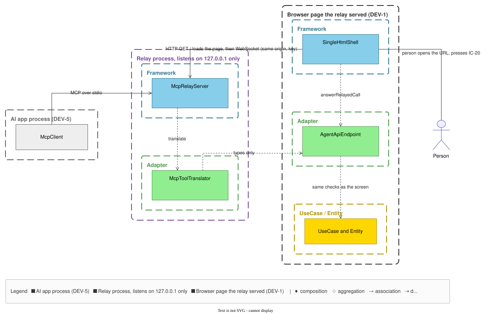

# MCP の取次 — 設計

**UID**: DOC-DESIGN-MCP-RELAY
**Version**: 0.1

> ⭐ 本書は手で書く原稿であり、MCP の取次の組み方の正である。  
> 取次が何をしなければならないかは `01-04-requirements.md` の `FR-150` と 表 T-035 の `AG-12` が持つ。  
> 本書はそれをどう組むかだけを持ち、要求・表の行をコピーせずに指す。

## 1. 目的と置き場所

**Type**: SECTION

取次は、MCP の客（AI のアプリ）が呼んだ `Agent API` のメンバを、人がブラウザで開いている `GRS` のページへ運び、ページの答えを客へ返す別のプロセスである。  
文書の唯一の正は開いているページのままであり（`FR-150`）、取次は文書もドメインの規則も持たない（`AG-12` の結び）。  
取次は `GRS` のページを `127.0.0.1` で自分で配り、そのページと同じ origin の WebSocket で繋ぐ（`AG-12` の ①）。

置き場所を 図 F-045 に示す。  
箱はコンポーネント、枠はプロセスと層である。  
ページの側は既にあるコンポーネントにユニットを 1 つずつ足すだけで、`UseCase` と `Entity` は変えない。

**図 F-045 — MCP の取次の置き場所**

[](fig-mcp-relay.svg)

図の原稿は `_source/fig-mcp-relay.json` である。  
`.drawio` と `.svg` はそこから生成したものであり、手で直さない —— 次の生成で消える。

## 2. コンポーネントと層

**Type**: SECTION

取次のプロセスに載るコンポーネントは `05-07-design.md` の 表 T-062 の `CP-40`（`McpToolTranslator`）と `CP-41`（`McpRelayServer`）である。  
ページの側は、同表の `CP-17`（`AgentApiEndpoint`）と `CP-25`（`SingleHtmlShell`）に、表 T-075 の `UF-185` と `UF-188` を足す。  
取次の側のユニットは同表の `UF-186` と `UF-187` である。  
層・責務・負う要求は 表 T-062 と 表 T-075 が持ち、公開する名前は `tbl-published-entries.md` の 表 T-064 の `PI-17` ・ `PI-40` ・ `PI-41` が持つ。  
本書はそれらをコピーしない。

層の割り方の理由は次のとおりである。

- 呼び出しと答えを MCP の形と `Agent API` の形のあいだで写すことは、値から値への変換なので `Adapter` の `pure` とする（表 T-060 の `LY-4`）。
- 待ち受ける口・繋いだページ・待っている呼び出し・溜めた変更の通知は現在値なので、`Framework` だけが持つ（`LY-5`）。
- 取次には `UseCase` と `Entity` のコンポーネントを置かない —— 取次が持つ規則は運び方だけであり、文書の規則はページの `Agent API` が 表 T-035 の `AG-5` のとおり当てる。
- ⭐ 取次のコンポーネントから出る辺は、`McpRelayServer` から `McpToolTranslator` への 1 本と、`McpToolTranslator` から `AgentApiEndpoint` の型だけを読む 1 本に限る（`_source/components.json` の `edges`。表 T-247 の `EG-5` が、ここに無い辺をコードに作ることを禁じる）。  
  型だけの辺は、呼び出しと答えの型を 2 か所で書かないためである（`R2.21`）。  
  これで「取次は文書もドメインの規則も持たない」（`AG-12` の結び）を検査が見張る。

## 3. インターフェース

**Type**: SECTION

### 3.1 MCP の客と取次のあいだ

取次は MCP の stdio の運び方で客と話す。  
標準出力は MCP の文だけに使い、取次の記録は標準エラーへ書く。

- **道具の一覧** —— 道具は `tbl-agent-api-members.md` の 表 T-107 のメンバと 1 対 1 であり、名は同じ確定名である（`AG-12` の ④）。  
  道具の説明は同表の「何を担うか」の欄の英語（原稿の `en`）から刷り、手で書かない。  
  ⚠️ `readSchema`（`AM-30`）だけは取次が自分で答える（`AG-12` の ④） —— ページへ運ばず、取次が中に持つものだけで答えるので、ページが繋がる前にも答える。  
  ⭐ スキーマは部分ごとに渡す（CR-802） —— `which`（`document`・`commands`）だけなら目次（一番上の鍵、`$defs` の名を 1 つに 1 行の説明で、文書のスキーマの版 `schemaVersion`）を、`defs`（`$defs` の名の並び）を渡せばその定義だけを、それが `$ref` で指すほかの定義の名（`refersTo`）と知らない名（`unknown`）と共に、`full` が真なら本文の全部（下の「資源」の 2 つと同じ本文）を返す。  
  文書のスキーマの全部は大きく、AI の会話の多くを占めるので、要る定義だけを読ませる。  
  `which` が `notes` なら、書く前に読む短い注意（`tbl-agent-api-members.md` の「スキーマの注意」、原稿の `schemaNotes` から刷る。刷るときに、注意が言うスキーマの鍵と定義の名が `npm run gen` の刷った文書のスキーマにまだあるかを確かめ、無ければ止める）を返す —— 時刻・長さ・依存の数・進捗・新しい `uid` のような、間違えやすい所だけを持ち、どれもスキーマの説明と同じことを言う。  
  ⭐ 取次が中に持つスキーマを正とする —— 取次が配るページは同じ組み立てで作るので、ページの `schemaVersion` は中に持つスキーマの版と同じである。版の食い違いを繋ぐときに比べる道は作らず、`readSchema` の答えに `schemaVersion` を載せる。  
  違う `which`、名の並びでない `defs`、真偽でない `full` には拒否 `malformedRequest` を値で返す。  
  ⭐ 道具・引数・命令の説明は英語で書き、仕様の行 ID を入れない —— 読むのは AI であり、行 ID の先を AI は引けない。公開の仕様の宛先は初期化の案内に 1 度だけ置く。表の印字（`tbl-agent-api-members.md`・`tbl-document-commands.md`）は日本語のままとする。
- **道具の入力** —— 1 つのオブジェクトとし、鍵はそのメンバの引数の名とする。  
  引数の名・型・意味は 表 T-107 の引数の欄が持ち（`tbl-agent-api-members.md`）、道具の入力の形はその原稿から刷り、手で書かない。  
  入力の型は TS の型から導く —— `string` は文字列、`number` は数、`boolean` は真偽、数の並びは数の並び、文字列の並びは文字列の並び（CR-802）、文字列の値の並び（`'a' | 'b'`）は文字列の `enum`、名の付いた型はオブジェクト。  
  ⛔ `oneOf`・`anyOf`・型の並び（`["array", "null"]`）を刷らない（`AG-12` の ⑧） —— Claude Code の受け手はそれらを落とし、AI に見えた `applyCommands` の束は中身の無いオブジェクトだった。  
  `null` を受ける引数を作らない —— 解除は空の並びで言う（`showOnlyTasks`）。  
  ⭐ ただし `applyCommands`（`AM-7`）の `request` は、刻印と命令の束を鍵に持つオブジェクトとし、束の 1 つは鍵 `kind`（`tbl-document-commands.md` の 表 T-108 の確定名を並べた `enum`）を必ず持つオブジェクトとする。  
  命令ごとの鍵と型は道具の入力に刷らず、2 つ目の資源（下の「資源」）が持つ。  
  鍵ごとの説明は引数の欄の意味である。  
  引数を持たないメンバとプロパティ（`agentApiVersion` ・ `schemaVersion`）は空のオブジェクトを受ける。  
  ⚠️ `watchChanges` だけは受け手の代わりに待つ長さ `waitMs` を受ける（`AG-12` の ⑤）—— 表 T-107 の `AM-17` の MCP だけの鍵である。  
  ⚠️ 書き出しの 5 つ（`AM-11`〜`AM-15`）は保存の鍵 `fileName`・`overwrite` を受ける（`AG-12` の ⑨）—— これも MCP だけの鍵であり、取次が読んでページへ運ばない。  
  渡さなければ待たずに答える。  
  ⛔ 取次は入力の中身を検めない —— 検めるのはページの `Agent API` である（`AG-12` の結び、`AG-5`）。
- **初期化の答え** —— 能力は道具と資源の 2 つとし、案内（`instructions`）を載せる（`AG-12` の ⑧）。  
  案内の文は `tbl-agent-api-members.md` の「MCP の初期化の答えに載せる案内」であり、同じ原稿から刷り、手で書かない。  
  読むのは AI なので英語で書く。
- **資源** —— 2 つを出す（`AG-12` の ⑧）。  
  1 つ目は `GRS JSON` のスキーマである。  
  所は `grs-relay://grs-document.schema.json`、名は `grs-document.schema.json`、型は `application/schema+json` とする。  
  中身は、取次の組み立てが `_source/grs-document.schema.json` から中に持ったバイト列であり、配るページと同じ版である。  
  2 つ目は命令の形のスキーマであり、所は `grs-relay://grs-commands.schema.json`、名は `grs-commands.schema.json`、型は `application/schema+json` とする。  
  中身は 表 T-108 の原稿（`_source/document-commands.json`）から刷った JSON Schema であり、命令ごとの `kind` の値と鍵・型・説明を持つ —— 命令の択は `oneOf` で書いてよい（資源は AI が読む文書であり、受け手が解く道具の入力ではない）。  
  文書の列を書く値の形は、1 つ目の資源の同じ列の形を指す。  
  資源の一覧はその 2 つを返し、読むとそれぞれの文字列を返す。  
  ほかの所を読む求めには、MCP の「資源が無い」の誤り（`-32002`）を返す。  
  ⚠️ 資源は道具ではない —— 道具の一覧（`AG-12` の ④）は変わらない。
- **道具の答え** —— メンバが返した値を、そのまま構造のある値として返す。  
  拒否も値のまま返し、MCP の誤りにしない（表 T-035 の `AG-9a`）。  
  画像（`exportPng`）は MCP の画像として返す。  
  MCP の誤りにするのは、ページがメンバを呼べずに例外で終わったときだけである。

### 3.2 取次とページのあいだ

- **ページを配る** —— `GET /` に、同じ版で作った単一 `.html` と同じバイト列を返す。  
  内容セキュリティ方針（`05-07-design.md` の 表 T-232）はページの中にあるので、取次は足しも削りもしない。  
  ほかの道は断る。
- **繋ぐ** —— ページは同じ origin の WebSocket で繋ぎ、最初の文で、URL の断片から読んだ鍵を渡す（`AG-12` の ⑦）。  
  WebSocket への接続は 表 T-232 の `PO-7` が許す。
- **運ぶ** —— 鍵を受けた後の文は JSON-RPC 2.0 とする。  
  取次が呼び、ページが答える。  
  `method` は 表 T-107 の確定名、`params` は 3.1 の道具の入力と同じオブジェクトである。  
  `result` はメンバの答えであり、画像のバイト列だけは base64 の文字列にする。  
  型は `relayed-call.ts` が持つ `RelayedCall` と `RelayedAnswer` である（表 T-064 の `PI-17`）。
- **知らせる** —— ページは、購読した変更を `changeNoticed` の通知として取次へ送る（3.3）。

```text
page  -> relay   {"jsonrpc":"2.0","method":"relayKeyPresented","params":{"key":"<key from #fragment>"}}
relay -> page    {"jsonrpc":"2.0","id":7,"method":"readStamp","params":{}}
page  -> relay   {"jsonrpc":"2.0","id":7,"result":<the value readStamp returned>}
page  -> relay   {"jsonrpc":"2.0","method":"changeNoticed","params":<one change notice>}
```

### 3.3 待つ道具

`watchChanges` の購読は、ページが繋がってから最初に `watchChanges` が呼ばれたとき、取次がページに 1 度だけ求める。  
届いた変更は取次が届いた順に溜め、`watchChanges` の呼び出しは、溜まっていればすぐに、無ければ `waitMs` だけ待って、溜まっていたものをすべて返す。  
⭐ `waitMs` は 40,000 で頭打ちにする —— 5 節の締め切りより短くし、待つ道具そのものが AI のアプリの時間切れに当たらないためである。  
待つあいだに何も届かなければ空の並びを返す —— これが `AG-12` の ⑤ の「まだ無い」である。  
ページが切れたら購読と溜めたものを捨て、次に繋いだページで購読し直す。  
何が届くかは `AG-6` がページの側で決める。

## 4. データの流れ

**Type**: SECTION

1. AI のアプリが取次を起動する。  
   取次は `127.0.0.1` の、OS が選んだ空いた口で待ち受け、起動ごとの鍵を暗号学的な乱数から作り、`http://127.0.0.1:<口>/#<鍵>` を標準エラーへ書く。
2. 人がその URL をブラウザで開き、文書を「開く」（`FR-087`）で開き、`IC-20` で `Agent API` を有効にする（`FR-065`）。
3. ページは、`Agent API` が有効であり、URL の断片に鍵があるあいだだけ、取次へ繋ぐ（`AG-12` の ②）。
4. 取次は origin と鍵を照らし、まだページが繋がっていなければ受ける（`AG-12` の ③ ⑦）。
5. 客が道具を呼ぶ。  
   取次は `McpToolTranslator` で呼び出しを写し、ページへ送る。
6. ページは `answerRelayedCall` で同じ名のメンバを呼び、答えを返す。  
   検証・拒否・刻印の照合は、画面からの書き込みと同じ道を通る（`AG-5`）。
7. 取次は答えを `McpToolTranslator` で MCP の答えに写し、客へ返す。

## 5. 断る道と異常

**Type**: SECTION

- **ページが繋がっていない**（開いていない・`Agent API` が無効・閉じられた） —— 取次は道具の呼び出しに拒否を値で返す（`AG-12` の ②）。  
  理由の区分は `pageNotConnected` とし、開く URL を添える —— AI が人に開き方を伝えられるようにするためである。  
  ⚠️ ページが無いので現在の刻印は無く、刻印の欄は空とする。
- **保存** —— 書き出しの道具が `fileName` を受けたら、取次はページに値を求め、受けた値を保存先のフォルダへ書き、`AgentSavedFile`（表 T-400 の `AV-21`）を返す（`AG-12` の ⑨）。  
  書く前に名を確かめ、断るときは拒否を値で返す —— 理由の区分は、フォルダの外を指す名・違う拡張子が `badFileName`、既にあって `overwrite` が無いのが `fileExists`、フォルダを作れない・書けないのが `saveFolderUnavailable` である。  
  フォルダが無ければ作る。  
  上書きするときは、前の中身を `<名>.bak` へ移し（古い `.bak` は置き換える）、新しい中身は一時ファイルに書いてから名を替える —— 途中で止まっても前の中身が残る。  
- **呼び出しの途中でページが切れた** —— 答えを待っていた呼び出しにも、同じ拒否を返す。  
  ページの側は、繋いでいた取次との接続が切れたことを 表 T-233 の `RS-90` で人に告げる（`AG-12` の ②）。  
  ページで既に確定した書き込みは戻さない。
- **2 つ目のページ・origin の違う接続・鍵の無い接続・鍵の違う接続** —— WebSocket を閉じて断る（`AG-12` の ③ ⑦）。  
  繋がっているページは変わらない。
- **ページの `Agent API` が断った** —— 刻印の食い違い・人のドラッグ中・読み取り専用のタスクグループ（`FR-111` の 表 T-275 の `GP-1` ・ `GP-7`、理由は 表 T-233 の `RS-61` ・ `RS-62`）など、どの拒否も取次は写さずにそのまま運ぶ。
- **合流の 3 択** —— ページは問いを出したらすぐ `AgentImportOutcome`（表 T-400 の `AV-15`）の「人に問うたとき」を返し、人が答えた後の書き込みは `watchChanges` で届く（`AG-12` の ⑥、`FR-022`）。
- **締め切り** —— 取次は、ページへ送った呼び出しに 45 秒の締め切りを持つ（`AG-12` の ⑥）。  
  過ぎたら、理由の区分を `relayTimedOut` とした拒否を値で返し、メンバの名と「画面に問いや窓が出ていないか人に尋ねる」ことを添える —— AI のアプリの要求が時間切れになると、アプリは取次を起動し直し、口と鍵が変わってページが繋がりを失う。  
  ⚠️ 45 秒は、MCP の TypeScript の SDK の要求の時間切れの既定（60 秒と見込む）より短くした値である —— **見込みであり測っていない**。実装で受け手の値を測り、短ければ下げる。  
  後から来た答えは捨てる。ページで起きたことは戻さない。
- **客が呼び出しを取り消した** —— 取次は後から来た答えを捨てる。  
  ページで起きたことは戻さない。

## 6. 配り方

**Type**: SECTION

配り方は `AG-12` の ① が持つ —— AI のアプリが MCP の相手として入れる 1 つのファイルと、同じ中身をコマンド行の JavaScript の実行環境で動かす形である。  
どちらの形も、同じ版で作った単一 `.html` を中に持ち、3.2 のとおりそのまま配る。  
取次を使わない人の `GRS` は、今までどおり単一 `.html` を開くだけで動く（`FR-150`）。  
⭐ 前者の形は MCP の束（`grs-relay.mcpb`）とする —— `manifest.json` と、取次を 1 つに束ねた JavaScript の 2 つだけを入れた zip であり、`manifest.json` の実行の土台は `node` とする。  
JavaScript が、同じ版の単一 `.html` と `GRS JSON` のスキーマを中に持つ —— ⛔ 束に単一 `.html` を別のファイルとして入れない（読まれないまま束を重くするだけである）。  
束を入れる人は Node も何も入れなくてよい —— 実行の土台は AI のアプリが持つ（`AG-12` の ①）。  
後者の形は、同じ JavaScript のファイル 1 つ（`grs-relay.mjs`）である。  
取次は、動くときに手元のファイルを 1 つも読まない。  
⭐ 束と取次の版は、組み立てたソースのコミットの時刻を UTC で表した日時とする（CR-799、利用者の裁定 R4） —— 人が読む形は `2026-10-18T08:12:34Z` である。  
`manifest.json` の `version` と、初期化の答えの `serverInfo` の版は semver でなければならないので、同じ時刻を `年.月日.時分秒` の 3 つの数（例 `2026.1018.81234`）で書く —— semver は数の頭の 0 を許さないので、月日と時分秒は頭の 0 を落とした数である（1 月 5 日 0 時 12 分 34 秒は `2026.105.1234`）。  
⭐ pre-release の印（`0.0.0-20261018T081234Z` の形）にしない —— 入れる側がその版を「不安定」と読みうる。  
3 つの数の形なら、semver として比べた順が時刻の順になる。  
人が読む形は `manifest.json` の `description` の頭（`Built 2026-10-18T08:12:34Z.`）と、入手する所の頁の 2 つのボタンの下に出す。  
同じコミットから作れば同じ版になる —— 時刻は組み立てのときに git から取る（`tools/relay_version.mjs`）。  
公開の組み立ては push したコミットから作るので、頁の版は配るファイルの版と一致する。  
⚠️ これは CR-791 の版（`package.json` の版に単一 `.html` の SHA-256 の頭 12 桁を繋いだもの）を置き換える —— 利用者が、版を日時にすると定めた。  
どちらも公開する単一 `.html` と同じ組み立てで作り、最新版を入手する所（`_assets/tbl-settings.md` の 表 T-206 の `S-350`）の頁に置く —— `GRS` はその頁を、ヘルプの左上のリンクと `IC-20` の項目のリンクで案内するだけで、自分では取得しない（`FR-036`、表 T-003 の `CN-6`）。  
⛔ バッチファイル・シェルのスクリプト・実行ファイルでは配らない —— インターネットから落とした署名の無いこれらを OS の保護が止め、止まらない機械でも利用者に警告を越えさせる。  
取次を別の言語でもう 1 つ書くことにもなり、`AG-12` の ① の「同じ中身」を破る。  
束に署名は付けない —— 付けるときは束の形式の署名であり、OS の保護には関係しない。

⭐ 入手する所の頁の原稿は `docs/download/index.html` であり、手で書いた 1 つの自己完結した `.html` である。  
公開の組み立ては `docs/` をそのままサイトに載せるので、頁は `/download/index.html` に着く。  
組み立ては同じ所に、公開する単一 `.html` を `GRS.html` の名で置き、束と、束の SHA-256 を書いた `grs-relay.mcpb.sha256` と、`grs-relay.mjs` を並べる。  
頁は外の資源を読まない —— 頁の中の書式とスクリプトは、頁の Content Security Policy に SHA-256 を書いたものだけが動く。  
頁が持つものは次のとおりである。

- 最上部の大きなボタン —— 押すと `GRS.html` を落とす。  
  ボタンの下に版（上の日時）を出す。束を落とすボタンの下にも、`manifest.json` の `version` と同じ版と日時を出す。  
  頁の原稿（`docs/download/index.html`）は版の所に場所を取るだけで、公開の組み立てが `tools/stamp_download_page.mjs` で書き入れる —— 原稿に版を手で書かない。  
  ⛔ 頁を開いただけでは何も落とさない（理由は `S-350` の注）。
- AI 連携を使い始める手順 —— 束を落とす・AI のアプリに入れる・入って有効であることを確かめる・AI に開く所を尋ねる・その所を開く・文書を開く・`IC-20` を押す・AI に頼む・保存する、の順である。  
  入れ方は、束を AI のアプリの拡張の画面へドラッグ & ドロップする 1 通りだけを案内する —— 利用者が、ほかの入れ方を案内しないと定めた。  
  AI に開く所を尋ねる段は、デスクトップのアプリの Chat タブと Code タブのどちらでもよいと書く —— 入れた束を 2 つのタブが共有する。  
  開く所は、取次が `pageNotConnected` に添える所（5 節）であり、`#` の後ろの鍵まで丸ごと開く。  
  文書は「開く」（`IC-1`、`FR-087`）で開き、`IC-20` で `Agent API` を有効にし（`FR-065`）、「書き出して保存」（`IC-2`）で保存する —— AI に名を告げて保存させることもできる（取次の設定の保存先のフォルダへ、7 節）。
- AI が保存する所と、その変え方（CR-799、利用者の裁定 R6） —— 既定の保存先（ドキュメントの下の `GRS`）、AI のアプリの拡張の設定で `Save folder` を選び直す道筋（その作り手のいまの画面の語で）、ドキュメントのフォルダを OneDrive へ移している PC では既定がエクスプローラーの「ドキュメント」と別の所になることの注意、`Confirm before overwrite` が何をするかの 1 行。  
  ⚠️ 例の所には利用者の名を書かず `<name>` と書く。
- 開く所は、取次を起動するたびに変わること（4 節の 1）。
- AI にできること・できないこと —— `AG-12` と `tbl-agent-api-members.md` の 表 T-107 が持つ範囲を、利用者の語で書く。
- PC の外へ出ないもの（7 節）と、AI が読んだものは会話として AI のサービスへ渡ること。
- 止め方 —— `IC-20` をもう一度押す。  
  ⚠️ 既に読まれたものは取り戻せない（`FR-065`）。
- うまくいかないときの手当て。
- 進んだ人向けに、コマンドで MCP の相手を起動する客で `grs-relay.mjs` を動かす形と、`grs-relay.mcpb.sha256` で落としたものを確かめる手。  
  この客は、コマンドラインの Claude Code と、拡張を入れられない AI のアプリである —— デスクトップのアプリの Code タブはこの形を要らない。
- 技術紹介への案内 —— 最上部のボタンの右の、紹介頁（`_assets/tbl-settings.md` の 表 T-206 の `S-583` の所）を開くボタンであり、頁の言語を `?lang=ja` ／ `?lang=en` で付けて新しいタブで開く —— 利用者が、最上部のボタンの右を技術紹介のボタンにすると定めた。  
  ⛔ 入手する所にも手順の 1 段にもしない —— `GRS.html` と束は上のボタンとリンクで落とし、手順は紹介頁を開かずに済む（下の段）。  
  頁は表を読めないので所を書き写す —— 所を変えたときに直す 2 つ目の場所であることは `S-583` の注が持つ。

⭐ 頁は、AI 連携を使い始めるまでの手順のすべてを自分で持つ —— 利用者はほかの説明書・README・リポジトリの頁を開かず、頁の案内に従うだけで使い始められる。  
⭐ 頁は英語と日本語の 2 つの塊を持ち、右上に `English` と `日本語` の 2 つ並びのボタンを置いて、選んでいる方を塗りつぶす。  
既定は英語とする —— 頁は、閲覧者がどの言語を読むかを知る前に開かれる。  
選んだ言語は閲覧者のブラウザにだけ覚えさせる —— 閲覧者ごとの便宜であり、ほかの閲覧者にも `GRS` にも届かない。  
⚠️ アプリのヘッダーの言語の切り替え（地球儀と小文字の言語コード）とは形を揃えない —— 頁の切り替えは、初めて来た人が見落とさないことを優先する。  
⚠️ 頁は 1 つの AI のアプリを名指し、その作り手のいまの画面の語（拡張を入れる設定の道筋）で手順を書く。  
その語は作り手の公開の説明と照らしたもの（2026-10-04）であり、作り手が画面を変えると腐る —— 変わったら照らし直す。

## 7. 守り

**Type**: SECTION

- 待ち受けるのは `127.0.0.1` だけであり、ほかの機器からは繋げない（`AG-12` の ①）。
- `Host` が `127.0.0.1:<口>` でない要求は、ページを配る道でも WebSocket でも断る。  
  別の名前を `127.0.0.1` へ向ける手（DNS の張り替え）で、別の origin のページに取次を読ませないためである。
- 接続を受けるのは、取次が配ったページの origin で、起動ごとの鍵を渡したものだけである（`AG-12` の ⑦）。  
  origin を照らすので、別の名前を `127.0.0.1` へ向けたページからも繋げない。  
  ⛔ `Origin` が `null` の接続も断る —— 手元のファイルで開いたページやサンドボックスの枠は、どれも `null` を名乗るので、受ければどのページからでも繋げてしまう。
- 名簿も認証も持たない（`FR-111` の RATIONALE）—— 鍵が守るのは「同じ機械の別のページ」からであり、人を見分けることではない。
- 取次は文書を持たず、書き込みはいつもページが確定する。  
  取次がファイルを書くのは、書き出しの道具が `fileName` を受けたときだけであり、書く所は人が取次の設定で決めたフォルダの中だけである（`AG-12` の ⑨）。  
  ⭐ 取次の設定は 2 つ —— 保存先のフォルダ `saveFolder`（既定は利用者のドキュメントの下の `GRS`）と、上書きの前に確認する `confirmBeforeOverwrite`（既定は入）。  
  束（`.mcpb`）では AI のアプリの拡張の設定に出し、人がいつでも変えられる。  
  コマンド行の形（`grs-relay.mjs`）では同じ名の引数で受ける。  
  ⛔ フォルダは AI の引数でも会話でも変えられない —— 他人から受け取った文書に仕込まれた文に従って、AI が別の所へ書くのを防ぐ。  
  取次はファイルを読まない。

## 8. 本書が持たないもの

**Type**: SECTION

- 道具の一覧と、各メンバが何を担うか —— `tbl-agent-api-members.md` の 表 T-107。
- 取次とページが従う規則 —— 表 T-035 の `AG-12`。
- 引数と戻り値の型 —— 表 T-107 と 表 T-400（`tbl-agent-api-members.md`）。
- コンポーネントとユニットの責務 —— 表 T-062 と 表 T-075。
- サーバーとの連携・名簿・認証 —— 範囲外である（`01-04-requirements.md` の 表 T-002 の `SO-12`）。
- MCP の HTTP の運び方・ブラウザを取次が自分で開くこと・道具を束ねること —— 持たない（束ねないことは `AG-12` の ④）。
