# 状態機械 — 出来事・状態・状態遷移表

**UID**: DOC-TBL-STATE-MACHINES
**Version**: 0.2

> ⛔ 本書は生成物である。  
> 手で直さない —— 直しても次の `npm run gen` で消える。
> **状態機械の唯一の正は `_source/state-machines.json` である。**  
> 本書はそれを `_source/state_machines_json_to_md.py` が印字したものである。
> **作り直す**: `npm run gen` ／ **ズレを検出する**: `npm run gen:check`。

本書は、保存しない状態の状態機械（`05-07-design.md` の 5.6 の ADR-002）を、領域ごと・状態機械ごとに印字したものである。  
⚠️ 例外はタスクグループの木（`taskGroupTree`）の 1 つだけであり、その状態は文書に保存する値である（`05-07-design.md` の 表 T-250 の `SD-5`）。  
原稿が持つもの・持たないものは `05-07-design.md` の 表 T-250 が、状態機械の形は 表 T-249 が持つ。  
名前の読み方は `05-07-design.md` の 5.5 が持つ。

## ガードの条件の書き方

各領域のガードの一覧の条件は、次の項・演算・関数だけで書く式である。  
生成器は条件を 1 つずつ読み、読む値が在ることを確かめる（`_source/state_machines_json_to_md.py` の `load()`）。

### 項

| 項 | 意味 |
| --- | --- |
| `event.<運ぶ値>` | 升の出来事が運ぶ値（`SD-2`）。ガードを使うどの升の出来事も、その値を運ぶ。後ろに続く `.欄` はコードの型の欄であり、生成器は引かない |
| `root.<運ぶ値>` | 領域の根が運ぶ値 |
| `<状態機械>.<運ぶ値>` | 同じ領域のその状態機械の、いまの状態が運ぶ値。いまの状態がその値を運ばなければ `null` |
| `taskGroup.<列>` | 文書に保存する値を持つ領域（`SD-5`）だけ: 升が木の状態を決めるタスクグループの列（`_assets/fig-erd-detail.md` の `TaskGroup`） |
| `in(<状態機械>.<状態>)` | 同じ領域のその状態機械が、いまその状態か、その下の状態にいる |
| `inAfter(<状態機械>.<状態>)` | 同じ出来事の 1 段を終えた後に、同じ領域のその状態機械がその状態か、その下の状態にいる |
| `<関数>(<引数>, …)` | 下の関数の値。引数の数は関数ごとに決まっている |
| `'字'` ・ `0` ・ `true` ・ `false` ・ `null` ・ `[a, b, …]` | 字・整数・真偽・値が無いこと・並び。`null` の欄は `null` である |

### 演算

| 演算 | 意味 |
| --- | --- |
| `!x` | x でない |
| `x && y` | x かつ y |
| <code>x &#124;&#124; y</code> | x または y |
| `x == y` ・ `x != y` | 等しい ・ 等しくない |
| `x < y` ・ `x <= y` ・ `x > y` ・ `x >= y` | 数の大小 |
| `x in y` | x が並び y のどれかに等しい |
| `x.length` | 並び x の長さ |
| `( x )` | 先に結ぶ。結ぶ強さは `!` ＞ 比較と `in` ＞ `&&` ＞ <code>&#124;&#124;</code> |

### 関数

| 関数 | 意味 | 根拠 |
| --- | --- | --- |
| `after(value)` | 同じ出来事の 1 段を終えた後の、その状態機械の運ぶ値（`<状態機械>.<運ぶ値>` を渡す）。その後の状態がその値を運ばなければ `null` | `FR-088` ・ `S-99g` |
| `ancestors(taskGroupId)` | その `id` のタスクグループの親、親の親……と最上位までの `id` の並び（自身は含まない）。その `id` のタスクグループが無ければ空 | `HR-3` ・ `HR-1a` ・ `SJ-2` |
| `calendarDraftRefusals(calendarDraft)` | 休日の設定の下書きが当てられない断りの並び（`WC-10` の 1 件 1 行） | `WC-10` ・ `WC-7` |
| `childTaskGroups(taskGroupId)` | 親（`parentId`）がその `id` のタスクグループである、直下の子のタスクグループの並び | `HR-7` ・ `TD-6` |
| `noticeDisplay(reason)` | 表 T-233 の、その理由の表示の仕方（`_source/notice-reasons.json` の `display`。`'hide'` は「出さない」、`'autoDismiss'` は「時間で消す」） | `FR-076` ・ `NT-2` |
| `reasonsOf(standing)` | 立っている通知の並びの、1 枚ずつの理由（表 T-233 の行）の並び | `NT-8` ・ `NT-2` |
| `setting(row)` | 設定の行（`_assets/tbl-settings.md` の `S-` 行）の、いま文書が持つ値 | `S-418` |
| `wordsRow(reason)` | 表 T-233 で、その理由が語を借りる行（まとめ方の「語は …」）。借りなければその理由自身 | `NT-3` ・ `FR-076` |
| `wordsRowsOf(standing)` | 立っている通知の並びの、1 枚ずつの `wordsRow` の並び | `NT-3` |

## 領域をまたぐ優先順

**表 T-283 — 領域をまたぐ優先順**

本表は、2 つ以上の領域が同じ入力を奪い合うとき、どの段が先に消費するかを並べる（`05-07-design.md` の 表 T-250 の `SD-4`）。  
同じ出来事の行は、上ほど先に消費する。  
段ごとの状態のキーは、その段に当たる状態であり、名は本書の各領域の状態の一覧に在る。  
⭐ 順そのものの正は、各行の「順を決めた行」が名指す要求の行である —— `Esc` の段の語と並びは `IN-4` の「消費する階層は」の並びと 1 対 1 で一致し、生成器がそれを確かめる。

| 行 ID | 奪い合う出来事 | 段 | 段ごとの状態のキー | 順を決めた行 | 注 |
| --- | --- | --- | --- | --- | --- |
| RG-1 | `Esc` | 出ている通知 | `noticeDisplayStateMachine.shown` | `IN-4` ・ `NT-8` | 消すものが無いときは消費しない（`NT-8`） |
| RG-2 | `Esc` | 確定していないその場の編集 | `fieldEditStateMachine.editingField` | `IN-4` | 面が消費する（`IF-9`） |
| RG-3 | `Esc` | 開いている面 | `confirmationStateMachine.questionAsked` ／ `openSurfaceStateMachine.open` | `IN-4` ・ `FR-070` | 同じ段の中は、問い → 面の順。問いか面が立っているあいだは `SK-19` の 2 段目を当てない（`FR-070`）。ヘルプはこの段に立たない —— 開いているウィンドウの段に立つ（`IN-4`） |
| RG-4 | `Esc` | 進行中のドラッグ・引きかけの矢印 | `pointerPressStateMachine.changingDocument` ／ `pointerPressStateMachine.viewingDocument` | `IN-4` | — |
| RG-16 | `Esc` | 開いているウィンドウ | `searchPanelDisplayStateMachine.shown.normal` ／ `searchPanelDisplayStateMachine.shown.maximized` ／ `helpDisplayStateMachine.shown.normal` ／ `helpDisplayStateMachine.shown.maximized` と、フレームの値（焦点がどのウィンドウの中にあるか、焦点がプロパティパネルの中にあるか）。遅延診断レポートの窓は状態機械を持たず、出ていて（`S-451`）最小化していないときに立つ。担当リストのウィンドウも同じ（`S-545`） | `IN-4` ・ `SV-14` ・ `HN-2` ・ `FR-152` ・ `RW-1` ・ `RO-1` | 1 度の `Esc` で 1 つだけ閉じる。焦点がその中にあるウィンドウが先、ほかは 表 T-337 の手前から（`IN-4`）。焦点がプロパティパネルの中にあるあいだは立たない —— `RG-14` が先に受ける（`IN-4`）。最小化したウィンドウは立たない。検索パネルは、列のフィルタが開いていればフィルタだけを閉じる（`SV-14`）。遅延診断レポートの窓は窓だけを閉じ、診断の表示は終えない（`RW-1`）。担当リストのウィンドウを閉じると担当リストの表のスケジュールフィルタを解除する（`RO-1`）。`escapePressed` の `rung` の語は `searchPanel` ・ `helpModal` ・ `delayDiagnosticsReport` ・ `resourceList` |
| RG-14 | `Esc` | プロパティパネル | `propertiesPanelContentStateMachine`（`hidden` 以外） | `IN-4` | 面ではない（`S-99g`、`S-99h`）。進行中のドラッグと開いているウィンドウの後に置く（`IN-4`）。番号は最後の次を採り、並びは表の上下が持つ |
| RG-5 | `Esc` | 構え | `armModeStateMachine`（`notArmed` 以外） | `IN-4` | — |
| RG-6 | `Esc` | 選択 | `selectionStateMachine.objectsSelected` と、根の値 `chosenTaskGroups`（空でないとき）のどちらか —— タスクグループパネルのタスクグループだけを選んでいるときも立つ（`FR-085`） | `IN-4` ・ `FR-085` | 構えより前に置かない（`IN-4`） |
| RG-7 | `Esc` | `Dual Cursor` モード | `dualCursorModeStateMachine.on` | `IN-4` | — |
| RG-8 | `Esc` | 出ている説明 | `tooltipDisplayStateMachine.allowed` と、フレームの値（描いた説明がある） | `IN-4` ・ `IN-3` | 状態だけでは決まらない段（`SF-5`） |
| RG-17 | `Esc` | 全画面表示 | `fullScreenModeStateMachine.full` | `IN-4` ・ `FR-071` | 最後の段。全画面表示を出ることをブラウザに求める（`FR-071` の入口の押下と同じ求め）。閲覧環境が Keyboard Lock を持たないときはブラウザが先に取る（`IN-4a`）。番号は最後の次を採り、並びは表の上下が持つ |
| RG-9 | `Enter` | 出ている通知 | `noticeDisplayStateMachine.shown` | `SK-19` ・ `NT-8` | — |
| RG-10 | `Enter` | その場の編集の確定 | `fieldEditStateMachine.editingField` ／ `createdTaskNamingStateMachine.createdNameEnded` | `SK-19` ・ `FR-091` | 面も問いも立っていないとき |
| RG-11 | `Enter` | プロパティパネルを出すのをやめる | `propertiesPanelContentStateMachine`（`hidden` 以外） | `SK-19` | 面も問いも立っておらず、確定していないその場の編集も無いとき |
| RG-12 | `Enter` | 選択を解除する | `selectionStateMachine.objectsSelected` と、根の値 `chosenTaskGroups`（空でないとき）のどちらか —— タスクグループパネルのタスクグループだけを選んでいるときも立つ（`FR-085`） | `SK-19` ・ `FR-085` | プロパティパネルも出していないとき |
| RG-13 | `y` ／ `n` | 問いに答える | `confirmationStateMachine.questionAsked` | `NT-7` | `NT-8` の消去の次、`IN-4` と `SK-19` の階層より先 |

## 画面の値（`screen`）

**表 T-280 — 画面の値の状態機械**

本表は、出来事の定義・根の値・状態機械ごとの状態遷移表と状態の一覧からなる。  
状態遷移表の行はその状態機械を動かす出来事、列はその状態機械の葉の状態、升は「→ 次の状態 [ガード] / 副作用」である。  
ガードは名と条件を「`名`（`条件`）」と刷り、条件は同じ領域のガードの一覧と同じである。  
状態に entry ／ exit の副作用がある状態機械は、出来事の行の上に `entry` ／ `exit` の行を置く —— その状態へ入る遷移・出る遷移が、出 → 遷移の副作用 → 入の順に起こし、自己への遷移（「→ 自己」）は起こさない。  
升の「—」は変化なし（同じ参照）を表す。  
ガードの付いた枝がすべての場合を覆わない升には「それ以外 → —」を添え、どの場合に何が起きるかを升ごとに言い切る。  
親の状態に置いた升は、その子のすべての列に同じ升を刷り、「親 … の升」と書き添える。

### 画面の値の出来事

| 出来事 | どこから来るか | 運ぶ値 | 動かすもの |
| --- | --- | --- | --- |
| `screen/paletteToggled` | 入力: `IC-7` ・ `SK-14` | — | `paletteDisplayStateMachine` |
| `screen/paletteMinimizeToggled` | 入力: `IC-75` | — | `paletteDisplayStateMachine` |
| `screen/milestoneListToggled` | 入力: `IC-50` | — | `milestoneListDisplayStateMachine` |
| `screen/fullScreenEntryPressed` | 入力: `IC-11` ・ `SK-15` | — | `fullScreenModeStateMachine` |
| `screen/fullScreenChanged` | 副作用の結果（ブラウザの `fullscreenchange`）: `FR-071` | `isFullScreen` | `fullScreenModeStateMachine` |
| `screen/surfaceEntryPressed` | 入力（`IC-132` は `surfaceName` に `U-65` を運ぶ）: `IC-2` ・ `SK-12` ・ `IC-132` | `surfaceName` | `openSurfaceStateMachine` ・ `calendarDraftStateMachine` |
| `screen/surfaceRaisedByFlow` | 副作用の結果（ファイルの領域が面を立てる）: `OP-3` ・ `U-56` ・ `U-61` ・ `U-62` | `surfaceName` | `openSurfaceStateMachine` ・ `calendarDraftStateMachine` |
| `screen/flowSurfaceAnswered` | 入力（`U-56` ・ `U-61` の答えの入口。呼び手は同じ入力から領域 `fileFlow` の答えの出来事も作る）: `IC-71` ・ `IC-72` ・ `IC-73` ・ `IC-95` ・ `IC-96` ・ `IC-97` ・ `OP-3` ・ `FR-022` | `surfaceName` | `openSurfaceStateMachine` |
| `screen/surfaceCloseAsked` | 入力: `IC-52` | `target`（閉じる対象。語は `surface`（開いている面、`S-99g`）・`panel`（プロパティパネル、`S-99h`）・`helpModal`（ヘルプ、`U-30`）の 3 つ） | `openSurfaceStateMachine` ・ `propertiesPanelContentStateMachine` ・ `helpDisplayStateMachine` ・ `baseTimeZoneDraftStateMachine` ・ `timeShiftDraftStateMachine` ・ `wholeScheduleShiftDraftStateMachine` ・ `calendarDraftStateMachine` |
| `screen/escapePressed` | 入力（`Esc`）: `IN-4` | `rung`（消費する `IN-4` の段の語。呼び手が詰める） | `armModeStateMachine` ・ `openSurfaceStateMachine` ・ `propertiesPanelContentStateMachine` ・ `dualCursorModeStateMachine` ・ `tooltipDisplayStateMachine` ・ `searchPanelDisplayStateMachine` ・ `helpDisplayStateMachine` ・ `baseTimeZoneDraftStateMachine` ・ `timeShiftDraftStateMachine` ・ `wholeScheduleShiftDraftStateMachine` ・ `calendarDraftStateMachine` |
| `screen/armEntryPressed` | 入力: `IC-23` ・ `IC-24` ・ `IC-25` ・ `IC-26` ・ `IC-27` ・ `IC-61` ・ `IC-35` ・ `IC-36` ・ `IC-142` ・ `FR-016` | `armKind` ／ `shapeKind` ／ `glyph` | `armModeStateMachine` |
| `screen/watermarkEntryPressed` | 入力: `IC-41` ・ `WM-10` | — | `openSurfaceStateMachine` ・ `watermarkDisplayStateMachine` ・ `calendarDraftStateMachine` |
| `screen/watermarkUnlockAnswered` | 入力（`U-60` の答え）: `U-60` ・ `WM-6` ・ `WM-7` | `isProceeding` | `openSurfaceStateMachine` |
| `screen/watermarkUnlockMatched` | 副作用の結果（照合）: `WM-6` ・ `WM-8` | — | `openSurfaceStateMachine` ・ `watermarkDisplayStateMachine` |
| `screen/watermarkUnlockMismatched` | 副作用の結果（照合）: `WM-8` | — | `openSurfaceStateMachine` |
| `screen/settingsEntryPressed` | 入力: `IC-17` ・ `FR-072` | — | `propertiesPanelContentStateMachine` ・ `baseTimeZoneDraftStateMachine` ・ `timeShiftDraftStateMachine` ・ `wholeScheduleShiftDraftStateMachine` |
| `screen/propertiesOfChoiceAsked` | 入力（パネルを出すことを要求が名指した押下。員数は各要求が持つ）: `FR-072` | `subject` | `propertiesPanelContentStateMachine` ・ `baseTimeZoneDraftStateMachine` ・ `timeShiftDraftStateMachine` ・ `wholeScheduleShiftDraftStateMachine` |
| `screen/selectionMoved` | ほかの領域の結果（選択）: `FR-072` | `subject`（空もありうる） | `propertiesPanelContentStateMachine` ・ `baseTimeZoneDraftStateMachine` ・ `timeShiftDraftStateMachine` ・ `wholeScheduleShiftDraftStateMachine` |
| `screen/createdNameSettled` | 入力（作った直後の名前の欄の編集が終わった後の `Enter` —— 表 T-292 の `createdTaskNamingStateMachine` が `createdNameEnded` に居るとき（表 T-283 の `RG-10`）。名前付けのあいだでも、ほかの欄の編集を終えた `Enter` では送らない）: `FR-091` ・ `SK-19` | — | `propertiesPanelContentStateMachine` ・ `baseTimeZoneDraftStateMachine` ・ `timeShiftDraftStateMachine` ・ `wholeScheduleShiftDraftStateMachine` |
| `screen/settleKeyPressed` | 入力（`SK-19` の 2 段目）: `SK-19` ・ `FR-070` | `hasSurfaceOrConfirmation` ／ `hasUnsettledEntry` | `propertiesPanelContentStateMachine` ・ `baseTimeZoneDraftStateMachine` ・ `timeShiftDraftStateMachine` ・ `wholeScheduleShiftDraftStateMachine` |
| `screen/dualCursorEntryPressed` | 入力: `IC-45` ・ `DC-1` ・ `DC-4` | `date`（置く日付） ／ `hasDaysToPlace` | `armModeStateMachine` ・ `dualCursorModeStateMachine` |
| `screen/guideCursorEntryPressed` | 入力: `IC-47` ・ `IC-48` ・ `DC-9` | `guideCursor`（押したガイドカーソルの値（`S-66`）） | 根 ・ `dualCursorModeStateMachine` |
| `screen/dualCursorPlaced` | 入力（`Task Group Area` のクリック）: `DC-2` ・ `PTD-2` | `date`（置く日付） | `dualCursorModeStateMachine` |
| `screen/displayScaleStepped` | 副作用の結果（倍率を書いた後にシェルが送る。運ぶ `percent` は書いた後に立っている値であり、入力の翻訳係は知らない（書き込みが拒まれたときは立っている値のまま））: `IC-104` ・ `IC-105` ・ `SK-22` ・ `SK-23` ・ `SE-1` | `percent` ／ `end` | `scaleMessageDisplayStateMachine` |
| `screen/verticalZoomEndReached` | 副作用の結果（縦軸のズームが端に当たった）: `ZE-5` | `percent` ／ `end` | `scaleMessageDisplayStateMachine` |
| `screen/scaleMessageTimeElapsed` | 時間: `S-244` ・ `SE-3` | — | `scaleMessageDisplayStateMachine` |
| `screen/screenLanguageChosen` | 入力: `IC-21` ・ `FR-038` | `screenLanguage` | 根 |
| `screen/helpLanguageChosen` | 入力: `IC-128` ・ `FR-038` | `helpLanguage` | 根 |
| `screen/themePreferenceChosen` | 入力: `IC-16` ・ `FR-039` | `themePreference` | 根 |
| `screen/propertyPanelWidthSettled` | 入力（プロパティパネルの境界を離した）: `GR-22` ・ `IN-1` ・ `FR-052` | `propertyPanelWidth` | 根 |
| `screen/progressMarkerPressed` | 入力（進捗マーカーの押下が離れた（`GA-18`）。押下の最中には送らない —— 副作用の書き込みが `WS-2` に拒まれる）: `GA-18` ・ `FR-107` ・ `PV-4` | `taskUid` ／ `rememberedActual`（覚える実績） ／ `writes`（文書に書く命令。入力の翻訳係が作る。書くものが無ければ空） | 根 |
| `screen/hintTargetChanged` | 入力: `EZ-2` ・ `EZ-6` ・ `FR-037` ・ `IN-3` | — | `tooltipDisplayStateMachine` |
| `screen/searchEntryPressed` | 入力: `IC-117` ・ `SK-24` | — | `searchPanelDisplayStateMachine` |
| `screen/searchPanelMinimizeToggled` | 入力（検索パネルのタイトルバーの最小化の入口）: `IC-129` | — | `searchPanelDisplayStateMachine` |
| `screen/searchPanelMaximizeToggled` | 入力（検索パネルのタイトルバーの最大化と元に戻す入口）: `IC-130` ・ `IC-131` | — | `searchPanelDisplayStateMachine` |
| `screen/searchPanelClosePressed` | 入力（検索パネルの閉じる入口）: `IC-52` | — | `searchPanelDisplayStateMachine` |
| `screen/searchHitJumped` | 入力（検索の表の行を押して飛んだ）: `SJ-1` | — | `searchPanelDisplayStateMachine` |
| `screen/helpEntryPressed` | 入力: `IC-22` ・ `SK-13` | — | `helpDisplayStateMachine` |
| `screen/helpMinimizeToggled` | 入力（ヘルプのタイトルバーの最小化の入口）: `IC-129` | — | `helpDisplayStateMachine` |
| `screen/helpMaximizeToggled` | 入力（ヘルプのタイトルバーの最大化と元に戻す入口）: `IC-130` ・ `IC-131` | — | `helpDisplayStateMachine` |
| `screen/continuationMarkClicked` | 入力（続きの印を押して離した（動かさない））: `PE-12` ・ `EL-16` | `landedLink` ／ `landedTarget` | `landingMarkDisplayStateMachine` |
| `screen/landingMarkClearAsked` | 入力（印が出ているあいだの押下・キーの押下。見る位置と倍率だけを動かす操作と修飾キーだけの押下（EL-17 の ⭐）、印を付けた押下の 2 回目（EL-18）を除く）: `EL-17` | — | `landingMarkDisplayStateMachine` |
| `screen/searchJumpLanded` | 入力（押して飛ぶ入口（SJ-1 のセル・FR-134 の行・RW-13 の修正案の行・PTL-16 の親の名・PR-37 / PR-38 の名）を押して離し、飛んで画面に出した。AM-16 が寄せたときも送る。SJ-8 で出せなかったときは送らない）: `SJ-10` ・ `AM-16` ・ `RW-13` | `landedTarget` ／ `landedRelatedTasks` | `landingMarkDisplayStateMachine` |
| `screen/fileDragEntered` | 入力（ファイルを持つドラッグ（`dataTransfer.types` に `Files`）がウィンドウに入った。ウィンドウの中の UI パーツから UI パーツへ移るだけのものは送らない）: `OP-17` | `isOpenAccepted` | `dropCueDisplayStateMachine` |
| `screen/fileDragLeft` | 入力（ファイルを持つドラッグがウィンドウの外へ出た、またはドロップした）: `OP-17` | — | `dropCueDisplayStateMachine` |
| `screen/baseTimeZoneChosen` | 入力（本プロジェクトの基準タイムゾーンの選ぶ欄でタイムゾーンを選んだ。選んだだけでは当てない）: `FO-14` ・ `FR-156` | `chosenRegion`（`FR-156`。表 T-376 の種が標準時の行の鍵） ／ `isOtherThanShownBase`（`FR-156` ・ `S-574`。選んだタイムゾーンが、いまの見せる基準（`S-574`、空なら `AT-157`）と違うか） | `baseTimeZoneDraftStateMachine` |
| `screen/baseChangeEntryPressed` | 入力（答え 換算して適用する ／ 換算しない の 1 つを押した）: `FO-14` ・ `FR-156` | `chosenWay`（`keepGlobalTime`（換算して適用する）／ `keepLocalTime`（換算しない）） | `baseTimeZoneDraftStateMachine` |
| `screen/baseChangeCancelPressed` | 入力（答え キャンセル を押した）: `FO-14` ・ `FR-156` | — | `baseTimeZoneDraftStateMachine` |
| `screen/timeShiftAmountSettled` | 入力（タイムシフトの量の欄を確定した（`Enter` か欄を離れる）。確定しただけでは問わない）: `FO-16` ・ `IN-6` ・ `SK-19` | `shiftMinutes`（`FR-157`。正負の分） | `timeShiftDraftStateMachine` |
| `screen/timeShiftEntryPressed` | 入力: `IC-162` ・ `FR-157` | — | `timeShiftDraftStateMachine` |
| `screen/timeShiftLanded` | 副作用の結果（タイムシフトの書き込み（`CM-98`）が受け入れられた）: `FR-157` ・ `CM-98` | — | `timeShiftDraftStateMachine` |
| `screen/wholeScheduleShiftDateSettled` | 入力（全体日程シフトの新しい開始日の欄を確定した（`Enter` か欄を離れる）。確定しただけでは問わない）: `FO-17` ・ `IN-6` ・ `SK-19` | `newStartDate`（`FR-159` ・ `WH-2`。入れた新しい開始日（日だけ、`yyyy-mm-dd`）。空は空の字） | `wholeScheduleShiftDraftStateMachine` |
| `screen/wholeScheduleShiftEntryPressed` | 入力: `WH-12` ・ `FR-159` | — | `wholeScheduleShiftDraftStateMachine` |
| `screen/wholeScheduleShiftLanded` | 副作用の結果（全体日程シフトの書き込み（`CM-99`）が受け入れられた）: `FR-159` ・ `CM-99` | — | `wholeScheduleShiftDraftStateMachine` |
| `screen/calendarDraftEdited` | 入力（休日の設定の入口を押した、または欄を確定した（`IN-6`）。呼び手が、直した後の下書きの全部を詰める —— `untouched` からは文書の暦から組んだ下書きに直しを当てたもの）: `IC-133` ・ `IC-134` ・ `IC-135` ・ `IC-136` ・ `IC-137` ・ `IC-163` ・ `IC-164` ・ `IC-165` ・ `WC-4` | `calendarDraft`（`WC-2` ・ `WC-3` ・ `WC-4` ・ `WC-8`。直した後の下書きの全部） | `calendarDraftStateMachine` |
| `screen/calendarApplyEntryPressed` | 入力: `IC-138` ・ `WC-7` | — | `calendarDraftStateMachine` |
| `screen/documentReplacedByOpenOrNew` | 副作用の結果（文書を置き換えて開いた（`RD-4`）か、新しく始めた（`RD-7`）差し替えが受け入れられた。取り消し・やり直し・合流と重ね・画面と `Agent API` の書き込みでは送らない —— 領域 `notices` の同じ鍵（書き込みの毎巡）とは別の出来事である）: `RD-4` ・ `RD-7` | — | `baseTimeZoneDraftStateMachine` ・ `timeShiftDraftStateMachine` ・ `wholeScheduleShiftDraftStateMachine` ・ `calendarDraftStateMachine` |

### 画面の値のガード

升が名で引くガードと、その条件（本書の頭の「ガードの条件の書き方」で書く）。

| ガード | 条件 | 根拠 |
| --- | --- | --- |
| `hasCalendarDraftRefusal` | `calendarDraftRefusals(calendarDraftStateMachine.calendarDraft).length > 0` | `WC-10` ・ `WC-7` |
| `hasChoice` | <code>event.subject.selection.items.length &gt; 0 &#124;&#124; event.subject.taskGroupIds.length &gt; 0</code> | `FR-072` |
| `hasDaysToPlace` | `event.hasDaysToPlace`（画面の中央（`Task Group Area` の横の中点）に置く日付があるかは、呼び手が判じて運ぶ） | `DC-1` |
| `hasSurfaceOrConfirmation` | `event.hasSurfaceOrConfirmation`（`Enter` の時点で面か問いが立っているかは、呼び手が判じて運ぶ） | `SK-19` ・ `FR-070` |
| `hasUnsettledEntry` | `event.hasUnsettledEntry`（`Enter` の時点で確定していないその場の編集があるかは、呼び手が判じて運ぶ） | `SK-19` |
| `isAnotherSurface` | `in(openSurfaceStateMachine.open) && openSurfaceStateMachine.surfaceName != event.surfaceName` | `S-99g` |
| `isFlowAwaitingAnswer` | `openSurfaceStateMachine.surfaceName in ['U-56', 'U-61']` | `OP-3` ・ `U-56` ・ `U-61` ・ `RS-27` |
| `isFullScreen` | `event.isFullScreen` | `FR-071` |
| `isHelpTarget` | `event.target == 'helpModal'` | `IC-52` ・ `FR-036` |
| `isLeavingDocumentSettings` | `in(propertiesPanelContentStateMachine.documentSettingsDisplayed) && !inAfter(propertiesPanelContentStateMachine.documentSettingsDisplayed)` | `FR-072` ・ `FR-156` ・ `FR-157` ・ `FR-159` |
| `isLeavingHolidaySettings` | `openSurfaceStateMachine.surfaceName == 'U-65' && after(openSurfaceStateMachine.surfaceName) != 'U-65'` | `FR-088` ・ `S-99g` ・ `U-65` |
| `isNewStartDateEmpty` | `event.newStartDate == ''` | `FO-17` ・ `WH-12` |
| `isOpenAccepted` | `event.isOpenAccepted`（いまファイルを開けるか（領域 `fileFlow` の `fileOperationStateMachine.idle` で、問いが立っていない）は、呼び手が判じて運ぶ） | `OP-17` |
| `isOtherThanShownBase` | `event.isOtherThanShownBase`（選んだタイムゾーンが、いまの見せる基準と違うかは、呼び手が判じて運ぶ） | `FO-14` |
| `isPanelTarget` | `event.target == 'panel'` | `IC-52` ・ `FR-072` |
| `isProceeding` | `event.isProceeding` | `WM-6` ・ `WM-9` |
| `isRungArmed` | `event.rung == 'armed'` | `IN-4` ・ `FR-016` |
| `isRungDualCursor` | `event.rung == 'dualCursorMode'` | `IN-4` ・ `DC-7` |
| `isRungHelp` | `event.rung == 'helpModal'` | `IN-4` ・ `HN-2` |
| `isRungSearchPanel` | `event.rung == 'searchPanel'` | `IN-4` ・ `SV-14` |
| `isRungSurface` | `event.rung == 'surface'` | `IN-4` |
| `isRungTooltip` | `event.rung == 'tooltip'` | `IN-4` ・ `IN-3` |
| `isSameArm` | <code>event.armKind == 'taskShapeArmed' &amp;&amp; in(armModeStateMachine.taskShapeArmed) &amp;&amp; event.shapeKind == armModeStateMachine.shapeKind &#124;&#124; event.armKind == 'milestoneShapeArmed' &amp;&amp; in(armModeStateMachine.milestoneShapeArmed) &amp;&amp; event.glyph == armModeStateMachine.glyph &#124;&#124; event.armKind == 'dependencyArmed' &amp;&amp; in(armModeStateMachine.dependencyArmed) &#124;&#124; event.armKind == 'commentBoxArmed' &amp;&amp; in(armModeStateMachine.commentBoxArmed) &#124;&#124; event.armKind == 'highlightBoxArmed' &amp;&amp; in(armModeStateMachine.highlightBoxArmed) &#124;&#124; event.armKind == 'parentTaskArmed' &amp;&amp; in(armModeStateMachine.parentTaskArmed)</code>（押した入口が、いま構えている入口そのもの —— 種類が同じで、形（`shapeKind`）・記号（`glyph`）を運ぶ種類ではそれも同じ） | `SP-4` ・ `FR-016` ・ `PTL-2` |
| `isShiftZero` | `event.shiftMinutes == 0` | `FO-16` ・ `FR-157` |
| `isSurfaceTarget` | `event.target == 'surface'` | `IC-52` |
| `isWatermarkUnlockSurface` | `openSurfaceStateMachine.surfaceName == 'U-60'` | `U-60` ・ `WM-6` |

### 根 `screen` の値

運ぶ値: `screenLanguage` ／ `helpLanguage` ／ `rememberedActuals` ／ `themePreference` ／ `guideCursorMode` ／ `dualCursor` ／ `propertyPanelWidth`。  
根拠: `CP-36` ・ `S-99` ・ `S-434` ・ `PV-4` ・ `S-72` ・ `S-66` ・ `S-65` ・ `S-171`。

| 出来事 | `screen` |
| --- | --- |
| `screen/screenLanguageChosen` | → 自己 / `storeScreenLanguage`（`screenLanguage` を書き換える） |
| `screen/helpLanguageChosen` | → 自己 / `writeHelpLanguage`（`helpLanguage` を書き換える。残さない） |
| `screen/progressMarkerPressed` | → 自己 / `writeProgressStep`（`rememberedActuals` を書き換え、運ぶ `writes` を文書に書く） |
| `screen/themePreferenceChosen` | → 自己 / `storeThemePreference`（`themePreference` を書き換える） |
| `screen/guideCursorEntryPressed` | → 自己 / `storeGuideCursorMode`（`guideCursorMode` を書き換える） |
| `screen/propertyPanelWidthSettled` | → 自己 / `storePropertyPanelWidth`（`propertyPanelWidth` を書き換える） |

**図 F-026 — 画面の値の状態遷移**

状態機械ごとに 1 つの図に分け、その状態機械の節に置く。状態機械どうしは直交する。  
図は UML の状態機械図である —— 矢印のラベルは「出来事 [ガード] / 副作用」、同じ 2 つの状態を結ぶ遷移は 1 本の矢印に 1 行ずつ並べる。ガードは名で書き、条件は同じ領域のガードの一覧が持つ。  
行き先が運ぶ値で決まる升は選択の擬似状態（◇）で分ける。entry ／ exit は状態の箱の中に書く。  
⭐ 遷移の全数は 表 T-280 の状態遷移表が持つ。図と表はどちらも原稿から刷る。

### 状態機械 `armModeStateMachine`

[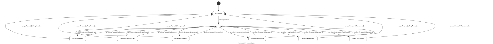](fig-sm-armModeStateMachine.svg)

| 出来事 | `notArmed` | `taskShapeArmed` | `milestoneShapeArmed` | `dependencyArmed` | `commentBoxArmed` | `highlightBoxArmed` | `parentTaskArmed` |
| --- | --- | --- | --- | --- | --- | --- | --- |
| `screen/escapePressed` | — | → `notArmed` [`isRungArmed`（`event.rung == 'armed'`）] それ以外 → — | → `notArmed` [`isRungArmed`（`event.rung == 'armed'`）] それ以外 → — | → `notArmed` [`isRungArmed`（`event.rung == 'armed'`）] それ以外 → — | → `notArmed` [`isRungArmed`（`event.rung == 'armed'`）] それ以外 → — | → `notArmed` [`isRungArmed`（`event.rung == 'armed'`）] それ以外 → — | → `notArmed` [`isRungArmed`（`event.rung == 'armed'`）] それ以外 → — |
| `screen/armEntryPressed` | → `{armKind}` | → `notArmed` [`isSameArm`（<code>event.armKind == 'taskShapeArmed' &amp;&amp; in(armModeStateMachine.taskShapeArmed) &amp;&amp; event.shapeKind == armModeStateMachine.shapeKind &#124;&#124; event.armKind == 'milestoneShapeArmed' &amp;&amp; in(armModeStateMachine.milestoneShapeArmed) &amp;&amp; event.glyph == armModeStateMachine.glyph &#124;&#124; event.armKind == 'dependencyArmed' &amp;&amp; in(armModeStateMachine.dependencyArmed) &#124;&#124; event.armKind == 'commentBoxArmed' &amp;&amp; in(armModeStateMachine.commentBoxArmed) &#124;&#124; event.armKind == 'highlightBoxArmed' &amp;&amp; in(armModeStateMachine.highlightBoxArmed) &#124;&#124; event.armKind == 'parentTaskArmed' &amp;&amp; in(armModeStateMachine.parentTaskArmed)</code>）] → `{armKind}` [not `isSameArm`（<code>event.armKind == 'taskShapeArmed' &amp;&amp; in(armModeStateMachine.taskShapeArmed) &amp;&amp; event.shapeKind == armModeStateMachine.shapeKind &#124;&#124; event.armKind == 'milestoneShapeArmed' &amp;&amp; in(armModeStateMachine.milestoneShapeArmed) &amp;&amp; event.glyph == armModeStateMachine.glyph &#124;&#124; event.armKind == 'dependencyArmed' &amp;&amp; in(armModeStateMachine.dependencyArmed) &#124;&#124; event.armKind == 'commentBoxArmed' &amp;&amp; in(armModeStateMachine.commentBoxArmed) &#124;&#124; event.armKind == 'highlightBoxArmed' &amp;&amp; in(armModeStateMachine.highlightBoxArmed) &#124;&#124; event.armKind == 'parentTaskArmed' &amp;&amp; in(armModeStateMachine.parentTaskArmed)</code>）] | → `notArmed` [`isSameArm`（<code>event.armKind == 'taskShapeArmed' &amp;&amp; in(armModeStateMachine.taskShapeArmed) &amp;&amp; event.shapeKind == armModeStateMachine.shapeKind &#124;&#124; event.armKind == 'milestoneShapeArmed' &amp;&amp; in(armModeStateMachine.milestoneShapeArmed) &amp;&amp; event.glyph == armModeStateMachine.glyph &#124;&#124; event.armKind == 'dependencyArmed' &amp;&amp; in(armModeStateMachine.dependencyArmed) &#124;&#124; event.armKind == 'commentBoxArmed' &amp;&amp; in(armModeStateMachine.commentBoxArmed) &#124;&#124; event.armKind == 'highlightBoxArmed' &amp;&amp; in(armModeStateMachine.highlightBoxArmed) &#124;&#124; event.armKind == 'parentTaskArmed' &amp;&amp; in(armModeStateMachine.parentTaskArmed)</code>）] → `{armKind}` [not `isSameArm`（<code>event.armKind == 'taskShapeArmed' &amp;&amp; in(armModeStateMachine.taskShapeArmed) &amp;&amp; event.shapeKind == armModeStateMachine.shapeKind &#124;&#124; event.armKind == 'milestoneShapeArmed' &amp;&amp; in(armModeStateMachine.milestoneShapeArmed) &amp;&amp; event.glyph == armModeStateMachine.glyph &#124;&#124; event.armKind == 'dependencyArmed' &amp;&amp; in(armModeStateMachine.dependencyArmed) &#124;&#124; event.armKind == 'commentBoxArmed' &amp;&amp; in(armModeStateMachine.commentBoxArmed) &#124;&#124; event.armKind == 'highlightBoxArmed' &amp;&amp; in(armModeStateMachine.highlightBoxArmed) &#124;&#124; event.armKind == 'parentTaskArmed' &amp;&amp; in(armModeStateMachine.parentTaskArmed)</code>）] | → `notArmed` [`isSameArm`（<code>event.armKind == 'taskShapeArmed' &amp;&amp; in(armModeStateMachine.taskShapeArmed) &amp;&amp; event.shapeKind == armModeStateMachine.shapeKind &#124;&#124; event.armKind == 'milestoneShapeArmed' &amp;&amp; in(armModeStateMachine.milestoneShapeArmed) &amp;&amp; event.glyph == armModeStateMachine.glyph &#124;&#124; event.armKind == 'dependencyArmed' &amp;&amp; in(armModeStateMachine.dependencyArmed) &#124;&#124; event.armKind == 'commentBoxArmed' &amp;&amp; in(armModeStateMachine.commentBoxArmed) &#124;&#124; event.armKind == 'highlightBoxArmed' &amp;&amp; in(armModeStateMachine.highlightBoxArmed) &#124;&#124; event.armKind == 'parentTaskArmed' &amp;&amp; in(armModeStateMachine.parentTaskArmed)</code>）] → `{armKind}` [not `isSameArm`（<code>event.armKind == 'taskShapeArmed' &amp;&amp; in(armModeStateMachine.taskShapeArmed) &amp;&amp; event.shapeKind == armModeStateMachine.shapeKind &#124;&#124; event.armKind == 'milestoneShapeArmed' &amp;&amp; in(armModeStateMachine.milestoneShapeArmed) &amp;&amp; event.glyph == armModeStateMachine.glyph &#124;&#124; event.armKind == 'dependencyArmed' &amp;&amp; in(armModeStateMachine.dependencyArmed) &#124;&#124; event.armKind == 'commentBoxArmed' &amp;&amp; in(armModeStateMachine.commentBoxArmed) &#124;&#124; event.armKind == 'highlightBoxArmed' &amp;&amp; in(armModeStateMachine.highlightBoxArmed) &#124;&#124; event.armKind == 'parentTaskArmed' &amp;&amp; in(armModeStateMachine.parentTaskArmed)</code>）] | → `notArmed` [`isSameArm`（<code>event.armKind == 'taskShapeArmed' &amp;&amp; in(armModeStateMachine.taskShapeArmed) &amp;&amp; event.shapeKind == armModeStateMachine.shapeKind &#124;&#124; event.armKind == 'milestoneShapeArmed' &amp;&amp; in(armModeStateMachine.milestoneShapeArmed) &amp;&amp; event.glyph == armModeStateMachine.glyph &#124;&#124; event.armKind == 'dependencyArmed' &amp;&amp; in(armModeStateMachine.dependencyArmed) &#124;&#124; event.armKind == 'commentBoxArmed' &amp;&amp; in(armModeStateMachine.commentBoxArmed) &#124;&#124; event.armKind == 'highlightBoxArmed' &amp;&amp; in(armModeStateMachine.highlightBoxArmed) &#124;&#124; event.armKind == 'parentTaskArmed' &amp;&amp; in(armModeStateMachine.parentTaskArmed)</code>）] → `{armKind}` [not `isSameArm`（<code>event.armKind == 'taskShapeArmed' &amp;&amp; in(armModeStateMachine.taskShapeArmed) &amp;&amp; event.shapeKind == armModeStateMachine.shapeKind &#124;&#124; event.armKind == 'milestoneShapeArmed' &amp;&amp; in(armModeStateMachine.milestoneShapeArmed) &amp;&amp; event.glyph == armModeStateMachine.glyph &#124;&#124; event.armKind == 'dependencyArmed' &amp;&amp; in(armModeStateMachine.dependencyArmed) &#124;&#124; event.armKind == 'commentBoxArmed' &amp;&amp; in(armModeStateMachine.commentBoxArmed) &#124;&#124; event.armKind == 'highlightBoxArmed' &amp;&amp; in(armModeStateMachine.highlightBoxArmed) &#124;&#124; event.armKind == 'parentTaskArmed' &amp;&amp; in(armModeStateMachine.parentTaskArmed)</code>）] | → `notArmed` [`isSameArm`（<code>event.armKind == 'taskShapeArmed' &amp;&amp; in(armModeStateMachine.taskShapeArmed) &amp;&amp; event.shapeKind == armModeStateMachine.shapeKind &#124;&#124; event.armKind == 'milestoneShapeArmed' &amp;&amp; in(armModeStateMachine.milestoneShapeArmed) &amp;&amp; event.glyph == armModeStateMachine.glyph &#124;&#124; event.armKind == 'dependencyArmed' &amp;&amp; in(armModeStateMachine.dependencyArmed) &#124;&#124; event.armKind == 'commentBoxArmed' &amp;&amp; in(armModeStateMachine.commentBoxArmed) &#124;&#124; event.armKind == 'highlightBoxArmed' &amp;&amp; in(armModeStateMachine.highlightBoxArmed) &#124;&#124; event.armKind == 'parentTaskArmed' &amp;&amp; in(armModeStateMachine.parentTaskArmed)</code>）] → `{armKind}` [not `isSameArm`（<code>event.armKind == 'taskShapeArmed' &amp;&amp; in(armModeStateMachine.taskShapeArmed) &amp;&amp; event.shapeKind == armModeStateMachine.shapeKind &#124;&#124; event.armKind == 'milestoneShapeArmed' &amp;&amp; in(armModeStateMachine.milestoneShapeArmed) &amp;&amp; event.glyph == armModeStateMachine.glyph &#124;&#124; event.armKind == 'dependencyArmed' &amp;&amp; in(armModeStateMachine.dependencyArmed) &#124;&#124; event.armKind == 'commentBoxArmed' &amp;&amp; in(armModeStateMachine.commentBoxArmed) &#124;&#124; event.armKind == 'highlightBoxArmed' &amp;&amp; in(armModeStateMachine.highlightBoxArmed) &#124;&#124; event.armKind == 'parentTaskArmed' &amp;&amp; in(armModeStateMachine.parentTaskArmed)</code>）] | → `notArmed` [`isSameArm`（<code>event.armKind == 'taskShapeArmed' &amp;&amp; in(armModeStateMachine.taskShapeArmed) &amp;&amp; event.shapeKind == armModeStateMachine.shapeKind &#124;&#124; event.armKind == 'milestoneShapeArmed' &amp;&amp; in(armModeStateMachine.milestoneShapeArmed) &amp;&amp; event.glyph == armModeStateMachine.glyph &#124;&#124; event.armKind == 'dependencyArmed' &amp;&amp; in(armModeStateMachine.dependencyArmed) &#124;&#124; event.armKind == 'commentBoxArmed' &amp;&amp; in(armModeStateMachine.commentBoxArmed) &#124;&#124; event.armKind == 'highlightBoxArmed' &amp;&amp; in(armModeStateMachine.highlightBoxArmed) &#124;&#124; event.armKind == 'parentTaskArmed' &amp;&amp; in(armModeStateMachine.parentTaskArmed)</code>）] → `{armKind}` [not `isSameArm`（<code>event.armKind == 'taskShapeArmed' &amp;&amp; in(armModeStateMachine.taskShapeArmed) &amp;&amp; event.shapeKind == armModeStateMachine.shapeKind &#124;&#124; event.armKind == 'milestoneShapeArmed' &amp;&amp; in(armModeStateMachine.milestoneShapeArmed) &amp;&amp; event.glyph == armModeStateMachine.glyph &#124;&#124; event.armKind == 'dependencyArmed' &amp;&amp; in(armModeStateMachine.dependencyArmed) &#124;&#124; event.armKind == 'commentBoxArmed' &amp;&amp; in(armModeStateMachine.commentBoxArmed) &#124;&#124; event.armKind == 'highlightBoxArmed' &amp;&amp; in(armModeStateMachine.highlightBoxArmed) &#124;&#124; event.armKind == 'parentTaskArmed' &amp;&amp; in(armModeStateMachine.parentTaskArmed)</code>）] |
| `screen/dualCursorEntryPressed` | — | → `notArmed` [`dualCursorModeStateMachine.off` にいる & `hasDaysToPlace`（`event.hasDaysToPlace`）] それ以外 → — | → `notArmed` [`dualCursorModeStateMachine.off` にいる & `hasDaysToPlace`（`event.hasDaysToPlace`）] それ以外 → — | → `notArmed` [`dualCursorModeStateMachine.off` にいる & `hasDaysToPlace`（`event.hasDaysToPlace`）] それ以外 → — | → `notArmed` [`dualCursorModeStateMachine.off` にいる & `hasDaysToPlace`（`event.hasDaysToPlace`）] それ以外 → — | → `notArmed` [`dualCursorModeStateMachine.off` にいる & `hasDaysToPlace`（`event.hasDaysToPlace`）] それ以外 → — | → `notArmed` [`dualCursorModeStateMachine.off` にいる & `hasDaysToPlace`（`event.hasDaysToPlace`）] それ以外 → — |

- `armModeStateMachine.notArmed` —— 初期。根拠 `AR-1`
- `armModeStateMachine.taskShapeArmed` —— 運ぶ値 `shapeKind`（`SH-1` ・ `SH-2` ・ `SH-3` ・ `SH-4`）。根拠 `AR-2` ・ `IC-23` ・ `IC-24` ・ `IC-25` ・ `IC-26`
- `armModeStateMachine.milestoneShapeArmed` —— 運ぶ値 `glyph`（`SH-5`）。根拠 `AR-3` ・ `IC-27`
- `armModeStateMachine.dependencyArmed` —— 根拠 `AR-4` ・ `IC-61`
- `armModeStateMachine.commentBoxArmed` —— 根拠 `AR-5` ・ `IC-35`
- `armModeStateMachine.highlightBoxArmed` —— 根拠 `AR-6` ・ `IC-36`
- `armModeStateMachine.parentTaskArmed` —— 根拠 `AR-7` ・ `IC-142`

表に無い出来事は `armModeStateMachine` を変えない（同じ参照）。

### 状態機械 `paletteDisplayStateMachine`

[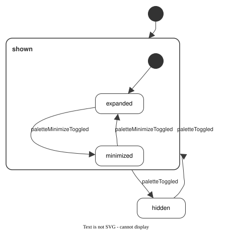](fig-sm-paletteDisplayStateMachine.svg)

| 出来事 | `shown.expanded` | `shown.minimized` | `hidden` |
| --- | --- | --- | --- |
| `screen/paletteToggled` | → `hidden`（親 `shown` の升） | → `hidden`（親 `shown` の升） | → `shown` |
| `screen/paletteMinimizeToggled` | → `shown.minimized` | → `shown.expanded` | — |

- `paletteDisplayStateMachine.shown` —— 初期。根拠 `S-99e`
- `paletteDisplayStateMachine.shown.expanded` —— 初期。親 `paletteDisplayStateMachine.shown`。根拠 `S-200` ・ `FR-053`
- `paletteDisplayStateMachine.shown.minimized` —— 親 `paletteDisplayStateMachine.shown`。根拠 `S-200` ・ `IC-75`
- `paletteDisplayStateMachine.hidden` —— 根拠 `S-99e`

表に無い出来事は `paletteDisplayStateMachine` を変えない（同じ参照）。

### 状態機械 `milestoneListDisplayStateMachine`

[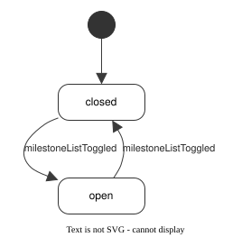](fig-sm-milestoneListDisplayStateMachine.svg)

| 出来事 | `closed` | `open` |
| --- | --- | --- |
| `screen/milestoneListToggled` | → `open` | → `closed` |

- `milestoneListDisplayStateMachine.closed` —— 初期。根拠 `S-142` ・ `FR-053`
- `milestoneListDisplayStateMachine.open` —— 根拠 `S-142` ・ `IC-50`

表に無い出来事は `milestoneListDisplayStateMachine` を変えない（同じ参照）。

### 状態機械 `fullScreenModeStateMachine`

[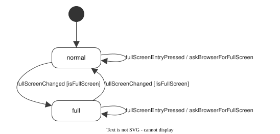](fig-sm-fullScreenModeStateMachine.svg)

| 出来事 | `normal` | `full` |
| --- | --- | --- |
| `screen/fullScreenEntryPressed` | → 自己 / `askBrowserForFullScreen` | → 自己 / `askBrowserForFullScreen` |
| `screen/fullScreenChanged` | → `full` [`isFullScreen`（`event.isFullScreen`）] それ以外 → — | → `normal` [not `isFullScreen`（`event.isFullScreen`）] それ以外 → — |

- `fullScreenModeStateMachine.normal` —— 初期。根拠 `S-99f`
- `fullScreenModeStateMachine.full` —— 根拠 `S-99f` ・ `FR-071`

表に無い出来事は `fullScreenModeStateMachine` を変えない（同じ参照）。

### 状態機械 `openSurfaceStateMachine`

[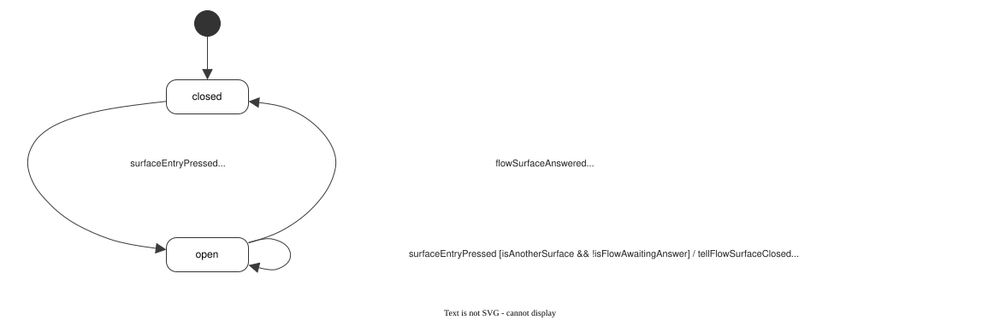](fig-sm-openSurfaceStateMachine.svg)

| 出来事 | `closed` | `open` |
| --- | --- | --- |
| `screen/surfaceEntryPressed` | → `open` | → 自己 [`isAnotherSurface`（`in(openSurfaceStateMachine.open) && openSurfaceStateMachine.surfaceName != event.surfaceName`） & not `isFlowAwaitingAnswer`（`openSurfaceStateMachine.surfaceName in ['U-56', 'U-61']`）] / `tellFlowSurfaceClosed`（開いている面を閉じて、押した入口の面に差し替える。`surfaceName` を書き換える） → 自己 [`isAnotherSurface`（`in(openSurfaceStateMachine.open) && openSurfaceStateMachine.surfaceName != event.surfaceName`） & `isFlowAwaitingAnswer`（`openSurfaceStateMachine.surfaceName in ['U-56', 'U-61']`）] / `raiseNotice`（`RS-27`）（開く道の答えを待つ面（`flowSurfaceAnswered` で答える `U-56`・`U-61`）は差し替えない。押した入口が効かない理由として運ぶ） それ以外 → — |
| `screen/surfaceRaisedByFlow` | → `open` | → 自己 [`isAnotherSurface`（`in(openSurfaceStateMachine.open) && openSurfaceStateMachine.surfaceName != event.surfaceName`） & not `isFlowAwaitingAnswer`（`openSurfaceStateMachine.surfaceName in ['U-56', 'U-61']`）] / `tellFlowSurfaceClosed`（開く道が立てる面も、開いている面を差し替える。答えを待つ面が開いているあいだ、開く道は次の面を立てない） それ以外 → — |
| `screen/flowSurfaceAnswered` | — | → `closed`（`tellFlowSurfaceClosed` を返さない —— 答えた後に「閉じた」が戻らない） |
| `screen/surfaceCloseAsked` | — | → `closed` [`isSurfaceTarget`（`event.target == 'surface'`）] / `tellFlowSurfaceClosed` それ以外 → — |
| `screen/escapePressed` | — | → `closed` [`isRungSurface`（`event.rung == 'surface'`）] / `tellFlowSurfaceClosed` それ以外 → — |
| `screen/watermarkEntryPressed` | → `open` [`watermarkDisplayStateMachine.shown` にいる]（`surfaceName` は `U-60`） それ以外 → — | → 自己 [`watermarkDisplayStateMachine.shown` にいる & not `isWatermarkUnlockSurface`（`openSurfaceStateMachine.surfaceName == 'U-60'`） & not `isFlowAwaitingAnswer`（`openSurfaceStateMachine.surfaceName in ['U-56', 'U-61']`）] / `tellFlowSurfaceClosed`（開いている面を閉じて、押した入口の面に差し替える。`surfaceName` を書き換える（`U-60`）） → 自己 [`watermarkDisplayStateMachine.shown` にいる & not `isWatermarkUnlockSurface`（`openSurfaceStateMachine.surfaceName == 'U-60'`） & `isFlowAwaitingAnswer`（`openSurfaceStateMachine.surfaceName in ['U-56', 'U-61']`）] / `raiseNotice`（`RS-27`）（開く道の答えを待つ面（`flowSurfaceAnswered` で答える `U-56`・`U-61`）は差し替えない。押した入口が効かない理由として運ぶ） それ以外 → — |
| `screen/watermarkUnlockAnswered` | — | → 自己 [`isWatermarkUnlockSurface`（`openSurfaceStateMachine.surfaceName == 'U-60'`） & `isProceeding`（`event.isProceeding`）] / `matchWatermarkUnlock` → `closed` [`isWatermarkUnlockSurface`（`openSurfaceStateMachine.surfaceName == 'U-60'`） & not `isProceeding`（`event.isProceeding`）] それ以外 → — |
| `screen/watermarkUnlockMatched` | — | → `closed` [`watermarkDisplayStateMachine.shown` にいる & `isWatermarkUnlockSurface`（`openSurfaceStateMachine.surfaceName == 'U-60'`）] それ以外 → — |
| `screen/watermarkUnlockMismatched` | — | → 自己 [`isWatermarkUnlockSurface`（`openSurfaceStateMachine.surfaceName == 'U-60'`）] / `raiseNotice`（`RS-41`）（面を閉じない） それ以外 → — |

- `openSurfaceStateMachine.closed` —— 初期。根拠 `S-99g`
- `openSurfaceStateMachine.open` —— 運ぶ値 `surfaceName`（`U-54` ・ `U-56` ・ `U-60` ・ `U-61` ・ `U-62` ・ `U-65`）。根拠 `S-99g` ・ `IC-52`

表に無い出来事は `openSurfaceStateMachine` を変えない（同じ参照）。

### 状態機械 `watermarkDisplayStateMachine`

[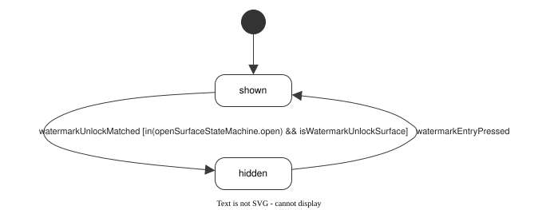](fig-sm-watermarkDisplayStateMachine.svg)

| 出来事 | `shown` | `hidden` |
| --- | --- | --- |
| `screen/watermarkEntryPressed` | — | → `shown` |
| `screen/watermarkUnlockMatched` | → `hidden` [`openSurfaceStateMachine.open` にいる & `isWatermarkUnlockSurface`（`openSurfaceStateMachine.surfaceName == 'U-60'`）] それ以外 → — | — |

- `watermarkDisplayStateMachine.shown` —— 初期。根拠 `S-144`
- `watermarkDisplayStateMachine.hidden` —— 根拠 `WM-8`

表に無い出来事は `watermarkDisplayStateMachine` を変えない（同じ参照）。

### 状態機械 `propertiesPanelContentStateMachine`

[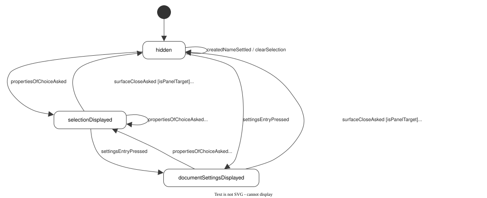](fig-sm-propertiesPanelContentStateMachine.svg)

| 出来事 | `hidden` | `selectionDisplayed` | `documentSettingsDisplayed` |
| --- | --- | --- | --- |
| `screen/surfaceCloseAsked` | — | → `hidden` [`isPanelTarget`（`event.target == 'panel'`）] それ以外 → — | → `hidden` [`isPanelTarget`（`event.target == 'panel'`）] それ以外 → — |
| `screen/escapePressed` | — | → `hidden` [`isRungSurface`（`event.rung == 'surface'`） & `openSurfaceStateMachine.closed` にいる] それ以外 → — | → `hidden` [`isRungSurface`（`event.rung == 'surface'`） & `openSurfaceStateMachine.closed` にいる] それ以外 → — |
| `screen/settingsEntryPressed` | → `documentSettingsDisplayed` | → `documentSettingsDisplayed` | → `hidden`（直前の選択物の有無を問わない） |
| `screen/propertiesOfChoiceAsked` | → `selectionDisplayed` | → 自己（`subject` を書き換える） | → `selectionDisplayed` |
| `screen/selectionMoved` | — | → 自己 [`hasChoice`（<code>event.subject.selection.items.length &gt; 0 &#124;&#124; event.subject.taskGroupIds.length &gt; 0</code>）]（`subject` を書き換える） それ以外 → — | → `selectionDisplayed` [`hasChoice`（<code>event.subject.selection.items.length &gt; 0 &#124;&#124; event.subject.taskGroupIds.length &gt; 0</code>）]（`subject` を書き換える。設定を出していても、選んだものへ移る） それ以外 → — |
| `screen/createdNameSettled` | → 自己 / `clearSelection` | → `hidden` / `clearSelection` | → `hidden` / `clearSelection` |
| `screen/settleKeyPressed` | — | → `hidden` [not `hasSurfaceOrConfirmation`（`event.hasSurfaceOrConfirmation`） & not `hasUnsettledEntry`（`event.hasUnsettledEntry`）] それ以外 → — | → `hidden` [not `hasSurfaceOrConfirmation`（`event.hasSurfaceOrConfirmation`） & not `hasUnsettledEntry`（`event.hasUnsettledEntry`）] それ以外 → — |

- `propertiesPanelContentStateMachine.hidden` —— 初期。根拠 `S-99h`
- `propertiesPanelContentStateMachine.selectionDisplayed` —— 運ぶ値 `subject`（選択とタスクグループの集合）。根拠 `S-99h` ・ `IR-2` ・ `FR-072`
- `propertiesPanelContentStateMachine.documentSettingsDisplayed` —— 根拠 `S-99h` ・ `FR-072` ・ `IC-17`

表に無い出来事は `propertiesPanelContentStateMachine` を変えない（同じ参照）。

### 状態機械 `dualCursorModeStateMachine`

[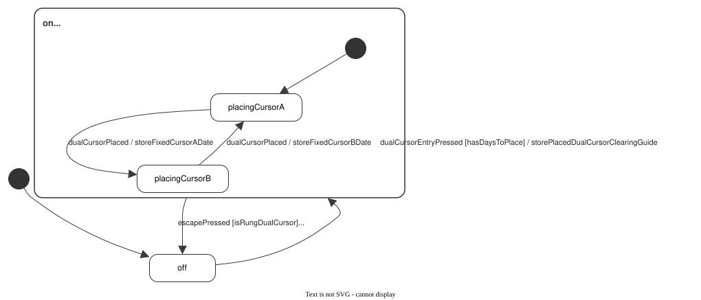](fig-sm-dualCursorModeStateMachine.svg)

| 出来事 | `off` | `on.placingCursorA` | `on.placingCursorB` |
| --- | --- | --- | --- |
| exit | — | / `storeClearedDualCursor`（どの出方でも、二重カーソルを消したことを覚える）（親 `on` の升） | / `storeClearedDualCursor`（どの出方でも、二重カーソルを消したことを覚える）（親 `on` の升） |
| `screen/escapePressed` | — | → `off` [`isRungDualCursor`（`event.rung == 'dualCursorMode'`）] それ以外 → —（親 `on` の升） | → `off` [`isRungDualCursor`（`event.rung == 'dualCursorMode'`）] それ以外 → —（親 `on` の升） |
| `screen/dualCursorEntryPressed` | → `on` [`hasDaysToPlace`（`event.hasDaysToPlace`）] / `storePlacedDualCursorClearingGuide` それ以外 → — | → `off`（親 `on` の升） | → `off`（親 `on` の升） |
| `screen/guideCursorEntryPressed` | — | → `off`（親 `on` の升） | → `off`（親 `on` の升） |
| `screen/dualCursorPlaced` | — | → `on.placingCursorB` / `storeFixedCursorADate` | → `on.placingCursorA` / `storeFixedCursorBDate` |

- `dualCursorModeStateMachine.off` —— 初期。根拠 `DC-1`
- `dualCursorModeStateMachine.on` —— exit / `storeClearedDualCursor`。根拠 `DC-1` ・ `PTD-2`
- `dualCursorModeStateMachine.on.placingCursorA` —— 初期。親 `dualCursorModeStateMachine.on`。根拠 `DC-1`
- `dualCursorModeStateMachine.on.placingCursorB` —— 親 `dualCursorModeStateMachine.on`。根拠 `DC-2` ・ `DC-8`

表に無い出来事は `dualCursorModeStateMachine` を変えない（同じ参照）。

### 状態機械 `scaleMessageDisplayStateMachine`

[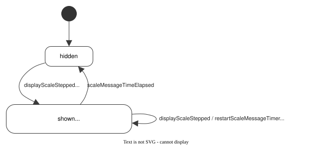](fig-sm-scaleMessageDisplayStateMachine.svg)

| 出来事 | `hidden` | `shown` |
| --- | --- | --- |
| entry | — | / `startScaleMessageTimer` |
| `screen/displayScaleStepped` | → `shown` | → 自己 / `restartScaleMessageTimer`（中身を書き換える） |
| `screen/verticalZoomEndReached` | → `shown` | → 自己 / `restartScaleMessageTimer`（中身を書き換える） |
| `screen/scaleMessageTimeElapsed` | — | → `hidden` |

- `scaleMessageDisplayStateMachine.hidden` —— 初期。根拠 `SE-1`
- `scaleMessageDisplayStateMachine.shown` —— 運ぶ値 `percent` ／ `end`（`max` ・ `min` ・ なし）。entry / `startScaleMessageTimer`。根拠 `SE-2` ・ `ZE-5` ・ `S-244`

表に無い出来事は `scaleMessageDisplayStateMachine` を変えない（同じ参照）。

### 状態機械 `tooltipDisplayStateMachine`

[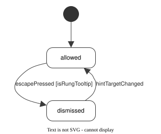](fig-sm-tooltipDisplayStateMachine.svg)

| 出来事 | `allowed` | `dismissed` |
| --- | --- | --- |
| `screen/escapePressed` | → `dismissed` [`isRungTooltip`（`event.rung == 'tooltip'`）] それ以外 → — | — |
| `screen/hintTargetChanged` | — | → `allowed` |

- `tooltipDisplayStateMachine.allowed` —— 初期。根拠 `IN-3`
- `tooltipDisplayStateMachine.dismissed` —— 根拠 `IN-3` ・ `IN-4`

表に無い出来事は `tooltipDisplayStateMachine` を変えない（同じ参照）。

### 状態機械 `searchPanelDisplayStateMachine`

[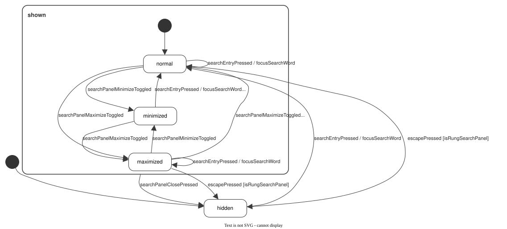](fig-sm-searchPanelDisplayStateMachine.svg)

| 出来事 | `hidden` | `shown.normal` | `shown.minimized` | `shown.maximized` |
| --- | --- | --- | --- | --- |
| `screen/searchEntryPressed` | → `shown.normal` / `focusSearchWord` | → 自己 / `focusSearchWord` | → `shown.normal` / `focusSearchWord` | → 自己 / `focusSearchWord` |
| `screen/searchPanelMinimizeToggled` | — | → `shown.minimized` | → `shown.normal` | → `shown.minimized` |
| `screen/searchPanelMaximizeToggled` | — | → `shown.maximized` | → `shown.maximized` | → `shown.normal` |
| `screen/searchPanelClosePressed` | — | → `hidden`（親 `shown` の升） | → `hidden`（親 `shown` の升） | → `hidden`（親 `shown` の升） |
| `screen/escapePressed` | — | → `hidden` [`isRungSearchPanel`（`event.rung == 'searchPanel'`）] それ以外 → — | — | → `hidden` [`isRungSearchPanel`（`event.rung == 'searchPanel'`）] それ以外 → — |
| `screen/searchHitJumped` | — | — | — | → `shown.normal` |

- `searchPanelDisplayStateMachine.hidden` —— 初期。根拠 `S-442`
- `searchPanelDisplayStateMachine.shown` —— 根拠 `S-442` ・ `FR-151`
- `searchPanelDisplayStateMachine.shown.normal` —— 初期。親 `searchPanelDisplayStateMachine.shown`。根拠 `S-442` ・ `SV-9`
- `searchPanelDisplayStateMachine.shown.minimized` —— 親 `searchPanelDisplayStateMachine.shown`。根拠 `S-442` ・ `SV-12` ・ `IC-129`
- `searchPanelDisplayStateMachine.shown.maximized` —— 親 `searchPanelDisplayStateMachine.shown`。根拠 `S-442` ・ `SV-13` ・ `IC-130`

表に無い出来事は `searchPanelDisplayStateMachine` を変えない（同じ参照）。

### 状態機械 `helpDisplayStateMachine`

[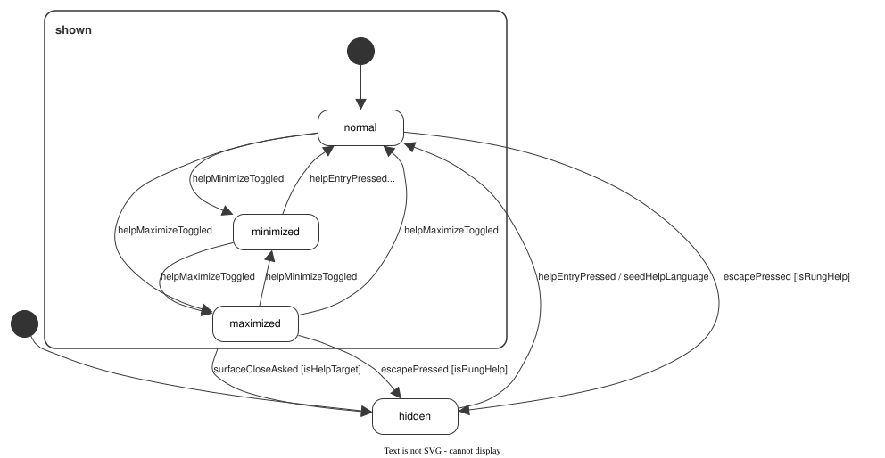](fig-sm-helpDisplayStateMachine.svg)

| 出来事 | `hidden` | `shown.normal` | `shown.minimized` | `shown.maximized` |
| --- | --- | --- | --- | --- |
| `screen/helpEntryPressed` | → `shown.normal` / `seedHelpLanguage` | — | → `shown.normal` | — |
| `screen/helpMinimizeToggled` | — | → `shown.minimized` | → `shown.normal` | → `shown.minimized` |
| `screen/helpMaximizeToggled` | — | → `shown.maximized` | → `shown.maximized` | → `shown.normal` |
| `screen/surfaceCloseAsked` | — | → `hidden` [`isHelpTarget`（`event.target == 'helpModal'`）] それ以外 → —（親 `shown` の升） | → `hidden` [`isHelpTarget`（`event.target == 'helpModal'`）] それ以外 → —（親 `shown` の升） | → `hidden` [`isHelpTarget`（`event.target == 'helpModal'`）] それ以外 → —（親 `shown` の升） |
| `screen/escapePressed` | — | → `hidden` [`isRungHelp`（`event.rung == 'helpModal'`）] それ以外 → — | — | → `hidden` [`isRungHelp`（`event.rung == 'helpModal'`）] それ以外 → — |

- `helpDisplayStateMachine.hidden` —— 初期。根拠 `S-435`
- `helpDisplayStateMachine.shown` —— 根拠 `S-435` ・ `FR-036`
- `helpDisplayStateMachine.shown.normal` —— 初期。親 `helpDisplayStateMachine.shown`。根拠 `S-435` ・ `WB-1`
- `helpDisplayStateMachine.shown.minimized` —— 親 `helpDisplayStateMachine.shown`。根拠 `S-435` ・ `WB-2` ・ `IC-129`
- `helpDisplayStateMachine.shown.maximized` —— 親 `helpDisplayStateMachine.shown`。根拠 `S-435` ・ `WB-3` ・ `IC-130`

表に無い出来事は `helpDisplayStateMachine` を変えない（同じ参照）。

### 状態機械 `landingMarkDisplayStateMachine`

[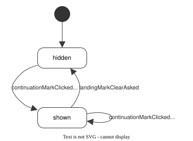](fig-sm-landingMarkDisplayStateMachine.svg)

| 出来事 | `hidden` | `shown` |
| --- | --- | --- |
| `screen/continuationMarkClicked` | → `shown` | → 自己（中身を書き換える） |
| `screen/landingMarkClearAsked` | — | → `hidden` |
| `screen/searchJumpLanded` | → `shown` | → 自己（中身を書き換える） |

- `landingMarkDisplayStateMachine.hidden` —— 初期。根拠 `EL-17`
- `landingMarkDisplayStateMachine.shown` —— 運ぶ値 `landedBy`（印を付けたもの —— `continuationMark`（続きの印、`EL-16`） ／ `jump`（飛び方、`SJ-10`）） ／ `landedLink`（印を付けた依存線の先行と後続の `UID`。`landedBy` が `continuationMark` のときだけ持ち、`jump` では `null`） ／ `landedTarget`（印の先の `Task` の `UID`、またはコメントボックスの id） ／ `landedRelatedTasks`（遅延診断の修正案の行から飛んだとき（表 T-346 の `RW-13`）の、行の関係するタスクの `UID` の列 —— `S-573` の色の囲みを描く。ほかの飛び方と続きの印では空）。根拠 `EL-16` ・ `EL-19` ・ `SJ-10` ・ `RW-13`

表に無い出来事は `landingMarkDisplayStateMachine` を変えない（同じ参照）。

### 状態機械 `dropCueDisplayStateMachine`

[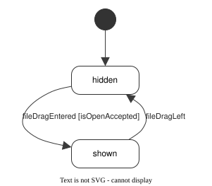](fig-sm-dropCueDisplayStateMachine.svg)

| 出来事 | `hidden` | `shown` |
| --- | --- | --- |
| `screen/fileDragEntered` | → `shown` [`isOpenAccepted`（`event.isOpenAccepted`）]（`isOpenAccepted` は、表 T-290 の `fileOperationStateMachine` が `idle` で、`confirmationStateMachine` が `notAsked` のとき真 —— 偽なら `fileFlow/documentOpenAsked` が `RS-27` で断るので、案内を出さない） それ以外 → — | — |
| `screen/fileDragLeft` | — | → `hidden` |

- `dropCueDisplayStateMachine.hidden` —— 初期。根拠 `OP-17`
- `dropCueDisplayStateMachine.shown` —— 根拠 `OP-17` ・ `U-68`

表に無い出来事は `dropCueDisplayStateMachine` を変えない（同じ参照）。

### 状態機械 `baseTimeZoneDraftStateMachine`

[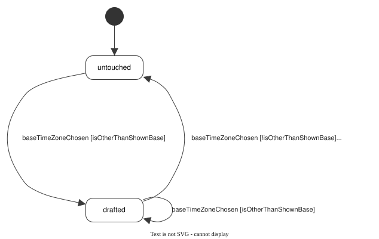](fig-sm-baseTimeZoneDraftStateMachine.svg)

| 出来事 | `untouched` | `drafted` |
| --- | --- | --- |
| `screen/baseTimeZoneChosen` | → `drafted` [`isOtherThanShownBase`（`event.isOtherThanShownBase`）]（いまの見せる基準と同じタイムゾーンを選んだときは移らない） それ以外 → — | → 自己 [`isOtherThanShownBase`（`event.isOtherThanShownBase`）]（`chosenRegion` を書き換える） → `untouched` [not `isOtherThanShownBase`（`event.isOtherThanShownBase`）]（いまの見せる基準を選び直したので、下書きを捨てる） |
| `screen/baseChangeEntryPressed` | — | → `untouched` / `issueBaseChangeCommand`（`keepGlobalTime` は `CM-95` を、`keepLocalTime` は `CM-94` と `CM-95`（`null`）を、1 回の書き込みで出す。確認を取らない） |
| `screen/baseChangeCancelPressed` | — | → `untouched`（何も書かない） |
| `screen/surfaceCloseAsked` | — | → `untouched` [`isLeavingDocumentSettings`（`in(propertiesPanelContentStateMachine.documentSettingsDisplayed) && !inAfter(propertiesPanelContentStateMachine.documentSettingsDisplayed)`）]（プロパティパネルが文書の設定を出さなくなるときだけ、下書きを捨てる） それ以外 → — |
| `screen/escapePressed` | — | → `untouched` [`isLeavingDocumentSettings`（`in(propertiesPanelContentStateMachine.documentSettingsDisplayed) && !inAfter(propertiesPanelContentStateMachine.documentSettingsDisplayed)`）]（プロパティパネルが文書の設定を出さなくなるときだけ、下書きを捨てる） それ以外 → — |
| `screen/settingsEntryPressed` | — | → `untouched` [`isLeavingDocumentSettings`（`in(propertiesPanelContentStateMachine.documentSettingsDisplayed) && !inAfter(propertiesPanelContentStateMachine.documentSettingsDisplayed)`）]（プロパティパネルが文書の設定を出さなくなるときだけ、下書きを捨てる） それ以外 → — |
| `screen/propertiesOfChoiceAsked` | — | → `untouched` [`isLeavingDocumentSettings`（`in(propertiesPanelContentStateMachine.documentSettingsDisplayed) && !inAfter(propertiesPanelContentStateMachine.documentSettingsDisplayed)`）]（プロパティパネルが文書の設定を出さなくなるときだけ、下書きを捨てる） それ以外 → — |
| `screen/selectionMoved` | — | → `untouched` [`isLeavingDocumentSettings`（`in(propertiesPanelContentStateMachine.documentSettingsDisplayed) && !inAfter(propertiesPanelContentStateMachine.documentSettingsDisplayed)`）]（プロパティパネルが文書の設定を出さなくなるときだけ、下書きを捨てる） それ以外 → — |
| `screen/createdNameSettled` | — | → `untouched` [`isLeavingDocumentSettings`（`in(propertiesPanelContentStateMachine.documentSettingsDisplayed) && !inAfter(propertiesPanelContentStateMachine.documentSettingsDisplayed)`）]（プロパティパネルが文書の設定を出さなくなるときだけ、下書きを捨てる） それ以外 → — |
| `screen/settleKeyPressed` | — | → `untouched` [`isLeavingDocumentSettings`（`in(propertiesPanelContentStateMachine.documentSettingsDisplayed) && !inAfter(propertiesPanelContentStateMachine.documentSettingsDisplayed)`）]（プロパティパネルが文書の設定を出さなくなるときだけ、下書きを捨てる） それ以外 → — |
| `screen/documentReplacedByOpenOrNew` | — | → `untouched` |

- `baseTimeZoneDraftStateMachine.untouched` —— 初期。根拠 `FO-14` ・ `FR-156`
- `baseTimeZoneDraftStateMachine.drafted` —— 運ぶ値 `chosenRegion`（`FR-156`。表 T-376 の種が標準時の行の鍵。いまの見せる基準と違う）。根拠 `FR-156` ・ `FO-14`

表に無い出来事は `baseTimeZoneDraftStateMachine` を変えない（同じ参照）。

### 状態機械 `timeShiftDraftStateMachine`

[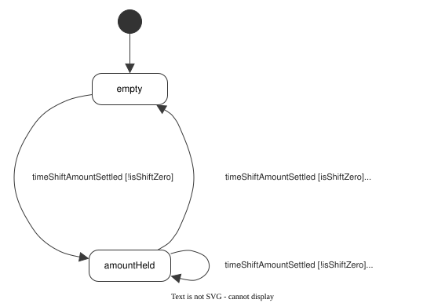](fig-sm-timeShiftDraftStateMachine.svg)

| 出来事 | `empty` | `amountHeld` |
| --- | --- | --- |
| `screen/timeShiftAmountSettled` | → `amountHeld` [not `isShiftZero`（`event.shiftMinutes == 0`）] それ以外 → — | → 自己 [not `isShiftZero`（`event.shiftMinutes == 0`）]（`shiftMinutes` を書き換える） → `empty` [`isShiftZero`（`event.shiftMinutes == 0`）] |
| `screen/timeShiftEntryPressed` | — | → 自己 / `raiseTimeShiftQuestion`（下書きの量で `QN-14` を問う。続けると答えたら `CM-98` を 1 回出す。量が 0 か空のあいだは `IC-162` が薄い（`FR-029`）） |
| `screen/timeShiftLanded` | — | → `empty` |
| `screen/surfaceCloseAsked` | — | → `empty` [`isLeavingDocumentSettings`（`in(propertiesPanelContentStateMachine.documentSettingsDisplayed) && !inAfter(propertiesPanelContentStateMachine.documentSettingsDisplayed)`）]（プロパティパネルが文書の設定を出さなくなるときだけ、量を捨てる） それ以外 → — |
| `screen/escapePressed` | — | → `empty` [`isLeavingDocumentSettings`（`in(propertiesPanelContentStateMachine.documentSettingsDisplayed) && !inAfter(propertiesPanelContentStateMachine.documentSettingsDisplayed)`）]（プロパティパネルが文書の設定を出さなくなるときだけ、量を捨てる） それ以外 → — |
| `screen/settingsEntryPressed` | — | → `empty` [`isLeavingDocumentSettings`（`in(propertiesPanelContentStateMachine.documentSettingsDisplayed) && !inAfter(propertiesPanelContentStateMachine.documentSettingsDisplayed)`）]（プロパティパネルが文書の設定を出さなくなるときだけ、量を捨てる） それ以外 → — |
| `screen/propertiesOfChoiceAsked` | — | → `empty` [`isLeavingDocumentSettings`（`in(propertiesPanelContentStateMachine.documentSettingsDisplayed) && !inAfter(propertiesPanelContentStateMachine.documentSettingsDisplayed)`）]（プロパティパネルが文書の設定を出さなくなるときだけ、量を捨てる） それ以外 → — |
| `screen/selectionMoved` | — | → `empty` [`isLeavingDocumentSettings`（`in(propertiesPanelContentStateMachine.documentSettingsDisplayed) && !inAfter(propertiesPanelContentStateMachine.documentSettingsDisplayed)`）]（プロパティパネルが文書の設定を出さなくなるときだけ、量を捨てる） それ以外 → — |
| `screen/createdNameSettled` | — | → `empty` [`isLeavingDocumentSettings`（`in(propertiesPanelContentStateMachine.documentSettingsDisplayed) && !inAfter(propertiesPanelContentStateMachine.documentSettingsDisplayed)`）]（プロパティパネルが文書の設定を出さなくなるときだけ、量を捨てる） それ以外 → — |
| `screen/settleKeyPressed` | — | → `empty` [`isLeavingDocumentSettings`（`in(propertiesPanelContentStateMachine.documentSettingsDisplayed) && !inAfter(propertiesPanelContentStateMachine.documentSettingsDisplayed)`）]（プロパティパネルが文書の設定を出さなくなるときだけ、量を捨てる） それ以外 → — |
| `screen/documentReplacedByOpenOrNew` | — | → `empty` |

- `timeShiftDraftStateMachine.empty` —— 初期。根拠 `FO-16`
- `timeShiftDraftStateMachine.amountHeld` —— 運ぶ値 `shiftMinutes`（`FR-157`。正負の分）。根拠 `FR-157` ・ `IC-162`

表に無い出来事は `timeShiftDraftStateMachine` を変えない（同じ参照）。

### 状態機械 `wholeScheduleShiftDraftStateMachine`

[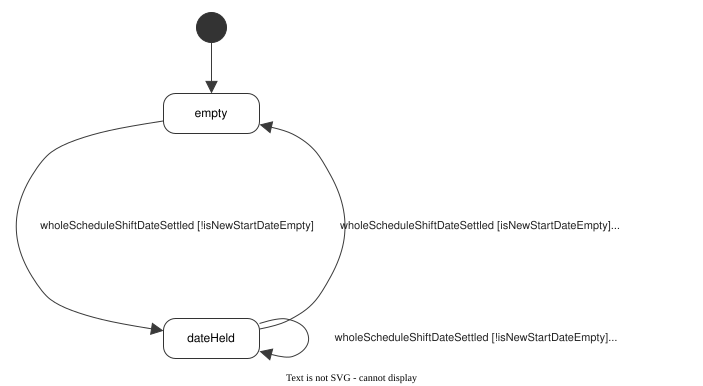](fig-sm-wholeScheduleShiftDraftStateMachine.svg)

| 出来事 | `empty` | `dateHeld` |
| --- | --- | --- |
| `screen/wholeScheduleShiftDateSettled` | → `dateHeld` [not `isNewStartDateEmpty`（`event.newStartDate == ''`）] それ以外 → — | → 自己 [not `isNewStartDateEmpty`（`event.newStartDate == ''`）]（`newStartDate` を書き換える） → `empty` [`isNewStartDateEmpty`（`event.newStartDate == ''`）] |
| `screen/wholeScheduleShiftEntryPressed` | — | → 自己 / `raiseWholeScheduleShiftQuestion`（下書きの日で `QN-15` を問う。続けると答えたら `CM-99` を 1 回出す。適用のボタンが押せないあいだ（`WH-12`）は何もしない） |
| `screen/wholeScheduleShiftLanded` | — | → `empty` |
| `screen/surfaceCloseAsked` | — | → `empty` [`isLeavingDocumentSettings`（`in(propertiesPanelContentStateMachine.documentSettingsDisplayed) && !inAfter(propertiesPanelContentStateMachine.documentSettingsDisplayed)`）]（プロパティパネルが文書の設定を出さなくなるときだけ、新しい開始日を捨てる） それ以外 → — |
| `screen/escapePressed` | — | → `empty` [`isLeavingDocumentSettings`（`in(propertiesPanelContentStateMachine.documentSettingsDisplayed) && !inAfter(propertiesPanelContentStateMachine.documentSettingsDisplayed)`）]（プロパティパネルが文書の設定を出さなくなるときだけ、新しい開始日を捨てる） それ以外 → — |
| `screen/settingsEntryPressed` | — | → `empty` [`isLeavingDocumentSettings`（`in(propertiesPanelContentStateMachine.documentSettingsDisplayed) && !inAfter(propertiesPanelContentStateMachine.documentSettingsDisplayed)`）]（プロパティパネルが文書の設定を出さなくなるときだけ、新しい開始日を捨てる） それ以外 → — |
| `screen/propertiesOfChoiceAsked` | — | → `empty` [`isLeavingDocumentSettings`（`in(propertiesPanelContentStateMachine.documentSettingsDisplayed) && !inAfter(propertiesPanelContentStateMachine.documentSettingsDisplayed)`）]（プロパティパネルが文書の設定を出さなくなるときだけ、新しい開始日を捨てる） それ以外 → — |
| `screen/selectionMoved` | — | → `empty` [`isLeavingDocumentSettings`（`in(propertiesPanelContentStateMachine.documentSettingsDisplayed) && !inAfter(propertiesPanelContentStateMachine.documentSettingsDisplayed)`）]（プロパティパネルが文書の設定を出さなくなるときだけ、新しい開始日を捨てる） それ以外 → — |
| `screen/createdNameSettled` | — | → `empty` [`isLeavingDocumentSettings`（`in(propertiesPanelContentStateMachine.documentSettingsDisplayed) && !inAfter(propertiesPanelContentStateMachine.documentSettingsDisplayed)`）]（プロパティパネルが文書の設定を出さなくなるときだけ、新しい開始日を捨てる） それ以外 → — |
| `screen/settleKeyPressed` | — | → `empty` [`isLeavingDocumentSettings`（`in(propertiesPanelContentStateMachine.documentSettingsDisplayed) && !inAfter(propertiesPanelContentStateMachine.documentSettingsDisplayed)`）]（プロパティパネルが文書の設定を出さなくなるときだけ、新しい開始日を捨てる） それ以外 → — |
| `screen/documentReplacedByOpenOrNew` | — | → `empty` |

- `wholeScheduleShiftDraftStateMachine.empty` —— 初期。根拠 `FO-17`
- `wholeScheduleShiftDraftStateMachine.dateHeld` —— 運ぶ値 `newStartDate`（`FR-159` ・ `WH-2`。入れた新しい開始日（日だけ、`yyyy-mm-dd`）。空は空の字）。根拠 `FR-159` ・ `WH-12`

表に無い出来事は `wholeScheduleShiftDraftStateMachine` を変えない（同じ参照）。

### 状態機械 `calendarDraftStateMachine`

[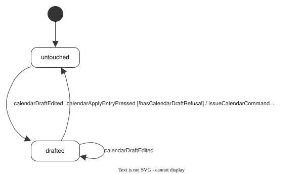](fig-sm-calendarDraftStateMachine.svg)

| 出来事 | `untouched` | `drafted` |
| --- | --- | --- |
| `screen/calendarDraftEdited` | → `drafted`（翻訳が文書の暦から組んだ下書きに直しを当てたものを運ぶ） | → 自己（`calendarDraft` を書き換える） |
| `screen/calendarApplyEntryPressed` | — | → `untouched` [not `hasCalendarDraftRefusal`（`calendarDraftRefusals(calendarDraftStateMachine.calendarDraft).length > 0`）] / `issueCalendarCommand`（下書きで `CM-39` を 1 回出す。`CM-39` が文書を変え、当てた 1 組の合計が `Project.minutesPerDay`（空なら `S-128`）と違えば `RS-89` を 1 度告げる。面は開いたまま、当てた後の文書を見せる） それ以外 → — |
| `screen/surfaceCloseAsked` | — | → `untouched` [`isLeavingHolidaySettings`（`openSurfaceStateMachine.surfaceName == 'U-65' && after(openSurfaceStateMachine.surfaceName) != 'U-65'`）]（開いている面が `U-65` でなくなるときだけ、下書きを捨てる） それ以外 → — |
| `screen/escapePressed` | — | → `untouched` [`isLeavingHolidaySettings`（`openSurfaceStateMachine.surfaceName == 'U-65' && after(openSurfaceStateMachine.surfaceName) != 'U-65'`）]（開いている面が `U-65` でなくなるときだけ、下書きを捨てる） それ以外 → — |
| `screen/surfaceEntryPressed` | — | → `untouched` [`isLeavingHolidaySettings`（`openSurfaceStateMachine.surfaceName == 'U-65' && after(openSurfaceStateMachine.surfaceName) != 'U-65'`）]（開いている面が `U-65` でなくなるときだけ、下書きを捨てる） それ以外 → — |
| `screen/surfaceRaisedByFlow` | — | → `untouched` [`isLeavingHolidaySettings`（`openSurfaceStateMachine.surfaceName == 'U-65' && after(openSurfaceStateMachine.surfaceName) != 'U-65'`）]（開いている面が `U-65` でなくなるときだけ、下書きを捨てる） それ以外 → — |
| `screen/watermarkEntryPressed` | — | → `untouched` [`isLeavingHolidaySettings`（`openSurfaceStateMachine.surfaceName == 'U-65' && after(openSurfaceStateMachine.surfaceName) != 'U-65'`）]（開いている面が `U-65` でなくなるときだけ、下書きを捨てる） それ以外 → — |
| `screen/documentReplacedByOpenOrNew` | — | → `untouched` |

- `calendarDraftStateMachine.untouched` —— 初期。根拠 `FR-088` ・ `WC-7`
- `calendarDraftStateMachine.drafted` —— 運ぶ値 `calendarDraft`（`WC-2` ・ `WC-3` ・ `WC-4` ・ `WC-8`。稼働する曜日の集合（`AT-73` の符号）・週の始まり（`AT-17` の符号）・時間帯の行の並び（各行は始まりと終わりの字）・例外日の行の並び（`Exception` の形。足した行の `ordinal` は文書の最大 ＋ 1 から））。根拠 `FR-088` ・ `WC-2` ・ `WC-4` ・ `WC-8`

表に無い出来事は `calendarDraftStateMachine` を変えない（同じ参照）。

## 通知（`notices`）

**表 T-286 — 通知の状態機械**

本表は、出来事の定義・根の値・状態機械ごとの状態遷移表と状態の一覧からなる。  
状態遷移表の行はその状態機械を動かす出来事、列はその状態機械の葉の状態、升は「→ 次の状態 [ガード] / 副作用」である。  
ガードは名と条件を「`名`（`条件`）」と刷り、条件は同じ領域のガードの一覧と同じである。  
状態に entry ／ exit の副作用がある状態機械は、出来事の行の上に `entry` ／ `exit` の行を置く —— その状態へ入る遷移・出る遷移が、出 → 遷移の副作用 → 入の順に起こし、自己への遷移（「→ 自己」）は起こさない。  
升の「—」は変化なし（同じ参照）を表す。  
ガードの付いた枝がすべての場合を覆わない升には「それ以外 → —」を添え、どの場合に何が起きるかを升ごとに言い切る。  
親の状態に置いた升は、その子のすべての列に同じ升を刷り、「親 … の升」と書き添える。

### 通知の出来事

| 出来事 | どこから来るか | 運ぶ値 | 動かすもの |
| --- | --- | --- | --- |
| `notices/noticeRaised` | 副作用の結果（副作用 `raiseNotice` の実行。ほかの領域の遷移とシェルの流れが返す）: `FR-076` ・ `NT-3` | `reason`（表 T-233 の `RS-` の行、または 表 T-220 の行） ／ `affectedCount`（無いこともある） | `noticeDisplayStateMachine` |
| `notices/noticeTimeElapsed` | 副作用の結果（シェルが数えた `_assets/tbl-settings.md` の 表 T-206 の `S-542` が経った。ポインタが箱の上にある間の止めと、離れたときの数え直しはシェルの時計の仕事であり、本機械は期限が来たことだけを受ける）: `NT-2` ・ `FT-4` | `reason`（期限が来た 1 枚の理由） | `noticeDisplayStateMachine` |
| `notices/newestNoticeDismissAsked` | 入力（`Esc`（`IN-4` の第 1 段）／ `Enter`（`SK-19` の第 1 段）。段は呼び手が決め、同じ入力のほかの何よりも先に進める）: `NT-8` ・ `IN-4` ・ `SK-19` | — | `noticeDisplayStateMachine` |
| `notices/noticeDismissPressed` | 入力（1 つの通知の `OK` の入口を押して離した）: `NT-8` | `reason`（押された通知の理由。`NT-3` の束ねで 1 つの理由に 1 枚なので、理由が通知を 1 つに決める） | `noticeDisplayStateMachine` |
| `notices/documentReplaced` | 副作用の結果（`WS-6` の差し替えが済み、`WS-7` の配りが始まる）: `WS-6` ・ `WS-7` | — | `changeDeliveryStateMachine` |
| `notices/changeDelivered` | 副作用の結果（`WS-7` の配りが終わった）: `WS-7` ・ `AG-6` | `silentWatchers`（答えを返さなかった配り先の数） | `changeDeliveryStateMachine` |

### 通知のガード

升が名で引くガードと、その条件（本書の頭の「ガードの条件の書き方」で書く）。

| ガード | 条件 | 根拠 |
| --- | --- | --- |
| `hasSilentWatcher` | `event.silentWatchers > 0` | `RS-23` ・ `AG-6` |
| `isHiddenReason` | `noticeDisplay(event.reason) == 'hide'` | `FR-076` |
| `isLeavingNone` | `event.reason in reasonsOf(noticeDisplayStateMachine.standing) && noticeDisplayStateMachine.standing.length == 1` | `NT-8` |
| `isLeavingSome` | `event.reason in reasonsOf(noticeDisplayStateMachine.standing) && noticeDisplayStateMachine.standing.length > 1` | `NT-8` |
| `isOnlyOneStanding` | `noticeDisplayStateMachine.standing.length == 1` | `NT-8` ・ `NT-2` |
| `isSameReasonStanding` | `wordsRow(event.reason) in wordsRowsOf(noticeDisplayStateMachine.standing)` | `NT-3` ・ `FR-076` |
| `isTimedCard` | `noticeDisplay(event.reason) == 'autoDismiss' && event.reason in reasonsOf(noticeDisplayStateMachine.standing)` | `NT-2` |

### 根 `notices` の値

運ぶ値: —。  
根拠: `FR-076`。

根の運ぶ値だけを書き換える出来事は無い。

**図 F-029 — 通知の状態遷移**

状態機械ごとに 1 つの図に分け、その状態機械の節に置く。状態機械どうしは直交する。  
図は UML の状態機械図である —— 矢印のラベルは「出来事 [ガード] / 副作用」、同じ 2 つの状態を結ぶ遷移は 1 本の矢印に 1 行ずつ並べる。ガードは名で書き、条件は同じ領域のガードの一覧が持つ。  
行き先が運ぶ値で決まる升は選択の擬似状態（◇）で分ける。entry ／ exit は状態の箱の中に書く。  
⭐ 遷移の全数は 表 T-286 の状態遷移表が持つ。図と表はどちらも原稿から刷る。

### 状態機械 `noticeDisplayStateMachine`

[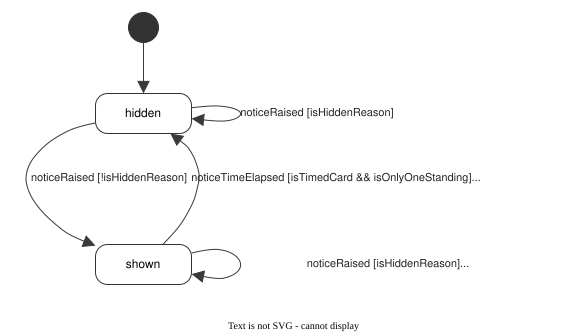](fig-sm-noticeDisplayStateMachine.svg)

| 出来事 | `hidden` | `shown` |
| --- | --- | --- |
| `notices/noticeRaised` | → 自己 [`isHiddenReason`（`noticeDisplay(event.reason) == 'hide'`）]（立てない（表 T-233 の表示の仕方が「出さない」）） → `shown` [not `isHiddenReason`（`noticeDisplay(event.reason) == 'hide'`）]（1 枚） | → 自己 [`isHiddenReason`（`noticeDisplay(event.reason) == 'hide'`）]（変えない） → 自己 [not `isHiddenReason`（`noticeDisplay(event.reason) == 'hide'`） & `isSameReasonStanding`（`wordsRow(event.reason) in wordsRowsOf(noticeDisplayStateMachine.standing)`）]（その 1 枚の件数を増やし、いちばん新しい位置へ動かす。相乗りする理由どうし（表 T-233 のまとめ方）は同じ理由と数える） → 自己 [not `isHiddenReason`（`noticeDisplay(event.reason) == 'hide'`） & not `isSameReasonStanding`（`wordsRow(event.reason) in wordsRowsOf(noticeDisplayStateMachine.standing)`）]（いちばん新しいものとして足す。枚数に上限を置かない） |
| `notices/noticeTimeElapsed` | — | → `hidden` [`isTimedCard`（`noticeDisplay(event.reason) == 'autoDismiss' && event.reason in reasonsOf(noticeDisplayStateMachine.standing)`） & `isOnlyOneStanding`（`noticeDisplayStateMachine.standing.length == 1`）] → 自己 [`isTimedCard`（`noticeDisplay(event.reason) == 'autoDismiss' && event.reason in reasonsOf(noticeDisplayStateMachine.standing)`） & not `isOnlyOneStanding`（`noticeDisplayStateMachine.standing.length == 1`）]（その 1 枚を除く） それ以外 → — |
| `notices/newestNoticeDismissAsked` | — | → `hidden` [`isOnlyOneStanding`（`noticeDisplayStateMachine.standing.length == 1`）] → 自己 [not `isOnlyOneStanding`（`noticeDisplayStateMachine.standing.length == 1`）]（いちばん新しいものを除く） |
| `notices/noticeDismissPressed` | — | → `hidden` [`isLeavingNone`（`event.reason in reasonsOf(noticeDisplayStateMachine.standing) && noticeDisplayStateMachine.standing.length == 1`）] → 自己 [`isLeavingSome`（`event.reason in reasonsOf(noticeDisplayStateMachine.standing) && noticeDisplayStateMachine.standing.length > 1`）]（押されたものを除く） それ以外 → — |

- `noticeDisplayStateMachine.hidden` —— 初期。根拠 `NT-8` ・ `IN-4`
- `noticeDisplayStateMachine.shown` —— 運ぶ値 `standing`（出ている通知の列。古い順。1 つは理由と件数）。根拠 `FR-076` ・ `NT-3` ・ `NT-8` ・ `IN-4` ・ `SK-19` ・ `IR-3`

表に無い出来事は `noticeDisplayStateMachine` を変えない（同じ参照）。

### 状態機械 `changeDeliveryStateMachine`

[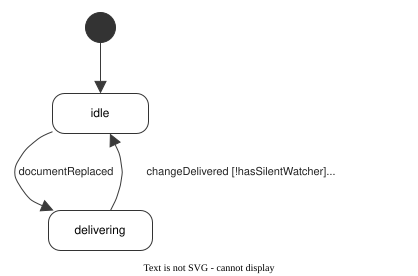](fig-sm-changeDeliveryStateMachine.svg)

| 出来事 | `idle` | `delivering` |
| --- | --- | --- |
| `notices/documentReplaced` | → `delivering` | — |
| `notices/changeDelivered` | — | → `idle` [not `hasSilentWatcher`（`event.silentWatchers > 0`）] → `idle` [`hasSilentWatcher`（`event.silentWatchers > 0`）] / `raiseNotice`（`RS-23`） |

- `changeDeliveryStateMachine.idle` —— 初期。根拠 `WS-7`
- `changeDeliveryStateMachine.delivering` —— 根拠 `WS-2` ・ `RS-9` ・ `CA-3`

表に無い出来事は `changeDeliveryStateMachine` を変えない（同じ参照）。

## 身振り（`gesture`）

**表 T-289 — 身振りの状態機械**

本表は、出来事の定義・根の値・状態機械ごとの状態遷移表と状態の一覧からなる。  
状態遷移表の行はその状態機械を動かす出来事、列はその状態機械の葉の状態、升は「→ 次の状態 [ガード] / 副作用」である。  
ガードは名と条件を「`名`（`条件`）」と刷り、条件は同じ領域のガードの一覧と同じである。  
状態に entry ／ exit の副作用がある状態機械は、出来事の行の上に `entry` ／ `exit` の行を置く —— その状態へ入る遷移・出る遷移が、出 → 遷移の副作用 → 入の順に起こし、自己への遷移（「→ 自己」）は起こさない。  
升の「—」は変化なし（同じ参照）を表す。  
ガードの付いた枝がすべての場合を覆わない升には「それ以外 → —」を添え、どの場合に何が起きるかを升ごとに言い切る。  
親の状態に置いた升は、その子のすべての列に同じ升を刷り、「親 … の升」と書き添える。

### 身振りの出来事

| 出来事 | どこから来るか | 運ぶ値 | 動かすもの |
| --- | --- | --- | --- |
| `gesture/pointerPressed` | 入力（ポインタを押した。入力の源は、身振りを持つあいだ次の押下を報告しない）: `CS-2` ・ `IN-1` | `pressRow`（`PTD-7` ・ `PTD-1` ・ `PTD-2` ・ `PTD-3` ・ `PTD-4` ・ `PTD-4a` ・ `PTD-5`。押下の行。呼び手が構え・`Dual Cursor`・選択から詰める。`PTD-7`（選択をコピーする）は文書を変える押下である） ／ `pressedOn`（押したもの —— 当たった掴みか、画面の場所（入口・掴み帯・パネルの境界・タスクグループの掴み代・つまみ）。座標は運ばない） | `pointerPressStateMachine` ・ `taskGroupGrabStateMachine` |
| `gesture/pointerReleased` | 入力（押していたボタンを離した）: `IN-1` ・ `CS-2` | — | `pointerPressStateMachine` ・ `taskGroupGrabStateMachine` |
| `gesture/pressInterrupted` | 入力（`Esc`（`IN-4` の進行中のドラッグの段。段は呼び手が決める）／ 離す前にポインタが失われた（`IN-1a`））: `IN-1` ・ `IN-1a` ・ `IN-4` | — | `pointerPressStateMachine` ・ `taskGroupGrabStateMachine` |
| `gesture/taskGroupGrabTravelPassed` | 入力（タスクグループを掴んだまま、押した点から初めて `S-208` を超えて動いた）: `HF-15` ・ `S-208` | — | `taskGroupGrabStateMachine` |
| `gesture/entryRepeatTimeElapsed` | 時間（`startEntryRepeat` の待ち（`S-172`）か、`repeatHeldEntry` の待ち（`S-173`）が明けた）: `FR-018` ・ `S-172` ・ `S-173` | — | `pointerPressStateMachine` |

### 身振りのガード

升が名で引くガードと、その条件（本書の頭の「ガードの条件の書き方」で書く）。

| ガード | 条件 | 根拠 |
| --- | --- | --- |
| `isDocumentChangingPress` | <code>(event.pressedOn == null &#124;&#124; event.pressedOn.kind == 'grab') &amp;&amp; !(event.pressRow in ['PTD-1', 'PTD-5']) &#124;&#124; event.pressedOn != null &amp;&amp; !(event.pressedOn.kind in ['grab', 'scrollbarThumb', 'panelBorder', 'paletteBand']) &amp;&amp; !(event.pressedOn.kind == 'entry' &amp;&amp; event.pressedOn.entry in ['IC-12', 'IC-13', 'IC-14', 'IC-15'])</code>（押下の先を先に問い、押下の行は後に問う —— 描いた入口の押下は `PTD-5` に落ちるので、行を先に問うとパレットのどの押下も `AG-9` から外れる。文書を変えない押下は、取り消しの対象（表 T-027）でないものを書く押下である —— スクロールバーのつまみ（`UN-8`）、パネルの境界（`UN-16`）、パレットの掴み帯（`FR-053`）、押し続けると繰り返す入口（`UN-8`）） | `AG-9` ・ `UN-8` ・ `UN-9` ・ `UN-16` ・ `PTD-1` ・ `PTD-5` ・ `FR-018` ・ `FR-053` |
| `isHeldOnRepeatingEntry` | `pointerPressStateMachine.pressedOn.kind == 'entry' && pointerPressStateMachine.pressedOn.entry in ['IC-12', 'IC-13', 'IC-14', 'IC-15']`（押し続けている押下が、押し続けると繰り返す入口の上にある（刻みの出来事は押下の先を運ばない）） | `FR-018` ・ `S-173` |
| `isOnPaletteBand` | `pointerPressStateMachine.pressedOn.kind == 'paletteBand'` | `FR-053` ・ `GR-19` |
| `isOnRepeatingEntry` | `event.pressedOn.kind == 'entry' && event.pressedOn.entry in ['IC-12', 'IC-13', 'IC-14', 'IC-15']` | `FR-018` ・ `S-172` |
| `isTaskGroupGrabStrip` | `event.pressedOn.kind == 'taskGroupGrabStrip'` | `HF-15` ・ `GR-20` |

### 根 `gesture` の値

運ぶ値: —。  
根拠: `CS-2`。

根の運ぶ値だけを書き換える出来事は無い。

**図 F-035 — 身振りの状態遷移**

状態機械ごとに 1 つの図に分け、その状態機械の節に置く。状態機械どうしは直交する。  
図は UML の状態機械図である —— 矢印のラベルは「出来事 [ガード] / 副作用」、同じ 2 つの状態を結ぶ遷移は 1 本の矢印に 1 行ずつ並べる。ガードは名で書き、条件は同じ領域のガードの一覧が持つ。  
行き先が運ぶ値で決まる升は選択の擬似状態（◇）で分ける。entry ／ exit は状態の箱の中に書く。  
⭐ 遷移の全数は 表 T-289 の状態遷移表が持つ。図と表はどちらも原稿から刷る。

### 状態機械 `pointerPressStateMachine`

[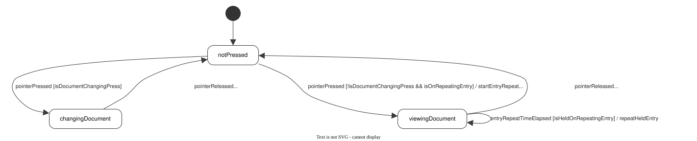](fig-sm-pointerPressStateMachine.svg)

| 出来事 | `notPressed` | `changingDocument` | `viewingDocument` |
| --- | --- | --- | --- |
| `gesture/pointerPressed` | → `changingDocument` [`isDocumentChangingPress`（<code>(event.pressedOn == null &#124;&#124; event.pressedOn.kind == 'grab') &amp;&amp; !(event.pressRow in ['PTD-1', 'PTD-5']) &#124;&#124; event.pressedOn != null &amp;&amp; !(event.pressedOn.kind in ['grab', 'scrollbarThumb', 'panelBorder', 'paletteBand']) &amp;&amp; !(event.pressedOn.kind == 'entry' &amp;&amp; event.pressedOn.entry in ['IC-12', 'IC-13', 'IC-14', 'IC-15'])</code>）] → `viewingDocument` [not `isDocumentChangingPress`（<code>(event.pressedOn == null &#124;&#124; event.pressedOn.kind == 'grab') &amp;&amp; !(event.pressRow in ['PTD-1', 'PTD-5']) &#124;&#124; event.pressedOn != null &amp;&amp; !(event.pressedOn.kind in ['grab', 'scrollbarThumb', 'panelBorder', 'paletteBand']) &amp;&amp; !(event.pressedOn.kind == 'entry' &amp;&amp; event.pressedOn.entry in ['IC-12', 'IC-13', 'IC-14', 'IC-15'])</code>） & `isOnRepeatingEntry`（`event.pressedOn.kind == 'entry' && event.pressedOn.entry in ['IC-12', 'IC-13', 'IC-14', 'IC-15']`）] / `startEntryRepeat`（前の待ちを捨てて張り直す） → `viewingDocument` [not `isDocumentChangingPress`（<code>(event.pressedOn == null &#124;&#124; event.pressedOn.kind == 'grab') &amp;&amp; !(event.pressRow in ['PTD-1', 'PTD-5']) &#124;&#124; event.pressedOn != null &amp;&amp; !(event.pressedOn.kind in ['grab', 'scrollbarThumb', 'panelBorder', 'paletteBand']) &amp;&amp; !(event.pressedOn.kind == 'entry' &amp;&amp; event.pressedOn.entry in ['IC-12', 'IC-13', 'IC-14', 'IC-15'])</code>） & not `isOnRepeatingEntry`（`event.pressedOn.kind == 'entry' && event.pressedOn.entry in ['IC-12', 'IC-13', 'IC-14', 'IC-15']`）] | — | — |
| `gesture/pointerReleased` | — | → `notPressed` | → `notPressed` |
| `gesture/pressInterrupted` | — | → `notPressed` [`isOnPaletteBand`（`pointerPressStateMachine.pressedOn.kind == 'paletteBand'`）] / `restorePaletteCorner`（パレットを押した時点の角へ戻す） → `notPressed` [not `isOnPaletteBand`（`pointerPressStateMachine.pressedOn.kind == 'paletteBand'`）] | → `notPressed` [`isOnPaletteBand`（`pointerPressStateMachine.pressedOn.kind == 'paletteBand'`）] / `restorePaletteCorner`（パレットを押した時点の角へ戻す） → `notPressed` [not `isOnPaletteBand`（`pointerPressStateMachine.pressedOn.kind == 'paletteBand'`）] |
| `gesture/entryRepeatTimeElapsed` | — | — | → 自己 [`isHeldOnRepeatingEntry`（`pointerPressStateMachine.pressedOn.kind == 'entry' && pointerPressStateMachine.pressedOn.entry in ['IC-12', 'IC-13', 'IC-14', 'IC-15']`）] / `repeatHeldEntry`（入口の命令をもう 1 度実行し、`S-173` の待ちを張る） それ以外 → — |

- `pointerPressStateMachine.notPressed` —— 初期。根拠 `IN-1` ・ `AG-9`
- `pointerPressStateMachine.changingDocument` —— 運ぶ値 `pressRow`（押した時点の押下の行） ／ `pressedOn`（押したもの）。根拠 `AG-9` ・ `WS-2` ・ `CS-2` ・ `IN-4` ・ `UN-4`
- `pointerPressStateMachine.viewingDocument` —— 運ぶ値 `pressRow`（押した時点の押下の行） ／ `pressedOn`（押したもの）。根拠 `AG-9` ・ `UN-8` ・ `UN-9` ・ `IN-4` ・ `FR-018`

表に無い出来事は `pointerPressStateMachine` を変えない（同じ参照）。

### 状態機械 `taskGroupGrabStateMachine`

[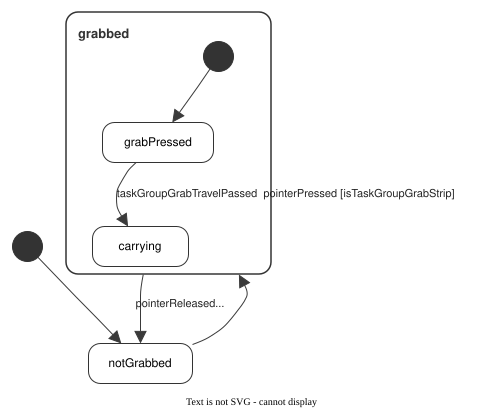](fig-sm-taskGroupGrabStateMachine.svg)

| 出来事 | `notGrabbed` | `grabPressed` | `carrying` |
| --- | --- | --- | --- |
| `gesture/pointerPressed` | → `grabPressed` [`isTaskGroupGrabStrip`（`event.pressedOn.kind == 'taskGroupGrabStrip'`）] それ以外 → — | — | — |
| `gesture/pointerReleased` | — | → `notGrabbed` | → `notGrabbed` |
| `gesture/pressInterrupted` | — | → `notGrabbed` | → `notGrabbed` |
| `gesture/taskGroupGrabTravelPassed` | — | → `carrying` | — |

- `taskGroupGrabStateMachine.notGrabbed` —— 初期。根拠 `HF-15`
- `taskGroupGrabStateMachine.grabPressed` —— 根拠 `HF-15` ・ `GR-20` ・ `S-208`
- `taskGroupGrabStateMachine.carrying` —— 根拠 `HF-15`

表に無い出来事は `taskGroupGrabStateMachine` を変えない（同じ参照）。

## ファイル操作と問い（`fileFlow`）

**表 T-290 — ファイル操作と問いの状態機械**

本表は、出来事の定義・根の値・状態機械ごとの状態遷移表と状態の一覧からなる。  
状態遷移表の行はその状態機械を動かす出来事、列はその状態機械の葉の状態、升は「→ 次の状態 [ガード] / 副作用」である。  
ガードは名と条件を「`名`（`条件`）」と刷り、条件は同じ領域のガードの一覧と同じである。  
状態に entry ／ exit の副作用がある状態機械は、出来事の行の上に `entry` ／ `exit` の行を置く —— その状態へ入る遷移・出る遷移が、出 → 遷移の副作用 → 入の順に起こし、自己への遷移（「→ 自己」）は起こさない。  
升の「—」は変化なし（同じ参照）を表す。  
ガードの付いた枝がすべての場合を覆わない升には「それ以外 → —」を添え、どの場合に何が起きるかを升ごとに言い切る。  
親の状態に置いた升は、その子のすべての列に同じ升を刷り、「親 … の升」と書き添える。

### ファイル操作と問いの出来事

| 出来事 | どこから来るか | 運ぶ値 | 動かすもの |
| --- | --- | --- | --- |
| `fileFlow/documentOpenAsked` | 入力（開く入口・`Ctrl` ＋ `O`、ファイルを落とした、`Ctrl` ＋ `R`、重ねる予定が無いときの変更前の予定の入口）: `IC-1` ・ `SK-10` ・ `OP-2` ・ `CHN-1` ・ `SK-21` ・ `OP-13` ・ `IC-4` ・ `OP-15` | `openRoute`（`OP-2` ・ `OP-13` ・ `OP-15`。`chooser`（開く入口・`Ctrl` ＋ `O`）／ `drop`（ファイルを落とした）／ `reopen`（`Ctrl` ＋ `R`）／ `baseline`（重ねる予定が無いときの変更前の予定の入口。`OP-3` を問わずに重ねる）） | `fileOperationStateMachine` |
| `fileFlow/agentDocumentHanded` | 入力（`Agent API` が文書を渡した（`openRoute` は `handed`））: `AM-8` ・ `FR-022` | — | `fileOperationStateMachine` |
| `fileFlow/documentFileWriteAsked` | 入力（`Ctrl` ＋ `S`、書き出しの形式を選んだ、遅延診断の修正案の `IC-157` ・ `IC-158` を押した）: `SK-11` ・ `FR-060` ・ `SK-12` ・ `FR-096` ・ `U-54` ・ `IC-157` ・ `IC-158` ・ `FR-155` | `writeForm`（`FR-060` ・ `FR-096` ・ `FR-155` ・ `SX-3`。保存（`Ctrl` ＋ `S`）か、`U-54` で選んだ書き出しの形式か、直す前の保存 —— `beforeFixOverwrite`（`IC-157`。`SK-11` と同じ道で `GRS JSON` を書く）／ `beforeFixBackup`（`IC-158`。`RW-15` の選択面でバックアップを書く —— `SX-3`）） ／ `fixBundle`（`FR-155` ・ `UN-21`。`writeForm` が `beforeFixOverwrite` ／ `beforeFixBackup` のときだけ持つ —— チェックの入った行の直し（表 T-373 の命令の列）。ほかでは `null`） | `fileOperationStateMachine` |
| `fileFlow/openChoiceAnswered` | 入力（`U-56` の 3 つの入口）: `IC-71` ・ `IC-72` ・ `IC-73` ・ `OP-3` | `openChoice`（`OP-3`。置き換え ／ 合流 ／ 重ね） ／ `question`（`QN-5`。置き換えを選んだときに立てる問い。挙げる名前は操作を始めた時点の文書（`CS-4`）。呼び手が詰める） | `fileOperationStateMachine` ・ `confirmationStateMachine` |
| `fileFlow/mergeMappingAnswered` | 入力（`U-61` の 3 つの入口）: `IC-95` ・ `IC-96` ・ `IC-97` ・ `FR-022` | `mergeMapping`（`MM-1` ・ `MM-2` ・ `MM-4`） | `fileOperationStateMachine` |
| `fileFlow/confirmationAnswered` | 入力（`Yes` / `No`、`y` / `n`、`Esc`）: `NT-7` ・ `IN-4` | `isProceeding`（`NT-7`。`Esc`（`IN-4` の段 `confirmation`）は偽。段は呼び手が決める） | `fileOperationStateMachine` ・ `confirmationStateMachine` |
| `fileFlow/changeQuestionRaised` | 入力（確認を要る書き込みの束（タスクグループの削除・子孫タスクを持つ `Task` の削除・すべてのタスクグループの削除）、担当の削除、掴んで運んだタスクグループの移動と深すぎる配下の引き上げ（表 T-051 の `HF-15`）、AI がファイルを開くよう求めた（`AM-29`、`QN-17`））: `FR-032` ・ `FR-099` ・ `QN-1` ・ `QN-2` ・ `QN-3` ・ `QN-10` ・ `IC-66` ・ `IC-106` ・ `HF-20` ・ `HF-15` ・ `QN-16` ・ `AM-29` ・ `QN-17` | `question`（`QN-1` ・ `QN-2` ・ `QN-3` ・ `QN-10` ・ `QN-16` ・ `QN-17`） ／ `owedAction`（「続ける」で行う書き込みの束 —— `QN-17` では、`IC-1` と同じ道でファイルを選ぶ窓を開くこと） | `confirmationStateMachine` |
| `fileFlow/newDocumentEntryPressed` | 入力（新しく始める入口・`N`）: `IC-98` ・ `SK-25` ・ `FR-095` | `question`（`QN-5`。いまの文書を捨てる問い。呼び手が詰める） | `confirmationStateMachine` |
| `fileFlow/grsResetEntryPressed` | 入力（GRS リセットの入口）: `IC-139` ・ `FR-153` | `question`（`QN-11`。GRS をリセットする問い。挙げる名前は、未保存の編集があるときだけ、いまの文書。呼び手が詰める） | `confirmationStateMachine` |
| `fileFlow/flowSurfaceClosed` | ほかの領域の結果（画面の値の副作用 `tellFlowSurfaceClosed`。人が `×` か `Esc` で面を閉じた）: `IC-52` ・ `IN-4` | `surfaceName`（`U-56` ・ `U-61` ・ `U-62`） | 根 ・ `fileOperationStateMachine` |
| `fileFlow/documentFileRead` | 副作用の結果（`readDocumentFile` が読み、形式を判じ、検証を通した）: `OP-5` ・ `OP-12` ・ `FR-023` | `question`（`QN-5`。読み直すときに立てる問い。挙げる名前は操作を始めた時点の文書（`CS-4`）。副作用の実行が詰める） ／ `incomingFile`（`OP-16`。読んだファイルの名前（ファイルを持たずに渡された文書では無い）と、読んだ中身のバイト数と、読んだ文書の文書名（`AT-3`。無いこともある）。`Open Chooser` が出す。副作用の実行が詰める） | `fileOperationStateMachine` ・ `confirmationStateMachine` |
| `fileFlow/documentOpenFailed` | 副作用の結果（読めない・選ばなかった・検証が拒んだ・読み直す相手が無い・着地を拒まれた（告げるのは副作用の中身））: `OP-5` ・ `OP-13` ・ `FR-023` | — | `fileOperationStateMachine` |
| `fileFlow/mergeMappingAsked` | 副作用の結果（`importIncomingDocument` が対応付けを問うことになった）: `FR-022` ・ `U-61` ・ `FR-073` | `mergeCandidates`（`U-61`） ／ `unreadColumns`（`FR-073`） | `fileOperationStateMachine` |
| `fileFlow/documentOpenLanded` | 副作用の結果（取り込みが着地した。起動時に渡された文書を読み終えたとき（`OP-14`）も、`reportedCounts` を運ぶために送る）: `RD-3` ・ `RD-4` ・ `FR-023` ・ `FR-101` ・ `OP-14` | `droppedTaskNames`（`RS-50`） ／ `missingTaskNames`（`RS-73` ・ `MG-11`。合流で、前回の取り込みでは届いていて今回届かなかった `Task` の名前。合流でなければ空） ／ `reportedCounts`（`FR-076` ・ `U-62`。読込の中で上がった、表 T-233 の表示の仕方が「`U-62` に並べる」の理由と件数 —— `reason`（表 T-233 の行）と `count`（件数）の組の列。相乗りする理由は同じ理由に数える。着地しなかった読込の件数は運ばない） ／ `openedFileName`（`FR-101`。無いこともある） ／ `openChoice`（`OP-3` ・ `RD-3` ・ `RD-4`。置き換え（`RD-4`）か、合流・重ね（`RD-3`）か） | 根 ・ `fileOperationStateMachine` ・ `unsavedEditsStateMachine` |
| `fileFlow/overwriteQuestionRaised` | 副作用の結果（`writeDocumentFile` の途中で、同じとみなせない相手を見つけた）: `DI-4` ・ `QN-4` | `question`（`QN-4`） | `confirmationStateMachine` |
| `fileFlow/documentFileSaved` | 副作用の結果（`GRS JSON` が書けた（表 T-340 の `SX-1`。`SK-11` でも `IC-2` でも保存である））: `FR-060` ・ `FR-101` ・ `SX-1` | `openedFileName`（`FR-101`。無いこともある） | 根 ・ `fileOperationStateMachine` ・ `unsavedEditsStateMachine` |
| `fileFlow/diagnosticFixBackupSaved` | 副作用の結果（直す前のバックアップの `GRS JSON` が書けた（表 T-340 の `SX-3`）。保存ではない —— 上書きする先・未保存の編集・ヘッダーのファイルの状態を変えない）: `SX-3` ・ `FR-155` ・ `RW-15` | — | `fileOperationStateMachine` |
| `fileFlow/documentFileWriteEnded` | 副作用の結果（`GRS JSON` 以外の形式の書き出しが終わった（表 T-340 の `SX-2`）、または保存・書き出しが書けなかった（告げるのは副作用の中身））: `FR-096` ・ `CS-4` ・ `SX-2` | — | `fileOperationStateMachine` |
| `fileFlow/documentEditLanded` | 副作用の結果（画面か `Agent API` からの書き込み（表 T-067 の 1 巡）か、取り消し・やり直しの差し替えが受け入れられた。合流・重ね（`RD-3`）では送らない。受け入れられて文書が変わったときだけ送る（`FR-100`） —— 文書を変えなかった書き込み（取り消しの手を積まない書き込み）では送らない。中身は比べ直さず、書き込みの後の文書が前の文書そのもの（同じ参照）かで判じる）: `WS-6` ・ `RD-1` ・ `RD-2` ・ `FR-100` | `isBackToSavedDocument`（`FR-100` ・ `RD-1` ・ `RD-2`。差し替えた後の文書が、未保存の印を下ろした時点（保存・置き換え・新しく始める・起動）に持っていた文書そのもの（同じ参照）なら真。中身を比べ直さない。機械も根も文書を持たないので、印を下ろした時点の文書を持つ `SingleHtmlShell` が判じて詰め、ガードはこの値を読むだけである（`isProceeding` と同じ形）） | `unsavedEditsStateMachine` |
| `fileFlow/newDocumentLanded` | 副作用の結果（`carryOutOwedAction`（新しく始めること）の差し替えが受け入れられた）: `FR-095` ・ `RD-7` | — | 根 ・ `unsavedEditsStateMachine` |
| `fileFlow/startupDocumentHeld` | 副作用の結果（起動時の文書の差し替えが受け入れられた）: `FR-062` ・ `RD-6` | — | `unsavedEditsStateMachine` |

### ファイル操作と問いのガード

升が名で引くガードと、その条件（本書の頭の「ガードの条件の書き方」で書く）。

| ガード | 条件 | 根拠 |
| --- | --- | --- |
| `hasAnythingToReport` | <code>event.droppedTaskNames.length &gt; 0 &#124;&#124; event.missingTaskNames.length &gt; 0 &#124;&#124; event.reportedCounts.length &gt; 0</code> | `FR-023` ・ `MG-14` ・ `U-62` ・ `FR-076` |
| `isBackToSavedDocument` | `event.isBackToSavedDocument`（取り消し・やり直しの着地で、文書が印を下ろした時点の文書そのものに戻ったかは、呼び手が判じて運ぶ） | `FR-100` |
| `isBaselineRoute` | `fileOperationStateMachine.openRoute == 'baseline'` | `OP-15` |
| `isDifferenceReviewSurface` | `event.surfaceName == 'U-61'` | `U-61` ・ `MG-6` |
| `isFileOperationQuestion` | `confirmationStateMachine.owedAction == null`（ファイル操作が自ら立てた問い（`OP-4`・`DI-4`）は、答えた後に果たす操作を運ばない） | `OP-4` ・ `DI-4` ・ `NT-7` |
| `isImportCanceled` | `event.mergeMapping.kind == 'cancelImport'` | `MM-4` ・ `MG-6` |
| `isImportReportSurface` | `event.surfaceName == 'U-62'` | `U-62` |
| `isOpenChooserSurface` | `event.surfaceName == 'U-56'` | `U-56` ・ `OP-3` |
| `isOverwriteQuestion` | `confirmationStateMachine.question.question == 'QN-4'` | `DI-4` ・ `QN-4` |
| `isProceeding` | `event.isProceeding` | `NT-7` |
| `isReopenRoute` | `fileOperationStateMachine.openRoute == 'reopen'` | `OP-13` |
| `isReplaceChoice` | `event.openChoice == 'replace'` | `OP-3` ・ `OP-4` |

### 根 `fileFlow` の値

運ぶ値: `openedFileName`（`U-58` ・ `FR-101`） ／ `droppedTaskNames`（`U-62` ・ `RS-50`） ／ `missingTaskNames`（`U-62` ・ `RS-73` ・ `MG-11`） ／ `reportedCounts`（`U-62` ・ `FR-076`）。  
根拠: `OP-8` ・ `CS-4`。

| 出来事 | `fileFlow` |
| --- | --- |
| `fileFlow/documentFileSaved` | → 自己（`openedFileName` を書き換える（名が運ばれたときだけ）） |
| `fileFlow/documentOpenLanded` | → 自己 [`hasAnythingToReport`（<code>event.droppedTaskNames.length &gt; 0 &#124;&#124; event.missingTaskNames.length &gt; 0 &#124;&#124; event.reportedCounts.length &gt; 0</code>）] / `raiseFlowSurface`（`U-62`）（`droppedTaskNames` と `missingTaskNames` と `reportedCounts` と `openedFileName` を書き換える（名は運ばれたときだけ）） → 自己 [not `hasAnythingToReport`（<code>event.droppedTaskNames.length &gt; 0 &#124;&#124; event.missingTaskNames.length &gt; 0 &#124;&#124; event.reportedCounts.length &gt; 0</code>）]（`openedFileName` を書き換える（名が運ばれたときだけ）） |
| `fileFlow/flowSurfaceClosed` | → 自己 [`isImportReportSurface`（`event.surfaceName == 'U-62'`）]（`droppedTaskNames` と `missingTaskNames` と `reportedCounts` を空にする） それ以外 → — |
| `fileFlow/newDocumentLanded` | → 自己（`openedFileName` を空にする（新しく始めた文書はどのファイルにも無い —— `FR-095`）） |

**図 F-036 — ファイル操作と問いの状態遷移**

状態機械ごとに 1 つの図に分け、その状態機械の節に置く。状態機械どうしは直交する。  
図は UML の状態機械図である —— 矢印のラベルは「出来事 [ガード] / 副作用」、同じ 2 つの状態を結ぶ遷移は 1 本の矢印に 1 行ずつ並べる。ガードは名で書き、条件は同じ領域のガードの一覧が持つ。  
行き先が運ぶ値で決まる升は選択の擬似状態（◇）で分ける。entry ／ exit は状態の箱の中に書く。  
⭐ 遷移の全数は 表 T-290 の状態遷移表が持つ。図と表はどちらも原稿から刷る。

### 状態機械 `fileOperationStateMachine`

[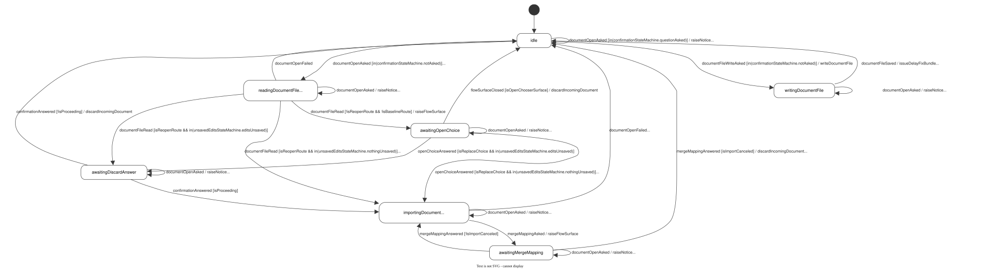](fig-sm-fileOperationStateMachine.svg)

| 出来事 | `idle` | `readingDocumentFile` | `awaitingOpenChoice` | `awaitingDiscardAnswer` | `importingDocument` | `awaitingMergeMapping` | `writingDocumentFile` |
| --- | --- | --- | --- | --- | --- | --- | --- |
| entry | — | / `readDocumentFile` | — | — | / `importIncomingDocument` | — | — |
| `fileFlow/documentOpenAsked` | → `readingDocumentFile` [`confirmationStateMachine.notAsked` にいる] → 自己 [`confirmationStateMachine.questionAsked` にいる] / `raiseNotice`（`RS-27`） | → 自己 / `raiseNotice`（`RS-27`） | → 自己 / `raiseNotice`（`RS-27`） | → 自己 / `raiseNotice`（`RS-27`） | → 自己 / `raiseNotice`（`RS-27`） | → 自己 / `raiseNotice`（`RS-27`） | → 自己 / `raiseNotice`（`RS-27`） |
| `fileFlow/agentDocumentHanded` | → `readingDocumentFile` [`confirmationStateMachine.notAsked` にいる]（`openRoute` は `handed`） それ以外 → — | — | — | — | — | — | — |
| `fileFlow/documentFileWriteAsked` | → `writingDocumentFile` [`confirmationStateMachine.notAsked` にいる] / `writeDocumentFile` → 自己 [`confirmationStateMachine.questionAsked` にいる] / `raiseNotice`（`RS-27`） | → 自己 / `raiseNotice`（`RS-27`） | → 自己 / `raiseNotice`（`RS-27`） | → 自己 / `raiseNotice`（`RS-27`） | → 自己 / `raiseNotice`（`RS-27`） | → 自己 / `raiseNotice`（`RS-27`） | → 自己 / `raiseNotice`（`RS-27`） |
| `fileFlow/documentFileRead` | — | → `awaitingDiscardAnswer` [`isReopenRoute`（`fileOperationStateMachine.openRoute == 'reopen'`） & `unsavedEditsStateMachine.editsUnsaved` にいる] → `importingDocument` [`isReopenRoute`（`fileOperationStateMachine.openRoute == 'reopen'`） & `unsavedEditsStateMachine.nothingUnsaved` にいる]（保存していない編集が無いので問わずに置き換える（表 T-234 の `QN-5` の問うか）） → `importingDocument` [`isBaselineRoute`（`fileOperationStateMachine.openRoute == 'baseline'`）] → `awaitingOpenChoice` [not `isReopenRoute`（`fileOperationStateMachine.openRoute == 'reopen'`） & not `isBaselineRoute`（`fileOperationStateMachine.openRoute == 'baseline'`）] / `raiseFlowSurface`（`U-56`） | — | — | — | — | — |
| `fileFlow/documentOpenFailed` | — | → `idle` | — | — | → `idle` | — | — |
| `fileFlow/openChoiceAnswered` | — | — | → `awaitingDiscardAnswer` [`isReplaceChoice`（`event.openChoice == 'replace'`） & `unsavedEditsStateMachine.editsUnsaved` にいる] → `importingDocument` [`isReplaceChoice`（`event.openChoice == 'replace'`） & `unsavedEditsStateMachine.nothingUnsaved` にいる]（保存していない編集が無いので問わずに置き換える（表 T-234 の `QN-5` の問うか）） → `importingDocument` [not `isReplaceChoice`（`event.openChoice == 'replace'`）] | — | — | — | — |
| `fileFlow/confirmationAnswered` | — | — | — | → `importingDocument` [`isProceeding`（`event.isProceeding`）] → `idle` [not `isProceeding`（`event.isProceeding`）] / `discardIncomingDocument` | — | — | → 自己 [`isOverwriteQuestion`（`confirmationStateMachine.question.question == 'QN-4'`）] / `answerOverwriteQuestion` それ以外 → — |
| `fileFlow/mergeMappingAsked` | — | — | — | — | → `awaitingMergeMapping` / `raiseFlowSurface`（`U-61`） | — | — |
| `fileFlow/mergeMappingAnswered` | — | — | — | — | — | → `idle` [`isImportCanceled`（`event.mergeMapping.kind == 'cancelImport'`）] / `discardIncomingDocument` → `importingDocument` [not `isImportCanceled`（`event.mergeMapping.kind == 'cancelImport'`）] | — |
| `fileFlow/flowSurfaceClosed` | — | — | → `idle` [`isOpenChooserSurface`（`event.surfaceName == 'U-56'`）] / `discardIncomingDocument` それ以外 → — | — | — | → `idle` [`isDifferenceReviewSurface`（`event.surfaceName == 'U-61'`）] / `discardIncomingDocument` それ以外 → — | — |
| `fileFlow/documentOpenLanded` | — | — | — | — | → `idle` | — | — |
| `fileFlow/documentFileSaved` | — | — | — | — | — | — | → `idle` / `issueDelayFixBundle`（運んだ `fixBundle` があれば 1 つの束として発行する（`writeForm` が `beforeFixOverwrite` のとき）。束のどれかを命令が断ったら何も当てず、断った行と理由を告げる） |
| `fileFlow/diagnosticFixBackupSaved` | — | — | — | — | — | — | → `idle` / `issueDelayFixBundle`（運んだ `fixBundle` を 1 つの束として発行する。`unsavedEditsStateMachine` とヘッダーのファイルの状態は動かさない（`SX-3`）） |
| `fileFlow/documentFileWriteEnded` | — | — | — | — | — | — | → `idle`（運んだ `fixBundle` は捨てる —— 書けなかったときは直さない（`FR-155`）） |

- `fileOperationStateMachine.idle` —— 初期。根拠 `OP-8` ・ `CS-4`
- `fileOperationStateMachine.readingDocumentFile` —— 運ぶ値 `openRoute`（`OP-2` ・ `OP-13` ・ `OP-15`）。entry / `readDocumentFile`。根拠 `OP-2` ・ `OP-5` ・ `OP-8` ・ `OP-12` ・ `OP-13` ・ `CS-4`
- `fileOperationStateMachine.awaitingOpenChoice` —— 運ぶ値 `incomingFile`（`OP-16`）。根拠 `OP-3` ・ `U-56` ・ `OP-5` ・ `CS-4`
- `fileOperationStateMachine.awaitingDiscardAnswer` —— 根拠 `OP-4` ・ `QN-5` ・ `OP-13`
- `fileOperationStateMachine.importingDocument` —— entry / `importIncomingDocument`。根拠 `RD-3` ・ `RD-4` ・ `OP-9` ・ `FR-022`
- `fileOperationStateMachine.awaitingMergeMapping` —— 運ぶ値 `mergeCandidates`（`U-61`） ／ `unreadColumns`（`FR-073`）。根拠 `FR-022` ・ `U-61` ・ `FR-073`
- `fileOperationStateMachine.writingDocumentFile` —— 運ぶ値 `fixBundle`（書けたら 1 つの束として発行する直し（`FR-155`）。直す前の保存でなければ `null`）。根拠 `FR-060` ・ `FR-096` ・ `DI-4` ・ `CS-4` ・ `FR-155`

表に無い出来事は `fileOperationStateMachine` を変えない（同じ参照）。

### 状態機械 `confirmationStateMachine`

[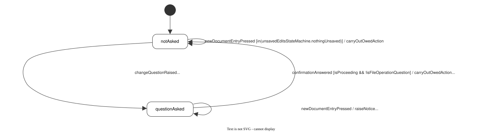](fig-sm-confirmationStateMachine.svg)

| 出来事 | `notAsked` | `questionAsked` |
| --- | --- | --- |
| `fileFlow/changeQuestionRaised` | → `questionAsked` | — |
| `fileFlow/newDocumentEntryPressed` | → `questionAsked` [`unsavedEditsStateMachine.editsUnsaved` にいる] → 自己 [`unsavedEditsStateMachine.nothingUnsaved` にいる] / `carryOutOwedAction`（保存していない編集が無いので問わずに新しく始める（表 T-234 の `QN-5` の問うか）） | → 自己 / `raiseNotice`（`RS-27`） |
| `fileFlow/grsResetEntryPressed` | → `questionAsked` | → 自己 / `raiseNotice`（`RS-27`） |
| `fileFlow/openChoiceAnswered` | → `questionAsked` [`isReplaceChoice`（`event.openChoice == 'replace'`） & `fileOperationStateMachine.awaitingOpenChoice` にいる & `unsavedEditsStateMachine.editsUnsaved` にいる] それ以外 → — | → 自己 [`isReplaceChoice`（`event.openChoice == 'replace'`） & `fileOperationStateMachine.awaitingOpenChoice` にいる & `unsavedEditsStateMachine.editsUnsaved` にいる] それ以外 → — |
| `fileFlow/documentFileRead` | → `questionAsked` [`isReopenRoute`（`fileOperationStateMachine.openRoute == 'reopen'`） & `fileOperationStateMachine.readingDocumentFile` にいる & `unsavedEditsStateMachine.editsUnsaved` にいる] それ以外 → — | → 自己 [`isReopenRoute`（`fileOperationStateMachine.openRoute == 'reopen'`） & `fileOperationStateMachine.readingDocumentFile` にいる & `unsavedEditsStateMachine.editsUnsaved` にいる] それ以外 → — |
| `fileFlow/overwriteQuestionRaised` | → `questionAsked` | → 自己 |
| `fileFlow/confirmationAnswered` | — | → `notAsked` [`isProceeding`（`event.isProceeding`） & not `isFileOperationQuestion`（`confirmationStateMachine.owedAction == null`）] / `carryOutOwedAction` → `notAsked` [`isProceeding`（`event.isProceeding`） & `isFileOperationQuestion`（`confirmationStateMachine.owedAction == null`）] → `notAsked` [not `isProceeding`（`event.isProceeding`）] |

- `confirmationStateMachine.notAsked` —— 初期。根拠 `NT-7` ・ `U-55`
- `confirmationStateMachine.questionAsked` —— 運ぶ値 `question`（`QN-1` ・ `QN-2` ・ `QN-3` ・ `QN-4` ・ `QN-5` ・ `QN-10` ・ `QN-11` ・ `QN-16` ・ `QN-17`） ／ `owedAction`（「続ける」で行う書き込みの束か、新しく始めることか、GRS リセット（`FR-153`）か、ファイルを選ぶ窓を開くこと（`QN-17`）。ファイル操作の問いでは無い）。根拠 `NT-7` ・ `U-55` ・ `QN-1` ・ `QN-2` ・ `QN-3` ・ `QN-4` ・ `QN-5` ・ `QN-10` ・ `QN-11` ・ `QN-16` ・ `QN-17`

表に無い出来事は `confirmationStateMachine` を変えない（同じ参照）。

### 状態機械 `unsavedEditsStateMachine`

[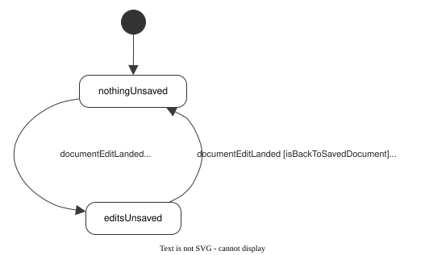](fig-sm-unsavedEditsStateMachine.svg)

| 出来事 | `nothingUnsaved` | `editsUnsaved` |
| --- | --- | --- |
| `fileFlow/documentEditLanded` | → `editsUnsaved` | → `nothingUnsaved` [`isBackToSavedDocument`（`event.isBackToSavedDocument`）]（取り消し・やり直しが、印を下ろした時点（保存・置き換え・新しく始める・起動）に持っていた文書そのものへ戻した） それ以外 → — |
| `fileFlow/documentOpenLanded` | → `editsUnsaved` [not `isReplaceChoice`（`event.openChoice == 'replace'`）]（合流・重ねは、ファイルに無い文書を作る。重ねも、重ねた予定と `S-69` を文書に書くので数える） それ以外 → — | → `nothingUnsaved` [`isReplaceChoice`（`event.openChoice == 'replace'`）]（置き換えは、開いたファイルと同じ文書にする） それ以外 → — |
| `fileFlow/documentFileSaved` | — | → `nothingUnsaved` |
| `fileFlow/newDocumentLanded` | — | → `nothingUnsaved` |
| `fileFlow/startupDocumentHeld` | — | → `nothingUnsaved` |

- `unsavedEditsStateMachine.nothingUnsaved` —— 初期。根拠 `FR-100` ・ `ZE-4`
- `unsavedEditsStateMachine.editsUnsaved` —— 根拠 `FR-100` ・ `LM-11`

表に無い出来事は `unsavedEditsStateMachine` を変えない（同じ参照）。

## 名前付けと入力欄（`fieldEntry`）

**表 T-292 — 名前付けと入力欄の状態機械**

本表は、出来事の定義・根の値・状態機械ごとの状態遷移表と状態の一覧からなる。  
状態遷移表の行はその状態機械を動かす出来事、列はその状態機械の葉の状態、升は「→ 次の状態 [ガード] / 副作用」である。  
ガードは名と条件を「`名`（`条件`）」と刷り、条件は同じ領域のガードの一覧と同じである。  
状態に entry ／ exit の副作用がある状態機械は、出来事の行の上に `entry` ／ `exit` の行を置く —— その状態へ入る遷移・出る遷移が、出 → 遷移の副作用 → 入の順に起こし、自己への遷移（「→ 自己」）は起こさない。  
升の「—」は変化なし（同じ参照）を表す。  
ガードの付いた枝がすべての場合を覆わない升には「それ以外 → —」を添え、どの場合に何が起きるかを升ごとに言い切る。  
親の状態に置いた升は、その子のすべての列に同じ升を刷り、「親 … の升」と書き添える。

### 名前付けと入力欄の出来事

| 出来事 | どこから来るか | 運ぶ値 | 動かすもの |
| --- | --- | --- | --- |
| `fieldEntry/fieldFocusAsked` | 入力（欄に焦点を置くことを要求が名指した押下（名称・タスクグループ名・担当・注記の本文・枠の色・文書名））: `MK-13` ・ `FR-035` ・ `FR-097` | `fieldRow`（`PR-1` ・ `AT-53` ・ `PR-16` ・ `PR-21` ・ `PR-22` ・ `U-27`） | `fieldEditStateMachine` |
| `fieldEntry/creationLanded` | 副作用の結果（作る書き込みが着地し、作ったものが文書に在る）: `TC-9` ・ `FR-091` ・ `HF-14` ・ `HF-17` | `created`（作ったタスクの UID か、足したタスクグループの ID） | 根 ・ `createdTaskNamingStateMachine` ・ `fieldEditStateMachine` |
| `fieldEntry/fieldFocusWithdrawn` | 入力（`Esc`、欄の外の押し、パネルを閉じたこと、人が焦点を別の所へ動かしたこと、選択が変わったこと、求めた欄がパネルに無いこと。呼び手が決める）: `IN-5a` ・ `IN-5b` ・ `IN-4` | — | `fieldEditStateMachine` |
| `fieldEntry/fieldEditBegan` | 入力（宿主が知らせる: 文字入力の欄で編集が始まった（焦点が入った）。人の押下・キーで入っても、求めた焦点が入っても同じ）: `IF-9` ・ `IN-5b` ・ `AG-9` | `fieldRow`（`IF-9` ・ `PR-1` ・ `AT-53` ・ `PR-16` ・ `PR-21` ・ `U-27` ・ `U-60`。編集が始まった欄が名乗る行 ID） | `createdTaskNamingStateMachine` ・ `fieldEditStateMachine` |
| `fieldEntry/fieldEditEnded` | 入力（宿主が知らせる: その欄の編集が終わった（確定・取り消し・欄が消えた —— どれでも））: `IF-9` ・ `SK-19` ・ `IN-4` ・ `IN-6` ・ `FR-091` | `fieldRow`（`IF-9` ・ `PR-1` ・ `AT-53` ・ `PR-16` ・ `PR-21` ・ `U-27` ・ `U-60`。編集が終わった欄が名乗る行 ID） | `createdTaskNamingStateMachine` ・ `fieldEditStateMachine` |
| `fieldEntry/choiceMoved` | ほかの領域の結果（選択。作ったものを選んだ変化は `creationLanded` が運ぶので送らない）: `FR-091` ・ `FR-072` | — | `createdTaskNamingStateMachine` |

### 名前付けと入力欄のガード

升が名で引くガードと、その条件（本書の頭の「ガードの条件の書き方」で書く）。

| ガード | 条件 | 根拠 |
| --- | --- | --- |
| `isCreatedTask` | `event.created.kind == 'task'` | `TC-9` ・ `FR-091` ・ `HF-17` |
| `isEditedField` | `in(fieldEditStateMachine.editingField) && fieldEditStateMachine.fieldRow == event.fieldRow` | `IF-9` ・ `IN-5b` |
| `isNameField` | `event.fieldRow == 'PR-1'` | `FR-091` ・ `PR-1` |

### 根 `fieldEntry` の値

運ぶ値: —。  
根拠: `FR-091` ・ `IN-5b`。

| 出来事 | `fieldEntry` |
| --- | --- |
| `fieldEntry/creationLanded` | → 自己 [not `isCreatedTask`（`event.created.kind == 'task'`）] / `bringCreatedTaskGroupIntoSight`（足したタスクグループが描かれていないときだけ送る。描かれているかはシェルが次のレイアウトで判じる） それ以外 → — |

**図 F-038 — 名前付けと入力欄の状態遷移**

状態機械ごとに 1 つの図に分け、その状態機械の節に置く。状態機械どうしは直交する。  
図は UML の状態機械図である —— 矢印のラベルは「出来事 [ガード] / 副作用」、同じ 2 つの状態を結ぶ遷移は 1 本の矢印に 1 行ずつ並べる。ガードは名で書き、条件は同じ領域のガードの一覧が持つ。  
行き先が運ぶ値で決まる升は選択の擬似状態（◇）で分ける。entry ／ exit は状態の箱の中に書く。  
⭐ 遷移の全数は 表 T-292 の状態遷移表が持つ。図と表はどちらも原稿から刷る。

### 状態機械 `createdTaskNamingStateMachine`

[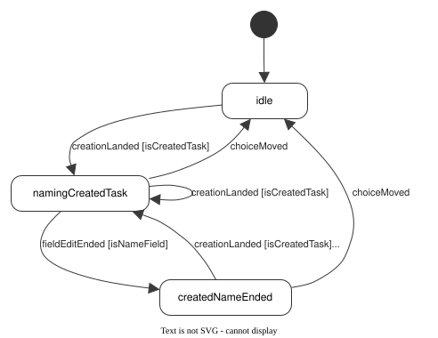](fig-sm-createdTaskNamingStateMachine.svg)

| 出来事 | `idle` | `namingCreatedTask` | `createdNameEnded` |
| --- | --- | --- | --- |
| `fieldEntry/creationLanded` | → `namingCreatedTask` [`isCreatedTask`（`event.created.kind == 'task'`）] それ以外 → — | → 自己 [`isCreatedTask`（`event.created.kind == 'task'`）]（`createdTaskUid` を書き換える） それ以外 → — | → `namingCreatedTask` [`isCreatedTask`（`event.created.kind == 'task'`）]（`createdTaskUid` を書き換える（次に作ったタスクの名前付けが始まる）） それ以外 → — |
| `fieldEntry/fieldEditEnded` | — | → `createdNameEnded` [`isNameField`（`event.fieldRow == 'PR-1'`）]（終わった欄が名前の欄（`PR-1`）。確定でも取り消しでも同じ —— 次の `Enter` が名前を確定する押下である） それ以外 → — | — |
| `fieldEntry/fieldEditBegan` | — | — | → `namingCreatedTask`（欄の編集がまた始まった —— 名前の編集の終わりは最後の出来事ではなくなる） |
| `fieldEntry/choiceMoved` | — | → `idle` | → `idle` |

- `createdTaskNamingStateMachine.idle` —— 初期。根拠 `FR-091` ・ `FR-072`
- `createdTaskNamingStateMachine.namingCreatedTask` —— 運ぶ値 `createdTaskUid`（`TC-9`）。根拠 `FR-091` ・ `TC-9` ・ `FR-001`
- `createdTaskNamingStateMachine.createdNameEnded` —— 運ぶ値 `createdTaskUid`（`TC-9`）。根拠 `FR-091` ・ `SK-19`

表に無い出来事は `createdTaskNamingStateMachine` を変えない（同じ参照）。

### 状態機械 `fieldEditStateMachine`

[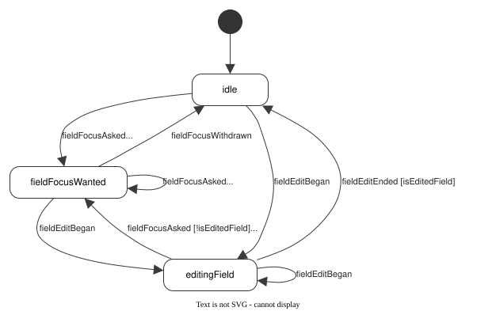](fig-sm-fieldEditStateMachine.svg)

| 出来事 | `idle` | `fieldFocusWanted` | `editingField` |
| --- | --- | --- | --- |
| `fieldEntry/fieldFocusAsked` | → `fieldFocusWanted` | → 自己（`fieldRow` を書き換える） | → `fieldFocusWanted` [not `isEditedField`（`in(fieldEditStateMachine.editingField) && fieldEditStateMachine.fieldRow == event.fieldRow`）]（求めた欄が編集中の欄なら求めは既に満ちている） それ以外 → — |
| `fieldEntry/creationLanded` | → `fieldFocusWanted`（`fieldRow` はタスクなら `PR-1`、タスクグループなら `AT-53`） | → 自己（`fieldRow` を書き換える） | → `fieldFocusWanted`（`fieldRow` はタスクなら `PR-1`、タスクグループなら `AT-53`） |
| `fieldEntry/fieldEditBegan` | → `editingField` | → `editingField`（求めた欄なら焦点が入った。別の欄なら人が焦点を動かした —— どちらも求めは終わる） | → 自己（`fieldRow` を書き換える（編集する欄が替わった）） |
| `fieldEntry/fieldEditEnded` | — | — | → `idle` [`isEditedField`（`in(fieldEditStateMachine.editingField) && fieldEditStateMachine.fieldRow == event.fieldRow`）] それ以外 → — |
| `fieldEntry/fieldFocusWithdrawn` | — | → `idle` | — |

- `fieldEditStateMachine.idle` —— 初期。根拠 `IN-5a` ・ `IN-5b` ・ `AG-9`
- `fieldEditStateMachine.fieldFocusWanted` —— 運ぶ値 `fieldRow`（`PR-1` ・ `AT-53` ・ `PR-16` ・ `PR-21` ・ `PR-22` ・ `U-27`）。根拠 `IN-5a` ・ `IN-5b` ・ `MK-13` ・ `HF-14` ・ `FR-091` ・ `FR-035`
- `fieldEditStateMachine.editingField` —— 運ぶ値 `fieldRow`（`IF-9` ・ `PR-1` ・ `AT-53` ・ `PR-16` ・ `PR-21` ・ `U-27` ・ `U-60`）。根拠 `AG-9` ・ `IN-5a` ・ `IN-4` ・ `IN-6` ・ `SK-19` ・ `IF-9`

表に無い出来事は `fieldEditStateMachine` を変えない（同じ参照）。

## 選択（`selection`）

**表 T-293 — 選択の状態機械**

本表は、出来事の定義・根の値・状態機械ごとの状態遷移表と状態の一覧からなる。  
状態遷移表の行はその状態機械を動かす出来事、列はその状態機械の葉の状態、升は「→ 次の状態 [ガード] / 副作用」である。  
ガードは名と条件を「`名`（`条件`）」と刷り、条件は同じ領域のガードの一覧と同じである。  
状態に entry ／ exit の副作用がある状態機械は、出来事の行の上に `entry` ／ `exit` の行を置く —— その状態へ入る遷移・出る遷移が、出 → 遷移の副作用 → 入の順に起こし、自己への遷移（「→ 自己」）は起こさない。  
升の「—」は変化なし（同じ参照）を表す。  
ガードの付いた枝がすべての場合を覆わない升には「それ以外 → —」を添え、どの場合に何が起きるかを升ごとに言い切る。  
親の状態に置いた升は、その子のすべての列に同じ升を刷り、「親 … の升」と書き添える。

### 選択の出来事

| 出来事 | どこから来るか | 運ぶ値 | 動かすもの |
| --- | --- | --- | --- |
| `selection/objectsPicked` | 入力（対象を選ぶ押下・範囲・`Shift` での増減・全選択・端のドラッグで絞ること。新しい選択は呼び手（入力の翻訳係）が組み、値が変わったときだけ送る。⭐ `Ctrl` ドラッグのコピー（表 T-308 の `CY-8`）だけは、コピーが着地したあとに殻が組んで送る —— コピーの `UID` は書き込みが払い出す）: `SL-2` ・ `SL-3` ・ `SL-4` ・ `SK-2` ・ `SL-7a` ・ `CY-8` | `pickedObjects`（`SL-1` ・ `SL-7b`） | `selectionStateMachine` |
| `selection/emptyAreaClicked` | 入力（何にも当たらない場所での素の左クリック（構えなし））: `MK-11` ・ `SL-6` | — | `selectionStateMachine` |
| `selection/selectionEscapePressed` | 入力（`Esc`。画面の値の `escapePressed` と同じ押下から呼び手が作る）: `IN-4` | `rung`（消費する `IN-4` の段の語。呼び手が詰める） | 根 ・ `selectionStateMachine` |
| `selection/selectionSettleKeyPressed` | 入力（`Enter`。通知も確定していないその場の編集も無く、プロパティパネルも出していないときだけ呼び手が送る）: `SK-19` | — | 根 ・ `selectionStateMachine` |
| `selection/selectionCleared` | 副作用の結果（画面の値の副作用 `clearSelection` の結果）: `FR-091` | — | `selectionStateMachine` |
| `selection/selectionPruned` | 副作用の結果（書き込みが着地し、文書に無くなった対象を刈った。または、表示の切り替え・タスクグループの折りたたみと隠し・縦軸の倍率で描かれなくなったタスクを刈った。⭐ 同じ着地で、文書に無くなったタスクグループもタスクグループの選択から刈る（`FR-085`））: `FR-081` ・ `UN-9` ・ `FR-049` ・ `FR-018` ・ `HR-1a` ・ `HR-6` ・ `FR-085` | `remainingObjects` ／ `chosenTaskGroups`（`FR-085`。刈ったあとに残るタスクグループ。文書から消えたタスクグループを除いたタスクグループの選択） | 根 ・ `selectionStateMachine` |
| `selection/createdTaskSelected` | 副作用の結果（作る書き込みが着地し、作ったタスクが文書に在る）: `FR-001` ・ `FR-091` ・ `TC-9` | `createdTaskUid`（`TC-9`） | `selectionStateMachine` |
| `selection/createdCommentBoxSelected` | 副作用の結果（置く書き込みが着地し、置いたコメントボックスが文書に在る）: `FR-019` ・ `AR-5` | `createdCommentBoxId`（`AT-110`） | `selectionStateMachine` |
| `selection/taskGroupsPicked` | 入力（タスクグループパネルでタスクグループを選ぶ・増減する）: `FR-085` ・ `FR-042` | `chosenTaskGroups` | 根 |
| `selection/createdTaskGroupSelected` | 副作用の結果（タスクグループを足す書き込みが着地し、足したタスクグループが文書に在る）: `HF-14` | `createdTaskGroupId` | 根 |
| `selection/resourcesPicked` | 入力（担当リストで選ぶ・すべて選択・選択をすべて解除・増減する）: `FR-099` ・ `AS-6` | `chosenResources` | 根 |
| `selection/copyTaken` | 入力（コピーできる選び方のときだけ呼び手が送る。コピーできないときは `RS-27` で断り、出来事を作らない）: `SK-4` ・ `FR-033` | `copiedForPaste` | 根 |

### 選択のガード

升が名で引くガードと、その条件（本書の頭の「ガードの条件の書き方」で書く）。

| ガード | 条件 | 根拠 |
| --- | --- | --- |
| `hasPickedObjects` | `event.pickedObjects.items.length > 0` | `SL-3` ・ `SL-4` |
| `hasRemainingObjects` | `event.remainingObjects.items.length > 0` | `FR-081` ・ `UN-9` |
| `isRungSelection` | `event.rung == 'selection'` | `IN-4` |

### 根 `selection` の値

運ぶ値: `chosenTaskGroups`（`FR-085`） ／ `chosenResources`（`FR-099` ・ `AS-6`） ／ `copiedForPaste`（`FR-033`。無いこともある。`Task` をコピーしたときは、選ばれていた `Task` をすべて持つ）。  
根拠: `FR-081` ・ `FR-085` ・ `FR-099` ・ `FR-033` ・ `UN-9` ・ `IN-4` ・ `SK-19`。

| 出来事 | `selection` |
| --- | --- |
| `selection/taskGroupsPicked` | → 自己（`chosenTaskGroups` を書き換える） |
| `selection/createdTaskGroupSelected` | → 自己（`chosenTaskGroups` を作ったタスクグループ 1 つにする） |
| `selection/resourcesPicked` | → 自己（`chosenResources` を書き換える） |
| `selection/copyTaken` | → 自己（`copiedForPaste` を書き換える） |
| `selection/selectionEscapePressed` | → 自己 [`isRungSelection`（`event.rung == 'selection'`）]（`chosenTaskGroups` を空にする —— 段「選択」は対象とタスクグループの両方を解く） それ以外 → — |
| `selection/selectionSettleKeyPressed` | → 自己（`chosenTaskGroups` を空にする —— 対象とタスクグループの両方を解く） |
| `selection/selectionPruned` | → 自己（`chosenTaskGroups` を、運ぶ `chosenTaskGroups`（文書に在るタスクグループだけ）に置き換える） |

**図 F-039 — 選択の状態遷移**

状態機械ごとに 1 つの図に分け、その状態機械の節に置く。状態機械どうしは直交する。  
図は UML の状態機械図である —— 矢印のラベルは「出来事 [ガード] / 副作用」、同じ 2 つの状態を結ぶ遷移は 1 本の矢印に 1 行ずつ並べる。ガードは名で書き、条件は同じ領域のガードの一覧が持つ。  
行き先が運ぶ値で決まる升は選択の擬似状態（◇）で分ける。entry ／ exit は状態の箱の中に書く。  
⭐ 遷移の全数は 表 T-293 の状態遷移表が持つ。図と表はどちらも原稿から刷る。

### 状態機械 `selectionStateMachine`

[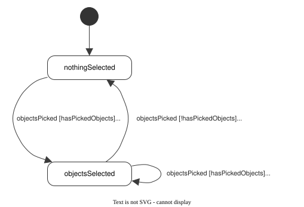](fig-sm-selectionStateMachine.svg)

| 出来事 | `nothingSelected` | `objectsSelected` |
| --- | --- | --- |
| `selection/objectsPicked` | → `objectsSelected` [`hasPickedObjects`（`event.pickedObjects.items.length > 0`）] それ以外 → — | → 自己 [`hasPickedObjects`（`event.pickedObjects.items.length > 0`）]（`selectedObjects` を書き換える） → `nothingSelected` [not `hasPickedObjects`（`event.pickedObjects.items.length > 0`）] |
| `selection/emptyAreaClicked` | — | → `nothingSelected` |
| `selection/selectionEscapePressed` | — | → `nothingSelected` [`isRungSelection`（`event.rung == 'selection'`）] それ以外 → — |
| `selection/selectionSettleKeyPressed` | — | → `nothingSelected` |
| `selection/selectionCleared` | — | → `nothingSelected` |
| `selection/selectionPruned` | — | → 自己 [`hasRemainingObjects`（`event.remainingObjects.items.length > 0`）]（`selectedObjects` を書き換える） → `nothingSelected` [not `hasRemainingObjects`（`event.remainingObjects.items.length > 0`）] |
| `selection/createdTaskSelected` | → `objectsSelected`（`selectedObjects` は作ったタスク 1 つ） | → 自己（`selectedObjects` を作ったタスク 1 つに置き換える） |
| `selection/createdCommentBoxSelected` | → `objectsSelected`（`selectedObjects` は置いたコメントボックス 1 つ） | → 自己（`selectedObjects` を置いたコメントボックス 1 つに置き換える） |

- `selectionStateMachine.nothingSelected` —— 初期。根拠 `SP-1` ・ `MK-11` ・ `SL-6`
- `selectionStateMachine.objectsSelected` —— 運ぶ値 `selectedObjects`（`SL-1` ・ `SL-7b`）。根拠 `SP-2` ・ `SP-3` ・ `SL-1` ・ `IN-4`

表に無い出来事は `selectionStateMachine` を変えない（同じ参照）。

## 操作の記録（`interactionRecord`）

**表 T-295 — 操作の記録の状態機械**

本表は、出来事の定義・根の値・状態機械ごとの状態遷移表と状態の一覧からなる。  
状態遷移表の行はその状態機械を動かす出来事、列はその状態機械の葉の状態、升は「→ 次の状態 [ガード] / 副作用」である。  
ガードは名と条件を「`名`（`条件`）」と刷り、条件は同じ領域のガードの一覧と同じである。  
状態に entry ／ exit の副作用がある状態機械は、出来事の行の上に `entry` ／ `exit` の行を置く —— その状態へ入る遷移・出る遷移が、出 → 遷移の副作用 → 入の順に起こし、自己への遷移（「→ 自己」）は起こさない。  
升の「—」は変化なし（同じ参照）を表す。  
ガードの付いた枝がすべての場合を覆わない升には「それ以外 → —」を添え、どの場合に何が起きるかを升ごとに言い切る。  
親の状態に置いた升は、その子のすべての列に同じ升を刷り、「親 … の升」と書き添える。

### 操作の記録の出来事

| 出来事 | どこから来るか | 運ぶ値 | 動かすもの |
| --- | --- | --- | --- |
| `interactionRecord/interactionRecordToggled` | 入力（`IC-76` を押して離した。記録していないときは始め、記録しているときは止める —— 開始と停止は同じ 1 つの入口である）: `IC-76` ・ `FR-102` | — | `interactionRecordingStateMachine` |

### 根 `interactionRecord` の値

運ぶ値: —。  
根拠: `FR-102` ・ `S-206`。

根の運ぶ値だけを書き換える出来事は無い。

**図 F-041 — 操作の記録の状態遷移**

状態機械ごとに 1 つの図に分け、その状態機械の節に置く。状態機械どうしは直交する。  
図は UML の状態機械図である —— 矢印のラベルは「出来事 [ガード] / 副作用」、同じ 2 つの状態を結ぶ遷移は 1 本の矢印に 1 行ずつ並べる。ガードは名で書き、条件は同じ領域のガードの一覧が持つ。  
行き先が運ぶ値で決まる升は選択の擬似状態（◇）で分ける。entry ／ exit は状態の箱の中に書く。  
⭐ 遷移の全数は 表 T-295 の状態遷移表が持つ。図と表はどちらも原稿から刷る。

### 状態機械 `interactionRecordingStateMachine`

[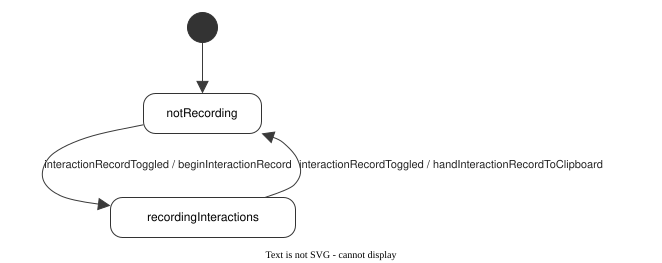](fig-sm-interactionRecordingStateMachine.svg)

| 出来事 | `notRecording` | `recordingInteractions` |
| --- | --- | --- |
| `interactionRecord/interactionRecordToggled` | → `recordingInteractions` / `beginInteractionRecord`（記録の溜めを空にし、始めた時刻を取り、始めたことを 1 行目に書く） | → `notRecording` / `handInteractionRecordToClipboard`（止めたことを書き、記録の文を組んでクリップボードへ渡し、溜めを空にする） |

- `interactionRecordingStateMachine.notRecording` —— 初期。根拠 `S-206` ・ `FR-102`
- `interactionRecordingStateMachine.recordingInteractions` —— 根拠 `FR-102` ・ `S-206` ・ `IC-76`

表に無い出来事は `interactionRecordingStateMachine` を変えない（同じ参照）。

## `Agent API`（`agentApi`）

**表 T-296 — `Agent API` の状態機械**

本表は、出来事の定義・根の値・状態機械ごとの状態遷移表と状態の一覧からなる。  
状態遷移表の行はその状態機械を動かす出来事、列はその状態機械の葉の状態、升は「→ 次の状態 [ガード] / 副作用」である。  
ガードは名と条件を「`名`（`条件`）」と刷り、条件は同じ領域のガードの一覧と同じである。  
状態に entry ／ exit の副作用がある状態機械は、出来事の行の上に `entry` ／ `exit` の行を置く —— その状態へ入る遷移・出る遷移が、出 → 遷移の副作用 → 入の順に起こし、自己への遷移（「→ 自己」）は起こさない。  
升の「—」は変化なし（同じ参照）を表す。  
ガードの付いた枝がすべての場合を覆わない升には「それ以外 → —」を添え、どの場合に何が起きるかを升ごとに言い切る。  
親の状態に置いた升は、その子のすべての列に同じ升を刷り、「親 … の升」と書き添える。

### `Agent API` の出来事

| 出来事 | どこから来るか | 運ぶ値 | 動かすもの |
| --- | --- | --- | --- |
| `agentApi/agentApiEntryPressed` | 入力（`IC-20` を押した。無効のときは有効にし、有効のときは無効にする —— 有効にするのと無効にするのは同じ 1 つの入口である）: `IC-20` ・ `FR-065` | — | 根 ・ `agentApiEnablingStateMachine` |
| `agentApi/rememberedEnablingLoaded` | 副作用の結果（起動のとき、シェルがブラウザ（オリジン）の記憶を読んだ結果）: `FR-065` ・ `S-99b` | `isRememberedEnabled`（`S-99b`。記憶が有効を指すか） | `agentApiEnablingStateMachine` |

### `Agent API` のガード

升が名で引くガードと、その条件（本書の頭の「ガードの条件の書き方」で書く）。

| ガード | 条件 | 根拠 |
| --- | --- | --- |
| `isRememberedEnabled` | `event.isRememberedEnabled` | `FR-065` ・ `S-99b` |

### 根 `agentApi` の値

運ぶ値: —。  
根拠: `FR-065` ・ `S-99b`。

| 出来事 | `agentApi` |
| --- | --- |
| `agentApi/agentApiEntryPressed` | → 自己 / `storeAgentApiEnabling`（押した後の有効・無効をブラウザ（オリジン）の記憶に書く） |

**図 F-042 — `Agent API` の状態遷移**

状態機械ごとに 1 つの図に分け、その状態機械の節に置く。状態機械どうしは直交する。  
図は UML の状態機械図である —— 矢印のラベルは「出来事 [ガード] / 副作用」、同じ 2 つの状態を結ぶ遷移は 1 本の矢印に 1 行ずつ並べる。ガードは名で書き、条件は同じ領域のガードの一覧が持つ。  
行き先が運ぶ値で決まる升は選択の擬似状態（◇）で分ける。entry ／ exit は状態の箱の中に書く。  
⭐ 遷移の全数は 表 T-296 の状態遷移表が持つ。図と表はどちらも原稿から刷る。

### 状態機械 `agentApiEnablingStateMachine`

[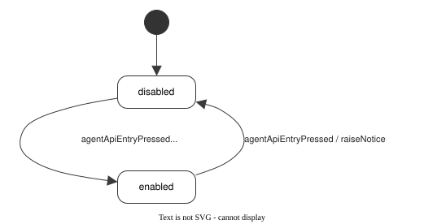](fig-sm-agentApiEnablingStateMachine.svg)

| 出来事 | `disabled` | `enabled` |
| --- | --- | --- |
| `agentApi/agentApiEntryPressed` | → `enabled` | → `disabled` / `raiseNotice`（`RS-20`） |
| `agentApi/rememberedEnablingLoaded` | → `enabled` [`isRememberedEnabled`（`event.isRememberedEnabled`）] それ以外 → — | — |

- `agentApiEnablingStateMachine.disabled` —— 初期。根拠 `FR-065` ・ `CP-17`
- `agentApiEnablingStateMachine.enabled` —— 根拠 `FR-065` ・ `S-99b`

表に無い出来事は `agentApiEnablingStateMachine` を変えない（同じ参照）。

## タスクグループの木（`taskGroupTree`）

**表 T-328 — タスクグループの木の状態機械**

本表は、出来事の定義・根の値・状態機械ごとの状態遷移表と状態の一覧からなる。  
状態遷移表の行はその状態機械を動かす出来事、列はその状態機械の葉の状態、升は「→ 次の状態 [ガード] / 副作用」である。  
ガードは名と条件を「`名`（`条件`）」と刷り、条件は同じ領域のガードの一覧と同じである。  
状態に entry ／ exit の副作用がある状態機械は、出来事の行の上に `entry` ／ `exit` の行を置く —— その状態へ入る遷移・出る遷移が、出 → 遷移の副作用 → 入の順に起こし、自己への遷移（「→ 自己」）は起こさない。  
升の「—」は変化なし（同じ参照）を表す。  
ガードの付いた枝がすべての場合を覆わない升には「それ以外 → —」を添え、どの場合に何が起きるかを升ごとに言い切る。  
親の状態に置いた升は、その子のすべての列に同じ升を刷り、「親 … の升」と書き添える。

⭐ 本領域の状態は文書に保存する値である（`05-07-design.md` の 表 T-250 の `SD-5`） —— 状態の型は `_assets/fig-erd-detail.md` の `AT-153` の列挙が持ち、状態のキーはその値と同じ並びである。  
値が変われば、起こしたものによらず未保存の編集であり、取り消しの 1 段である（`01-04-requirements.md` の `FR-018`）。

### タスクグループの木の出来事

| 出来事 | どこから来るか | 運ぶ値 | 動かすもの |
| --- | --- | --- | --- |
| `taskGroupTree/oneLevelOpenPressed` | 入力（タスクグループの 1 階層展開する操作子を押した。押しが何かを行うときだけ（`FR-029`））: `IC-90` ・ `HF-13` ・ `HR-7` | `pressedRowId`（押したタスクグループの id） | `treeStateMachine` |
| `taskGroupTree/allBelowOpenPressed` | 入力（タスクグループの配下をすべて展開する操作子を押した。押しが何かを行うときだけ）: `IC-58` ・ `HF-2` ・ `HR-3` | `pressedRowId`（押したタスクグループの id） | `treeStateMachine` |
| `taskGroupTree/hidePressed` | 入力（タスクグループの隠す操作子を押した）: `IC-59` ・ `HF-3` ・ `HR-6` | `pressedRowId`（押したタスクグループの id） | `treeStateMachine` |
| `taskGroupTree/allBelowFoldPressed` | 入力（タスクグループの配下をすべて折りたたむ操作子を押した。押しが何かを行うときだけ）: `IC-77` ・ `HF-11` ・ `HR-4` | `pressedRowId`（押したタスクグループの id） | `treeStateMachine` |
| `taskGroupTree/everyTaskGroupOpenPressed` | 入力（頭のすべて展開する操作子を押した。押しが何かを行うときだけ）: `IC-74` ・ `HF-10` ・ `HR-1` | — | 根 ・ `treeStateMachine` |
| `taskGroupTree/everyTaskGroupFoldPressed` | 入力（頭のすべて折りたたむ操作子を押した。押しが何かを行うときだけ）: `IC-78` ・ `HF-12` ・ `HR-2` | — | 根 ・ `treeStateMachine` |
| `taskGroupTree/topLevelOpenPressed` | 入力（頭の最も浅い段を 1 階層展開する操作子を押した。押しが何かを行うときだけ）: `IC-92` ・ `HF-16` | — | 根 ・ `treeStateMachine` |
| `taskGroupTree/childTaskGroupAddPressed` | 入力（タスクグループの配下に足す操作子か、頭の最も浅い段へ足す操作子を押した）: `IC-91` ・ `HF-14` ・ `HR-8` ・ `IC-93` ・ `HF-17` | `pressedRowId`（押したタスクグループの id。頭の操作子（`IC-93`）では段 0 を押したので、どのタスクグループでもない。値は `null` とする） | 根 ・ `treeStateMachine` |
| `taskGroupTree/fitPressed` | 入力（全体表示を求めた）: `IC-10` ・ `SK-18` ・ `FR-055` ・ `HF-8` | — | 根 ・ `treeStateMachine` |
| `taskGroupTree/everyTaskGroupDeletePressed` | 入力（頭のすべてのタスクグループを消す操作子を押し、問い（`QN-10`）に消すと答えた）: `IC-106` ・ `HF-20` | — | 根 |
| `taskGroupTree/verticalZoomShrinkPressed` | 入力（縦軸を縮める入力。縮める側の端で倍率を書き換えないとき（`ZE-2`）も送る。拡げる入力・日付の軸のズーム・`Agent API` の `setZoom` では送らない）: `MK-2` ・ `MK-4` ・ `IC-14` ・ `SK-16c` ・ `ZE-2` | — | `treeStateMachine` |
| `taskGroupTree/taskGroupRevealAsked` | 入力（検索パネルの表の行を押して飛ぶ（`SJ-1`）か、`Agent API` の `focusTask`（`AM-16`）が飛ぶか、依存線の続きの印を押して折りたたんだタスクグループか隠したタスクグループの配下の端へ送る（`EL-21`）か、スケジュールフィルタを掛けているあいだに表の行を「非表示」から「表示」にする（`FR-151` の 表 T-353 の `TV-6`）。⭐ スケジュールフィルタを掛けることでは展開しない（同行））: `SJ-1` ・ `AM-16` ・ `EL-21` ・ `TV-6` | `revealedRowId`（飛ぶ先のタスクグループの id） | 根 ・ `treeStateMachine` |

### タスクグループの木のガード

升が名で引くガードと、その条件（本書の頭の「ガードの条件の書き方」で書く）。

| ガード | 条件 | 根拠 |
| --- | --- | --- |
| `isBelowPressedTaskGroup` | `event.pressedRowId in ancestors(taskGroup.id)` | `HR-3` ・ `HR-4` ・ `HR-6` ・ `HR-1a` |
| `isChildOfPressedTaskGroup` | `event.pressedRowId != null && taskGroup.parentId == event.pressedRowId` | `HR-7` ・ `HF-13` |
| `isLeafTaskGroup` | `childTaskGroups(taskGroup.id).length == 0` | `TD-6` ・ `HR-3` |
| `isLevelZeroCollapsed` | `setting('S-418') == 'collapsed'` | `S-418` ・ `HR-2` |
| `isPressedTaskGroup` | `taskGroup.id == event.pressedRowId` | `HR-3` ・ `HR-4` ・ `HR-6` ・ `HR-7` ・ `HR-8` |
| `isRevealedTaskGroupOrAncestor` | <code>taskGroup.id == event.revealedRowId &#124;&#124; taskGroup.id in ancestors(event.revealedRowId)</code> | `SJ-2` |
| `isTopLevelTaskGroup` | `taskGroup.parentId == null` | `HF-16` ・ `HR-7` |

### 根 `taskGroupTree` の値

運ぶ値: —。  
根拠: `AT-153` ・ `S-418`。

| 出来事 | `taskGroupTree` |
| --- | --- |
| `taskGroupTree/everyTaskGroupFoldPressed` | → 自己 / `writeLevelZeroCollapsed`（段 0 を折りたたむ（`S-418` を `'collapsed'` に）。タスクグループの値と同じ束に入れる） |
| `taskGroupTree/everyTaskGroupOpenPressed` | → 自己 [`isLevelZeroCollapsed`（`setting('S-418') == 'collapsed'`）] / `writeLevelZeroAuto`（段 0 を展開する（`S-418` を `'auto'` に）。タスクグループの値と同じ束に入れる） それ以外 → — |
| `taskGroupTree/topLevelOpenPressed` | → 自己 [`isLevelZeroCollapsed`（`setting('S-418') == 'collapsed'`）] / `writeLevelZeroAuto`（同上） それ以外 → — |
| `taskGroupTree/childTaskGroupAddPressed` | → 自己 [`isLevelZeroCollapsed`（`setting('S-418') == 'collapsed'`）] / `writeLevelZeroAuto`（同上。1 階層だけ展開し、タスクグループの値は変えない（`HF-17`）） それ以外 → — |
| `taskGroupTree/fitPressed` | → 自己 [`isLevelZeroCollapsed`（`setting('S-418') == 'collapsed'`）] / `writeLevelZeroAuto`（同上） それ以外 → — |
| `taskGroupTree/everyTaskGroupDeletePressed` | → 自己 [`isLevelZeroCollapsed`（`setting('S-418') == 'collapsed'`）] / `writeLevelZeroAuto`（同上。消す書き込みと同じ束に入れる（`HF-20`）） それ以外 → — |
| `taskGroupTree/taskGroupRevealAsked` | → 自己 [`isLevelZeroCollapsed`（`setting('S-418') == 'collapsed'`）] / `writeLevelZeroAuto`（段 0 を展開する（`S-418` を `'auto'` に）。タスクグループの値と同じ束に入れる） それ以外 → — |

**図 F-043 — タスクグループの木の状態遷移**

状態機械ごとに 1 つの図に分け、その状態機械の節に置く。状態機械どうしは直交する。  
図は UML の状態機械図である —— 矢印のラベルは「出来事 [ガード] / 副作用」、同じ 2 つの状態を結ぶ遷移は 1 本の矢印に 1 行ずつ並べる。ガードは名で書き、条件は同じ領域のガードの一覧が持つ。  
行き先が運ぶ値で決まる升は選択の擬似状態（◇）で分ける。entry ／ exit は状態の箱の中に書く。  
⭐ 遷移の全数は 表 T-328 の状態遷移表が持つ。図と表はどちらも原稿から刷る。

### 状態機械 `treeStateMachine`

[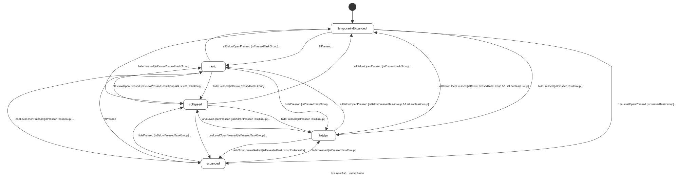](fig-sm-treeStateMachine.svg)

| 出来事 | `auto` | `collapsed` | `expanded` | `temporarilyExpanded` | `hidden` |
| --- | --- | --- | --- | --- | --- |
| `taskGroupTree/oneLevelOpenPressed` | → `expanded` [`isPressedTaskGroup`（`taskGroup.id == event.pressedRowId`）] それ以外 → — | → `expanded` [`isPressedTaskGroup`（`taskGroup.id == event.pressedRowId`）] それ以外 → — | — | → `expanded` [`isPressedTaskGroup`（`taskGroup.id == event.pressedRowId`）] それ以外 → — | → `collapsed` [`isChildOfPressedTaskGroup`（`event.pressedRowId != null && taskGroup.parentId == event.pressedRowId`）] それ以外 → — |
| `taskGroupTree/allBelowOpenPressed` | → `temporarilyExpanded` [`isPressedTaskGroup`（`taskGroup.id == event.pressedRowId`）] → `temporarilyExpanded` [`isBelowPressedTaskGroup`（`event.pressedRowId in ancestors(taskGroup.id)`） & not `isLeafTaskGroup`（`childTaskGroups(taskGroup.id).length == 0`）] それ以外 → — | → `temporarilyExpanded` [`isPressedTaskGroup`（`taskGroup.id == event.pressedRowId`）] → `temporarilyExpanded` [`isBelowPressedTaskGroup`（`event.pressedRowId in ancestors(taskGroup.id)`） & not `isLeafTaskGroup`（`childTaskGroups(taskGroup.id).length == 0`）] → `auto` [`isBelowPressedTaskGroup`（`event.pressedRowId in ancestors(taskGroup.id)`） & `isLeafTaskGroup`（`childTaskGroups(taskGroup.id).length == 0`）] それ以外 → — | — | — | → `temporarilyExpanded` [`isBelowPressedTaskGroup`（`event.pressedRowId in ancestors(taskGroup.id)`） & not `isLeafTaskGroup`（`childTaskGroups(taskGroup.id).length == 0`）] → `auto` [`isBelowPressedTaskGroup`（`event.pressedRowId in ancestors(taskGroup.id)`） & `isLeafTaskGroup`（`childTaskGroups(taskGroup.id).length == 0`）] それ以外 → — |
| `taskGroupTree/hidePressed` | → `hidden` [`isPressedTaskGroup`（`taskGroup.id == event.pressedRowId`）] → `collapsed` [`isBelowPressedTaskGroup`（`event.pressedRowId in ancestors(taskGroup.id)`）] それ以外 → — | → `hidden` [`isPressedTaskGroup`（`taskGroup.id == event.pressedRowId`）] それ以外 → — | → `hidden` [`isPressedTaskGroup`（`taskGroup.id == event.pressedRowId`）] → `collapsed` [`isBelowPressedTaskGroup`（`event.pressedRowId in ancestors(taskGroup.id)`）] それ以外 → — | → `hidden` [`isPressedTaskGroup`（`taskGroup.id == event.pressedRowId`）] → `collapsed` [`isBelowPressedTaskGroup`（`event.pressedRowId in ancestors(taskGroup.id)`）] それ以外 → — | — |
| `taskGroupTree/allBelowFoldPressed` | → `collapsed` [`isPressedTaskGroup`（`taskGroup.id == event.pressedRowId`）] → `collapsed` [`isBelowPressedTaskGroup`（`event.pressedRowId in ancestors(taskGroup.id)`）] それ以外 → — | — | → `collapsed` [`isPressedTaskGroup`（`taskGroup.id == event.pressedRowId`）] → `collapsed` [`isBelowPressedTaskGroup`（`event.pressedRowId in ancestors(taskGroup.id)`）] それ以外 → — | → `collapsed` [`isPressedTaskGroup`（`taskGroup.id == event.pressedRowId`）] → `collapsed` [`isBelowPressedTaskGroup`（`event.pressedRowId in ancestors(taskGroup.id)`）] それ以外 → — | — |
| `taskGroupTree/everyTaskGroupOpenPressed` | → `temporarilyExpanded` [not `isLeafTaskGroup`（`childTaskGroups(taskGroup.id).length == 0`）] それ以外 → — | → `temporarilyExpanded` [not `isLeafTaskGroup`（`childTaskGroups(taskGroup.id).length == 0`）] → `auto` [`isLeafTaskGroup`（`childTaskGroups(taskGroup.id).length == 0`）] | — | — | → `temporarilyExpanded` [not `isLeafTaskGroup`（`childTaskGroups(taskGroup.id).length == 0`）] → `auto` [`isLeafTaskGroup`（`childTaskGroups(taskGroup.id).length == 0`）] |
| `taskGroupTree/everyTaskGroupFoldPressed` | → `collapsed` | — | → `collapsed` | → `collapsed` | — |
| `taskGroupTree/topLevelOpenPressed` | — | — | — | — | → `collapsed` [`isTopLevelTaskGroup`（`taskGroup.parentId == null`）] それ以外 → — |
| `taskGroupTree/childTaskGroupAddPressed` | → `temporarilyExpanded` [`isPressedTaskGroup`（`taskGroup.id == event.pressedRowId`）] それ以外 → — | → `temporarilyExpanded` [`isPressedTaskGroup`（`taskGroup.id == event.pressedRowId`）] それ以外 → — | — | — | — |
| `taskGroupTree/fitPressed` | — | → `auto` | → `auto` | → `auto` | — |
| `taskGroupTree/verticalZoomShrinkPressed` | — | — | — | → `auto` | — |
| `taskGroupTree/taskGroupRevealAsked` | → `expanded` [`isRevealedTaskGroupOrAncestor`（<code>taskGroup.id == event.revealedRowId &#124;&#124; taskGroup.id in ancestors(event.revealedRowId)</code>）] それ以外 → — | → `expanded` [`isRevealedTaskGroupOrAncestor`（<code>taskGroup.id == event.revealedRowId &#124;&#124; taskGroup.id in ancestors(event.revealedRowId)</code>）] それ以外 → — | — | → `expanded` [`isRevealedTaskGroupOrAncestor`（<code>taskGroup.id == event.revealedRowId &#124;&#124; taskGroup.id in ancestors(event.revealedRowId)</code>）] それ以外 → — | → `expanded` [`isRevealedTaskGroupOrAncestor`（<code>taskGroup.id == event.revealedRowId &#124;&#124; taskGroup.id in ancestors(event.revealedRowId)</code>）] それ以外 → — |

- `treeStateMachine.auto` —— 根拠 `AT-153` ・ `FR-018`
- `treeStateMachine.collapsed` —— 根拠 `HR-4` ・ `HR-1a`
- `treeStateMachine.expanded` —— 根拠 `HR-7` ・ `FR-018`
- `treeStateMachine.temporarilyExpanded` —— 初期。根拠 `HR-3` ・ `HR-1` ・ `FR-018` ・ `AT-153` ・ `HF-14`
- `treeStateMachine.hidden` —— 根拠 `HR-6`

表に無い出来事は `treeStateMachine` を変えない（同じ参照）。
