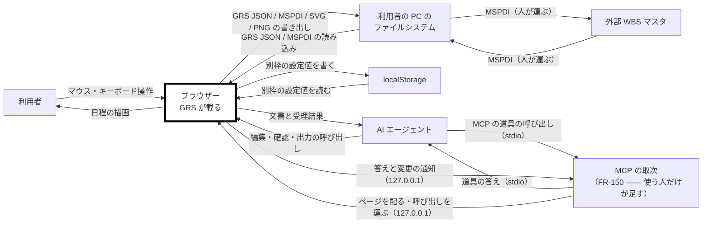

# gr-scheduler 仕様書 — 要求

**Grammar**: spec.sgra
**UID**: DOC-REQUIREMENTS
**Version**: 0.4

本書は第 1 部（Chapter 1 〜 4）である。  
仕様形式は **ANPS-part**（4 枚）。  
書き方の規則は `docs/development-rules/08-spec-template/spec-writing-rules.md`、要望の入力は `studies/user-order.md` が正である。

> **未記入の節は引用で始まる行を持つ。**  
> `grep -n "^> 未記入" docs/spec/*.md` で残りを引ける。

## Chapter 1. Foundation (基本事項)

### 1.1 Background (背景)

**Type**: SECTION

日程の図は、複数の対象と複数の工程が絡む仕事で最も広く使われる図の 1 つである。  
ところが、それを描く道具は 2 つに割れている。  
作図ソフト（`PowerPoint` など）と表計算ソフト（`Excel` など）は自由に描けるが、成果物は画像であって構造を持たない。  
日程管理ソフトは構造を持つが、調査した範囲ではいずれも 1 つの行に複数のタスクやマイルストーンを置けない。

そのため「1 対象を 1 行に置き、その対象の全工程を 1 枚で俯瞰する」形式の日程の図は、実際には作図ソフトで描かれている。  
描いた図は日付が動くたびに人が引き直すことになり、他の日程管理ソフトへ渡すこともできない。

**問題は道具の出来ではなく、用途の違う道具が使われていることにある。**  
現状を表 T-001 に示す。

**表 T-001 — 現状**

| 行 ID | 現状 | 何が起きるか |
| --- | --- | --- |
| PLM-1 | 日程の図を作図ソフト（`PowerPoint` など）や表計算ソフト（`Excel` など）で描いている | 日付が 1 つ動くたびに、図形と線を人が引き直す。 更新が滞り、図と実態が離れる。 他の日程管理ソフトへ日程をデータとして渡せず、機械が読めない |
| PLM-2 | （欠番） | —— |
| PLM-3 | 日程管理ソフトは 1 行に 1 つのタスクしか置けない | 対象ごとの俯瞰ができない。 行数が対象数と工程数の積まで膨らむ |
| PLM-4 | 全体日程が 1 画面に収まらない | スクロールしながら記憶で繋ぐことになり、工程の前後関係を見落とす |
| PLM-5 | 操作感が重たいソフトがある | 日程を検討するあいだ待たされるので、良い日程を引くことに集中できない |
| PLM-6 | 初見者に使いづらいソフトがある | 日程の検討とは別に習熟の工数がかかり、使う人の賛同を得た導入が難しい |
| PLM-7 | ソフト自体が重く、配布が難しい場合がある | 導入と初期設定の手間が、使う人の賛同を得る妨げになる |
| PLM-8 | 日程の図を画像や資料として配ると、誰がいつ持ち出したか追えない | 秘密を含む日程が外へ出たとき、出どころが辿れない |
| PLM-9 | 日程の図は遅れているタスクを示すが、その遅れがどこで生まれたかは示さない | 遅れているタスクの多くは先行の遅れに巻き込まれたタスクであり、読み手は依存と WBS を自分で辿って原因を探すことになる。 実績が入力されていないタスクがあると、遅れの像そのものが歪む。 ⇒ 支援の差し向け先を誤る |

### 1.2 Challenges (課題)

**Type**: SECTION

**背景の現状を解くために何を成すかを表 T-054 に示す。**  
どこまで成せば足りるかは 1.3 の目標が持つ。

**表 T-054 — 課題**

| 行 ID | 課題 | 価値のことば | 受ける目標 |
| --- | --- | --- | --- |
| CH-1 | 作図ソフトと同じ操作感で描きながら、構造化したスケジュールデータを出す | —— | `GL-008` / `GL-004` |
| CH-2 | 縮めたときに出す情報を絞り、全体を 1 枚で俯瞰させる | **ペライチ** | `GL-001` / `GL-002` |
| CH-3 | 軽快に動かす | **ぬるサク** | `GL-003` |
| CH-4 | 説明を読まずに操作できるようにする | **すぐわか** | `GL-006` |
| CH-5 | 単一の `.html` で完結させ、特定の業種にも製品にも依存しない | —— | `GL-005` |
| CH-6 | 秘密の日程を画面に出したとき、誰がいつ出したかを絵の中に残す | —— | `GL-007` |
| CH-7 | 遅れの発生源と、数字が信用できないタスクを、読み手が判断せずに受け取れるようにする | **遅延診断** | `GL-009` |

価値のことばの語義は `_assets/tbl-glossary.md` の表 T-106 が持つ。

### 1.3 Goals (目標)

#### 1 つのタスクグループに複数のタスクを置いて俯瞰できる

**Type**: GOAL
**UID**: GL-001

**STATEMENT**: 利用者が、1 つのタスクグループに複数のタスクとマイルストーンを置き、1 つの対象の全工程を 1 つのタスクグループで見渡せる状態になること。

#### 全体日程を 1 画面で見られる

**Type**: GOAL
**UID**: GL-002

**STATEMENT**: 利用者が、プロジェクトの全体日程をスクロールせずに 1 画面で見られる状態になること。

#### 操作が引っかからない

**Type**: GOAL
**UID**: GL-003

**STATEMENT**: 利用者が、**どの操作を行っても**、操作が引っかからずに追従する状態（**ぬるサク**）になること。  
**外部の応答を待つ時間と、大量のデータを読み書きする時間はこれに含めない。**

#### 成果物が構造化データである

**Type**: GOAL
**UID**: GL-004

**STATEMENT**: 描いた日程が、画像ではなく機械が読める構造化データとして出し入れでき、外部 WBS マスタとの間を情報を落とさずに往復できる状態になること。

#### 1 つのファイルだけで動く

**Type**: GOAL
**UID**: GL-005

**STATEMENT**: 利用者が、1 つの `.html` をブラウザーで開くだけで、サーバーもインストールも無しに日程を編集できる状態になること。

#### マニュアルを読まずに使える

**Type**: GOAL
**UID**: GL-006

**STATEMENT**: 初めて触る利用者が、マニュアルを読まずに主要な操作へ到達できる状態になること。

#### 秘密の日程を画面に出した証跡が残る

**Type**: GOAL
**UID**: GL-007

**STATEMENT**: 利用者が秘密の日程を画面に出すとき、誰がいつ出していたかが画面上に残る状態になること。

#### 描いたものを直接掴んで日程を変えられる

**Type**: GOAL
**UID**: GL-008

**STATEMENT**: 利用者が、画面に描かれたタスクとマイルストーンを直接掴んで動かすことで日程を変えられ、握っているあいだその結果が絵に出る状態になること。

#### 遅れの発生源を、掘り下げるだけで特定できる

**Type**: GOAL
**UID**: GL-009

**STATEMENT**: 基準日の時点で、遅れのうち最優先で対処すべきタスク（ボトルネック）を、折りたたんだ画面から掘り下げる操作だけで特定できる状態になること。  
数字が信用できないタスクは、それと分かる形で示されること。  
⭐ 読み手には、日程を描いた人でない者（全体を見て支援を差し向ける立場の人）と、画面を見ない AI が含まれる。  
どちらも依存と WBS を自分で辿らない。  
読み手の行動は「信用できないタスクを無くさせ、そのうえでボトルネックから支援する」の 2 手で足りること —— 読み手が数手の掘り下げで届くことが本目標の要件であり、詳しさを足す要求はこの要件で測る。

### 1.4 Approach (解決方針)

**Type**: SECTION

実装言語は TypeScript とする。  
ビルドは Vite で行い、生成した JavaScript と CSS を 1 つの `.html` へ埋め込んで出力する。  
テストは、値だけで決まる層を Vitest で、利用者の操作を通した確認と性能の計測を Playwright で行う。  
テストコードの置き場と Chapter 8 〜 10 の対応は Chapter 7 が定める。

⚠️ **Vite は型を検査しない。**  
TypeScript から型注釈を落とすだけなので、型エラーがあってもビルドは通る。  
型検査は `tsc --noEmit` として別に実行する。

描画方式と層の分け方は本章では決めない。  
Chapter 5 で決める。  
方式の理由と代償は `studies/04-performance/performance-notes-ja.md` §1 E-1 にあり、Chapter 5.1 はそれを読んだうえで決める。

**性能は骨格の段階で実測してから機能を積む。**  
骨格で 1 度測っただけでは、完成版の性能は分からない。  
Chapter 10 の非機能テストは節目ごとに再計測して結果を足す。

### 1.5 Scope (範囲)

**Type**: SECTION

本プロジェクトの範囲を表 T-002 に示す。

**表 T-002 — 範囲**

| 行 ID | 区分 | 内容 |
| --- | --- | --- |
| SO-1 | In-scope | 日程の作成・編集・表示。 1 つのタスクグループに複数のタスクを置くこと（マルチバー）。 タスクグループの階層と折りたたみ。 異方性ズームと表示量の増減 |
| SO-2 | In-scope | 予定と実績の管理・表示。 進捗の可視化 |
| SO-3 | In-scope | タスク間の依存関係の表現と自動配線 |
| SO-4 | In-scope | 注記・強調・カーソル・透かし |
| SO-5 | In-scope | `GRS JSON` と MSPDI XML の双方向 Import / Export。 複数ファイルの合流（形式は問わない） |
| SO-6 | In-scope | SVG と PNG の出力 |
| SO-7 | In-scope | 人間向け UI と同格の `Agent API` |
| SO-8 | Out-of-scope | 資源管理（工数・割当率・稼働率）。 ただし担当の表示と割当の追加・編集・解除は行う |
| SO-9 | Out-of-scope | コスト管理・EVM・出来高管理・資源平準化 |
| SO-10 | Out-of-scope | クリティカルパス計算とスケジューラ。 日付は人が決める |
| SO-11 | Out-of-scope | カスタムフィールドの汎用機構 |
| SO-12 | Out-of-scope | サーバー通信・認証・共同編集。 **設計の余地を残す判断は `NFR-012` が持つ** |
| SO-13 | Out-of-scope | 絵文字アイコンの対応。 アイコンの外部からの取り込み |
| SO-14 | Out-of-scope | タッチ操作とモバイル表示 |

### 1.6 Constraints (制約事項)

**Type**: SECTION

破ることのできない制約を表 T-003 に示す。

**表 T-003 — 制約事項**

| 行 ID | 制約 | 内容 |
| --- | --- | --- |
| CN-1 | 単一ファイル | 成果物は 1 つの `.html` とする。 サーバーを必要とせず、ネットワークから切り離した状態で全機能が動くこと。 ⚠️ 例外 —— `FR-150`（`Agent API` を MCP の道具として呼ばせる）だけは、MCP を使う人が足す取次（表 T-007 の `DEV-6`）を要する。 取次は `.html` とは別に配り（形は 表 T-035 の `AG-12` の ①）、利用者の PC の中の `127.0.0.1` だけで待ち受けて `GRS` のページを配る（表 T-008 の `CHN-10` 〜 `CHN-14`）。 取次を足さない人の `GRS` は、1 つの `.html` だけで動く（`GL-005` を動かさない —— `FR-150` の RATIONALE） |
| CN-2 | 対応ブラウザー | Chromium 系（Chrome / Edge）を基準とする。 Firefox は動作確認に留め、Safari は対象外とする |
| CN-3 | 対応 OS | 問わない。 単一ファイルでネットワークを持たないため、OS 差は実質フォントだけである |
| CN-4 | 入力機器 | マウスとキーボードのみとする。 タッチは対象外とする |
| CN-5 | 文字コード | **書き出すものは UTF-8・BOM なしとする（MUST）。 ** JSON は RFC 8259 が BOM の付加を禁じており、MSPDI XML も同じ扱いとする。 ⚠️ **読む側の規則は本行ではない** —— 受け入れる入力の範囲は `FR-023` が持つ |
| CN-6 | 外部通信 | 実行時に外部へ通信しない。 外部から取得する資源を持たない。 ⚠️ 人が押したリンクで、閲覧環境が別の頁を新しいタブに開くことは、本行の通信に当たらない —— 開くのは閲覧環境であり、成果物は何も送らず、何も取得しない（`FR-073`）。 ⚠️ `FR-150` の取次が配ったページと、同じ PC の取次とのあいだの通信（表 T-008 の `CHN-12` 〜 `CHN-14`）も、本行の通信に当たらない —— 取次は `127.0.0.1` だけで待ち受け、ページも取次も PC の外へは何も送らず、PC の外から何も取得しない。 ページが繋げる先は、内容セキュリティ方針が同じ origin に限る（表 T-232 の `PO-7`）。 取次から先で AI のアプリが何と通信するかは、`GRS` の外である（表 T-007 の `DEV-5`） |
| CN-7 | 第三者著作物 | **第三者の素材**（フォント・アイコン・画像・データ）を成果物にもリポジトリにも同梱しない。 実行時に必要な第三者ライブラリは、許諾条件を満たす帰属表示を成果物へ埋め込んだうえで同梱してよい（`FR-069`）。 例外 —— 交換相手のスキーマのうち、`GRS` が実際に読み書きする要素名と列挙値は、本仕様書に引用してよい。 引用するときは出典をファイル名と行番号で書くこと（MUST）。 読み書きしないものを網羅的にコピーしてはならない（MUST NOT）。 例外 —— 交換相手のスキーマの、要素の道筋ごとの子の名と順の表（表 T-033 の `EX-10`）は、スキーマから道具で作って同梱してよい。 型・説明・列挙値は含めない |
| CN-8 | 内容セキュリティ方針 | `GRS HTML` に対する内容セキュリティ方針（`CSP`）を持つ。 `img-src` は `data:` とする。 **指令の全数は 表 T-232 が持つ** |
| CN-9 | **画面とデータモデルの分離** | **画面（GUI）とデータモデルを層として分離する。 ** 層の具体は Chapter 5 が決めるが、**分離すること自体は破れない制約**とする。 **同じものを 2 つの語で呼ばない命名の規則は 1.9 が持つ** |

### 1.7 Limitations (制限事項)

**Type**: SECTION

要求を完全には満たさないが、許容すると決めた既知の妥協点を表 T-004 に示す。

**表 T-004 — 制限事項**

| 行 ID | 制限 | なぜ許容するか |
| --- | --- | --- |
| LM-1 | 透かしの除去は暗号的に防げない。 クライアント単体で動く `GRS HTML` であるため、DOM を直接編集すれば透かしは消せる | 目的は撮影されたときの証跡であり、弱い抑止で足りる。 強制するにはサーバー配備が要る |
| LM-2 | 「WCAG 2.1 AA 適合」とは名乗らない | 支援技術による読み上げを対象外にしたため。 条文に部分適合の概念が無く、1 つでも外せば適合とは言えない。 AA は指針として使い、**色覚とコントラスト・フォーカスの判別・文字サイズと言語・エラー表示**に絞る |
| LM-2b | **すべての操作をキーボードだけで完了することはできない**（WCAG 2.1 の 2.1.1 を適合範囲から外す） | **中核がドラッグで日程を描くことだからである**（`CN-4` はマウスとキーボード）。 バーを引く・範囲を囲う・依存線を結ぶは、いずれもポインターの連続した位置を入力とする操作であり、鍵に写しても同じ道具にならない。 **キーボードは速さの手段として残す**（`FR-070` の表 T-036）。 ⚠️ **これにより、ポインターを使えない利用者は `GRS` を使えない。 ** 受け入れたうえで名乗らない |
| LM-2a | 1.4.12（行間・字間の上書き）は**参考に留め、適合範囲に数えない** | **ラベル幅を概算する方針（実測もキャッシュもしない）と両立しない。 ** 概算は文字の実寸を見ないので、読む人が字間を広げた瞬間に見積もりが外れる。 実測へ切り替えると描画のたびに計測が走り、`GL-003`（操作が引っかからない）を直接崩す。 **最優先事項を守るほうを選ぶ** |
| LM-3 | 書き出した担当を外部ツールがどう扱うかは未検証である | 実機での確認が要る。 開発を止める理由にはならないが、検証するまで断定しない |
| LM-4 | 扱える文書の大きさはブラウザーのメモリに収まる範囲に限られる | サーバーもデータベースも持たない構成の帰結である。 上限に達したときは人に通知する |
| LM-5 | 往復無損失を保証するのは、1 つのファイルを合流させずに未編集で往復した場合に限る | 範囲を限定する理由は `FR-021` が持つ。 **合流の利点（`FR-056`）と引き換えに受け入れる** |
| LM-6 | **別枠で持つ設定値は、同じ機の他のローカルページからも読める** | 単一ファイルをローカルで開く形では、保管庫が機ごとに 1 つしかない。 **共有 PC では他者が読みうる。 ** 全数は `_assets/tbl-settings.md` の表 T-206 の別枠の行である |
| LM-7 | 完了率が 100 を超える値を相手のツールがどう扱うかは**未検証である** | 丸めない方針（`FR-012`）は `GRS` 側の決定であり、相手側の挙動は実機で確かめるまで断定しない |
| LM-8 | 書き出した SVG / PNG にも透かしが載るため、**開いた者の名前が第三者へ伝わりうる** | 透かしの目的（誰がいつ画面に出していたか）と、画像を配る用途が衝突する。 **利用者に示したうえで可否を選ばせる**（`FR-020`） |
| LM-11 | **異常終了すると、最後に保存してからの編集がすべて失われる** | 書き込むのは人が求めたときだけと決めたことの帰結である（`FR-060` ／ 表 T-036 の `SK-11`）。 ⛔ **自動保存を持てば数秒ぶんに縮むが、それを承知で持たない。 **⭐ **タブを閉じる側は `FR-100` が塞ぐ** —— 塞げないのはブラウザーや OS ごと落ちたときだけである |
| LM-10 | 再取り込みの照合が成り立つ前提は、1 つの対向ツールでの実機挙動でしか確かめられていない | 特定製品で確かめた挙動を役割名で書いているので、一般論のように読めてしまう。 **接続先ごとに実機確認が要る**（表 T-032 の MG-3） |
| LM-9 | **文書を開き直したとき、取り消しの履歴は戻らない** | 履歴を文書にもファイルにも入れないと決めたことの帰結である。 入れると容量と書き込み量が跳ね上がる。 **引き継がない規則は表 T-024a の `OP-4` が持つ** |
| LM-12 | **既定の透かし解除パスワードは秘密として機能しない** | **既定値そのものが本仕様書に書いてある**（表 T-207 の `S-100`）。 成果物に埋め込まれるのは SHA-256（`S-101`）だが、既定値が公開されている以上どちらにせよ秘密として機能しない。 **透かしはアクセス制御ではなく証跡である**（`FR-020` が画面上でもそう示すことを求めている）。 **この機能が意味を持つのは将来サーバーと接続したときである** |
| LM-14 | ファイルを直接開いた状態（`file://`）では、上書き保存が働かないことがある | 単一ファイルをローカルで開く形では保存先への権限が保たれず（`FR-060`）、保管庫の読み出しを拒否するブラウザーもある（`FR-038`）。 表 T-003 の `CN-1` と `NFR-004` の「全機能が動く」判定からは、上書き保存に加えて、`localStorage` を保管先とする値（表 T-206 の別枠）も除く —— 全数は表 T-206 の別枠の行、すなわち「別枠。`localStorage` に置く。」と明記した行である。  ⛔ **復帰の申し出は無い**（`FR-060`）—— 上書きの相手を覚えないと決めたので、起動ごとに一度、人が保存先を選ぶことになる。  |
| LM-15 | 表示量のしきい値を変えると、スケジュールデータの群の刻を動かさずに書き出した画像からタスクとタスクグループが消える | しきい値は見せ方の群であり（`FR-063`）、`FR-077` は可読の下限を割るときタスクグループの量を減らすと定める。 ⚠️ **`WY-1` は破れていない** —— 同じ JSON を往復させれば同じ絵に戻る。 破れるのは「同じ刻印なら同じ絵」という別の読みであり、本仕様書はそれを約束していない |
| LM-13 | **透かしはコントラストの適合範囲に数えない** | 透かしは薄く重ねると定めており（`FR-020`）、`NFR-007` の 4.5 : 1 と両立しない。 外す判断とその理由は `NFR-007` が持つ。 濃さは表 T-207 の `watermarkOpacity` |
| LM-18 | **テーマ色の明度は色相ごとに寄り、暗いテーマでは実績が予定より明るく描かれる** | ⭐ 表 T-236 の値は前プロジェクトの試作から採ったものであり、色相 214 では寄せずに 表 T-017a を満たす。 ⭐ ほかの色相は `FR-041` の 表 T-366 で明度を寄せて満たす —— 2026-10-04 に 360 の色相で測ると、寄せた後に地（`S-146`）に対して `CT-3` 〜 `CT-5` を割る色相は無い（最悪は `CT-3` の 3.01、`CT-4` の 3.00）。 ⚠️ 寄せる前は、明るいテーマで 88 の色相が `CT-3` を、131 の色相が `CT-4` を割っていた（最悪 2.49）。 比の測り方は 表 T-366 の `CF-6` である。 ⛔ 暗いテーマでは実績が予定より明るく描かれ、`FR-007` の求める向きと逆になる。 ⚠️ この限界は承知のうえで採った —— 見た目を試作に揃えることを優先し、測り直しは 表 T-026 の `RC-1` の対象として残す |
| LM-19 | 1 フレームの予算を満たしていない。 ⭐ ほかの不具合が無くなるまで、いまの値を是とする —— **フレーム時間の実測は中央値 16.67 ミリ秒、95 パーセンタイル 24.4 ミリ秒であり、上限は 16.7 ミリ秒である**（`NFR-002` の平均 60fps と `NFR-003` の p95、第 7 章の合否では 表 T-043 の `PG-2` / `PG-3` / `PG-8` / `PG-10` / `PG-12` が外側）。 フレーム時間は届いたフレームとフレームの間隔であり（`05-07-design.md` の 表 T-043 の前文）、95 パーセンタイルが上限を超えているので満たしていない。 測り方は出荷ビルド（コミット `5c1b915`）、Edge 153.0.4234.32、1920 × 1080、`Task` 1000 件、表 T-025 の `MC-8` の区間 4 つで 240 フレームずつ間隔を測った 960 個、2026-09-14 である。 道具は `tools/probe/examples/lm-19-frame-time-baseline.mjs`、生の数は `docs/development-records/measurements/frame-time-stage0-2026-09-14.json`、要約は `docs/development-records/history/refactor-plan-report-2026-09-13.md` の 16 節が持つ。 ⚠️ 構えているあいだのドラフトを描くので、マイルストーンの道で 240 フレーム中 3 枚が予算を超える（ドラフトを描かなければ 0 枚。 中央値の差は機械のばらつきに埋もれる） | ⭐ ほかの不具合を無くすことを性能の改善より先に置き、それまではいまの性能を是とする。 ⛔ **`NFR-002` / `NFR-003` の条項は下げない** —— 満たしていないことを本行が記す。 ⛔ 条項を実測に合わせて書き換えてはならない（`RISK-001` が名指す関門であり）。 ⛔ **この期間、性能の最適化を進めない** —— **ほかの不具合を先に無くす**。 ⭐ **耐えられなくなったら再検討する。 **⭐ **行き先は測り分けてある** —— ⚠️ 次の数は参考であり、フレーム時間ではない —— `tools/probe/examples/frame-attribution.mjs` の trace で、描き直しの呼び出しの中の仕事を割ったものである。 `showSvg` の書き込みと解析が 3.12 ミリ秒、1,376 要素を丸ごと差し替えたことに続く style / layout / paint が 6.11 ミリ秒で、合わせて 9.2 ミリ秒は絵の受け渡しが文字列であること（`05-07-design.md` の 表 T-065 の `IF-1`）から来る。 ⇒ 残りを全部取り返しても届かないので、直すなら継ぎ目そのものを変えることになり、それは別の判断である |
| LM-16 | **同じ語を名乗る呼び手どうしは見分けられず、互いの書き込みで起きない** | 書き手は 1 つの文字列であり（表 T-229 の `ED-2`）、`AG-6` はその等値だけで「自分以外か」を判定する。 **語が重なった 2 体は、互いの書き込みを自分のものと読む。 ** ⭐ **画面と起動テンプレートについては起きない** —— 同表がその 2 語を予約している。 ⚠️ 閉じるには監視の継ぎ目に書き手の識別を別で持たせることになり、それは別の判断である ⚠️ 同じ語で監視を購読できるのも 1 体だけである —— 後から購読した呼び手が先の購読を置き換え（表 T-035 の `AG-6`）、先の呼び手は知らされないまま監視を失う |
| LM-20 | 明るいテーマでは、非稼働日の塗り（`FR-054` の 表 T-343）の上で、カーソル（`_assets/tbl-settings.md` の `S-195`）とイナズマ線（`S-160`）が `NFR-007` の 3 : 1 を割る | 利用者が触れる見本を見て、割ることを知ったうえで塗りの濃さを選んだ。 ⭐ カーソルは塗りが無くてもタスクグループの帯の上で 3.01 : 1 しかなく、どの灰色を重ねても割る。 測った最悪は、タスクグループの帯（`S-164`）の上でカーソル 2.64 : 1、イナズマ線 2.88 : 1（塗りの無い帯の上では 3.01 : 1 と 3.29 : 1）である。 測り方は、表 T-236 の色（`S-195` 明 `#f500f5`、`S-160` 明 `#d66400`）と、表 T-236 の式に 表 T-305 の 10 色相を入れた地を sRGB へ換算し、`S-450` を重ねた地との WCAG 2.1 の比の最悪を取った（`studies/24-pause-glyph-and-weekend-shade/weekend-shade-sample.html`）。 ⭐ 線は塗らない列を通って続くので、線そのものを見失うことはない |
| LM-21 | 予定の塗りは、タスクグループの地（`_assets/tbl-settings.md` の `S-166`・`S-167`）とタスクグループの帯（`S-164` と 表 T-294 のタスクグループの帯）の上では、表 T-017a の `CT-5` の 1.3 : 1 に届かないことがある —— 暗いテーマで、塗りがタスクグループに溶けて帯として読みにくい | ⭐ 利用者が、`CT-5` の床を地（`S-146`）に対してだけ掛け、タスクグループの上で溶けることを既知の限界とすると定めた。 ⭐ 測った最小（2026-10-04、`FR-041` の 表 T-366 で寄せた後、360 の色相）: テーマの予定の塗り ÷ タスクグループの地は、暗いテーマで `S-166` の上 1.22、`S-167` の上 1.39、明るいテーマで `S-166` の上 1.29、`S-167` の上 1.33。 パレット色の暗いテーマの塗り ÷ タスクグループの地は、赤 1.01、紫 1.00、青 1.05、薄い灰色 1.12、オレンジ 1.18、緑 1.37、黄 1.39（2026-09-22 の測り）。 ⚠️ 満たすには塗りを明るい側へ大きく寄せる要があり、見た目が変わる。 |
| LM-22 | 予定の端を文書の暦の非稼働日に置いたタスクに限り、書き出す `PercentComplete` は `ActualDuration ÷ Duration` と一致しない —— `FR-011` と `FR-012` は端の日を非稼働日でも 1 日と数え、交換相手へ書く `Duration`（`_assets/fig-erd-detail.md` の `DV-8`）は非稼働日を数えない | 利用者が、端を非稼働日に置いても `GRS` は問わず、文書の暦も変えないと定めた —— 置くたびに問うと手が止まる。 休日に働くとき、その日を稼働日にするかは利用者が決め、暦の編集面（`FR-088` の 表 T-344）で変える —— 変えればその日が `Duration` の数えに入り、ずれは消える。 ⚠️ 端を稼働日へ寄せて揃えることはしない（`FR-103` の結び） |
| LM-23 | 依存線の続きマーク（`FR-009` の 表 T-303 の `EL-9`）の 3 つの点のうち、印を描ける場所（`Task Group Lanes` —— ピン止めしたタスクグループ（`FR-098`）があるときは帯の下の残り）の外に出る点は、描かれず、押しても応えない —— 描かれた最上段のタスクグループから上へ向かう線と、帯のすぐ下のタスクグループから帯の側へ向かう線で起きる | ⭐ 利用者が、触れる見本（`studies/44-continuation-mark-at-the-edge/`）で、押せる範囲だけ広げる・横へ折り返す・上向きのまま縮めるの 3 つの描き方と見比べたうえで、今のままを既知の限界とすると定めた。 ⭐ `EL-7` の「上に折れてすぐ」は変えない。 測った数（2026-10-08、縦の倍率 1）: 格納したタスクグループを木の頭に置き、その下の描かれた最上段のタスクグループのタスクから格納したタスクグループのタスクへ FS を結ぶと（`EL-20`）、`Task Group Lanes` の上端 99.125 に対して点の中心の縦の位置は 99.19・95.19・91.19 であり、2 つの点の中心が上端より上に在る。 縦の倍率 0.6 でも同じで、2 では 3 つとも中に在る。 測り方は `change-request/CR-703-two-known-limitations-the-mark-at-the-edge-and-ct-4.md` の 7 節である |
| LM-24 | 予定の輪郭線（`_assets/tbl-settings.md` の `S-156`）は、明るいテーマで、タスクグループの地（`S-166`・`S-167`）とタスクグループの帯（`S-164`）の上では、表 T-017a の `CT-4` の 3 : 1 をわずかに割ることがある | ⭐ 利用者が、`CT-4` を地（`S-146`）に対してだけ解き、タスクグループの地の上でわずかに割ることを既知の限界とすると定めた —— もう一方の択は、寄せを強めることであった。 ⭐ 測った数（2026-10-08、`FR-041` の 表 T-366 で寄せた後、360 の色相、比の測り方は `CF-6`）: 明るいテーマで、`S-156` ÷ `S-166` は 80 の色相が 3 : 1 を割り、最悪は色相 123 の 2.84 である。 表 T-305 の色相では、`TH-4`（95）が 2.92、`TH-5`（50）が 2.99 である。 `S-156` ÷ `S-167` は 23 の色相が割り、最悪は 2.94 である（表 T-305 の色相では割らない）。 `S-156` ÷ `S-164` は 110 の色相が割り、最悪は 2.80 である。 暗いテーマではどれも割らない（最悪は `S-164` の上の 4.10）。 ⚠️ 満たすには輪郭線を暗い側へさらに寄せる要があり、見た目が変わる |

### 1.8 Glossary (用語集)

**Type**: SECTION

確定名の全数は `_assets/tbl-glossary.md`（`DOC-TBL-GLOSSARY`）が持つ。  
本書と合わせて、そこが用語の正である。  
表 T-101 〜 T-106・表 T-109 と 図 F-019 からなる。  
表 T-107 は `_assets/tbl-agent-api-members.md` が、表 T-108 は `_assets/tbl-document-commands.md` が持つ。  
**他所で違う名前を見たら、あちらが勝つ。**

辞書を開かずに本書の散文を読むための語だけを表 T-005 に示す。  
表 T-005 は辞書からの抜粋であり、正ではない。  
食い違ったら辞書が勝つ。

**表 T-005 — 本書を読むための語**

| 行 ID | 語 | 意味 |
| --- | --- | --- |
| G-1 | `Task` | 日程要素。 バーもマイルストーンも `Task` である。 マイルストーンかどうかは `Task.milestone`（真偽値）が持ち、これを交換相手へ書き出す。 どう描くかは `TaskVisual.shapeKind` が持ち、書き出さない。  2 つは別の概念であり、**形を変えても `Task.milestone` は変わらない** |
| G-2 | `TaskGroup` | `Task` が載る器。 入れ子で階層になる（**深さの上限は `FR-004` が持つ**）。 画面に描いたものはタスクグループ（`Task Groups`）。 ⚠️ **WBS の深さはこれと別物で、上限を持たない** |
| G-3 | `TaskGroupMember` | どの `Task` がどの `TaskGroup` に載るかの対応 |
| G-4 | 積み順 | 1 つの `TaskGroup` の中で縦に積む順。 **決めるのは表 T-014 の `ST-2` の自動割当だけであり、文書は段を持たない**（人は指定できない —— `ST-6`） |
| G-5 | マルチバー | 1 つのタスクグループに複数の `Task` が載っている状態。 `TaskGroup` と `TaskGroupMember` がその実体である |
| G-6 | WBS | 親タスクと子タスクの木。 `Task.parentTaskUid` が持つ。 MSPDI へ書き出す |
| G-7 | 外部 WBS マスタ | `GRS` の外側で WBS を持ち、MSPDI を生成・再取り込みする対向ツール。 特定の製品を指す語ではない |
| G-8 | MSPDI | 外部 WBS マスタとの交換に用いる XML 形式。 事実の正は公式スキーマ（XSD）である |
| G-9 | 予定 / 実績 | 同じ 1 つの `Task` が両方を持つ。 別の `Task` にも別のタスクグループにもしない |
| G-10 | `Progress Status Mark`（進捗ステータスマーク） | 実績バーの右端の外側に出る、状態を変える入口。 形が意味を担う |
| G-11 | `Progress Line`（イナズマ線） | 遅れの分布を 1 本の折れ線で示す重ね描き。 ボトルネックの可視化に使う |
| G-12 | LOD | ズームに応じて描く要素を増減させる仕組み。 **2 つある**（時間軸 LOD / グループ LOD）。 表 T-005a で言い分ける |
| G-13 | Carry | 取り込んだ MSPDI の項目を、そのまま持ち回って書き戻す仕組み。 対象は、**`GRS` が使わない項目**と、**算出で置き換えうるが原値を保つ項目**（`ActualDuration`）である。 後者の規則は表 T-019 の注記が持つ |
| G-14 | `GRS JSON` | `GRS` 自身の文書形式（JSON）。 単独で `JSON` と書いたらこれを指す。 交換相手のものは必ず `MSPDI` と書く。 ⚠️ 1 つの文書を指すときは「`GRS JSON`」ではなく「JSON」と書いてよい —— 形式の名であってファイルの名ではない |

LOD は 2 つある。  
混ぜて書いてはならない（MUST NOT）。  
内訳を表 T-005a に示す。  
⚠️ 形状の幅が狭いことを理由に `Task` を描かないでおく LOD は無い —— 幅の狭い `Task` も最小の幅で描く（`FR-018`）。

**表 T-005a — LOD の 2 種**

| 行 ID | 名前 | 何を増減するか | 駆動 |
| --- | --- | --- | --- |
| L-1 | 時間軸 LOD | `Time Ruler` の粒度（年 → 年 ＋ 月 → 年 ＋ 月 ＋ 週 → 年 ＋ 月 ＋ 日 ＋ 曜日） | 横（`zoomX`） |
| L-3 | グループ LOD | 深い **`TaskGroup`** を描かない | 縦（`zoomY`）＝ 高さ |

### 1.9 Notation (表記規約)

**Type**: SECTION

本書は RFC 2119 / RFC 8174 に従う。  
SHALL / MUST は必須、SHOULD は推奨、MAY は任意を表す。  
規範語として扱うのは大文字で書かれた場合に限る。

**例外:** EARS 構文中の小文字 `shall` は、本書では大文字の SHALL と同じ拘束力を持つものとする。

本書の書き方は、冒頭が名指す `spec-writing-rules.md` に従う。  
同書が EARS の構文、文体、要求の粒度、席番号、表と図の参照、規則と理由の置き場を持つ。  
**ここにはコピーしない。**

**図:** 大きな図を外へ出す判定の閾値を同書から変えた場合はここに記す。

**`[System]` の定義。**  
EARS の `[System]` は `GRS`（`GoodRelax Scheduler`。  
名前の正は `_assets/tbl-glossary.md` の `U-45`） であり、**Chapter 2.2 で「対象ソフトが載る」と記した機器の上で動く。**

⚠️ 本規約は名前と値についての規約（「名前と値を 2 か所で管理しない」）の続きである。  
名前の正は `_assets/tbl-glossary.md`、値の正は `_assets/tbl-settings.md`、**規則と理由の正は要求**である。

**命名の規約。**

**モデルの語彙に一本化する（MUST）。**  
UI の名前とデータの名前が食い違ったら、**UI の名前を変える**。  
同じものを画面側とデータ側で別の語で呼ぶと、不具合が止まらなくなる。  
1 つの概念には 1 つの語しか与えない。  
`type` `data` `info` `value` のような無意味な汎用語を使ってはならない（MUST NOT）。

面ごとの記法を表 T-006a に示す。  
同じ概念でも面が違えば記法が違う。  
矛盾ではない。  
ただし語幹は必ず一致させること（MUST） —— `taskGroupId` ↔ `group_id` は正しく、`rowId` ↔ `group_id` は禁止である。

**同表が縛るのは、本仕様書が定めるソフトウェアの中の名前である（MUST）** —— `src/` のコードと、`GRS` が読み書きする鍵（`GRS JSON` と、交換相手に由来して `W-8` が記法を与えるもの）である。  
⚠️ **本仕様書を組み立てる道具は同表の対象外とする** —— `_source/` の原稿と生成器、および検査のスクリプトである。  
**それらは成果物ではなく、本書を作るための足場だからである。**

**表の行 ID の接頭辞の正は `_assets/tbl-row-id-prefixes.md` が持つ。**  
同書が接頭辞ごとに、元の語と、何を指すかと、持ち主の木と、定義する表と、行数を持つ。  
**ここにはコピーしない。**

**表 T-006a — 面ごとの記法**

| 行 ID | 面 | 記法 | 例 |
| --- | --- | --- | --- |
| W-1 | 型・クラス | PascalCase | `TaskGroup` |
| W-2 | 関数・変数・JSON プロパティ | camelCase | `taskGroupId` |
| W-3 | 定数 | SCREAMING_SNAKE_CASE | `MAX_GROUP_DEPTH` |
| W-4 | 文字列判別値・`data-role`・CSS クラス | 文字列判別値は camelCase（`W-2` と同じ記法 —— 命令の種類は命令の名そのものである）。 `data-role`・CSS クラスは kebab-case。 ⚠️ ただし UI パーツの確定名を運ぶ `data-role` は `W-6` の形とする —— 表 T-103 の名をそのまま書く。 訳すと同じものに 2 つ目の綴りができる。 ⚠️ 名を運ぶ要素の箱は、その UI パーツの範囲と同じとは限らない —— `Schedule Canvas` の要素はウィンドウ全体を覆う描画の層であり、範囲は `App Header` の下の縁から始まる（`_assets/tbl-glossary.md` の `U-32`） | `temporarilyExpanded` ／ `toggle-plan` ／ `Schedule Canvas` |
| W-5 | i18n キー | snake_case | `group_id` |
| W-6 | UI パーツ（散文で指すとき） | PascalCase の複合語（空白あり） | `Task Group Panel` |
| W-7 | データの属性（散文で指すとき） | `Entity.field` 形式 | `TaskGroupMember.taskGroupId` |
| W-8 | 交換相手に由来する列 | **語幹は相手のまま、記法は `W-2` に従う** | `StatusDate` → `statusDate` |
| W-9 | `carry` / `carryElements` の中身 | **相手の綴りをそのまま保つ** | `Cost` / `SaveVersion` |
| W-10 | 真偽値 | `GRS` 固有のものは `is` / `has` / `can` で始める。 交換相手に由来するものは語幹を変えない | `isPlanVisible` / `milestone` |
| W-11 | ファイル名・ディレクトリ名 | kebab-case（`W-4` と同じ記法）。 語幹は中身の型名・層名と一致する | `ScheduleLayout` → `schedule-layout.ts` ／ `UseCase` → `use-case/` |

`GRS` は、表 T-103 にも表 T-109 にも行を持たない要素の DOM の印を、仮に決めた形で扱う（仮: OPQ-8）。

⛔ **プロパティパネルの項目名の英語の綴りは `W-2` に従うこと（MUST）**。  
⭐ **項目名は画面の言語に従う（`FR-038`、表 T-016 の前文）**。  
⛔ **ここに書き写してはならない（MUST NOT）**⛔ 同じ面が文書設定を出すときも、これに従うこと（MUST）。  
内部の綴りや識別子をそのまま出してはならない（MUST NOT）。  
`FR-038` の辞書が 表 T-016 と同じ行 ID で持つ、画面の言語の綴りが画面に出る。  
⛔ 項目名を `W-5` の snake_case で綴らない —— その綴りはデータモデルの列名でもあり、`W-2` が JSON のプロパティを camelCase と定めるため両立しない。  
⭐ **`W-5` は i18n キーだけを受け持つ。**

> `W-8` で相手の名前が禁止語（`type` `data` `info` `value`）になるときは、意味を足した複合語にすること（MUST）。  
> 交換相手には `Type` という名の要素が複数あり、そのままコピーすると何の種別かが読めなくなる。
>
> 交換相手の綴りが現れてよいのは `carry` と `carryElements` の内側だけである（MUST）。  
> `GRS` が解釈する列に相手の綴りを混ぜてはならない（MUST NOT） —— 混ぜると、どこまでを `GRS` が理解しているのかが読めなくなる。

**大文字の略語を識別子に入れてはならない（MUST NOT）。**  
camelCase に落ちた瞬間に意味が消えるためである。  
`LOD` は識別子では `LevelOfDetail` と全部書く（`Lod` は無意味な語になる）。  
裸の `H` / `W` も同じで、`Height` / `Width` と書く。  
**散文では `LOD` と書いてよい**（大文字なら読める）。

接続語は意味で使い分ける。  
`Of` は比率（X ÷ Y）に限ること（MUST）。  
変換と導出は `From`、引き当ては `By` を使うこと（MUST） —— `Of` を変換にも使うと、`actualOfPlan`（実績 ÷ 予定）と同じ形が別の意味を持つ。  
例 —— `jsonFromDocument`（変換）／ `taskByUid`（引き当て）／ `fontOfActual`（比率）。

> ⚠️ `LevelOfDetail` は略語を展開した綴りであり、接続語の `Of` ではない（すぐ上の規則が `LOD` を全部書くよう定めている）。
>
> ⚠️ `Of` の直後にドットが来る形は、比の値を鍵で引く連想であり、接続語の `Of` ではない —— `_assets/tbl-glossary.md` の表 T-104 の `K-13` 〜 `K-17`（`shapeHeightOf.<形状>`）がこれである。  
> **比率の名は 1 つもドットを持たないので、形で見分けられる。**

**概念に記号のラベルを与えてはならない（MUST NOT）。**  
比較しているあいだの一時的な番号（案 A / 案 B）と比較表の行ラベルは許すが、**決着したあとの散文では中身の名前で呼ぶ**。  
却下案も同じである。  
判定は 1 つ —— **その記号を知らない者が、その 1 文だけを読んで意味が取れるか。**  
取れないなら記号ではなく中身で呼ぶ。

**曖昧な日本語を単独で使ってはならない（MUST NOT）。**  
同じ日本語が複数の概念を指す語がある。  
単独で書いたら誤りとする。  
全数を表 T-006b に示す。  
⭐ **本表が縛るのは本仕様書の散文である**（1.9 の表記規約）。  
⛔ **画面に刷る語は対象外とする** —— あちらの正は `FR-038` が定める言語ごとの辞書であり、画面では併記しようのない語がある。  
⚠️ **`A-17` だけは複合語であっても使ってはならない。**  
併記では曖昧さが解けないためである（理由は同行が持つ）。

**表 T-006b — 単独で使ってはならない日本語**

| 行 ID | 語 | 書き方 |
| --- | --- | --- |
| A-1 | 段 | **8 義ある。 ** ①積み順 ②WBS の深さ ③タスクグループ（`TaskGroup`）の深さ ④ズームのノッチ ⑤目盛の帯の中の段（`rulerHeightPx` の内訳）⑥取り消しの 1 段（`FR-031`）**⑦文字サイズの段（`fontSizeStep` の S / M / L）**。 ⑧線だけの形（表 T-012 の `SH-3` / `SH-4`）の縦の段（`FR-109` の 表 T-271）。 必ずどれかを併記する。 「N 段」と単独で書かない |
| A-3 | レベル | `OutlineLevel` / タスクグループの深さ / LOD のどれかを明示する |
| A-4 | 深さ | WBS（親タスクと子タスクの木）かタスクグループかを必ず併記する |
| A-5 | マーカー | 単独で書いたら `Progress Status Mark` を指す。 期限マークは「期限マーク」（`deadline`）、マイルストーンの図形は「マイルストーン形状（`milestoneGlyph`）」と書く。 「マーク」とも書かない |
| A-6 | 進捗 | **3 つが別物。 ** `Progress Status Mark`（状態の記号）／ `Progress Line`（イナズマ線）／ 完了率（`percentComplete`）。 ラベルを指すなら「完了率ラベル」 |
| A-7 | ベースライン | **2 義ある。 ** ①変更前の予定（`isBaselineVisible`）②文字のベースライン（`labelBaseline`）。 前者は「変更前の予定」と書く |
| A-8 | キャンバス | `Schedule Canvas`（UI 領域）／ 出力サイズ（`exportCanvas`）／ 余白（`canvasPadding`）を区別する |
| A-9 | 基準線 | 変更前の予定の訳語に限る。 性能の実測値は「基準値」と書く |
| A-10 | 太さ | 英語は用途で分かれる。 `Width` は寸法（幅）に使い、太さには使わない。 日本語で「幅」と「太さ」を取り違えない |
| A-11 | 幅 | 「日付の幅」と「占有幅」（ラベル込み）を区別する |
| A-12 | 期間 | 「予定の期間」／ 実績期間（`actualDuration`）／ 表示期間 を明示する |
| A-13 | 端点 | 単独で書いたら**バーの端の掴み点**（全形状が持つ）。 形状名は必ず「ダンベル」と 4 文字で書く。 ⚠️ フェードの掴み点（`FR-104` の 表 T-266 の `GA-7` / `GA-8`）は別物なので「フェードの掴み点」と書く |
| A-14 | バー | `Task Bars`（総称）／ `Plan Bar` ／ `Actual Bar` のどれかを明示する。 形状の 1 値は矩形（`rectangle`）であって「バー」ではない |
| A-15 | カーソル | 単独で書いたら `Cursor`（日付を指す線の総称）を指す。 マウスが指す点は必ず「ポインター」と書く |
| A-16 | 頂点 | 単独で書いたら `Progress Line Vertex`（イナズマ線の頂点）を指す。 描くものの座標点は `ScheduleGeometry` が持つものであり、「描くものの頂点」と書く |
| A-17 | 部品 | ⚠️ 複合語であっても使ってはならない（MUST NOT）。 本表で唯一、単独か否かを問わない行である。  名指しできる語が 4 つあるので、どれかを書く —— **構造の単位**なら「コンポーネント」「モジュール」「ユニット」のどれか（定義と入れ子は Chapter 5.3 の表 T-074。 ⚠️ **本設計にモジュールは 0 である**）、**画面の要素**なら「UI パーツ」（記法は `W-6`）。 ⚠️ **出典の語を引くときは出典の語のままとする** —— 引用を本仕様書の確定名に置き替えると、出典が意味する範囲と表 T-103 の全数がずれる。 ⚠️ **本行のように禁止語として名指しする箇所は対象外である** |

**文中で属性に触れるときは所属を付ける（MUST）** —— `taskGroupId` ではなく `TaskGroupMember.taskGroupId` と書く。  
表 T-006a により、形で面が見分けられる。

**条件の列と結論の列で組んだ表（決定表）は、条件の取りうる値をすべて覆い、かつ 2 行が同じ条件の組で重ならないように書くこと（MUST）。**  
条件の列の「—」と「（問わない）」は、その列のどの値でも当たることを表す略記とすること（MUST） —— 略記を開いて読んだとき、条件のどの組にもちょうど 1 行が当たること。  
⭐ 開いた先に隙間が残れば、その組で何が起きるかを仕様が決めていないことになり、重なりが残れば、同じ組に 2 つの結論が立つ。

### 1.10 Direct Manipulation Principles (直接操作の原則)

**Type**: SECTION

形を直接掴んで動かす振る舞いが、なぜその形に決まっているのかを表 T-274 に示す。  
⛔ 本節は理由だけを持ち、規則は持たない —— 規則は `FR-104` 〜 `FR-110` が持つ。  
⚠️ 本節の「直接操作の原則」は、`V-13a` が指す「作り方の原則」（進め方の原則）とは別のものである。

**表 T-274 — 直接操作の原則**

| 行 ID | 原則 | 仕様が言う理由 | 覆う行 |
| --- | --- | --- | --- |
| PP-1 | どれも指せる | どの形も、ズームのどの段でも、それだけが応える領域を持つ。 縮めた画面こそ日程を動かす画面だからである | `GA-1` ／ `GA-2` ／ `GA-3` ／ `GA-4` ／ `GA-5` ／ `GA-6` ／ `GA-7` ／ `GA-8` ／ `GA-9` ／ `GA-10` ／ `GA-11` ／ `GA-12` ／ `GA-13` ／ `GA-14` ／ `GA-15` ／ `GA-16` ／ `GA-17` ／ `GA-18` ／ `GA-19` ／ `GA-20` ／ `GA-21` ／ `GA-22` ／ `GA-24` ／ `HT-1` ／ `HT-2` ／ `HT-3` ／ `HT-4` ／ `TY-1` ／ `TY-2` ／ `TY-3` ／ `TY-4` ／ `TY-5` ／ `TY-6` ／ `TY-7` ／ `TY-8` ／ `TY-9` ／ `XS-1` ／ `XS-2` ／ `XS-3` ／ `XS-4` ／ `XS-5` ／ `XS-6` ／ `XS-7` ／ `XS-8` ／ `XS-9` ／ `XS-10` ／ `XS-12` |
| PP-2 | 実績は事実 | 実績は起きたことの記録である。 軽い操作のついでに変わってはならず、変えるのは実績の端を掴む意図した操作に限る | `PE-1` ／ `PE-3` ／ `PE-6` ／ `PE-7` ／ `PE-8` ／ `PE-10` |
| PP-3 | 見えないものは掴めない | 画面に無いものが指の下で動けば、利用者は原因を知りようがない | `RF-3` |
| PP-4 | 被らせない | 中心線を共有する形はラベルを横へ逃がし、段で分かれた形はラベルを動かさない。 ラベルは線より手前に描く | `LP-1` ／ `LP-2` ／ `LP-3` ／ `LP-4` ／ `LP-5` ／ `LP-6` ／ `LP-7` ／ `LP-8` ／ `ZO-5` |
| PP-5 | ダミーはまだ始まっていない実績 | ダミーに独自の規則を持たせない。 規則の数が減る | `RF-1` |
| PP-6 | ポインターの形で、何を掴むかが分かる | 押す前に結果が分かるようにするためである。 理由の全文は `FR-106` の RATIONALE が持つ | `PK-1` ／ `PK-3` ／ `PK-4` ／ `PK-5` ／ `PK-7` ／ `PK-8` ／ `PK-9` ／ `PK-10` ／ `PK-11` ／ `PK-12` ／ `PK-13` ／ `PK-14` ／ `PK-15` ／ `PK-16` ／ `PK-17` ／ `PK-18` |
| PP-7 | 描く前後は 1 つの表で決める | 前後の決まりを 1 か所に集めるためである。 理由の全文は `FR-110` の RATIONALE が持つ | `ZO-1` ／ `ZO-1a` ／ `ZO-2` ／ `ZO-3` ／ `ZO-4` ／ `ZO-6` ／ `ZO-7` ／ `ZO-8` ／ `ZO-9` ／ `ZO-10` ／ `ZO-11` ／ `ZO-12` ／ `ZO-13` ／ `ZO-14` ／ `ZO-15` ／ `ZO-16` |

⭐ 本表のどの行も覆わない行は `PE-0`・`PE-11`・`PE-12`・`PE-13` であり、それぞれの理由は宿主の要求の RATIONALE が持つ —— `PE-0` は `FR-105`、`PE-11` は `FR-075`、`PE-12` は `FR-049`、`PE-13` は `FR-044` である。  
⛔ 本表の「覆う行」の欄にも上の段にも名の無い行を、表 T-266 ／ 表 T-267 ／ 表 T-268 ／ 表 T-269 ／ 表 T-270 ／ 表 T-271 ／ 表 T-272 ／ 表 T-273 ／ 表 T-020 へ足してはならない（MUST NOT）。

## Chapter 2. System Overview (システム概要)

### 2.1 Overview Diagram (概要図)

**Type**: SECTION

`GRS` の名称と略称は `_assets/tbl-glossary.md` の `U-45` が持つ。  
以降 EARS の主語はすべてその略称である（1.9 の `[System]` の定義）。

構成の概要を図 F-001 に示す。  
対象ソフトが載る機器を太枠で示す。  
色は使わない。  
線のラベルには何が流れるかを書く。

**図 F-001 — 構成の概要**

**外部 WBS マスタとの間にネットワークの線は無い。**  
ファイルを人が運ぶ。  
これは制約 CN-1 と CN-6 の帰結である。

### 2.2 Devices (機器)

**Type**: SECTION

構成する機器を表 T-007 に示す。

**表 T-007 — 機器**

| 行 ID | 機器 | 種別 | 対象ソフトが載るか | 供給元 | こちらで変えられるか |
| --- | --- | --- | --- | --- | --- |
| DEV-1 | 利用者の PC のブラウザー | Chromium 系 Web ブラウザー | **載る** | 既存 | 変えられない |
| DEV-2 | 利用者の PC のファイルシステム | ローカル記憶 | 載らない | 既存 | 変えられない |
| DEV-3 | ブラウザーの localStorage | ブラウザー内蔵の記憶 | 載らない | 既存 | 変えられない |
| DEV-4 | 外部 WBS マスタが動く環境 | 対向ツール | 載らない | 既存 | 変えられない |
| DEV-5 | AI エージェントの実行環境 | 自動化の主体。 利用者の PC 上で動く | 載らない | 既存 | 変えられない |
| DEV-6 | MCP の取次の実行環境 | JavaScript の実行環境。 利用者の PC 上で動き、AI のアプリが持つものか、取次をインストールした人がコマンド行に用意したものである（表 T-035 の `AG-12` の ①） | 載らない。 **`FR-150` の取次が載る** —— 取次は EARS の主語ではなく、振る舞いは 表 T-035 の `AG-12` が持ち、`FR-150` が `GRS` にそれを守らせる | 既存 | 変えられない |

> **EARS の `[System]` は `GRS` である** —— DEV-1 の上で動く `GRS HTML` の `GRS` を指す。
> 以降の要求で主語となるのはこれだけである。  
> DEV-2 から DEV-5 は `GRS` の外側にあり、
> **こちらで挙動を変えられない**。  
> それらに対する要求を書いてはならない（MUST NOT）。

### 2.3 Routes (経路)

**Type**: SECTION

機器の間を流れるものを表 T-008 に示す。

**表 T-008 — 経路**

| 行 ID | from | to | 運ぶもの | 方式 | 入力として信頼できるか |
| --- | --- | --- | --- | --- | --- |
| CHN-1 | DEV-2 | DEV-1 | `GRS JSON` / MSPDI XML / `GRS HTML` | ファイル選択またはドラッグ＆ドロップ | **信頼できない** |
| CHN-2 | DEV-1 | DEV-2 | `GRS JSON` / MSPDI XML / `GRS HTML` / SVG / PNG / `GRS JSON` のスキーマ（表 T-024 の `IO-10`） | ダウンロード | 該当なし（送信のみ） |
| CHN-3 | DEV-3 | DEV-1 | 別枠で持つ設定値（`_assets/tbl-settings.md` の表 T-206 の別枠）| Web Storage の読み出し | **信頼できない** |
| CHN-4 | DEV-1 | DEV-3 | 同上 | Web Storage の書き込み | 該当なし（送信のみ） |
| CHN-5 | DEV-5 | DEV-1 | 編集・確認・出力の指示 | `GRS HTML` が公開する関数の呼び出し | **信頼できない** |
| CHN-6 | DEV-1 | DEV-5 | 文書と受理結果 | 同上の戻り値 | 該当なし（送信のみ） |
| CHN-7 | DEV-4 | DEV-2 | MSPDI XML | 人が運ぶ（共有フォルダ・メール等） | 該当なし（`GRS` の外） |
| CHN-9 | DEV-1 | OS のクリップボード（機器ではない。 経路の相手として書く） | 画像、日程の画像をデータ化するプロンプト（`FR-068`）、および操作と描画の記録（`FR-102`） | 書き出し（`FR-033` / 表 T-024 の IO-6） | **送信のみ・読まない**（検証の対象にならない）。 ⚠️ 出て行く経路なので `LM-8`（透かしに載る名前が第三者へ伝わりうる）はここにも効く |
| CHN-8 | DEV-2 | DEV-4 | MSPDI XML | 同上 | 該当なし（`GRS` の外） |
| CHN-10 | DEV-5 | DEV-6 | 道具の呼び出し（表 T-107 のメンバの名と引数） | MCP の stdio —— 取次の標準入力であり、ネットワークを通らない（`_assets/design-mcp-relay.md` の 3.1） | 該当なし —— 取次は中身を検めずに `CHN-13` へ運ぶ（表 T-035 の `AG-12` の結び） |
| CHN-11 | DEV-6 | DEV-5 | 道具の答え（`CHN-14` で届いた答えと、ページが繋がっていないときの拒否の値） | MCP の stdio —— 取次の標準出力 | 該当なし（送信のみ） |
| CHN-12 | DEV-6 | DEV-1 | `GRS` のページ（同じ版で作った `GRS HTML` のバイト列） | HTTP —— 取次が `127.0.0.1` だけで待ち受けるので、ほかの機器からは繋げない（表 T-035 の `AG-12` の ①） | 該当なし —— 運ぶのは `GRS` そのものであり、文書は運ばない |
| CHN-13 | DEV-6 | DEV-1 | 編集・確認・出力の指示（`CHN-10` で届いた呼び出し） | WebSocket —— `CHN-12` で配ったページと同じ origin（表 T-035 の `AG-12` の ① ⑦、表 T-232 の `PO-7`） | **信頼できない** —— `CHN-5` と同じ `Agent API` への入力であり、同じ検証を通る（表 T-035 の `AG-5`） |
| CHN-14 | DEV-1 | DEV-6 | 起動ごとの鍵、`CHN-13` の呼び出しへの答え、購読した変更の通知 | 同上 | 該当なし（送信のみ） |

> **ほかの機器へ出るネットワークの経路は 1 本も無い** —— 取次の経路（`CHN-10` 〜 `CHN-14`）も、標準入出力か `127.0.0.1` だけを通る（方式の欄）。  
> **自分が書いたものを読み戻す CHN-3 も「信頼できない」に数える。**  
> localStorage は
> 同じブラウザーの他のページからも書き換えられるので、出所を自分だと仮定できない。

### 2.4 Exclusions (持たないもの)

**Type**: SECTION

構成に含まれないものを表 T-009 に示す。

**表 T-009 — 持たないもの**

| 行 ID | 持たないもの | 理由 |
| --- | --- | --- |
| XO-1 | サーバーとネットワーク通信 | 範囲外である（表 T-002 の `SO-12`）。 単一 `.html` で完全にオフラインで動くこと（`CN-1` / `CN-6`）。 ⚠️ 待ち受けるプロセスとして持つのは `FR-150` の取次（表 T-007 の `DEV-6`）だけである —— 取次は利用者の PC の中の `127.0.0.1` だけで待ち受け、文書も名簿も持たず、呼び出しと答えを運ぶだけなので、`SO-12` のサーバー通信に当たらない（表 T-035 の `AG-12`） |
| XO-2 | 利用者アカウントと認証 | XO-1 と同じ。 共同編集と権限設定は将来拡張である |
| XO-3 | データベース | 文書はファイル（DEV-2）と localStorage（DEV-3）だけで持つ |
| XO-4 | AI 推論の実行系 | `GRS` は AI を持たない。 `Agent API` を持つだけである |
| XO-5 | 日付を自動で決める計算系 | 日付は人が決める。 クリティカルパス計算は範囲外であり（表 T-002 の `SO-10`）、資源平準化も範囲外である（表 T-002 の `SO-9`） |
| XO-6 | タッチ入力とモバイル表示 | 入力機器をマウスとキーボードに限る（CN-4） |

## Chapter 3. Use Cases (ユースケース)

### 3.1 Actors (アクター)

**Type**: SECTION

アクターを表 T-010 に示す。  
人は 2 種いる。  
**同じ `.html` を開くが、達成したいことが違う。**

**表 T-010 — アクター**

| 行 ID | アクター | 種別 | 対応する機器 | 何を得たいか |
| --- | --- | --- | --- | --- |
| AC-1 | 作成者 | 人 | DEV-1 | 日程を描き、動いたら直し、他者へ配りたい |
| AC-2 | 閲覧者 | 人 | DEV-1 | 全体を俯瞰し、どこが遅れているかを見つけたい |
| AC-3 | AI エージェント | 外部システム | DEV-5 | 人が UI で行える編集・確認・出力を、API で行いたい |
| AC-4 | 外部 WBS マスタ | 外部システム | DEV-4 | WBS と日付を MSPDI で受け渡し、自分の側の構造を保ちたい |

> **AC-4 は自動では動かない。**  
> 表 T-008 の CHN-7 / CHN-8 のとおり、両者の間はファイルを人が運ぶ。

### 3.2 Use Cases (ユースケース)

**Type**: SECTION

ユースケースは、要望の項目を機能ごとに 1 件ずつ立てず、アクターが 1 度に達成する目標の単位でまとめたものである。  
どのユースケースがどの要望を吸収したかを表 T-011 に示す。  
**この表が要望の取りこぼしを防ぐ唯一の手段である。**

各ユースケースは、6 つの欄 `INTENT`・`TRIGGER`・`PRECONDITION`・`POSTCONDITION`・`STEPS`・`REJECTION` を持つ。  
正常に終わる道の印は `UC-xxx.OK`、拒む道の印は `UC-xxx.RJn` であり、要求の `ORIGIN` は印を指す。  
見出しの括弧の中の英語の名は、同じユースケースを実装する UseCase の名である。  
拒まずに意図を別の道で果たす場合は、ユースケースに書かず、機能要求に書く。

**表 T-011 — ユースケースと要望の対応**

項番はすべて要望の入力（[`user-order.md`](../../studies/user-order.md)）の該当節へのリンクである。  
⚠️ **このリンクが解決するのは `.md` を直に読むときだけである** —— 宛先は `docs/spec` の外にあり、StrictDoc は `_assets/` の外を出力へ複製しないので、書き出した HTML では開けない。

| 行 ID | ユースケース | 吸収した要望の項番 | 主なアクター |
| --- | --- | --- | --- |
| V-1 | UC-001 タスクを置いて期間を決める | [10](../../studies/user-order.md#アイテムタスク--マイルストーン) / [15](../../studies/user-order.md#アイテムタスク--マイルストーン) / [17](../../studies/user-order.md#アイテムタスク--マイルストーン) / [18](../../studies/user-order.md#アイテムタスク--マイルストーン) / [30](../../studies/user-order.md#行と階層)（一部） / [31](../../studies/user-order.md#行と階層)（一部） | AC-1 |
| V-2 | UC-002 タスクグループを階層で組み立てる | [26](../../studies/user-order.md#行と階層) / [27](../../studies/user-order.md#行と階層) / [28](../../studies/user-order.md#行と階層) | AC-1 |
| V-3 | UC-003 タスクの属性を編集する | [12](../../studies/user-order.md#アイテムタスク--マイルストーン) / [13](../../studies/user-order.md#アイテムタスク--マイルストーン) / [16](../../studies/user-order.md#アイテムタスク--マイルストーン) / [19](../../studies/user-order.md#プロパティ) / [20](../../studies/user-order.md#プロパティ) / [21](../../studies/user-order.md#プロパティ) / [22](../../studies/user-order.md#プロパティ) / [23](../../studies/user-order.md#色) / [24](../../studies/user-order.md#色) / [25](../../studies/user-order.md#色) / [69](../../studies/user-order.md#プロパティ) | AC-1 |
| V-4 | UC-004 タスク間の依存を示す | [46](../../studies/user-order.md#依存関係) / [47](../../studies/user-order.md#依存関係)（**表 T-026 の `RC-6` により 2 種へ縮小**） / [48](../../studies/user-order.md#依存関係) / [49](../../studies/user-order.md#依存関係) | AC-1 |
| V-5 | UC-005 実績を記録する | [50](../../studies/user-order.md#予定と実績) / [51](../../studies/user-order.md#予定と実績) / [39](../../studies/user-order.md#時間軸ズーム)（暦。 `FR-054`） / [52](../../studies/user-order.md#予定と実績)（モード切替のみ取り下げ。 重ね順と局所分離は `FR-110` の 表 T-020 と `FR-011` が受ける） | AC-1 |
| V-6 | UC-006 遅れを見つける | [53](../../studies/user-order.md#予定と実績) / [54](../../studies/user-order.md#予定と実績) / [40](../../studies/user-order.md#カーソル)（基準日線。 `FR-046`） | AC-2 |
| V-7 | UC-007 見たい範囲を出す | [6](../../studies/user-order.md#画面)（6-1・6-2 のみ） / [8](../../studies/user-order.md#画面) / [9](../../studies/user-order.md#画面) / [29](../../studies/user-order.md#行と階層) / [32](../../studies/user-order.md#時間軸ズーム) / [33](../../studies/user-order.md#時間軸ズーム) / [34](../../studies/user-order.md#時間軸ズーム) / [35](../../studies/user-order.md#時間軸ズーム) / [36](../../studies/user-order.md#時間軸ズーム)（素の左ドラッグは範囲選択へ変更。 パンは `Ctrl`・中ボタン・スクロールバーに残す） / [37](../../studies/user-order.md#時間軸ズーム) / [38](../../studies/user-order.md#時間軸ズーム) / [41](../../studies/user-order.md#カーソル) / [42](../../studies/user-order.md#カーソル) / [43](../../studies/user-order.md#カーソル) | AC-2 |
| V-8 | UC-008 注記で伝える | [44](../../studies/user-order.md#注記強調) / [45](../../studies/user-order.md#注記強調) | AC-1 |
| V-9 | UC-009 秘密の日程を画面に出す | [55](../../studies/user-order.md#透かし) | AC-1 / AC-2 |
| V-10 | UC-010 外部 WBS マスタとやりとりする | [56](../../studies/user-order.md#入出力) / [62](../../studies/user-order.md#入出力) | AC-1 / AC-4 |
| V-11 | UC-011 文書を保存して配る | [57](../../studies/user-order.md#入出力) / [58](../../studies/user-order.md#入出力) / [59](../../studies/user-order.md#入出力) / [60](../../studies/user-order.md#入出力) / [63](../../studies/user-order.md#入出力) | AC-1 |
| V-11a | UC-014 複数の日程を 1 つにまとめる | [61](../../studies/user-order.md#入出力)（合流は形式に依らないため、`UC-010` にも `UC-011` にも属さない） | AC-1 |
| V-12 | UC-012 AI エージェントに編集させる | （要望の項番に対応するものは無い。 前プロジェクトの AI 共同編集トライアルの成果から起こした） | AC-3 |
| V-12a | UC-013 AI と相談しながら日程を直す | （要望の項番に対応するものは無い。 前プロジェクトの AI 共同編集トライアルの成果から起こした） | AC-1 / AC-3 |
| V-14 | UC-015 遅れの発生源を見つける | （要望の項番に対応するものは無い。 利用者の指示から起こした） | AC-2 / AC-3 |
| V-13a | （ユースケースを持たない項番。 将来の拡張） | [65](../../studies/user-order.md#作り方の原則)（5 つ。 `NFR-012` が受ける） | — |
| V-13 | （ユースケースを持たない項番） | [1](../../studies/user-order.md#最優先事項ここを外すと作る意味がない) 〜 [5](../../studies/user-order.md#最優先事項ここを外すと作る意味がない)（最優先事項）／ [66](../../studies/user-order.md#作り方の原則) / [67](../../studies/user-order.md#作り方の原則) / [68](../../studies/user-order.md#作り方の原則)（作り方の原則）／ [6](../../studies/user-order.md#画面)（6-3 〜 6-6。 **`GL-006` 配下の横断要求が受ける**） / [7](../../studies/user-order.md#画面)（コマンドパレットの薄さ。 `FR-053`） / [64](../../studies/user-order.md#入出力)（ショートカット。 `FR-070`）／ [11](../../studies/user-order.md#アイテムタスク--マイルストーン) / [14](../../studies/user-order.md#アイテムタスク--マイルストーン) / [52](../../studies/user-order.md#予定と実績)（欠番） | — |

> **V-13 は取りこぼしではない。**  
> 最優先事項のうち **1 〜 4 は目標**として Chapter 1.3 が、**5（WYSIWYG）は `FR-080`** が受ける（同要求の `ORIGIN` がそう宣言している）。  
> 作り方の原則は**表記と命名の規約**として Chapter 1.9 が、**層の分離**は制約として表 T-003 の CN-9 が、**提案すること（項 68）**は製品への要求ではなく**進め方**なので、仕様書のどの要求も受けない —— 本プロジェクトの進め方として、レビューのたびに提案を出すことで果たす。  
> ⚠️ **受け手を要求側に作らないこと（MUST NOT）** —— 製品の振る舞いではないので、要求に置くと検証できない項目が増える。  
> 欠番 3 件のうち [11](../../studies/user-order.md#アイテムタスク--マイルストーン) と [14](../../studies/user-order.md#アイテムタスク--マイルストーン) は取り下げられたもの、[52](../../studies/user-order.md#予定と実績) は本文の決定が生きている（`V-5` を見よ）。

> ⚠️ **リンクは節の見出しを指しており、項番そのものを指してはいない。**  
> 要望の入力は番号付きの箇条書きで書かれていて、項ごとの錨を持たないためである。  
> **錨が外れた場合でもファイルの先頭には着く**ので、リンクが黙って壊れることはない。

#### タスクを置いて期間を決める（PlaceTask）

**Type**: USE_CASE
**UID**: UC-001

**INTENT**: 作成者は、タスクグループの上に期間を持つタスクかマイルストーンを置き、名称を付ける。

**TRIGGER**: 作成者がタスクかマイルストーンの形状を構えたとき

**PRECONDITION**: —

**POSTCONDITION**: `GRS` はタスクかマイルストーンを文書に記録し、名称ラベルを形状が隠れない位置に置き、同じタスクグループで時間が重なるタスクを決まった順で縦に積んでいる。

**STEPS**:

1. 作成者は `GRS` にタスクグループと期間を示す。
2. `GRS` は構えた形状のタスクを作成者に示す。
3. 作成者は `GRS` にタスクの名称を伝える。
4. `GRS` は名称を付けたタスクを作成者に示す。

**REJECTION**:

- RJ1（手順 1）もし時間が重なるタスクの積み順が安全弁の上限に達する場合、`GRS` は上限に達したことを作成者に知らせる。

**Relations**:

- **Type**: `Parent`
  **ID**: `GL-001`
  **Role**: `Satisfies`

#### タスクグループを階層で組み立てる（ArrangeTaskGroups）

**Type**: USE_CASE
**UID**: UC-002

**INTENT**: 作成者は、タスクグループを階層の木に組み、配下を畳んで見たい階層だけを出す。

**TRIGGER**: 作成者がタスクグループの並びを組み直すとき

**PRECONDITION**: —

**POSTCONDITION**: `GRS` はタスクグループの階層と元データの階層を `UID` を保ったまま組み替え、畳んだ `TaskGroup` の配下のタスクグループを隠し、格納したタスクグループを戻す入口（表 T-015 の `HR-6`）を出している。

**STEPS**:

1. 作成者は `GRS` に新しいタスクグループの名前を伝える。
2. `GRS` は新しいタスクグループを作成者に示す。
3. 作成者は `GRS` にタスクグループの移し先の親を伝える。
4. `GRS` は組み替えた階層を作成者に示す。
5. 作成者は `GRS` に畳む階層を伝える。
6. `GRS` は畳んだ階層を作成者に示す。

**REJECTION**:

- RJ1（手順 3）もし移した後の配下が深さの上限を超える場合、`GRS` は、掴んで運ぶ道（`HF-15` が問う）のほかの入口から来た移動を受け付けず、深さの上限に達したことを作成者に知らせる（`HM-3a`）。

**Relations**:

- **Type**: `Parent`
  **ID**: `GL-001`
  **Role**: `Satisfies`

#### タスクの属性を編集する（EditTaskProperties）

**Type**: USE_CASE
**UID**: UC-003

**INTENT**: 作成者は、選んだタスクの日付・形状・色・線の太さ・担当と、`Schedule Canvas` の表示と書式を整える。

**TRIGGER**: 作成者がタスクの属性か `Schedule Canvas` の表示を変えるとき

**PRECONDITION**: —

**POSTCONDITION**: `GRS` は変えた属性と表示の設定を文書に記録し、担当ラベルと完了率ラベルを表示の設定に従って描いている。

**STEPS**:

1. 作成者は `GRS` に編集するタスクを伝える。
2. `GRS` はタスクの属性を画面の言語の項目名で作成者に示す。
3. 作成者は `GRS` に属性の新しい値を伝える。
4. `GRS` は新しい値で描いたタスクを作成者に示す。
5. 作成者は `GRS` に表示の切り替えとテーマを伝える。
6. `GRS` は指定に従って描き直した `Schedule Canvas` を作成者に示す。

**REJECTION**:

- RJ1（手順 3）もし作成者が塗りと輪郭を同時に透明にする場合、`GRS` は受け付けない理由を作成者に知らせる。

**Relations**:

- **Type**: `Parent`
  **ID**: `GL-004`
  **Role**: `Satisfies`

#### タスク間の依存を示す（LinkTasks）

**Type**: USE_CASE
**UID**: UC-004

**INTENT**: 作成者は、2 つのタスクの間に依存を結び、ラグを決める。

**TRIGGER**: 作成者が依存線を構えたとき

**PRECONDITION**: 文書はタスクを 2 つ以上持っている。

**POSTCONDITION**: `GRS` は、引き出した辺と引き入れた辺の組合せで決めた種別と、作成者が決めたラグの依存を文書に記録し、種別に応じた経路で線を引いている。

**STEPS**:

1. 作成者は `GRS` に先行タスクの辺と後続タスクの辺を伝える。
2. `GRS` はラグを既定値にした依存の線を作成者に示す。
3. 作成者は `GRS` に依存のラグを伝える。
4. `GRS` は引き直した依存の線を作成者に示す。

**REJECTION**:

- RJ1（手順 1）もし後続タスクの辺が依存を受け付けない場合（全数は `FR-009`）、`GRS` は引きかけの矢印を捨て、受け付けない理由を作成者に知らせる。

**Relations**:

- **Type**: `Parent`
  **ID**: `GL-004`
  **Role**: `Satisfies`

#### 実績を記録する（RecordActuals）

**Type**: USE_CASE
**UID**: UC-005

**INTENT**: 作成者は、タスクの実績の日付と状態を記録する。

**TRIGGER**: 作成者がタスクの実績を入れるとき

**PRECONDITION**: —

**POSTCONDITION**: `GRS` は実績開始日・実績期間・状態を文書に記録し、日付から算出した完了率を格納し、予定と同じ形状で実績を描いている。

**STEPS**:

1. 作成者は `GRS` に実績の開始日と終了日を伝える。
2. `GRS` は実績のバーと完了率を作成者に示す。
3. 作成者は `GRS` にタスクの次の状態を伝える。
4. `GRS` は新しい状態を、形が意味を担う記号で作成者に示す。

**REJECTION**: —

**Relations**:

- **Type**: `Parent`
  **ID**: `GL-004`
  **Role**: `Satisfies`

#### 遅れを見つける（FindDelays）

**Type**: USE_CASE
**UID**: UC-006

**INTENT**: 閲覧者は、基準日の時点でどのタスクがどれだけ遅れているかを見つける。

**TRIGGER**: 閲覧者が基準日を置いたとき

**PRECONDITION**: —

**POSTCONDITION**: `GRS` は基準日の位置にイナズマ線を引き、遅れているタスクの印を遅れを表す形で描いている。

**STEPS**:

1. 閲覧者は `GRS` に基準日を伝える。
2. `GRS` はイナズマ線と遅れているタスクの印を閲覧者に示す。
3. 閲覧者は `GRS` に遅れの量を知りたいタスクを伝える。
4. `GRS` はタスクの遅れの量を日数で閲覧者に示す。
5. 閲覧者は `GRS` に重ねる変更前の予定を伝える。
6. `GRS` は変更前の予定を重ねた `Task Group Lanes` を閲覧者に示す。

**REJECTION**: —

**Relations**:

- **Type**: `Parent`
  **ID**: `GL-002`
  **Role**: `Satisfies`

#### 見たい範囲を出す（ShowRange）

**Type**: USE_CASE
**UID**: UC-007

**INTENT**: 閲覧者は、`Schedule Canvas` の見たい範囲を 1 画面に出す。

**TRIGGER**: 閲覧者が `Schedule Canvas` の別の範囲を見るとき

**PRECONDITION**: —

**POSTCONDITION**: `GRS` はタイムルーラーの粒度を 1 日あたりの表示幅から決めた段階にし、描くタスクグループの量を表 T-005a のグループ LOD に合わせ、描いているタスクグループに載るタスクをすべて描いている。

**STEPS**:

1. 閲覧者は `GRS` に拡大か縮小の中心と向きを伝える。
2. `GRS` は中心の日付とタスクグループを保った倍率の `Schedule Canvas` を閲覧者に示す。
3. 閲覧者は `GRS` に見たい位置を伝える。
4. `GRS` は見たい位置まで等倍で動かした `Schedule Canvas` を閲覧者に示す。
5. 閲覧者は `GRS` に見比べたいタスクグループを伝える。
6. `GRS` はピン止めしたタスクグループを縦のスクロールによらず閲覧者に示す。

**REJECTION**: —

**Relations**:

- **Type**: `Parent`
  **ID**: `GL-002`
  **Role**: `Satisfies`
- **Type**: `Parent`
  **ID**: `GL-003`
  **Role**: `Satisfies`

#### 注記で伝える（AnnotateSchedule）

**Type**: USE_CASE
**UID**: UC-008

**INTENT**: 作成者は、`Task Group Lanes` の任意の場所にコメントボックスとハイライトボックスを置いて読み手に伝える。

**TRIGGER**: 作成者がコメントボックスかハイライトボックスを置くとき

**PRECONDITION**: —

**POSTCONDITION**: `GRS` はコメントボックスの位置を日付とタスクグループの識別子で、吹き出しのずれを画面上の距離で、ハイライトボックスの範囲を日付の範囲とタスクグループの範囲で文書に記録している。

**STEPS**:

1. 作成者は `GRS` にコメントボックスの指す先と本文を伝える。
2. `GRS` はコメントボックスを作成者に示す。
3. 作成者は `GRS` に強調する範囲を伝える。
4. `GRS` は範囲を囲むハイライトボックスを、ズームによらず同じ大きさの角丸で作成者に示す。

**REJECTION**: —

**Relations**:

- **Type**: `Parent`
  **ID**: `GL-002`
  **Role**: `Satisfies`

#### 秘密の日程を画面に出す（ShowConfidentialSchedule）

**Type**: USE_CASE
**UID**: UC-009

**INTENT**: 作成者は、誰がいつ出していたかを画面に残して、秘密の日程を画面に出す。

**TRIGGER**: 作成者が文書を開いたとき

**PRECONDITION**: —

**POSTCONDITION**: `GRS` は開いた者の名前と実行時の日時を、薄く斜めに `Task Group Lanes` へ繰り返し重ねている。

**STEPS**:

1. 作成者は `GRS` に開く文書を伝える。
2. `GRS` は開いた者の名前と日時の透かしを重ねた `Task Group Lanes` を作成者に示す。
3. 作成者は `GRS` に透かし解除パスワードを伝える。
4. `GRS` は透かしを外した `Task Group Lanes` を作成者に示す。

**REJECTION**:

- RJ1（手順 3）もし透かし解除パスワードのハッシュが登録したハッシュと異なる場合、`GRS` は透かしを重ねたまま保つ。

**Relations**:

- **Type**: `Parent`
  **ID**: `GL-007`
  **Role**: `Satisfies`

#### 外部 WBS マスタとやりとりする（ExchangeWithWbsMaster）

**Type**: USE_CASE
**UID**: UC-010

**INTENT**: 作成者は、外部 WBS マスタの日程を取り込んで直し、取り込んだときに持っていた情報を落とさずに書き戻す。

**TRIGGER**: 作成者が MSPDI ファイルを開くとき

**PRECONDITION**: —

**POSTCONDITION**: `GRS` は使わない項目も保持して取り込み、保持した項目を戻した MSPDI ファイルを書き出している。  
編集していない文書の書き出しは、取り込んだファイルと同じ内容である。

**STEPS**:

1. 作成者は `GRS` に開く MSPDI ファイルを伝える。
2. `GRS` は今の文書を置き換えるか合流させるかを作成者に問う。
3. 作成者は `GRS` に置き換えを伝える。
4. `GRS` は取り込んだ日程を作成者に示す。
5. 作成者は `GRS` に日程の変更を伝える。
6. 作成者は `GRS` に MSPDI での書き出しを伝える。
7. `GRS` は書き出しを終えたことを作成者に示す。

**REJECTION**:

- RJ1（手順 1）もし入力が壊れているか想定した構造でない場合、`GRS` は受け付けなかった箇所を作成者に示す。

**Relations**:

- **Type**: `Parent`
  **ID**: `GL-004`
  **Role**: `Satisfies`

#### 複数の日程を 1 つにまとめる（MergeSchedules）

**Type**: USE_CASE
**UID**: UC-014

**INTENT**: 作成者は、別の日程のファイルを今の文書へ足し、同じ物が両側にあるときの扱いを決める。

**TRIGGER**: 作成者が開いたファイルの合流を選んだとき

**PRECONDITION**: —

**POSTCONDITION**: `GRS` は取り込んだファイルの出自を判別し、作成者が選んだ扱いで取り込んだ物を今の文書へ足している。

**STEPS**:

1. 作成者は `GRS` に合流させるファイルを伝える。
2. `GRS` は対応するかもしれないタスクと選べる扱いを作成者に示す。
3. 作成者は `GRS` に扱いを伝える。
4. `GRS` は上書きした物、残した物、届かなかった物を作成者に示す。

**REJECTION**: —

> **合流は `UC-010`（外部 WBS マスタとやりとりする）には属さない。**
> **合流は形式に依らない** —— 入口は「開く」1 つで、`MSPDI` も `GRS JSON` も同じ経路から入る（`FR-087` の `OP-2`）。
> `UC-010` に置くと、`GRS JSON` の合流まで「外部 WBS マスタとのやりとり」に紐づいてしまう。
> `UC-010` を形式に依らない書き方へ広げる案は採らない —— 広げると `FR-021`（往復無損失）・`FR-057`・`FR-058` が
> 持っていた「外部 WBS マスタとの往復が目的」という根拠が薄くなる。

**Relations**:

- **Type**: `Parent`
  **ID**: `GL-004`
  **Role**: `Satisfies`

#### 文書を保存して配る（SaveAndShareDocument）

**Type**: USE_CASE
**UID**: UC-011

**INTENT**: 作成者は、文書を同じ見た目を再現できる形で保存し、画像として配る。

**TRIGGER**: 作成者が文書を保存するか書き出すとき

**PRECONDITION**: —

**POSTCONDITION**: `GRS` は同じ見た目を再現できるだけの情報を JSON に書き、同じ文書から同じ絵になる画像を書き出している。

**STEPS**:

1. 作成者は `GRS` に JSON での保存を伝える。
2. `GRS` は保存を終えたことを作成者に示す。
3. 作成者は `GRS` に画像での書き出しを伝える。
4. `GRS` は書き出しを終えたことを作成者に示す。

**REJECTION**:

- RJ1（手順 3）もし絵の高さが書き出せる高さの上限を超える場合、`GRS` は書き出しを止め、止めた理由を作成者に知らせる。

**Relations**:

- **Type**: `Parent`
  **ID**: `GL-005`
  **Role**: `Satisfies`

#### AI エージェントに編集させる（OperateThroughAgentApi）

**Type**: USE_CASE
**UID**: UC-012

**INTENT**: AI エージェントは、人が UI で行えるのと同じ編集・確認・出力を `Agent API` で行う。

**TRIGGER**: AI エージェントが文書を扱うとき

**PRECONDITION**: 人が `Agent API` を有効にしている。

**POSTCONDITION**: `GRS` は受理した編集を文書に記録している。

**STEPS**:

1. AI エージェントは `GRS` に `Agent API` の版数を尋ねる。
2. `GRS` は版数を AI エージェントに返す。
3. AI エージェントは `GRS` に文書を読む要求を伝える。
4. `GRS` は文書を AI エージェントに返す。
5. AI エージェントは `GRS` に編集を申し込む。
6. `GRS` は受理したことと今の文書を値で AI エージェントに返す。

**REJECTION**:

- RJ1（手順 5）もし申し込みが受け付けられない内容である場合、`GRS` は受理しなかった理由と今の文書を、再試行に使える構造化した拒否の値で AI エージェントに返す。

**Relations**:

- **Type**: `Parent`
  **ID**: `GL-004`
  **Role**: `Satisfies`

#### AI と相談しながら日程を直す（ConsultAiOnSchedule）

**Type**: USE_CASE
**UID**: UC-013

**INTENT**: 作成者は、AI のアプリの会話で AI に相談し、AI が申し込んだ変更を画面で確かめて受け入れる。

**TRIGGER**: 作成者が AI のアプリの会話で直したいことを伝えたとき

**PRECONDITION**: 作成者が開いた `GRS` のページは、AI のアプリと `Agent API` でつながっている。

**POSTCONDITION**: `GRS` は受け入れた変更を文書に記録し、会話のうち変更の理由だけを文書に残している。

**STEPS**:

1. 作成者は AI に直したいことを伝える。
2. AI は `GRS` に変更を申し込む。
3. `GRS` は変更を適用した `Schedule Canvas` を作成者に示す。
4. 作成者は `GRS` に受け入れない変更の取り消しを伝える。

**REJECTION**:

- RJ1（手順 2）もし申し込みが受け付けられない内容である場合、`GRS` は `UC-012.RJ1` と同じ値を AI に返す。

**Relations**:

- **Type**: `Parent`
  **ID**: `GL-004`
  **Role**: `Satisfies`

#### 遅れの発生源を見つける（RunDelayDiagnostics）

**Type**: USE_CASE
**UID**: UC-015

**INTENT**: 閲覧者か AI は、信用できない数字と、最優先で支援を差し向けるボトルネックを見つける。

**TRIGGER**: 閲覧者が遅延診断を実行したとき

**PRECONDITION**: —

**POSTCONDITION**: `GRS` は、矛盾と記載漏れを持つ `Task` のマーカーを紫（`?`）、ボトルネックを赤（炎）、ボトルネックの祖先をボトルネック経路の印（`!!`）、ほかの遅れを黄（`!`）で描き、レポートを出している（`FR-131`・`FR-132`・`FR-133`）。

**STEPS**:

1. 閲覧者は `GRS` に遅延診断の実行を伝える。
2. `GRS` は塗り分けた進捗ステータスマークとレポートを閲覧者に示す。
3. 閲覧者は `GRS` にボトルネック経路の印（`!!`）のタスクの掘り下げを伝える。
4. `GRS` は掘り下げたタスクの配下と配下の印を閲覧者に示す。

**REJECTION**:

- RJ1（手順 1）もし基準日が置かれていない場合、`GRS` は基準日が要ることを閲覧者に知らせる。

> ⛔ 全体表示を診断の前提にしてはならない（MUST NOT） —— 全体表示は読み手の都合で行う操作であり、診断はその前でも後でも走る。

**Relations**:

- **Type**: `Parent`
  **ID**: `GL-009`
  **Role**: `Satisfies`

