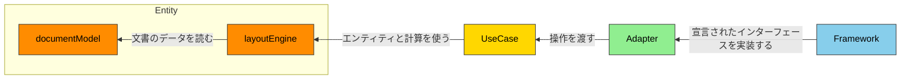
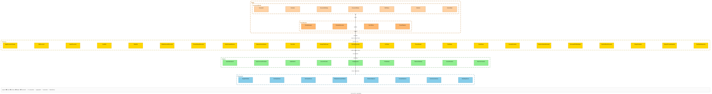
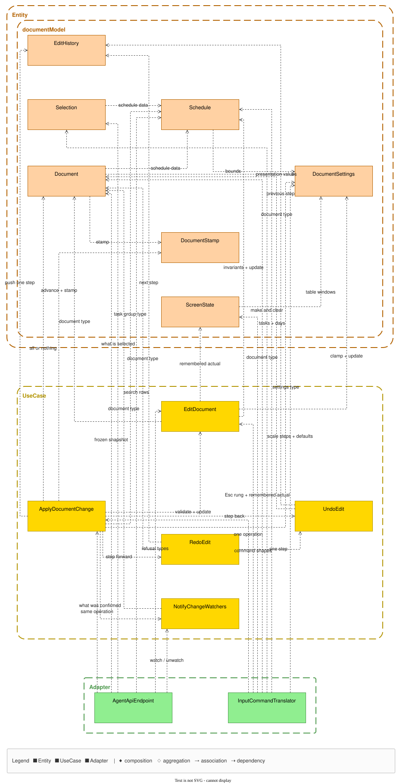
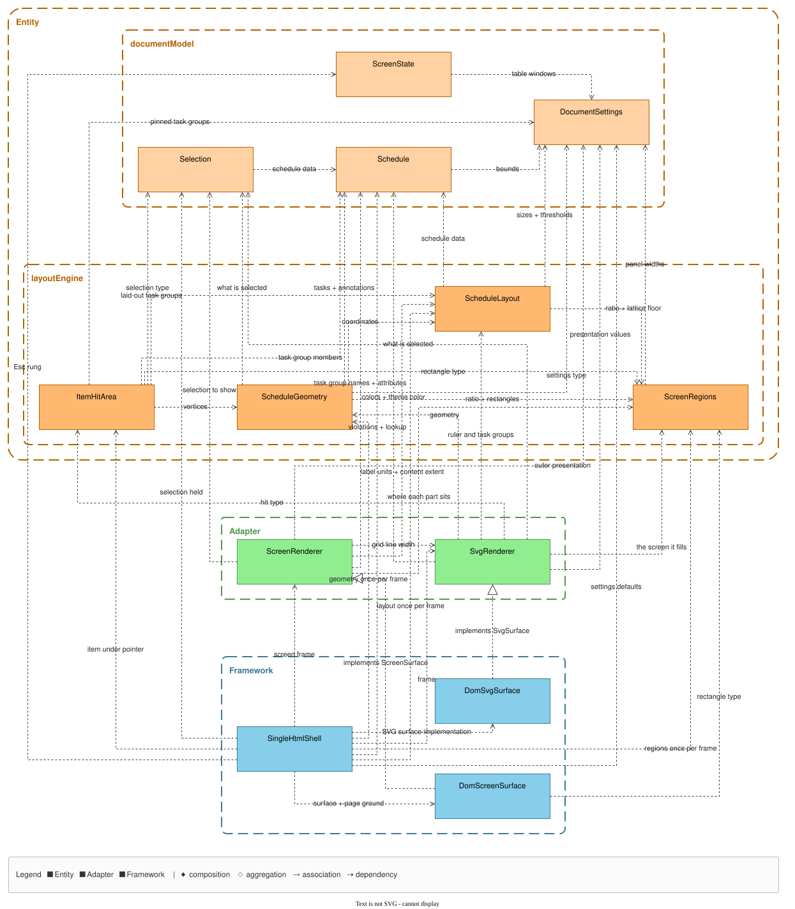
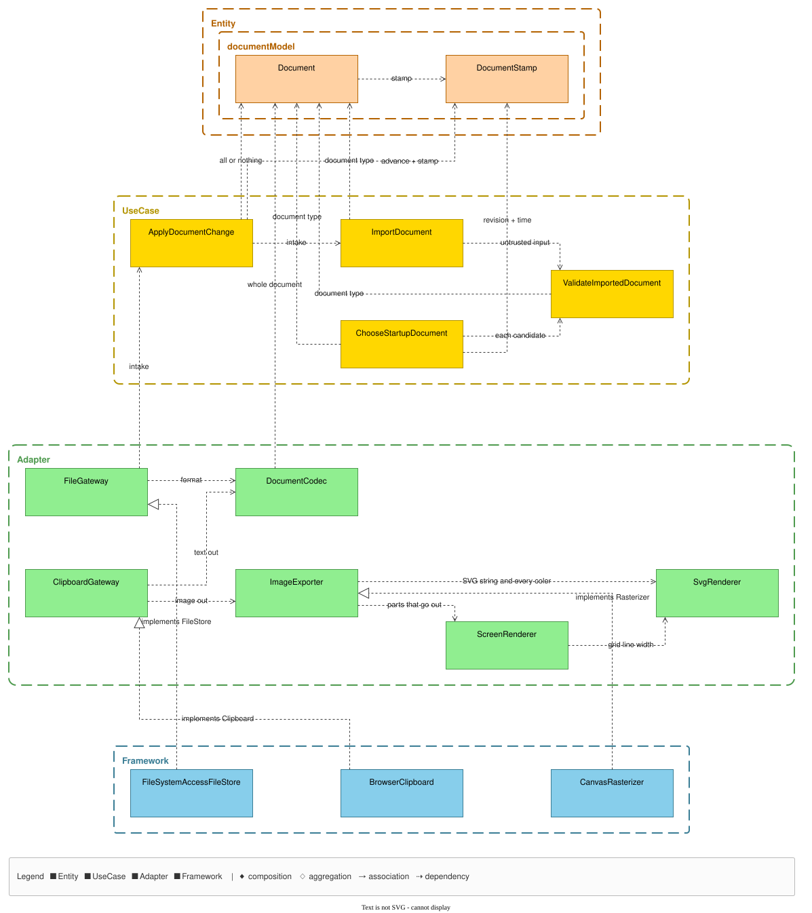
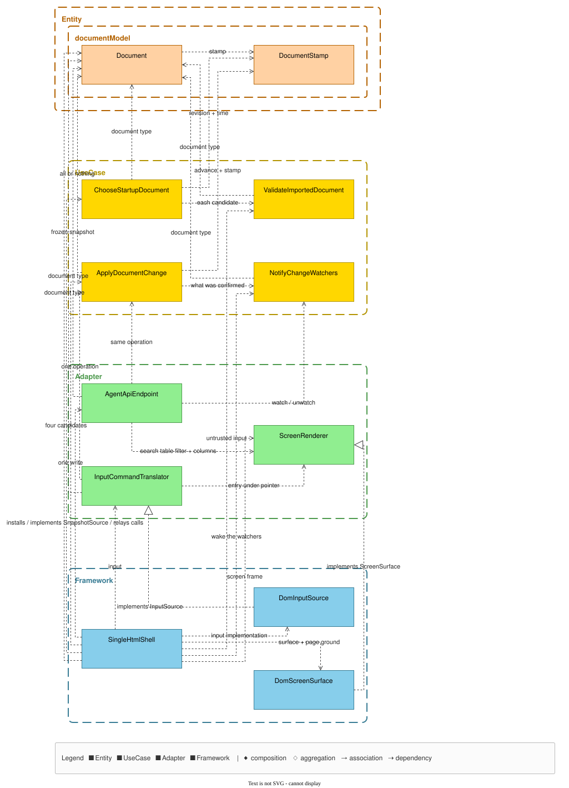

# gr-scheduler 仕様書 — 設計

**Grammar**: spec.sgra \
**UID**: DOC-DESIGN \
**Version**: 0.4

本書は第 2 部（Chapter 5 〜 7）である。

## Chapter 5. Design (設計)

**Type**: SECTION

### 5.1 Architecture Concept (アーキテクチャ方式)

**Type**: SECTION

**Clean Architecture を採る。**  
層は `Entity` / `UseCase` / `Adapter` / `Framework` の 4 つとし、既定の名前をそのまま使う。  
`Entity` の内側は、さらに `documentModel` と `layoutEngine` に分ける。

層の凡例と依存の向きを 図 F-012 に、各層に置くものを 表 T-060 に、依存の規則を 表 T-061 に示す。

**図 F-012 — 層と依存の向き**



矢印は依存の向きを表し、ラベルはその依存が何のためかを表す。  
外向きの辺は 1 本も無い。  
本図は層の凡例であり、**コンポーネントどうしの辺は Chapter 5.2 が持つ。**  
層を飛び越す例（`LR-1`）は 図 F-015 が持つ。

**表 T-060 — 層**

| 行 ID | 層 | 置くもの | 純粋性 |
| --- | --- | --- | --- |
| LY-1 | `Entity` / `documentModel` | 表 T-052 が定める文書ルートの 3 群すべて（スケジュールデータの群のエンティティは 表 T-056）と、その不変条件（全数は Chapter 6.1 が持つ）。<br>および**文書に保存しない実行時の値**（取り消しの履歴・選択・画面の使い方の値。<br>いずれも不変の値として持ち、丸ごと置き換える） | すべて `pure` |
| LY-2 | `Entity` / `layoutEngine` | 画面の各部の矩形、日付と座標の対応、`Task Groups` の配置、描くものの頂点、表示量の増減、当たり判定 | すべて `pure` |
| LY-3 | `UseCase` | 文書を変える操作と、確定までの手順。<br>取り込みの検証。<br>変更の通知。<br>保存しない画面とセッションの流れの遷移（出来事から次の状態と副作用を決める） | 操作と検証は `pure`、確定と通知は `non-pure`。<br>遷移は `pure` |
| LY-4 | `Adapter` | `Agent API`、SVG の生成、`Schedule Canvas` の外側の UI パーツの記述の生成、交換形式との相互変換、画面の入力を操作へ変えること、および**外側の道具を使うためのインターフェースの宣言** | 変換と直列化は `pure`、外を読むものは `semi-pure-mutable`、残りは `non-pure` |
| LY-5 | `Framework` | **`Adapter` が宣言したインターフェースの実装**（ブラウザーの DOM・SVG・File System Access API・`localStorage` を使う）と、`GRS HTML` のシェルと、ページに載らない MCP の取次のプロセス（`FR-150`、`_assets/design-mcp-relay.md`）。<br>**現在値を保持するのはこの層だけである** —— 内側の 3 層はすべて値を引数で受け取る | 外を読むものは `semi-pure-mutable`、残りは `non-pure` |

**表 T-061 — 依存の規則**

| 行 ID | 規則 |
| --- | --- |
| LR-1 | 層をまたぐ依存は内向きだけとすること（MUST）。<br>外向きの依存を作ってはならない（MUST NOT）。<br> 内向きであれば層を飛び越してよい |
| LR-2 | 同じ層の中で呼び合ってよい。<br>ただし相手が Chapter 5.3 で宣言したインターフェースを介すること（MUST）。<br>他のコンポーネントの内部へ直に触れてはならない（MUST NOT） |
| LR-3 | **層の中の呼び出しを非巡回に保つこと（MUST）** —— 巡回すると、どちらが先に成り立つのかを決められなくなる |
| LR-4 | `layoutEngine` は `documentModel` を読んでよい。<br>`documentModel` が `layoutEngine` を知ってはならない（MUST NOT） |
| LR-5 | 外側の道具は、内側が宣言したインターフェースを介して使うこと（MUST）。<br>その実装は外側の層が持つこと（MUST） —— これがあるので `LR-1` に例外が要らない |
| LR-6 | `Entity` と `UseCase` が、ブラウザーの供給する型に触れてはならない（MUST NOT） |

本表が規則を持つのは、依存の向きが実行して確かめる性質ではなく、構造を静的に見て確かめる性質なので、テストを持つ要求としてではなく本章が持つ。

`Entity` を 2 つに割るのは、レイアウトがこの道具の価値そのものでありながら、ブラウザーを必要としないためである。  
価値は「ペライチ」（`_assets/tbl-glossary.md` の `VK-3`）であり、それを成り立たせているのが `layoutEngine` の算法である。  
座標と当たり判定は手段ではなく本質であり、手段はむしろ描き方のほうである —— 描き方は `Adapter` が持ち、`layoutEngine` は座標までしか持たない。  
そして `FR-093` が文字の実測を禁じているので、**レイアウトの計算は文字の実寸をブラウザーに訊かずに済む。**  
画面の寸法は引数として受け取る。  
割っておくと `NFR-013` の計算量をブラウザー無しで測れる（測り方は表 T-025 の `MC-9` が持つ）。

⚠️ **この方針の代償は `LM-2a` が持つ。**  
レイアウトを純粋に保てることと、`LM-2a` が適合範囲を絞っていることは、**同じ 1 つの決定の表と裏である。**  
片方だけを変えることはできない。

**文書への書き込みの経路は 1 本である**（`FR-028` ／ 表 T-042 の `MS-1`。  
1 本にした理由は 表 T-070 の `MN-4`）。

**描画はその経路を通らない。**  
描画は文書を読むだけで変えないので、書き込みの経路に載せる理由が無い。  
**載せると、画面を描くたびに書き込みの経路が起動する。**

設計の合否は `docs/development-rules/07-review-standards.md` の `R2` で判定する（`FR-092` の `EZ-5`）。

### 5.2 Components (コンポーネント)

**Type**: SECTION

コンポーネントを 表 T-062 に、全体を 図 F-013 に、経路ごとの詳細を 図 F-014 〜 図 F-017 に示す。  
層の定義と依存の規則は 5.1 が持つ。

**コンポーネントは、`McpToolTranslator`（`CP-40`）と `McpRelayServer`（`CP-41`）を除いて、すべて機器 `DEV-1` に載る**（表 T-007）。  
⚠️ その 2 つは、ページの外にある MCP の取次のプロセスとして、機器 `DEV-6` に載る（表 T-007、`FR-150`、`_assets/design-mcp-relay.md`）。

**コンポーネントを分ける基準は 1 つである** —— 同じ表・同じ要求が寸法と規則を持っているなら 1 コンポーネント、別々の要求が持っているなら別コンポーネントとする。  
`ScheduleGeometry` が予定・実績・依存線・注記をまとめて持つのは、それらの寸法を 表 T-201 が 1 枚で持ち `FR-094` が縛っているからであり、逆に `Framework` の 7 コンポーネントが分かれているのは、実装するインターフェースが別だからである。  
`McpRelayServer`（`CP-41`）が分かれているのは、載るプロセスが別だからである。

**表 T-062 — コンポーネント**

| 行 ID | 層 | コンポーネント | 責務 | 正 |
| --- | --- | --- | --- | --- |
| CP-1 | `documentModel` | `Schedule` | スケジュールデータの群と、その不変条件。<br>予実の状態と遅れの判別。<br>暦に従った稼働日の数え上げ | 表 T-052 の `DR-2` / `FR-010`（表 T-019a）/ `FR-047`（表 T-021b）/ `FR-054` |
| CP-2 | `documentModel` | `DocumentSettings` | 見せ方の群。<br>保存する値と、その下限・上限 | 表 T-052 の `DR-3` / `FR-063` |
| CP-3 | `documentModel` | `DocumentStamp` | 文書刻印と、版を進める純粋関数 | 表 T-052 の `DR-4` / `FR-063` |
| CP-4 | `documentModel` | `EditHistory` | 取り消しの履歴。<br>不変の値として持つ | `FR-031` |
| CP-5 | `layoutEngine` | `ScheduleLayout` | 時間軸、ラベル幅の概算、`Task Groups` の配置、表示量の増減、全体表示 | `FR-017` / `FR-093` / `FR-003` / `FR-018` / `FR-055` |
| CP-6 | `layoutEngine` | `ScheduleGeometry` | 描くものの頂点。<br>バー・依存線・イナズマ線・カーソル・注記・透かし | `FR-094` / `FR-009` / `FR-014` |
| CP-7 | `layoutEngine` | `ItemHitArea` | ポインターが指すアイテムの判定 | 表 T-023c の `SL-1` |
| CP-8 | `UseCase` | `ApplyDocumentChange` | **文書への書き込みの唯一の経路。<br>** 照合・全か無か・履歴・刻印・通知 | 表 T-042 の `MS-1` / `FR-028` / `AG-2` / `AG-3` / `FR-031` / `FR-063` |
| CP-9 | `UseCase` | `EditDocument` | 集約ごとの編集。<br>検証して新しい文書を返すだけで、確定させない | 表 T-027 / `FR-088` |
| CP-10 | `UseCase` | `ImportDocument` | 取り込みと合流 | `FR-087` / `FR-022` |
| CP-11 | `UseCase` | `UndoEdit` | 履歴を 1 段戻す | `FR-031` |
| CP-12 | `UseCase` | `RedoEdit` | 履歴を 1 段進める | `FR-031` |
| CP-13 | `UseCase` | `ValidateImportedDocument` | 信頼できない入力の検証。<br>取り込みの 3 経路が共有する | `FR-023` / `NFR-009` |
| CP-14 | `UseCase` | `ChooseStartupDocument` | 起動時に開く文書を決める | `FR-062` / 表 T-034 |
| CP-15 | `UseCase` | `NotifyChangeWatchers` | 確定を購読者へ配る | 表 T-035 の `AG-6` |
| CP-17 | `Adapter` | `AgentApiEndpoint` | `Agent API` を設置する。<br>既定で公開しない。<br>`SnapshotSource` を宣言する | `FR-028` / `FR-065` / 表 T-035 / 表 T-107 |
| CP-18 | `Adapter` | `InputCommandTranslator` | 画面の入力を、操作と、どこで何が起きたかを運ぶ出来事へ変える。<br>`InputSource` を宣言する | `FR-016` / `FR-070` |
| CP-19 | `Adapter` | `SvgRenderer` | 幾何から SVG 文字列を作る。<br>`SvgSurface` を宣言する | `FR-080` |
| CP-20 | `Adapter` | `DocumentCodec` | `GRS JSON`・`MSPDI`・`GRS HTML` を文書と相互変換する。<br>`AppShellSource` を宣言する | `FR-024` / `FR-021` / `FR-056` / `FR-057` / `FR-067` |
| CP-21 | `Adapter` | `ImageExporter` | 画像として書き出す。<br>表 T-076 が「描く」と定めた UI パーツを組み立てる。<br>⛔ 縦に収まらないときは、絵を返さずに拒む（`FR-025`）。<br> `Rasterizer` を宣言する | `FR-025` / `FR-080` |
| CP-22 | `Adapter` | `FileGateway` | ファイルの読み書き。<br>`FileStore` を宣言する | `FR-060` / 表 T-024 |
| CP-24 | `Adapter` | `ClipboardGateway` | クリップボードへ出す。<br>`Clipboard` を宣言する | `FR-033` / `FR-068` |
| CP-25 | `Framework` | `SingleHtmlShell` | 起動と結線。<br>起動の順序は 表 T-077、フレームを起こす契機の観測は 表 T-078 に従う。<br> **現在値を保持する。<br>** 保存しない画面とセッションの値は、セッションの現在値 1 つとして保持し、出来事を 1 段進めて差し替え、返った副作用を実行して、その結果を出来事で戻す（`CP-39`）。<br> **フレームの先頭で画面の矩形とレイアウトと幾何を 1 回計算して配り**、描画を回し、入力を渡す。<br>埋め込みの入れ物を持ち、公開点を置く。<br>`SnapshotSource` と `AppShellSource` の実装 | `FR-067` / `FR-065` / `NFR-011` / 5.6 の ADR-001 |
| CP-26 | `Framework` | `DomSvgSurface` | `SvgSurface` の実装 | — |
| CP-27 | `Framework` | `DomInputSource` | `InputSource` の実装 | — |
| CP-28 | `Framework` | `FileSystemAccessFileStore` | `FileStore` の実装。<br>**ファイルのハンドルを保持する** | `FR-060` |
| CP-30 | `Framework` | `BrowserClipboard` | `Clipboard` の実装 | `FR-033` |
| CP-31 | `Framework` | `CanvasRasterizer` | `Rasterizer` の実装 | `FR-025` |
| CP-32 | `documentModel` | `Selection` | 選ばれている対象の集合と、選んだ順序。<br>文書に保存しない。<br>文書に無くなった対象を指さない（`FR-081` の結び） | 表 T-023c の `SL-1` / `SL-7b` / `SL-8` / 表 T-023c の結び |
| CP-34 | `documentModel` | `Document` | **文書ルートの合成と、`DR-1` の不変条件**（ルートに 3 群だけを置く／群に属する値をルート直下へ直に置かない） | 表 T-052 の `DR-1` |
| CP-35 | `layoutEngine` | `ScreenRegions` | **画面の各部の矩形**（各部の名は 表 T-103 が持つ）と、ポインターがどの領域にあるかの判定 | `FR-051` |
| CP-36 | `documentModel` | `ScreenState` | **画面の値が運ぶ型と、`Esc` が次に消費する段の判定** —— 覚えた実績（`FR-107` の 表 T-270 の「押下の巡り」で 中断 → 未着手 のときに外した実績。<br>⛔ 文書に保存しない）と、`Dual Cursor` の追従側（表 T-029a の `DC-2`）の型、表 T-028 の `IN-4` の段の判定。<br>⭐ 画面の値の状態そのもの（構え、表 T-206 の `S-99e` / `S-99f` / `S-99g` / `S-144` ほか）は 表 T-280 が持ち、その型は `CP-39` にある | `FR-053` / `FR-071` / `FR-107` / 表 T-023b |
| CP-37 | `Adapter` | `ScreenRenderer` | `Schedule Canvas` の外側の UI パーツの記述を作る。<br>`ScreenSurface` を宣言する | `FR-051` / `FR-006` / `FR-036` / `FR-053` / `FR-076` |
| CP-38 | `Framework` | `DomScreenSurface` | `ScreenSurface` の実装 | — |
| CP-39 | `UseCase` | `AdvanceScreenSession` | 保存しない画面とセッションの流れを、出来事を受けて 1 段進め、次の状態と副作用の列を返す。<br>副作用を実行しない | 5.6 の ADR-002 / 表 T-249 / 表 T-250 / 表 T-280 / 表 T-286 / 表 T-289 / 表 T-290 / 表 T-292 / 表 T-293 / 表 T-295 / 表 T-296 |
| CP-40 | `Adapter` | `McpToolTranslator` | MCP の道具と `Agent API` のメンバのあいだで、呼び出しと答えを相互に写す。<br>取次のプロセスに載り、ページには載らない | `FR-150` / 表 T-035 の `AG-12` / 表 T-107 |
| CP-41 | `Framework` | `McpRelayServer` | MCP の客の呼び出しを、自分が配ったページへ運ぶ。<br>運ぶために持つ値（鍵・繋いだページ・待っている呼び出し・溜めた変更の通知）を保持する。<br>取次のプロセスに載り、ページには載らない | `FR-150` / 表 T-035 の `AG-12` |
| CP-42 | `UseCase` | `PlaceTask` | `UC-001` の UseCase。<br>押した点と離した点から、置くタスクの期間を決める | `UC-001` / `FR-001` / `FR-103` |
| CP-43 | `UseCase` | `ArrangeTaskGroups` | `UC-002` の UseCase。<br>タスクグループの木の状態の書き込みと、親の下に新しいタスクグループを立てる書き込みを作る | `UC-002` / 表 T-328 |
| CP-44 | `UseCase` | `EditTaskProperties` | `UC-003` の UseCase。<br>担当を消す前に、割当が解かれるタスクを問うかを決める | `UC-003` / `FR-099` |
| CP-45 | `UseCase` | `LinkTasks` | `UC-004` の UseCase。<br>先行タスクの辺からポインターまで、仮の依存の線を描く | `UC-004` / `FR-009` |
| CP-46 | `UseCase` | `RecordActuals` | `UC-005` の UseCase。<br>進捗ステータスマークを引いて離したとき、実績をどこから始めるかを決める | `UC-005` / 表 T-245 の `GO-9` / 表 T-240 の `DM-2` |
| CP-47 | `UseCase` | `FindDelays` | `UC-006` の UseCase。<br>基準日の時点でタスクが遅れている稼働日数を答える | `UC-006` / `FR-047` |
| CP-48 | `UseCase` | `ShowRange` | `UC-007` の UseCase。<br>保存した表示の場所が、文書の中の場所をまだ指しているかを決める | `UC-007` / 表 T-024a の `OP-10` |
| CP-49 | `UseCase` | `AnnotateSchedule` | `UC-008` の UseCase。<br>コメントボックスの線先を、タスクグループの上の点に置く | `UC-008` / 表 T-221 の `LF-15` |
| CP-50 | `UseCase` | `ShowConfidentialSchedule` | `UC-009` の UseCase。<br>透かしが名を出す者と、透かし解除の答えが透かしを外すかを決める | `UC-009` / `FR-020` |
| CP-51 | `UseCase` | `ExchangeWithWbsMaster` | `UC-010` の UseCase。<br>使えない日付のために落とすタスクを選び、作業量の値を持つ文書を見分ける | `UC-010` / `FR-023` / 表 T-033 の `EX-3` |
| CP-52 | `UseCase` | `SaveAndShareDocument` | `UC-011` の UseCase。<br>保存する文書に、書いた時刻の刻印を押す | `UC-011` / 表 T-058 の `AT-140` |
| CP-53 | `UseCase` | `MergeSchedules` | `UC-014` の UseCase。<br>同じマスタの前回の取り込みから消えたタスクの名を挙げる | `UC-014` / 表 T-032 の `MG-11` |
| CP-54 | `UseCase` | `OperateThroughAgentApi` | `UC-012` の UseCase。<br>書き込みの経路の拒否を、AI エージェントに返す理由と規則の行へ写す | `UC-012` / 表 T-400 の `AV-4` |
| CP-55 | `UseCase` | `RunDelayDiagnostics` | `UC-015` の UseCase。<br>文書の暦で遅延診断を求める | `UC-015` / `FR-130` |

`CP-42`〜`CP-55` は、Chapter 3.2 のユースケースと同じ名の UseCase である（規則 07 の R1c）。  
その名は見出しの括弧の名を写したものである（仮: OPQ-26）。  
`UC-013` は同じ名の UseCase をまだ持たない —— 呼ばれる側のコンポーネントと `UC-012` の UseCase で手順が済み、このユースケースだけが持つ結果（会話のうち変更の理由を `changeLog` に残すこと、表 T-052 の `DR-4`）を作る経路が定まっていない（未決: OPQ-27）。  
各コンポーネントの内側のユニットと、公開するインターフェースは Chapter 5.3 が宣言する。  
本表が定めるのはコンポーネントの境界だけである。  
⭐ 本表の `正` の欄は、そのコンポーネントの寸法と規則の根拠がどの表と要求に在るかを示す。  
要求を負うユニット（持ち主）は 表 T-075 の `負う要求` の欄が示す —— 2 つの欄は粒度が違うので、別のユニットを指して見えても食い違いではない。

**規約のうち、意図して満たさないものが 2 つある。**

> **`R2.13`（CQS・SHOULD）** —— `ApplyDocumentChange` は文書を変え、かつ結果を値で返す。  
> `FR-028` が「受理したか否かを値で返すこと」を、`AG-9a` が拒否の値の中身を、それぞれ MUST で定めているためである。  
> 状態変更とその結果通知を分けると、2 回の呼び出しの間に別の書き込みが入り、`AG-3` の原子性が保てない。

> **`R2.5`（ISP・SHOULD）** —— `Agent API` は 27 のメンバを 1 つの面に載せ、用途別に分けない。  
> **`FR-028` が入口を 1 つと定めているためである。**  
> 呼ぶ側が複数の面を持つと「人間向け UI と同格」が崩れる。  
> 同条項が禁じているのは「使わないメソッドを実装させられること」であり、実装は 1 つなのでその害は生じない。

**図の原稿は `_source/components.json` である**（コンポーネント・辺・層の木）。  
`_source/build.py` が `.svg` と `docs/review/components/components.md` を書き出す。  
`.svg` と `.drawio` を手で直してはならない（MUST NOT） —— 次の生成で消える。  
図とその一覧を同じ原稿から起こすことで、両者の食い違いが起きないようにしている。

**箱はコンポーネントである。**  
層ごとに枠で囲み、内側の層ほど上に置いた。  
矢印はすべて上を向く。  
**本図の矢印は層と層の間だけを結ぶ。**  
コンポーネントどうしの辺は経路ごとの図（図 F-014 〜 図 F-017）が持つ。  
層をまたぐ矢印は、それを裏づけるコンポーネントどうしの辺が 1 本以上あるときにだけ描かれる（`build.py` が検算する）。

**コンポーネントどうしの辺を何とするかを 表 T-247 に示す。**  
図の原稿の辺は本表で数えた辺をすべて含むこと（MUST）。

**表 T-247 — コンポーネントの辺**

| 行 ID | 規則 |
| --- | --- |
| EG-1 | `src/` の層のフォルダ（`entity/document-model/` ・ `entity/layout-engine/` ・ `use-case/` ・ `adapter/` ・ `framework/`）の直下のフォルダを、1 つのコンポーネントのフォルダとして読むこと（MUST）。<br>その名は、フォルダ名に 表 T-006a の `W-11` を逆向きに当てたもの（kebab-case から PascalCase）とし、表 T-062 のコンポーネント名と一致すること（MUST） |
| EG-2 | コンポーネント A のフォルダの `.ts` が、`.` で始まる指定子で、別のコンポーネント B のフォルダの `.ts` または `.json` を読むとき、A から B への辺が 1 本あるとすること（MUST）。<br>`import … from` ・ `export … from` ・ `import '…'` のいずれも数える。<br>同じ A と B の組は、読む箇所がいくつあっても 1 本とする |
| EG-3 | 型だけを読む import（`import type` ・ `export type` ・ 波括弧の中がすべて `type` のもの）も辺に数えること（MUST） —— 型を読むだけでも、B の型が変われば A が変わるからである |
| EG-4 | 同じコンポーネントのフォルダの中で読むことと、`.` で始まらない指定子で読むことは、辺に数えない |
| EG-5 | 本表で数えた辺はすべて、`_source/components.json` の `edges` に、同じ `source` と `target` の組として在ること（MUST）。<br>`edges` に無い辺をコードに作ってはならない（MUST NOT） |
| EG-6 | `SingleHtmlShell`（`CP-25`）から出る辺も、他の辺と同じく `edges` に 1 本ずつ書くこと（MUST）。<br>結線であることを理由に省いてはならない（MUST NOT） —— 省くと、殻がいくつのコンポーネントを知っているかが図から読めなくなる |
| EG-7 | import を伴わずに実行時に呼び返す流れは、辺に数えない。<br>実装を宣言した側へ渡す流れは 表 T-065、確定を購読者へ配る流れは 表 T-067 の `WS-7`、フレームを起こす流れは 表 T-078 が持つ |
| EG-8 | 表 T-061 の規則は、本表で数えた辺のすべてに掛かること（MUST） —— `.json` を読む辺も含む |

**図 F-013 — コンポーネントと層**

[](_assets/fig-components.svg)

**図をクリックすると原寸で開く。**

人向けの画面と `Agent API` が同じ入口へ入り、確定して配るまでを 図 F-014 に示す。  
入口が 1 つであることは `FR-028` と 表 T-042 の `MS-1` が定める。

**図 F-014 — 書き込みの経路**

[](_assets/view-write.svg)

**描画が書き込みの経路を通らないことを 図 F-015 に示す。**  
SVG を作るコンポーネントは `Adapter` にあるが、`UseCase` を通らずに `layoutEngine` を直接読む。

**図 F-015 — 読み取りの経路**

[](_assets/view-read.svg)

ファイル・保管庫・クリップボード・画像と、取り込みの検証を 図 F-016 に示す。  
取り込みの 3 経路が同じ検証を通ることは `FR-023` が要求する。

**図 F-016 — 出し入れの経路**

[](_assets/view-io.svg)

シェルが結線し、開く文書を決め、`Agent API` を公開するまでを 図 F-017 に示す。  
開く文書の順は 表 T-034 が持つ。

**図 F-017 — 起動の経路**

[](_assets/view-startup.svg)

### 5.3 File Structure (ファイル構成)

**Type**: SECTION

**本節が宣言するのは公開インターフェースである** —— **コンポーネントの外から呼んでよい名前の全数**のことである。  
`R2.19` が各コンポーネントの公開面を本節に置くよう要求しており、その定義の正とする用語集がこのリポジトリに無いので、本節が定義を持つ。  
表 T-061 が規則を持つのと同じ事情である。

⚠️ **これを「面」と呼ばない。**  
表 T-006a の「面ごとの記法」・画面の面・前面と背面で 3 義あるためである。  
層をまたぐ 8 本だけは「層をまたぐインターフェース」と呼び分け（表 T-065）、裸の「インターフェース」を書かない。

構造の単位を 3 語で呼び分ける。  
全数と定義を 表 T-074 に示す。  
本節が定義を持つ事情は公開インターフェースと同じである。  
⚠️ 「部品」を使ってはならないことは 表 T-006b の `A-17` が定める。

**表 T-074 — 構造の単位**

| 行 ID | 語 | 定義 | 本設計での全数 |
| --- | --- | --- | --- |
| SU-1 | **コンポーネント** | **フォルダの外へ見せる公開エントリを 1 つ持つもの**（規則は本節が MUST で定める）。<br>⚠️ **公開メンバを持たないものもある** —— `CP-25` は Vite の入口であり、他から呼ばれるメンバを持たない（`PI-25`） | **51。<br>** 全数は 表 T-062、公開する名前は 表 T-064 |
| SU-2 | **モジュール** | **複数のユニットを束ねた、コンポーネントの一部。<br>** 外へは公開しない | ⭐ **0** |
| SU-3 | **ユニット** | **1 ファイル。<br>** 公開エントリもユニットである | **199。<br>** 全数は 表 T-075、割った理由は 表 T-063 |

**入れ子は コンポーネント ＞ モジュール ＞ ユニット である。**  
**モジュールは任意の中間段であり、無いときはコンポーネントが直にユニットを持つ。**

⚠️ **本設計にモジュールは 1 つも無い。**  
表 T-075 のとおり `EditDocument` が最も多くのユニットを持ち、`InputCommandTranslator`・`SingleHtmlShell`・`ScheduleLayout` の順にそれに次ぐが、**どれも平らに並べている。**  
束ねる必要が出たときに階層を足す —— **要らないうちは作らない**（`R2.9`）。

コンポーネントごとにフォルダを作り、コンポーネント名と語幹が同じ 1 ファイルだけを公開エントリとすること（MUST）。  
フォルダの外から、公開エントリ以外のファイルを読んではならない（MUST NOT） —— 読めてしまうと、`LR-2` を検査できない。  
記法は 表 T-006a の `W-11` である。

**`src/` の `.json` の置き場を 表 T-248 に示す。**

**表 T-248 — `.json` の置き場**

| 行 ID | 規則 |
| --- | --- |
| JF-1 | `src/` の `.json` はユニットではなく、表 T-075 に行を持たない。<br>置かれたフォルダのコンポーネントに属し、公開エントリにはならない（表 T-074 の `SU-1`）。<br>⇒ 他のコンポーネントのフォルダの `.json` を読んではならない（MUST NOT） —— 本節の MUST NOT がそのまま掛かる |
| JF-2 | `.json` は、その中身を 表 T-062 の責務の欄に持つコンポーネントのフォルダに置くこと（MUST） |
| JF-3 | 持ち主と同じ層か、それより外側の層のコンポーネントが中身を要するときは、持ち主の公開エントリが公開する名前（表 T-064）を介して読むこと（MUST） |
| JF-4 | 持ち主より内側の層のコンポーネントが中身を要するときは、その値を引数で受け取ること（MUST） —— 表 T-061 の `LR-1` と 表 T-060 の `LY-5` の帰結である |

どのコンポーネントもインスタンスを作らない。  
公開するのは型と関数だけである。  
表 T-060 の `LY-5` の帰結であり、**内側の 3 層には漏らせる可変状態がそもそも無い。**

ユニットは 表 T-276 の基準に従って割ること（MUST）。  
基準の筆頭は変更の理由である（`R2.2`）—— 純粋性（`R7.9`）はその次に来る基準であって、唯一の基準ではない。  
割った理由は 表 T-063 が行ごとに持つ。  
**ユニットの全数と、どのコンポーネントに属するかは 表 T-075 が持つ。**

**表 T-276 — ユニットを割る基準**

| 行 ID | 基準 | 規則 |
| --- | --- | --- |
| UD-1 | **変更の理由** | 1 つのユニットは、変更の理由を 1 つだけ負う（`R2.2`）。<br>「変更の理由」とは、そのユニットの中身を書き換えさせうる仕様の出どころ —— 要求 ID・表・裁定 —— である。<br>1 つのユニットの中に、互いに素な出どころから縛られる 2 つのまとまりが在るときは、別のユニットへ出す |
| UD-2 | **純粋性** | 純粋な側と非純粋な側が同じコンポーネントに在るときは、別のファイルへ出す。<br>`R7.9` は SHOULD だが、表 T-060 の `LY-3` が層で同じことを求めるので、本設計では基準とする |
| UD-3 | **純粋性は割らない理由にならない** | 2 つのまとまりの純粋性が等しいことを、`UD-1` に当たるまとまりを割らない理由としない。<br>⚠️ 全部が純粋なユニットでも、変更の理由が 2 つあれば `UD-1` で割る |
| UD-4 | **割り方はコードの位置で裏づける** | 割ることを定める変更要求は、提案するユニットごとに、いま在るコードの `file:line` の範囲を書く。<br>範囲を書けない割り方は採らない。<br>⚠️ 概念だけで割ると、割るはずの処理が思っていたファイルに無いことがある |
| UD-5 | **迷いの試験** | 割ったあと「この欠陥はどのファイルか」に 1 つのファイルで答えられる。<br>2 つ以上のファイルが答になる割り方は `UD-1` を満たしていない |

**`UseCase` のコンポーネント名は動詞句であり**（`R2.1` の層別表）、そのコンポーネントが公開する操作はコンポーネント名を camelCase にしたものとする —— 同じ概念に 2 つの語を与えないためである。  
**記法が違うだけで、食い違いではない**（表 T-006a の `W-1` と `W-2`）。  
⚠️ **外側の状態を読むメンバだけは動詞＋目的語とする** —— 名詞にすると、遅さと失敗しうることが名前から消える。

**`main.ts` を作らない。**  
Vite の入口は `single-html-shell.ts` である —— 表 T-062 の `CP-25` が負う。  
テストコードの置き場は Chapter 7 が持つ。  
本節は `src/` だけを持つ。

ディレクトリ構成を次に示す。  
51 のフォルダは 表 T-062 の 51 コンポーネントと 1 対 1 である。

```text
src/
  entity/
    document-model/   document/ · schedule/ · document-settings/ · document-stamp/
                      edit-history/ · selection/ · screen-state/
    layout-engine/    schedule-layout/ · schedule-geometry/ · item-hit-area/
                      screen-regions/
  use-case/           apply-document-change/ · edit-document/ · import-document/
                      undo-edit/ · redo-edit/ · validate-imported-document/
                      choose-startup-document/ · notify-change-watchers/
                      advance-screen-session/ · place-task/ · arrange-task-groups/
                      edit-task-properties/ · link-tasks/ · record-actuals/
                      find-delays/ · show-range/ · annotate-schedule/
                      show-confidential-schedule/ · exchange-with-wbs-master/
                      save-and-share-document/ · merge-schedules/
                      operate-through-agent-api/ · run-delay-diagnostics/
  adapter/            agent-api-endpoint/ · input-command-translator/ · svg-renderer/
                      document-codec/ · image-exporter/ · file-gateway/
                      clipboard-gateway/ · screen-renderer/ · mcp-tool-translator/
  framework/          single-html-shell/ · dom-svg-surface/ · dom-input-source/
                      file-system-access-file-store/ · browser-clipboard/
                      canvas-rasterizer/ · dom-screen-surface/ · mcp-relay-server/
```

ユニットを割った理由を 表 T-063 に、ユニットの全数を 表 T-075 に、51 コンポーネントの公開インターフェースを 表 T-064 に、層をまたぐ 8 本を 表 T-065 に示す。

**表 T-063 が持つのは、割った理由だけである。**  
⚠️ **層をまたぐインターフェースの 8 ファイルは本表に行を持たない** —— 割った理由が「宣言の置き場」の 1 つしか無く、その規則を 表 T-065 の後で本節が定めるからである。

**表 T-063 — ユニットを割った理由**

| 行 ID | コンポーネント | ユニット | 割った理由 |
| --- | --- | --- | --- |
| UT-1 | `ApplyDocumentChange` | `apply-document-change.ts` ／ `document-change-plan.ts` | **純粋性**（表 T-060 の `LY-3`） |
| UT-2 | `EditDocument` | `edit-document.ts` と、集約ごとの 8 ファイル ／ `deletion-confirmations.ts` ／ `search-jump.ts` ／ `whole-schedule-shift.ts` | **純粋性ではない** —— 表 T-075 のとおり 12 とも同じである。<br>そのうち 2 つは `UT-9` でさらに割った。<br>**集約ごとに変更の理由が別なので割った** —— タスクの規則が変わっても暦の規則は変わらない<br>`deletion-confirmations.ts` は、削除が負う問い（表 T-050 と 表 T-234 の削除の行）が変わったときに書き直す —— 集約をまたいで数えるので、どの集約のファイルにも置かない。<br>`search-jump.ts` は、検索ウィンドウからの飛び方（`FR-151` の 表 T-332）が変わったときに書き直す —— タスクグループの木と表示の位置をまたいで書くので、どの集約のファイルにも置かない。<br>`whole-schedule-shift.ts` は、全体日程シフトの移し方（`FR-159` の 表 T-379）が変わったときに書き直す —— `Task`・基準計画・`Project`・注記と設定の値（`S-77`・`S-518`・`S-519`）をまたいで 1 回で書くので、どの集約のファイルにも置かない |
| UT-3 | `NotifyChangeWatchers` | `notify-change-watchers.ts` ／ `change-notice.ts` | **純粋性**（`LY-3`）。<br>⚠️ 選び方の規則は 表 T-035 の `AG-6` にある。<br>値だけで決まる |
| UT-4 | `AgentApiEndpoint` | `agent-api-endpoint.ts` ／ `agent-api-members.ts` ／ `relayed-call.ts` | **純粋性ではない** —— 表 T-075 のとおり 3 つとも同じである。<br>設置は `FR-065`（既定で公開しない）が、27 メンバは 表 T-107 が、取次が運んだ呼び出しの受け方は 表 T-035 の `AG-12` が縛るので、変更の理由が別である |
| UT-5 | `DocumentCodec` | `document-codec.ts` ／ `json-codec.ts` ／ `mspdi-codec.ts` ／ `embedded-html-codec.ts` | **一部は純粋性** —— `GRS HTML` だけが `AppShellSource` を呼ぶ。<br>**残りは形式ごとに正が別だからである** —— `GRS JSON` は `FR-024`、`MSPDI` は交換相手のスキーマ、`GRS HTML` は `FR-067` |
| UT-6 | `SingleHtmlShell` | `single-html-shell.ts` ／ `frame-loop.ts` ／ `session-effects.ts` ／ `pointer-shape.ts` ／ `held-press-preview.ts` ／ `browser-stored-values.ts` ／ `interaction-record.ts` ／ `view-place.ts` ／ `frame-clock-wakes.ts` ／ `field-entry.ts` ／ `document-file-flow.ts` ／ `watermark-unlock.ts` ／ `task-group-band-ceiling-cache.ts` ／ `copy-and-paste.ts` ／ `agent-api-relay-link.ts` ／ `parent-task-hold.ts` ／ `shown-tasks-hold.ts` ／ `beneath-picture-hold.ts` ／ `delay-diagnostics-report-window.ts` ／ `resource-list-window.ts` | **純粋性ではない** —— 表 T-075 のとおり `held-press-preview.ts` は `semi-pure-mutable` で、ほかは `non-pure` である。<br>起動は `FR-067` と `FR-065` が、フレームの走行は 表 T-060 の `LY-5` と 5.6 の ADR-001 が縛るので、変更の理由が別である。<br>`session-effects.ts` は、副作用の名の全数（表 T-280 ・ 表 T-286 ・ 表 T-289 ・ 表 T-290 ・ 表 T-292 ・ 表 T-293 の状態遷移表の升）と、返った順に 1 つずつ実行すること（表 T-249 の `SF-6`）を負い、フレームの回し方とは変更の理由が互いに素である（表 T-276 の `UD-1`）—— 「副作用が 2 度実行された」「種類の漏れが型検査を通った」は本ファイル、「書き込みの中身が違う」は `frame-loop.ts` の実行の行である（`UD-5`）。<br>`frame-loop.ts` の周期から、変更の理由が別の塊を兄弟へ出した（`UD-1`）—— ブラウザーに残す値は 表 T-206 の `S-99`〜`S-99c` の鍵と読めないときの扱いが、ポインターの形は 表 T-269 と 表 T-266 の欄が、表示の場所は `OP-10` と `FR-055` が、透かしの解除は `FR-020` と `S-99c`・`S-101` が、縦軸のズームの天井の使い回しは 表 T-071 の `CA-1` が、掴んで動かす間の先の描画は 表 T-023d が、操作の記録は `FR-102` と 表 T-295 が、時間でフレームを起こす待ちは 表 T-078 の `FT-4` が、名前付けと入力欄は 表 T-292 が、文書のファイルの流れは 表 T-290 と 表 T-024・表 T-024a が、コピーと貼り付けは `FR-033` が、取次へ繋ぐ口は 表 T-035 の `AG-12` が、親タスクと子タスクの見せ方と混ざった選択の 2 択は `FR-135` と 表 T-351 が、日程抽出のチェックは 表 T-353 と `SJ-0` が、下の絵の使い回しは 表 T-071 の `CA-1` の ③ が、遅延診断レポートの窓の入口は `01-04-requirements.md` の 表 T-346 が、担当リストのウィンドウの入口は同書の 表 T-370 が変わったときに書き直す。<br>兄弟が共有する語彙は `frame-loop.ts` に置き、`frame-loop.ts` が兄弟の名を出し直す。<br>兄弟は閉包の値を、`frame-loop.ts` が 1 度だけ作る手の束（`FrameLoopHands`）から読む —— 状態を覚える兄弟は自分の値だけを持つ小さな作り手であり、ほかは手の束を引数で受ける関数である。<br> ⚠️ **割らないと 1 つのユニットが複数の事柄を負い、`R2.2` に反する** —— 5.2 の分割基準が、ユニットの側でも同じことを言う |
| UT-7 | `ScreenRenderer` | `screen-renderer.ts` と、UI パーツごとのファイル（全数は 表 T-075） | **純粋性ではない** —— 表 T-075 のとおりどれも同じである。<br>**UI パーツごとに縛る要求が別なので割った**（`UT-2` と同じ形である）—— ヘルプの規則が変わってもプロパティパネルの規則は変わらない。<br>検索ウィンドウは、中身（`search-panel.ts`）と、列のフィルターと並べ替え（`search-table-filters.ts`）の 2 つに割った —— 列のフィルターの規則（`FR-151` の 表 T-330 の `SV-7`・`SV-8`）が変わっても、パネルの中身の組み立ては変わらない |
| UT-8 | `SvgRenderer` | `svg-renderer.ts` と、描く物ごとのファイル（全数は 表 T-075） | **純粋性ではない** —— 表 T-075 のとおりどれも同じである。<br>**描く物ごとに縛る要求が別なので割った**（表 T-276 の `UD-1`）—— 格子の規則（`FR-089`）が変わってもタスクの図の規則（`FR-013`・`FR-075`）は変わらない。<br>依存線をタスクの図と同じユニットに置くのは、両者が同じ変更で動いてきたからである |
| UT-9 | `EditDocument` | `edit-task.ts` と要求ごとの 5 ファイル ／ `edit-task-group.ts` と要求ごとの 4 ファイル | **純粋性ではない** —— 表 T-075 のとおり 11 とも同じである。<br>**1 つの集約の中でも、要求ごとに変更の理由が別なので割った**（表 T-276 の `UD-1`）—— 完了率の式（`FR-012`）が変わっても、予定と実績の置き方（`FR-011`・`FR-103`）は変わらない。<br>`FR-011` と `FR-103` は同じ変更で動いてきたので 1 つのユニットに置き、`FR-058` の規則は `FR-085` の分岐の中にあるので 1 つのユニットに置いた |
| UT-10 | `InputCommandTranslator` | `input-command-translator.ts` と、入力の種類と答える表ごとのファイル（全数は 表 T-075） | **純粋性ではない** —— 表 T-075 のとおりどれも同じである。<br>**入力の種類ごとに、答える表が別なので割った**（表 T-276 の `UD-1`）—— 打鍵の割当（表 T-036）が変わってもホイールの割当（表 T-023 の `MK-1` 〜 `MK-5`）は変わらず、プロパティパネルの入力の型（表 T-016）が変わってもタスクグループの掴み（表 T-051 の `HF-15`）は変わらない。<br>どれも `pure` であることは、割らない理由にならない（`UD-3`）。<br>兄弟が共有する語彙と補助、入口の振り分け（表 T-023a・表 T-109）は公開エントリに置いた |
| UT-11 | `AdvanceScreenSession` | `advance-screen-session.ts` ／ `session-step.ts` ／ 領域ごとのファイル（いまは `screen-values.ts` ／ `notice-values.ts` ／ `gesture-values.ts` ／ `file-flow-values.ts` ／ `field-entry-values.ts` ／ `selection-values.ts` ／ `interaction-record-values.ts` ／ `agent-api-values.ts`） ／ 画面の値の下書きの規則（いまは `calendar-draft.ts`） | **変更の理由が 4 つある**（表 T-276 の `UD-1`）—— 公開エントリは領域の合成と、ほかの領域や文書の値を出来事へ詰めることを負い（表 T-249 の `SF-8`）、`session-step.ts` は全領域が共有する 1 段の形を負い（表 T-249 の `SF-2` ・ `SF-3` ・ `SF-4` と 表 T-250 の `SD-3`）、領域ごとのファイルはその領域の出来事とステートマシンの表を負う（画面の値は 表 T-280、通知は 表 T-286、身振りは 表 T-289、ファイル操作と問いは 表 T-290、名前付けと入力欄は 表 T-292、選択は 表 T-293、操作の記録は 表 T-295、`Agent API` は 表 T-296）。<br>下書きの規則のファイルは、画面の値が運ぶ下書きの組み方・直し方・断りを負う（休日の設定は `01-04-requirements.md` の 表 T-344）。<br>**純粋性ではない** —— 表 T-075 のとおり 4 つとも `pure` である（`UD-3`）。<br>領域が増えるたびに領域のファイルが 1 つ増える（`UT-2` ・ `UT-7` と同じ形）—— 画面の値の遷移が変わっても 1 段の形は変わらない |
| UT-12 | `DomScreenSurface` | `dom-screen-surface.ts` と、描く UI パーツごとのファイルと、欄の編集の 1 ファイル（全数は 表 T-075） | **純粋性ではない** —— 表 T-075 のとおりどれも同じである（表 T-060 の `LY-5` は `Framework` に `semi-pure-mutable` と `non-pure` しか与えない）。<br>**UI パーツごとに縛る要求が別なので割った**（表 T-276 の `UD-1`、`UT-7` と同じ形である）—— 通知の作法（表 T-037）が変わってもプロパティパネルの入力の型（表 T-016）は変わらない。<br>欄の編集は UI パーツではなく、表 T-028 の `IN-4`・`IN-5a`・`IN-6` が縛るので別のユニットにした。<br>兄弟が共有する語彙（色・入口の寸法と見た目・UI パーツの名）と層の重ね方は公開エントリに置いた |
| UT-13 | `Schedule` | `schedule.ts` ／ `schedule-entities.ts` ／ `plan-actual-state.ts` ／ `calendar-day.ts` ／ `working-calendar.ts` ／ `task-delay.ts` ／ `stored-color.ts` ／ `schedule-invariants.ts` ／ `task-group-names.ts` ／ `schedule-search.ts` ／ `delay-diagnostics.ts` ／ `delay-diagnostics-report-table.ts` ／ `delay-fixes.ts` ／ `time-zone.ts` | **純粋性ではない** —— 表 T-075 のとおりどれも `pure` である（`UD-3`）。<br>**変更の理由が別なので割った**（表 T-276 の `UD-1`）—— エンティティの型と列と既定の暦は `erd.json` と 表 T-209 が変わったときに `npm run gen` が書き直し、予実の状態の判別は 表 T-019a が、暦の日付の算術は 表 T-033 の `EX-` の行と 表 T-029a の `DC-` の行が、稼働日の数えは `FR-054` と 表 T-214 が、遅れの判別は 表 T-021b が、色の保存の綴りは 表 T-017b が、文書の不変条件は 表 T-220 が、タスクグループ名の導きは `AT-53`・`AT-54` の規則が、検索の当たりは `FR-151` の 表 T-330 の `SV-4` と 表 T-331 が、遅延診断の判じ方は 表 T-310 〜 T-319 が、遅延診断レポートの表と書き出しの文字列は `01-04-requirements.md` の 表 T-347 と 表 T-346 の `RW-6` が、修正案と修正の記録は 表 T-373 と 表 T-317 の `DX-11` ・ `DX-12` が、タイムゾーンの時計は 表 T-376 が変わったときに人が書き直す。<br>生成の区画を公開エントリではなく兄弟に置いたのは、`working-calendar.ts` がモジュールの頂上で既定の暦を読むからである —— 区画が公開エントリにあると、兄弟が公開エントリから取り込み、公開エントリが兄弟を出し直す輪ができ、読み込みの順によっては読む時に定数がまだ無い。<br>`taskByUid` と、兄弟の名の出し直しは公開エントリに置いた |
| UT-14 | `ScheduleLayout` | `schedule-layout.ts` ／ `time-axis.ts` ／ `label-width.ts` ／ `assignee-label.ts` ／ `percent-label.ts` ／ `name-label.ts` ／ `shape-cross-sections.ts` ／ `drawn-task-groups.ts` ／ `group-level-of-detail.ts` ／ `label-placement.ts` ／ `pinned-band.ts` ／ `task-group-scroll.ts` ／ `fit-zoom.ts` | **純粋性ではない** —— 表 T-075 のとおり 13 とも `pure` である（`UD-3`）。<br>**段ごとに正が別なので割った**（表 T-276 の `UD-1`）—— 表 T-068 の `LC-1` 〜 `LC-9` は `layoutFromSchedule` の 1 回の通り道で、時間軸は `FR-017` と 表 T-252 が、ラベル幅の概算は `FR-093` が、担当ラベルは `FR-059` が、完了率ラベルは `FR-090` と `OC-2` が、名称ラベルの字は `FR-002` と `ND-1` 〜 `ND-5` が、形の縦の断面は 表 T-271 と `FR-077` が、描くタスクグループの選びは `LC-1` と `HR-2` が、描くタスクグループの深さは `FR-018` と 表 T-005a の `L-3` が、ラベルの置き場は `FR-109` と 表 T-272・表 T-273 が、ピン止めの帯は `FR-098` と `LF-14` が、縦の表示位置からのずらしは `OP-10a` が、全体表示は `FR-055` が変わったときに書き直す。<br>タスクグループのループ —— 段の割当（`FR-003`・表 T-014）・占有幅の合算（`LC-7`）・帯高（`LC-9`）—— は公開エントリに置き、兄弟へ出したのはループが呼ぶ関数だけである。<br>兄弟が共有する語彙（形の種類・置き場の型・生成の定数）と、兄弟の名の出し直しは公開エントリに置いた |
| UT-15 | `ScheduleGeometry` | `schedule-geometry.ts` ／ `task-figures.ts` ／ `highlight-box.ts` ／ `dependency-route.ts` ／ `plan-actual-guides.ts` ／ `progress-line.ts` ／ `comment-box.ts` ／ `dual-cursor.ts` ／ `parent-task-arrows.ts` | **純粋性ではない** —— 表 T-075 のとおり 9 つとも `pure` である（`UD-3`）。<br>**描くものごとに正が別なので割った**（表 T-276 の `UD-1`）—— タスクの図は `FR-043` と 表 T-012・表 T-021・表 T-240 が、ハイライトボックスの箱は `FR-019` と `CM-52` が、依存線の経路と矢じりは `FR-009` と 表 T-222 が、予実の補助線は `FR-084` と 表 T-020a が、イナズマ線は `FR-014` と 表 T-022 が、コメントボックスは `FR-097` と `S-182` が、`Dual Cursor` は `FR-082` と `CU-2` が、親タスクと子タスクの矢印は `FR-135` と 表 T-351 が変わったときに書き直す。<br>ハイライトボックスはタスクの図と共に変わってきたが、共に変えた変更はどれも多くのファイルに一斉に触れた手直しだったので、名が体を表すように別のユニットにした —— 割ったあと、どちらかに触れる次の 2 件の変更のうち 1 件でも `task-figures.ts` と `highlight-box.ts` の両方に触れたら、1 つに戻す。<br>頂点を 1 度に組み立てる通り道（`LC-10`・`LC-11`）と、兄弟が共有する語彙（頂点の型・1 回の入力 `GeometryInputs`・`point`）と、兄弟の名の出し直しは公開エントリに置いた |
| UT-16 | `ItemHitArea` | `item-hit-area.ts` ／ `dependency-end.ts` ／ `marquee.ts` ／ `drawn-selection.ts` | **純粋性ではない** —— 表 T-075 のとおり 4 つとも `pure` である（`UD-3`）。<br>**答える問いごとに正が別なので割った**（表 T-276 の `UD-1`）—— ポインターの下の対象と掴み代は `FR-104` と 表 T-023d・表 T-266・表 T-267・表 T-268 が、依存線の端は `FR-009` と `PTD-3` が、範囲選択で囲まれた対象は `SL-3` が、描いているタスクへ選択を絞ることは `FR-049` と 表 T-023c が変わったときに書き直す。<br>描いた形を掴みの側から読み直す通り道（`shapeOf`）と、兄弟が共有する語彙（対象と当たりの型・図形の算）と、兄弟の名の出し直しは公開エントリに置いた |
| UT-17 | `DocumentCodec` | `json-codec.ts` ／ `grs-json-schema.ts` ／ `mspdi-codec.ts` ／ `mspdi-xml.ts` ／ `mspdi-child-placement.ts` ／ `mspdi-fade-frames.ts` ／ `mspdi-imported-task-groups.ts` | **純粋性ではない** —— 表 T-075 のとおり、割ったユニットはどれも `pure` である（`UD-3`）。<br>**1 つの形式の中でも、変更の理由が別なので割った**（表 T-276 の `UD-1`）—— `UT-5` で形式ごとに割ったユニットを、さらに割った。<br>`GRS JSON` の文字列と文書の変換（形式の版の判じ・古い版の補い）は `FR-024` と `FR-073` が、値をスキーマに照らす歩きと節の表は 表 T-220 の前文のスキーマ（`grs-document.schema.json`）が変わったときに書き直す。<br>`MSPDI` の要素の木と文書の写しは `FR-021`・`FR-057` と交換相手のスキーマの列が、XML の文字列と要素の木の変換は XML の構文と `FR-023` の拒みと `CN-5` の書き方が、書き出す要素の子の並びは交換相手のスキーマの子の順（`EX-10`、`mspdi-child-order.json`）が、フェード日数を写す拡張領域の枠は `EX-6`・`EX-8` と枠の名簿（`mspdi-custom-fields.json`）が、取り込んだタスクから作るタスクグループと所属は `FR-058` と `AT-51` が変わったときに書き直す。<br>生成の区画は、それを歩く関数と同じユニットに刷る —— `json-codec.ts` は生成の定数を直に読まず、スキーマの根を閉じ込めた関数を兄弟に問う。<br>外れの型は作り手と同じユニットに置き、`json-codec.ts` と `mspdi-codec.ts` が出し直す。<br>`MSPDI` の兄弟が共有する要素の木の語彙（要素の道・葉の読み書き・告知）は公開エントリに置いた |

⭐ **要求の側から「まずどのファイルを開くか」を引けるように、表 T-075 は欄「負う要求」を持つ。**  
欄に書くのは、その要求が動いたときに**最初に開くユニット**だけであり、その要求に触るファイルの全部ではない。  
同じ要求を 2 つ以上の行に書いてはならない（MUST NOT） —— 2 つ書くと、どちらを先に開くかが読めなくなる。  
何も負わないユニットは `—` とする —— 層をまたぐ宣言だけの 8 ファイルは規則を持たないので、必ずそうなる。

⚠️ **持ち主の形は 1 つではない。**  
⛔ 1 対 1 を強いると、層をまたぐことが要求そのものである要求について嘘を書くことになる。  
区分を 表 T-277 に示し、欄では要求 ID にその行 ID を添える。

**表 T-277 — 要求の持ち主の区分**

| 行 ID | 区分 | 定義 | 欄に立つユニット | 例 |
| --- | --- | --- | --- | --- |
| OW-1 | 単独 | 規則を決めるユニットが 1 つだけあり、ほかのファイルはその結果を使うだけである。<br>要求が動いても、ほかのファイルの規則は動かない | そのユニット 1 つ | `FR-014`（イナズマ線の頂点）は `schedule-geometry.ts` |
| OW-2 | 連鎖 | 層を跨ぐことが要求そのものである。<br>入力 → ユースケース → 幾何 → 描画 → DOM と伝わる。<br>跨ぐのは 表 T-061 の依存規則がそう強いているからであり、設計の失敗ではない | 規則の値を持つ最も内側のユニット。<br>外側はそれに従うだけなので、変更はそこから始まる | `FR-085`（タスクグループを作る）は `edit-task-group.ts` |
| OW-3 | 群 | 同じコンポーネントの兄弟ユニットが並列に分担する。<br>表 T-063 の `UT-2` と `UT-7` が「集約ごと」「UI パーツごと」と言っているのがこの形である | そのコンポーネントの公開エントリ。<br>入口は規則を持たないが、兄弟の全数をそこで読めるので 1 ホップで正しい兄弟に着く | `FR-096`（書き出しの入口を 1 つにする）は `document-codec.ts` |
| OW-4 | 横断 | ユニットが何をするかではなく、どう書かれるかを縛る。<br>検証の作法・可読の下限・寸法の出どころ・速さの下限などがこれである | 起点のユニット。<br>起点のユニットを持たない要求は本欄に現れず、本節の結びが名指す | `FR-023`（外部入力の検証）は `validate-imported-document.ts` |
| OW-5 | 全体の性質 | どのユニットの性質でもなく、木の全体の性質である。<br>`OW-4` との境はここである —— `OW-4` はユニットがどう書かれるかを縛り、`OW-5` はどのユニットにも属さない。<br>だから起点はユニットではなく、その要求を確かめる手立て（試験・関門・検査）である | 本欄には立たない。<br>確かめる手立てを、本節の結びが名指す | `NFR-004`（単一ファイル・オフライン）は `tests/system/nfr-004-file-scheme-sweep.sws.test.ts` |

⭐ `OW-3` は 表 T-063 の `UT-2` と `UT-7` が言う「ごと」の中身を、要求 ID で名指したものである。

ユニットの全数を 表 T-075 に示す。  
行は 表 T-062 の `CP-n` の順に並べ、コンポーネントの中では公開エントリを先に置く。

責務の欄が `CP-n` を指しているとき、そのユニットは 表 T-062 のその行の責務をそのまま負う —— 「の残り」と書いたものは、同じコンポーネントの別のユニットが負う分を除いた残りである。

⚠️ **純粋性は関数ごとの分類である**（`R7.1`）。  
本欄はそのユニットが持つ関数の純粋性を重複なく並べたものであり、メンバごとの値は 表 T-064 が持つ。  
⚠️ 層をまたぐインターフェースの 8 ファイルは型の宣言だけを持ち、関数を持たないので、純粋性を持たない（`—`）。  
⚠️ 表 T-065 は 8 行であり、同じ章の後段も 8 つの `UF-` を並べている。

**表 T-075 — ユニット**

| 行 ID | コンポーネント | ユニット | 純粋性 | 責務 | 負う要求 |
| --- | --- | --- | --- | --- | --- |
| UF-1 | `Schedule` | `schedule.ts` | `pure` | スケジュールデータの群を 表 T-064 の `PI-1` のとおりに公開する | — |
| UF-126 | `Schedule` | `schedule-entities.ts` | `pure` | スケジュールデータの群のエンティティ（表 T-056）の型と、列（表 T-058）と既定の暦（表 T-209）の定数を持つ | — |
| UF-127 | `Schedule` | `plan-actual-state.ts` | `pure` | `Task` の予実の状態を表 T-019a の手順で判別し、その状態から 表 T-022 の頂点を打つ日を答える（`FR-010` ・ `FR-014` ・ `FR-131`） | `FR-010`（`OW-1`） |
| UF-170 | `Schedule` | `calendar-day.ts` | `pure` | 暦の日付（`CalendarDay`）を字と相互に変え、比べ、日の番号で数える（`EX-2`・`EX-7`・`FD-6`）。<br>日を表す鍵の字（時刻を持たない読みのための字）と、丸 1 日の始まりと終わりの字（`01-04-requirements.md` の 表 T-350 の `WT-6`〜`WT-8`）を別に作る | — |
| UF-202 | `Schedule` | `time-zone.ts` | `pure` | 表 T-376 のタイムゾーン（`01-04-requirements.md` の `FR-156`）を、生成した一覧から持ち、値が表の鍵か・標準時の行の鍵かを判じ、表 T-376 の行の固定の UTC の差で読む時計（スケジュールデータの壁時計の分と、見せる基準の壁時計の分の換算）を作る。<br>この PC の標準時の差を 表 T-376 の標準時の行へ寄せるのも本ユニットだけである（同要求） | — |
| UF-128 | `Schedule` | `working-calendar.ts` | `pure` | 文書の暦で稼働日を判じ、数え、進め、ラグを稼働日へ換算する（`FR-054`・`FR-009`）。<br>予定の長さ（`_assets/fig-erd-detail.md` の `DV-8`）を数えるのも本ユニットだけである。<br>繰り返しの無い例外日を見分ける述語（同書の `AT-82`）を持つのも本ユニットだけであり、取り込み・書き出し・稼働日の数え・非稼働日の塗りがそれを使う。<br>文書の既定の時刻（`Project.defaultStartTime` ／ `defaultFinishTime`、空なら `S-482` ／ `S-483`）で、開始の側と終了の側の日時の字を作る（`01-04-requirements.md` の 表 T-350） | `FR-054`（`OW-2`）・`FR-303`（`OW-2`）・`FR-304`（`OW-2`） |
| UF-129 | `Schedule` | `task-delay.ts` | `pure` | `Task` が遅れているかと、遅れの稼働日数を表 T-021b の起点と終点から判ずる（`FR-047`） | `FR-047`（`OW-1`） |
| UF-130 | `Schedule` | `stored-color.ts` | `pure` | 選んだ色の保存の綴り —— パレット色の名とカスタムカラーの明暗の 2 値 —— を表 T-017b の `CV-1`〜`CV-4` に従って作り・読み・確かめる | — |
| UF-131 | `Schedule` | `schedule-invariants.ts` | `pure` | 文書の不変条件を表 T-220 の行ごとに判じ、違反の箇所を返す | — |
| UF-177 | `Schedule` | `task-group-names.ts` | `pure` | タスクグループ名を `AT-53` と `AT-54` から導き、最上位までの名前の並びを返す | — |
| UF-178 | `Schedule` | `schedule-search.ts` | `pure` | 語に当たるタスクとコメントボックスの行を、表 T-331 の列の値とともに返す（表 T-330 の `SV-4`） | — |
| UF-184 | `Schedule` | `delay-diagnostics.ts` | `pure` | 遅延診断のレポート（表 T-317）を、進捗妥当性検査（表 T-310 〜 T-312）・ボトルネック検出（表 T-313 ・ 表 T-314 ・ 表 T-316）・明記されていない親（表 T-318）・マイルストーンの先行と達成（表 T-319）から作る | `FR-131`（`OW-1`）・`FR-132`（`OW-1`）・`FR-134`（`OW-2`）・`FR-135`（`OW-1`）・`FR-136`（`OW-1`） |
| UF-192 | `Schedule` | `delay-diagnostics-report-table.ts` | `pure` | 遅延診断レポートの表（`01-04-requirements.md` の 表 T-347）の行を、`AM-19` と同じレポートから既定の並びで作り、修正案と修正の記録の表（表 T-374）の行を既定の並びと欄の書き方で作り、コピーと書き出しの Markdown の文字列（表 T-346 の `RW-6`）を 1 つの関数で作る（`delayDiagnosticsReportMarkdown`） | — |
| UF-201 | `Schedule` | `delay-fixes.ts` | `pure` | 遅延診断の指摘ごとに、表 T-373 の修正方法で修正案の行を作り、チェックの入った行を結びの順で写しへ当てて連鎖の行を探し、チェックの入った行から 1 つの束の命令と修正の記録の行（表 T-317 の `DX-11` ・ `DX-12`）を作る（`proposeDelayFixes` ・ `delayFixCommands` ・ `delayFixLogRowsOf`） | `FR-155`（`OW-2`） |
| UF-2 | `DocumentSettings` | `document-settings.ts` | `pure` | `CP-2` | `FR-039`（`OW-2`）・`FR-041`（`OW-2`）・`FR-049`（`OW-2`） |
| UF-3 | `DocumentStamp` | `document-stamp.ts` | `pure` | `CP-3` | `FR-063`（`OW-2`）・`FR-364`（`OW-2`） |
| UF-4 | `EditHistory` | `edit-history.ts` | `pure` | `CP-4` | `FR-031`（`OW-2`） |
| UF-5 | `ScheduleLayout` | `schedule-layout.ts` | `pure` | 表 T-068 の順に 1 度だけ通して、タスクとタスクグループの置き場を決め、段を割り当てる（`FR-003`・表 T-014） —— 各段の値を兄弟に問い（`LC-1` 〜 `LC-6`）、タスクごとに形・予定の幅・実績とダミーの届き・フェードの切り詰めを測り、占有幅を合算して（`LC-7`・表 T-038）、段の間の隙間（`VG-2`）と帯高と縦位置を決める（`LC-9`）。<br>置き場の型と生成の定数と 1 回の走行の暦の読みを持ち、兄弟の名を束ねて 表 T-064 の `PI-5` のとおりに公開する | `FR-003`（`OW-1`） |
| UF-132 | `ScheduleLayout` | `time-axis.ts` | `pure` | 日付と横の位置を対応づける時間軸を敷く（`FR-017`・`LC-3`）。<br>ルーラーの粒度を選び（表 T-252、表 T-005a の `L-1`）、目盛を間引き（`LF-1`）、タスクグループを置かずに軸だけを答える（`DC-3`） | `FR-017`（`OW-1`）・`FR-158`（`OW-2`） |
| UF-133 | `ScheduleLayout` | `label-width.ts` | `pure` | ラベルの幅を、全角 2・半角 1 の単位数 × 字の大きさ × `labelCoef` で概算する（`FR-093`・`LC-5`） | `FR-093`（`OW-1`） |
| UF-134 | `ScheduleLayout` | `assignee-label.ts` | `pure` | 担当ラベルの字を、割当の並びで先頭の作業資源（主担当）の名と、ほかにもいるときの印「, …」で書く（`FR-059`・`AS-13`）。<br>材料・費用・名の空の資源を出さず（`AT-87`・`AT-88`）、担当ラベルが名を出す資源を答える（`AS-1`） | `FR-059`（`OW-2`） |
| UF-135 | `ScheduleLayout` | `percent-label.ts` | `pure` | 完了率ラベルの字を整数と `%` で書き、担当ラベルと 1 枚に繋ぐ（`FR-090`・`OC-2`）。<br>未着手は書かない | `FR-090`（`OW-2`）・`FR-340`（`OW-2`） |
| UF-136 | `ScheduleLayout` | `name-label.ts` | `pure` | 名称ラベルの字を書く（`FR-002`・`LC-4`） —— 名を打ち切り、予定日を添え、年を書くかを文書全体で決める（`ND-1` 〜 `ND-5`・`S-232`）。<br>予定日の字を名の字の `S-325` 倍で測って、ラベルの幅を答える | `FR-002`（`OW-2`） |
| UF-137 | `ScheduleLayout` | `shape-cross-sections.ts` | `pure` | 形ごとの縦の断面（表 T-271 の `XS-1` 〜 `XS-9`）を、縦の倍率から決める（表 T-012）。<br>字を可読の下限より小さくせず（`FR-077`）、同じ式を逆に解いて、名の字の大きさから縦の倍率を答える | `FR-077`（`OW-2`） |
| UF-138 | `ScheduleLayout` | `drawn-task-groups.ts` | `pure` | 描くタスクグループを選ぶ —— 折りたたんだタスクグループと格納したタスクグループを落とし（`LC-1`・`HF-7`・`HR-2`）、残りを木の順に並べる | — |
| UF-139 | `ScheduleLayout` | `group-level-of-detail.ts` | `pure` | 縦の倍率に応じて描くタスクグループの深さを減らす（表 T-005a の `L-3`、`FR-018`・`LC-2`）。<br>`expanded` と `temporarilyExpanded` が残すタスクグループを答え（`01-04-requirements.md` の 表 T-329 の `TD-6`・`TD-7`）、深さごとに要る倍率を 1 つの式で答える（`S-87`・`S-88`） | `FR-018`（`OW-2`）・`FR-305`（`OW-2`） |
| UF-140 | `ScheduleLayout` | `label-placement.ts` | `pure` | ラベルの基準を選び（`RF-1`・`RF-3`、実績の無いタスクではダミーの帯）、名称・進捗ステータスマーク・担当ラベルを形に隠れない所へ置く（`FR-109`・`LC-6`・表 T-272・表 T-273）。<br>未定の再開マークのぶん外へずらす（`GA-20`・`XS-10`） | `FR-109`（`OW-1`） |
| UF-141 | `ScheduleLayout` | `pinned-band.ts` | `pure` | ピン止めしたタスクグループを上の帯へ持ち上げ、入りきらないタスクグループを落とす（`FR-098`・`LF-14`）。<br>残りのタスクグループとタスクを帯の下へずらす | — |
| UF-142 | `ScheduleLayout` | `task-group-scroll.ts` | `pure` | 縦の表示位置（`OP-10a`・`S-176`）から、ピン止めでないタスクグループとタスクをずらす | — |
| UF-143 | `ScheduleLayout` | `fit-zoom.ts` | `pure` | 全体が収まる縦横の倍率と表示位置を求める（`FR-055`・`OP-10`） —— 描く深さを床の倍率で試して選び、横の倍率を `S-75`／`S-76` に収める | `FR-055`（`OW-1`） |
| UF-6 | `ScheduleGeometry` | `schedule-geometry.ts` | `pure` | 配置から、`Schedule Canvas` に描くものの頂点を 1 度に組み立てる（`CP-6`・`LC-10`・`LC-11`） —— 描く設定と選択を 1 回の入力にまとめ（`GeometryInputs`）、兄弟に描くものごとの頂点を問い、基準日線を置く。<br>頂点の型を持ち、兄弟の名を束ねて 表 T-064 の `PI-6` のとおりに公開する | `FR-020`（`OW-2`）・`FR-045`（`OW-2`）・`FR-079`（`OW-4`）・`FR-094`（`OW-4`）・`FR-162`（`OW-4`）・`NFR-013`（`OW-4`） |
| UF-144 | `ScheduleGeometry` | `task-figures.ts` | `pure` | 1 つのタスクの描く図形の頂点を作る —— 予定・実績・マイルストーンの形、名称ラベルと担当ラベルの箱、進捗ステータスマーク、再開マーク、ダミー、フェードの掴み点（表 T-012・表 T-021・表 T-240・`LF-6` 〜 `LF-13`）。<br>それらを 1 つのタスクの頂点に組む（`taskGeometryOf`） | `FR-043`（`OW-2`） |
| UF-171 | `ScheduleGeometry` | `highlight-box.ts` | `pure` | ハイライトボックスの箱を、上下のタスクグループと両端の日から置く（`FR-019`）。<br>終わりの日を含め、並びが逆でも min と max で囲み、角の丸みを既定で埋めない（`CM-52`） | — |
| UF-145 | `ScheduleGeometry` | `dependency-route.ts` | `pure` | 依存線の経路と矢じりを引く（`FR-009`・表 T-018・表 T-018a・表 T-222）。<br>選んだ線を太くし（`SL-8`・`S-447`）、予定日の無いタスクを端にしない（`RT-4a`） | `FR-009`（`OW-1`） |
| UF-146 | `ScheduleGeometry` | `plan-actual-guides.ts` | `pure` | 予定と実績が離れたとき、実績から予定へ補助線を引く（`FR-084`・表 T-020a） | `FR-084`（`OW-1`） |
| UF-147 | `ScheduleGeometry` | `progress-line.ts` | `pure` | 基準日のイナズマ線の頂点を打つ（`FR-014`・表 T-022）。<br>タスクをタスクグループと段で束ね、頂点を 2 乗の手間で探さない（`NFR-013`） | `FR-014`（`OW-1`） |
| UF-148 | `ScheduleGeometry` | `comment-box.ts` | `pure` | コメントボックスの本文を折り返し、本文の箱と引出し線を置く（`FR-097`・`FR-019`・`S-182`）。<br>引出し線は 1 本の経路として答える（`GR-14`） | `FR-097`（`OW-2`） |
| UF-149 | `ScheduleGeometry` | `dual-cursor.ts` | `pure` | `Dual Cursor` の 2 本の縦線を置く（`FR-082`・`CU-2`） | `FR-082`（`OW-2`） |
| UF-196 | `ScheduleGeometry` | `parent-task-arrows.ts` | `pure` | 家族の親タスクと子タスクの矢印（子タスクから親タスクへ、明記は実線・導いた親タスクは破線）と、親が決まらない子の `?` と候補の番号を置く（`FR-135`・表 T-318・`S-485`・`S-486`）。<br>親の名の色を変える `Task` を答える（`S-398`・`S-399`） | — |
| UF-7 | `ItemHitArea` | `item-hit-area.ts` | `pure` | ポインターの下の対象と掴み代を 1 つに決める（`CP-7`・表 T-023d・表 T-266・表 T-267・表 T-268・`FR-104`） —— 描いた形を掴みの側から読み直し（`shapeOf`）、掴み代の大きさを 表 T-206 から 1 組で答える。<br>兄弟が使う図形の算を持ち、兄弟の名を束ねて 表 T-064 の `PI-7` のとおりに公開する | `FR-104`（`OW-1`）・`FR-105`（`OW-2`）・`FR-108`（`OW-2`） |
| UF-150 | `ItemHitArea` | `dependency-end.ts` | `pure` | 構えが依存線のとき、予定の帯の左半分・右半分から依存線の端を答える（`FR-009`・`PTD-3`）。<br>実績の帯へは落ちず（`FR-009` の MUST NOT）、押したときの当たりから起点を答える | — |
| UF-151 | `ItemHitArea` | `marquee.ts` | `pure` | 範囲選択の矩形に完全に囲まれた対象を返す（`SL-3`）。<br>返す順は、タスク・依存線・コメントボックス・ハイライトボックスの決まった順である（`SL-7b`） | — |
| UF-169 | `ItemHitArea` | `drawn-selection.ts` | `pure` | 選択を、描いているタスクだけに絞る（表 T-023c・`FR-049`） —— 描いているかを 表 T-240 の図から判じる（`isTaskDrawn`）。<br>何も外れないときは同じ物を返し、選んだ順を保つ（`SL-7b`）<br>フレームで使う絞り方（`selectionWithinDrawnTaskGroups`）は、表 T-023c が名指さないタスクグループのタスクを残し、掴んで動かす間の下書きの絵では絞らない | — |
| UF-8 | `ApplyDocumentChange` | `apply-document-change.ts` | `non-pure` | 確定と通知 | — |
| UF-9 | `ApplyDocumentChange` | `document-change-plan.ts` | `pure` | 照合と、全か無かの組み立て | `FR-095`（`OW-2`） |
| UF-10 | `EditDocument` | `edit-document.ts` | `pure` | 集約ごとの 8 ファイルと `deletion-confirmations.ts` を束ねて公開する | `FR-007`（`OW-3`）・`FR-032`（`OW-3`） |
| UF-11 | `EditDocument` | `edit-task.ts` | `pure` | `Task` の命令を受け、要求を負う規則は兄弟のユニットへ委ねて、新しい文書を返す | — |
| UF-72 | `EditDocument` | `task-create.ts` | `pure` | 構えた形状で、期間を持つタスクを 1 つ立てる | `FR-001`（`OW-2`）・`FR-160`（`OW-2`） |
| UF-73 | `EditDocument` | `task-paste.ts` | `pure` | 選んだタスクだけをコピーし、選ばれていない子孫タスクはコピーしない | `FR-033`（`OW-2`） |
| UF-74 | `EditDocument` | `task-plan-actual.ts` | `pure` | 予定と実績の日付を、表 T-245・表 T-019・表 T-021a に従って置く | `FR-011`（`OW-2`）・`FR-044`（`OW-2`）・`FR-103`（`OW-2`） |
| UF-75 | `EditDocument` | `percent-complete.ts` | `pure` | 完了率を、稼働日で数えた実績と予定から算出し直す。<br>文書の全 `Task` を数え直して、値が変わった `Task` を答える —— 暦の編集（`UF-16`）と `GRS JSON` の読み（`UF-35`）が同じ式を呼ぶ | `FR-012`（`OW-2`） |
| UF-76 | `EditDocument` | `task-appearance.ts` | `pure` | タスクの見た目 —— 形・図形・色・線の太さ・名の置き場・フェードの日数 —— を書き換える | `FR-083`（`OW-2`）・`FR-161`（`OW-2`） |
| UF-12 | `EditDocument` | `edit-task-group.ts` | `pure` | `TaskGroup` の命令を受け、要求を負う規則は兄弟のユニットへ委ねて、新しい文書を返す | `FR-111`（`OW-2`） |
| UF-77 | `EditDocument` | `task-group-naming.ts` | `pure` | タスクグループを、名か由来を持つものとして立て、名を付け替える | `FR-058`（`OW-2`）・`FR-085`（`OW-2`） |
| UF-78 | `EditDocument` | `task-group-look.ts` | `pure` | タスクグループの色と最小の高さを書き換える | `FR-042`（`OW-2`） |
| UF-79 | `EditDocument` | `task-group-folding.ts` | `pure` | タスクグループの木の状態を、1 つのタスクグループまたは全タスクグループについて書き換え、入口ごとの先の値を `_assets/tbl-state-machines.md` の 表 T-328 の遷移表から引く | `FR-004`（`OW-2`） |
| UF-80 | `EditDocument` | `task-group-order.ts` | `pure` | 兄弟のタスクグループの並びと親を、表 T-015a に従って変える | `FR-005`（`OW-2`） |
| UF-13 | `EditDocument` | `edit-dependency.ts` | `pure` | `Dependency` の編集 | — |
| UF-14 | `EditDocument` | `edit-annotation.ts` | `pure` | 注記（`CommentBox` と `HighlightBox`）の編集 | `FR-019`（`OW-2`）・`FR-320`（`OW-2`）・`FR-321`（`OW-2`）・`FR-322`（`OW-2`）・`FR-323`（`OW-2`）・`FR-324`（`OW-2`） |
| UF-15 | `EditDocument` | `edit-resource.ts` | `pure` | `Resource` と `Assignment` の編集 | `FR-008`（`OW-2`） |
| UF-16 | `EditDocument` | `edit-calendar.ts` | `pure` | `Calendar` の編集。<br>例外日の日付の時刻を揃えるのは本ユニットだけである（`_assets/tbl-document-commands.md` の `CM-39`）。 | `FR-088`（`OW-2`）・`FR-300`（`OW-2`） |
| UF-17 | `EditDocument` | `edit-project.ts` | `pure` | `Project` の編集 | `FR-035`（`OW-2`）・`FR-046`（`OW-2`） |
| UF-18 | `EditDocument` | `edit-document-settings.ts` | `pure` | `DocumentSettings` の編集 | — |
| UF-162 | `EditDocument` | `deletion-confirmations.ts` | `pure` | 削除が消すもの・解くものを数え、表 T-234 の問い（`QN-1`・`QN-2`・`QN-10`）を立てるかを決める（`FR-032`） —— タスクグループと共に消えるタスクグループとタスクを数える（表 T-050 の `CD-1`・`CD-2`・`CD-6`）。<br>担当の外しで解かれるタスクの問い（`QN-3`・`CD-5`）は `CP-44` が持つ。<br>告げ方（表 T-037 の `NT-7`）は持たない | — |
| UF-179 | `EditDocument` | `search-jump.ts` | `pure` | 飛ぶ先のタスクグループと祖先を展開し、表示を寄せる書き込みを、表 T-332 に従って作る | — |
| UF-207 | `EditDocument` | `whole-schedule-shift.ts` | `pure` | 全体日程シフト（`FR-159`）の書き込みと、問い（`QN-15`）に出すものの数えを、表 T-379 の同じ写像で作る | `FR-159`（`OW-2`） |
| UF-19 | `ImportDocument` | `import-document.ts` | `pure` | `CP-10` | `FR-015`（`OW-2`）・`FR-022`（`OW-2`）・`FR-056`（`OW-1`）・`FR-087`（`OW-1`） |
| UF-20 | `UndoEdit` | `undo-edit.ts` | `pure` | `CP-11` | — |
| UF-21 | `RedoEdit` | `redo-edit.ts` | `pure` | `CP-12` | — |
| UF-22 | `ValidateImportedDocument` | `validate-imported-document.ts` | `pure` | `CP-13` | `FR-023`（`OW-4`）・`FR-341`（`OW-4`）・`FR-342`（`OW-4`）・`NFR-009`（`OW-4`） |
| UF-23 | `ChooseStartupDocument` | `choose-startup-document.ts` | `pure` | `CP-14` | `FR-027`（`OW-2`）・`FR-062`（`OW-1`） |
| UF-24 | `NotifyChangeWatchers` | `notify-change-watchers.ts` | `non-pure` | 購読の登録・解除と、配ること | — |
| UF-25 | `NotifyChangeWatchers` | `change-notice.ts` | `pure` | まだ受け取っていない変更を選ぶ | — |
| UF-208 | `PlaceTask` | `place-task.ts` | `pure` | `CP-42` | — |
| UF-209 | `ArrangeTaskGroups` | `arrange-task-groups.ts` | `pure` | `CP-43` | — |
| UF-210 | `EditTaskProperties` | `edit-task-properties.ts` | `pure` | `CP-44` | — |
| UF-211 | `LinkTasks` | `link-tasks.ts` | `pure` | `CP-45` | — |
| UF-212 | `RecordActuals` | `record-actuals.ts` | `pure` | `CP-46` | — |
| UF-213 | `FindDelays` | `find-delays.ts` | `pure` | `CP-47` | — |
| UF-214 | `ShowRange` | `show-range.ts` | `pure` | `CP-48` | — |
| UF-215 | `AnnotateSchedule` | `annotate-schedule.ts` | `pure` | `CP-49` | — |
| UF-216 | `ShowConfidentialSchedule` | `show-confidential-schedule.ts` | `pure` | `CP-50` | — |
| UF-217 | `ExchangeWithWbsMaster` | `exchange-with-wbs-master.ts` | `pure` | `CP-51` | — |
| UF-218 | `SaveAndShareDocument` | `save-and-share-document.ts` | `pure` | `CP-52` | — |
| UF-219 | `MergeSchedules` | `merge-schedules.ts` | `pure` | `CP-53` | — |
| UF-220 | `OperateThroughAgentApi` | `operate-through-agent-api.ts` | `pure` | `CP-54` | — |
| UF-221 | `RunDelayDiagnostics` | `run-delay-diagnostics.ts` | `pure` | `CP-55` | — |
| UF-27 | `AgentApiEndpoint` | `agent-api-endpoint.ts` | `non-pure` | 設置と公開点の管理 | `FR-064`（`OW-3`）・`FR-065`（`OW-2`）・`FR-365`（`OW-2`） |
| UF-28 | `AgentApiEndpoint` | `agent-api-members.ts` | `non-pure` | 表 T-107 の 27 メンバの結線 | `FR-028`（`OW-2`） |
| UF-185 | `AgentApiEndpoint` | `relayed-call.ts` | `non-pure` | 取次が運んだ呼び出しを 1 つずつ、表 T-107 の同じ確定名のメンバへ渡し、答えを運べる値にして返す（`answerRelayedCall`） —— 画像のバイト列は base64 の文字列にし、購読した変更は渡された送り口へ流す（`_assets/design-mcp-relay.md` の 3.2 ・ 3.3）。<br>呼び出しと答えの型（`RelayedCall` ・ `RelayedAnswer`）を宣言する | — |
| UF-29 | `AgentApiEndpoint` | `snapshot-source.ts` | `—` | `SnapshotSource` の宣言（`IF-7`） | — |
| UF-30 | `InputCommandTranslator` | `input-command-translator.ts` | `pure` | `CP-18` の残り —— 入力の種類と押した所から、答える兄弟を選ぶ（表 T-023a・表 T-109）。<br>兄弟が共有する語彙と補助 —— 出力の型、日とタスクグループの座標、スクロールの錨 —— を持つ。<br>縦軸の上限の字と帯を、コピーせずに `PI-5`・`PI-37` へ問う | `FR-016`（`OW-3`）・`FR-034`（`OW-1`）・`FR-040`（`OW-4`）・`FR-070`（`OW-3`） |
| UF-90 | `InputCommandTranslator` | `shortcut-keys.ts` | `pure` | 打鍵を、表 T-036 の割当に従って操作へ変える | — |
| UF-91 | `InputCommandTranslator` | `wheel-input.ts` | `pure` | ホイールの回転を、表 T-023 の `MK-1` 〜 `MK-5` に従ってスクロールかズームへ変える | — |
| UF-92 | `InputCommandTranslator` | `zoom-and-fit.ts` | `pure` | `Schedule Canvas` の倍率を決めて書き込む —— 1 段のズームと、全体表示 | — |
| UF-93 | `InputCommandTranslator` | `display-scale-steps.ts` | `pure` | 表示の倍率を 1 段動かし、`Task Group Lanes` の中点の日とタスクグループを留める（`FR-039`・表 T-252） | — |
| UF-94 | `InputCommandTranslator` | `frame-drags.ts` | `pure` | 画面の枠の UI パーツ —— パレットのグリップ・スクロールバー・パネルの境 —— を引いた量を、位置と幅の書き込みに変える | — |
| UF-95 | `InputCommandTranslator` | `dual-cursor-input.ts` | `pure` | `Dual Cursor` の入口の押下とチャートの押下を、表 T-029a に従って日の置き場と追う側に変える | — |
| UF-96 | `InputCommandTranslator` | `task-group-tree-entrances.ts` | `pure` | タスクグループの折りたたみ・展開・格納・足しの入口を、表 T-015・表 T-051・表 T-328 に従って書き込みに変える | — |
| UF-97 | `InputCommandTranslator` | `task-group-grab.ts` | `pure` | 掴んだタスクグループを 表 T-051 の `HF-15` に従って運び、落ち先（隙間と段）を親と並びの書き込み（表 T-108 の `CM-73`）に変える | — |
| UF-98 | `InputCommandTranslator` | `item-grab.ts` | `pure` | チャートの上で掴んだアイテムを離したとき、掴んだ所（表 T-266・表 T-023d）ごとに、置く値（表 T-245・表 T-246・表 T-270）を書き込みに変える | — |
| UF-99 | `InputCommandTranslator` | `armed-placement.ts` | `pure` | 構え（表 T-023b）を、ドラッグした範囲か、選んでいるタスクに当てて書き込みに変える | — |
| UF-100 | `InputCommandTranslator` | `field-commit.ts` | `pure` | プロパティパネルで確定した値を、表 T-016 の入力の型に従って 表 T-108 の命令にする | — |
| UF-101 | `InputCommandTranslator` | `selection-input.ts` | `pure` | 入力から次の選択を、表 T-023c に従って決める | — |
| UF-102 | `InputCommandTranslator` | `screen-state-input.ts` | `pure` | 入力から画面の値の出来事（全数は 表 T-280）を、表 T-023b に従って作る。<br>`Esc` の段は作らない —— 段はシェルが 表 T-028 の `IN-4` に従って決める（表 T-283） | — |
| UF-31 | `InputCommandTranslator` | `input-source.ts` | `—` | `InputSource` の宣言（`IF-2`） | — |
| UF-32 | `SvgRenderer` | `svg-renderer.ts` | `pure` | `CP-19` の残り —— 下の絵の SVG を、表 T-020 の順に層を重ねて組み立てる。<br>`ZO-6` だけは下の絵に入れず、重ねの絵の SVG（表 T-065 の `IF-1`）に組み立てる。<br>層の並びと、どの層を重ねの絵に出すかを決めるのは本ユニットだけであり、兄弟は層ごとの文字列の列を返す | `FR-080`（`OW-2`）・`FR-110`（`OW-1`）・`NFR-007`（`OW-4`） |
| UF-81 | `SvgRenderer` | `schedule-task-figures.ts` | `pure` | タスクごとの図 —— 予定・実績・ガイド・ダミー・選択枠・フェードの掴み点・進捗ステータスマーク・再開マーク・ラベル —— と、タスクを結ぶ依存線 | `FR-013`（`OW-2`）・`FR-075`（`OW-2`） |
| UF-82 | `SvgRenderer` | `schedule-grid.ts` | `pure` | チャートの格子 —— タスクグループの帯と横罫、日付の縦罫、目盛の帯 —— を 1 つの刻みから描く | `FR-089`（`OW-2`） |
| UF-83 | `SvgRenderer` | `schedule-overlays.ts` | `pure` | タスクに属さない重ね描き —— 進捗線・状態線・二重カーソル・ガイドカーソル・注記・透かし | — |
| UF-33 | `SvgRenderer` | `svg-surface.ts` | `—` | `SvgSurface` の宣言（`IF-1`） | — |
| UF-34 | `DocumentCodec` | `document-codec.ts` | `pure` | 3 つの符号器を束ねて公開する | `FR-096`（`OW-3`）・`FR-362`（`OW-3`）・`FR-363`（`OW-3`） |
| UF-35 | `DocumentCodec` | `json-codec.ts` | `pure` | `GRS JSON` の文字列と文書を相互に変える（`FR-024`・`FR-073`） —— 形式の版を判じて新しい版の知らない鍵を並べて捨て（`OP-7`・`FR-073`）、退いた列を外し（表 T-297）、古い版の欠けた列を埋め（`AT-141`〜`AT-143`・`GP-1`）、`documentSettings` の解釈できない鍵を捨てるか既定値に戻し（`OP-6`）、スキーマの外れで拒み（`RS-25`・`RS-64`）、設定値を範囲へ寄せて数え（`OP-6`・`PI-2`）、完了率を日付から数え直して数える（`FR-012`・`RS-52`）。<br>スキーマに照らす問いは兄弟に問い、外れの型を出し直す | `FR-024`（`OW-1`）・`FR-073`（`OW-2`）・`FR-360`（`OW-2`）・`FR-361`（`OW-2`） |
| UF-152 | `DocumentCodec` | `grs-json-schema.ts` | `pure` | `GRS JSON` のスキーマ（表 T-220 の前文、`grs-document.schema.json`）を持ち、それに照らして答える —— 値の外れを並べ（`FR-023`・`RS-25`）、実体を持つ集まりの名を答える（表 T-297）。<br>節の表は生成器が刷り、11 の語だけを解し、知らない鍵の外れを名乗らせる（`isUnknownKeyFault`）。<br>日時の `pattern` と形式の版の `const` は節の表に刷らない —— 日時は `FR-023` が、版は `FR-073` が判じる（Chapter 6.1） | — |
| UF-36 | `DocumentCodec` | `mspdi-codec.ts` | `pure` | `MSPDI` の要素の木と文書を、列ごとに相互に写す（`FR-021`・`FR-057`） —— 読まない子を `carry` に控えて書くとき元の位置へ戻し（`DF-3`・`MR-3`・`RS-60`）、プロジェクトの要約タスクを `Task` にせず原形のまま控え（`MR-4`・`EX-5`）、版を判じ（`EX-1`・`AT-143`）、書き出すときに作る値を作り（表 T-059）、実績の長さを停止日に直し（`FR-011`・`AT-141`）、制約の 2 列を写す（`EX-11`・`EX-12`）。<br>XML の文字列と要素の木の変換は `mspdi-xml.ts` に、書き出す要素の子の並び（`EX-10`）は `mspdi-child-placement.ts` に、フェード日数と拡張領域の枠（`EX-6`・`EX-8`）は `mspdi-fade-frames.ts` に、取り込んだタスクのタスクグループと所属（`FR-058`）は `mspdi-imported-task-groups.ts` に問う。<br>兄弟が使う要素の木の語彙と、外へ見せる入口と型を持ち、外れの型を出し直す | `FR-021`（`OW-2`）・`FR-057`（`OW-1`） |
| UF-153 | `DocumentCodec` | `mspdi-xml.ts` | `pure` | XML の文字列と要素の木を相互に変える。<br>宣言に無い属性と、定義の無い実体参照を拒み（`FR-023`）、入れ子を明示のスタックで読み、UTF-8 の宣言と名前空間を置いて書く（`CN-5`） | — |
| UF-154 | `DocumentCodec` | `mspdi-child-placement.ts` | `pure` | 書き出す要素の子を、交換相手のスキーマの `xsd:sequence` の順に置く（`EX-10`） —— 持ち回った子を届いた順で戻し、宣言の無い子を宣言された隣に付ける。<br>順の名簿（`pj15` だけが宣言する子の印を含む）を `mspdi-child-order.json` から持ち、`xsd:all` の親と名簿に無い親の子は届いた順に置く | — |
| UF-155 | `DocumentCodec` | `mspdi-fade-frames.ts` | `pure` | フェード日数を、`MSPDI` の拡張領域の枠と相互に写す（`EX-6`・`EX-8`） —— 枠の定義を 1 度だけ書く。<br>名簿（`mspdi-custom-fields.json`）の順に使われていない枠を探し、取り込み元の枠を上書きせず、書けなければ告げ、読むときは `Alias` で名乗った枠だけを取る | — |
| UF-156 | `DocumentCodec` | `mspdi-imported-task-groups.ts` | `pure` | 取り込んだタスクの WBS の木から、タスクグループと所属を作る（`FR-058`）。<br>子を持たないタスクにはタスクグループを作らず親のタスクグループへ載せ、`maxGroupDepth` の深さで止めて、深いタスクは最も深い祖先のタスクグループへ載せ、タスクグループの ID をタスクの UID から作る（`AT-51`） | — |
| UF-37 | `DocumentCodec` | `embedded-html-codec.ts` | `semi-pure-mutable` | `GRS HTML` の書き出しと、埋め込まれた文書の取り出し | `FR-067`（`OW-2`）・`FR-366`（`OW-2`） |
| UF-38 | `DocumentCodec` | `app-shell-source.ts` | `—` | `AppShellSource` の宣言（`IF-8`） | — |
| UF-39 | `ImageExporter` | `image-exporter.ts` | `semi-pure-mutable` | `CP-21` の残り | `FR-025`（`OW-2`）・`FR-343`（`OW-2`） |
| UF-40 | `ImageExporter` | `rasterizer.ts` | `—` | `Rasterizer` の宣言（`IF-6`） | — |
| UF-41 | `FileGateway` | `file-gateway.ts` | `semi-pure-mutable` ／ `non-pure` | `CP-22` の残り | `FR-060`（`OW-2`）・`FR-344`（`OW-2`） |
| UF-42 | `FileGateway` | `file-store.ts` | `—` | `FileStore` の宣言（`IF-3`） | — |
| UF-45 | `ClipboardGateway` | `clipboard-gateway.ts` | `non-pure` | `CP-24` の残り | — |
| UF-46 | `ClipboardGateway` | `clipboard.ts` | `—` | `Clipboard` の宣言（`IF-5`） | — |
| UF-47 | `SingleHtmlShell` | `single-html-shell.ts` | `non-pure` | 起動と結線（順序は 表 T-077）、埋め込みの入れ物、公開点を置くこと、`AppShellSource` の実装 | `NFR-011`（`OW-2`） |
| UF-48 | `SingleHtmlShell` | `frame-loop.ts` | `non-pure` | 現在値の保持（保存しない画面とセッションの値は、セッションの現在値（`PI-39` の `ScreenSession`）1 つとして持つ。<br>出来事は 1 本の送り口 `sendToSession` だけを通し、`advanceScreenSession` で 1 段進めて参照を差し替え、返った副作用をその同じ呼び出しの中で `UF-123` の実行に渡す —— `SF-6` ・ `SF-7`。<br>`Esc` の段は `escapeTarget` で決めて 1 段 1 行で送る（表 T-283）。<br>描き手へは根の状態と `ScreenViewReadings` を渡す）、フレームを起こす契機の観測（表 T-078）、フレーム先頭の収集と計算、描画と入力への配り、`SnapshotSource` の実装、全画面表示をブラウザーに求めることと、ブラウザーが告げた全画面表示の変化を 表 T-206 の `S-99f` へ写すこと（`FR-071`）。<br>⭐ 全画面表示の求めは、入口の入力（表 T-078 の `FT-1`）を受けたその呼び出しの中で、フレームを待たずに出すこと（MUST） —— ブラウザーは利用者の操作による活性の中で出された求めしか受け付けず、活性をどこまで持ち越すかはブラウザーごとに違うので、入力を受けた呼び出しの中で出すことだけが、どのブラウザーでも活性の中にある。<br>ポインターの形は `pointer-shape.ts` に、掴んで動かす間の先の描画は `held-press-preview.ts` に、ブラウザーに残す値の読み書きは `browser-stored-values.ts` に、操作の記録は `interaction-record.ts` に、表示の場所は `view-place.ts` に、時間でフレームを起こす待ちは `frame-clock-wakes.ts` に、名前付けと入力欄の出来事は `field-entry.ts` に、文書のファイルの流れは `document-file-flow.ts` に、透かしの解除の門は `watermark-unlock.ts` に、縦軸のズームの天井の使い回しは `task-group-band-ceiling-cache.ts` に、コピーと貼り付けは `copy-and-paste.ts` に問う。<br>削除が負う問いを立てるかは `EditDocument`（`PI-9`）に問い、告げ方（`NT-7`）だけを添える。<br>兄弟が共有する語彙（問いの型・告げ方）と、兄弟が閉包の値を読む手の束（`FrameLoopHands`）を持つ。<br>⚠️ 本ユニットは `R2.2a` と `R2.2b` を満たさない —— セッションを 1 段進めることとフレームを計算して配ることが 1 つの周期に残る。<br>2 つは多くの変更で共に書き換わってきたので、いまは 1 つの周期に置く | `FR-068`（`OW-2`）・`FR-367`（`OW-2`）・`FR-368`（`OW-2`）・`FR-100`（`OW-2`）・`NFR-002`（`OW-4`）・`NFR-003`（`OW-4`）・`NFR-010`（`OW-1`） |
| UF-157 | `SingleHtmlShell` | `pointer-shape.ts` | `non-pure` | 指している掴み代に応じて、表 T-269 のポインターの形を描いて返す（`IN-2`・`FR-106`） —— 形の選び方は 表 T-266 の欄から読み、押している間は押した点の形を保ち、依存線を構えているあいだは形を出さない | `FR-106`（`OW-1`） |
| UF-158 | `SingleHtmlShell` | `held-press-preview.ts` | `semi-pure-mutable` | 掴んで動かす間、離したときの結果を先に描く文書と依存線を作る（表 T-023d・`PTD-3`・`PTD-5`・`FR-009`） —— 先に描く掴みの行を持ち、範囲選択の矩形を求め、保持中の文書から 1 度だけ当てる。<br>拒まれた引きは描かない | — |
| UF-159 | `SingleHtmlShell` | `browser-stored-values.ts` | `non-pure` | ブラウザーに残す値（表 T-206 の `S-99`〜`S-99c`）を読み書きし、GRS リセット（`01-04-requirements.md` の `FR-153`）では同書の 表 T-345 が「消す」とする鍵を消す —— 起動時の画面の言語と `Agent API` の記憶を読む（`FR-038`・`FR-065`）。<br>鍵に共通の接頭辞を付け、読めない値は無いものとし、書けないときは何もしない。<br>⭐ 消すときも、共通の接頭辞で `GRS` の鍵を見分け、ほかの鍵に触れない（同表の `WP-6`） | `FR-153`（`OW-1`） |
| UF-160 | `SingleHtmlShell` | `interaction-record.ts` | `non-pure` | 操作の記録（`FR-102`）の行を上限（`S-207`）の中に溜め、終わりにクリップボードへ渡す —— 入力・フレーム・完了の行（`IR-1`〜`IR-3`）を綴る。<br>文書の中身は記録せず、隠れたパレットの最小化を覚える | `FR-102`（`OW-2`） |
| UF-161 | `SingleHtmlShell` | `view-place.ts` | `non-pure` | 表示の場所（`OP-10`）を決める —— 保存された場所があればそれを使い、無ければ全体表示（`FR-055`）を 1 度だけ解いて保つ（表 T-071 の `CA-1` の ①）。<br>起動見本から始めたかを覚え、画面の寸法が変われば解き直し、別の文書が来たら忘れる。<br>起動見本の場所で描いているあいだに書き出す文書へ、その場所を載せる（`OP-10`） | — |
| UF-163 | `SingleHtmlShell` | `frame-clock-wakes.ts` | `non-pure` | 時間が来たことでフレームを起こす待ちを計る（表 T-078 の `FT-4`） —— 説明の待ち（アイコンは `EZ-2`、タスクは `EZ-6`）・倍率の告げの期限（`SE-3`）・押し続けの繰り返し（`FR-018`）。<br>1 回ごとに次を仕掛ける | — |
| UF-164 | `SingleHtmlShell` | `field-entry.ts` | `non-pure` | 名前付けと入力欄の領域（表 T-292）の出来事を、面と機械の間で運ぶ —— 焦点の求めと再試行（`MK-13`・`IN-5a`・`IN-5b`）、知らせの汲み出し（`IF-9`）、確定の書き込み（`SK-19`）。<br>状態を読む前に知らせを汲み、動いた選択も求めを取り下げる | — |
| UF-165 | `SingleHtmlShell` | `document-file-flow.ts` | `non-pure` | 文書のファイルの流れ（表 T-290）—— 開く・保存する・書き出す・渡された文書とドロップされたファイルを取り込む —— をファイルの門を通して運ぶ。<br>開く前に検証して使えない日付のタスクを落とし（`FR-023`）、開き方・合流の対応・上書きの問いの答えを待ち（`QN-4`・`QN-5`・`OP-3`・表 T-032a）、失敗を 表 T-233 の理由で告げる | — |
| UF-166 | `SingleHtmlShell` | `watermark-unlock.ts` | `non-pure` | 透かしの解除の門（`FR-020`・`U-60`） —— 答えの SHA-256 を求め、記憶の値（`S-99c`、無ければ `S-101`）と照らすことを `CP-50` に問う。<br>SHA-256 を求められない環境では、合わない答えとして `RS-41` を告げる | — |
| UF-167 | `SingleHtmlShell` | `task-group-band-ceiling-cache.ts` | `non-pure` | 縦軸のズームの天井（`FR-016`、`taskGroupBandCeilingOf`）を、帯を変えない入力のあいだ使い回す（表 T-071 の `CA-1` の ②） —— 帯を変えない設定の列（縦の倍率と表示の位置）は鍵から外す | — |
| UF-168 | `SingleHtmlShell` | `copy-and-paste.ts` | `non-pure` | 選んだタスクグループかタスクをコピーし、コピーしたものを貼る命令を作る（`FR-033`・`SK-4`・`SK-5`・`DU-2`） —— 重ねの上限を超える貼り付けは告げて止め、貼る先が 2 つ以上なら貼らない | — |
| UF-123 | `SingleHtmlShell` | `session-effects.ts` | `non-pure` | ステートマシンが返した副作用を、返った順に 1 つずつ種類ごとの実行へ渡すこと（`runSessionEffects`）と、その実行の表の型（`EffectRunners` —— 副作用の種類の全数を 1 つ残らず求める。<br>全数は 表 T-280 ・ 表 T-286 ・ 表 T-289 ・ 表 T-290 ・ 表 T-292 ・ 表 T-293 の状態遷移表の升）、まだ結線していない領域の種類の置き場（`unwiredEffect` —— 呼ばれたら投げる。<br>シェルはその領域の出来事を送らないので届かない） | — |
| UF-188 | `SingleHtmlShell` | `agent-api-relay-link.ts` | `non-pure` | 取次が配ったページで、`Agent API` が有効であり URL の断片に鍵があるあいだだけ、同じ origin の WebSocket で取次へ繋ぎ、届いた呼び出しを `answerRelayedCall` へ渡して答えを返す（表 T-035 の `AG-12` の ② ⑦、`_assets/design-mcp-relay.md` の 3.2） —— 無効になれば閉じる | — |
| UF-195 | `SingleHtmlShell` | `delay-diagnostics-report-window.ts` | `non-pure` | 遅延診断レポートの窓の入口に答える —— 表と枠の入口は窓の値へ、`IC-108` はクリップボードへ、`IC-140` は `.md` のファイルへ（`01-04-requirements.md` の 表 T-346） | — |
| UF-200 | `SingleHtmlShell` | `resource-list-window.ts` | `non-pure` | 担当リストのウィンドウの入口に答える —— 表と枠の入口はウィンドウの値へ（`01-04-requirements.md` の 表 T-370） | — |
| UF-197 | `SingleHtmlShell` | `parent-task-hold.ts` | `non-pure` | 親タスク表示の入切（`S-484`、`IC-141`）と、描く家族の持ち主（`FR-135`）と、混ざった選択の 2 択（表 T-234 の `QN-12`、表 T-351 の `PTL-13`・`PTL-14`）を持つ —— 親の答えは文書が変わったときだけ求め直す | — |
| UF-198 | `SingleHtmlShell` | `shown-tasks-hold.ts` | `non-pure` | 文書が持つ 3 つの表の表示の列と日程抽出（`_assets/tbl-settings.md` の 表 T-203 の `S-560`・`S-561`・`S-564`・`S-565`・`S-568` 〜 `S-570`）から `Task Group Lanes` に描くタスク（積）を作り、文書と画面に合わせて保つ（表 T-353） —— 文書から消えた行の値を捨て（`TV-2`）、作ったタスクを判定から外し（`TV-7`・`TV-13`）、飛ぶ先を描くものに入れ（`SJ-0`）、「表示」に戻った行のタスクのタスクグループを展開し（`TV-6`）、文書を置き換えたら置き換えた文書の値に替え（`TV-9`）、描く集合を絵へ渡し（`TV-1`・`TV-3`）、Agent API の読み書き（`AM-26`・`AM-27`）に応える | — |
| UF-206 | `SingleHtmlShell` | `beneath-picture-hold.ts` | `non-pure` | 下の絵の SVG 文字列（`svgFromSchedule`）を、絵が読むものが同じあいだ使い回す（表 T-071 の `CA-1` の ③） —— 指の位置は鍵から外し、絵が指から読むもの（`beneathPointerReadingOf`）を鍵に入れる | — |
| UF-49 | `DomSvgSurface` | `dom-svg-surface.ts` | `non-pure` | `CP-26` | — |
| UF-50 | `DomInputSource` | `dom-input-source.ts` | `non-pure` | `CP-27` | — |
| UF-51 | `FileSystemAccessFileStore` | `file-system-access-file-store.ts` | `semi-pure-mutable` ／ `non-pure` | `CP-28` | — |
| UF-53 | `BrowserClipboard` | `browser-clipboard.ts` | `non-pure` | `CP-30` | — |
| UF-54 | `CanvasRasterizer` | `canvas-rasterizer.ts` | `semi-pure-mutable` | `CP-31` | — |
| UF-55 | `Selection` | `selection.ts` | `pure` | `CP-32` | `FR-081`（`OW-1`） |
| UF-57 | `Document` | `document.ts` | `pure` | `CP-34` | — |
| UF-58 | `ScreenRegions` | `screen-regions.ts` | `pure` | `CP-35` | `FR-051`（`OW-2`） |
| UF-59 | `ScreenState` | `screen-state.ts` | `pure` | `CP-36` | — |
| UF-60 | `ScreenRenderer` | `screen-renderer.ts` | `pure` | 同じコンポーネントのほかのファイルを束ねて公開し、画面の言語とヘルプの言語を運ぶ（`FR-038`） | `FR-029`（`OW-3`）・`FR-038`（`OW-3`）・`FR-380`（`OW-3`）・`FR-381`（`OW-3`） |
| UF-61 | `ScreenRenderer` | `screen-frame.ts` | `pure` | `App Header`・`Panel Divider`・`Scrollbars` の割り付け（`FR-051` / `FR-052`）、`Scroll Thumb` が表す全体の測り（`GR-21` —— 内容の範囲といま見えている範囲の和。<br>押した時点の全体を保つのは値を持つ `SingleHtmlShell` である）と、全画面表示かどうか（表 T-206 の `S-99f`）を記述へ運ぶこと（`FR-071`）。<br>⚠️ 画面を広げるのはブラウザーであり、本ユニットは全画面表示のために割り付けを変えない | `FR-052`（`OW-2`） |
| UF-62 | `ScreenRenderer` | `app-header-items.ts` | `pure` | `Branding` の字と押した先の所（`FR-051` の 表 T-349）・`Project Title`（`FR-035`）・`Opened File Name` と `File Saved At`（`FR-101`）・`Agent API` が有効であることの表示（`FR-065`）・画面の言語の切替（`FR-038`）。<br>⚠️ **`FR-101` の「名前を時刻の上に置く」は本ユニットの責務ではない** —— 本ユニットは名前と時刻と大きさの 3 つの値を運ぶだけであり、**順序を運ぶ欄を持たない**。<br>上下の関係を負うのは `UF-104` である | — |
| UF-63 | `ScreenRenderer` | `task-group-panel.ts` | `pure` | `Task Group Panel` と `Task Group Title Tree`（`FR-085` / `FR-005` / `FR-098`） | `FR-098`（`OW-2`）・`FR-306`（`OW-2`）・`FR-307`（`OW-2`） |
| UF-64 | `ScreenRenderer` | `properties-panel.ts` | `pure` | `Properties Panel`（`FR-006` / `FR-072`） | `FR-006`（`OW-2`）・`FR-072`（`OW-1`） |
| UF-65 | `ScreenRenderer` | `command-palette.ts` | `pure` | `Command Palette`（`FR-053` / `FR-083`） | `FR-078`（`OW-2`） |
| UF-66 | `ScreenRenderer` | `open-modals.ts` | `pure` | 重ねて開く面（定義は 表 T-028 の `IN-4`）—— `FR-036` / `FR-074` / `FR-088` | `FR-036`（`OW-2`）・`FR-074`（`OW-2`） |
| UF-67 | `ScreenRenderer` | `notices.ts` | `pure` | 通知と確認（`FR-076`。<br>作法は 表 T-037） | `FR-076`（`OW-2`） |
| UF-69 | `ScreenRenderer` | `tooltips.ts` | `pure` | ツールチップ（`FR-029` / `FR-037` / `FR-092`） | `FR-037`（`OW-1`） |
| UF-180 | `ScreenRenderer` | `search-panel.ts` | `pure` | `Search Window`（`U-64`）の中身 —— タイトルバー・入力欄・出している表とその固定 | `FR-151`（`OW-2`） |
| UF-181 | `ScreenRenderer` | `search-table-filters.ts` | `pure` | 検索の表に列のフィルターと並べ替えを当て、列ごとの値の一覧を返す（表 T-330 の `SV-7`・`SV-8`） | — |
| UF-189 | `ScreenRenderer` | `window-box.ts` | `pure` | ウィンドウ（`01-04-requirements.md` の 表 T-335）の箱を、5 つのウィンドウに 1 か所で求める —— 既定と覚えた位置、範囲への収め、最小化と最大化の箱、タイトルバーの帯と縁を引いた後の箱（`WB-8`・`WB-9`、表 T-023d の `GR-24`・`GR-25`） | — |
| UF-193 | `ScreenRenderer` | `table-window.ts` | `pure` | 表を持つ 3 つのウィンドウ（`Search Window`・`Delay Diagnosis Report`・`Resource List`）に共通の部分 —— 列の見出しと幅、1 つだけ開く列のフィルターとその中身、並べ替え、タイトルバーの入口（表 T-330 の `SV-7`・`SV-8`・`SV-18`、表 T-335 の `WB-7`） | — |
| UF-194 | `ScreenRenderer` | `delay-diagnostics-report.ts` | `pure` | `Delay Diagnosis Report`（`U-66`）の中身 —— タイトルバー・`IC-140`・`IC-108`・入力欄・まとめ・表 T-347 の表（表 T-346）と、コピーと書き出しの文字列とファイルの名（`RW-6`・`RW-7`） | — |
| UF-199 | `ScreenRenderer` | `resource-list.ts` | `pure` | `Resource List`（`U-49`）の中身 —— タイトルバー・タイトルバーの下の 1 行（`IC-63` 〜 `IC-66` と入力欄）・表 T-371 の表とその固定（`01-04-requirements.md` の `FR-099` の 表 T-370） | `FR-099`（`OW-2`） |
| UF-204 | `ScreenRenderer` | `holiday-settings.ts` | `pure` | 休日の設定（`U-65`）の中身 —— 下書き（`_assets/tbl-state-machines.md` の 表 T-280 の `calendarDraftStateMachine`）か文書の暦から、`01-04-requirements.md` の `FR-088` の 表 T-344 の段ごとの入口・欄・断りの 1 行を組む | — |
| UF-70 | `ScreenRenderer` | `screen-surface.ts` | `—` | `ScreenSurface` の宣言（`IF-9`） | — |
| UF-71 | `DomScreenSurface` | `dom-screen-surface.ts` | `non-pure` | `CP-38` の残り —— UI パーツを 表 T-337 の重ね順に重ね、記述の変わった UI パーツだけを兄弟に描かせ、画面の点がどの UI パーツのどの入口の上かを答える（`IF-9`）。<br>ヘッダーの高さを測って知らせ、パネルと通知の置き場を決める（`FR-051`）。<br>表示の倍率の告げ（`SE-4`・`SE-5`）を描く。<br>兄弟が共有する語彙 —— 色（表 T-236・`FR-041`）・入口の寸法と見た目（`FR-029`・表 T-237）・見た目の表・UI パーツの名 —— を持つ。<br>⭐ **`FR-101` の「名前を時刻の上に置く」を満たすのは兄弟の `UF-104` である** —— `Opened File Name` を `File Saved At` の上に置く。<br>⛔ **記述の側に順序の欄を作って満たしてはならない** —— 作ると同じ配置が 2 か所で決まり、`UF-62` と `UF-104` のどちらが正かが読めなくなる | `FR-152`（`OW-1`） |
| UF-103 | `DomScreenSurface` | `screen-frame-drawing.ts` | `non-pure` | `Panel Divider` のグリップと線、`Scrollbars` の溝と `Scroll Thumb` を、記述の矩形のとおりに描く（`U-21`・`U-24`・`SC-4`・`GR-22`）。<br>パネルの境の線を記述から引く | — |
| UF-104 | `DomScreenSurface` | `app-header-drawing.ts` | `non-pure` | `App Header` の中身 —— `Branding`・文書名・ファイルの名と保存の時刻と大きさ・ヘッダーの入口 —— を描く（`U-31`）。<br>`Branding` を文書名の左の席に押せる字として置いて縦線で隔て（`FR-051` の 表 T-349）、文書名を `FR-039` の太さで描き、名前を時刻の上に置き（`FR-101`）、時刻と大きさを 表 T-341 のとおり綴り、2 段を `App Header` の高さに数えずに置き（`HS-8`）、題と 2 段に縦線の右の幅を分け合わせて題を上の層に置き（`HS-9`・`HS-10`）、画面の言語の入口に言語の略号を添える（`IC-21`） | `FR-101`（`OW-2`） |
| UF-105 | `DomScreenSurface` | `task-group-panel-drawing.ts` | `non-pure` | `Task Group Title Tree` のタスクグループを、表 T-051 の `Task Group Buttons`・掴み代・折りたたんだ数とともに描く（`U-22`・`FR-098`）。<br>パネルの角の入口（`HF-10`・`HF-12`・`HF-16`・`HF-17`）を描き、描いた `Task Group Buttons` の格子の高さを測って知らせる（表 T-221 の `LF-16`・`HF-19`） | — |
| UF-106 | `DomScreenSurface` | `properties-panel-drawing.ts` | `non-pure` | `Properties Panel` の欄を、表 T-016 の入力の型ごとの入口として描く（`U-25`・`FR-006`・`FR-072`）。<br>長い値を折り返して高さを伸ばし、出口の入口を最初の欄の行に置く | — |
| UF-107 | `DomScreenSurface` | `field-editing.ts` | `non-pure` | 文字入力の欄の編集 —— 焦点を持つ・`Esc` で打つ前へ戻す・`Enter` と欄の外の押しで確定する —— を 表 T-028 の `IN-4`・`IN-6` と `SK-19` に従って扱い、確定した値を欄の行 ID とともに返す（`IF-9`）。<br>欄はプロパティパネルの欄・文書名（`U-27`）・透かし解除の答え（`U-60`）である。<br>入力中かを答え（`IN-5a`）、立っている通知が `Enter` と `Esc` を先に取る（`NT-8`） | — |
| UF-108 | `DomScreenSurface` | `command-palette-drawing.ts` | `non-pure` | `Command Palette` —— グリップ・最小化・群と区切り線 —— を描く（`U-26`・`FR-053`・`GR-19`）。<br>区切り線の太さと間は `S-143` から読む | — |
| UF-109 | `DomScreenSurface` | `open-modals-drawing.ts` | `non-pure` | 重ねて開く面（定義は 表 T-028 の `IN-4`）を、面の種類ごとに描く —— ヘルプ（`FR-036`・表 T-256）・休日の設定（`FR-088`・表 T-257）・書き出しの形式・取り込みの報告（`FR-023`・`U-62`）・設定の欄・透かし解除の問い（`FR-020`）ほか。<br>休日の設定の中身は `UF-205` が描く | — |
| UF-205 | `DomScreenSurface` | `holiday-settings-drawing.ts` | `non-pure` | 休日の設定（`FR-088`・表 T-344）の中身を描く —— 送らない段と送る例外日の一覧（表 T-257 の `RR-2`）、一覧の横の送りを `Ctrl` ＋ `Shift` ＋ ホイールで受けること（`RR-3`・`MK-5`）、名前の欄の固定（`RR-4`）、画面の px の罫（`RR-5`）、断りの線（`WC-10`）。<br>欄は `Properties Panel` と同じ欄を使い、確定の作法を揃える（`IN-6`） | — |
| UF-110 | `DomScreenSurface` | `notices-drawing.ts` | `non-pure` | 通知と確認を、表 T-037 の作法で描く（`FR-076`・`NT-1`・`NT-7`・`NT-8`）。<br>確認の一覧と答えを区切り線の上に置く（`CQ-2`・`CQ-4`・表 T-258） | — |
| UF-112 | `DomScreenSurface` | `tooltips-drawing.ts` | `non-pure` | ツールチップを、指す物の下に置いて描く（`IN-3`・`EZ-2`）。<br>指す物は UI パーツごとの錨の表から引く | — |
| UF-182 | `DomScreenSurface` | `search-panel-drawing.ts` | `non-pure` | `Search Window` を描く —— 固定した見出しと列、フィルター、見出しの帯と縁の掴み | — |
| UF-191 | `DomScreenSurface` | `window-frame-drawing.ts` | `non-pure` | ウィンドウ（表 T-335）に共通の枠を描く —— タイトルバー（`WB-7`）を描き、点がどのウィンドウのタイトルバーの帯か縁か（表 T-023d の `GR-24`・`GR-25`）を答える（`IF-9`） | — |
| UF-84 | `AdvanceScreenSession` | `advance-screen-session.ts` | `pure` | 領域ごとのファイルを束ねて公開し、根の状態を持って 1 段進める。<br>ほかの領域や文書の値を出来事へ詰める | `FR-091`（`OW-3`） |
| UF-85 | `AdvanceScreenSession` | `session-step.ts` | `pure` | 全領域が共有する 1 段の形（`Step` ・ `unchanged` ・ 共有の空の副作用の列 ・ `assertNever`） | — |
| UF-86 | `AdvanceScreenSession` | `screen-values.ts` | `pure` | 画面の値の領域の遷移（表 T-280）と、そこから生成した型と初期値の区画 | `FR-048`（`OW-2`）・`FR-053`（`OW-2`）・`FR-071`（`OW-2`）・`FR-107`（`OW-2`） |
| UF-203 | `AdvanceScreenSession` | `calendar-draft.ts` | `pure` | 休日の設定（`_assets/tbl-glossary.md` の `U-65`）の下書き（表 T-280 の `calendarDraftStateMachine` が運ぶ値）を、文書の暦から組み、入口と欄の確定ごとに直し、断り（`01-04-requirements.md` の 表 T-344 の `WC-10`）を判じ、表 T-108 の `CM-39` へ写す。<br>断りの判じは `CM-39` が断るのと同じ Entity の述語を呼び、写しを持たない（同表の `WC-10`） | — |
| UF-87 | `AdvanceScreenSession` | `notice-values.ts` | `pure` | 通知の領域の遷移（表 T-286）と、そこから生成した型と初期値の区画 | — |
| UF-88 | `AdvanceScreenSession` | `gesture-values.ts` | `pure` | 身振りの領域の遷移（表 T-289）と、そこから生成した型と初期値の区画 | — |
| UF-89 | `AdvanceScreenSession` | `file-flow-values.ts` | `pure` | ファイル操作と問いの領域の遷移（表 T-290）と、そこから生成した型と初期値の区画 | — |
| UF-121 | `AdvanceScreenSession` | `field-entry-values.ts` | `pure` | 名前付けと入力欄の領域の遷移（表 T-292）と、そこから生成した型と初期値の区画 | — |
| UF-122 | `AdvanceScreenSession` | `selection-values.ts` | `pure` | 選択の領域の遷移（表 T-293）と、そこから生成した型と初期値の区画 | — |
| UF-124 | `AdvanceScreenSession` | `interaction-record-values.ts` | `pure` | 操作の記録の領域の遷移（表 T-295）と、そこから生成した型と初期値の区画 | — |
| UF-125 | `AdvanceScreenSession` | `agent-api-values.ts` | `pure` | `Agent API` の領域の遷移（表 T-296）と、そこから生成した型と初期値の区画 | — |
| UF-186 | `McpToolTranslator` | `mcp-tool-translator.ts` | `pure` | MCP の道具の一覧・呼び出し・答えを、`Agent API` のメンバの中継の呼び出しと答えへ相互に写す（表 T-035 の `AG-12` の ④ ⑤、`_assets/design-mcp-relay.md` の 3.1） —— ページが繋がっていないときの答えも、理由の区分 `pageNotConnected` の拒否の値として写す | `FR-150`（`OW-2`） |
| UF-187 | `McpRelayServer` | `mcp-relay-server.ts` | `non-pure` | MCP の客の呼び出しを、自分が `127.0.0.1` で配ったページへ運び、答えを返す（表 T-035 の `AG-12` の ① 〜 ③ ⑤ ⑦、`_assets/design-mcp-relay.md` の 3 〜 5） —— 起動ごとの鍵・繋いだページ・待っている呼び出し・溜めた変更の通知を現在値として持つ | — |

⚠️ `semi-pure-mutable` と `non-pure` が同じユニットに載ることは `R7.9` に反しない。  
同条項が別ファイルへ分けよと求めるのは**純粋な側と非純粋な側**であり、`semi-pure-mutable` は非純粋な側だからである。  
外を読むだけのメンバと外へ書くメンバが同じ入口に並ぶのは、表 T-065 のインターフェース 1 本が両方を持つときである。

**「負う要求」の欄の結び。**

`01-04-requirements.md` が持つ要求は 170 件である（`FR` が 157 件、`NFR` が 13 件）。  
そのうち 152 件は、上の欄が起点のユニットを名指している。

⛔ **起点のユニットを持たない要求が 7 件ある** —— どれも 表 T-277 の `OW-5` である。  
`OW-5` は表 T-075 の欄に立たないので、確かめる手立てを本段が名指す。

- `FR-092`（マニュアルを読まずに使えるようにする手立て）—— 表 T-040 の手立ては、どのユニットも単独では備えられない。
  ⭐ 正は `docs/development-rules/07-review-standards.md` の `R2` であり、5.1 が既にそう名乗っている。
- `NFR-001`（初期描画の上限）—— `tests/nfr/nfr-001-010-011-013-the-rest-of-chapter-7.test.ts`。
- `NFR-004`（単一ファイル・オフライン）—— `tests/system/nfr-004-file-scheme-sweep.sws.test.ts`。
  同要求が求めるとおり、`file://` で開いた状態と `http://` で開いた状態の両方で同じ母数を掃く。
- `FR-030`（色だけで伝えない）—— `tests/use-case/uc-005-record-actuals.test.ts`（表 T-021 の進捗ステータスマークは、状態ごとに形が違う）と `tests/system/nfr-004-file-scheme-sweep.sws.test.ts`（表 T-023c の `SL-8`、選択を破線の枠でも示す）。
- `FR-069`（ライセンス全文を成果物の中に持つ）—— 検査 27 が走らせる `tools/generate_license.py --check`。
- `FR-369`（`FR-069` の子）—— `FR-069` と同じく、検査 27 が走らせる `tools/generate_license.py --check`。
- `FR-370`（`FR-069` の子）—— `FR-069` と同じく、検査 27 が走らせる `tools/generate_license.py --check`。

⚠️ **起点をまだ書いていない要求が 11 件ある。**  
⛔ これは「持ち主が無い」ではなく「まだ決めていない」である。  
理由は 3 つに分かれる。

- **仕様が起点のユニットを決めていない（6 件）** —— `FR-130` ・ `FR-133` ・ `FR-156` ・ `FR-157` ・ `FR-301` ・ `FR-302`。
  ⚠️ どの行も起点を名指していない。
  ⛔ どれが正かは、本節では決めない。
- **1 つのユニットの性質ではなく、木の全体の性質であり、確かめる手立てもまだ無い（4 件）** —— `NFR-005` ・ `NFR-006` ・ `NFR-008` ・ `NFR-012`。
  ⛔ どの 1 ファイルを名指しても嘘になる。
  ⚠️ `OW-4` は「起点のユニットが無ければ規則か表を名指す」と言うが、これらは名指せる規則も表も持たない。
  ⛔ **表 T-277 の `OW-5` もこの 4 件には届かない** —— `OW-5` の起点は確かめる手立てであるが、この 4 件を名指す試験も検査も無い（2026-09-21 実測。
  `tests/` の全ファイルと `.claude/skills/spec-graph-check/` の全 `.py` を要求 ID で引いて 0 件）。
  ⭐ 手立てが 1 つ立ったとき、上の `OW-5` の段へ移す。
- **要求が要る入口を、いまは作らないと決めている（1 件）** —— `FR-086`。

表 T-064 の `PI-n` は、表 T-062 の `CP-n` と同じコンポーネントである。  
純粋性を添えていないメンバは `pure` である。  
表 T-064 は名前と、それが何を担うかと、呼び方（関数なら引数の順と意味、型なら欄の名と意味）を持つ。  
⭐ **仕様書が正である** —— `src/` の公開エントリの名・引数・型の欄は、表 T-064 の呼び方に合わせること（MUST）。  
仕様書とコードが食い違えば、直すのはコードである。  
境界値は Chapter 6.1 が持つ（表 T-107 と同じ扱いである）。  
⚠️ 呼び方をまだ書いていない名は、書くときに、いまのコードの形を正とするか別の形を正とするかを再検討してから書く —— コードの形を黙って写さない。  

表 T-064 の全行は `_assets/tbl-published-entries.md` が持つ。  
⛔ **本節は 表 T-064 をコピーしない** —— 表は `_source/published-entries.json` から生成される。

層をまたぐインターフェースは、宣言するコンポーネントのフォルダに、その名前の語幹で置くこと（MUST）（例 —— `adapter/svg-renderer/svg-surface.ts`）。  
**実装を外側の層が持つことは `LR-5` が定めている。**

⚠️ **この 8 ファイルもユニットである**（表 T-074 の `SU-3`）—— 表 T-075 の `UF-29` / `UF-31` / `UF-33` / `UF-38` / `UF-40` / `UF-42` / `UF-46` / `UF-70` がそれである。  
宣言だけを別ファイルにするのは、実装する側が公開エントリを丸ごと取り込まずに型を得られるようにするためである。  
⚠️ **公開エントリは、そのインターフェースを再び公開すること（MUST）** —— さもないと外側の層が公開エントリ以外のファイルを読むことになり、本節の MUST NOT に反する。  
**再び公開した名前は 表 T-064 が持つ。**

**表 T-065 — 層をまたぐインターフェース**

| 行 ID | インターフェース | 宣言するコンポーネント | 実装するコンポーネント | 何を供給するか |
| --- | --- | --- | --- | --- |
| IF-1 | `SvgSurface` | `SvgRenderer`（`CP-19`） | `DomSvgSurface`（`CP-26`） | 作った SVG 文字列を画面に載せる。<br>⭐ 口は 2 つ —— 下の絵（表 T-020 の `ZO-6` を除く全行と目盛）と、重ねの絵（`ZO-6` の範囲選択の矩形だけで、握っていなければ空）。<br>重ねの絵は、下の絵と同じ幅・高さ・`viewBox` を持ち、`ZO-6` が下の絵の中で受けていたのと同じ切り抜き（`Task Group Lanes` の帯）で切り、`Schedule Canvas` の中で下の絵の手前に載せること（MUST） —— `ZO-6` は 表 T-020 の最前面なので、手前に重ねても前後は変わらない。<br>⭐ 分けるのは、範囲選択（表 T-023c の `SL-3`）のあいだ動くのが矩形だけだからである —— 矩形を下の絵に混ぜると、枠が動くたびに下の絵の全体を差し替える（`NFR-002`・`NFR-003`）。<br>⛔ 重ねの絵に `ZO-6` のほかの行を載せてはならない（MUST NOT） —— 基準日線（`ZO-8`）のように層の途中にある行を出すと、その手前の行（`ZO-3`・`ZO-5` ほか）との前後が変わる。<br>⭐ 実装は、渡された文字列が前に載せたものと同じなら画面を書き換えないこと（MUST） —— 範囲選択のあいだ下の絵の文字列は変わらないので、下の絵は載せ直されない。<br>⭐ 重ねの要素は、重ねの絵が空でないあいだだけ置き、空になったら外すこと（MUST） —— 握っていないあいだ、宿主に要素を残さない。<br>置くときは `Schedule Canvas` の宿主の最後の子とし、`position:absolute` で下の絵と同じ左上に載せること（MUST） —— 子の並びで手前に来る。<br>`SingleHtmlShell`（`CP-25`）は重ねの絵の文字列を覚え（初めは空）、前と違うときだけ重ねの口を呼ぶこと（MUST） —— 範囲選択をしないフレームは重ねの口に触れない。<br>⚠️ 重ねの絵は点を受けない —— 画面上の点がどの UI パーツの上かの答え（`IF-9`）は、重ねの有る無しで変わらない |
| IF-2 | `InputSource` | `InputCommandTranslator`（`CP-18`） | `DomInputSource`（`CP-27`） | ポインターとキーの出来事 |
| IF-3 | `FileStore` | `FileGateway`（`CP-22`） | `FileSystemAccessFileStore`（`CP-28`） | ファイルの読み書き。<br>ハンドルは実装が保持する（`FR-060`） —— 上書きする先と、選ばせる面に渡す最後に読み書きしたファイルの 2 つであり、どちらも同じ起動のあいだだけ持つ。<br>⭐ 選ばせる面を開かずに閲覧環境のダウンロードへ渡す書き出し（`01-04-requirements.md` の 表 T-024 の `IO-10`、`FR-068`）も担う —— ハンドルを持たず、上書きする先にも最後に読み書きしたファイルにもならない。<br>⭐ 読み書きの道が思いがけず失敗したとき（`Promise` の拒否）は、呼ぶ側がその道の終わりで、読む道は `01-04-requirements.md` の 表 T-233 の `RS-75`、書く道は同表の `RS-76` として告げること（MUST） —— どの操作が失敗したかを告げ、黙って捨てない |
| IF-5 | `Clipboard` | `ClipboardGateway`（`CP-24`） | `BrowserClipboard`（`CP-30`） | クリップボードへの書き出し（`IO-6`） |
| IF-6 | `Rasterizer` | `ImageExporter`（`CP-21`） | `CanvasRasterizer`（`CP-31`） | SVG から画像へ（`IO-4`） |
| IF-7 | `SnapshotSource` | `AgentApiEndpoint`（`CP-17`） | `SingleHtmlShell`（`CP-25`） | 凍結された現在値（表 T-035 の `AG-4`）と、**どの身振りの最中か**（`AG-9`。<br>表 T-023a の行 ID を運び、最中でなければ「無し」を運ぶ） |
| IF-8 | `AppShellSource` | `DocumentCodec`（`CP-20`） | `SingleHtmlShell`（`CP-25`） | アプリ自身の HTML。<br>`IO-7` を作るのに要る |
| IF-9 | `ScreenSurface` | `ScreenRenderer`（`CP-37`） | `DomScreenSurface`（`CP-38`） | 作った記述を画面に載せ、**編集できる欄で確定した値を、その欄が名乗る行 ID とともに返し**（⭐ 行 ID は 表 T-016 の行に限らない。<br>ヘッダーの文書名の欄は 表 T-103 の `U-27` を名乗る —— `FR-035` の「その場で編集できるようにすること」を果たす欄であり、プロパティパネルの項目ではない。<br>）、文字入力を受ける欄で編集が始まったことと終わったことを、その欄が名乗る行 ID とともに知らせ（⭐ 行 ID は確定した値と同じ名乗りとする。<br>透かし解除の面の答えの欄は 表 T-103 の `U-60` を名乗る。<br>）、画面上の点がどの UI パーツ（表 T-103）のどの入口（表 T-109）の上か、および書き出しの選択面では 表 T-024 のどの形式の上かを答える —— ⚠️ **入口と形式は別の表の行であり、一方の上にあるとき他方は `null` である**。<br>⭐ 焦点（閲覧環境のフォーカス）が `FR-036` の 表 T-335 のどのウィンドウの中にあるかを答えること（MUST） —— 表 T-028 の `IN-4` の「開いているウィンドウ」の段が、焦点を持つウィンドウを先に閉じるために読む。<br>どのウィンドウの中にも無いときは `null` とする。<br>⭐ 焦点がプロパティパネル（`FR-006`）の中にあるかも答えること（MUST） —— 同じ段が、焦点がパネルの中にあるあいだは立たないために読む。<br>⭐ 知らせが運ぶのは欄の行 ID だけとし、確定していない中身（打ちかけの文字）を返してはならない（MUST NOT）—— 中身を返すのは確定した値だけである。<br>⭐ 始まりと終わりは 表 T-292 の `fieldEditStateMachine` が状態 `editingField` として持つ —— 「入力中か」を読む 3 つの規則（`IN-4` の第 2 階層・`IN-5a`・表 T-035 の `AG-9` を受ける `WS-2`）は、この状態を読み、宿主に問わない。<br>⛔ 読む側は、状態を読む前に届いている知らせをすべてステートマシンへ渡すこと（MUST）—— 焦点はブラウザーが動かすので、渡し残すと状態が古い。<br>⚠️ 終わりは、確定・取り消し・欄が画面から消えたことのどれでも 1 つの知らせとする —— 確定した値は上の答えが別に運ぶ。<br>⛔ **行 ID を読むのは 表 T-292 の升（ガードと運ぶ値の書き換え）だけとし、上の 3 つの規則は `editingField` に居るかしか読まない（MUST）—— 欄を名指す値を読む側が使い始めると、継ぎ目が太る。<br>**⚠️ 欄に焦点を置く求め（`fieldFocusWanted` —— `IN-5a` の後の段）は「入力中」ではない —— `WS-2` はこれを読まない。<br>⭐ 欄に焦点を置く求めに、面は 2 つの答えのどちらかで答えること（MUST） —— 欄が描かれているのに焦点が入らなかったときは「入らなかった」（偽）、焦点が入ったとき、または描いたパネルにその欄が無いときは「置き直さなくてよい」（真）。<br>「入らなかった」だけが `IN-5b` の置き直しを促し、欄が無いという答えは `IN-5a` の後の段の「求めた欄がパネルに無いとき」の取り下げに当たる。<br>⚠️ 状態の呼び名は `IN-5a` が自ら `AG-9` と同じであると書いており、持つ場所も 1 つ（`editingField`）でよい。<br>⭐ 上の MUST NOT の例外は、検索ウィンドウ（`U-64`）の入力欄（`FR-151` の 表 T-330 の `SV-2`）の 1 つだけとする —— 面は、この欄の語が変わるたびに、打ちかけの語をそのまま返すこと（MUST）。<br>`SV-5` は 1 文字打つたびに表を作り直し、`Enter` を要しないので、確定を待つと表が作り直されない。<br>⭐ 列のフィルターの中の検索欄（`SV-7`）の語は返さない —— 面が自らその語で一覧に出す項目を減らし、`IC-125`・`IC-126` の上の点には、いま一覧に出ている値を添えて答える（`IC-125`・`IC-126` はそれらの値だけに効く）。<br>1 字ごとに描き手へ返して一覧を作り直すと、変換中の字が切れる。<br>返してよいのは、確定していない中身を返さない理由がこの欄に当たらないからである —— 検索の語は文書に保存せず（`FR-151`）、スケジュールデータへ書かないので、打ちかけを読んでも人の確定を上書きしない。<br>⚠️ 検索ウィンドウの入力欄（`SV-2`・`SV-7`）は編集の始まりも終わりも知らせない —— `IN-5a` はこれらの欄をキーの行き先で判じるので、`editingField` を要しない。<br>数えると、`WS-2` の拒否が検索の打鍵まで広がる。<br>⭐ ウィンドウ（`01-04-requirements.md` の `FR-036` の 表 T-335 —— ヘルプ・検索ウィンドウ・遅延診断レポートの窓）の上の点には、上の UI パーツと入口の答えに加えて下の 2 つ目を、検索ウィンドウの上の点には 1 つ目も答えること（MUST） —— 検索の表の行も掴み領域も、表 T-103 の UI パーツでも 表 T-109 の入口でもないので、上の答えでは運べない。<br>1 つ目は、その点が検索の表のどの行の飛ぶセル（表 T-332 の `SJ-1`: タスクの表は `SQ-1`、コメントボックスの表は `SQ-7`）の上かであり、タスクは `Task.uid`、コメントボックスは `CommentBox.id` で名乗る。<br>ほかのセルの上では、この答えを `null` とする —— `SJ-1` のとおり、ほかのセルは飛ばない。<br>2 つ目は、その点がどのウィンドウの、タイトルバーの帯（表 T-023d の `GR-24`）の上か縁（`GR-25`）の上かであり、縁なら上・下・左・右のどの辺か、4 つの角のどれかまで答える —— 角は 2 辺を同時に動かす（`GR-25`）ので、辺と角を分けないと 表 T-335 の `WB-9` がどちらへ伸ばすかを決められない。<br>⚠️ 縁はウィンドウの外側にも `S-426` の幅だけ敷くので、ウィンドウの箱の外の点にも答える。<br>⚠️ 帯と縁と列の境目が重なる所では 表 T-023d の順で 1 つだけを答え、入口の上では入口だけを答える —— `GR-24` は入口の載っていない所である。<br>⭐ 検索ウィンドウでは、2 つ目に、タイトルバーの帯と縁のほかに、表の見出し行の列の境目（表 T-023d の `GR-28`）も入る —— 境目の上では、その境目の左の列（`FR-151` の 表 T-331 の行）まで答える。<br>`SV-18` は境目の左の列の幅を変えるので、列を名乗らないと、どの列の幅を変えるかを決められない |

`SvgRenderer` が SVG の文字列を作り、`DomSvgSurface` がそれを画面に載せる —— 名前が近い 2 つを別のフォルダへ分けたのは、**前者が `pure` で後者が `non-pure` だからである。**

⛔ 点がどの入口の上かは、その入口を描いた側が答えること（MUST）。  
他所で同じ矩形を計算し直してはならない（MUST NOT） —— 描き方を変えた瞬間に 2 つの答えがずれ、どちらが正かを読む者が決められなくなる。  
⚠️ **`ScreenView` の各部に矩形を持たせる形は採らない** —— 記述を組み立てる 9 ユニットはどれも寸法を測る手段を持たない（`LR-6`）。  
**同じ判断を 表 T-070 の `MN-6` が計算の側で下している**（1 回だけ計算して配る）。

