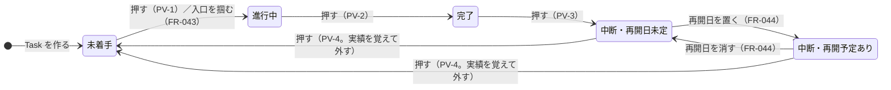
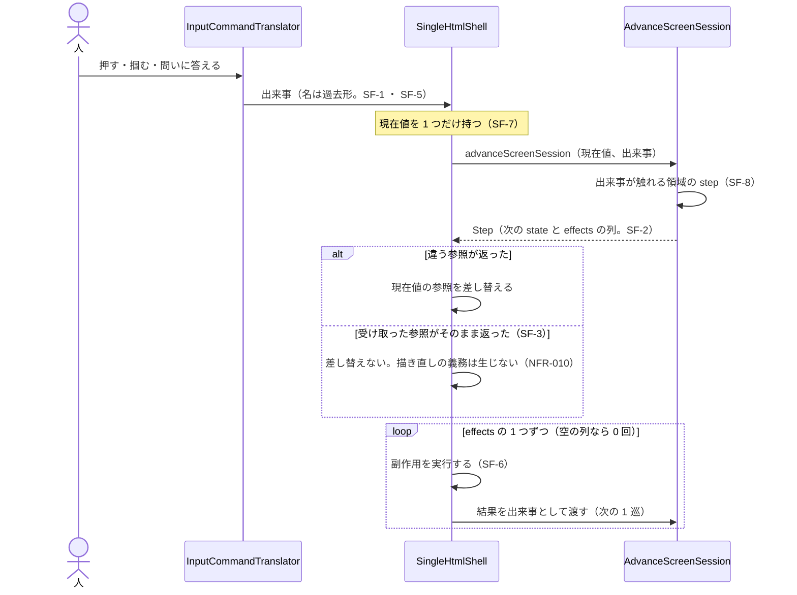
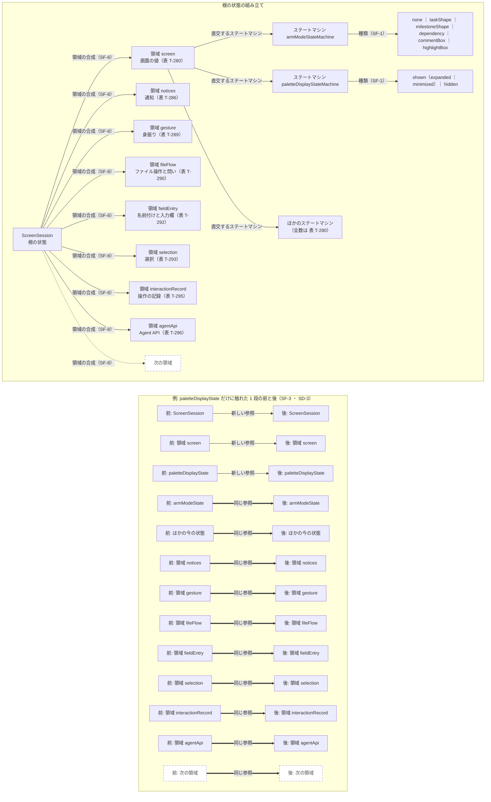

# gr-scheduler 仕様書 — 設計（Chapter 5 の 2）

**Grammar**: spec.sgra
**UID**: DOC-SPEC-CH5-02

## Chapter 5. Design (設計)

**Type**: SECTION

> 最初のファイル: `spec-ch5-01.md`

### 5.4 Domain Model (ドメインモデル)

**Type**: SECTION

**文書の全体像を 図 F-010 に示す**（`_assets/fig-erd-overview.md`）。  
→ [LINK: DOC-FIG-ERD-OVERVIEW]**エンティティの全数は 表 T-056 が持つ**（`_assets/fig-erd-detail.md`）。  
→ [LINK: DOC-FIG-ERD-DETAIL]ルートを日程データの群・見せ方の群・文書の刻印に分ける規則は 表 T-052 が、交換相手の木をそのまま持つ規則は 表 T-053 が持つ。

図 F-010 の箱は JSON のオブジェクトであり、箱の名前はその鍵である。  
列は左から型・鍵・意味である。  
入れ子でしか現れないものは、どの鍵の下に入るかを辺のラベルに書いた。  
鍵に入るのがエンティティであれば、意味の欄にその名前を置いた。  
多重度は線の端の記号が表す —— 記法は 図 F-011 と同じである。

⚠️ **ルートの箱だけは鍵を持たない** —— 文書そのものであり、どの鍵の下にも無いためである。  
この箱には型の名（`Document`。  
表 T-062 の `CP-34`）を置いた。

⚠️ `documentSettings` から `schedule` への 2 本は、指す先の行が消えても`documentSettings` を 1 文字も変えない。  
⛔ 2 本の扱いは同じではない。  
表示位置は、指す先が無くなってよい —— そのときの扱いは表 T-024a の `OP-10` が持つ。  
**ピン止めは、指す先が無くなってはならない（MUST NOT）** —— 消すときに一緒に外すことを 表 T-050 の `CD-2` が定めており、宙吊りは文書が壊れていることを表す。

**縦の並びを決める軸が 2 本ある。**  
一方は WBS で、`Task.parentTaskUid` が持ち、深さに上限を課さず、交換相手へ書き出す。  
もう一方はタスクグループで、`TaskGroup` と `TaskGroupMember` が持ち、深さに上限を課し、交換相手へ書き出さない。  
**どちらの深さをどう扱うかは `FR-004` が定める。**

**2 本に分けたのは、交換相手が木を 1 本しか持たないためである。**  
縦積みを交換相手の木へ載せると、往復のたびに縦積みの形が WBS の形へ潰れる。  
**分けておけば、往復で保証するのは WBS の側だけで済む**（`FR-021`）。

**識別子は交換相手のものをそのまま使い、代理キーを作らない。**  
代理キーを作ると、取り込みと書き出しのたびに 対応表が要り、その対応表を失うと往復が成立しなくなる。  
**合流の照合が `UID` の一致で行われること**（`FR-022`）も、同じ前提の上に立っている。

⚠️ **`Project` だけは識別子を主キーにしない** —— 交換相手のスキーマがこれを省略でき、省略された文書が実在するためである。  
**文書が持つ `Project` は 1 つなので、識別に使う必要が無い。**

### 5.5 Behavior (振る舞い)

**Type**: SECTION

**本節が定めるのは順序である** —— 何を先に読み、何を先に計算し、何を先に配るか。  
**コンポーネントの境界は 5.2 が、公開する名前は 5.3 が持つ。**

`R7.4`（MUST）が一貫性の単位の明示を求めており、本節の 表 T-066 がそれである。

**表 T-066 — 一貫性の単位**

| 行 ID | 単位 | 一度に集めるもの | 集める時点 | 破ると何が起きるか |
| --- | --- | --- | --- | --- |
| CS-1 | **1 フレーム**（描く） | 文書の凍結された複製（基準日 `Project.statusDate` を含む）・画面の寸法 | **フレームの先頭で 1 回** | 1 枚の絵の中で座標系が変わり、上半分と下半分が違う寸法で描かれる |
| CS-2 | **身振り 1 回**（掴む） | 身振りを始めた時点の文書 | **ポインタを押した時点** | 途中の状態へ他者が書き込み、離した瞬間に人の操作がそれを上書きする（表 T-035 の `AG-9`） |
| CS-3 | **1 回の書き込み**（確定する） | 照合する刻印 3 つと、変更の全体 | **`applyDocumentChange` を呼んだ時点** | 半端に適用された文書が残る（`AG-3`） |
| CS-4 | **人の応答を待つ 1 回のファイル操作**（開く・書き出す） | その操作が現在値から要るものの全部 | **操作を始めた時点** | 待っているあいだに動いた値と、始めた時点の値とが混ざった文書が着地する |

**`CS-1` 〜 `CS-3` は入れ子である。**  
身振り 1 回は多数のフレームを含み、1 回の書き込みは身振りの中でも外でも起こる。  
身振りが何かは `AG-9` が定めており、対象は表 T-027 の取り消し対象行と一致する。

⚠️ **`CS-4` だけは入れ子ではない。**  
人の応答を待つ操作はフレームをまたぐので、待っているあいだに `CS-1` が何度も走る。  
待っているあいだ、現在値を読み直してはならない（MUST NOT）。  
着地は `replaceDocument` で行うこと（MUST） —— 呼び手ごとの扱いは 表 T-230 が持つ。  
⛔ **待つことそのものは画面を何も変えない** —— 表 T-078 に契機が無いからである。  
**待っていることを示す表示を出してはならない（MUST NOT）。**  
⭐ 待ちが終わって問いが立つときのフレームは 表 T-078 の `FT-1` である —— その押下の、遅れて来た残りだからである。  
⭐ **凍らせるのではない** —— 待っているあいだに寸法が変われば `FT-3` が走る（`NFR-011`）。  
⭐ 閲覧環境が開いた選ぶ窓（色の入力の色選び、日付の入力のカレンダー）で値を選んだときのフレームも、同じ理由で `FT-1` である。

⚠️ **`CS-1` はシステムの時計を集めない。**  
基準日は文書の中にあり、そこへ本日を書くのは `FR-046` が定める操作の側である。  
フレームの先頭で時計を読むと、日付をまたいだ瞬間に 表 T-069 の `RV-3` / `RV-4` とイナズマ線が動き、`WY-2` が崩れる。

⭐ **外を読むのは `Framework` だけである**（表 T-060 の `LY-5`）。  
内側の 3 層は値を引数で受け取るので、処理の途中で外を読むことが構造上できない。  
本表は、その単位に名前を与えたものである。  
⚠️ ただし `Framework` 自身が人の応答を待つあいだは、層の分け方では守れない —— そこを覆うのが `CS-4` である。

**`R4.3`（MUST）が求める手順を 表 T-067 に示す。**

**表 T-067 — 文書を変える手順**

| 行 ID | 順 | すること | 純粋性 | 正 |
| --- | :-: | --- | --- | --- |
| WS-1 | 1 | 刻印 3 つを照合する。 食い違えば拒否し、現在の文書を返す | `pure` | 表 T-035 の `AG-2` |
| WS-2 | 2 | 書ける時機かを見る。 **身振りの最中・編集入力の確定前・通知の配布中は拒否する** ⚠️ 編集入力の確定前でも、`01-04-requirements.md` の 表 T-027 の `UN-8`（ズーム・スクロール・パン）だけから成る書き込みは拒否しない —— 確定される欄の値にも取り消しの段にも触れず、同書の 表 T-338 の `MH-4` が欄を編集しながら倍率を変えることを求める ⭐ 確認の問い（`01-04-requirements.md` の 表 T-037 の `NT-7`）が立っている間も拒否する —— 上の `UN-8` だけから成る書き込みは、問いが立っている間も拒否しない ⭐ 時機は、呼び手（`Framework`）が集めて引数で渡す 4 つの真偽 —— 身振りの最中・編集入力の確定前・確認の問いが立っている・通知の配布中 —— で見ること（MUST）。 拒否の理由は、この順で最初に当たったものとし、`01-04-requirements.md` の 表 T-233 の `RS-7`・`RS-8`・`RS-74`・`RS-9` とする。 ⛔ 書き込みが `UN-8` だけから成るかの判じは本行だけが持ち、呼び手が前もって判じて書き込みを止めてはならない（MUST NOT） —— 判じが 2 か所にあると、編集入力の確定前と問いの間とで例外が食い違う。 画面からの書き込み（取り消し・やり直しを含む）が問いのために拒まれたら、呼び手は `NT-7` のとおり `RS-27` として捨てる | `pure` | `AG-9` ／ `NT-7` ／ 本節 |
| WS-3 | 3 | 操作を検証し、新しい文書を組み立てる。 **1 つでも拒まれたら全部を捨てる** | `pure` | `AG-3` ／ 表 T-063 の `UT-1` |
| WS-4 | 4 | 取り消しの履歴に 1 段積む。 表 T-027 の対象外なら積まない | `pure` | `FR-031` ／ `AG-10` |
| WS-5 | 5 | 刻印を進める。 日程データの群の刻を動かすのは、その群を変えたときだけ。 どちらの群であれ動いた刻と、最後に書いた者は、取り消しの対象（`01-04-requirements.md` の 表 T-027）の書き込みを 1 つでも含むとき更新する ⭐ 対象外（`WS-4` が積まないもの）だけから成る書き込みでは、刻印のどれも動かさない —— 同書の `FR-063` ⚠️ **まるごと差し替える道では 表 T-230 の刻印の欄に従う** | `pure` | `FR-063` |
| WS-6 | 6 | ⭐ **現在値を差し替える** | `non-pure` | 表 T-060 の `LY-5` |
| WS-7 | 7 | ⭐ **差し替えの後に通知を配る** | `non-pure` | `AG-6` |

**`WS-1` 〜 `WS-5` は純粋である** —— 外を読まず、現在値も変えない。  
**`WS-6` だけが変え、`WS-7` だけが外へ出す。**  
表 T-063 の `UT-1` が `ApplyDocumentChange` を 2 ユニットに割っているのは、この境目である。

通知は差し替えの後とすること（MUST）。  
前に配ってはならない（MUST NOT） —— 前に配ると購読者が読む文書がまだ古い。  
**`AG-6` が「確定した変更」と書いているのは、この順序のことである。**

**差し替えは 1 つの参照の置き換えとすること（MUST）** —— 途中まで書き換わった文書を誰にも読ませない。  
`AG-4` の凍結された複製は、差し替えの前か後のどちらかを返し、混ざったものを返さない。

⚠️ **通知を配っているあいだの書き込みは拒否すること（MUST）** —— 購読者が通知を受けてそのまま書き込むと、**どの版に対する通知だったのかが決まらなくなる。**  
拒否は `WS-2` で行い、**値の中身は `AG-9a` に従う。**  
待ち行列を作らないのは、`FR-028` が受理したか否かをその場で値で返すと定めているためである。  
拒否の理由は、書き込みと同じ 表 T-233 の `RS-9` とする。

**自分の書き込みで自分が起きてはならない（`AG-6`）。**  
通知の選び方は `AG-6` が持ち、判定するのは表 T-063 の `UT-3` が分けた純粋な側（表 T-075 の `UF-25`）である。

**文書をまるごと差し替える道も、本表の 7 つの順を踏む** —— 表 T-064 の `PI-8` が公開する `replaceDocument` がそれである。  
⭐ 呼び手ごとに違うのは履歴・刻印・取り消しの 1 段の 3 つだけであり、それを 表 T-230 に示す。

**表 T-230 — まるごと差し替えるときの呼び手ごとの扱い**

| 行 ID | 呼び手 | `WS-3` の位置に立つもの | 履歴 | 刻印 | 取り消しの 1 段 | 正 |
| --- | --- | --- | --- | --- | --- | --- |
| RD-1 | 取り消し（人の押下と `Agent API` の `undoEdit`） | `UndoEdit`（`PI-11`） | 問う先が答えたものを据える | 入ってきたまま | 積まない | `FR-031` ／ `FR-063` ／ `tbl-agent-api-members.md` の 表 T-107 の `AM-9` |
| RD-2 | やり直し（人の押下と `Agent API` の `redoEdit`） | `RedoEdit`（`PI-12`） | 問う先が答えたものを据える | 入ってきたまま | 積まない | `FR-031` ／ `tbl-agent-api-members.md` の 表 T-107 の `AM-10` |
| RD-3 | 取り込み（合流と重ね） | `ImportDocument`（`PI-10`） | いまのものを残す | 進める | 表 T-027 に従う | `FR-022` ／ `FR-056` ／ `UN-6` |
| RD-4 | `OP-3` の置き換え | `ImportDocument`（`PI-10`） | 捨てる | 入ってきたまま | 積まない | `OP-4` ／ `UN-6` |
| RD-6 | 起動時の文書 | 呼び手が持って来る | 空にする | 入ってきたまま | 積まない | `FR-062` ／ 表 T-034 |
| RD-7 | `FR-095` の初期化 | 呼び手が持って来る（`01-04-requirements.md` の 表 T-342 の空の文書） | 捨てる | 進める | 積まない | `FR-095` ／ `OP-4` |

本表の 6 つが、まるごと差し替える呼び手の全数である。  
呼び手は、自分がどの行かを名乗ること（MUST）。  
名乗らない差し替えを受け付けてはならない（MUST NOT） —— 履歴を捨てるか残すかが呼び手の心得になると、`OP-4` が MUST で定めた履歴の扱いを経路の中で誰も検査しなくなる。

⭐ **`RD-5` は退役した席なので、番号を飛ばして `RD-7` としている**。  
⭐ **履歴と取り消しの 1 段の扱いは `RD-4` と同じであり、選んだのではなく導いた** —— `FR-095` は人が求め、`OP-4`（問いは 表 T-234 の `QN-5`）で確かめたうえで、持っているものを置き換える道である。  
⛔ **`RD-4` と違うのは、入ってくる文書の出どころと刻印である** —— **空の文書（`01-04-requirements.md` の 表 T-342）は差し替えるその時に作るので、書かれたときの刻印を持たない。**  
⭐ 下の「入ってきたまま」の理由（`FR-063` の等値）が当たらないので、刻印を進める。  
⚠️ 本行が無かったあいだ、`FR-095` は名乗る行を持たないので、直上の MUST によって実装できなかった。

`WS-1` が照合するのは、呼び手が申告した「読んだ刻印」と現在の文書の刻印である（MUST）。  
入ってくる文書の刻印と照合してはならない（MUST NOT） —— 入ってくる文書の刻印は**定義により**現在のものと違うので、照合するとあらゆる差し替えが拒否される。  
**申告が無いことだけを理由に拒否してはならない（MUST NOT）** —— `AG-2` の申告は能力であって義務ではない。

**`WS-3` の位置に立つのは本表がその欄に名指したものである（MUST）** —— 命令を組み立てる `editDocument` はこの道では呼ばれない。  
「呼び手が持って来る」の行では、呼び手が渡した文書がそのまま `WS-3` の答えである。

**この道で入ってくる文書を検証し直してはならない（MUST NOT）** —— 外から来た文書の検証は `OP-5` と `FR-023` が既に負っており、**取り消しの履歴が持つ文書はその対象ではない。**

`WS-5` は、本表の刻印の欄が「進める」の行でだけ刻印を進めること（MUST）。  
「入ってきたまま」の行で進めてはならない（MUST NOT） —— 取り消しは以前の文書を刻印ごと復元し（`FR-063`）、ファイルと起動テンプレートから来る文書は、書かれたときの刻印を持っていなければ `FR-063` の等値の判定が意味を成さない。

`WS-4` は、本表の欄が「積まない」の行で取り消しの 1 段を積んではならない（MUST NOT） —— 表 T-027 が分類しているのは人が文書に対して行う操作であり、**履歴を歩くこと自体はその対象ではない。**

`WS-7` へ渡す「日程データの群が動いたか」は、出て行く文書と入ってくる文書の `scheduleUpdatedAt` の等値で導くこと（MUST） —— **`WS-5` が判定を下さない行があるためである。**  
等値で判定するのは `FR-063` の定めに従う。

保存しない状態のステートマシン（5.6 の ADR-002）の原稿は `_source/state-machines.json` であり、ステートマシンの唯一の正である。  
原稿から、ガードの式の書き方、領域ごとの出来事の定義・ガードの一覧・優先順の表と、ステートマシンごとの状態遷移図（UML）・状態遷移表・状態の一覧を生成し、TypeScript の判別共用体と初期値とガードの名の型を生成し、ガードごとの判定をその条件の式から生成する。  
⭐ 状態遷移図と状態遷移表を手で直してはならない（MUST NOT） —— 2 つが別々に直されると、どちらが正か分からなくなる。  
遷移表の定数は、それを読むコードがあるユニットにだけ生成する（いまはタスクグループの木の `task-group-folding.ts` だけ）—— ほかの領域の遷移の関数はその定数を読まず、表との一致は領域ごとの契約試験が確かめる（表 T-250 の `SD-3`、表 T-285 の `RA-6`）。  
手で書くのは各領域の遷移の関数と、ガードの式が呼ぶ名の付いた関数（原稿の頭の関数の一覧）の本体だけである。  
原稿に載せるのは、要求が名指す状態・出来事・遷移だけとする（MUST）。  
ガードの条件は原稿が持ち、コードの判定はそれに従う —— 領域ごとに、ガードと同じ名の判定を 1 つずつ持つ表をその式から生成し、遷移の関数はその表を通して呼ぶ（条件と判定が黙ってずれる道を残さない）。  
式が呼ぶ名の付いた関数は、領域のユニットが同じ名で手で書く（無ければ型の検査が止める）。  
実装の都合の細部は状態の種類を増やさず、状態が運ぶ値としてコードが持つ。  
⚠️ 文書のデータの状態は、表 T-250 の `SD-5` のタスクグループの木を除いて原稿に入れない（図 F-018 を含む）。  
原稿が持つもの・持たないものを 表 T-250 に示す。

**表 T-250 — ステートマシンの原稿が持つもの**

| 行 ID | 項目 | 持つもの | 持たないもの |
| --- | --- | --- | --- |
| SD-1 | 状態 | ステートマシンの中のキー（名は `ステートマシン.キー`）、親（入れ子）、初期状態か、運ぶ値の名前、入るとき・出るときに必ず起きる副作用（entry ／ exit）、根拠の行 | 既定値と上下限（表 T-206 が持ち、`S-` 行を指すだけ） |
| SD-2 | 出来事 | キー（名は `領域/キー`）、どこから来るか（入力の行・副作用の結果・時間）、運ぶ値の名前。 領域ごとに 1 度だけ定め、いくつのステートマシンを動かしても定め直さない | 画面の語（辞書が持つ） |
| SD-3 | 状態遷移表 | ステートマシンごとに、出来事 × いまの状態 の升。 升は先の状態（同じステートマシンの状態）、ガード（名前、またはほかのステートマシンがいる状態）、副作用の名前と引数、根拠の行を持つ。 ガードの条件は領域ごとのガードの一覧が式で持ち（式の書き方は原稿の頭に 1 度だけ定める）、升と一覧はその式を刷る。 コードの判定もその式から生成する。 entry ／ exit の副作用は、その状態へ入る（出る）升に重ねて書かない。 遷移の無い組（葉の状態と、そのステートマシンが名指す出来事の組）は、1 つずつ `unhandled[]` に `ignore`（変化なし、同じ参照）か `error`（起きてはならない）で書く（NDD レビュー基準の付録 A.6） | 副作用の中身と、式が呼ぶ名の付いた関数の本体（コードが持つ）。 ⭐ 表と関数のずれは、領域ごとの契約試験（すべての状態と出来事の組で先の状態の種類が表と一致し、`ignore` の組では同じ参照を返す）が止める |
| SD-4 | 領域をまたぐ優先順 | 奪い合う出来事、順を決めた要求の行、段ごとの状態のキー | **順そのものの正**（`IN-4` などの要求の行が持つ） |
| SD-5 | 文書のデータの状態 | タスクグループの木（`TaskGroup.treeState`、`_assets/fig-erd-detail.md` の `AT-153`）だけは、保存する値でも原稿に置く。 その領域は、出来事・状態遷移表・状態遷移図・状態の一覧と、ガードの名の型・ガードごとの判定・遷移表の定数だけを生成する。 判定は 1 つの入力（升が木の状態を決めるタスクグループ —— 根の升では無い ——、出来事が運ぶ値、式が呼ぶ名の付いた関数）を受け、遷移の関数は升のガードの名でその表から引く | 状態の型（`erd.json` の列挙が持ち、原稿の状態のキーはその値と同じ並びとする）、根の値、`step`（値は書き込みの唯一の経路で書き換わる —— 表 T-249 の `SF-10`） |

第 1 領域（画面の値）の出来事・ステートマシン・状態遷移表を `_assets/tbl-state-machines.md` の 表 T-280 に、状態遷移を 図 F-026 に示す。  
第 2 領域（通知）のそれらを同じファイルの 表 T-286 に、状態遷移を 図 F-029 に示す。  
第 3 領域（身振り）のそれらを同じファイルの 表 T-289 に、状態遷移を 図 F-035 に示す。  
第 4 領域（ファイル操作と問い）のそれらを同じファイルの 表 T-290 に、状態遷移を 図 F-036 に示す。  
第 5 領域（名前付けと入力欄）のそれらを同じファイルの 表 T-292 に、状態遷移を 図 F-038 に示す。  
第 6 領域（選択）のそれらを同じファイルの 表 T-293 に、状態遷移を 図 F-039 に示す。  
第 7 領域（操作の記録）のそれらを同じファイルの 表 T-295 に、状態遷移を 図 F-041 に示す。  
第 8 領域（`Agent API`）のそれらを同じファイルの 表 T-296 に、状態遷移を 図 F-042 に示す。  
第 9 領域（タスクグループの木）のそれらを同じファイルの 表 T-328 に、状態遷移を 図 F-043 に示す。  
領域をまたぐ優先順（`SD-4`）を同じファイルの 表 T-283 に示す。  
順そのものの正は `IN-4` ・ `SK-19` ・ `NT-7` の行である。  
ステートマシン・状態・出来事・遷移は、番号ではなく名で指す。  
ステートマシン（定義）の名は、追うものを表す名詞句に `StateMachine` を付けたもの（`armModeStateMachine`）で、全領域を通して 1 つしかない。  
コードが今の状態を持つ値とその型は、同じ名詞句に `State` を付ける（`armModeState` ・ `ArmModeState`）。  
状態は「このステートマシンは今〈状態〉である」と読める過去分詞・形容詞（`taskShapeArmed` ・ `hidden`）か、現在分詞と目的語（`placingCursorA`）とし、名は `ステートマシン.キー`（`paletteDisplayStateMachine.shown.expanded`）である。  
出来事の名は `領域/キー`（`screen/armEntryPressed`）、遷移の名はその升（ステートマシン・いまの状態・出来事の組）である。  
同じ領域のステートマシンどうしは直交する。  
キーが 2 語以上の状態（`shown.expanded`）は、親（`shown`）の単一の共用体の種類である。

予実の状態遷移を 図 F-018 に示す。  
箱は 表 T-019 の 5 行、辺は 表 T-021a と `FR-043` / `FR-044` である。

**図 F-018 — 予実の状態遷移**

状態は列の組み合わせから判別する。  
判別の手順は 表 T-019a が、置く値は 表 T-019 と 表 T-021a と `01-04-requirements.md` の `FR-103` の 表 T-245 の `GO-5` 〜 `GO-10`、および `FR-043` / `FR-044` が持つ。

⚠️ **遅れは状態ではない。**  
導出であり、上のどの箱とも並ばない（表 T-021 の `PM-4`。  
条件の全数は 表 T-021b）。

**記号の巡回は 1 本の輪であり、作業の進み順に閉じている** —— 未着手 → 進行中 → 完了 → 中断 → 未着手。  
未着手はこの輪の中に在り、`PV-4` が中断から未着手へ戻す（図 F-018）。  
**戻すときに外した実績は `ScreenState` が覚え、`PV-1` が戻す**（規則の正は `01-04-requirements.md` の `FR-107` と 表 T-021a）。  
**着手を取り消したいときは取り消しも受ける**（表 T-027 の `UN-2`）。

**レイアウトの計算順序を 表 T-068 に示す。**

**表 T-068 — レイアウトの計算順序**

| 行 ID | 順 | 計算 | 主な入力 | 正 |
| --- | :-: | --- | --- | --- |
| LC-1 | 1 | 人が折りたたんだタスクグループと非表示のタスクグループを落とす | 折りたたみの状態 | 表 T-051 の `HF-7` |
| LC-2 | 2 | 表示量を増減し、描く対象を決める | 縦横の倍率 ／ タスクグループの木の状態（`01-04-requirements.md` の 表 T-329） | `FR-018` ／ 表 T-005a |
| LC-3 | 3 | 時間軸を敷く（日付 → x） | 倍率・表示位置 | `FR-017` |
| LC-4 | 4 | ラベルを打ち切る | `truncateUnits` | `01-04-requirements.md` の `FR-002` |
| LC-5 | 5 | ラベルの幅を概算する | 単位数 × フォント × `labelCoef` | `FR-093` |
| LC-6 | 6 | ラベルの置き場所を決める | 幅と基準の幅 | `01-04-requirements.md` の `FR-109` の 表 T-272 と 表 T-273 |
| LC-7 | 7 | 占有幅を合算する | 外へ出したラベル・担当・完了率 | 表 T-038 |
| LC-8 | 8 | 段を割り当てる | 占有幅 | 表 T-014 の `ST-2` / `ST-3` |
| LC-9 | 9 | タスクグループを木の順に並べ、帯高と縦位置を決める | 段数・タスクグループの親子 | 表 T-014 の `ST-9` ／ `AT-55` |
| LC-10 | 10 | 依存線の経路を引き、端点が見えていない線を省く | 端点の座標 ／ `Task Group Area` と帯（表 T-221 の `LF-14`） | 表 T-018a ／ `01-04-requirements.md` の 表 T-303 |
| LC-11 | 11 | 描くものの頂点を作る | 上のすべて | `FR-094` |

上から順に 1 度だけ通ること（MUST）。  
後の段の結果を前の段へ戻してはならない（MUST NOT） —— `01-04-requirements.md` の `FR-109` の 表 T-273 の結びが既に理由を書いている。  
外へ出したラベルが他の `Task` と干渉しても、そこでずらす規則を置かない。  
置くと **ラベル配置 → 占有幅 → 段割当 → 干渉判定 → ラベル配置** の循環になる。  
**干渉は `LC-8` の貪欲割当が解く。**

**`LC-1` が `LC-2` より先なのは `HF-7` が定めている** —— 人が折りたたんだ状態は表示量の増減より強い。  
**`LC-10` が `LC-2` より後なのは `RT-4a` と `01-04-requirements.md` の 表 T-303 が定めている** —— 端点のどちらかが描かれていない依存線は引かず、グループ LOD が描かないタスクグループの端点と、人が折りたたんだタスクグループ・格納したタスクグループの配下の端点は、描かれている最も近い祖先のタスクグループに立てる（同表の `EL-2` ・ `EL-20`）。
描かれている祖先が無い格納したタスクグループの配下の端点は、`LC-9` の木の順でその端のタスクグループより前に描かれているスクロールするタスクグループのうち最後のタスクグループの下端に立てる（同表の `EL-20`）。

**`LC-9` がタスクグループを並べる順は木の順とすること（MUST）** —— 親のタスクグループの直下にその配下を置き、同じ親の下では `_assets/fig-erd-detail.md` の `AT-55` の昇順に並べる。  
**深さの順に並べてはならない（MUST NOT）** —— 同じ深さのタスクグループが塊になり、**親とその配下が画面の離れた場所に出る。**  
タスクグループが画面に収まりきらないとき、上端に来るのが根ばかりになり、**木を持つ文書が階層の無い一覧に見える。**  
⚠️ **`LC-1` と `LC-2` が落としたタスクグループは、この順から抜けるだけである** —— 残ったタスクグループどうしの前後は変わらない。  
タスクグループの縞（`FR-042`）が数える「タスクグループの位置」も、この順での位置とすること（MUST） —— 別の順で数えると、同じ文書で縞の向きと並びが食い違う。

⭐ フレームの 1 回のほかに本表を走らせてよいのは、全体を収める表示（`FR-055`）と、画像を書き出すとき（`01-04-requirements.md` の `FR-080`・`FR-025`）と、`PI-5` の `taskGroupPlacesAtZoomY` に問う 3 つの道 —— `FR-016` の縦軸の錨、`FR-016` の縦軸の上限（帯の側、`01-04-requirements.md` の 表 T-253）、`FR-039` の表示の倍率を変えたときの錨 —— だけである。  
⭐ どれも `layoutEngine`（`CP-5`）の中でのみ走らせること（MUST）—— ⚠️ タスクグループの高さと縦位置を決める `LC-9` は本表の中にあるので、候補の倍率でのタスクグループの位置は本表をもう 1 度走らせることでしか得られない。  
⭐ 全体を収める表示は、下の表のとおり本表を 2 回まで走らせる。  
2 つの錨は、候補の倍率で 1 回ずつ走らせる。  
⭐ 書き出しは、書き出す 1 枚ごとに 1 回走らせる —— 全体表示時の期間を固定していなければ（`01-04-requirements.md` の `FR-055` の 表 T-367 の `FX-1`）画面と同じ区画と倍率で、固定していれば `01-04-requirements.md` の 表 T-241 の `IX-13` の区画と 1 日の幅、`IX-14` の縦のズーム 1 で走らせる。  
⭐ 上限を探す道は、表 T-253 が調べる倍率ごとに 1 回ずつ走らせる —— 回数を 2 回で縛らず、表 T-253 の手順が有限で止める（`BC-1` の並びは `S-76` の上限で終わり、`BC-4` の詰めは `BC-5` の差で止まる）。  
⚠️ 下の「3 回目を走らせてはならない」は、全体を収める表示の回にだけ掛かる —— 上限を探す道は、ある倍率の結果を次の倍率の入力へ戻さない（どの回も倍率の決まった独立の問いである）ので、表示量が行き来して振動することが無い。  
⭐ 探した上限は 表 T-071 の `CA-1` の ② が持ち越すので、フレームごとに探し直さない。

| 回 | すること |
| --- | --- |
| 1 | 人が全体表示を求めたとき（表 T-051 の `HF-8`）は、人が折りたたんだ状態をすべて捨て、`expanded` と `temporarilyExpanded` も 表 T-328 の `fitPressed` のとおり `auto` へ戻したものとして走らせる。 ⛔ 起動のときの全体表示（`01-04-requirements.md` の 表 T-024a の `OP-10`）では捨てない —— 同行が `HF-8` を働かせることを禁じているので、文書が持つ折りたたみと展開のまま走らせ、`LC-1` が落としたタスクグループの深さは数えない。 そのうえで、帯の高さが `FR-094` の床に達する倍率で、その文書が持つすべての深さを通して `LC-1` 〜 `LC-9` を走らせ、**表 T-038 の実寸を段ごとに得る**。 ⭐ その床より下では絵が倍率に依らないので、1 回測れば床の内側に収まる段の縦幅は算術で出る |
| — | **採った段が床の内側の倍率で描けるなら、それで決まる** |
| 2 | **採った段が床より上の倍率を要するときだけ**もう 1 度通し、その倍率での実寸を見て、**収まらなければ 1 つ浅い段へ退く** |

**3 回目を走らせてはならない（MUST NOT）** —— 反復が終わる保証が無く、**表示量が行き来すると振動する。**  
**収まらない軸にスクロールを残すことは `FR-055` が既に定めている。**

⚠️ **本表をフレームごとに全部通す必要はない。**  
何をどこまで作り直すかは Chapter 5.6 のキャッシュの判断が持つ。  
**ただし作り直す範囲を変えても、順序を変えてはならない（MUST NOT）。**

描くときに求める値を 表 T-069 に示す。  
文書には書かない値である。  
交換相手にも書かない（Chapter 6.2 と 表 T-059）。

**表 T-069 — 描くときに求める値**

| 行 ID | 値 | 求め方 | 求めるコンポーネント | 正 |
| --- | --- | --- | --- | --- |
| RV-1 | 実績バーの右端 | 実績の最後の日（完了なら `actualFinish`、それ以外は `stop`）の翌暦日の列の左端 時刻を表示しているとき（`01-04-requirements.md` の `FR-158`）は、右端は終わりの瞬間の位置、左端は開始の瞬間の位置、マイルストーンの菱形は開始の瞬間の位置を中心に立つ。 時刻を表示しないときは、本行のとおり日の列で描く（終わりの日は同書の `FR-054` の終了の側の日） | `ScheduleLayout` | `FR-011` |
| RV-2 | 予実の状態 | 表 T-019a の 5 段を上から当て、最初に当たった行 | `Schedule` | `FR-010` |
| RV-3 | 遅れかどうか | 表 T-021b の 3 条件のいずれかに当たるか | `Schedule` | 表 T-021 の `PM-4` |
| RV-4 | 遅れの量 | 表 T-021b の起点と終点から稼働日で数える | `Schedule` | `FR-047` |
| RV-5 | 進捗の記号 | 表 T-021。 `PM-4` が成立するときは `PM-4` を出す | `ScheduleGeometry` | `FR-013` |
| RV-6 | 予定バーの右端 | `finish` の日の翌暦日の列の左端 —— 帯は `start` の日の列の左端から `finish` の日の列までを、両端を含めて覆う（`RV-1` と同じ求め方）。 開始日と終了日が同じなら 1 日の列を覆う。 マイルストーンには当たらない —— 菱形は `start` の日の列の左端を中心に立つ 時刻を表示しているとき（`01-04-requirements.md` の `FR-158`）は、右端は終わりの瞬間の位置、左端は開始の瞬間の位置、マイルストーンの菱形は開始の瞬間の位置を中心に立つ。 時刻を表示しないときは、本行のとおり日の列で描く（終わりの日は同書の `FR-054` の終了の側の日） | `ScheduleLayout` | `FR-018` |

**これらを文書に持ってはならない（MUST NOT）** —— 持つと、元になった列と食い違ったときにどちらが正かを決める規則が要る（表 T-059 と同じ理由である）。

⚠️ **完了率は本表に含まない。**  
算出して**文書に格納する**値だからである（`FR-012`）。  
**求めた値を保存するかどうかで置き場が分かれる。**

`RV-2` 〜 `RV-4` を `Schedule`（`CP-1`）が持つのは、いずれも日程データの群の列だけから決まる純粋な判定だからである。  
公開する名前は 表 T-064 の `PI-1` が持つ。

⚠️ **稼働日の数え上げも同じ理由で `Schedule`（`CP-1`）が持つ**（`FR-054`）—— 暦は日程データの群の中にある（表 T-052 の `DR-2`）。  
`RV-1` を求める `ScheduleLayout` も、完了率を格納する `EditDocument`（`FR-012`）も、実績の終了を置き直す `01-04-requirements.md` の `FR-103` の 表 T-245 の `GO-3` と `GO-9` も、同じメンバを呼ぶこと（MUST）。  
数え方を 3 か所に書いてはならない（MUST NOT） —— 同じタスクで違う日数が出る。

起動の順序を 表 T-077 に示す。  
正は `NFR-011` である。

**表 T-077 — 起動の順序**

| 行 ID | 順 | すること | 正 |
| --- | :-: | --- | --- |
| BO-1 | 1 | 画面の寸法を確定させ、`ScreenRegions`（`CP-35`）を求める。 **寸法が確定するまで 1 枚も描かない** | `NFR-011` |
| BO-2 | 2 | 表 T-034 の順で最初に開く文書を決める | `FR-062` |
| BO-3 | 3 | 見せ方の群から倍率と表示位置を読む。 表 T-024a の `OP-10` に当たるときは、この 2 つを `BO-4` が決める | `FR-055` ／ `FR-087` |
| BO-4 | 4 | 表 T-068 を通し、レイアウトと幾何を作る。 **`OP-10` に当たるときの走行回数は 表 T-068 の後の規則に従う** | 表 T-068 ／ `FR-055` |
| BO-5 | 5 | 最初の 1 枚を出す | `NFR-011` |

上から順に通すこと（MUST）。  
前の段が済む前に次の段へ進んではならない（MUST NOT） —— `BO-1` を飛ばすと寸法の無い 1 枚が、`BO-3` を飛ばすと位置の決まらない 1 枚が出る。  
**どちらも `NFR-011` が禁じている。**

⚠️ **本表が定めるのは最初の 1 枚に至る描画の順序である。**  
画面の言語とヘルプの言語（`FR-038`）と、起動時の用件をまとめた 1 枚（表 T-037 の `NT-4`）は、この順序の外にある。  
⚠️ **権限の復帰の申し出は、この順序に入れない** —— `FR-060` がそれを MUST NOT で禁じているので、順序の外に置くべきものが無い。

⚠️ **起動の収集は 表 T-066 の 4 単位のどれでもない。**  
`BO-1` 〜 `BO-5` を通すあいだが起動の一貫性の単位であり、最初の 1 枚が出た後は `CS-1` に移る。

**フレームが走る契機の全数を 表 T-078 に示す。**

**表 T-078 — フレームが走る契機**

| 行 ID | 契機 | 気づくもの | 正 |
| --- | --- | --- | --- |
| FT-1 | 人の入力（ポインタとキー）と、ファイルのドロップ（01-04 の 表 T-024a の `OP-2`）と、ファイルを持つドラッグがウィンドウに入る・出ること（同表の `OP-17`）。 ⭐ **その入力の、待ち（表 T-066 の `CS-4`）をまたいだ続きを含む** | `DomInputSource`（`CP-27`）が 表 T-065 の `IF-2` で渡す。 ⚠️ **待ちをまたいだ続きを起こすのはシェル自身である** —— `IF-2` の供給物は広げない。 ⭐ 閲覧環境が開いた選ぶ窓（色の入力の色選び、日付の入力のカレンダー）で選んだ値が届いたことも、その窓を開いた押下の続きに数え、シェル自身が起こす | `NFR-010` |
| FT-2 | 現在値の差し替え（表 T-067 の `WS-6`） | `SingleHtmlShell`（`CP-25`） | 表 T-067 |
| FT-3 | **画面の寸法が変わったこと** | `SingleHtmlShell`（`CP-25`）が自分で観測する | `NFR-011` ／ 表 T-066 の `CS-1` |
| FT-4 | **時間が来たこと** | `SingleHtmlShell`（`CP-25`）が自分で計る | `FR-092` の `EZ-2` と `EZ-6` ／ 表 T-037 の `NT-2` ／ `FR-039` の 表 T-260 の `SE-3` ／ `FR-018` の押し続け（`S-172` / `S-173`） |
| FT-6 | **ブラウザが全画面表示に入ったこと・出たこと**（`fullscreenchange`） | `SingleHtmlShell`（`CP-25`）が自分で観測する。 ⚠️ **`FT-3` に任せない** —— 画面の寸法が変わらないまま全画面表示が切り替わることがあり、そのとき入口の押された見た目が古いまま残る | `FR-071` |

**本表に無い契機でフレームを起こしてはならない（MUST NOT）** —— これが `NFR-010` の具体である。  
⚠️ **最初の 1 枚は 表 T-077 の `BO-5` が起こす。**

⚠️ `FT-4` が数えるのは 4 つである —— アイコンの説明を出すまでの待ち時間（`S-124`）と、時間で消える通知の期限（`NT-2`）と、表示の倍率を示すメッセージを消すまでの時間（`S-244`、表 T-260 の `SE-3`）と、入口を押し続けたときの刻み（`FR-018` の `S-172` の待ちと `S-173` の間隔）。
⚠️ 数え方: 本表の `正` の欄が名指す、時間で起きることを定める行を数えた。  
コードの `frame-clock-wakes.ts` の `setTimeout` は 5 つ（アイコンの説明の待ち、タスクの説明の待ち、倍率のメッセージ、押し続け、時間で消す通知の期限）である。
**時計を読むのはシェルであり、`CS-1` の収集には入らない** —— 基準日と混同しないこと。
⛔ 通知の期限は、表示の仕方が「時間で消す」の通知（表 T-233）が立っているときにだけ数える —— 表 T-037 の `NT-2` は選言であり、ほかの通知には前の枝（読み終える前に消えない）を当てている。  
⭐ 期限の値は `_assets/tbl-settings.md` の 表 T-206 の `S-542` である。  
⚠️ 時間で消す通知にも `NT-8` の消し方（`OK`・`Enter`・`Esc`）が当たる。

⚠️ **`IF-2` の供給物を広げない（表 T-065）** —— 寸法も時間も入力機器の出来事ではなく、宿主が持つ値だからである。  
`FT-3` と `FT-4` を観測するのはシェルである（表 T-060 の `LY-5`）。  
**`layoutEngine` は寸法を引数で受け取る**（5.1）。

### 5.6 Decisions (設計判断)

**Type**: SECTION

本節は設計の判断を記録する。  
採番は ADR-000 から始め、前プロジェクトの記録番号は引き継がない（`studies/README.md` の §0-4）。  
書式は `docs/development-rules/08-spec-template/spec-template.md` の 4 項目に従う。

⚠️ **4 項目は散文で書き、表にしない。**  
`項目` / `内容` の 2 列表は行 ID を持てず、`docs/development-rules/08-spec-template/spec-writing-rules.md` の「1.9 の表と図の参照の規則」が表の第 1 列に課す条件を満たせないからである。  
⛔ **同書の文をここへコピーしない。**  
数え上げられる中身だけを番号付きの表にする。

`R2.18`（MUST）が ADR-000「最小構成との比較」を本節に置くことを求めている。

**ADR-000 — 最小構成との比較**

**Context** —— 要求をすべて満たす最小の構成は、1 つのコンポーネントが `GRS JSON` を読み、レイアウトを計算し、SVG を組み立ててブラウザへ載せる形である。  
層も、コンポーネントの境界も、宣言されたインターフェースも要らない。  
⚠️ ただし `FR-150` だけは、ブラウザの外で待ち受けるプロセスを要するので（`FR-150` の RATIONALE）、最小の構成も、呼び出しと答えを運ぶだけのプログラムを 1 つ、表 T-007 の `DEV-6` に持つ。

**Decision** —— **表 T-070 の 9 つを増やした。**

**Status** —— `Accepted`。

**Consequences** —— **増やした理由と代償は 表 T-070 が行ごとに持つ。**  
意図して払う代償の全数は 表 T-073 が持つ。

**表 T-070 — 最小構成に対して増やしたもの**

| 行 ID | 増やしたもの | 最小構成では | 増やした理由 | 代償 |
| --- | --- | --- | --- | --- |
| MN-1 | 層を 4 つに分け、`Entity` をさらに 2 つに割った（表 T-060） | 1 コンポーネント | `FR-092` の `EZ-5` が設計の合否を `R2` で判定すると定め、`R2.16` が CA を求める。 **割った側の理由は 5.1 が持つ** | 構造を保つ手間。 **非巡回であることを毎回検算する** |
| MN-2 | コンポーネントを 37 に分けた（表 T-062） | 分けない | 分ける基準は 5.2 が持つ | コンポーネントをまたぐ呼び出しが 表 T-064 の宣言を介する（`LR-2`） |
| MN-3 | 層をまたぐインターフェースを 8 本宣言した（表 T-065） | ブラウザの API を直に呼ぶ | `LR-5` | `Framework` に、宣言を実装するためのコンポーネントが増えた |
| MN-4 | 文書への書き込みの経路を 1 本にした（`CP-8`） | 呼ぶ側が直に書き換える | `FR-028` と 表 T-042 の `MS-1`。 **入口が 2 つに分かれると、片方にしか掛からない検証や履歴が生まれる** | 描画がこの経路を通らないことを別に定める必要があった（5.1） |
| MN-5 | 文書ルートをコンポーネントとして立てた（`CP-34`） | ルートに型を与えない | 表 T-052 の `DR-1` は 3 群すべてに同時に掛かる規則であり、どの 1 群からも検査できない | コンポーネントが 1 つ増えた。 ⚠️ **辺はむしろ 6 本減った** |
| MN-6 | ⭐ **画面の矩形とレイアウトと幾何をフレーム先頭で 1 回だけ計算して配る**（ADR-001） | 必要になったコンポーネントが各々計算する | 4 本の経路が `ScheduleLayout` を必要とし、**ポインタが動くたびに 表 T-068 の 11 段が 4 回走る**。 `NFR-002` / `NFR-003` の予算に収まらない | `Framework` から `layoutEngine` への辺が 3 本増え、図 F-013 にクラスタ対が 1 つ増えた |
| MN-7 | ⭐ **画面のモデルを `Entity` に置いた**（`CP-35` / `CP-36`） | 描く直前にその場で割り付ける | **`LR-6` により、矩形も画面の値もブラウザ無しで決まる。 ** 書き出しが文書だけの純粋関数になり、書き出しが通る値（`CP-35`）と画面にしか要らない値（`CP-36`）が 2 小層の境目で分かれる | 現在値は `Framework` が持つので（`LY-5`）、毎フレーム引数で内側へ渡す |
| MN-8 | ⭐ **日程表の外側の UI パーツを組み立てるコンポーネントを立てた**（`CP-37` / `CP-38`） | 描画が 1 つで日程表も外側も描く | 表 T-075 の `UF-61` 〜 `UF-69` が受ける要求を、組み立てる側で受けるコンポーネントが 1 つも無かった。  `FR-080` の `WY-2` が除外を持つのは透かしの層だけなので、外側を日程表と同じ出口に混ぜられない | コンポーネントが 2 つ、層をまたぐインターフェースが 1 本増えた |
| MN-9 | 保存しない状態をステートマシンで持つ（ADR-002） | シェルのクロージャが値を直に持つ | 同じガードがコピーで並び、`await` をまたいで現在値を読み書きする形が残る（`R4`）。 遷移を図と試験で確かめられない | 出来事と副作用の型を書く手間。 原稿と遷移の関数を契約試験で結ぶ手間 |

`R2.20`（MUST）が、キャッシュを用いる場合に 4 点を本節の ADR に置くことを求めている。

ADR-001 — 画面の矩形とレイアウトと幾何をフレーム先頭で 1 回だけ計算する

**Context** —— **表 T-068 の 11 段を必要とする経路が 1 フレームに 4 本ある** —— `SvgRenderer`（目盛とタスクグループ）／ `ScheduleGeometry`（座標）／ `InputCommandTranslator`（ポインタ → 日付）／ `ItemHitArea`（当たり判定）。  
**どのコンポーネントもインスタンスを持たないので**（5.3）、各々が自分で計算すると同じ 11 段が 4 回走る。

**Decision** —— `SingleHtmlShell` がフレームの先頭で 1 回計算し、そのフレームのあいだ配る。  
4 点は 表 T-071 が持つ。  
持ち主をシェルにするのは、表 T-060 の `LY-5` が定めているためである。

**Status** —— `Accepted`。

**Consequences** —— `Framework` から `layoutEngine` への辺が 3 本増えた。  
図 F-013 にクラスタ対が 1 つ、図 F-015 にシェルが現れる。  
⚠️ 計算する場所が `Framework` になるが、計算そのものは `layoutEngine` の純粋関数のままである —— **シェルは呼んで結果を持つだけで、算法を持たない。**  
表 T-068 の順序も変わらない。

**表 T-071 — キャッシュの 4 点**

| 行 ID | 事項 | 内容 |
| --- | --- | --- |
| CA-1 | 何をキャッシュするか | そのフレームの `ScreenRegions` と `ScheduleLayout` と `ScheduleGeometry`（後の 2 つは 表 T-068 の結果）。 ⚠️ **文書そのものはキャッシュではない** —— 現在値であり、持ち主は `LY-5` が定めている ⭐ ほかに、自分の鍵で失効する持ち越しを 3 つ持つ。 ① 全体表示が選んだ表示位置（表 T-024a の `OP-10`）—— 鍵は画面の環境であり、文書が表示位置を持ったとき、別の文書になったとき、環境が変わったときに捨てる。 ② 縦軸のズームの上限（`FR-016`）—— 鍵は帯を組む材料（日程データの群、ズームとスクロール位置を除く文書の設定、描く横の倍率、`Task Group Area` の矩形、段 0 の折りたたみ、ズームの下限と上限）であり、どれかが変わったときに作り直す ③ 下の絵の SVG 文字列（表 T-065 の `IF-1`）—— 鍵は下の絵が読むものであり、どれかが変わったフレームで組み直す。 読むものは、日程データ・描く設定・配置と幾何（本行の前段）・画面の領域・選択・見る人の値のうち絵が読むもの（テーマ・ガイドカーソルの形・跳んだ先の印）・2 連カーソルの追従・目盛の曜日の語・透かし・仮の依存線と、絵が指から読むもの（表 T-064 の `PI-19` の `beneathPointerReadingOf` の答え —— ガイドカーソルの点・指が中にある実績のダミー・指が掴み代に載った進捗マーカー）である。 ⛔ 指の位置そのものを鍵に入れてはならない（MUST NOT） —— 範囲選択（表 T-023c の `SL-3`）のあいだ毎フレーム変わるので、覚えが 1 度も当たらない。 ⭐ 鍵に入れたものだけが絵に効くこと（MUST） —— 絵が読むものを鍵から漏らすと、古い絵が残る。 書き出し（`FR-080`）の絵は覚えない |
| CA-2 | 無効化の契機 | **フレームの先頭。 ** そのフレームのあいだは作り直さない。 ⚠️ `NFR-010` により、表 T-078 の契機が 1 つも無いフレームはそもそも走らない ⚠️ `CA-1` の後段の 3 つはフレームの先頭で作り直さない —— 自分の鍵が変わったときにだけ作り直す |
| CA-3 | 許容する陳腐化 | **1 フレームぶん。 ** ⚠️ **フレームの途中で文書が変わることは無い** —— 身振りの最中の書き込みは 表 T-035 の `AG-9` が、通知の配布中の書き込みは 表 T-067 の `WS-2` が拒否する。 ⚠️ 人の応答を待つファイル操作（表 T-066 の `CS-4`）はフレームをまたぐが、着地は `WS-6` なので、やはりフレームの途中では変わらない |
| CA-4 | 同時失効時の挙動 | **同時に失効する複数のキャッシュを持たない。 ** 持ち主は `SingleHtmlShell` ただ 1 つで、`CA-1` の 3 つは同じ契機で同時に作り直される。 **1 つだけが古いという状態を作ってはならない（MUST NOT）** ⚠️ 自分の鍵で失効する `CA-1` の後段の 3 つは、本行の外である —— 鍵が同じあいだは古くならない |

ADR-002 — 保存しない状態を、自前のステートマシン 1 つで持つ

**Context** —— 保存しない状態が、`frameLoop` の `let` 60 と、`UseCase` のモジュールスコープの可変状態 2 に散っている。  
同じガードがコピーで並ぶ —— `asking` ・ `openChoosing` ・ `isFileOperationWaiting` の 3 項が 5 か所、`escapeLevelOf` の組み立てが 2 か所にある。  
数えた箇所は `docs/development-records/history/refactor-stage1-state-inventory-2026-09-13.md` が持つ。  
表 T-060 の `LY-5` は現在値を `Framework` に限るが、持つ形を定めていないので、クロージャの `let` しか置き場が無かった。

**Decision** —— 表 T-249 の形で持つ。  
ライブラリは使わない。

**Status** —— `Accepted`。

**Consequences** —— `UseCase` にコンポーネントが 1 つ増える。  
遷移は原稿（表 T-250）から図・表・型を生成し、契約試験で関数と結ぶ。  
性能は、領域を移すたびに `LM-19` の手順で測る。  
最小構成に対して増やした理由と代償は 表 T-070 の `MN-9` が持つ。

**表 T-249 — ステートマシンの形**

| 行 ID | 条 | 正 |
| --- | --- | --- |
| SF-1 | 状態は領域ごとの判別共用体（`kind` で分かれる型）で持つ。 出来事も共用体とし、名は過去形とする | `R2` 命名の品詞の規約（イベントは過去形） |
| SF-2 | 遷移は領域ごとの `step(state, event)` とし、次の状態と副作用の列を 1 つの値で返す純粋関数とする | `R7.2`、`R4` グリッチ（次の状態は丸ごと返す） |
| SF-3 | 何も変わらない出来事では、受け取った状態と同じ参照を返す。 空の副作用の列は共有の定数とする | `NFR-010` |
| SF-4 | 扱わない出来事の組は `never` による網羅でコンパイルエラーにする | `R4` グリッチ（無効な遷移が存在しないか） |
| SF-5 | 連続して変わる値（ポインタの座標・寸法・時刻）はステートマシンに入れず、フレームの値として持つ。 フレームの値と、ほかのステートマシンの今の状態から毎回導ける値（ポインタの形、指しているパーツと当たり、説明が出ているか）もステートマシンに入れず、導く関数で求める。 出来事は、押す・掴む・問いに答える、および指しているパーツや当たりが変わったときだけ作る | `docs/development-records/history/refactor-plan-report-2026-09-13.md` の記録 4 ・ 13（性能の見立て） |
| SF-6 | 副作用（書き込み・ファイル・クリップボード・問い）は値として返し、`SingleHtmlShell` が実行する。 結果は出来事として `step` へ戻す | `LY-5`、`R7.9`、`R4` レースコンディション |
| SF-7 | 現在値はシェルが 1 つだけ持ち、参照を差し替えて進める。 内側の 3 層のモジュールスコープに可変状態を置かない | `LY-5`、5.3 の「内側の 3 層には漏らせる可変状態がそもそも無い」 |
| SF-8 | 根の状態は領域の合成とし、`step` は領域ごとのユニットに分ける。 1 つの `switch` に全領域を集めない | `R2.2`、表 T-063 の `UT-2` と同じ理由の形 |
| SF-9 | クラスを作らない。 公開するのは型と関数だけ | 5.3 |
| SF-10 | 文書は集約に入れない。 文書を変えるのは書き込みの唯一の経路で、セッションは読むだけ。 変更の監視の登録も集約に入れない —— 書くのは `NotifyChangeWatchers`（`CP-15`）の経路だけであり、シェルが持って引数で渡す | 表 T-042 の `MS-1`、`CP-15`、`AG-6` |

1 つの出来事が 1 巡する流れを 図 F-027 に示す。  
担い手の名は 表 T-062 のコンポーネントである。  
⚠️ 出来事を作って `advanceScreenSession` を呼ぶ道が入っているのは、画面の値の領域である。  
ほかの領域は 表 T-285 の `RA-7` の段がまだ済んでいない。

**図 F-027 — 1 つの出来事の 1 巡**

根の状態の組み立てを 図 F-028 に示す。  
破線の箱は、まだ無い領域である。  
下の段は、出来事が 1 つのステートマシンだけに触れた 1 段の前と後であり、触れなかったステートマシンと領域は同じ参照のまま残る（`SF-3`）。  
⭐ ステートマシンと種類の全数は 表 T-280 が持つ —— 図は 2 つのステートマシンだけを例に描く。

**図 F-028 — 根の状態の組み立て**

全領域が共有する 1 段の形の約束を 表 T-284 に示す。  
領域のユニットと公開エントリは、本表の名前と約束に従うこと（MUST）。

**表 T-284 — 全領域が共有する 1 段の形**

| 行 ID | 名前 | ユニット | 約束すること | 正 |
| --- | --- | --- | --- | --- |
| SS-1 | `Step<S, E>` | `session-step.ts`（`UF-85`） | 次の状態 `state` と副作用の列 `effects` を、読み取り専用の 1 つの値で運ぶ。 次の状態は丸ごと入る | 表 T-249 の `SF-2` |
| SS-2 | `NO_EFFECTS` | `session-step.ts`（`UF-85`） | 空の副作用の列。 凍結した 1 つの定数を全領域が共有する | `SF-3` |
| SS-3 | `unchanged` | `session-step.ts`（`UF-85`） | 受け取った状態と同じ参照を持ち、副作用が `NO_EFFECTS` の `Step` を返す。 何も変わらない出来事と、状態遷移表に升の無い組の答えである | `SF-3`、表 T-250 の `SD-3` |
| SS-4 | `assertNever` | `session-step.ts`（`UF-85`） | 扱わない種類を `never` で受け、網羅の漏れをコンパイルエラーにする。 実行時に届いたら投げる | `SF-4` |
| SS-5 | `advanceScreenSession` | `advance-screen-session.ts`（`UF-84`） | 根の状態と出来事を受け、出来事が触れる領域の `step` を呼んで `Step` を返す。 出来事が触れない領域は、1 段の後も同じ参照のまま残す（`SF-3` ・ `SF-8`）。 領域の中でも、出来事が触れないステートマシンは同じ参照のまま残す（状態遷移表に升の無い組は `SD-3`）。 どの領域も同じ参照を返し、副作用も無いときは、根も受け取った参照を返す | `SF-2`、`SF-3`、`SF-8`、表 T-064 の `PI-39`、図 F-027、図 F-028 |
| SS-6 | `emptyScreenSession` | `advance-screen-session.ts`（`UF-84`） | 根の初期の状態。 各領域の初期の状態を合成したもの | `PI-39`、表 T-280 ・ 表 T-286 ・ 表 T-289 ・ 表 T-290 ・ 表 T-292 ・ 表 T-293 ・ 表 T-295 ・ 表 T-296 の状態の一覧の初期 |

ステートマシンに領域を 1 つ足す手順を 表 T-285 に示す。  
領域を足すときは、本表の段の順に従うこと（MUST）。  
「止めるもの」の欄は、その段を飛ばしたときに赤くなる検査か、その段を求める規則である。

**表 T-285 — 領域を 1 つ足す手順**

| 行 ID | 段 | すること | 止めるもの |
| --- | --- | --- | --- |
| RA-1 | 原稿 | `_source/state-machines.json` に、その領域の出来事とステートマシン（状態と状態遷移表）と、ガードの一覧（条件の式）を足す。 要求が名指すものだけを載せる | 表 T-250 の `SD-1` 〜 `SD-3`、5.5 の原稿の段 |
| RA-2 | 生成 | `npm run gen` で、状態遷移図・表と、判別共用体・ガードの名の型・ガードごとの判定・遷移表の定数を刷る。 生成物を手で直さない | 生成物が原稿と 1 バイトでも違えば落ちる `--check`、生成物の出どころの検査 |
| RA-3 | 領域のユニット | 領域ごとのファイルに `step` を手で書き、表 T-284 の名前で 1 段を返す。 ガードの式が呼ぶ名の付いた関数も、同じ名で手で書く。 同じコミットで 表 T-075 に `UF` の行を足す | `src/` と 表 T-075 のパスの集合が一致することの検査、`SF-8` |
| RA-4 | ユニットを割った理由 | 表 T-063 の `UT-11` のユニットの欄に、足した領域のファイルを載せる | 本行だけが求める。 ⚠️ `UT-11` のユニットの欄と `src/` の食い違いを見る機械検査は無い |
| RA-5 | 根への合成 | `ScreenSession` に領域を足し、`advanceScreenSession` と `emptyScreenSession` を広げる。 同じコミットで 表 T-064 の `PI-39` を直す | 表 T-064 と `src/` を双方向に突き合わせる検査、表 T-284 の `SS-5` ・ `SS-6` |
| RA-6 | 契約試験 | `step` を書いた者とは別の者が、仕様だけを読んで試験を書く —— すべての状態と出来事の組で先の状態の種類が表と一致し、表に無い組では同じ参照が返ること | `SD-3`、`docs/development-rules/04-verification.md` の 1. |
| RA-7 | シェルへの結線 | `SingleHtmlShell` の値をその領域の現在値へ置き換え、副作用を実行して結果を出来事として戻す | `SF-6`、`SF-7`、内側の 3 層の可変状態の検査、コンポーネントの辺の検査 |
| RA-8 | 性能 | `LM-19` の手順で 1 フレームの時間を測る。 `LM-19` が記す 2026-09-14 の実測より悪くしない | `LM-19`、ADR-002 の Consequences |

**描かなかった図とその理由を 表 T-072 に示す。**

**表 T-072 — 描かなかった図とその理由**

| 行 ID | 描かなかった図 | 理由 |
| --- | --- | --- |
| NF-1 | Chapter 5.3（ファイル構成）の図 | **ディレクトリ木はコードブロックで足りる。 ** 図にすると生成物が 1 つ増え、原稿と食い違う余地が生まれる |
| NF-2 | Chapter 5.5 の相互作用のシーケンス図 | **表 T-067 と 表 T-077 が順序を持つ。 ** どちらも順ごとに担い手を書いているので、**図にしても表以上の情報が出ない** |
| NF-3 | `Agent API` の 27 メンバの図 | **表 T-107 が全数を持つ。 ** 図に書き写すと 2 か所で管理することになる（表 T-064 の `PI-17` が MUST NOT で禁じている） |
| NF-4 | 図の席番号 F-008 と F-009 | ⚠️ **欠番のままとする。 ** 使われないまま残った席番号であり、**別のものに割り当て直してはならない（MUST NOT）** —— F-002 〜 F-007 の封印と同じ扱いである |

**意図して払う代償の全数を 表 T-073 に示す。**

⚠️ 本表は索引である。  
理由と規則は「正」の欄が持つ。  
書き写してはならない（MUST NOT）。

**表 T-073 — 意図して払う代償**

| 行 ID | 代償 | 何と引き換えか | 正 |
| --- | --- | --- | --- |
| TR-1 | WCAG 2.1 の 1.4.12 を適合範囲に数えない | ラベル幅を実測しないこと | `LM-2a` ／ 5.1 |
| TR-3 | `R2.13`（CQS）と `R2.5`（ISP）を意図して満たさない | 書き込みの入口を 1 つに保つこと | 5.2 |
| TR-4 | `AgentApiEndpoint` が現在値を持たず、呼ばれるたびに引く | 現在値の持ち主を `Framework` だけに限ること | 表 T-065 の `IF-7` |

