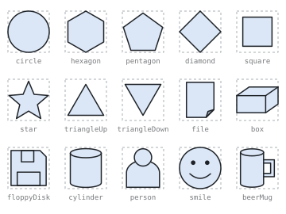

# gr-scheduler 仕様書 — 設計（Chapter 6 〜 7）

**Grammar**: spec.sgra
**UID**: DOC-SPEC-CH6-7

> 最初のファイル: `spec-ch5-01.md`

## Chapter 6. Software Specification (ソフトウェア仕様)

**Type**: SECTION

### 6.1 Software Specifications (ソフトウェア仕様)

**Type**: SECTION

**文書の不変条件の全数を 表 T-220 に示す** —— 表 T-060 の `LY-1` が、その全数を本節が持つと定めている。

**表 T-720 — 文書の不変条件の判じ方の実装仕様**

| 行 ID | 何についてか | 実装仕様 | traces |
| --- | --- | --- | --- |
| IMPS-1300 | 表 T-220 を回す者 | `scheduleViolations`（表 T-064 の `PI-1`）は、表 T-220 を駆動して回ること。 | FR-023 |
| IMPS-1301 | 判ずる時点 | `GRS` は、表 T-220 の行を、操作が終わった文書について判ずること。 `GRS` は、操作が終わった時点で判ずることを、`IV-20` だけでなく表 T-220 のすべての行に当てること。 | FR-023 |
| IMPS-1302 | 行ごとの条件 | 表 T-220 の条件を、行ごとに書き下さないこと。 | FR-023 |

`IMPS-1301` —— 操作の途中の文書を数え上げると、偽の違反が出る。  
`IMPS-1301` —— ほかの行が今まで黙っていられたのは、静止した文書についての条件しか述べておらず、操作の途中の状態を持たなかったからである。  
⚠️ ユースケースの層はタスクグループが 0 の文書を返す —— 1 つのタスクグループが戻るのはその外側であり、`tests/unit/t-050-a-document-always-holds-one-task-group.test.ts` が押さえる。  
ユースケースの層の側に単体試験は置かない —— `edit-task-group.ts` は `pure` であり、`docs/development-rules/04-verification.md` の省略の表が `pure` の関数の単体試験を省く。  
⭐ 何をもって 1 つの操作とするかは `01-04-requirements.md` の 表 T-050 の直下が持つ。  
`IMPS-1302` —— 表を指す要求を検証するテストの駆動の仕方は、1.9 が名指す `spec-writing-rules.md` が持つ。

**表 T-721 — スキーマを走らせる読む路の実装仕様**

| 行 ID | 何についてか | 実装仕様 | traces |
| --- | --- | --- | --- |
| IMPS-1303 | 表 T-220 が持つ条件 | 表 T-220 は、生成したスキーマが持てない条件だけを持つこと。 表 T-220 は、1 つの列だけで決まる条件を持たないこと。 | FR-023 |
| IMPS-1304 | 配列の本数の上限 | `GRS JSON` を読むとき、`GRS` は、スキーマが刷る配列の本数の上限（`maxItems`、例: 時間帯の `S-582`）を理由に文書ごと拒まないこと。 | FR-023 |
| IMPS-1305 | スキーマに足りない条件 | スキーマに足りない条件は、原稿の側を直して、スキーマに強制させること。 | FR-023 |
| IMPS-1306 | スキーマを走らせること | `GRS JSON` を読むとき、`GRS` は、生成したスキーマ（`_source/grs-document.schema.json`）を実際に走らせること。 スキーマを走らせずに、`IMPS-1303` の免除（1 つの列だけで決まる条件を表 T-220 に持たないこと）を根拠にしないこと。 | FR-023 |
| IMPS-1307 | スキーマを走らせる側 | `GRS JSON` を読むとき、文書を組み立てる側（Chapter 5.2 の `CP-20`）は、スキーマを走らせること。 | FR-023 |
| IMPS-1308 | 退役した列 | `GRS JSON` を読むとき、`GRS` は、スキーマを走らせる前に、表 T-297 の列を捨てること。 `GRS` は、捨てた列を通知しないこと。 `GRS` は、捨てた列を書き戻さないこと。 | FR-023 |
| IMPS-1309 | 注記の見た目の列の補い | `GRS JSON` を読むとき、`GRS` は、スキーマを走らせる前に、`_assets/fig-erd-detail.md` の `AT-145` ・ `AT-146` ・ `AT-147` の列を持たない `HighlightBox` の項と、`AT-148` 〜 `AT-152` と `AT-168` の列を持たない `CommentBox` の項に、欠けている列を `null` として足すこと。 `GRS` は、欠けている列を形式の版（`FR-073`）によらずに足すこと。 `GRS` は、欠けている列を足したことを通知しないこと。 | FR-023, FR-019 |

`IMPS-1303` —— 1 つの列だけで決まる条件を表 T-220 にも書くと、二重に持つことになる。  
`_source/grs-document.schema.json` は、列ごとの型と、`null` を許すかと、文字列の長さと、数値の範囲と、原稿が値を綴った列挙を既に強制する。  
`IMPS-1304` —— 上限は書き手への約束であり、本数を読む条件は表 T-220 の行（時間帯なら `IV-24`）が持つ。  
`IMPS-1306` —— 免除は「別の者が強制している」ことを前提にしており、**誰も走らせなければ、その列は誰にも見られない。**  
`IMPS-1307` —— 列の形が違うものは、文書になる前に落ちるべきだからである。  
`IMPS-1308` —— 仕様が落とした列を、保存済みの文書はまだ持っている。  
捨てた列について、読む人の側に直せることが何も無い。  
`IMPS-1309` —— 列を足す前に保存した文書は、その鍵を持たない。  
`null` は `_assets/tbl-settings.md` の 表 T-217 の既定か、`01-04-requirements.md` の `FR-019` が名指す色で描く値なので、どの版の文書でも絵が変わらない。  
足したことについて、読む人の側に直すことが何も無い。  
⚠️ `AT-168` だけは、列を足す前の造りが文書の文字サイズで描いていた大きさと違う既定（同表の `S-624`）で描く —— 利用者が既定を 1 つの px に定めた（`FR-019`）。

**表 T-297 — 退役した列（読むときに捨てる）**

| 行 ID | 実体 | 列 | 捨てる理由 | traces |
| --- | --- | --- | --- | --- |
| RK-1 | `TaskVisual` | `nameAnchor` | 名称ラベルの位置を人が指定する手段を持たない（`FR-002`） | FR-023 |
| RK-2 | `TaskVisual` | `nameAlign` | 同上 | FR-023 |

**表 T-722 — 退役した列と公式運用の宣言の実装仕様**

| 行 ID | 何についてか | 実装仕様 | traces |
| --- | --- | --- | --- |
| IMPS-1310 | 運用の前に消した列 | 表 T-297 は、運用の前に形を変えて消した列の行を持たないこと。 | FR-023, FR-073 |
| IMPS-1311 | 公式運用の後に消す列 | 公式運用の後に消す列は、表 T-297 ではなく、刊行するスキーマの変更の台帳（Chapter 6.2）に「削除」の行として足すこと。 | FR-073 |
| IMPS-1312 | 公式運用を宣言する変更 | 公式運用を宣言する変更は、宣言の前に置いた補いと読み替えを消すこと。 消すのは 5 つ —— 表 T-297 の行（`RK-1`・`RK-2`）、`TaskGroup.editPermission` を `null` で補うこと（`01-04-requirements.md` の `GP-1`）、注記の見た目 9 列（`_assets/fig-erd-detail.md` の `AT-145` 〜 `AT-152` と `AT-168`）を `null` で補うこと、`Project.sourceFormat`（`AT-143`）を補うこと、`actualDuration` から `stop`（`AT-141`）へ読み替えること（`01-04-requirements.md` の `FR-011`）。 公式運用を宣言する変更は、表 T-297 を変更の台帳へ畳むこと。 公式運用を宣言する変更は、変更の台帳を空から始めること。 | FR-073 |

`IMPS-1310` —— 運用の前に形を変えて消した列を持つ文書は読み替えず、スケジュールデータの群が合わない文書として拒む（`01-04-requirements.md` の `FR-073`）。  
形を変えた造りは形式の版を上げるので、古い造りには版が新しいことが告げられる。  
`IMPS-1311` —— 同じ意味の表を 2 つ持たない。  
`IMPS-1312` —— 宣言の前に運用中の文書は無い —— 残せば、台帳に載らない読み替えが残り、「台帳は最新の `GRS` が古い文書にすることの全件」が偽になる。

**表 T-723 — 読む路の照合の実装仕様**

| 行 ID | 何についてか | 実装仕様 | traces |
| --- | --- | --- | --- |
| IMPS-1313 | 刊行するスキーマの `documentSettings` の群 | 刊行するスキーマ（`_source/grs-document.schema.json`）は、`documentSettings` の群にも、欠けている鍵と知らない鍵を拒む条件と、鍵ごとの型・列挙・下限・上限を持たせたままとすること。 | FR-024 |
| IMPS-1314 | 読む路と `documentSettings` の群の鍵 | `GRS JSON` を読むとき、`GRS` は、`documentSettings` の群の鍵を理由に文書を拒まないこと。 | FR-023, FR-024 |
| IMPS-1315 | 読む路が `documentSettings` の群の値について見るもの | `GRS JSON` を読むとき、`GRS` は、`documentSettings` の群の値について、鍵ごとの型と、原稿が値を綴った列挙だけを見ること。 `GRS` は、`documentSettings` の群の値に、下限・上限に反することを拒む条件を当てないこと。 | FR-023 |
| IMPS-1316 | スケジュールデータの群 | `GRS` は、`IMPS-1314`・`IMPS-1315` の寛さをスケジュールデータの群に当てないこと。 もしスケジュールデータの群がスキーマに合わない場合、`GRS` は文書ごと拒むこと（配列の本数の上限（`IMPS-1304`）と、照合に載せないもの（`IMPS-1317`）と、新しい版の知らない列（`IMPS-1319`）を除く）。 | FR-023 |
| IMPS-1317 | 照合に載せないもの | `GRS` は、刊行するスキーマが日時の列に言う `pattern` を、`GRS JSON` を読む路の照合に載せないこと。 `GRS` は、文書の形式の版（`schemaVersion` の `const`）も照合に載せないこと。 | FR-023, FR-073 |
| IMPS-1318 | 時刻の列の形 | `GRS` は、時刻の列（`_assets/fig-erd-detail.md` の `AT-154` ・ `AT-155`）の形（`xsd:time` の字面の `pattern`）を照合に載せること。 もし時刻の列が形に合わない場合、`GRS` は文書ごと拒むこと。 | FR-023 |
| IMPS-1319 | 新しい版の知らない列 | もし形式の版がこの造りの知る最大の版より新しい文書を読む場合、`GRS` は、知らない列だけを拒まずに並べて見せること（`01-04-requirements.md` の `FR-073`）。 `GRS` は、続けたときに知らない列を捨てること。 | FR-073 |
| IMPS-1320 | `MSPDI` の路 | `GRS` は、`GRS JSON` を読む路のスキーマの照合を、`MSPDI` の路に当てないこと。 | FR-021, FR-023 |

`IMPS-1313` —— 刊行するスキーマは書く者の約束であり、`01-04-requirements.md` の `FR-024` は、書き出す文書がこのスキーマに適合することを求めている。  
⚠️ `documentSettings` の群については、刊行するスキーマが拒む文書を読む路が開く —— 食い違う向きはこの 1 つだけであり、読む路が開いた文書を書き出せば、スキーマに合う文書になる（`FR-024`）。  
`IMPS-1314` —— 知らない鍵は捨て、欠けている鍵は既定値で補い、型か列挙が合わない値はその鍵だけ既定値とする（表 T-024a の `OP-6`）。  
`IMPS-1315` —— ⛔ 範囲は 表 T-064 の `PI-2` が持つ `clampedSettings` の仕事であり、それは範囲外の値を拒まずに動かして収める。  
⚠️ **拒めば、見せ方の 1 鍵が範囲を外れただけで文書全体が開けなくなる** —— `OP-6` が読む側に求めている寛さと逆になる。  
`IMPS-1316` —— 一部を黙って落とすと、欠けたことが見えないまま日程が読まれる。  
`IMPS-1317` —— 日時の列が使えない値を持つ行は、`01-04-requirements.md` の `FR-023` が行ごと落として告げる（`IV-14`）。  
照合が文書ごと拒めば、その MUST とぶつかる。  
刊行するスキーマは、その形を書き手への約束として言う（`FR-024`）。  
形式の版は照合の前に `FR-073` が判じる。  
`IMPS-1318` —— 時刻の列は文書に 1 つしか無い `Project` の列なので、日時のように行ごと落とす道が無い。  
`IMPS-1320` —— `MSPDI` の路は文書を自分で組み立てるので、**当てても自作物の自己点検にしかならない。**

**表 T-220 — 文書の不変条件**

| 行 ID | 不変条件 | 判定に要るもの | 種別 | traces |
| --- | --- | --- | --- | --- |
| IV-1 | 主キーの値が、それが並ぶ配列の中で重複しないこと | 表 T-058 の鍵の欄が `PK` または `PK,FK` とする列 | 一意 | FR-023 |
| IV-2 | 外部キーが非 `null` のとき、それが指す先の行が同じ文書にあること | 表 T-058 の鍵の欄が `FK` または `PK,FK` とする列と、表 T-057 が定めるその指し先 | 参照 | FR-023 |
| IV-3 | ピン止めしたタスクグループが、実在する `TaskGroup` を指すこと。 ⚠️ **表示位置は対象外** —— 指す先が無いときの扱いは表 T-024a の `OP-10` が持ち、2 本の違いは 5.4 が持つ | `_assets/tbl-settings.md` の `S-126` と、`TaskGroup` の主キーの集合 | 参照 | FR-023 |
| IV-4 | `Task.parentTaskUid` がたどる親タスクと子タスクの関係に輪が無いこと | `Task` の主キーと `parentTaskUid` | 構造 | FR-023 |
| IV-5 | `TaskGroup.parentId` がたどる入れ子の深さが、タスクグループの深さの上限を超えないこと。 ⚠️ **WBS の深さは対象外** —— 上限を持たない | `TaskGroup` の主キーと `parentId`、`_assets/tbl-settings.md` の `S-125` | 構造 | FR-023 |
| IV-6 | どの `Task` も、ちょうど 1 つの `TaskGroupMember` から指されること | `Task` の主キーと `TaskGroupMember.taskUid` | 構造 | FR-023 |
| IV-23 | どの `Task` も、ちょうど 1 つの `TaskVisual` から指されること。 ⭐ 色も形も決めていない `Task` は、`taskUid` のほかがすべて `null` の 1 つを持つ —— 無いときの描き方を別に定めずに済む | `Task` の主キーと `TaskVisual.taskUid` | 構造 | FR-023 |
| IV-7 | 暦が 1 つ以上あること | `Calendar` の並び | 構造 | FR-023 |
| IV-17 | `FR-054` が解いた文書の暦が、稼働する曜日を 1 つ以上持つこと。 ⚠️ **解かれなかった暦は対象外** —— 数え上げに使わない暦は、稼働する曜日を 1 つも持たなくてよい | `FR-054` の解き方と、その暦の `WeekDay` の並び | 構造 | FR-023 |
| IV-8 | `TaskGroup` の `name` と `derivedFromTaskUid` が同時に `null` でないこと | その 2 列 | 組合せ | FR-023 |
| IV-9 | `TaskVisual` と `HighlightBox` のそれぞれで、`fillColor` と `strokeColor` が同時に透明でないこと | 実体ごとのその 2 列と、透明を表す値（`_assets/tbl-glossary.md` の `P-19`） | 組合せ | FR-023 |
| IV-10 | `start` と `finish` がともに非 `null` の `Task` で、`finish` が `start` より前でないこと | その 2 列 | 組合せ | FR-023 |
| IV-11 | `fadeInDays` または `fadeOutDays` を持つ `Task` が、`finish` を持つこと | その 3 列 | 組合せ | FR-023 |
| IV-12 | `fadeInDays` と `fadeOutDays` の和が、その `Task` の期間を超えないこと。 ⭐ **日数は暦日で数えること（MUST）** —— ⛔ 稼働日で数えると `FD-6`（暦日）と食い違う。 `FD-6` が正である。 ⛔ ここでいう「期間」は、表 T-012a の `FD-6` と同じく暦日で数えること（MUST） | その 2 列と `start` ／ `finish` | 組合せ | FR-023 |
| IV-14 | 日付と日時の列が、日時として読め（時刻は 1 分の単位）、受け入れる日付の範囲に収まること。 ⭐ 秒が `00` でない時刻は分へ切り捨てて読むので、本行に反しない —— 時刻を書いていない日付の字も読める（どちらの読みも `FR-054`）。 ⭐ 時刻を書いた字は、時を 2 桁で書いたものだけが読める —— `2026-01-05T8:00:00` は読めない（`FR-054`）。 ⚠️ **空文字は「読めない」側である** —— 空を許す列の空は `null` である | 表 T-058 の型の欄が日付または日時とする列と、表 T-214 | 範囲 | FR-023 |
| IV-15 | `TaskOrigin.lastSeenImportSequence` が `Project.importSequence` を超えないこと | その 2 列 | 範囲 | FR-023 |
| IV-16 | 下限または上限の欄が別の設定値を名指している設定値が、その欄の式を満たすこと。 ⚠️ **欄が画面の寸法を指すものは対象外** —— 静止した文書だけでは判定できない | `_assets/tbl-settings.md` の下限・上限の欄 | 範囲 | FR-023 |
| IV-19 | ハイライトボックスの `start` が `finish` より後でないこと、および `topTaskGroupId` が `bottomTaskGroupId` より下でないこと。 ⭐ `IV-10` が `Task` の 2 列について定めるものを、注記の 4 列について定める。 ⚠️ **ドラッグから来た値は本行の対象ではない** —— `FR-019` が離した時点で正規化すると定めており、正規化された値は本行を必ず満たす。 ⛔ **正規化が描かれた `y` で上下を決めると、この一文は偽になる** —— ピン留めしたタスクグループから木の上のタスクグループへ引くと満たさない（木の順位 7 から 0 へ引くと、`topTaskGroupId` ＝ 7 ／ `bottomTaskGroupId` ＝ 0 が入る）。 ⭐ `FR-019` の正規化はタスクグループの木の順位で判ずるので、この一文は真である。 ⛔ **打ち込みと取り込みから来た値には効かせること（MUST）** —— そちらに向きが無いとは言えない | その 4 列 | 組合せ | FR-023 |
| IV-18 | `TaskGroup.parentId` がたどる親子に輪が無いこと。 ⚠️ **`IV-4` は `Task.parentTaskUid` だけを見る** —— 表 T-015a の `HM-4` が禁じるのは画面の上での移動、`FR-023` が見るのは取り込みの WBS であり、この輪はどちらにも掛からない | `TaskGroup` の主キーと `parentId` | 構造 | FR-023 |
| IV-20 | 文書が `TaskGroup` を 1 つ以上持つこと。 ⭐ 原本は 表 T-050 の直下の「文書は、`TaskGroup` を必ず 1 つ以上持つこと（MUST）」である | `TaskGroup` の並び | 構造 | FR-023 |
| IV-21 | `actualStart` と実績の最後の日（完了なら `actualFinish`、それ以外は `stop`）がともに非 `null` の `Task` で、`FR-011` が日付から数えた実績の長さが 0 を下回らないこと。 ⭐ `IV-10` が予定の 2 列について定めるものを、実績の日付について定める —— 下回る値は実績の両端が入れ替わった置き方であり、拒んで告げる。 ⚠️ **0 以上で床を下回る値は本行の対象ではない** —— 着手しているタスクの床（`_assets/tbl-settings.md` の `S-129`）は `FR-011` が持つ | その 3 列と、`FR-054` が解いた文書の暦 | 組合せ | FR-023 |
| IV-22 | `TaskVisual.shapeKind` が非 `null` のとき、それが `'milestone'` であることと、その `TaskVisual` が指す `Task` の `milestone` が真であることが一致すること。 ⭐ マイルストーンかどうかの正は `Task.milestone` であり、形は描き方だけを持つ（`01-04-requirements.md` の 表 T-005 の `G-1`） —— 食い違う文書では、描いた形と、名称ラベルに添える予定日（同書の 表 T-251）と依存の種別（同書の `FR-009`）が別のことを言う。 ⚠️ **`shapeKind` が `null` の `TaskVisual` は対象外** —— 形を `Task.milestone` から解く（`_assets/fig-erd-detail.md` の `AT-100`）。 ⚠️ 画面の上の編集は食い違いを作らない —— 作るときは同書の 表 T-239 の `TC-1` が形から真偽値を決め、置いた後は同書の `FR-083` が期間を持つ形とマイルストーンの乗り換えを禁じる。 MSPDI の上書きで `Task.milestone` だけが変わるときは、本行で拒まず、同書の 表 T-032 の `MG-8` が形を揃える —— 取り込み元での変更であって、壊れたファイルではない | その 2 列と、`TaskVisual` から `Task` への外部キー（表 T-057） | 組合せ | FR-023 |
| IV-24 | 1 つの曜日・例外日の時間帯は 0 本（稼働でない日）か 1 〜 `_assets/tbl-settings.md` の 表 T-211 の `S-582` 本で、どれも始まりが終わりより前（終わりの `00:00:00` は 24:00）であり、互いに重ならないこと。 ⭐ 数えられない暦を作らない —— `IV-17` と同じ筋である。 ⚠️ 接する時間帯（12:00 に終わり 12:00 に始まる）は重ならない | `WeekDay` と `Exception` の時間帯（`_assets/fig-erd-detail.md` の `AT-158` ／ `AT-159`）と、その `WorkingTime` の 2 列（`AT-161` ／ `AT-162`） | 組合せ | FR-023 |

`IV-14` が `uuid` の形の列を確かめるかは、未決である（未決: OPQ-3）。

**表 T-724 — 不変条件の判定に要るものの実装仕様**

| 行 ID | 何についてか | 実装仕様 | traces |
| --- | --- | --- | --- |
| IMPS-1321 | 判定に要るもの | 表 T-220 は、判定に要るものを列の名前で並べないこと。 | FR-023 |

`IMPS-1321` —— 列を足すたびに表 T-220 と原稿の 2 か所を直すことになる。  
⭐ **鍵の欄と型の欄を指しておけば、原稿から引ける。**

レイアウトの計算（表 T-068）のうち、要求が材料までしか持たないものの算式を 表 T-221 に示す。

**表 T-221 — レイアウトの算式**

| 行 ID | 求めるもの | 算式 | traces |
| --- | --- | --- | --- |
| LF-1 | 目盛の刻みの間隔 | 段階ごとに固定とする。 ⭐ **刻むのは段ではなく行であり、その行が刷る単位に 1 つ刻むこと（MUST）** —— **どの行が何を刷るかは `FR-017` の 表 T-238 が持つ。 **⇒ 年を刷る行は 1 年、月を刷る行は 1 か月、週の始まりの日を刷る行は 7 日、日と曜日を刷る行は 1 日に 1 つである。 ⭐ **日の段と曜日の段が同じ間隔なのは、同じ軸を 2 段に割ったものだからである**（`FR-017`）—— **別の間隔にすると、その日のものでない曜日が日の下に並ぶ。 **⭐ 実測（出荷ビルド）: 月の段の年の行は 1 回、月の行は 12 回刻んだ。 ⇒ **行を単位にすれば、段が割れても文を書き足さずに済む。 **⛔ **これ以外の間隔を採ってはならない（MUST NOT）**—— 間引いた段では読む人が刻みの単位を数え直すことになり、2 日おきと 3 日おきが倍率で入れ替わる。  ⭐ **週の段の起点は `Project.weekStartDay` が持つ**（`FR-054`）。 **ラベルが 1 刻みに収まることは段階の側が保証する** —— しきい値の導き方は 表 T-205 の注が持つ | FR-017 |
| LF-2 | タスクグループの帯高 | 段ごとに、その段に載る `Task` が縦に取る高さ（`01-04-requirements.md` の `FR-094` の 表 T-259 の `VG-5` が測る描いた端まで）の最大を採り、それらを合計して、段と段のあいだと、いちばん下の段の下に、同表の `VG-2` の隙間を 1 つずつ加える（段数と同じ数）。 ⭐ いちばん下の段の下にも加えるのは、次のタスクグループのいちばん上の段とのあいだに同じ隙間を空けるためである（同表の `VG-1`）。 **`Task` を 1 つも持たない段は、矩形が縦に取る高さとする** | FR-003 |
| LF-3 | タスクグループの縦位置 | 前のタスクグループの縦位置に、前のタスクグループの帯高と `taskGroupGap` を加える。 帯高は矩形が縦に取る高さを下回らない。 ⭐ 帯高は、そのタスクグループ名（タスクグループパネルに刷るタスクグループ名、`FR-085`）の字の箱が縦に取る高さも下回らない —— タスクグループ名が見えないと何のタスクグループか分からなくなる。 ⚠️ 表示の倍率（`FR-039`）を上げたまま縦に縮めたときに効く床である。 ⚠️ **タスクグループボタン（`01-04-requirements.md` の 表 T-051 の `HF-1` の格子）が縦に取る高さは、帯高の床に数えない** —— 数えると、`Task` が 1 段しかないタスクグループも格子の高さまで広がる。 格子が帯からはみ出す扱いは同表の `HF-19` と `HF-6` が、最後のタスクグループの下の余白は `LF-16` が持つ | FR-003 |
| LF-5 | 段間の通路の高さ | 下へ向かうときは先行の下端と、描いた順で先行のすぐ下の段の上端との中点、上へ向かうときは先行の上端と、描いた順で先行のすぐ上の段の下端との中点、同じ段どうしのときはその段の下端に、`01-04-requirements.md` の 表 T-259 の `VG-2` の隙間の半分を加えた高さ。 ⭐ 先行と後続のあいだに別の段があっても、横の走りはその段の真ん中ではなく先行のすぐ隣の段間を通り、後続の入口の手前（`x2`）で縦に降りる（上へ向かうときは上る） —— 別の段の形・ラベル・マーカー・名前の下を横に走らない（利用者が定めた）。 ⚠️ 隣り合う段どうしでは、先行と後続の中点と同じ高さである | FR-009 |
| LF-6 | 矢羽根の切り欠き | 予定側は、横幅に `chevronNotchOfWidth` を掛けた値と、縦幅に `chevronNotchOfHeight` を掛けた値の小さいほう。 実績側は予定側に `actualOfPlan` を掛けた値とし、**2 度目の頭打ちを当ててはならない（MUST NOT）** | FR-094 |
| LF-7 | 矢じりと端点の点 | 矢じりの横幅は、`thinArrowHeadLength` と、横幅に `arrowHeadOfSpan` を掛けた値の小さいほう。 矢じりの縦幅は `thinArrowHeadHeight`。 端点スパンの点の径は `spanDotSize`。 ⛔ **どれも線の太さから導かない** —— 値と式は `01-04-requirements.md` の `FR-109` の 表 T-271 の `XS-5` が持つ | FR-094 |
| LF-8 | 細線の太さ | `thinStrokeWidth` とする。 ⛔ 予定の縦幅から導かない —— 太さは 1 つの設定値である | FR-094 |
| LF-9 | 実績バーの縦の置き場 | 内側に重ねる形状は、予定の縦幅から実績の縦幅を引いた差の半分だけ下げる。 下へずらす形状は、予定の線の下の縁から `actualGap` だけ下に実績の線の上の縁を置く（`01-04-requirements.md` の `FR-109` の 表 T-271 の `XS-6`）| FR-094 |
| LF-10 | マイルストーンの図形の大きさ | 予定は、その `Task` の予定の縦幅を一辺とする図形とし、`start` の位置を中心に置く。 実績はそれに `actualOfPlan` を掛けた大きさとし、実績の日付を中心に置く。 **上下の中心は予定と同じとする**。 ⭐ **図形の中心は、その図形の外接枠の中心とする（上下も左右も）**。 ⛔ 頂点を置いた円の中心を中心としてはならない —— △ ▽ 五角形 ☆ が上下にずれ、横に並べたとき揃って見えない | FR-094 |
| LF-11 | マーカーと再開マークの置き場 | 横は `01-04-requirements.md` の `FR-109` の 表 T-272 と 表 T-273 が持つ。 縦は同要求の 表 T-271 が持つ（矩形は `XS-3`、線だけの形は 1 段目の `XS-4`、再開マークは `XS-10` ／ `XS-12`）。 マーカーは `markerSize` を一辺とする正方形で置く。 ⛔ **本行は寸法だけを持ち、場所を持たない** —— 場所を 2 か所に書くと必ず離れていく | FR-094 |
| LF-12 | イナズマ線の頂点の縦位置 | 段ごとに、その段の上端に**矩形**の予定の縦幅の半分を加えた高さ。 線の上端と下端は基準日の位置とし、最初のタスクグループの上と最後のタスクグループの下へ `progressLineOverhang` だけ伸ばす | FR-014 |
| LF-13 | 再開マークの形 | 下端をマーカーの下端に、矢先の高さをマーカーの中心に置いた L 字の折れ矢印とする（矩形で再開日があるとき —— `01-04-requirements.md` の `FR-109` の 表 T-271 の `XS-10`）。 腕の長さは図形の一辺に `resumeArmOfMarker` を、矢じりの大きさに `resumeHeadOfMarker` を掛けた値。 `resumeValid` が偽のときは一辺に `resumeScaleInvalid` を掛け、濃さに `resumeOpacityInvalid` を掛ける。 ⚠️ 同表の `XS-10` の未定のアイコンと `XS-12`（線だけの形の 3 段目のアイコン）の縦は同表が持ち、本行は持たない。 ⛔ **本行が持つのは形だけである** —— 横の位置は 表 T-273 の結びが持つ | FR-094 |
| LF-14 | ピン止めしたタスクグループの帯（`FR-098`）| 帯の高さは、帯に置くタスクグループの帯高（`LF-2`）を合計し、タスクグループとタスクグループのあいだに `taskGroupGap` をその数から 1 を引いた数だけ加えたものとする。 **帯へ上げたタスクグループは `LF-3` の連なりから除き、抜けた場所は詰める。 ** スクロールするタスクグループが並ぶのは、`Task Group Lanes` の高さから帯の高さと `taskGroupGap` 1 つぶんを引いた残りとする | FR-098 |
| LF-15 | コメントボックスの線先の置き場 | ⭐ 自由点（`01-04-requirements.md` の `FR-019` の ①） —— 横は `anchorDate` の日時（分まで）を時間軸に置いた位置、縦は `anchorTaskGroupId` のタスクグループが描かれた帯（`LF-2` / `LF-3`、ピン止めしたタスクグループは `LF-14`）の上端から、帯の高さに `anchorBandFraction` を掛けた所とする（`null` は 0.5、帯の縦の中央）。 ⚠️ 日の列の中央へは寄せない —— 線先は離した点そのものに立つ（同書の 表 T-023d の結び）。 ⭐ 吸着した点（同 ②） —— 対象の図形を囲む矩形の 8 点とする。 並びは左上・上・右上・右・右下・下・左下・左（`anchorSnapPoint` の値の順）。 タスクは、`anchorTaskFigure` の図形（予定バー・実績バー・マイルストーンの図形）のうち `anchorTaskGroupId` の帯に描いたもの（その帯に無ければ、最初に描いたもの）を、ハイライトボックスは描いた箱（`FR-019`）を囲む。 ⭐ マイルストーンの図形の四隅の点は、矩形の隅ではなく、隣り合う 2 辺の中点の中ほどとする —— 菱形では 4 辺の中点であり、8 点がどれも描いた形の上に立つ。 ⭐ 8 点の並びは 1 つの関数が持ち、描く側と、離した点を吸着させる側が同じ並びを読む（`01-04-requirements.md` の 表 T-023d の結び）。 ⚠️ 本文の箱は線先からのずれで置く（`FR-019`）ので、ずれを書かずに線先だけを書くと、箱も線先と共に動く —— 掴んで引いたときに何を書くかは、同書の 表 T-023d の結びが持つ | FR-094, FR-019 |
| LF-17 | コメントボックスの引出し線が本文の箱から出る隅 | 横は、留めた点（`LF-15`）が本文の箱の横の中点より右に在れば右、そうでなければ左の隅とする。 縦は、留めた点が箱の縦の中点より上に在れば上、そうでなければ下の隅とする。 ⭐ この 2 つで選ぶ隅は、4 隅のうち留めた点に最も近い隅である —— 横の差と縦の差をそれぞれ最も小さくする隅が、直線の距離も最も小さくする。 ⭐ 中点に等しいときは左と下を採る —— 等しい 2 隅のどちらを採っても線の長さは同じであり、左下はずれの基準隅（`01-04-requirements.md` の `FR-019`）と同じ隅である。 ⭐ 留めた点が本文の箱の中（縁を含む）に在るときは、引出し線を描かない —— 箱から外へ出る線が無く、隅から中の点へ引くと本文の上を横切る。 ⚠️ 線先の印（同書の 表 T-023d の結び）はそのときも描く（重ね順は同書の 表 T-020 の `ZO-10`）ので、選んでいれば箱の中の線先も見えて掴める | FR-094, FR-019 |
| LF-16 | タスクグループの並びの下の余白 | スクロールするタスクグループ（`LF-14` の帯へ上げたタスクグループを除く）のいちばん下のタスクグループの下に、タスクグループボタンの格子（`01-04-requirements.md` の 表 T-051 の `HF-1`）が縦に取る高さからそのタスクグループの帯高を引いた長さの余白を加える。 引いた長さが 0 を下回るとき（帯高が格子以上のとき）と、スクロールするタスクグループが 1 つも無いときは 0 とする。 格子が縦に取る高さは、入口 1 つの縦（`_assets/tbl-settings.md` の 表 T-206 の `S-138` ＋ `S-243` × 2）の 2 段ぶんに、`FR-029` のとおり `S-235` を掛けた長さとする —— 枠の線の太さ（`S-237`）は数えない（`FR-029` は `S-237` を外形の幅に加え、外形の縦は定めない）。 ⚠️ **格子の高さを数で書かない** —— タスクグループボタン 1 つの外形は `_assets/tbl-settings.md` の 表 T-206 の `S-138` と `S-243` が決めており、格子はその 2 段ぶんである。 ⛔ 同表の値をコピーしない。 ⚠️ 格子の高さは、表示の倍率（`FR-039` の 表 T-252 の `DS-7`）にも閲覧者の文字サイズにも追随しない —— `S-138` がそう定めている。 ⭐ 余白は縦のスクロールの全体（`01-04-requirements.md` の 表 T-023d の `GR-21` の「全体」）に入る —— タスクグループパネルは縦を本体と連動させる（同書の 表 T-031 の `SC-1`）ので、タスクグループパネルと `Task Group Lanes` の両方で、最後のタスクグループのタスクグループボタンが下端で切れない。 ⭐ `FR-055` が収まるかを見る縦の高さにも入る。 ⚠️ 余白には何も描かない。 タスクグループではないので、その縦位置はタスクグループの無い縦位置である（同書の 表 T-239 の `TC-3`）。 ⚠️ `canvasPadding`（`_assets/tbl-settings.md` の 表 T-201 の `S-56`）とは別の量であり、兼ねない —— `canvasPadding` を縦に取る場所は `FR-051` が持つ | FR-003 |
| LF-18 | マイルストーンの図形の線と塗り | 外形は塗り、縁の線で囲む。 絵の中の線（箱の稜線・円筒と杯の上面の手前の弧・フロッピーの窓・顔の口）は、塗りに穴を開けずに、塗りの上に線で描く。 顔の目は点で塗る。 書類の折り返しは、塗りの上に薄く塗った面（`shade`）で描く —— 面は紙の裏を見せ、角が折れていると読ませる。 線だけでは、角の欠けた四角と読まれうる。 ⭐ 中の線・点・面の色は、予定では予定の縁の色、実績とダミーでは予定の塗りの色とする —— 実績の塗りは濃いので、縁の色では見えない。 カスタムカラーのタスクでは、そのタスクの予定の塗りの色である。 ⭐ 重なる部分は、奥から順に描く —— 人は胴の上に頭、杯は取っ手の上に胴。 ⭐ 円・顔の輪郭・円筒・杯の丸みは曲線で描き、多角形で近似しない —— 多角形は拡大すると角が見える。 ⭐ 形そのもの（単位の正方形の中の座標）は 図 F-044 が持つ。 ⭐ `_assets/tbl-glossary.md` の 図 F-019 のグリフは同じ形を線だけで描く。 違いは 2 つだけとする —— 杯の取っ手は 1 本の線（小さな箱では二重の線が潰れて 1 つの塊になる）、人の肩の線は頭の輪郭で止める（線だけの絵には、胴を隠す塗りが無いため） | FR-078 |
| LF-19 | 目盛ラベルの横の置き場 | 各ラベルは、その行の自分の刻みの線の位置から右へ書き出す —— 刻みの線とラベルのあいだは空けない。 ⭐ 刻みの線が帯の左端より左に在るラベル（帯の左端より前から始まる期間のラベル）は、帯の左端から書き出す —— 寄せなければ、左端に掛かる期間の名が帯から消え、帯の中に刻みが 1 つも立たない行（`TM-1` の `yyyy` で 1 年より短い期間を出すときなど）は空になる。 ⛔ 寄せたラベルの右端（帯の左端にそのラベルの幅を足した位置）が、同じ行の次のラベルの書き出しから `S-135` を引いた位置を越えるあいだは、寄せたラベルを描いてはならない（MUST NOT） —— 2 つのラベルが重なり、どちらも読めなくなる。 越えないあいだは寄せて描く。 次のラベルが帯の右端より右に在るときも寄せて描く —— 重なる相手が無い。 ⛔ 寄せたラベルを次のラベルの手前まで左へずらし、帯の左端で切ってはならない（MUST NOT） —— 字の欠けた名が残る。 ⭐ ラベルの幅は `FR-093` の概算（`S-30`）とし、描いた字を測らない —— 帯は毎フレーム描く。 ⚠️ 判じは行ごとに行う —— `TM-4` の `d` と曜は同じ刻みに立つが幅が違うので、片方だけが消えることがある。 ⚠️ 寄せないラベルは自分の刻みから書き出すので、`LF-1` の「ラベルが 1 刻みに収まることは段階の側が保証する」が当たる —— 寄せたラベルだけがその保証の外に出るので、本行がその衝突を見る | FR-017 |

⚠️ **`Task` が 1 つで縦に取る高さは本表が持たない** —— 表 T-012 の「実績の置き方」の欄と、`FR-094` の床の規則が既に持っている —— 上へずらした名称ラベルのぶんは `01-04-requirements.md` の 表 T-038 の `OC-10` が持ち、その 1 段目の高さは同書の `FR-109` の 表 T-271 の `XS-4` が字の大きさで数える。

**表 T-725 — タスクグループの帯高の下限の実装仕様**

| 行 ID | 何についてか | 実装仕様 | traces |
| --- | --- | --- | --- |
| IMPS-1322 | `TaskGroup.minHeightPx` の指定 | もし `TaskGroup.minHeightPx` の指定がある場合、`GRS` は、タスクグループの帯高に `FR-042` を優先させること。 もし段数が指定より高い帯を要する場合、`GRS` は、帯高を指定を超えて広げること。 | FR-003, FR-042 |

`IMPS-1322` —— `TaskGroup.minHeightPx` の指定は下限である。  
描くときに指定へ掛ける比は `01-04-requirements.md` の `FR-039` の 表 T-252 の `DS-13` が持つ（表示の倍率の段だけで、縦のズームと `S-236` は掛けない）。  
⚠️ `LF-12` が矩形の縦幅を使うのは、段に載る `Task` の形状によらず同じ高さに頂点を打つためである —— 形状で高さが変わると、同じタスクグループの段どうしで頂点の高さが揃わない。

**図 F-044 — マイルストーンの図形（チャート）**

⭐ 本図はチャートのマイルストーンの形の正であり、`01-04-requirements.md` の 表 T-012 の `SH-5` の順に 15 形を並べる。  
各形は一辺 2 の単位の正方形の中に在り（y は下向き）、外接枠の中心を原点に置く（表 T-221 の `LF-10`）。  
要素の class は描き方の役である —— `body` は塗りと縁、`inner` は塗りの上の線、`dot` は塗った点、`shade` は薄く塗った面である（`LF-18`）。

**表 T-726 — マイルストーンの図形の実装仕様**

| 行 ID | 何についてか | 実装仕様 | traces |
| --- | --- | --- | --- |
| IMPS-1323 | 予定と実績の大きさ | `GRS` は、マイルストーンの予定と実績を、図 F-044 の単位の正方形の一辺を 表 T-221 の `LF-10` の大きさへ写して描くこと。 | FR-078, FR-094 |
| IMPS-1324 | グリフとの違い | 図 F-044 の形は、`_assets/tbl-glossary.md` の 図 F-019 のグリフとの違いを、表 T-221 の `LF-18` の 2 つだけとすること。 | FR-078 |

`IMPS-1324` —— ほかの違いがあれば、`npm run gen` がチャートの形の表を刷らずに止まる。

**依存線の経路の分岐を 表 T-222 に示す。**

**表 T-222 — 依存線の経路の分岐**

出口が右辺の向きで書く。  
族は 表 T-018 が持つ。

| 行 ID | 族 | 状況 | 折れ点 | 経路 | traces |
| --- | --- | --- | :-: | --- | --- |
| RP-1 | 対向 | 同じ段で、入口辺と出口辺の間隔が入口の走り以上 | 0 | 出口辺から入口辺へ水平に 1 本 | FR-009 |
| RP-2 | 対向 | 下の段で、`x2` が `x1` 以上 | 4 | 出口辺 → `x1` → 通路（`LF-5`）→ `x2` → 入口辺 —— `RP-4` と同じ形である。 ⭐ 先行の段の高さのまま横に走ると先行の進捗ステータスマークと名前の下を、後続の段の高さで横に走ると後続の担当ラベルと完了率ラベルの下を通るので、横の走りは段間の通路に置く（利用者が定めた） | FR-009 |
| RP-3 | 対向 | 上の段で、`x2` が `x1` 以上 | 4 | `RP-2` の上下を返したもの | FR-009 |
| RP-4 | 対向 | 下の段で `x2` が `x1` を下回る、または同じ段で `RP-1` に当たらない | 4 | 出口辺 → `x1` → 通路（`LF-5`）→ `x2` → 入口辺 | FR-009 |
| RP-5 | 対向 | 上の段で、`x2` が `x1` を下回る | 4 | `RP-4` の上下を返したもの | FR-009 |
| RP-6 | 同側 | 下の段 | 2 | 出口辺 → `x1` と `x2` の大きいほう → 下降 → 入口辺 | FR-009 |
| RP-7 | 同側 | 上の段 | 2 | `RP-6` の上下を返したもの | FR-009 |
| RP-8 | 同側 | 同じ段 | 4 | 出口辺 → `x1` → 通路（`LF-5`）→ `x2` → 入口辺。 ⚠️ `x1` と `x2` の差が出口の走りを下回るときは、`x1` を `x2` に出口の走りを足した位置へ押し出す —— 2 本の垂直線が重なると、行きと帰りの区別が付かない | FR-009 |

**0 折れは対向族にしかない。**  
同側族は 2 本の走りが同じ向きを向くので、水平 1 本にならない。  
`RP-1` のしきい値が入口の走りだけなのは、水平 1 本の経路には離すべき垂直線が無いからである。  
出口の走りは垂直線を出口辺から離すためにある。  
⚠️ 垂直に動く部分が他の図形を横切ることは 表 T-018a の `RT-5` が既に許容している。  
避ける経路は存在しないことがある —— `Task` の横位置は日付が決めるので動かせない。

**表 T-727 — 依存線の経路の分岐の実装仕様**

| 行 ID | 何についてか | 実装仕様 | traces |
| --- | --- | --- | --- |
| IMPS-1325 | 出口が左辺のとき | もし出口が左辺の場合（`SF` / `SS`）、`GRS` は、x の符号を反転して表 T-222 の同じ規則を当てること。 `GRS` は、経路の規則を 2 組持たないこと。 | FR-009 |
| IMPS-1326 | `x1` と `x2` | `GRS` は、`x1` を、出口辺に出口の走り（`dependencyLeadOut`）を足した位置とすること。 `GRS` は、`x2` を、対向族では入口辺から入口の走り（`dependencyLeadIn`）を引いた位置、同側族では入口辺に入口の走りを足した位置とすること。 | FR-009 |

**MSPDI を比べる前の正規化の全数を 表 T-228 に示す。**

**表 T-228 — MSPDI を比べる前の正規化**

| 行 ID | 段取り | 規則 | traces |
| --- | --- | --- | --- |
| NR-1 | 規格を当てる | **W3C Canonical XML 1.1**（`https://www.w3.org/TR/2008/REC-xml-c14n11-20080502/`）を当て、**注釈を含めない形**を用いる。 ⚠️ **短縮名の URL は版の指定にならない** —— `xml-c14n` は 1.0 ではなく 1.1 を返す | FR-021 |
| NR-2 | 要素の間の空白を落とす | `NR-1` の**前に**、要素の子を持つ要素の直下にある、空白だけの文字ノードを落とす。 ⛔ **葉の要素の中の空白は落とさない** —— そちらは値である。 ⚠️ 根拠は、交換相手が混在内容を持つ型を 1 つも持たないことである | FR-021 |
| NR-3 | 接頭辞を合否から外す | `NR-1` の**あと**に、要素名と属性名を、名前空間 URI と局所名の対として読む。 ⚠️ **規格の出力を書き換えるのではなく、比べ方を定める** —— 規格が接頭辞を守るのは、内容や属性値の中の `XPath` が接頭辞を参照しうるためであり、交換相手はその型を持たない | FR-021 |
| NR-4 | 型付きの値の綴りを揃える | `NR-1` の**前に**、交換相手のスキーマが型を与える要素の値を、`XML Schema Part 2` がその型に定める**標準字句表現**へ揃える。 ⛔ **標準字句表現を持たない型と、型が与えられていない要素の値は書き換えない** —— 型を知らないものを揃えると、値そのものを変える | FR-021 |
| NR-5 | 時間の量を比べる | 交換相手のスキーマが `xsd:duration` を与える要素は、**字句ではなく時間の量として**比べる。 ⛔ **年と月を持つ値は量として読まない** —— 長さが数え始めに依るので、比べようがない。 ⚠️ `NR-4` ではなく別の段取りにしているのは、この型に標準字句表現が無く、揃える先が存在しないためである | FR-021 |
| NR-6 | 名前の違う兄弟の順を合否から外す | `NR-1` の**前に**、各要素の子を名前ごとの列に分けて比べる。 名前の違う子どうしの順は比べない。 ⛔ 同じ名前の子の順は比べる —— 並びが意味を持つ（表 T-265 の `MR-2`）。 ⚠️ 規格は子の順を守るので、本行が無いと、順の乱れた入力を `EX-10` どおりに書き直しただけで `FR-021` の往復が不一致になる | FR-021 |
| NR-7 | 書き出すたびに作る値を合否から外す | `NR-1` の**前に**、双方から `Project/LastSaved` を落とす。 ⭐ 文書は列に持たず、書き出すその瞬間から作る値である（`_assets/fig-erd-detail.md` の 表 T-059 の `DV-12`） —— 往復で必ず変わり、`documentStamp.fileSavedAt` を突き合わせから外す（`01-04-requirements.md` の `FR-101`）のと同じ扱いである | FR-021 |

⭐ `GRS` が `xsd:duration` を書き出すときの綴りは 表 T-033 の `EX-9` が持つ。  
正は W3C の公式文書であり、事実はローカル複製で確かめる（`docs/reference/README.md`）。  
突き合わせの記録は `docs/review/c14n-vs-fr021-2026-08-22.md` が持つ。

**表 T-728 — MSPDI を比べる前の正規化の実装仕様**

| 行 ID | 何についてか | 実装仕様 | traces |
| --- | --- | --- | --- |
| IMPS-1327 | 双方へ当てる | 2 つの MSPDI を比べるとき、`GRS` は、表 T-228 の同じ段取りを双方へ当てること。 `GRS` は、表 T-228 の段取りを片側だけに当てないこと。 | FR-021 |
| IMPS-1328 | 表 T-228 が持つもの | 表 T-228 は、`NR-1` の規格に足す分だけを持つこと。 表 T-228 は、`NR-1` の規格が既に揃える属性の並びと自己終了タグの綴り方を持たないこと。 | FR-021 |

`IMPS-1327` —— 揃えずに比べると、通るかどうかがその日の実装で決まる。  
`IMPS-1328` —— コピーすると、規格が改訂されたとき仕様書だけが古くなる。

**書き出した絵を比べる前の正規化と、一致の判定の全数を 表 T-231 に示す。**

**表 T-231 — 書き出した絵を比べる前の正規化と、一致の判定**

| 行 ID | 段取り | 規則 | traces |
| --- | --- | --- | --- |
| NS-1 | 規格を当てる | **W3C Canonical XML 1.1**（`https://www.w3.org/TR/2008/REC-xml-c14n11-20080502/`）を当て、**注釈を含めない形**を用いる。 ⚠️ **短縮名の URL は版の指定にならない** —— `xml-c14n` は 1.0 ではなく 1.1 を返す | FR-080 |
| NS-2 | 要素の間の空白を落とす | `NS-1` の**前に**、要素の子を持つ要素の直下にある、空白だけの文字ノードを落とす。 ⛔ **葉の要素の中の空白は落とさない** —— そちらは値である | FR-080 |
| NS-3 | 数の綴りを揃える | `NS-1` の**前に**、座標と寸法を **0.01 px の格子**へ丸めた綴りにする。 ⛔ **書き出す側と写し取った側の両方に当てること（MUST）** —— 片側だけを丸めると、判定に含めない差との境が引けない | FR-080 |
| NS-4 | `id` を定数に限る | 書き出す `SVG` の `id` は、成果物の中で不変の定数だけとすること（MUST）。 走るたびに変わる値から作ってはならない（MUST NOT） —— 変えると `NS-1` の出力が毎回変わり、`WY-2` が決して通らない | FR-080 |
| NS-5 | `WY-2` と `WY-4` の相手を定める | **同じ走りの中で 2 回書き出したもの同士**とする（`WY-4` は、2 回のあいだに窓の大きさ・表示位置・ズーム・パネルの開閉を変える）。 ⛔ **版元に置いた見本と比べてはならない（MUST NOT）** —— `WY-2` が測るのは書き出しの経路が決定的かどうかであり、機と版をまたぐ浮動小数の再現性はその射程に無い | FR-080 |
| NS-6 | `WY-3` の許容差を定める | 双方を `NS-3` の格子へ丸めたうえで、外接矩形の各辺の差の絶対値が `1.0` px 未満であれば一致とする。  ⚠️ **端数が必ず出る理由は 表 T-041 の `WY-3` の欄が持つ** | FR-080 |

⚠️ **本表は 表 T-228 の兄弟である。**  
⭐ `NS-1` と `NS-2` が同じ規格と同じ段取りを採るのは、どちらも `XML` だからにすぎない。

**表 T-729 — 書き出した絵を比べる前の正規化の実装仕様**

| 行 ID | 何についてか | 実装仕様 | traces |
| --- | --- | --- | --- |
| IMPS-1329 | 双方へ当てる | 2 つの `SVG` を比べるとき、`GRS` は、表 T-231 の同じ段取りを双方へ当てること。 `GRS` は、表 T-231 の段取りを片側だけに当てないこと。 | FR-080 |
| IMPS-1330 | 表 T-231 が持つもの | 表 T-231 は、`NS-1` の規格に足す分と、判定の境だけを持つこと。 表 T-231 は、`NS-1` の規格が既に揃える属性の並びと自己終了タグの綴り方を持たないこと。 | FR-080 |
| IMPS-1331 | 表 T-228 の範囲 | 表 T-228 を、書き出した絵の比較へ広げないこと。 | FR-021, FR-080 |

`IMPS-1331` —— 表 T-228 の親は `FR-021`（交換相手との往復）であり、`NR-4` と `NR-5` は交換相手のスキーマに固有である。

**`GRS HTML` の内容セキュリティ方針の全数を 表 T-232 に示す。**

**表 T-232 — `GRS HTML` の内容セキュリティ方針**

| 行 ID | 指令 | 値と理由 | traces |
| --- | --- | --- | --- |
| PO-1 | `default-src` | `'none'`。 **土台を閉じ、要るものだけを個別に開ける。 ** ⛔ 開けていない取得元は、すべて本行が拒む | NFR-009 |
| PO-2 | `img-src` | `data:`。 **値は 表 T-003 の `CN-8` が持つ。 ** ⛔ `blob:` を足さない —— 絵を `` へ渡す道は `data:` の URL である | NFR-009 |
| PO-3 | `style-src` | `'unsafe-inline'`。 ⚠️ **成果物は 1 枚なので、様式は要素に直に載る。 ** ⛔ 外部の様式表は `PO-1` が拒む | NFR-009 |
| PO-4 | `script-src` | 埋め込んだスクリプトの `sha256` を 1 つだけ置くこと（MUST）。 `'unsafe-inline'` を書いてはならない（MUST NOT） —— それでは注入されたスクリプトも走る。 ⛔ `nonce` は採れない —— サーバーが要り、`NFR-004` はファイルを直接開いた状態での判定を MUST としている | NFR-009, NFR-004 |
| PO-5 | `base-uri` | `'none'`。 ⚠️ **`PO-1` は本指令に及ばない** —— 足さないと、注入された基底 URL が相対参照の行き先を変えられる | NFR-009 |
| PO-6 | `form-action` | `'none'`。 ⚠️ **`PO-1` は本指令にも及ばない** | NFR-009 |
| PO-7 | `connect-src` | `'self'`。 取次が配ったページは、同じ origin の取次へ WebSocket で繋ぐ（`FR-150`、表 T-035 の `AG-12` の ①）。 ⛔ ほかの取得元を足さない —— 本行が無ければ、`PO-1` がその接続も拒む | NFR-009, FR-150 |

**表 T-730 — `GRS HTML` の内容セキュリティ方針の実装仕様**

| 行 ID | 何についてか | 実装仕様 | traces |
| --- | --- | --- | --- |
| IMPS-1332 | 足す指令 | 成果物を組み立てるとき、`GRS` は、表 T-232 に無い指令を内容セキュリティ方針に足さないこと。 | NFR-009 |
| IMPS-1333 | ハッシュの元 | `GRS` は、`PO-4` のハッシュを、埋め込んだスクリプトの本文そのものから作ること。 | NFR-009 |

`IMPS-1332` —— 開けた取得元は、開けた理由が読めなければならない。  
`IMPS-1333` —— 本文に制御文字が 1 つ混じるとブラウザーの読む字面が変わり、ハッシュが合わずに画面全体が出なくなる。

#### 目盛の刻みの間隔とラベルの置き場を決める

**Type**: SW_SPEC
**UID**: SWS-1

**STATEMENT**: 目盛を描くとき、`GRS` は、刻みの間隔を 表 T-221 の `LF-1` に、目盛ラベルの横の置き場を同表の `LF-19` に従って決めること。

**RATIONALE**: `FR-017` が 4 段階を定めた、その各段の刻みを与えるものである。  
**罫線が同じ間隔で立つことは `FR-089` が定めており、同じ数を使う。**

**Relations**:

- **Type**: `Parent`
  **ID**: `FR-017`
  **Role**: `Satisfies`

#### タスクグループの帯高と縦位置を決める

**Type**: SW_SPEC
**UID**: SWS-2

**STATEMENT**: 段を割り当てたあと、`GRS` は、タスクグループの帯高と縦位置を 表 T-221 の `LF-2` と `LF-3` に従って決めること。

**RATIONALE**: 表 T-014 の `ST-9` が定めた、その決まり方である。  
⚠️ 空の段と空のタスクグループが矩形 1 段ぶんを取るのは、タスクグループの帯が消えてタスクグループ見出しと縦位置がずれるのを防ぐためである。

**表 T-731 — タスクグループの帯高と縦位置の実装仕様**

| 行 ID | 何についてか | 実装仕様 | traces |
| --- | --- | --- | --- |
| IMPS-1334 | タスクグループの並びの下の余白 | 段を割り当てたあと、`GRS` は、タスクグループの並びの下の余白を 表 T-221 の `LF-16` に従って置くこと。 | FR-003 |

**Relations**:

- **Type**: `Parent`
  **ID**: `FR-003`
  **Role**: `Satisfies`

#### 依存線の経路を引く

**Type**: SW_SPEC
**UID**: SWS-3

**STATEMENT**: 依存線を引くとき、`GRS` は、経路を 表 T-222 の分岐で選ぶこと。

**RATIONALE**: 表 T-018a の `RT-1` が定めた本数を、どの場面で採るかである。  
⚠️ 分岐が入力だけから決まる形にしてあるのは、同表の `RT-3` が要求するためである。  
可視の障害物を見ないので、`FR-009` も同時に満たす。

**表 T-732 — 依存線の経路の実装仕様**

| 行 ID | 何についてか | 実装仕様 | traces |
| --- | --- | --- | --- |
| IMPS-1335 | 走りと矢じりと通路 | 依存線を引くとき、`GRS` は、走りの長さを `_assets/tbl-settings.md` の 表 T-201 の `dependencyLeadOut` と `dependencyLeadIn` から、矢じりを同表の `dependencyArrowLength` と `dependencyArrowWidth` から、段間の通路を 表 T-221 の `LF-5` に従って決めること。 | FR-009 |

**Relations**:

- **Type**: `Parent`
  **ID**: `FR-009`
  **Role**: `Satisfies`

#### 描くものの頂点を作る

**Type**: SW_SPEC
**UID**: SWS-4

**STATEMENT**: `Schedule Canvas` を描くとき、`GRS` は、形状の細部・実績バーの置き場・マイルストーンの図形・コメントボックスのアンカーと引出し線の置き場を 表 T-221 の `LF-6` 〜 `LF-11` と `LF-13` と `LF-15` と `LF-17` に、ラベルとマーカーと再開マークの置き場を `01-04-requirements.md` の `FR-109` の 表 T-271 ・ 表 T-272 ・ 表 T-273 に従って決めること。

**RATIONALE**: `FR-094` が寸法の正を 表 T-201 に置いた、その値を何に掛けるかである。  
⚠️ 矢羽根の切り欠きに 2 度目の頭打ちを当てないのは、予定と実績で頭打ちに入る倍率が別々に来るためである —— 予定と実績は横幅も縦幅も違うので、独立に頭打ちさせると角度が割れる。

**Relations**:

- **Type**: `Parent`
  **ID**: `FR-094`
  **Role**: `Satisfies`

#### イナズマ線の頂点を打つ

**Type**: SW_SPEC
**UID**: SWS-5

**STATEMENT**: 基準日が置かれているとき、`GRS` は、イナズマ線の頂点の縦位置を 表 T-221 の `LF-12` に従って決めること。

**RATIONALE**: 表 T-022 が横位置（どの日に打つか）を定めているが、縦位置を定めていない。  
⚠️ 段の上端に矩形の縦幅の半分を足すのは、`FR-014` が段ごとに分けて計算せよと定めるのを、段に載る `Task` の形状によらず同じ高さで満たすためである。

**Relations**:

- **Type**: `Parent`
  **ID**: `FR-014`
  **Role**: `Satisfies`

#### MSPDI を比べる前の正規化

**Type**: SW_SPEC
**UID**: SWS-6

**STATEMENT**: 2 つの MSPDI を比べるとき、`GRS` は、表 T-228 に従って双方を正規化してから比べること。

**RATIONALE**: `FR-021` が挙げる 5 つの揺れに対して、**発明せずに既にある規格を採る。**  
⚠️ **ただし規格だけでは足りない** —— W3C の Canonical XML は要素の間の空白を保存し、名前空間の接頭辞を書き換えない。  
表 T-228 が持つのは、その足りない分である。  
正と確かめ方は `docs/reference/README.md` が、第三者著作物の扱いは 表 T-003 の `CN-7` が、突き合わせの記録は `docs/review/c14n-vs-fr021-2026-08-22.md` が持つ。

**Relations**:

- **Type**: `Parent`
  **ID**: `FR-021`
  **Role**: `Satisfies`

#### 書き出した絵を比べる前の正規化

**Type**: SW_SPEC
**UID**: SWS-7

**STATEMENT**: 2 つの `SVG` を比べるとき、`GRS` は、表 T-231 に従って双方を正規化してから比べること。

**RATIONALE**: `FR-080` が委任した先である。  
⚠️ **規格だけでは足りない** —— W3C の Canonical XML は要素の間の空白を保存し、小数の桁を揃えない。  
表 T-231 が持つのは、その足りない分と、`WY-2` と `WY-3` が「同じ」と言える境である。  
正と確かめ方は `docs/reference/README.md` が、第三者著作物の扱いは 表 T-003 の `CN-7` が、突き合わせの記録は `docs/review/c14n-vs-fr021-2026-08-22.md` が持つ。

**Relations**:

- **Type**: `Parent`
  **ID**: `FR-080`
  **Role**: `Satisfies`

#### `GRS HTML` の内容セキュリティ方針

**Type**: SW_SPEC
**UID**: SWS-8

**STATEMENT**: 成果物を組み立てるとき、`GRS` は、表 T-232 の指令を持つ内容セキュリティ方針を成果物へ埋め込むこと。

**RATIONALE**: 表 T-003 の `CN-8` が方針を持つことを定め、`NFR-009` がその方針を担保として名指している。  
⚠️ `CN-8` が値を持つのは `img-src` だけであり、残りの指令は持たない。  
⛔ **方針が無いあいだ、成果物に混じった参照は実際に外へ出る。**

**Relations**:

- **Type**: `Parent`
  **ID**: `NFR-009`
  **Role**: `Satisfies`

### 6.2 Data Schema (データスキーマ)

**Type**: SECTION

設定値（`documentSettings`）の既定値と範囲は `_assets/tbl-settings.md`（`DOC-TBL-SETTINGS`）が持つ。  
名前の正は `_assets/tbl-glossary.md` の表 T-104 である。

エンティティ・関係・列の全数を 図 F-011 と 表 T-056・表 T-057・表 T-058 に示す（`_assets/fig-erd-detail.md`）。  
→ [LINK: DOC-FIG-ERD-DETAIL]**文書が持たず、書き出すときに作る値は 表 T-059 が持つ。**  
概念と 2 本の軸は Chapter 5.4 が持つ。

**表 T-058 が、文書が持つ列の全数である。**  
⚠️ ただしルート直下の `schemaVersion` は、どのエンティティの列でもない（1 つのスカラーである）。  
**型と置き場は表 T-052 の `DR-4` が持つ。**  
文書ぜんたいの形は `_assets/fig-erd-overview.md`（`DOC-FIG-ERD-OVERVIEW`）が持ち、ルートの群の規則は `01-04-requirements.md` の表 T-052 が、持ち回りの形は表 T-053 が持つ。

**`GRS JSON` には、どのエンティティも書き出す（表 T-052 の `DR-2`）。**  
表 T-056 が数えているのは `MSPDI` への書き出しだけである。

⚠️ `carry` の器を持たないものは、交換相手に対応が無いか、対応があっても解釈しない要素を持たない。  
持たせると、書き戻す先が無い値を抱えることになる。

**図 F-011 の列の欄は左から型・名前・鍵・出自である。**  
鍵の欄の `PK` が主キー、`FK` が外部キー、`PK,FK` が主キーを兼ねる外部キーである。  
鍵を持つ列は、名前を太字にしている。  
多重度は線の端の記号が表す。  
丸が 0 でもよいこと、縦棒が 1 であること、鳥の足が多であることを表す。

⚠️ **型の括弧の中身（範囲・値の数・単位）は、図では出自の欄に回している。**  
図の型の欄には 1 語しか置けないためである。  
**型の全数は表 T-058 が持つ。**

⚠️ **交換相手へ書き出すときに作る列は、図に描いていない。**  
文書が持たないためである。  
全数は表 T-059 が持つ。

**出自の 4 区分** —— `Own` は交換相手から取り込んでそのまま書き戻すもの、`Consume` は取り込んで解釈し、書き出すときに作り直すもの、`GRS` は `GRS` が新たに持つもの、`Carry` は解釈せずに持ち回る器である。

⭐ `ET-` / `AT-` / `RL-` / `DV-` の番号は席番号である。  
 原稿（`_source/erd.json`）の行がそれぞれ自分の `seat` を持ち、生成器はそれを印字する。  
**行を足しても、それ以降の番号は動かない。**  
⭐ **要求の `UID` と同じ規則である**（Chapter 1）—— **番号が動くとトレースの鎖が切れる。**

**表 T-733 — 設定値の参照と引用と番号の実装仕様**

| 行 ID | 何についてか | 実装仕様 | traces |
| --- | --- | --- | --- |
| IMPS-1336 | 設定値の既定値と範囲 | 6.2 Data Schema は、設定値（`documentSettings`）の既定値と範囲を `_assets/tbl-settings.md` で指すこと。 6.2 Data Schema は、既定値と範囲の値を再掲しないこと。 | FR-024 |
| IMPS-1337 | 交換相手のスキーマからの引用 | 交換相手のスキーマからの引用は、表 T-003 の `CN-7` に従うこと。 交換相手のスキーマの事実は、ローカル複製（`docs/reference/mspdi/pj12/mspdi_pj12.xsd`、`docs/reference/mspdi/pj15/mspdi_pj15.xsd`）で確かめること（`docs/reference/README.md`）。 | FR-021 |
| IMPS-1338 | 引用の書き方 | 交換相手のスキーマからの引用は、版の入ったファイル名と行番号で書くこと。 交換相手のスキーマからの引用は、ハッシュが A.1 と合わない複製の行番号で引かないこと。 | FR-021 |
| IMPS-1339 | `carry` の中身 | 仕様書の表は、`carry` の中身をコピーしないこと（表 T-003 の `CN-7`）。 | FR-021 |
| IMPS-1340 | 図 F-011 の辺のラベル | 図 F-011 の辺のラベルは、その線が何を表すかを書くこと。 辺のラベルが規則を運ぶとき、辺のラベルは、規則を持つ席の指し先だけを添えること。 辺のラベルは、規則そのものを書き写さないこと。 | FR-024 |
| IMPS-1341 | `ET-` / `AT-` / `RL-` / `DV-` の番号 | 一度与えた `ET-` / `AT-` / `RL-` / `DV-` の番号を、振り直さないこと。 `ET-` / `AT-` / `RL-` / `DV-` の番号を、表の中の位置から取らないこと。 | FR-024 |
| IMPS-1342 | 外から指すとき | 外から指すときは、エンティティを名前で、列をエンティティ名と列名の対で指すこと（`Task.parentTaskUid` の形、表 T-006a の `W-7`）。 | FR-024 |

`IMPS-1337` —— 交換相手のスキーマの正は、A.1 が版ごとに定める。  
`IMPS-1340` —— 図は `_source/erd.json` からの生成物であり、規則をラベルへコピーすれば規則が 2 か所に在ることになる。  
`IMPS-1341` —— 位置を番号にすると、行を足したときに参照が黙ってずれる。

⚠️ **予実の状態・遅れ・進捗の記号は 表 T-059 に含まない** —— いずれも 文書にも交換相手にも書かないためである。  
**それらは Chapter 5.5 が持つ。**  
⚠️ **実績の長さ（`FR-011` が日付から数える）だけは、交換相手へ書き出す行を持つ** —— それが 表 T-059 の `DV-11` である（文書の列に持たない規則は `FR-011` が持つ。  
実績の最後の日は文書の列 `stop` と `actualFinish` が持ち、交換相手の `Stop` と `ActualFinish` へそのまま書く —— 取り込み元が `Stop` を持たなかった `Task` の例外は `FR-011` が持つ）。

**表 T-734 — スキーマの原稿の実装仕様**

| 行 ID | 何についてか | 実装仕様 | traces |
| --- | --- | --- | --- |
| IMPS-1343 | 表 T-059 の値 | `GRS` は、表 T-059 の値を文書に持たないこと。 | FR-024 |
| IMPS-1344 | `GRS JSON` のスキーマ | `GRS JSON` のスキーマは、原稿から起こす生成物とすること。 6.2 Data Schema は、スキーマ本体を持たないこと。 | FR-024 |
| IMPS-1345 | 起こす原稿の数 | `GRS JSON` のスキーマを起こす原稿は、スケジュールデータの群の `_source/erd.json` と、見せ方の群の `_source/settings.json` の 2 つとすること。 値をコピーした 3 つ目の原稿を作らないこと。 | FR-024 |
| IMPS-1346 | 原稿の置き場 | 原稿は `_source/` に置くこと。 原稿を `_assets/` に置かないこと。 | FR-024 |
| IMPS-1347 | 刊行される散文の欄 | 原稿の散文のうち刊行される欄は、言語ごとの辞書として持つこと。 | FR-024 |
| IMPS-1348 | 分類を述べる欄 | 原稿は、分類を述べる欄（表 T-058 の型の欄と `null` の欄）を辞書にしないこと。 原稿は、分類を分類として持つこと。 生成器は、分類の言語ごとの表示を刷ること。 | FR-024 |
| IMPS-1349 | 拡張領域の枠の原稿 | 交換相手から借りる拡張領域の枠の原稿は、`_source/mspdi-custom-fields.json` とすること。 `_source/mspdi-custom-fields.json` は、枠の番号と `Alias` と型を持つこと。 枠の番号を本仕様書へコピーしないこと。 枠の番号をコードに打たないこと。 | FR-057, FR-021 |
| IMPS-1350 | 拡張領域の枠の原稿の名乗り | `_source/mspdi-custom-fields.json` は、枠の番号が `GRS` の決定ではなく Microsoft の `PjCustomField` 列挙からの引用であることと、引用の出典を自ら名乗ること。 `_source/mspdi-custom-fields.json` は、正が外部の列挙表であり、手元の正典で裏付けられるのは `Text1` の 1 件だけであることも書くこと。 | FR-057, FR-021 |

`IMPS-1343` —— 文書が表 T-059 の値を持つと、元になった列と食い違ったときにどちらが正かを決める規則が要る。  
`IMPS-1344` —— 図と表が持つ列の構成を 2 か所で抱えることになるためである。  
`IMPS-1345` —— `_source/erd.json` は 図 F-011 と 表 T-056・表 T-057・表 T-058・表 T-059 を書き出している原稿であり、`_source/settings.json` は値の正であって 表 T-201 以降を書き出している。  
どちらも既にあるものである。  
`IMPS-1346` —— 原稿は言語に属さないからである。  
刊行物を日英で出すとき `_assets/` は言語ごとに分かれるので、そこに原稿を置けば原稿そのものが 2 つに割れ、値が 2 か所に在ることになる。  
`IMPS-1347` —— 後から言語を足す作業を、書き直しではなく記入にするためである。  
`IMPS-1348` —— 表 T-058 の型の欄と `null` の欄は、日本語で書かれていても散文ではない。  
辞書にすると「可」という表示の語を原稿へ焼き付けることになる。  
`IMPS-1349` —— 表 T-033 の `EX-6` と `EX-8` が規則を持つ。  
同じ数を 2 か所に書けば、片方が必ず腐る（1.9）。

⚠️ **表 T-104 も生成器が名簿を起こす表である** —— 設定の面が出す名の在り処であり、設定の面にも 表 T-006a の `W-2` が及ぶ。  
⚠️ `_source/display-words.json` は `GRS JSON` のスキーマを起こさない —— `IMPS-1345` の「起こす原稿は 2 つ」はスキーマの原稿の数であり、`_source/display-words.json` はそこに数えない。

**表 T-735 — 語と知らせとプロンプトの原稿の実装仕様**

| 行 ID | 何についてか | 実装仕様 | traces |
| --- | --- | --- | --- |
| IMPS-1351 | 画面に刷る語の原稿 | 画面に刷る語の原稿は、`_source/display-words.json` とすること。 | FR-038 |
| IMPS-1352 | 語の名簿 | `_source/display-words.json` は、語だけを持つこと。 `_source/display-words.json` は、どの語が要るかの名簿を持たないこと。 生成器は、名簿を要求の側から毎回起こして、`_source/display-words.json` と突き合わせること。 名簿の表を、`_source/display-words.json` にも 6.2 Data Schema にも並べ直さないこと。 | FR-038 |
| IMPS-1353 | 仕様書の表 | 語を仕様書の表へ刷らないこと。 | FR-038 |
| IMPS-1354 | 語が届く先 | `_source/display-words.json` の語が届く先は、`src/` の生成物 1 本とすること。 語の生成物の素性は、`IMPS-1366`（道標）に従うこと。 | FR-038 |
| IMPS-1355 | 知らせの名簿の原稿 | 知らせの名簿の原稿は、`_source/notice-reasons.json` とすること。 `_assets/tbl-notice-reasons.md` の 表 T-233・表 T-234 は、`_source/notice-reasons.json` から起こす生成物とすること。 `_assets/tbl-notice-reasons.md` を手で直さないこと。 `_source/notice-reasons.json` は、理由と問いの行 ID・場面・作法・出典・表示の仕方を持つこと。 `_source/notice-reasons.json` は、語を持たないこと。 | FR-076, FR-038 |
| IMPS-1356 | 理由と問いの名簿の突き合わせ | 辞書の生成器は、理由と問いの名簿を `_source/notice-reasons.json` から起こして、辞書と突き合わせること。 | FR-038 |
| IMPS-1357 | プロンプトの原稿 | 日程の画像をデータ化するプロンプト（`01-04-requirements.md` の `FR-068`）の原稿は、`_source/image-to-grs-json-prompt.ja.md` と `_source/image-to-grs-json-prompt.en.md` の 2 つとすること。 | FR-068 |
| IMPS-1358 | プロンプトの原稿に入れないもの | プロンプトの原稿に、`GRS JSON` のスキーマと土台の文書をコピーしないこと。 生成器は、土台の文書をプロンプトの原稿の後ろへ連ねること。 生成器は、`GRS JSON` のスキーマを、プロンプトと同じ生成物に入れること。 | FR-068 |
| IMPS-1359 | プロンプトの原稿の 1 行目 | プロンプトの原稿は、1 行目で、唯一の正であることと、起こす生成物と、作り直し方を名乗ること。 プロンプトの原稿の 1 行目を、プロンプトに入れないこと。 | FR-068 |
| IMPS-1360 | プロンプトが届く先 | プロンプトが届く先は、`src/` の生成物 1 本とすること。 プロンプトの生成物の素性は、`IMPS-1366`（道標）に従うこと。 | FR-068 |

`IMPS-1351` —— `FR-038` が「画面に刷る語は言語ごとの辞書として 1 か所に持つ」と課したものの置き場である。  
`IMPS-1352` —— 名簿は、その語を画面へ出すことを課した要求の側が既に持っている（`FR-036` が名指す表がその形である）。  
要求が表を足した日に、並べ直した席だけが古くなる。  
`IMPS-1353` —— 空の欄が並ぶだけで、規則を 1 つも述べない表になる。  
`IMPS-1355` —— 語は `_source/display-words.json` が行 ID で持つ。  
`IMPS-1356` —— `IMPS-1352` で名簿を持つとした要求の側が、`_source/notice-reasons.json` である。  
`IMPS-1357` —— 言語ごとに 1 つであり、言語を足す作業は原稿を 1 つ足す記入で済む。  
`IMPS-1358` —— スキーマは、押したときに 表 T-024 の `IO-10` のファイルとしてダウンロードに渡る（`FR-068`）。  
コピーすれば、スキーマの原稿（`IMPS-1345`）と初期テンプレート（`FR-027`）から離れる。

機械が読める原稿から起こす理由は 2 つある —— **(1)** 仕様書を日英で刊行すると表も行も 2 倍になり、値が 2 か所に在ることになる。  
**(2)** 手で持つと、値を打ち直したときに生成物も型もテストも 1 つとして知らせない。

**表 T-736 — 原稿と生成物の実装仕様**

| 行 ID | 何についてか | 実装仕様 | traces |
| --- | --- | --- | --- |
| IMPS-1361 | スケジュールデータの群の原稿 | スケジュールデータの群の原稿は、生成に要る型と、値の範囲と、空を許すかどうかを、機械が読める形で持つこと。 | FR-024 |
| IMPS-1362 | 見せ方の群の原稿 | 見せ方の群の原稿（`_source/settings.json`）も、機械が読める形とすること。 `_assets/tbl-settings.md` は、見せ方の群の原稿から起こす生成物とすること。 `_assets/tbl-settings.md` を手で直さないこと。 | FR-024 |
| IMPS-1363 | 欄を持つ形の値 | 見せ方の群の値が欄を持つ形（列のフィルター・並べ替え）であるとき、見せ方の群の原稿は、形を 1 度だけ持つこと（`_assets/tbl-settings.md` の 表 T-372）。 生成器は、スキーマの定義（`$defs`）を、見せ方の群の原稿が持つ形から起こすこと。 | FR-024 |
| IMPS-1364 | 移し替えの検証 | 原稿への移し替えは、往復のバイト一致で検証すること。 | FR-024 |
| IMPS-1365 | 生成物と原稿の一致 | 生成物は、原稿から作り直した結果と一致すること。 生成物を手で直さないこと。 | FR-024 |
| IMPS-1366 | 生成物の道標 | 生成物は、自分がどの原稿から起こされたかと、作り直し方を、自ら述べること。 生成物が述べる内容は、生成物であること・原稿の名前・作り直す手順の 3 つとすること。 | FR-024 |

`IMPS-1361` —— どの鍵をどう足すかは原稿の作りであり、6.2 Data Schema は定めない。  
`IMPS-1363` —— 3 つの表が同じ形を持つので、行ごとに形を書けば 3 つのコピーになる。  
⚠️ `IMPS-1345` の「起こす原稿は 2 つ」は破れない —— 形は見せ方の群の原稿の中に在る。  
`IMPS-1364` —— 原稿から起こした文書が元の文書と 1 バイトも違わないことが、移し替えで何も落ちていないことの証明である。  
`IMPS-1365` —— 5.2 が `_source/components.json` の生成物に同じ MUST NOT を定めている。  
`IMPS-1366` —— 述べていない生成物は、いずれ手で直される。  
⚠️ `_assets/tbl-settings.md` は「本書が設定値の正である」と書いたまま生成物になり、その 1 文が偽になっていた —— 道標が無いことより、古い道標が残っていることのほうが危ない。

**表 T-737 — 起こしたスキーマの中身の実装仕様**

| 行 ID | 何についてか | 実装仕様 | traces |
| --- | --- | --- | --- |
| IMPS-1367 | 言語 | 起こしたスキーマは、言語に属さないこと。 起こしたスキーマは、日本語を持たないこと。 起こしたスキーマを、言語ごとに 2 つ持たないこと。 | FR-024 |
| IMPS-1368 | 説明の採り方 | 起こしたスキーマの説明の欄は、原稿の `en` から採ること。 列の説明は、原稿の列が持つ `schemaNote` の `en` から採ること。 見せ方の群の鍵の説明は、`_source/settings.json` の行が持つ `schemaNote` の `en` から採ること。 | FR-024 |
| IMPS-1369 | 刊行物を日英で分けるとき | 刊行物を日英で分けるとき、起こしたスキーマのファイルを分けないこと。 | FR-024 |
| IMPS-1370 | 読み手 | 起こしたスキーマの読み手は、スキーマだけを渡されて文書を書く者（`AI` を含む）とすること。 | FR-024 |
| IMPS-1371 | 名と構造と説明 | 起こしたスキーマは、名と構造で先に語ること。 型・形・範囲・既定値・定数で言えることを、説明（`description`）に書かないこと。 説明は、概要と理由だけとすること。 | FR-024 |
| IMPS-1372 | 説明の中の ID | 説明に、本仕様書の ID（要求・表・行の ID）を書かないこと。 | FR-024 |
| IMPS-1373 | 交換相手から採った列 | 起こしたスキーマは、交換相手から採った列の名も値も、交換相手のままとすること（整数の符号を名前の列挙に替えない）。 交換相手から採った列の符号の意味は、説明で補ってもよい。 | FR-024, FR-021 |
| IMPS-1374 | `schemaNote` を置く列 | `schemaNote` は、要る列にだけ置くこと。 | FR-024 |
| IMPS-1375 | 日時の種類の理由 | スキーマの説明は、日時の種類を使い分ける理由を言うこと。 予定の日時は帯の無い現地時刻である（交換相手のまま往復するため）。 `GRS` が書く時刻は開始の側・終了の側・丸 1 日で分ける（`01-04-requirements.md` の 表 T-350 —— 時刻なしで入れた日付に交換相手が当てる時刻であり、時刻を扱う日にもそのまま正しい瞬間になるため）。 記録の刻は UTC とし、文書刻印に置く（読む人の現地時刻で示し、書いても群の刻を動かさないため）。 最後に保存した日時は持たず、書き出すときに作る（保存の時刻を 1 か所に持ち、保存を日程の変更に数えないため）。 | FR-024 |
| IMPS-1376 | 既定値と上下限の数 | 起こしたスキーマには、見せ方の群の各鍵の既定値と、文書に保存しない定数の鍵を名指す上下限の数を刷ること。 | FR-024 |
| IMPS-1377 | 値の読み方 | `IMPS-1376` の値を、刷られた表ではなく `_source/settings.json` から、`src/` の型を起こす生成器と同じ読み方で読むこと。 `Project.themeHue` の既定値も同じ形で、原稿の列が名指す設定の行（`S-73`）から読むこと。 | FR-024 |
| IMPS-1378 | 保存する鍵を名指す上下限 | 保存する鍵を名指す上下限（例: `rulerHeightPx` を名指す `rulerFontSizePx` の上限）を、数に解かないこと。 | FR-024 |
| IMPS-1379 | 持ち回りの器 | 起こしたスキーマで、持ち回りの器（`carry`）は、どのエンティティの器も 1 つの定義を指すこと。 | FR-024, FR-021 |
| IMPS-1380 | 日時の列 | 起こしたスキーマで、日時の列は 1 つの日時の定義を指すこと。 日時の定義は、形を `xsd:dateTime` の字面の `pattern` で言うこと。 | FR-024 |
| IMPS-1381 | `schemaVersion` | 起こしたスキーマで、`schemaVersion` は、造りの版を `const` で言うこと。 | FR-024, FR-073 |
| IMPS-1382 | 時刻の列 | 起こしたスキーマで、時刻の列（表 T-058 が型を時刻とする列）は 1 つの時刻の定義を指すこと。 時刻の定義は、形を `xsd:time` の字面の `pattern` で言うこと。 | FR-024 |

`IMPS-1367` —— 起こしたスキーマは `FR-024` の文書形式の契約であり、機械と交換相手が読むものであって、読み物ではないからである。  
`IMPS-1368` —— 原稿は 表 T-056 に刷る `ja` と対で持つ。  
`IMPS-1370` —— 文書が外で書かれて `GRS` へ持ち込まれるとき、書き手が持つのはスキーマだけだからである。  
`IMPS-1371` —— 何であるかを説明で補わなければ読めないなら、それは名か構造の欠陥である。  
`IMPS-1372` —— スキーマだけを持つ読み手には引けない。  
`IMPS-1373` —— 符号の意味が名から読めないのは交換相手の側の事情である。  
`IMPS-1374` —— 名と型で足りる列に説明を足すと、読み手が拾うべき 1 文が埋もれる。  
`IMPS-1376` —— 既定値と違う値を当て推量で書かせないためである。  
`IMPS-1377` —— 式で書かれた既定値は刷られた表からは採れず、別の読み方で解けば 3 つ目のコピーになる。  
`IMPS-1378` —— 文書ごとに動く値であり、既定値で解いた数は既定値のときにしか正しくない。  
`IMPS-1379` —— 器を空にしてよい理由を 1 か所で言うためである。  
`IMPS-1380` —— 書き手に日付だけで書かせないためである。  
小数秒と帯を許すのは、交換相手から取り込んだ値が綴りのまま往復するからである（`01-04-requirements.md` の 表 T-033 の `EX-4`）。  
`_assets/tbl-settings.md` の `S-77`（`scrollDate`）も同じ `pattern` を持つ。  
`IMPS-1381` —— 値の正は 1 つである（表 T-052 の `DR-4`）。  
⚠️ 日時の `pattern` と `schemaVersion` の `const` は、どちらも読む路の照合には載せない（Chapter 6.1 の `IMPS-1317`）。  
⛔ 時刻の `pattern` は読む路の照合に載せる（Chapter 6.1 の `IMPS-1318`） —— `Project` の列なので、行ごと落とす道が無い。

**表 T-738 — スキーマの所と変更の台帳の実装仕様**

| 行 ID | 何についてか | 実装仕様 | traces |
| --- | --- | --- | --- |
| IMPS-1383 | `$id` | 刊行するスキーマの `$id` は、`_assets/tbl-settings.md` の 表 T-206 の `S-540` の所とすること。 `S-540` は、開けば JSON が返る所とすること。 | FR-024 |
| IMPS-1384 | 書き出す `"$schema"` | `GRS JSON` を書き出すとき、`GRS` は、ルートの先頭の鍵に `"$schema"` を書くこと。 `GRS` は、`"$schema"` の値を `S-540` の所とすること。 `GRS` は、`"$schema"` の値に、読んだ値でなく `S-540` の今の値を書くこと。 | FR-024 |
| IMPS-1385 | ルートの `"$schema"` | 刊行するスキーマのルートは、`"$schema"` を必須の鍵として受けること。 刊行するスキーマは、`"$schema"` の型を文字列だけで縛ること。 刊行するスキーマは、`"$schema"` を `const` にしないこと。 | FR-024 |
| IMPS-1386 | 読む路と `"$schema"` | `GRS JSON` を読むとき、`GRS` は、`"$schema"` の値を理由に文書を拒まないこと。 | FR-023, FR-073 |
| IMPS-1387 | 変更の台帳 | 刊行するスキーマは、ルートの注釈の語 `x-grsChanges` に、変更の台帳を配列で持つこと。 変更の台帳は、1 件の変更を 1 要素とし、古い順に末尾へ足すだけとすること（前の要素を書き換えない）。 変更の台帳の正は、`_source/grs-json-changes.json` とすること。 生成器は、`_source/grs-json-changes.json` から変更の台帳を刷ること。 | FR-073, FR-024 |
| IMPS-1388 | 書き出す文書と台帳 | `GRS JSON` を書き出すとき、`GRS` は、変更の台帳を載せないこと。 | FR-073 |
| IMPS-1389 | 古い文書の読み方 | 古い文書を読むとき、最新の `GRS` は、変更の台帳の種別に従って読むこと。 `added` は行の既定値で補って読む、`removed` は捨てて読み告げない（Chapter 6.1 の 表 T-297 と同じ）、`renamed` は新しい名へ移して読む、`converted` は行が名指す規則で読む、`refused` は文書ごと拒む（`01-04-requirements.md` の 表 T-233 の `RS-25`）。 | FR-073 |
| IMPS-1390 | 公式運用の前の台帳 | 公式運用の前（`S-541` が `null`）の間、変更の台帳は空の配列であること（`01-04-requirements.md` の `FR-073`）。 | FR-073 |

`IMPS-1383` —— スキーマだけを持つ人が、`S-540` を開けば最新のスキーマに届く。  
書いた所が開けなければ、辿れない。  
`IMPS-1384` —— 文書だけを渡された人・AI・エディタが、`S-540` からスキーマへ辿れる。  
JSON を扱うエディタの多くは、データの文書の `"$schema"` を読んでスキーマを引き、照合と補完に使う。  
`IMPS-1385` —— ルートは閉じているので、受けなければ自分の書いた文書を拒む。  
`IMPS-1386` —— 互換は形式の版が判じる（`01-04-requirements.md` の `FR-073`）。  
所が移っても、古い所を書いた文書は読める。  
`IMPS-1387` —— 1 要素の欄と種別ごとの欄は、`_source/grs-json-changes.json` を縛る `docs/development-rules/manuscript-schemas/grs-json-changes.schema.json` が持つ。  
`IMPS-1388` —— 古い文書は自分より後の変更を知りようがなく、最新のスキーマが全件を持てば足りる。  
⚠️ 語は JSON Schema の語ではない —— JSON Schema 2020-12 は知らない語を注釈として通すので、台帳は照合を変えない。  
頭の `x-` は、規格の外の語だと読み手に告げる —— JSON Schema の計画が即席の注釈の語に勧めた慣習であり、OpenAPI の拡張の語も同じ慣習である。

⚠️ **`_source/` は原稿だけの場所ではない** —— `overview.json` と `.drawio` も `components.json` から起こした生成物である。  
⛔ だからフォルダ名では素性が分からない。

**表 T-739 — 起こしたスキーマの置き場と生成器の実装仕様**

| 行 ID | 何についてか | 実装仕様 | traces |
| --- | --- | --- | --- |
| IMPS-1391 | 起こしたスキーマの置き場 | 起こしたスキーマの置き場は、`_source/grs-document.schema.json` とすること。 | FR-024 |
| IMPS-1392 | `_source/` のファイルの名乗り | `_source/` の各ファイルは、自分で素性を名乗ること —— 原稿なら「編集せよ」、生成物なら「手で直すな」と、どこから起こしたかと作り直し方を添えて。 `_source/` の各ファイルの名乗りを、README で代えないこと。 | FR-024 |
| IMPS-1393 | スキーマを起こす生成器 | `_source/erd_json_to_schema.py` は、スキーマを起こすとき、スケジュールデータの群を `_source/erd.json` から、見せ方の群を `_assets/tbl-settings.md` から読むこと。 型の欄が機械で読めない行だけは、`_source/erd_json_to_schema.py` も見せ方の群の原稿（`_source/settings.json`）を直に読むこと。 `_source/erd_json_to_schema.py` は、型の欄が機械で読めない行がどれかを、自身で名乗ること。 | FR-024 |
| IMPS-1394 | 型の欄が機械で読めない行の名簿 | 6.2 Data Schema へ、型の欄が機械で読めない行の名簿（`_source/erd_json_to_schema.py` が名乗る中身）をコピーしないこと（1.9）。 | FR-024 |
| IMPS-1395 | 原稿が綴っていない値 | 起こしたスキーマは、原稿が綴っていない値を作らないこと。 列挙の値を原稿が綴っていない列は、素の文字列に広がる。 起こしたスキーマの生成物は、素の文字列に広げた列を自身で残すこと。 | FR-024 |
| IMPS-1396 | スキーマ検証と適合 | スキーマ検証を通ったことをもって、本仕様書に適合したとみなさないこと。 | FR-024 |

`IMPS-1391` —— 言語に属さないものは `_source/` に置くという `IMPS-1346` の規則の帰結である。  
`IMPS-1392` —— README は、検索結果からファイルを直接開いた者には届かない。  
`IMPS-1393` —— `_assets/tbl-settings.md` は `IMPS-1362` の生成物であって原稿ではない。  
型の欄が機械で読めない行を原稿から直に読むのは、刷られた表から採れないものを推し量らせないためである。  
⚠️ **見せ方の群を刷られた表から読むのはわざとである** —— **同じ原稿を読む者はもう 1 つあり**（`src/` の型を起こす生成器は `_source/settings.json` を直に読む）、同じ原稿を別々の形で読む 2 つが食い違うことが、表の欄を読み違えたことを捕まえる。  
`IMPS-1396` —— スキーマが見るのは形であり、規則と理由の正は要求の側である。

## Chapter 7. Test Strategy (テスト戦略)

**Type**: SECTION

**性能ゲートを先に置く。**

**ゲートを先に置くのは、測らずに機能を積むと、落ちたときに取り返せないからである**（`studies/04-performance/performance-notes-ja.md` の記録 N-1）。  
**測る動機は、合否が工程を止めるときにしか続かない。**

節目は、その節目で測り直しが済み、合格条件を満たすまで閉じないこと（MUST）。

合格条件は 表 T-043 のゲート行が正に取る非機能要求が、測定条件は表 T-025 が持つ。  
本章に数値を書いてはならない（MUST NOT） —— 二重に持つと、正を直したときここが腐る。  
**測る仕組みを「診断ツール」と呼んではならない（MUST NOT）。**

**表 T-042 — 節目**

| 行 ID | 節目 | 何を作るか |
| --- | --- | --- |
| MS-0 | M0 設計 | 画面の見た目・図形・言語の対応表・初期テンプレートを絵として決める。 **実装しない** |
| MS-1 | M1 骨格 | **機能を持たない骨格。 ** `Schedule Canvas`・`Time Ruler`・時間軸・ズーム・`UseCase` 層・文書の保持。 ⚠️ **描画方式はここで決まる**（Chapter 5.1）。 ⚠️ `UseCase` 層を 1 つに保ち、人向けの画面と `Agent API` の双方がそれを呼ぶ形を、ここで作る（`FR-028`）—— 後から作り直せない唯一の分岐である |
| MS-2 | M2 データと入出力 | 文書の形・`MSPDI` の往復・取り込んだ内容の検証・担当の割当 |
| MS-3 | M3 核となる機能 | 縦積み・整列・表示量の増減・依存線の経路・全体表示 |
| MS-4 | M4 予実と注記 | 予定と実績・進捗の印・遅れの表示・注記・透かし |
| MS-5 | M5 仕上げ | 見分けと読みやすさ・言語の切替・画像の書き出し・`Agent API` |

**どの要求をどの節目で満たすかは、本仕様書は定めない。**  
仕様書は「何を満たすか」を持ち、「いつ満たすか」は工程の側が持つ。  
**本表が定めるのは、ゲートを適用する単位だけである。**

⛔ 「フレーム時間」とは、届いたフレームとフレームの間隔である（MUST）。  
描き直しの呼び出しの中で過ごす時間を、フレーム時間として測ってはならない（MUST NOT）—— ⚠️ **実測でこの 2 つは切り離せた**: タスクグループボタンの高さを毎フレーム測り直すのをやめたところ、呼び出しの中で過ごす時間は 30.3 から 19.4 ミリ秒へ 36% よくなったが、ブラウザー自身の計器で見たレイアウト（5.3 → 5.5）・スタイルの再計算（6.3 → 6.5）・スクリプト（19.9 → 20.5）はどれも動かず、CPU を 8 倍に絞ったときのフレームの間隔も 405 → 446 ミリ秒（雑音の範囲）で変わらなかった。  
⇒ ⭐ 呼び出しの外で払われる費用があるので、呼び出しの中だけを測ると、人が待つ時間と切り離された数で合格できてしまう。  
⭐ **`PG-2` と `PG-3` の両方に当たる。**  
⛔ **`PG-1`（初期描画）には当たらない** —— **あちらは 1 枚が出るまでの時間であって、間隔ではない。**

**表 T-043 — 節目ごとに測るもの**

| 行 ID | 測るもの | M1 | M2 | M3 | M4 | M5 | 合否 | 正 |
| --- | --- | :-: | :-: | :-: | :-: | :-: | --- | --- |
| PG-1 | 初期描画に要する時間 | ● | ● | ● | ● | ● | ゲート | `NFR-001` |
| PG-2 | 平均フレームレート | ● | ● | ● | ● | ● | ゲート | `NFR-002` |
| PG-3 | フレーム時間の 95 パーセンタイル | ● | ● | ● | ● | ● | ゲート | `NFR-003` |
| PG-4 | 欠けた画面が出ないこと | ● | ● | ● | ● | ● | ゲート | `NFR-011` |
| PG-5 | 操作していない間の描き直しの回数 | ● | ● | ● | ● | ● | ゲート | `NFR-010` |
| PG-6 | 画面に出している描画要素の実数 | ● | ● | ● | ● | ● | 記録のみ | `FR-018`（間引きが効いているかを見る） |
| PG-7 | 成果物の `.html` のバイト数 | ● | ● | ● | ● | ● | 記録のみ | `NFR-004`（上限は定めない。 増え方を見る） |
| PG-8 | 掴んで動かしている間のフレーム時間 | — | — | ● | ● | ● | ゲート | `NFR-002` / `NFR-003` |
| PG-9 | ポインターが乗っている間の当たり判定 | — | — | ● | ● | ● | ゲート | `NFR-002` |
| PG-10 | 依存線が密集したときの経路の算出 | — | — | ● | ● | ● | ゲート | `NFR-002` |
| PG-11 | 重ね描きの層を作り直すときの時間 | — | — | — | ● | ● | ゲート | `NFR-002` |
| PG-12 | 文字数の多いラベルが密集したとき | — | — | ● | ● | ● | ゲート | `NFR-002` |
| PG-14 | 規模を変えたときの伸び方 | — | — | ● | ● | ● | ゲート | `NFR-013`（測り方は表 T-025 の `MC-9`） |

**毎回同じものを測ること（MUST）。**  
節目ごとに測る対象を変えると、前回との差が読めなくなる。  
**合否だけでなく前回との差を残すこと（MUST）** —— 落ちてから探すより、増え方を見ている方が原因の範囲が狭い。

⚠️ `PG-8` 〜 `PG-12` は、「測る」と決めるだけでは測られずに終わりやすい 5 つである（同 §2-5）。  
**測る担当と期限を、その節目を開く前に決めること（MUST）**（同記録 N-3）。

**落ちたときは次の節目へ進まないこと（MUST）。**  
`M1` で落ちたときは描画方式を選び直す —— **`M1` を機能無しで置くのは、そのためである。**  
`M2` より後で落ちたときは、直前の節目で足したものを疑う。

⚠️ `PG-14` が `M3` から始まるのは、`NFR-013` が挙げる 3 つのうち、当たり判定と依存線の経路がその節目で揃うためである —— `PG-9` と `PG-10` が同じ節目から始まっている。

確かめるものは `_assets/tbl-verification.md` の 表 T-334 に従うこと（MUST）。  
確かめるものを受ける系統と、テストコードの置き場は、同じ文書の 表 T-218 が持つ。  
⛔ **本章は 2 つの表をコピーしない** —— 2 つは `_source/verification.json` から生成される。  
⭐ 表 T-334 が数を持たないのは、全数を持つ所が別にあるからである —— UC を足しても、領域を足しても、表 T-334 は変わらない。  
⭐ 表 T-334 の `VT-3` が決めるのは何を測るかだけである。  
いつ測り、誰を呼ぶかは工程であり、本仕様書は定めない（表 T-042 の後の段と同じ）—— `docs/development-rules/04-verification.md` の 5 節が持つ。

⚠️ **本仕様書は試験のノードを持たない**（表 T-219）—— 表 T-218 のテストレベルの欄は読む者のための注記であって、書き込む先を持たない。  
単体の水準（`TS-5` と `TS-6`）は仕様書の外で実施する。  
契約テストは継ぎ目と状態表（表 T-334 の `VT-2`）を守る。  
⭐ 単体テストは原則として書かない —— 関数の内側は、上の系統の試験と、設計で決まる純粋性（表 T-060）が守る。  
単体テストは、`docs/development-rules/04-verification.md` の省略の表のどの行にも当たらない関数にだけ書くこと（MUST）。  
⚠️ 規則の向きは「省略してよい場合」を並べる側である —— 表に無いものは書く側へ倒れる。  
「書いてよい場合」を並べると、並べ忘れた関数が試験なしで通る。  
**どの系統も、落ちれば工程が止まる。**

テストコードは 表 T-218 が挙げる置き場にだけ置くこと（MUST）。  
ほかの置き場を作ってはならない（MUST NOT） —— 置き場が系統を決めているので、増やすと系統の読めないテストが生まれる。  
⚠️ `src/` の木は Chapter 5.3 が持つ。  
そこにテストを置かない。

表を指す要求を検証するテストの駆動の仕方は、1.9 が名指す `spec-writing-rules.md` が持つ。

**ケースの起こし方と合格基準を 表 T-219 に示す。**

**表 T-219 — 章ごとの方針と合格基準**

| 行 ID | 章 | ケースの起こし方 | 合格基準 |
| --- | --- | --- | --- |
| TW-1 | Chapter 8 | ノードを起こさない。 ケースは 表 T-334 の `VT-1` が決める | Chapter 3.2 の `UC-xxx` のすべてが `tests/use-case/` に 1 本を持ち、関門の走行で緑であること |
| TW-2 | Chapter 9 | ノードを起こさない | `tests/integration/` と `tests/system/` が関門の走行で緑であること |
| TW-3 | Chapter 10 | ノードを起こさない。 ケースは 表 T-334 の `VT-3` が決める | 表 T-043 のゲート行が、節目を閉じる走行で通ること |

⭐ 関門は工程の側が持つ（`docs/development-rules/04-verification.md` の 4 節）。  
⭐ 3 章にノードを置かないのは、同じ主張を仕様書とテストコードの 2 か所に載せないためである —— 載せれば**仕様書の側は落ちない**（1.9 がこの形を禁じている）。  
結果を本仕様書へコピーしないこと（MUST NOT） —— 結果は関門の走行の出力と `docs/development-records/measurements/` が持つ。  
2 か所に置くと必ずずれる（10.2 と同じ理由）。
