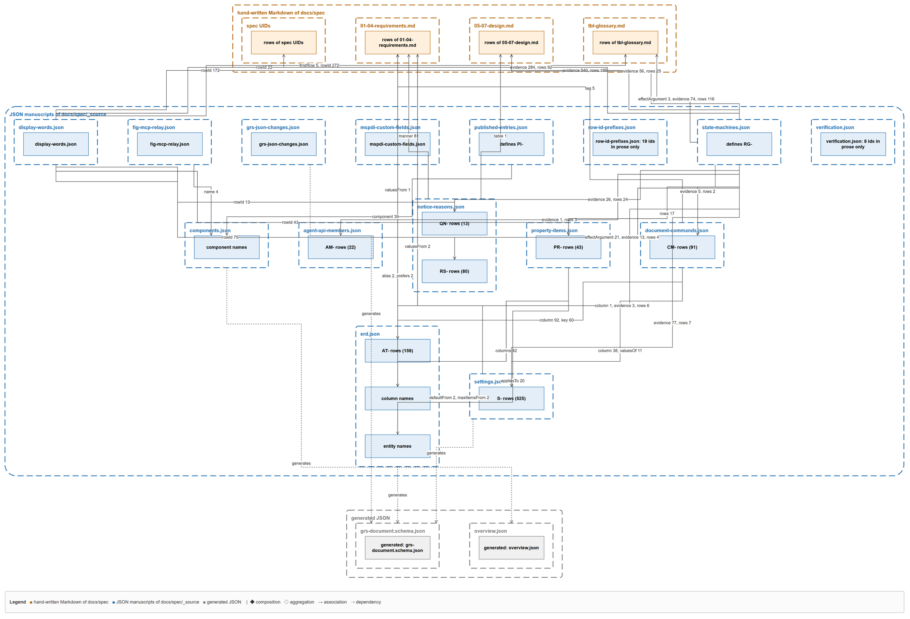

# 69 — `_source` の JSON の関係図と、2 つの検査（改名の前の段 0）

作った日: 2026-10-17。最初の版は `585b29cc`（基は `e5d2b794`）。独立のレビュー（`585b29cc` を読むだけ）の指摘を当てて直した版が今の本書である。裁定: `JDG-2692`（関係は手で描かず参照から生成し、検査は参照の整合と許可リスト付きの名の整合の 2 層）、`JDG-2691`・`JDG-2720`〜`JDG-2725`（許可リストの裁定）。

**利用者に見てほしいもの**: 下の図 1 枚と、2 節の表。改名（段 1〜2）は、この図とデータを利用者が見て良しとしてから始める。

## 1. 図 —— `_source` の JSON が互いの何を指すか

- 正: `docs/spec/_source/fig-source-relations.drawio`（生成物）、仕様へ載せる絵は `docs/spec/_assets/fig-source-relations.svg`。上の PNG は見るための写し。辺の表は `docs/spec/_source/source-relations.json`。
- 作り方: `npm run gen:relations`（`docs/spec/_source/source_relations.py`）。参照は手で書かず、各 JSON の値から読む。読み手は `.claude/skills/spec-graph-check/source_refs.py` の 1 つだけで、図と 2 つの検査が同じものを「参照」と呼ぶ。
- 読み方: 点線の枠 1 つが JSON 1 本（原稿 15 本はすべて描く）。枠の中の箱は、他のファイルから名指される「行 ID の族」（`AT- rows` など）か「名の族」（実体名・列名・部品名）。実線の矢印は「指す欄の名 と 数」、点線の矢印は生成。上の橙の帯は手書きの Markdown、下の灰色は生成される JSON。散文の参照しか持たないファイルは、箱に「ids in prose only」と数を書く。
- 図に載せたのは **構造の参照**（値の全体が他のファイルの行・実体・列・部品を名指す欄）の 30 本・2,601 件。文中の行 ID（散文の参照）は 126 本・4,217 件あり、図にすると全部の箱を覆うので 3 節の表にした。

### 図に載る構造の参照（30 本、`source-relations.json` の `structured`）

| 指す側 | 欄 | 指される側 | 数 |
| --- | --- | --- | ---: |
| `document-commands.json` | `column`・`key` | `erd.json` の列の行 `AT-` | 152 |
| `document-commands.json` | `column`・`valuesOf` | `settings.json` の行 `S-` | 49 |
| `document-commands.json` | `tag` | `01-04-requirements.md` の `PA-` | 5 |
| `erd.json` | `defaultFrom`・`maxItemsFrom` ／ `valuesFrom` | `settings.json` の `S-` ／ 表 T-376 | 4 ／ 1 |
| `property-items.json` | `columns`・`appliesTo` | `erd.json` の列名・実体名 | 62 |
| `mspdi-custom-fields.json` | `alias`・`prefers` | `erd.json` の列名（`fadeInDays`・`fadeOutDays`） | 4 |
| `notice-reasons.json` | `manner` ／ `table` | `01-04` の `NT-` ／ 表 T-220 | 81 ／ 1 |
| `display-words.json` | `rowId`・`firstRow` | `property-items.json`（`PR-`）・`notice-reasons.json`（`RS-`・`QN-`）・手書きの 3 本 | 602 |
| `state-machines.json` | `evidence`・`rows`・`effectArgument`・`column` | `settings.json`・`notice-reasons.json`・`property-items.json`（22）・`erd.json`・`document-commands.json`・`agent-api-members.json`・手書きの 3 本と UID | 1,595 |
| `published-entries.json` | `component` | `components.json` の部品名 | 39 |
| `fig-mcp-relay.json` | 箱の `name` | `components.json` の部品名 | 4 |
| `settings.json` | `valuesFrom` | 表 T-376 | 2 |
| 生成 | — | `erd.json`＋`settings.json`＋`grs-json-changes.json` → `grs-document.schema.json`、`components.json` → `overview.json` | — |

⚠️ **図に出ない関係**（構造の欄が無いので、読み手が拾えない）:

- `agent-api-members.json` と `document-commands.json` は、型の名と命令の名でつながるが、互いを指す欄を持たない。Agent API のメンバの名を片方だけで変えても、どの検査も赤にしない（レビューの壊す試験 H）。
- `grs-document.schema.json` の鍵は `erd.json` と `settings.json` から生成されるので、鍵の名の正はその 2 本である。

## 2. 2 つの検査（`check.sh` の 83 と 84）

| 検査 | 赤にするもの | 今の数 | 壊して確かめた |
| --- | --- | --- | --- |
| 83 参照の整合 `check-source-references.py` | どこにも解けない参照／指す欄に ID でない値／欄が許さない族の行（`valuesOf` は `S-` だけ）／命令が書かない実体の列（`CM-26` が Task の列）／命令の `retired` の並びと `retired.py` の食い違い／古い除外の行。あわせて `source_relations.py --check` が辺の表の古さを見る | 原稿 15 本と契約（`*.schema.json`）11 本から 7,766 の参照。除外 5（`PR-16`・`PR-37`・`PR-38`・`PR-44` の「文書の列ではない」項目と、`CR-710` 内の番号 `X-23`）。退いた ID の引用 3（刷るだけ） | レビューの壊す試験 B・C・D・E・F・J がどれも 1 件赤（直す前は緑）。A も赤 |
| 84 名の整合 `check-source-names.py` | 名が指す先の名と合わない／古い許可の行。指す先の行が無いときも落ちずに赤 | 368 の対（命令の値と書く列 130、値と行の鍵 60、保存の鍵と画面の語 178）。合わない 47 対を、理由つきの 44 行が覆う | `CM-87` の値の名を変えると 1 件赤。`K-77` の許可の行を消すと 1 件赤。壊す試験 A・F は 1 件赤（直す前は IndexError で落ちた） |

### 許可リストの 44 行の内訳（`source-names-allow.txt`）

| 群 | 行 | 例 |
| --- | ---: | --- |
| 利用者が名を残した（`JDG-2691`） | 10 | `isDependencyVisible` ↔ Dependency Lines、`strokeColor` ↔ Outline Color（3 実体）、`milestoneGlyph`、`viewTimeZone`、`levelZeroTreeState` |
| 1 組ずつ問うて残した（`JDG-2720`〜`JDG-2722`） | 3 | `themeHue`（`JDG-966` で据え置き済みだった）、`scrollDate`、`scrollTaskGroupId` |
| まとめて残した（`JDG-2725`） | 5 | `zoomX`・`zoomY`、`isAssigneeVisible`・`isPercentCompleteVisible`、`workingDayTypes` |
| 改名が決まっている（`CR-792` が着地すると行が古くなり、同じ変更で消す） | 10 | `targetTaskGroupId` ↔ `parentId`（`JDG-2689`）、`uids`（`JDG-2685`）、`fontScale`、`parentProgressToleranceDays`、`editGroup`、`scrollDayOffset`・`scrollGroupOffset`、`isApplied` → `isScheduleFilterApplied`（`JDG-2723`）、`hiddenKeys` → `hiddenTaskUids`・`hiddenResourceUids`（`JDG-2724`） |
| 形から決まり、名の選びが無い | 16 | 注記の錨の形 `AnnotationAnchor` の 7 欄、`dx`・`dy` ↔ `bodyOffsetPx`、予定・実績の日付の対の欄 4、`Bring to Front` の 2、MSPDI の名 `resumeValid` |

⭐ 改名の後で検査 84 が言うこと: `scrollDateFraction` ↔ Left Edge Time と `scrollTaskGroupFraction` ↔ Top Task Group Position は新しい名でも画面の語と合わない —— `CR-792` が新しい行（理由は `JDG-2681`）を書く。ほかの 8 行は合うようになり、消す。

## 3. 散文の参照の数（ファイルからファイルへ、`python docs/spec/_source/source_relations.py --matrix`）

行 = 引く側、列 = 行 ID を定める側。コード区間の内も外も数える。

| cites / defines | spec UIDs | 01-04-requirements.md | 05-07-design.md | tbl-glossary.md | agent-api-members.json | document-commands.json | erd.json | notice-reasons.json | property-items.json | published-entries.json | settings.json | state-machines.json | verification.json |
| --- | ---: | ---: | ---: | ---: | ---: | ---: | ---: | ---: | ---: | ---: | ---: | ---: | ---: |
| agent-api-members.json | 35 | 129 | 2 | 1 |  | 3 |  | 3 |  | 22 |  |  |  |
| agent-api-members.schema.json |  | 2 |  |  | 5 |  |  |  |  |  |  |  |  |
| components.json | 58 | 38 | 5 | 1 | 2 | 1 | 3 |  |  | 1 | 5 |  |  |
| display-words.json | 10 | 9 | 1 | 22 |  |  |  | 2 | 1 |  | 4 |  |  |
| document-commands.json | 102 | 46 |  |  | 2 |  | 11 |  |  | 2 | 15 | 3 |  |
| document-commands.schema.json |  |  |  |  |  | 4 | 1 |  |  |  | 2 |  |  |
| erd.json | 57 | 73 | 19 | 2 |  | 5 |  |  | 1 |  | 50 | 1 |  |
| erd.schema.json | 2 | 10 | 3 |  |  |  | 7 |  |  |  | 5 |  |  |
| fig-mcp-relay.json | 1 | 4 | 7 | 2 |  |  |  |  |  |  |  |  |  |
| grs-json-changes.json | 2 |  |  |  |  |  |  |  |  |  | 2 |  |  |
| grs-json-changes.schema.json | 1 |  | 1 |  |  |  | 1 | 1 |  |  | 2 |  |  |
| mspdi-custom-fields.json |  | 5 |  |  |  |  | 4 |  |  |  |  |  |  |
| mspdi-custom-fields.schema.json |  | 1 |  |  |  |  | 2 |  |  |  |  |  |  |
| notice-reasons.json | 64 | 101 | 38 | 6 |  |  |  |  |  |  | 14 |  |  |
| notice-reasons.schema.json | 1 | 3 | 4 |  |  |  |  | 8 |  |  |  |  |  |
| property-items.json | 30 | 50 |  | 1 |  | 12 | 13 |  |  |  | 22 |  |  |
| property-items.schema.json | 9 | 5 |  |  |  | 2 |  |  | 11 |  |  |  |  |
| published-entries.json | 198 | 666 | 82 | 42 | 10 | 29 | 22 | 22 | 2 |  | 108 | 53 |  |
| published-entries.schema.json |  |  |  |  |  |  |  |  |  | 3 |  |  |  |
| row-id-prefixes.json |  | 16 | 2 |  | 1 |  |  |  |  |  |  |  |  |
| settings.json | 488 | 913 | 17 | 32 |  | 2 | 15 | 6 | 9 |  |  | 2 |  |
| settings.schema.json | 1 |  |  |  |  |  | 2 |  |  |  | 19 |  |  |
| state-machines.json | 17 | 69 | 23 | 31 | 2 | 9 | 6 | 17 | 5 |  | 20 |  |  |
| state-machines.schema.json |  | 1 | 12 |  |  |  |  |  |  |  |  | 1 |  |
| verification.json |  | 1 | 7 |  |  |  |  |  |  |  |  |  |  |
| verification.schema.json |  |  | 1 |  |  |  |  |  |  |  |  |  | 15 |

## 4. 段 1（改名の手順書）への申し送り —— 図の外にある在りか

改名の道具は `tools/rename/`（`build_rename_tables.py`・`apply_rename.py`・`rename_symbols.mjs` ほか）が先にある。名の表を作る前に、次の在りかも対象に入れる（`git grep -w -l` で 2026-10-17 に確かめた）。

| 在りか | 載っている名（例） |
| --- | --- |
| `docs/spec/_source/*.schema.json`（手書きの契約） | `settings.schema.json` の `fontScale` |
| `docs/spec/_source/image-to-grs-json-prompt.en.md`・`.ja.md`（と生成器 `tools/generate_image_to_grs_json_prompt.py`） | `editGroup` |
| `docs/spec/_assets/tbl-glossary.md` の 表 T-104 | `K-85`・`K-120`・`K-121`・`K-140` の鍵の写し（`fontScale`・`scrollGroupOffset`・`scrollDayOffset`・`parentProgressToleranceDays`） |
| `tools/generate_entity_types.py` | `fontScale` |
| `tools/generate_startup_template.py` | `editGroup`・`parentProgressToleranceDays` |
| `tools/rename/build_rename_tables.py` | `scrollGroupOffset`・`parentProgressToleranceDays`（先の改名の表） |

- ⚠️ N-6（「どの行を」の値）と N-7（`setElementVisible` の値）は語が一般的である（`id` は `git grep -w -o id -- src tests docs/spec tools` で 9,621 か所、2026-10-17）。対象は、検査 84 の `key` の対 60 件と、各命令の `values` の名で絞る —— 部分文字列でも語の一致でもなく、命令の行 ID と値の名の組で替える。
- `JDG-2723`（`isApplied`）・`JDG-2724`（`hiddenKeys` を 2 つに分ける）も、同じ改名の 1 回に入れる。どちらも命令の形だけで、GRS JSON の形は変わらない（`AGENT_API_VERSION` を上げる）。

## 5. 測り方

- 参照の数: `python .claude/skills/spec-graph-check/check-source-references.py`（OK の行）。名の対の数: `python .claude/skills/spec-graph-check/check-source-names.py`（OK の行）、合わない対の一覧は `--list`。
- 行 ID の持ち主: `specindex.build()` が仕様の表の行を読み、生成された Markdown（`tbl-settings.md` ほか 11 本）の行は、その見出しが名指す JSON の原稿へ帰す。
- 図の箱と辺の数: `npm run gen:relations` の出力（24 の箱、34 の辺）。
- 壊す試験: レビューの `breaktest.py` を、本席の木の写し（scratchpad）に向けて走らせた。
