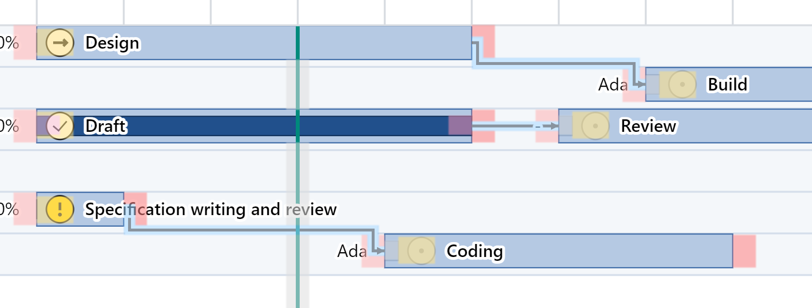
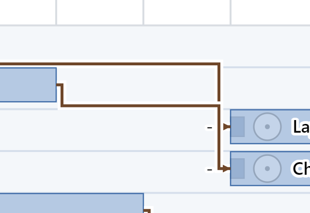
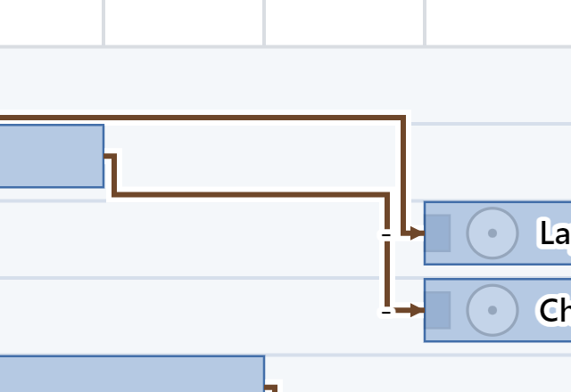
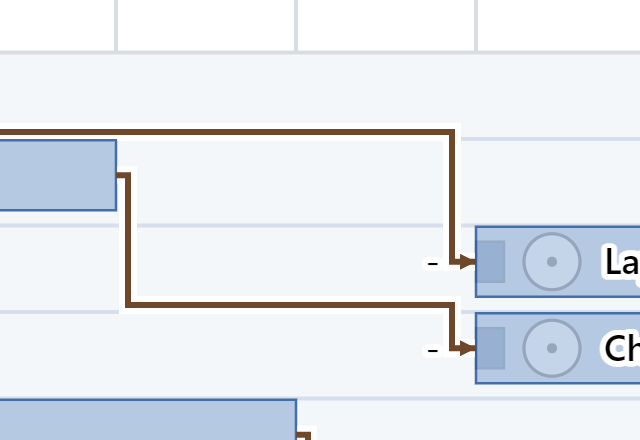

# 依存線と予定の掴み代 —— 触れる見本

- 作った日: 2026-10-24
- 見本: [`dependency-lines-and-grab-sample.html`](dependency-lines-and-grab-sample.html)（1 ファイルで完結する。ダブルクリックで開く。サーバーも通信も要らない）
- 利用者の言葉（uid 205）: 「マウスカーソル判定について、予定の操作に依存線の操作が干渉して、予定の編集が困難になってる。判定の優先順位やエリアを再度丁寧に検討すべき。」（2026-10-17）
- 所見（uid 204）: 2026-10-18 の初見 AI の試験の所見 O-1 —— 別々の 2 本の依存線の縦の部分が同じ x 座標で重なり、1 本に見える（「写真撮影 → 確認作業」と読めた）
- 裁定: [`rulings.md`](../../docs/development-records/rulings.md) の `JDG-3134`（案 B）・`JDG-3135`（直さない）
- 変更要求: [`CR-830`](../../change-request/CR-830-a-plan-end-takes-the-margin-of-a-dependency-line.md)
- 不具合の行: `DFC-3483`（uid 205）・`DFC-3484`（uid 204、取下げ）

## 開き方と触り方

| したいこと | すること |
|---|---|
| 場面を替える | 右の「場面」—— 当たり判定 ／ 依存線の縦の重なり |
| 当たりの決め方を見比べる | 右の「当たりの決め方」—— 決定（CR-830）／ 退けた案 A |
| 重なりの直し方を見比べる | 右の「縦の重なり」—— 決定（直さない）／ 退けた案 X ／ 退けた案 Y |
| ポインタの下で答える掴み代を見る | 絵の上でポインタを動かす。右の「ポインタの下」に行 ID と相手が出る |
| 掴み代の地図を見る | 「掴み代を塗る」（桃 = 予定の端 `GA-1`/`GA-2`、水色 = 依存線 `GA-19`、黄 = 進捗マーカー `GA-18`。本体 `GA-9` は塗らない） |
| 近くで見る | 「拡大して見る」（×1 〜 ×4）。横の倍率 zoomX と表示の倍率も替えられる |
| 値を伝える | 右下の灰色の塊をそのまま貼る |

## 作り

- 絵（`svgFromSchedule`）・配置（`layoutFromSchedule`）・幾何（`geometryFromLayout`）・当たり（`pointerWalkOf` と `answersAtPointer`）は `src/` そのものを `build-sample.mjs` が rolldown で束ねた。手で写した寸法は無い。
- 案を試すための差し込みは 1 か所だけ: 束ねるときに `item-hit-area.ts` の `claimingRegions` の出口に `window.grsHitVariant` を挟む（候補の掴み代の並びを入れ替えるだけ。無ければ出荷のまま）。
- 縦の重なりの案 X・案 Y は見本の中だけの写し（`separate`）で、出荷のコードには無い。
- 組み直し: このフォルダで `ROLLDOWN=<rolldown の dist/index.mjs> node build-sample.mjs`。掃き: `PLAYWRIGHT=<playwright の index.mjs> node sweep.mjs [絵.png] [hit|overlap]`（Edge）。作業木では根の `node_modules` を指す。

## uid 205 —— 予定の端と依存線

掃きの方法: `sweep.mjs hit` が場面「当たり判定」を開き（横の倍率 zoomX 12、表示の倍率 100、画面の px）、各タスクの予定の帯の高さの 15 % ・ 50 % ・ 85 % の 3 本の横の線を、端の 4px 内側から 16px 外側まで 0.5px おきに `answersAtPointer` に問うた。予定の終了の外側の掴み代は 12px（`S-253`）、依存線の掴み代は描いた線の縁から左右へ 2px（`S-285`）、線の太さは 1.5px、出口の走りは 3px（`S-298` の 4.8 × 描く比 0.625）。

| 所（Design → Build、FS の出口） | CR-830 の前 | 決定（CR-830、案 B） | 退けた案 A |
|---|---|---|---|
| 終了の右、帯の 50 %（線の出口の横の走り） | 線 0〜5.5px、端 6〜12px | 線 0〜3.5px（本線の横の走りと縦の折れ）、端 4〜12px | 線は端の上の 1 点だけ、端 0.5〜12px |
| 終了の右、帯の 85 %（線が降りる所） | 端 0px、線 0.5〜5.5px、端 6〜12px | 端 0〜2px、線 2.5〜3.5px（本線の縦）、端 4〜12px | 端 0〜12px |
| 終了の右、帯の 15 %（線の無い所） | 端 0〜12px | 同じ | 同じ |
| Draft → Review（同じ段の 1 本、RP-1。間は 45px） | 帯の 50 % は端の外の全部が線 | 同じ（本線の上なので線が答える） | 端 12px ＋ 端 12px を除いた間の 21px だけが線 |

- 決定の要点: 予定の端の掴み代が覆う点では、依存線は描いた線（本線と矢じり）でだけ答え、余白 2px は端に譲る。応える順（表 T-268 の `TY-2`）は変えないので、線の上では線が答え、どんなに短い線も描いた所で選べる（`JDG-141` が案 A を退けた理由を守る）。
- 退けた案 A では、2 つのタスクの間が 24px（端の掴み代 12px × 2）を下回ると、その間の線をどこでも掴めない。表示を縮めた画面でよく起きる。
- 根の `temp/Log/予定vs依存.txt` は、いつ取ったかを利用者が覚えていなかったので参考にとどめた（押した所の掴み代が `GA-2`・`GA-9`・`GA-18`・`GA-19` と入れ替わる様子は、上の表と同じ形）。

## uid 204 —— 別々の依存線の縦の重なり

掃きの方法: `sweep.mjs overlap` が場面「依存線の縦の重なり」の経路の頂点を読んだ（横の倍率 12、表示の倍率 100）。

| 線 | 経路（決定 —— 直さない） |
|---|---|
| Photo shoot → Layout | 出口 x=342 で通路 y=63 へ降り、入口の手前 x=513 で y=63〜95.4 を降りる |
| Copywriting → Check | 出口 x=432 で通路 y=84.6 へ降り、入口の手前 x=513 で y=84.6〜117.1 を降りる |

2 本の縦の走りが x=513 の y=84.6〜95.4 で重なる。Copywriting の横の走りは x=513 で Photo shoot の縦に突き当たって 1 本に見え、「Photo shoot → Check」と読める。

| 案 | 何が変わるか | 測った経路（Copywriting → Check） |
|---|---|---|
| 退けた案 X | 後の線の縦の走りを、線の縁の幅（太さ × 3、倍率 100 で 4.5px）だけ外へずらす | 入口の手前の縦が x=508.5。後続の札（開始の 9px 左に終わる）に縦がかかる |
| 退けた案 Y | 後の線は、後続のすぐ上の段間（通路）を横に走ってから降りる | 出口 x=432 で y=73.8〜106.3 を降り、通路 y=106.3 を x=513 へ、x=513 で y=106.3〜117.1 を降りる |

| 決定（直さない） | 退けた案 X | 退けた案 Y |
|---|---|---|
|  |  |  |

利用者は「直さない」を選んだ（`JDG-3135`）。表 T-018a の `RT-5`（他の図形との交差は許容する）と表 T-222 の経路のまま。

## 決まったこと

| 何か | 決まったこと | 裁定 |
|---|---|---|
| 予定の端の掴み代の中の依存線 | 描いた線（本線と矢じり）でだけ答える。余白 `S-285` は足さない。順は変えない | `JDG-3134` → 表 T-266 の `GA-19`（`CR-830`） |
| 別々の依存線の縦の重なり | 直さない | `JDG-3135` |
