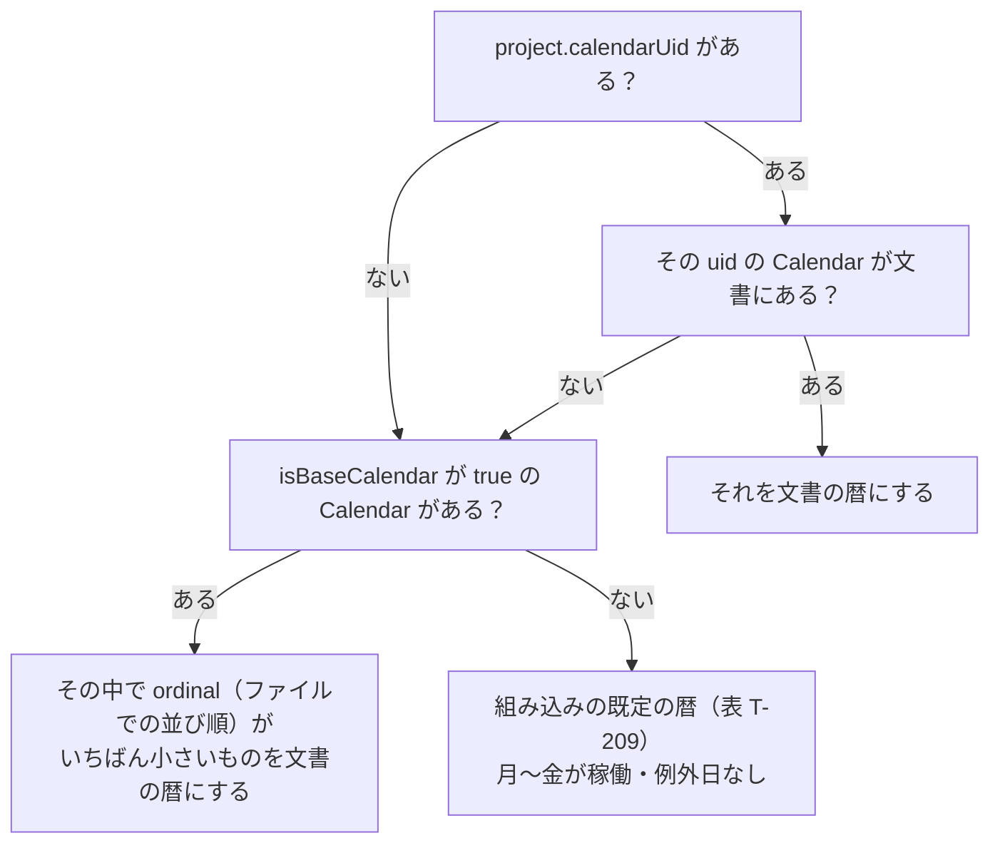

# 暦（カレンダー）—— MSPDI と GRS でどう扱うか

CR-851 の英語の説明文（D080・D093・D109・D121・D130・D132・D166・D172）への
コメントに答えるための解説である。事実は仕様書と CR-851 の表から取り、出典を最後に並べる。
MS Project そのものの既定値は仕様書の外の **一般知識** であり、そう書いた所だけがそれに当たる。

---

## 1. スキーマの冒頭に入れる文言の案

### 1.1 根の説明の「Concepts:」に入れる 2 行

```text
Calendars: GRS counts every working day with one document calendar, the one project.calendarUid names; other calendar links are kept only to be written back.
A working day without its own spans works 08:00-12:00 and 13:00-17:00, and one working day (1d) is project.minutesPerDay minutes, 480 when absent.
```

1 行目は「どの暦で数えるか」、2 行目は「1 日の中身と 1d の長さ」を言う。
各行はこの 2 行が根にある前提で短くしている（「document calendar」という語を全行で同じ意味に使う）。

### 1.2 行ごとの新しい説明の案

| 行 | 場所 | 案（英語） |
|---|---|---|
| D080 | `Project.calendarUid` | Same as MSPDI Project/CalendarUID: the document calendar. If it is absent or names no calendar, GRS uses the first calendar with isBaseCalendar true, else a built-in Monday-to-Friday calendar with no exceptions. |
| D093 | `Project.minutesPerDay` | Same as MSPDI Project/MinutesPerDay: the minutes of 1d, 480 when absent. If the spans of a working day add up to another total, GRS warns when the document opens, because 1d would no longer be one working day. |
| D109 | `Calendar.baseCalendarUid` | Same as MSPDI Calendar/BaseCalendarUID: the calendar this one inherits from. GRS keeps the link to write it back, but never looks into that parent calendar for days this calendar leaves out. |
| D121 | `WeekDay.workingTimes` | Same as MSPDI WeekDay/WorkingTimes. Absent on a working day means 08:00-12:00 and 13:00-17:00. |
| D132 | `Exception.workingTimes` | Same as MSPDI Exception/WorkingTimes; on a one-off working exception they replace that day's spans. Absent means 08:00-12:00 and 13:00-17:00. |
| D130 | `Exception.recurrenceKind` | Same as MSPDI Exception/Type. GRS accepts every value but counts only a one-off exception (9, absent, or 1 with recurrencePeriod absent or 1); it keeps the others and writes them back, and for a new exception it writes 1, as MS Project does. |
| D166 | `Dependency.linkLag` | Same as MSPDI PredecessorLink/LinkLag: tenths of a minute, whatever lagFormat says; absent means no lag. Shown in working days, one day is project.minutesPerDay minutes (480 when absent). |
| D172 | `Resource.calendarUid` | Same as MSPDI Resource/CalendarUID. Kept only to be written back; working days are counted with the document calendar. |

⭐ D130 の案は「書いてよい値は 1〜9 のどれでも」と先に言い、「数えるのはどれか」を 1 文にまとめた。
⭐ D166 の案は、`4800` が何を意味するか（480 分 ＝ 1 稼働日）を初めての人が読めるよう、0.1 分の単位を書いた。
⭐ `Task.calendarUid`（コメントは無いが D172 と同じ扱い）も D172 と同じ文にそろえるとよい。

---

## 2. やさしい解説

### 2.1 そもそも「暦」とは

工程表で「5 日かかる」と言うとき、土日や休業日を飛ばして数える。
その「どの日が働く日で、何時から何時まで働くか」を決めたものが暦（カレンダー）である。

MSPDI（MS Project の XML）の暦は、次の 3 つの部品でできている。

| 部品 | MSPDI の名前 | GRS JSON の名前 | 中身 |
|---|---|---|---|
| 暦そのもの | `Calendar` | `Calendar` | 名前・番号（UID）・基準の暦か・親の暦 |
| 曜日の決まり | `WeekDay` | `WeekDay` | 「月曜は働く、8:00〜12:00 と 13:00〜17:00」のような曜日ごとの決まり |
| 例外の日 | `Exception` | `Exception` | 「12/29〜1/3 は休み」「この土曜は出勤」のような特別な日 |

時間帯 1 本（例: 8:00〜12:00）が `WorkingTime` で、1 日に 1〜5 本持てる。

### 2.2 MSPDI では暦がたくさんある

MS Project のファイルには暦がいくつも入るのが普通である（ここは一般知識）。

- **基準の暦**（`IsBaseCalendar` が真）: 「Standard」など。ファイル全体の土台。
- **担当者ごとの暦**: 「田中さんは水曜休み」のような暦。基準の暦を親にして（`BaseCalendarUID`）、違う所だけを持つ。
- **タスクごとの暦**: タスクに別の暦を指させることもできる（`Task/CalendarUID`）。
- **プロジェクトの暦**: `Project/CalendarUID` が指す 1 つ。MS Project の画面では基準の暦からしか選べない（一般知識）。

### 2.3 GRS は暦を 1 つしか使わない

GRS は **稼働日を、文書の暦 1 つだけで数える**（FR-054、利用者の裁定 CR-164）。
理由: GRS は 1 行に何本ものタスクのバーを並べる。タスクごとに暦が違うと、同じ行の 2 本が別の数え方になり、
イナズマ線の頂点や遅れの日数を 1 行の中で比べられなくなる（FR-054 の ⚠️ の段、CR-164 §2）。

どの暦が「文書の暦」になるかは、次の順で決まる（FR-054 の最後の段、`working-calendar.ts:136-150`）。



### 2.4 持っているが数えには使わないもの

| もの | GRS がすること | 数えに使うか |
|---|---|---|
| `Task.calendarUid` | 読んで保ち、書き出すときに戻す | 使わない（FR-054、AT-33） |
| `Resource.calendarUid` | 同上 | 使わない（FR-054、AT-89） |
| 文書の暦以外の `Calendar` | 同上 | 使わない |
| `Calendar.baseCalendarUid` | 同上。**親の暦をたどって、足りない曜日を親から補うことはしない** | 使わない（FR-054 の ⚠️） |
| 繰り返しの例外日（毎年の元日など） | 保ち、書き出す。休日の設定の一覧には出し、消せるが直せない（WC-5） | 数えにも塗りにも使わない（FR-054、AT-82） |

「書き出すときに戻す」は、MS Project → GRS → MS Project と往復しても値がなくならない、という意味である。

### 2.5 曜日と時間帯の既定

- 稼働日なのに時間帯（`workingTimes`）を持たない日は、**8:00〜12:00 と 13:00〜17:00 の 2 本** を持つものとして読む（FR-054、S-580）。合計 480 分。
- 新しい文書の稼働日にも同じ 2 本を書く（S-580）。
- `dayWorking` が無い曜日・例外日は「休み」と読む（doc-shape-map D120・D129 の行）。

### 2.6 例外日 —— 1 回きりか、繰り返しか

`Exception/Type`（GRS JSON では `recurrenceKind`）は 1〜9 の数で、繰り返し方を表す（AT-82）。

| 値 | 意味 |
|---|---|
| 1 | 毎日（日次） |
| 2 / 3 | 毎年（日付で / 「第 2 月曜」のような位置で） |
| 4 / 5 | 毎月（日付で / 位置で） |
| 6 | 毎週 |
| 7 / 8 | 回数で指定（日数 / 稼働日数） |
| 9 | 繰り返しなし |

GRS が「1 回きり」と見るのは **9、値なし、または 1 で間隔（`recurrencePeriod`）が無いか 1** のときだけである（AT-82）。
1 で間隔 1 は「範囲の毎日」なので、範囲そのものと同じになる。MS Project 自身も 1 回きりの休日を Type 1 で書く（AT-82 が引く Microsoft Learn の例）。
だから GRS が足す例外日は 1 と書く（WC-6）。

それ以外（例: 毎年 1/1）は **展開しない**。範囲の全日を休みとして数えると、毎年 1 日の祝日が何年分も休みになってしまうからである（FR-054、AT-82）。
GRS はこれを保って書き出すが、数えには使わず、未対応であることを知らせる（FR-054 の RATIONALE）。

### 2.7 1 日の分数（minutesPerDay）と警告

MSPDI は 2 つの数を **別々に** 持つ（JDG-1713）。

- **暦の時間帯**: その日に実際に働く時刻。タスクの長さ（所要）はこれで数える（FR-054）。
- **1 日の分数**（`Project/MinutesPerDay`、既定 480）: 「1d」と打ったときの長さ、ラグの「1 稼働日」の長さ（FR-054、AT-14、AT-47）。

この 2 つが食い違うと、困ったことが起きる。例（JDG-1713 の問いの例）:

> 暦が 8:00〜17:00 の 1 本（昼休みなし、9 時間 = 540 分）で、minutesPerDay は 480。
> 「1d」と打つと 480 分 = 8 時間なので、タスクは 17:00 ではなく 16:00 に終わる。

ほかにもよくある形: 土曜を 8:00〜12:00 の半日出勤にした（240 分）のに、minutesPerDay は 480 のまま。

GRS はこれを黙って直さず、**知らせる**（RS-89）。

| 項目 | 中身 |
|---|---|
| いつ出るか | ① 文書を開いたとき、1 回だけ（FR-054）<br>② 休日の設定で、合計が違う時間帯の 1 組を当てたとき、1 回（FR-088、JDG-1968） |
| 何を数えるか | 曜日の稼働日と、稼働にする 1 回きりの例外日。時間帯を持たない日は 8:00〜12:00・13:00〜17:00（480 分）で数える。繰り返しの例外日は数えない（RS-89） |
| 出る文（日本語） | 「稼働日の時間帯の合計が、1 日（1d）の長さと違います」<br>次の手: 「「1d」と打った長さは、時間帯の合計ではなく文書が決めた 1 日の長さで数えます。そろえたいときは、休日の設定で時間帯を直してください」（`display-words.json:4148-4157`） |
| 消え方 | 自動では消えない（RS-89 の「出す」）。注意の形 NT-3 |
| GRS がしないこと | minutesPerDay を合計に合わせて書き換えること（利用者の判断、RS-89） |

なぜあるか: 「1d と打ったのに、1 日分の時間帯より短い（長い）」ことを、知らないまま使わせないため（FR-054）。
MS Project で作られた半日出勤のある暦などは、開くたびにこの知らせが出る。それは食い違いが本当にあるからであり、正しい動きである。

### 2.8 ラグの「稼働日」

依存線のラグ（`linkLag`）は、**どんな単位で見せていても 0.1 分で保存** する（AT-47、MSPDI の規則）。
単位の欄 `lagFormat` が 7（稼働日）のときも、1 稼働日は minutesPerDay 分（無ければ 480 分）で換える（AT-47、S-118）。
例: `4800` は 480 分 = 1 稼働日。暦の時間帯の合計からは換えない（FR-054）。

### 2.9 MS Project の既定と GRS の既定

MS Project の列は **一般知識**（英語版 MS Project の新規プロジェクトの既定）である。

| 項目 | MS Project の既定（一般知識） | GRS の既定（表 T-209） | 合うか |
|---|---|---|---|
| 稼働する曜日 | 月〜金（Standard 暦） | 月〜金（S-106） | 合う |
| 1 日の時間帯 | 8:00〜12:00、13:00〜17:00 | 同じ（S-580） | 合う |
| 1 日の分数 | 480 分（1 日 8 時間） | 480（S-128） | 合う |
| 既定の開始時刻 | 8:00 | 08:00:00（S-482） | 合う |
| 既定の終了時刻 | 17:00 | 17:00:00（S-483） | 合う |
| 祝日 | なし | なし（S-107） | 合う |
| 週の始まり | 日曜（`WeekStartDay` 0） | **月曜**（S-108） | **合わない** |
| 1 週の分数 / 1 か月の日数 | 2400 分 / 20 日 | 既定を持たない（値が無ければ書かない、FR-054） | GRS は使わない |

**結論: 時間帯・1 日の分数・開始と終了の時刻・稼働する曜日は、MS Project の既定と合っている。**
合わないのは週の始まりだけで、GRS は月曜、MS Project は日曜である。
`weekStartDay` が無いファイルを GRS は月曜と読むので（doc-shape-map D096 の行）、MS Project が同じファイルを日曜と読む場合は、週の目盛の日付がずれて見える。
仕様書の S-108 は月曜を選んだ理由を書いていない。

MSPDI の側の注意（一般知識）: MS Project が自分で書くファイルでは、稼働の曜日はいつも時間帯を書く。
時間帯を省いた稼働日を 8:00〜12:00・13:00〜17:00 と読むのは GRS の決め（FR-054）であり、手で書いたファイルや他のツールのファイルのためのものである。

---

## 3. コメントへの答え

**D080** —— 上の 2.3 にまとめた。GRS は稼働日を `project.calendarUid` が指す暦 1 つだけで数える。
指していない・指す先が無いときは、基準の暦のうちファイルで最初に並ぶもの、それも無ければ月〜金の組み込みの暦を使う（FR-054）。
タスクや担当者の暦は往復のために持つだけである（2.4）。

**D093** —— 2.7 にまとめた。用途は「1d と打った長さ」と「1 日分の時間帯」の食い違いを知らせること。
例えば暦を 8:00〜17:00 の 1 本にしたのに 1 日 480 分のままだと、1d のタスクは 16:00 に終わる。
文書を開いたとき（と休日の設定で時間帯を当てたとき）に 1 回、「稼働日の時間帯の合計が、1 日（1d）の長さと違います」と出し、GRS は値を勝手に直さない（RS-89）。

**D109** —— 「it」は `baseCalendarUid`（その暦の **親の暦へのつながり**）を指しており、この暦自身の uid ではない。
MSPDI では、親を持つ暦は親と違う所だけを書き、書いていない曜日は親から受け継ぐ。GRS はこのつながりをたどらず、文書の暦が自分で持つ行だけで数える（FR-054 の ⚠️）。
プロジェクトの暦は MS Project では基準の暦（親を持たない）なので、ふつうは困らない（一般知識）。案は 1.2 のとおり「the calendar this one inherits from」と言い換えた。

**D121 / D132** —— 合っている。8:00〜12:00、13:00〜17:00 は MS Project の Standard 暦の時間帯であり、仕様書 S-580 も Microsoft Learn の `Calendar` の例と同じと書く。
合計 480 分も minutesPerDay の既定 480 と合うので、既定の暦では D093 の警告は出ない（S-580）。

**D130** —— はい、1〜9 のどれでも受け付けて保ち、書き出す。数えに使うのが 1 回きりのもの（9、値なし、または 1 で間隔が無いか 1）だけ、というだけである。
繰り返しのもの（毎年の元日など）を数えないのは、日付に展開しないためで、範囲の全日を休みにすると何年分も休みになってしまうから（FR-054、AT-82）。
自分で足すなら 1 を書けばよい。MS Project も 1 回きりの休日を 1 で書く。

**D172** —— 担当者の暦は、MS Project に書き戻すためだけに持つ。GRS の稼働日の数えは文書の暦 1 つで行う（FR-054、AT-89）。`Task.calendarUid` も同じ扱いである。

**D166** —— ラグはいつも 0.1 分で保存し、「稼働日」で見せるときの 1 日を minutesPerDay 分（無ければ 480 分）で換える（AT-47）。
暦の時間帯の合計は使わない。だから時間帯と minutesPerDay が食い違うと、ラグの 1 日と実際の 1 日がずれる —— それを知らせるのが D093 の警告である。

---

## 4. 食い違い

仕様書と doc-shape-map の `description_new` の間に、**逆のことを言う箇所はない**。次は「片方が言い落としている」ものである。どちらを採るかはここでは決めない。

1. **D093 の警告の時**: `description_new` は「開くたびに」だけを言う。仕様書は、休日の設定で合計の違う 1 組を当てたときにも告げる（FR-088、RS-89、JDG-1968）。
2. **D093 の「every working day」**: 仕様書は「曜日の稼働日と、稼働にする 1 回きりの例外日。繰り返しの例外日は除く」と数える範囲を限る（FR-054、RS-89）。`description_old` はそれを書いていたが、`description_new` からは落ちた。
3. **D130 の「does not count it」**: 仕様書は、繰り返しの例外日を数えないだけでなく、塗らず（AT-82）、未対応と知らせ（FR-054 の RATIONALE）、休日の設定では消すだけにする（WC-5）。`description_new` はこれらを言わない。
4. **D109 の裏付け（仕様書の中の穴）**: FR-054 は「継承を解くのは取り込みの仕事（FR-023）」と書くが、FR-023 に暦の継承を解く文は無い（`01-04-requirements.md:7267-7307`）。
   MSPDI の読み込みも `BaseCalendarUID` をそのまま写すだけで（`src/adapter/document-codec/mspdi-codec.ts:838`）、継承を解く所はどこにも無い。
   `description_new` の「GRS does not follow it」は正しいが、仕様書の理由の指し先が空である。
5. 参考（CR-851 が当てる前の差であり、食い違いではない）: 仕様書の AT-82 は間隔を `carry` の `Period`、AT-158・AT-159 は「空の並び」と書く。CR-851 はそれぞれ `recurrencePeriod`、「プロパティが無い」に変える。
6. 参考（仕様書と実装の差）: RS-89 の英語の次の手は「fix the ranges in Working Time」と面を呼ぶが（`display-words.json:4155`）、用語集の U-65 は面の名を `Holiday Settings` とする。

---

## 5. 出典

- `docs/spec/01-04-requirements.md` —— FR-054（6078-6115 行: 文書の暦 1 つ、解決の順、Task/Resource の暦を使わない、baseCalendarUid を遡らない、時間帯の既定、1d と RS-89、繰り返しの例外日）、FR-088（5815-5861 行: 休日の設定、当てたときの RS-89）、表 T-344 の WC-4〜WC-8（5871-5875 行）、FR-023（7267-7307 行）
- `docs/spec/_assets/tbl-settings.md` —— 表 T-209（806-816 行: S-106・S-107・S-108・S-128・S-482・S-483・S-580）、S-118（770 行）
- `docs/spec/_assets/tbl-notice-reasons.md:67` —— RS-89
- `docs/spec/_assets/fig-erd-detail.md`（原稿は `docs/spec/_source/erd.json`）—— AT-14（348）、AT-18（352）、AT-47（387）、AT-65・AT-66（404-405）、AT-73・AT-158（412-414）、AT-82（422）、AT-89（433）
- `docs/spec/_assets/tbl-document-commands.md:70` —— CM-39（setCalendar）
- `docs/development-records/rulings.md` —— JDG-1713（2011 行: 時間帯と minutesPerDay を分けて持ち、開いたとき 1 度告げる）、JDG-1968（2295 行: 当てたときも 1 度告げる）
- `change-request/CR-164-one-calendar-per-document.md` —— 暦を文書に 1 つとする裁定と理由
- `studies/76-grs-json-beta-shape/doc-shape-map.tsv` —— 81（D080）、94（D093）、97（weekStartDay）、110（D109）、122（D121）、131（D130）、132（recurrencePeriod）、133（D132）、167（D166）、173（D172）行
- `studies/76-grs-json-beta-shape/shipped-text-criteria.md` —— E1〜E7
- 実装（確かめのためだけに読んだ）: `src/entity/document-model/schedule/working-calendar.ts:134-150`、`src/adapter/document-codec/mspdi-codec.ts:838`、`src/adapter/screen-renderer/display-words.json:4148-4157`
- MS Project の既定（Standard 暦、1 日 480 分、開始 8:00・終了 17:00、週の始まり日曜、1 週 2400 分、1 か月 20 日、プロジェクトの暦は基準の暦から選ぶ）は **一般知識** であり、仕様書の出典ではない。仕様書は S-580 と S-482 で Microsoft Learn と Microsoft サポートを引く。
