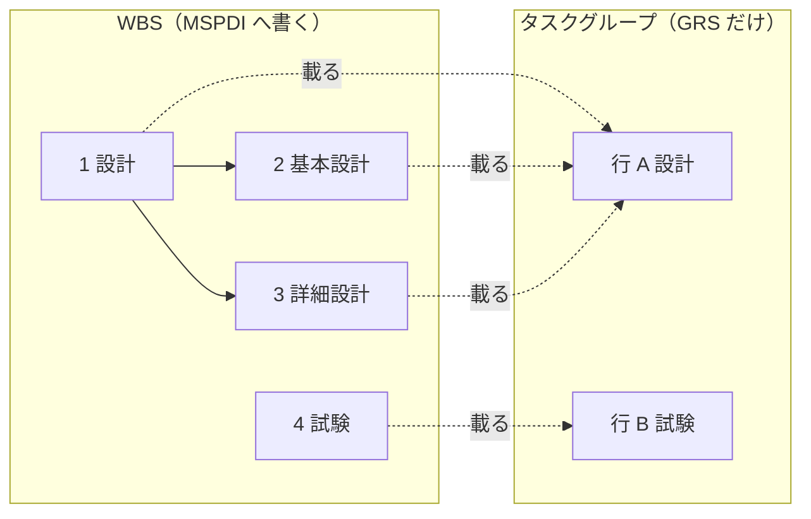

# WBS とタスクグループ —— 2 本の木の関係（CR-851 の行のレビュー D007・D010・D011 への答え）

2026-10-25。読むだけで調べた（書いたのは本ファイルだけ）。名は CR-851 の後の名（`siblingOrder`・`representedTaskUid`）で書く。
仕様書（`docs/spec`）はまだ CR-851 の前の名（`wbsOrder`・`TaskGroup.order`・`derivedFromTaskUid`）である。

## 1. スキーマの冒頭に入れる文言の案

ルートの `description` の「Terms:」の段（`JDG-3330`）のすぐ後、「The shape of GRS JSON:」の木（`JDG-3333`）の前に、次の 3 行を置く。

```text
Concepts:
WBS: the tree of parent and child tasks, the same tree that MSPDI holds.
Task groups: the rows of the task group panel, a separate tree that only GRS keeps; each task is drawn in exactly one.
```

- 1 行目 13 語、2 行目 21 語。「Terms:」と同じく見出し 1 行＋改行 1 つで分け、空行を入れない（`JDG-3333`）。
- 「別の木」「GRS だけが持つ（= MSPDI へ書かない）」「タスクは 1 つのタスクグループに描かれる」の 3 点を言う。
  「どう結ぶか」（取り込みで WBS から作る、移しても親は変わらない）は、それが効くプロパティの説明に置く（`JDG-3331` の「決まりは効く所に 1 回」）。

冒頭に Concepts がある前提の、各プロパティの説明の案（各 2 文以内）:

| 行 | プロパティ | 案 |
|---|---|---|
| D007 | `schedule.tasks` | Same as MSPDI Tasks, except that the WBS tree is given by Task.parentTaskUid and Task.siblingOrder. GRS makes ID, OutlineLevel, OutlineNumber and Summary from that tree each time it writes MSPDI. |
| D010 | `schedule.taskGroups` | The task groups, one per row of the task group panel and one band on the chart. taskGroups lists the task groups; taskGroupMembers says which tasks are drawn in each one. |
| D011 | `schedule.taskGroupMembers` | Puts every task in one task group of taskGroups: one entry per task, from taskUid to taskGroupId. A task group can hold many tasks, but a task is in exactly one task group. |
| — | `Task.parentTaskUid` | The parent task in the WBS. Absent means a top-level task; moving a task to another task group does not change it. |
| — | `Task.siblingOrder` | The order of this task among the tasks with the same parent task. When task groups are moved or reordered, GRS sets it again from the order of the task groups. |
| — | `TaskGroup.parentId` | The parent task group. Absent means a top-level task group (depth 1); task groups nest at most 5 deep, while the WBS has no such limit. |

D010 に足すかを決めてほしい 3 文目（取り違えを防ぐ文。基準 E3 の例外に当たる）:
`When GRS reads an MSPDI file, it makes the task groups from the WBS.`
—— 無いと「MSPDI から開くとタスクグループが 0 で何も描かれない」と読まれうる。

## 2. やさしい説明

### 2.1 ひとことで

- **WBS** は「親タスクと子タスク」の木。MS Project と同じ木で、MSPDI へ書き出す。GRS JSON では各タスクの `parentTaskUid`（親はだれか）と `siblingOrder`（兄弟の中で何番目か）で表す。MSPDI の `OutlineNumber`（1.2 のような番号）や `OutlineLevel`（深さ）は持たず、書き出すたびに木から作り直す。
- **タスクグループ** は、左のタスクグループパネルの「行」。チャートでは 1 本の帯になり、1 本の帯に何本ものバーを積める（マルチバー）。行どうしも `parentId` で入れ子にでき、深さは 5 段まで。GRS だけのもので、MSPDI へは書き出さない。
- **つなぎ** は `taskGroupMembers`。「タスク → どの行に描くか」を 1 タスク 1 件で持つ。1 つの行に何個でも載るが、1 つのタスクが載る行は必ず 1 つ。

### 2.2 2 本は独立か

基本は独立。ただし 3 か所でつながる。

| 場面 | 何が起きるか | 出典 |
|---|---|---|
| MSPDI を開く | 行は WBS から作る。子を持つタスクと、親を持たないタスクに 1 行ずつ。子を持たないタスクは親の行に載る。6 段目より深い所は行を作らず、5 段目の行に載せる（WBS の深さはそのまま） | `FR-058` |
| バーを別の行へ移す | 行が変わるだけ。親タスクは変わらない。子も元の行に残る | `HM-3`・`HM-10` |
| 行（タスクを表す行）を別の親の行の下へ移す | 行の木を上へたどって最初に出会う「タスクを表す行」のタスクが、新しい親タスクになる | `HM-12` |
| 行の並べ替え | 同じ親を持つタスクの順（`siblingOrder`）を、行の木の順で付け直す。親と日付は変えない | `HM-9`・`JDG-561` |
| 親タスクを結ぶ・外す | 親タスク設定のドラッグ、矢印の Delete、パネルの × で `parentTaskUid` を書く。行は変わらない | `FR-135`（`PTL-11`・`PTL-17`） |

「タスクを表す行」とは `representedTaskUid`（いまの `derivedFromTaskUid`）を持つ行のこと。MSPDI から作った行はみなこれを持つ。人が手で作った行は持たないので、その下へ移しても親タスクにはならない（`HM-7`）。
つまり「タスクの行は WBS の親について行く」のではない。ついて行くのは逆向きで、**行を動かしたときだけ WBS が行に合わせて動く**。

### 2.3 小さな例（タスク 4 つ、行 2 つ）

MS Project の木（MSPDI）:

| UID | 名 | OutlineNumber | OutlineLevel |
|---|---|---|---|
| 1 | 設計 | 1 | 1 |
| 2 | 基本設計 | 1.1 | 2 |
| 3 | 詳細設計 | 1.2 | 2 |
| 4 | 試験 | 2 | 1 |

GRS で開いた直後の画面（`FR-058`。「設計」は子を持つので行 A を持ち、子の 2・3 は A に載る。「試験」は親が無いので自分の行 B を持つ）:

```text
タスクグループパネル  | チャート
--------------------+----------------------------------
A 設計               | [====== 設計 ======]
                    |   [基本設計]
                    |          [詳細設計]
--------------------+----------------------------------
B 試験               |                    [== 試験 ==]
```



GRS JSON の該当部分（CR-851 の後の形。値の無いプロパティは書かない。id は短く書いた）:

```json
{
  "schedule": {
    "tasks": [
      { "uid": 1, "siblingOrder": 0, "name": "設計" },
      { "uid": 2, "parentTaskUid": 1, "siblingOrder": 0, "name": "基本設計" },
      { "uid": 3, "parentTaskUid": 1, "siblingOrder": 1, "name": "詳細設計" },
      { "uid": 4, "siblingOrder": 1, "name": "試験" }
    ],
    "taskGroups": [
      { "id": "aaaa...", "representedTaskUid": 1, "siblingOrder": 0, "name": "設計" },
      { "id": "bbbb...", "representedTaskUid": 4, "siblingOrder": 1, "name": "試験" }
    ],
    "taskGroupMembers": [
      { "taskUid": 1, "taskGroupId": "aaaa..." },
      { "taskUid": 2, "taskGroupId": "aaaa..." },
      { "taskUid": 3, "taskGroupId": "aaaa..." },
      { "taskUid": 4, "taskGroupId": "bbbb..." }
    ]
  }
}
```

ここで「詳細設計」のバーを行 B へ移すと、変わるのは `taskGroupMembers` の 1 件（`"taskUid": 3` の `taskGroupId` が `"bbbb..."`）だけ。
`parentTaskUid` は 1 のままなので、MSPDI へ書けば 3 は今までどおり「1.2 詳細設計」（`HM-3`）。
行の情報は MSPDI に無いので、その MSPDI だけを新しく開けば 3 は行 A に戻る。いま開いている文書へ MSPDI を「上書き」で合流させたときは、行の所属を保つ（`MG-8`）。

書き出す MSPDI の `ID`・`OutlineLevel`・`OutlineNumber`・`Summary` の 4 つは、行の並びと WBS の木から書き出すたびに作り直す（`DV-4`〜`DV-7`、`EX-2`）。

## 3. コメントへの答え

### D007「Task group と WBS と parent/child の関係を簡潔に書け。冒頭の方がいいかも」

- 置き場: ルートの `description` の「Terms:」の後に「Concepts:」の見出しと 2 行（1 章）。Terms と同じく、MSPDI の行を読む前に読める所。
- parent/child = WBS である（G-6）。言い分けると混ぜて読まれるので、Concepts の 1 行目で「WBS: the tree of parent and child tasks」と同じものだと言い切る。
- D007 本体は MSPDI との違い（木の持ち方）だけを言い、「書き出すたびに番号と深さを作る」を足す。

### D010・D011「taskGroups と taskGroupMembers の関係を 1 文で」

- D010 に「taskGroups lists the task groups; taskGroupMembers says which tasks are drawn in each one.」
- D011 の 1 文目を「Puts every task in one task group of taskGroups」で始め、どちらから読んでも相手の名が出るようにした。
- いまの D010 の「A task group can sit under a parent task group (TaskGroup.parentId)」は `parentId` の説明へ移した（1 か所に 1 回）。

## 4. 食い違い

1. **WBS の深さの上限**: `G-2`（`01-04-requirements.md:258`）と 5.4（`05-07-design.md:665-667`）は「WBS の深さは上限を持たない」。一方 表 T-211 の `S-115` `importMaxDepth` = 64（`_assets/tbl-settings.md:756`）は「親タスクの入れ子の深さの上限」で、取り込みの受け付けの上限である。クランプはしないが、受け付けの上限はある。案の parentId の「while the WBS has no such limit」はこの扱いが決まるまで保留にしてよい。
2. **タスクグループの名がタスクの名から来るか**: 仕様の `FR-058`（`01-04-requirements.md:7185`）「名前を指定しなかったタスクグループは導出元のタスクの名前を表示」、`AT-53` 「可（null = 導出）」・`AT-54` 「name と同時に null にできない」（`fig-erd-detail.md:393-394`）。CR-851 の表（`doc-shape-map.tsv:188,190`、`JDG-3315`）は「名は MSPDI の取り込みのときだけ写す。representedTaskUid は名を決めない。名の無い行もある」。CR-851 が当てる前の差。
3. **`siblingOrder` の省略**: `AT-26` `wbsOrder` は「可」（null あり、`fig-erd-detail.md:366`）、CR-851 の表は `siblingOrder` を必須の整数とする（`doc-shape-map.tsv:144`）。CR-851 が当てる前の差。
4. **メモリの旧記述**: 依頼に引かれたメモリ（grs-2axis-model-decision、2026-07-25）は「WBS も深さ ≤ Lv5」「`TaskGroupMember` が `stack_order` を持つ」と書くが、いまの仕様は WBS を浅く丸めず（`FR-004`、`01-04-requirements.md:1820-1822`）、段を文書に持たない（`G-4`・`ET-5`）。名も `wbs_parent` → `parentTaskUid`。仕様とメモリの差で、仕様どうしの差ではない。

## 5. 出典

- `docs/spec/01-04-requirements.md`: 表 T-005 の `G-2`〜`G-6`（256-261）、`TC-11`（1163）、`FR-004` の深さの段（1812-1823）、`FR-005` の 表 T-015a `HM-1`〜`HM-12`（1836-1854）、`FR-058`（7159-7185）、`MG-8`・`MG-8a`（7076-7077）、`EX-2`（7109）、`FR-135` と `PTL-11`・`PTL-17`（4055-4135）
- `docs/spec/05-07-design.md`: 5.4 の「縦の並びを決める軸が 2 本ある」（665-672）
- `docs/spec/_assets/fig-erd-detail.md`: `ET-4`・`ET-5`（268-269）、`AT-25`・`AT-26`（365-366）、`AT-51`〜`AT-55`（391-395）、`AT-60`・`AT-61`（400-401）、`DV-4`〜`DV-7`（509-512）
- `docs/spec/_assets/tbl-settings.md`: 表 T-211 の `S-115`（756）・`S-125` `maxGroupDepth` = 5（757、成果物に埋め込む定数で文書に保存しない）
- `docs/spec/_source/erd.json`: `TaskGroup`（1502-1505）、`parentId`（1529）、`derivedFromTaskUid`（1562）、`TaskGroupMember`（1672）、関係（3583-3654）
- `docs/development-records/rulings.md`: `JDG-561`（803）、`JDG-1729`（1979）、`JDG-3315`（3552）、`JDG-3330`〜`JDG-3333`（3567-3570）
- `studies/76-grs-json-beta-shape/doc-shape-map.tsv`: 8・11・12・142・144・185-190・197-199 行、`doc-shape-choices.md` の N11・N19
- `studies/76-grs-json-beta-shape/spec-rows-map.tsv`: 397-398 行（`ROOT_DESCRIPTION` の新しい形）
- 確かめに読んだコード（参照だけ）: `src/adapter/document-codec/mspdi-imported-task-groups.ts`（取り込みで行を作る）、`src/use-case/edit-document/task-group-order.ts:81`（行の順で `wbsOrder` を付け直す）
