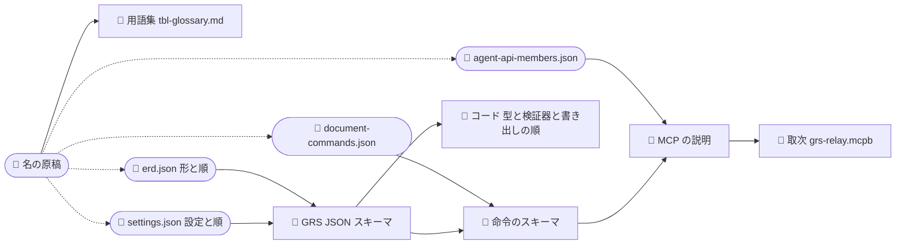
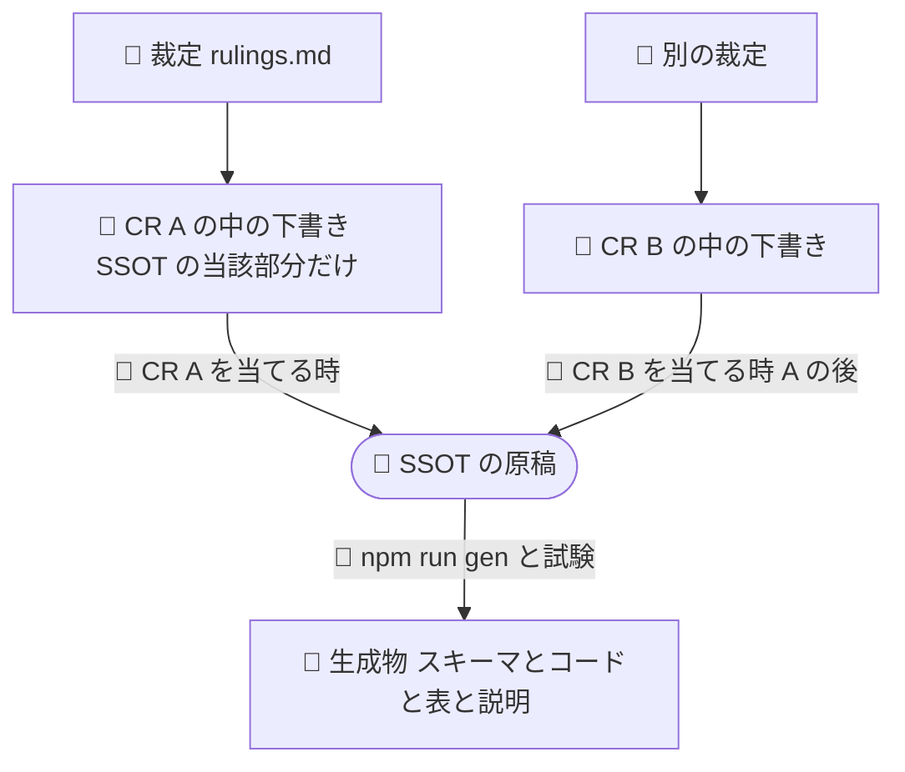

# 🔄 *SSOT と、用語・キー名のそろえ方 —— 1 枚目（SSOT の形と、残る隙間）*

> **/grsmd-qa の使い方**
> - 「回答:」の後ろに、選択肢の文字（a, b …）か自由な文を書き、保存してから、チャットで「更新した」と伝えてください。
> - 🔄 と*斜体*は、前回から変わった所です（`f` で 🔄 を検索すると順に飛べます）。初版には付きません。
> - 強調したい所には ★ を付けてかまいません。

🔄 *2026-10-28 に作り、同じ日に書き直した。問いは利用者の 3 つ（用語とキー名の一致の仕組み、`_source` からの生成、SSOT の JSON の形と順）と、裁定の置き場。今の仕組みの事実と数は `11-ssot-survey.md` にあり、この紙には決まった形と残る問いだけを置く。*

---

## 決まったこと

| 問 | 決め | 裁定 |
|---|---|---|
| 1-3 | SSOT は「1 つの事実は 1 か所」。名の原稿を 1 本立て（用語集は生成物に）、ほかの原稿は名を ID で指す | `JDG-3411` |
| 2 | プロパティの順は SSOT が決め、スキーマ・書き出し・表・説明はその順に従う。生成器は並べ替えない。順を検査する | `JDG-3412` |
| 3 | 裁定は `rulings.md` の 1 本のまま、JSON スキーマと API の裁定の索引を生成する。SSOT が常に最優先 | `JDG-3413` |
| 🔄 *3-2* | 🔄 *裁定が変える SSOT の部分だけの下書きを CR の中に作り、CR を当てる時に SSOT へ反映する。1 段あけて、並べた CR が原稿の上でぶつからないようにする* | 🔄 *`JDG-3414`* |

---

## 🔄 *目指す形（これまでの決め）*

🔄 *今の仕組みの事実（層・検査・生成器・順の出どころ）は `11-ssot-survey.md` に残し、ここには決まった形だけを描きます。*

🔄 ***事実ごとの居場所**（`JDG-3411`・`JDG-3412`・`JDG-3413`）*

| 🔄 *事実* | 🔄 *居場所（SSOT）* | 🔄 *そこから生まれる物* |
|---|---|---|
| 🔄 *名（語・英語名・日本語名・意味）* | 🔄 *名の原稿（新しく立てる。たとえば `docs/spec/_source/glossary.json`）* | 🔄 *用語集 `tbl-glossary.md`。ほかの原稿は名を ID で指す* |
| 🔄 *GRS JSON のデータの形と、その順* | 🔄 *`docs/spec/_source/erd.json`（実体と列の並びが、そのまま順）* | 🔄 *GRS JSON スキーマ、ERD の表、コードの型* |
| 🔄 *設定の値と、`documentSettings` の群と順* | 🔄 *`docs/spec/_source/settings.json`* | 🔄 *設定の表、スキーマの `documentSettings`、既定値* |
| 🔄 *Agent API* | 🔄 *`docs/spec/_source/agent-api-members.json`* | 🔄 *MCP の説明、コードの Agent API の領域、表* |
| 🔄 *文書の命令* | 🔄 *`docs/spec/_source/document-commands.json`* | 🔄 *命令のスキーマ、コードの命令の領域、表* |
| 🔄 *裁定（判断の記録）* | 🔄 *`docs/development-records/rulings.md`（SSOT より下。食い違えば SSOT が正）* | 🔄 *JSON と API の裁定の索引* |

🔄 ***生まれ方**（丸は人が直す原稿、四角は生成物。点線は名を ID で指すこと）*

🔄 ***裁定から SSOT まで**（`JDG-3413`・`JDG-3414`）*

- 🔄 *原稿が変わるのは CR を当てる時だけで、1 つずつです。並べて進める CR は、それぞれ自分の下書きだけを直すので、原稿の上でぶつかりません。*
- 🔄 *当てる時に、下書きの元にした原稿が変わっていたら、下書きを今の原稿から作り直してから当てます（SSOT が最優先）。*
- 🔄 *外と結ぶ所（GRS JSON・Agent API）の下書きは、利用者が行ごとに OK してから当てます（`JDG-3274`）。*

---

## 問 1. 生成に乗らない名の、ずれをどう止めるか

**場面**: 問 1-3 の答え（`JDG-3411`）で、名は名の原稿 1 本から生成されるか、ID で指されることになりました。それでも、生成に乗らない所が残ります。

| 残る所 | 今の数 |
|---|---|
| MCP の説明文とツールの説明の中に書いた名 | 説明の中の名 50 種のうち 15 がどのスキーマにも無い |
| 仕様書の文の中の `実体.列` | 395 件。今はずれ 0 だが検査は無い |
| `check.sh` が走らせない生成器 | 39 本のうち 10 本（コミットの門だけが走らせる） |

| 案 | 中身 |
|---|---|
| **a（推奨）** | **3 つとも検査で止める** —— 説明文と仕様書の文の中の名が、名の原稿かスキーマにあるかを見る検査を足す。`check.sh` は 39 本を全部走らせる（問 1-2 の入力の表から決める） |
| b | 説明文も文の中の名も、名の原稿から差し込む形にする（`{{名の ID}}` のように書き、生成で名に置き換える） |
| c | 今のまま |

**推奨の理由**: 説明文や仕様書の文は人や AI が読む文で、名を差し込む形（b）にすると原稿が読みにくくなります。名は文に書いたまま、ずれたら赤くするほうが、書く人にも読む人にも楽です。

回答:

### 🔄 *問 1-2. 生成物を入力にする段を、どこまで許すか*

🔄 ***場面**: 上の「生まれ方」の図でも、生成物を次の生成の入力にする所が残ります —— GRS JSON スキーマ → コードと命令のスキーマ → MCP の説明 → 取次 で、取次は原稿から 4 段目です。段が深いと、途中が古いまま次を作れば古い値が写ります（今は `npm run gen` の決まった順で防いでいます）。今はほかに、**生成した `.md`（`tbl-settings.md`）を、スキーマの生成器が入力として読んでいます**（目指す形では `settings.json` を直に読む）。*

| 案 | 中身 |
|---|---|
| **a（推奨）** | 🔄 ***段は許し、決まりを 2 つ置く** —— ① 生成器の入力は原稿か、生成した JSON だけ（生成した .md を入力にしない）。② 各生成器の入力を 1 つの表に書き、`npm run gen` の順をその表から決め、表と実際の入力が合うかを検査する* |
| b | 🔄 ***全部 1 段にする** —— どの生成器も原稿だけを読む（スキーマを組み立てる規則を、命令・MCP・雛形の生成器がそれぞれ持つ）* |
| c | 今のまま |

🔄 ***推奨の理由**: b は同じ組み立ての規則を何か所にも持つことになり、規則が離れていきます。a なら組み立ては 1 か所のまま、段の順が表から決まるので順の間違いが起きません。.md を入力から外せば、人の読む形を変えても生成が壊れません。*

回答:

---

## 自由欄

答えを読んで、ほかに聞きたいこと・違うと思う所があれば、ここに書いてください。

回答:
