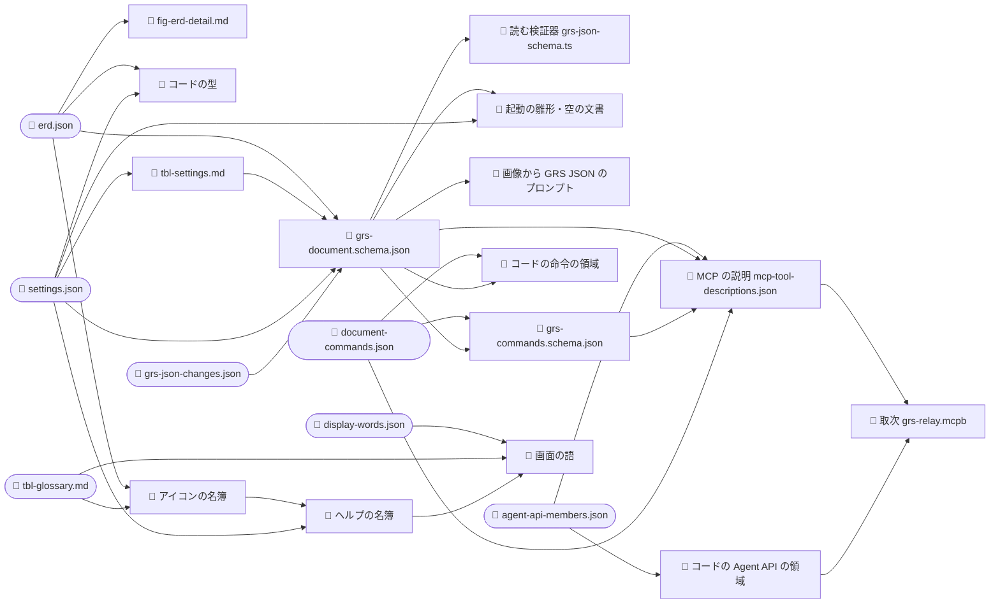

# SSOT と、用語・キー名のそろえ方 —— 1 枚目（今の仕組みと、隙間の塞ぎ方）

> **/grsmd-qa の使い方**
> - 「回答:」の後ろに、選択肢の文字（a, b …）か自由な文を書き、保存してから、チャットで「更新した」と伝えてください。
> - 🔄 と*斜体*は、前回から変わった所です（`f` で 🔄 を検索すると順に飛べます）。初版には付きません。
> - 強調したい所には ★ を付けてかまいません。

🔄 *2026-10-28 に作った。問いは利用者の 3 つ（用語とキー名の一致の仕組み、`_source` からの生成、SSOT の JSON の形と順）と、裁定の置き場。下の「答え」は今の事実で、数と出どころは全部 `11-ssot-survey.md` にある（調べた木は `1268eea24`。39 本の生成器の `--check` を 1 本ずつ走らせ、全部通った）。*

---

## 決まったこと

| 問 | 決め | 裁定 |
|---|---|---|

---

## 答え 1. 用語とキー名の一致は、今どう担保されているか

層は 7 つ: 用語集（G）・仕様書の文（P）・原稿 `_source`（M）・コード（C）・Agent API と MCP の説明（A）・GRS JSON スキーマ（S）・外の人が読む頁（X: spec-html・ダウンロード頁・紹介頁・手引き）。

担保の手段は 4 つ: ① 片方から片方を刷る生成器（39 本）、② `check.sh` の検査、③ コミットの門 GT-1（`npm run gen:check` で 39 本の古びを止める）、④ 規則 03 §1「仕様の名をそのまま綴る」（人が守るだけ）。

| 組 | 今 | 主な手段 |
|---|---|---|
| コード ↔ スキーマ | 生成 ＋ 検査 | 型（検査 20）、読む検証器（検査 27）、形の指紋の試験 |
| コード ↔ Agent API | 生成 | `agent-api-members.json` から刷る（GT-1 だけ。`check.sh` は走らせない） |
| 仕様書の表 ↔ 原稿 | 生成 ＋ 検査 | ERD の表・設定の表（検査 16・17） |
| 外の頁 ↔ スキーマ | 同じファイル | 公開スキーマは生成物そのもの（検査 75・76） |
| 用語集 ↔ 設定のキー（画面の語） | 一部検査 | 検査 37・84 |
| 用語集 ↔ スキーマの `documentSettings` | **なし** | 用語集は「全部のキーに K 行（MUST）」と言うが、誰も数えない。今 `tableViews` が欠け |
| 用語集 ↔ ERD とコード（データの名と値） | **なし** | 今 `P-5 actualDuration`（退いた列）、`P-17 actualPlacement`（値が用語集 `atActualDate`、コード `sideways`）が食い違う |
| 用語集 ↔ Agent API の名 | **なし** | メンバ名・命令名・引数名を比べる相手が無い（検査 84 の頭書きが自分でそう書く） |
| MCP の説明文 ↔ スキーマ | **なし** | 説明文の中の名 50 種のうち 15 がどのスキーマにも無い（`causeUid`・`staleStamp` ほか） |
| 仕様書の文 ↔ スキーマ | **なし**（今 0 件） | 文の中の `実体.列` 395 件はどれもスキーマにある（測った）が、検査は無い |
| ダウンロード頁・紹介頁 ↔ 他 | **なし** | 版の数字だけ検査。名はほぼ書いていない |

ほかに 1 つ: `check.sh` 27 番の注は「gen:check の生成器は全部ここで止める」と書くが、10 本（Agent API・命令・MCP の説明ほか）を走らせない。コミットの門では止まるが、`check.sh` だけを見ると古びが見えない。

---

## 答え 2. `_source` から、どうやってほかを作るか

`docs/spec/_source/` には 3 種類のファイルがある。

| 種類 | 数 | 例 |
|---|---|---|
| 原稿（SSOT） | 15 | `erd.json`（データの形）・`settings.json`（設定）・`display-words.json`（画面の語）・`agent-api-members.json`（Agent API）・`document-commands.json`（命令）・`notice-reasons.json`（拒否と知らせの理由）ほか |
| 原稿の契約（原稿を検証する手書きのスキーマ） | 11 | `erd.schema.json` ほか |
| 生成物 | 4 | `grs-document.schema.json`（GRS JSON スキーマ）・`grs-commands.schema.json`・`overview.json`・`source-relations.json` |

`npm run gen` が 39 本の生成器を決まった順に呼ぶ。主な流れ:

```text
erd.json + settings.json
  +- 仕様書の表（ERD の詳細、設定の表）
  +- grs-document.schema.json（GRS JSON スキーマ）
  |  +- コードの読む検証器、起動の雛形、画像から GRS JSON のプロンプト
  +- コードの型と既定値
agent-api-members.json
  +- 仕様書の表、コードの Agent API の領域、MCP の説明（grs-relay.mcpb に入る）
document-commands.json
  +- 仕様書の表、コードの命令の領域、grs-commands.schema.json
display-words.json + 用語集
  +- 画面の語（コード）
```

古びの止め方: GRS JSON・設定・画面の語は `check.sh` とコミットの門の両方、Agent API・命令・MCP の説明はコミットの門だけ。抜け: `fig-mcp-relay.json` の図を刷る生成器が無い。

---

## 答え 3. SSOT の JSON の形と、スキーマとの対応、順

- `erd.json` の形: 最上段に `entities`（実体 19）・`relations`（関係 26）・`container`（ルートと schedule の箱）ほか。実体は `name`・`description`・`columns`、列は `name`・`json`（機械の型）・`exchange`（MSPDI の道）・`meaning`（日本語）・`schemaNote`（英語。160 列のうち 32 列）ほか。
- スキーマとの対応: **実体と列は 1 対 1**（`$defs` の型 1 つ ＝ 実体 1 つ、プロパティ 1 つ ＝ 列 1 つ）。ルート・schedule の箱・`documentSettings`・共通の型（日時・色など）は ERD の外（`settings.json` と生成器）から足す。ERD の関係・日本語の意味・MSPDI の道はスキーマに出さない。
- 順（今の事実）:

| 場所 | スキーマの順を決めるもの |
|---|---|
| ルート | `$schema` を先頭に、`erd.json` の箱の並び |
| schedule の中 | `erd.json` の箱の並び |
| 実体の中 | `erd.json` の列の並び（19 実体とも一致を測った） |
| `documentSettings` の中 | **名のアルファベット順**（生成器が並べ替える） |

- 書き出すファイルの順: コードは **メモリの中の順のまま** 書き、並べ替えない。開いて保存した文書は元のファイルの順、新しい文書は起動の雛形の順。順を確かめる検査も試験も無い（形の指紋の試験は、わざと順を無視して比べる）。今、雛形の `Project` の 1 か所（`outlineBase`）がスキーマの順と違う。
- 順の規則: `JDG-3322`（ERD をもとに 1 つの規則の順に並べる）と、その案 `studies/76-grs-json-beta-shape/property-order.md`（「DR-6」）は `CR-851` 待ちで、仕様にも原稿にもまだ入っていない。

---

## 問 1. 用語とキー名の隙間を、どう塞ぐか

**場面**: 用語集で `Grab Point` と決めても、コード・Agent API・MCP の説明・`documentSettings` のキーが違う名のままでも、どの検査も赤くならない（答え 1 の「なし」の 6 組）。今回の用語の裁定（`JDG-3351`〜`3384`・`3410`）を当てる `CR-851` と `CR-855` の後も、同じことが起こりうる。

| 案 | 中身 |
|---|---|
| **a（推奨）** | **名の検査を足す** —— 用語集の行と、原稿（`erd.json`・`settings.json`・`agent-api-members.json`・`document-commands.json`）とコードの名を突き合わせる検査を 1 本にまとめる（今の検査 84 を広げる）。MCP の説明文の中の名もスキーマにあるかを見る。`check.sh` が 39 本の生成器を全部走らせるようにする |
| b | **用語集を生成にする** —— データ・設定・API の名の行を原稿から刷り、用語集の手書きは画面の部品の名だけにする |
| c | 今のまま（規則 03 §1 を人が守る） |

**推奨の理由**: 用語集は名の「意味」を人の言葉で書く所で、原稿は名の「形」を持つ所です。b は意味の書き場所を原稿へ移すことになり、原稿が大きくなります。a は書き場所を変えずに、ずれたら赤くするだけです。どれを選んでも、規則と道具の変更になるので、調整役が別の CR にします。

回答:

### 🔄 *問 1-2. 前提: SSOT はどれか、そこから何が何段で生まれるか*

🔄 *ご指摘のとおり、先に SSOT と派生の段を示します。数と出どころは `11-ssot-survey.md`、各段の入力は生成器のコードで確かめました（`erd_json_to_schema.py` が `tbl-settings.md` を読む、など）。*

🔄 ***SSOT（人が直す所）***

| 🔄 *パス* | 🔄 *持つもの* |
|---|---|
| 🔄 *`docs/spec/_source/erd.json`* | 🔄 *GRS JSON のデータの形（実体 19・列 160・関係 26）と、ルートと schedule の箱* |
| 🔄 *`docs/spec/_source/settings.json`* | 🔄 *設定の値と `documentSettings` のキー・型・既定値* |
| 🔄 *`docs/spec/_source/agent-api-members.json`* | 🔄 *Agent API と MCP のメンバ* |
| 🔄 *`docs/spec/_source/document-commands.json`* | 🔄 *文書を変える命令* |
| 🔄 *`docs/spec/_source/display-words.json`* | 🔄 *画面の語の原稿* |
| 🔄 *`docs/spec/_source/notice-reasons.json`* | 🔄 *拒否と知らせの理由* |
| 🔄 *`docs/spec/_source/grs-json-changes.json`* | 🔄 *GRS JSON の形の変更の台帳* |
| 🔄 *`docs/spec/_source/` のほか 8 本* | 🔄 *項目・状態機械・公開の入口・検証・行 ID の接頭辞・部品・MSPDI の独自項目・取次の図* |
| 🔄 *`docs/spec/_assets/tbl-glossary.md`（手書きの .md）* | 🔄 *用語集。**JSON ではないが、画面の語・アイコンの生成器の入力*** |
| 🔄 *`docs/spec/01-04-requirements.md`・`05-07-design.md` の表（手書き）* | 🔄 *時間帯・交換形式・アイコンの一覧など。**生成器が表を読む*** |

🔄 *つまり SSOT は JSON 15 本だけでなく、手書きの .md もいくつか入力になっています。*

🔄 ***派生の図**（GRS JSON と Agent API にかかわる所だけ。丸は手書き、四角は生成物）*



🔄 ***派生の段**（「段」は SSOT から何回の生成を経て生まれるか。生成物を入力にすると 1 段増える）*

| 🔄 *生成物* | 🔄 *直の入力* | 🔄 *段* |
|---|---|---|
| 🔄 *`fig-erd-detail.md`・`tbl-settings.md`・コードの型・`tbl-agent-api-members.md`・コードの Agent API の領域・アイコンの名簿* | 🔄 *SSOT だけ* | 🔄 *1* |
| 🔄 *`grs-document.schema.json`（GRS JSON スキーマ）* | 🔄 *`erd.json`・`settings.json`・**生成した `tbl-settings.md`*** | 🔄 *2* |
| 🔄 *ヘルプの名簿* | 🔄 *`settings.json`・**生成したアイコンの名簿*** | 🔄 *2* |
| 🔄 *読む検証器・起動の雛形と空の文書・画像のプロンプト* | 🔄 ***生成したスキーマ*** | 🔄 *3* |
| 🔄 *`grs-commands.schema.json`・コードの命令の領域* | 🔄 *`document-commands.json`・**生成したスキーマ*** | 🔄 *3* |
| 🔄 *画面の語* | 🔄 *`display-words.json`・用語集・**生成したヘルプの名簿**・**生成した項目の表*** | 🔄 *3* |
| 🔄 *MCP の説明* | 🔄 *`agent-api-members.json`・`document-commands.json`・**生成した 2 本のスキーマ*** | 🔄 *4* |
| 🔄 *取次 `grs-relay.mcpb`* | 🔄 ***生成した MCP の説明** と `src`* | 🔄 *5* |

🔄 ***段が深いと起きること**: 途中の生成物が古いまま次を作ると、古い値が次へ写ります。今は `npm run gen` が決まった順（39 本）で回すので防げていますが、順を間違えると 1 回では直らず、2 回回して初めて揃う所があります。もう 1 つ、**生成した .md（`tbl-settings.md`）を、スキーマの生成器が入力として読む**所があります。.md は人が読む物なので、形を変えたとき（表の列を足すなど）にスキーマが壊れやすい所です。*

| 🔄 *案* | 🔄 *中身* |
|---|---|
| 🔄 ***a（推奨）*** | 🔄 ***段は許し、決まりを 2 つ置く** —— ① 生成器の入力は SSOT か生成した JSON だけ（生成した .md を入力にしない。スキーマは `settings.json` を直に読む）。② 各生成器の入力と段を 1 つの表（たとえば `package.json` の横の一覧）に書き、`npm run gen` の順をその表から決め、表と実際の入力が合うかを検査する* |
| 🔄 *b* | 🔄 ***全部 1 段にする** —— どの生成器も SSOT だけを読み、生成物を入力にしない（スキーマの組み立てを、命令・MCP・雛形の生成器がそれぞれ持つ）* |
| 🔄 *c* | 🔄 *今のまま* |

🔄 ***推奨の理由**: b は同じ組み立て（スキーマを作る規則）を何か所にも持つことになり、規則が離れていきます。a なら組み立ては 1 か所のまま、段の順が表から決まるので順の間違いが起きません。.md を入力から外せば、人の読む形を変えても生成が壊れません。*

回答:

---

## 問 2. GRS JSON のプロパティの順の「正」を、どこに置くか

**場面**: AI や人が GRS JSON を読むとき、プロパティが意味の順（識別子 → 名 → 値 → 描き方 …）に並んでいると読みやすい（`JDG-3322`）。今は `documentSettings` だけアルファベット順で、書き出すファイルの順は開いた元のファイルの順になる。

| 案 | 中身 |
|---|---|
| **a（推奨）** | **原稿の並びを正にする** —— `erd.json` の列の並びと、`settings.json` に足す並び（`documentSettings` の群と順）を正にする。生成器は並べ替えない。GRS が書き出すときは、スキーマの順に並べ直してから書く。順を確かめる検査を足す |
| b | スキーマには順を持たせず（並べ替えたまま）、書き出すときだけ `property-order.md` の順に並べる |
| c | 今のまま（`documentSettings` はアルファベット順、書き出しは元のファイルの順） |

**推奨の理由**: 順を 1 か所（原稿）に置けば、スキーマ・仕様書の表・書き出すファイル・AI に見せる説明が同じ順になります。b は順の正がスキーマと別の表に分かれ、いずれ離れます。JSON の読み手は順を気にしないので、並べ直しても互換は壊れません。これも `CR-851`（形の組み替え）の中で当てるのが自然です。

回答:

---

## 問 3. JSON スキーマと API の裁定を、どこに置くか

**場面**: 今、裁定は全部 `docs/development-records/rulings.md` の 1 本（1,988 行）にあり、GRS JSON・スキーマの裁定が 195 行、Agent API・MCP の裁定が 114 行、混ざって並ぶ。行のレビューの表と質問の紙は `studies/76-grs-json-beta-shape/` にある。ご提案は、JSON スキーマと API の裁定を `studies/` のこのあたりに置くこと。

| 案 | 中身 |
|---|---|
| **a（推奨）** | **裁定は `rulings.md` の 1 本のまま、索引を `studies/81` に置く** —— JSON スキーマと API の裁定だけを並べた索引（裁定の番号・一行の決め・当てる CR・当てたか）を、`rulings.md` から生成して置く。質問の紙とレビューの表は今どおり `studies/` |
| b | JSON スキーマと API の裁定を、`rulings.md` から別のファイル（たとえば `docs/development-records/rulings-grs-json-api.md`）に分ける |
| c | ご提案のとおり、`studies/` の中に裁定そのものを置く |

**推奨の理由**: 裁定の台帳を 1 本にしておくと、番号の重複や、覆された裁定の追い方（どの裁定がどれを覆したか）を今の検査が見続けられます（`rulings.md` は検査 43 などが読んでいます）。`studies/` は作業場で下書きの扱いなので、ここに裁定そのものを置くと、検査の外に出ます。索引なら、JSON と API の裁定だけを一目で見られ、台帳は 1 本のままです。

回答:

---

## 自由欄

答えを読んで、ほかに聞きたいこと・違うと思う所があれば、ここに書いてください。

回答: 回答の前提としてSSOTとするJSONのファイル名のPathと、そこから派生する各種ファイルの関係を示せよ。 話それからだ。 まずはSSOTをズバリ示せ。 それからMeremaidの図と表で派生関係を示せ。  1段で派生させるのか、複数段で派生させるのかでも今後の扱いや不具合未然防止に影響するだろ？ わかる？ 
