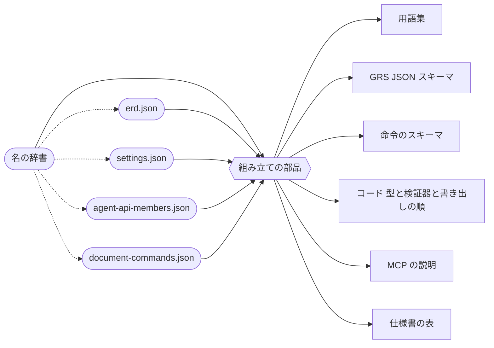
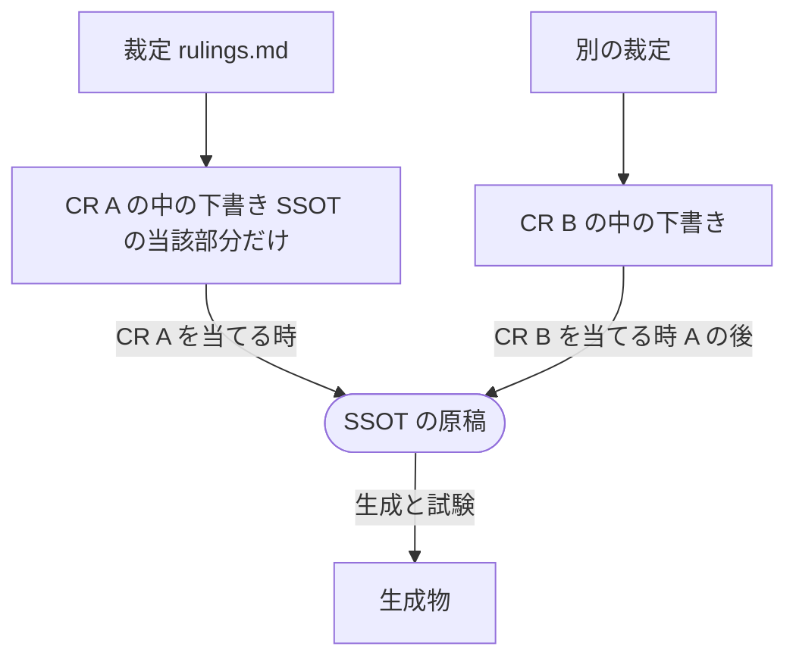

# SSOT と、用語・キー名のそろえ方

> **/grsmd-qa の使い方**
> - 「回答:」の後ろに、選択肢の文字（a, b …）か自由な文を書き、保存してから、チャットで「更新した」と伝えてください。
> - 🔄 と*斜体*は、前回から変わった所です（`f` で 🔄 を検索すると順に飛べます）。初版には付きません。
> - 強調したい所には ★ を付けてかまいません。

🔄 *2026-10-28 に作り、同じ日に閉じた（問いは全部決まった）。この紙には、決まったことだけを置く（`JDG-3417`）。今の仕組みの事実と数は `11-ssot-survey.md` にある。*

---

## 決まったこと

| 問 | 決め | 裁定 |
|---|---|---|
| 1 | 文の中に書いた名（説明文と仕様書の文）は文のまま残し、名の辞書にあるかを検査で見る。差し込む形にはしない | `JDG-3418` |
| 1-3 | SSOT は「1 つの事実は 1 か所」。名の原稿を 1 本立て（用語集は生成物に）、ほかの原稿は名を ID で指す | `JDG-3411` |
| 置き場 | 名の辞書は `docs/spec/_source/glossary.json` | `JDG-3419` |
| 2 | 原稿の JSON スキーマ（11 本と新しい `glossary.schema.json`）は開発ルールの下の 1 つのフォルダに置く。生成物のスキーマ 2 本は `_source` に残す | `JDG-3420` |
| 生成の仕組み | 開発ルールのスキーマに基づいて生成する仕組みを、今の生成器を土台に作り直す（保守性への投資） | `JDG-3421` |
| 言葉 | 名の辞書と生成の決まりは英語と日本語を並べ、英語が主（正）、日本語が副（訳）。仕様書は当面、日本語だけ | `JDG-3422` |
| 1-4 | 名の原稿はキーそのものを ID とする辞書。持ち主で意味が変わるキーだけ `kind@Color` のように分ける。各項目は英語の説明・日本語の説明・人に見せる名・用途を持つ。派生は子のプロパティ、関連する語はタグで結ぶ（分類の木） | `JDG-3415` |
| 1-2・1-5 | 生成は全部 SSOT から 1 段。生成物を入力にしない。スキーマを組み立てる規則は共有の部品に 1 か所 | `JDG-3416` |
| 順 | プロパティの順は SSOT が決め、スキーマ・書き出し・表・説明はその順に従う。生成器は並べ替えない。順を検査する | `JDG-3412` |
| 🔄 *3* | 🔄 *順は原稿の配列の並びだけで決める。順の要るものは必ず配列で持ち、順番号は入れない* | 🔄 *`JDG-3423`* |
| 3 | 裁定は `rulings.md` の 1 本のまま、JSON スキーマと API の裁定の索引を生成する。SSOT が常に最優先 | `JDG-3413` |
| 3-2 | 裁定が変える SSOT の部分だけの下書きを CR の中に作り、CR を当てる時に SSOT へ反映する。並べた CR が原稿の上でぶつからない | `JDG-3414` |
| 紙の形 | 1 つの議論は 1 つのファイル。使い方 → 決まったこと → 開いている問い → 自由欄。いらなくなった所は消す | `JDG-3417` |

🔄 *当てる CR: 順（`JDG-3412`・`JDG-3423`）は `CR-851`、ほかは `CR-857`（`CR-851` の後。まだ起草していない）。*

### 決まった形 —— 事実ごとの居場所

| 事実 | 居場所（SSOT） | そこから生まれる物 |
|---|---|---|
| 名（キー・英語の説明が主で日本語が副・人に見せる名・用途・子・タグ） | 名の辞書 `docs/spec/_source/glossary.json`（新しく立てる） | 用語集 `tbl-glossary.md`、スキーマと MCP の説明文 |
| GRS JSON のデータの形と、その順 | `docs/spec/_source/erd.json`（実体と列の並びがそのまま順。名は辞書の ID） | GRS JSON スキーマ、ERD の表、コードの型 |
| 設定の値と、`documentSettings` の群と順 | `docs/spec/_source/settings.json` | 設定の表、スキーマの `documentSettings`、既定値 |
| Agent API | `docs/spec/_source/agent-api-members.json` | MCP の説明、コードの Agent API の領域、表 |
| 文書の命令 | `docs/spec/_source/document-commands.json` | 命令のスキーマ、コードの命令の領域、表 |
| 原稿の書き方の決まり（原稿の JSON スキーマと、その英語が主の説明） | `docs/development-rules/` の下の 1 つのフォルダ（たとえば `manuscript-schemas/`） | 原稿の検査、生成器が読む形 |
| 裁定（判断の記録） | `docs/development-records/rulings.md`（SSOT より下。食い違えば SSOT が正） | JSON と API の裁定の索引 |

### 決まった形 —— 生まれ方（全部 1 段）

丸は人が直す原稿、六角は共有の組み立ての部品（コード）、四角は生成物。点線は名を辞書の ID で指すこと。

どの生成物も、原稿から組み立ての部品を通って 1 段で生まれる。生成物を次の生成の入力にはしない。

### 決まった形 —— 裁定から SSOT まで

- 原稿が変わるのは CR を当てる時だけで、1 つずつ。下書きの元にした原稿が変わっていたら、下書きを作り直してから当てる（SSOT が最優先）。
- 外と結ぶ所（GRS JSON・Agent API）の下書きは、利用者が行ごとに OK してから当てる（`JDG-3274`）。
