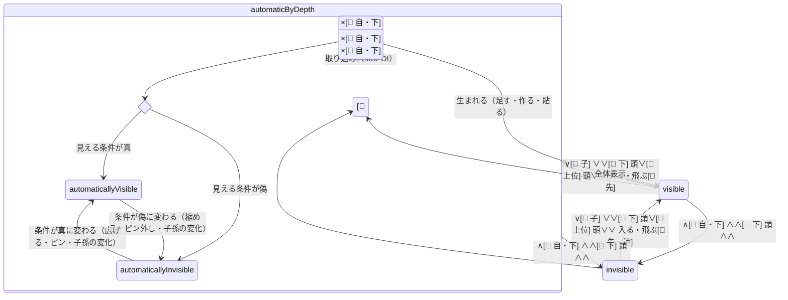
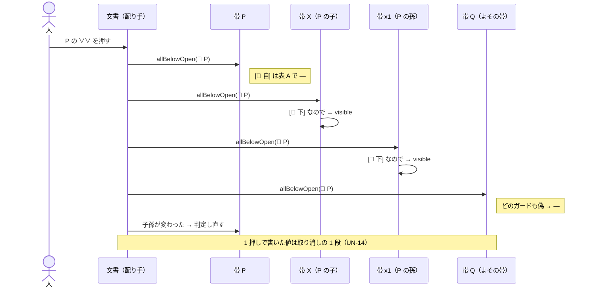
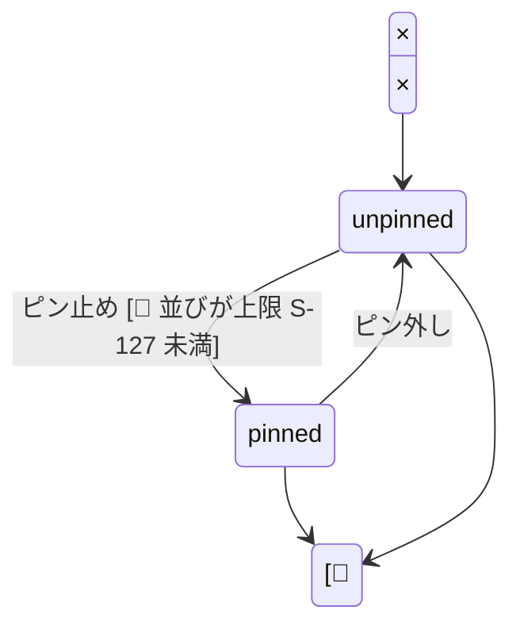

BGQA3
# GRS JSON の名（名の辞書 3）

> 「回答:」の後ろに答えを書いて保存し、1 行目の BGQA3 を切り取ってください。
> 凡例: ❓回答待 ✅回答済 🔄変化点 ★強調(ユーザー専用)

2026-11-15 に作った。BGQA2（名の辞書）が大きくなりすぎたので、あなたの指示で約束の面ごとに分けた（`JDG-3568`）。この紙は GRS JSON の名を受け持つ。文書の命令は BGQA4、Agent API は BGQA5 が受け持ち、GRS JSON の名が決まった後に出す。決まりと、これまでの決定事項は BGQA2（`goodrelax-qa-b2-glossary.md`）にある。

🔄 *残 10（❓ で検索）*

1 回目は、ほかの名に効く 10 問です: キーの付け方の決まり、根の並びと呼び名、順番の数、色の形、MSPDI と違う名を保つかの 2 問。残りの GRS JSON の問い（21）は、答えの後で 10 問前後ずつ出します。

2026-11-15 の 2 回目: 1 回目のあなたの答えで 4 問が決まりました（`JDG-3569`・`JDG-3602`〜`JDG-3604`）。説明と例を求めた問いは、JSON の例をコードブロックに入れて書き直しました。新しく、パレットの paper と ink（問 6-6-4-12）、タイムゾーンの置き場（問 6-8-19）、キーの付け方の決まり（問 6-8-6）、画面の欄の名（問 6-13-2）、MSPDI の名と違う語（問 6-9-5・6-7-7）を足しました。

2026-11-15 の 3 回目: あなたの求めに合わせ、GRS JSON の構造図と分け方の考え（問 6-13-3）を、問いの先頭に置きました。ほかの問いは 2 回目のままです。

2026-11-15 の 4 回目: 問 6-13-3 に、15 か所の GRS だけの値を 1 つずつ照らした根拠の表を足し、問 6-8-19 をそこへまとめました。ほかの問いは 2 回目のままです。

2026-11-15 の 5 回目: 問 6-13-3 が決まり（`JDG-3605`）、プロパティの名を併記した構造図に描き直しました。新しく、Project から移す 7 つの値の入れ物の名（問 6-13-4）を問います。

2026-11-15 の 6 回目: あなたの指示「影響が大きいものだけ最初に問え」に従い、ほかの名や形に広く効く 6 問だけを、影響の大きい順に出します: 持ち越しの形（問 6-7-8）、`ordinal` の 4 つの役目（問 6-7-6）、キーに持ち主の名を繰り返さない決まり（問 6-8-6）、色の形の 3 問（問 6-6-4-10・6-6-4-11・6-6-4-8）。1 つの名だけに効く 7 問は、出す前の置き場へ戻しました。

2026-11-17 の 7 回目: 3 問が決まりました（`JDG-3606`〜`JDG-3608`）。続きを求めた 3 問に答えました: `ordinal` は JSON から無くせること（問 6-7-6）、命名の決まりと例外（問 6-8-6）、`allOf` の意味と JSON のデータ（問 6-6-4-11。推奨を b に改めた）。構造図は、残りの 3 問が決まった後に、まとめて描き直します。

2026-11-17 の 8 回目: 3 問の方向が決まりました（`JDG-3609`〜`JDG-3611`）。あなたの求めに合わせて、続きの 3 問を出します: 持ち越した一覧の要素の置き場（問 6-7-9）、MSPDI の `Type` を写す 3 つの名（問 6-8-7。前回の E-6 の一覧の誤りも直した）、コメントボックスの文字の見た目の名（問 6-6-4-13）。

2026-11-17 の 9 回目: 文字の見た目が決まりました（`JDG-3612`）。問 6-7-9 は他の AI への質問状の答えを待ちます。MSPDI の `Type` を写す 3 つは、MSPDI の名を最大限に尊重する案を足して問い直します（問 6-8-8）。

2026-11-17 の 9 回目（追記）: 問 6-7-9 に、他の AI 3 つの答えと、それを受けた私の案を足しました。あなたの確認（違う種類の実体を指さないか、OKPN）を受けて、一覧ごとに配列とキーを分ける形を推奨にしました。

2026-11-17 の 10 回目: 問 6-7-9 が決まりました（`JDG-3613`）。構造図の ★ を直し、決まったことを当てて描き直しました（問 6-13-5。直した行は説明の末尾に 🔄）。問 6-8-8 は、その構造図を見て決めてください。

2026-11-17 の 11 回目: 他の AI 3 つに構造図のレビューを頼み、採る価値が高い指摘を、影響の大きい順に 4 問にしました: タスクに付く GRS の値の置き場（問 6-13-6）、Project から移す 7 つの値（問 6-13-4）、命名の決まりの足し（問 6-8-9）、個々の名（問 6-8-10）。構造図（問 6-13-5）と MSPDI の `Type` の名（問 6-8-8）は、この答えで形が変わるので、出す前の置き場へ下げました。答えの後で、構造図を描き直して出し直します。

2026-11-17 の 11 回目（追記）: あなたの問い「各タスクにgrsをつけたら taskGroupはどうなる？」に、問 6-13-7 で答えました。

2026-11-17 の 12 回目: 4 問が決まりました（`JDG-3614`〜`JDG-3617`。問 6-8-10 は仮）。あなたの問い「data の中か、並べて置くか」に問 6-13-8 で答えました。決まったことを当てた β の GRS JSON を作り、他の AI への 2 通目の質問状にしています。

2026-11-18 の 13 回目: 外の AI 2 つが 2 通目の質問状に答えました（点数は 8.5 と 7.5）。指摘を 1 つずつ構造図・実例・これまでの裁定と照らし、読み違いと、もう決まっている所を除きました。残った本物の指摘を、影響の大きい順に 8 問にし、問 6-13-8 に 2 つの答えを足して出し直します。前の回までに決まった問いの見出しは、決定事項の表に答えがあるので、問いの部から消しました。構造図と実例の誤り（実例の完了率など）は、この回の答えの後に描き直すときに直します。

2026-11-18 の 14 回目: 7 問が決まりました（`JDG-3618`〜`JDG-3624`。問 6-8-13 は ★ の無い 8 行と 7 行目）。あなたの問いと ★ に、5 つの続きの問いで答えます: 版のキーのあなたの案（問 6-13-10-2）、変更した者の今の運用と形（問 6-11-6-2）、取り込みの回のキー（問 6-8-13-2）、MSPDI の `Type` を写す 3 つの名を NEIM で選び直した案（問 6-8-13-3）、リンクの欄を整理した結果（問 6-8-13-4）。

2026-11-18 の 15 回目: 5 問が決まり（`JDG-3625`〜`JDG-3629`）、開いた問いは無くなりました。MSPDI の `Type` を写す 3 つは、あなたの指示「だったらMSPDIの名前にしろ」のとおり、MSPDI の名 `Type` を camelCase にした `type` にします。値の意味と、この `type` が判別子でないことは、スキーマの説明に書きます。次の回で、決まったことを全部当てた構造図と実例の JSON を出します。

2026-11-18 の 16 回目: 決まったことを全部当てた構造図（2026-11-18 版）を出します（問 6-13-5）。実例の JSON にも同じ変更を当てました。全体を見て、直す所を ★ で書いてください。

2026-11-18 の 17 回目: 外の AI 2 つが 3 通目の質問状に答えました（「一目で意図が伝わるか」の点数は 8.0 と 8.8）。指摘を構造図・実例・これまでの裁定・仕様と照らし、読み違いと、もう決まっている所を除いて、7 問にしました。MSPDI の名で迷った所は、名を変えずにスキーマの説明で補います（説明の案は、外の AI の案を照らしてまとめます）。実例の誤り（基準日より後のマイルストーンが完了済み、休止で作業時間が足りない、取り込み元の控えが 1 つのタスクだけ）は、問わずに直します。構造図の確認（問 6-13-5）は、この回の答えで構造図が変わるので、答えの後に描き直して出し直します。

2026-11-18 の 18 回目: 6 問が決まりました（`JDG-3630`〜`JDG-3635`。問 6-8-16 は ★ の無い 4 行）。あなたの指示「規則の順序は優先度順にしろ」に合わせ、命名の決まりを勝つ順に並べ直しました（問 6-8-15-2）。並べると N-2 の「略さない」が矛盾を起こしたので、書き直す案を付けました。あなたの ★ と案に答えました: `representativeTaskUid`（問 6-8-16-2）、`largestIssuedUid`（問 6-8-16-3）、`importOrigin`（問 6-8-16-4）。自由の欄の問い「あと何回他のAIレビューやる？」に、やめる線の案で答えました（問 6-13-13）。色の自動で作った側の印は、あなたの案 `isCalculatedFromOppositeColor` に決めました（`JDG-3636`）。

2026-11-19 の 19 回目: 5 問が決まり（`JDG-3637`〜`JDG-3641`）、開いた問いは無くなりました。あなたの「a」（問 6-13-13）に従い、ここまでの裁定を全部当てた構造図と実例で、外の AI への 4 通目の質問状を 1 回だけ書きます。名や形を変える指摘が 0 件なら、外の AI のレビューはそこでやめます。

2026-11-19 の 20 回目: 4 通目の質問状を書くと、決めたばかりの決まりと今の名の食い違いが 3 つ見つかりました。外の AI がまず突く所なので、4 通目を出す前に 3 問で直します（問 6-11-7・6-8-17・6-8-18）。

2026-11-19 の 21 回目: 2 問が決まりました（`JDG-3642`・`JDG-3643`。許す略に、あなたの言葉どおり `max` も足した）。あなたの問い「一般的なタイムゾーンのデータ形式は？」に、3 つの形を比べて答え、タイムゾーンの値の形を問い直します（問 6-8-18-2）。

2026-11-19 の 22 回目: タイムゾーンの値の形は①の ISO 8601 の時差の文字列に決まりました（`JDG-3644`）。チャットでのあなたの問い（夏時間のデータ、形の検査、夏に保存したデータを冬に使うとき）に、仕様 `FR-156` の決めで答え、続きを問います（問 6-8-18-3）。前の版のこの問いは仕様を読み違えていたので、書き直しました。

2026-11-19 の 23 回目: タイムゾーンが決まり（`JDG-3645`）、開いた問いは無くなりました。ここまでの決めを構造図・実例・4 通目の質問状に当て、4 通目をお渡しします。

2026-11-19 の 24 回目: 外の AI 2 つが 4 通目に答えました（9.2 と 9.1）。名や形を変える指摘が残ったので、6 問にしました。説明の文で足りる指摘はスキーマの説明の案に入れ、実例の誤り（親タスクの実績の開始が無い、刻印の日時が基準日より前、フェードがバー全体を覆う）は問わずに直します。

2026-11-19 の 25 回目: 5 問が決まりました（`JDG-3646`〜`JDG-3650`）。あなたの問い「深さはどこで設定するの？」に答えて問い直し（問 6-12-5-2。前の問いの「設定の面で選ぶ値」は私の誤りでした）、自由の欄の問い「決まりのN-xはどこに書く？」に答えました（問 6-13-15）。

2026-11-19 の 26 回目: 2 問が決まりました（`JDG-3651`・`JDG-3652`）。帯の木の形は 1 つの物にまとめ、決まりは仕様書の JSON だけ、値の書き方はスキーマの各プロパティだけに書きます。あなたの「autoなのに設定値があるのって違和感」に答え、深さの名を問います（問 6-12-5-3）。

2026-11-19 の 27 回目: あなたの指示「表示状態、折り畳み状態の仕様を整理しろ」に従い、帯の木の表示を決める状態を仕様から読み集めて整理しました。描くかの判定はもう MECE で、JSON の置き場が散っていたのが「片手落ち」の元でした。置き場を決め直す問い（問 6-12-6。深さの名の問い 6-12-5-3 はここへまとめた）と、整理で見つかった仕様の抜け 2 つ（問 6-12-7・6-12-8）を問います。

2026-11-19 の 28 回目: あなたの ★「表示/非表示(show/hide)や折り畳み/展開(collapse/expand)で整理せよ」に従い、問 6-12-6 を 2 つの概念で組み直しました。組み直すと、帯の 1 つの値 `treeState` に 2 つの概念が入っていると分かったので、推奨を「2 つのキーに分ける」に改めました。問 6-12-7・6-12-8 はそのままです。

2026-11-19 の 29 回目: あなたの問い「`temporarilyExpanded` ってなんだっけ？ 開く条件、折り畳む条件は？」に、問 6-12-6 の 4 節で答えました。問いの案は前の回のままです。

2026-11-19 の 30 回目: チャットでのあなたの指示「NEIMにしたい... 提案しろ」に従い、折り畳み/展開の値の名を問い 6-12-6-2 にしました。

2026-11-19 の 31 回目: チャットで `expandedUntilZoomOut` に決まり（`JDG-3653`）、`followsDepth` は退けられたので、`auto` の名を問 6-12-6-2 で問い直します。

2026-11-19 の 32 回目: チャットで `auto` の名が `automaticallyExpandedWithinDepth` に決まりました（`JDG-3654`）。あなたの指示「再度GQAをJSONの例を入れて更新しろ。 問題ないか念確する。」に従い、問 6-12-6 を、決まった名を全部当てた JSON の例で書き直しました。

2026-11-19 の 33 回目: あなたの 3 つの問いに答えました。根の値が少ない理由（問 6-12-6。根の開いた値を `expanded` に直した）、深さと取り消しの問いの書き直し（問 6-12-7。Ctrl+Z で深さの変化を戻すか、だけを問う）、普通の使い方では閉じた親の下に開いた子はできないこと（問 6-12-8。読むときに直す案に改めた）。

2026-11-19 の 34 回目: あなたの ★「rootの状態がLv1以下の波及しないか？ Lv1からLv2に波及するルールと分けて管理するの？」を仕様の表 T-328 で確かめ、問 6-12-6 に答えを足しました（波及する。帯と同じルールで、配下の帯の値へ書き込む）。

🔄 *2026-11-19 の 35 回目: チャットで `isCollapsedIntoParent`（`JDG-3655`）と `childrenExpansionState`（`JDG-3656`）に決まりました。あなたの指示に従い、合わせて直す名を 1 人目の作業者が集め、2 人目の独立した作業者が矛盾と動作の違いを調べました。その結果で [root] の問いを組み直しました（問 6-12-6〜6-12-11）。私の前の版の誤り 3 つも直しています。*

🔄 *2026-11-20 の 36 回目: あなたの問い「そもそもなんで親が子の折り畳み状態を持つのか？…矛盾してない？…hide が消えた今、再整理できるのでは？」に従い、作業者が帯の木の状態を一から整理しました。名の読み違い（親が子の畳みを持つように見えた）と、隠すことの本当の意味（親の表示から抜く）が分かり、帯ごとに値 1 つの案を推します（問 6-12-12〜6-12-14）。前の回の問い 6-12-6・6-12-9・6-12-10・6-12-11 は、この答えで形が変わるので下げました。*

🔄 *2026-11-20 の 37 回目: チャットでのあなたの問い「各タスクグループが自分自身の表示状態を持つ仕様を検討したか？ collapseStatus: collapsed, expanded, automaticallyChanged」を作業者が今の仕様と照らし、問 6-12-12 の 5 節に答えを足しました。キーの名（問 6-12-13）と自動の値の名（問 6-12-15）を、あなたの名を入れて問い直します。*

🔄 *2026-11-20 の 38 回目: あなたの指示「OKPN/OMPV NEIM MECE になっているのか？ 特にOKPNなのか？ Opusのエージェントを使って再整理せよ」に従い、Opus の作業者が 4 つの原則で整理し直しました。前の推奨（キー 1 つ・5 値）は OKPN と OMPV に反していました。キー 2 つの形を推します（問 6-12-12〜6-12-14）。問 6-12-8 に MECE の残りを合わせました。*

🔄 *2026-11-20 の 39 回目: あなたの問い「3値と、自動的に決まるのがどういう場合か、で自分自身の状態だけを管理できないのか？…足りないものはなんだ？」に従い、作業者があなたの 3 値案を 17 の場面で今の動作と比べました。足りないものは 4 つで、どれも決まり 1 行で受け入れられます。3 値案を推し、足りないものを 1 つずつ問います（問 6-12-16〜6-12-20）。前の回の問い 6-12-12〜6-12-15・6-12-8 は下げました。*

🔄 *2026-11-20 の 40 回目: チャットでのあなたの問い「③ だけは、値を足しても今と同じにはなりません とはどういう意味か？ …これらの操作をした時の子の状態は？」に、作業者が操作ごとに整理し直した答えで、問 6-12-19 を書き直しました（前の版の「値を足しても今と同じにならない」は言い過ぎでした）。足すときに兄弟も開くかを問 6-12-19-2 で問います。*

🔄 *2026-11-20 の 41 回目: チャットでのあなたの指示（値の名、操作と状態の関係を状態遷移図と状態遷移表に、帯ごとの状態機械、自動を内側の状態機械に）に従い、作業者が帯ごとの状態機械を設計しました。設計を [root] の頭に載せ、問 6-12-21〜6-12-25 を足しました。問 6-12-19・6-12-19-2・6-12-20 は問 6-12-23 にまとめて下げました。*

***

## 決定事項

### [proj] プロジェクト

| 何 | 決め | 裁定 |
|:---|:---|:---|
| プロジェクトの 23 語（問 6-8-5） | 表のとおり確定（8-6 `uid`・8-8 `name`・8-9 `title`・8-10〜8-18・8-20〜8-25・8-31〜8-35）。8-19 `scheduleDataTimeZone` は名だけ確定し、置き場を問 6-8-19 で問う | `JDG-3569` |
| GRS JSON の命名の決まり（問 6-8-6） | 決まり N-1〜N-12 と例外の決まり X-1〜X-4 を採る。例外 E-1・E-2・E-4・E-5 を採る。E-3・E-6 は問 6-8-7 | `JDG-3609` |
| 命名の決まりの足し（問 6-8-9） | N-13〜N-17 を足し、X-2 を明記する。MSPDI の真偽の値も MSPDI の名のまま | `JDG-3616` |
| 個々の名 10 個（問 6-8-10） | 仮に採る。最終は全体の JSON を見てから | `JDG-3617` |
| 表示の倍率の単位（問 6-8-11） | `displayScalePercent` → `displayScaleRatio`（1 が等倍） | `JDG-3621` |
| 命名と順の決まりの足し（問 6-8-12） | 7 つを採る: N-11 を N-13 へまとめる、N-4 にも MSPDI の名が勝つ、中身が全部無い物は書かない、日時の値の形、タスクグループの親は `parentTaskGroupId`、`siblingOrder` は 1 から飛ばさずに振る、`uid` は配列の中・`id` は文書全体で一意 | `JDG-3622` |
| 仮の名と、外の AI が意見した名（問 6-8-13） | `fontSizePreset`・`editableByGroupName`、`scrollPosition.type` は `fixed`・`automatic`。`snapPoint`・`snapPart`・`fitDayRange`・`topTaskOutlineLevel`・`sourceFormat`・`parentTaskProgressToleranceWorkingDays` は今のまま。取り込みの回・`Type` の 3 つ・リンクは続きの問い | `JDG-3623` |
| 取り込みの回のキー（問 6-8-13-2） | 数え手は `mspdiImportCount`。タスクの `lastSeenMspdiImportNumber` は今のまま | `JDG-3627` |
| MSPDI の `Type` を写す 3 つ（問 6-8-13-3） | MSPDI の名のまま `type`（例外の日・先行への結び付き・担当）。MSPDI の名は N-7 にも勝つ。値の意味はスキーマの説明に書く | `JDG-3628` |
| リンクの欄（問 6-8-13-4） | 3 つの実体とも `hyperlinkAddress`・`hyperlink` のまま。GRS だけのリンクも残る | `JDG-3629` |
| 元の形式の値（問 6-8-14） | `grs`・`mspdi12`・`mspdi15` | `JDG-3633` |
| 決まりの足し（問 6-8-15） | 6 つを採る（参照は N-5 が N-4 に勝つ、`xxxType` の範囲、物の名に単位、必須の範囲、MSPDI へのタスクの並び、`preceding…Uid` の先頭）。決まりを優先度の順に並べ直す | `JDG-3634` |
| 外の AI が迷った GRS の名（問 6-8-16） | `delayDiagnosticsToleranceWorkingDays`・`taskGroupRootTreeState`。`fadeInCalendarDays`・`fadeOutCalendarDays`・`leaderTarget` は今のまま。★ の 3 行は続きの問い | `JDG-3635` |
| 命名の決まりの優先の順（問 6-8-15-2） | 21 段に並べる（上が勝つ）。N-2 を「略は `uid`・`id`・`Px`・`Utc` だけ」と書き直す | `JDG-3638` |
| 帯を代表するタスク（問 6-8-16-2） | `representativeTaskUid` | `JDG-3639` |
| uid の数え手（問 6-8-16-3） | `highestIssuedUid` のまま | `JDG-3640` |
| 取り込み元の控え（問 6-8-16-4） | `importOrigin` | `JDG-3641` |
| 許す略（問 6-8-17） | `uid`・`id`・`Px`・`Utc` と、Web の決まりの語 `dx`・`dy`・`min`・`max`・`hex`。MSPDI は固有の名で略に数えない | `JDG-3643` |
| タイムゾーンの値の形（問 6-8-18） | 3 か所とも ISO 8601 の時差の文字列 `utcOffset`（例 `"+09:00"`）。N-10 の決まりは今の字のまま | `JDG-3644` |
| 夏時間と読むときの検査（問 6-8-18-3） | `zoneNameType` は追加の時計だけ。データの時差と見せる基準は標準時の行だけ（`FR-156`）。読むときに形を調べる | `JDG-3645` |
| 予定バーの綴り（問 6-8-22） | `snapPart` の値は `planBar`・`actualBar`・`milestoneMark` | `JDG-3647` |
| 取り込みの最上位の深さ（問 6-8-23） | `importedTopTaskOutlineLevel` | `JDG-3648` |
| タスクが最後に見た取り込みの回（問 6-8-24） | `lastSeenMspdiImportCount` | `JDG-3649` |
| 決まりの足し（問 6-8-25） | N-2 が N-4 に勝つ範囲、単位の無い数の終わり（`…Count`・`…Order`・`…Depth`）、`type` は必須、指す先の無い参照と親の輪は読むのを断る | `JDG-3650` |

### [root] スケジュールデータと文書の根

| 何 | 決め | 裁定 |
|:---|:---|:---|
| 似た字と根の並び（問 6-13-1） | `note` → `remarks`、`levelZeroTreeState` → `rootTreeState`（階層は「深さ」で数える）。根の並びは `$schema`・`schemaVersion`・`buildVersion`・`documentSettings`・`scheduleData`・`documentStamp`・`changeLogEntries` | `JDG-3602` |
| 根の 3 つの部分の呼び名（問 6-11-1） | 「文書刻印」「文書設定」「変更履歴」 | `JDG-3603` |
| GRS JSON の構造と分け方（問 6-13-3） | 1 文書 1 JSON。根を形の版・見せ方・中身・帳簿に分け、中身を MSPDI と往復する群と GRS だけの群に分ける。往復する群の実体に置くのは、その実体のことを言い、かつ MSPDI と往復する値だけ。Project の GRS だけの値 7 つを GRS の群の 1 つの物へ移す（名は問 6-13-4） | `JDG-3605` |
| タスクに付く GRS の値（問 6-13-6） | タスクの中の `grs` にまとめる（`taskGroupId`・`style`・`origin`・フェードの 2 つ）。`taskGroupMembers`・`taskStyles`・`taskOrigins` は無くなる。前回予定は別の配列のまま | `JDG-3614` |
| タスクとタスクグループ（問 6-13-7） | タスクが `grs.taskGroupId` で持つ | `JDG-3615` |
| 5 つの値の置き場（問 6-13-8） | 袋を作らない。5 つを `scheduleData` の直下に名のまま置く（`metadata` は無くなる） | `JDG-3618` |
| タイムゾーンの値の形（問 6-13-9） | 3 か所とも分の数 `utcOffsetMinutes`。`scheduleDataTimeZone` は `{ utcOffsetMinutes }` の物 | `JDG-3619` |
| 3 つの表の見せ方の型（問 6-13-11） | 2 つの型: タスクの表（`checkedTaskUids`）と担当の表（`checkedResourceUids`・`isUnassignedChecked`） | `JDG-3620` |
| 版の 2 つのキー（問 6-13-10） | `schemaVersionUtc`・`buildVersionUtc`。版を言うキーは `…VersionUtc` で終える | `JDG-3625` |
| 変更した者（問 6-11-6） | `changedBy` を `{ type, name }` にする。`type`（`user`・`agent`）は GRS が自動で書く | `JDG-3626` |
| 表のスケジュールフィルタ（問 6-13-12） | `isScheduleFilterApplied` | `JDG-3630` |
| 追加の時計の夏時間（問 6-12-3） | `zoneNameType`（`standard`・`daylight`） | `JDG-3631` |
| タスクを積む向き（問 6-12-4） | 値は `bottomToTop`・`topToBottom` | `JDG-3632` |
| 外の AI のレビューをやめる線（問 6-13-13） | 4 通目を 1 回だけ出し、名や構造を変える指摘が 0 件ならやめる | `JDG-3637` |
| 変更した者の種類（問 6-11-7） | `changedBy { writerType, name }`（`writerType` は `user`・`agent`）。`lastEditedBy` は判別子の `type` のまま | `JDG-3642` |
| 遅延診断の許し幅の置き場（問 6-13-14） | `documentSettings.delayDiagnosticsSettings.toleranceWorkingDays` | `JDG-3646` |
| 帯の木の見え方（問 6-12-5-2） | `taskGroupTreeView { rootTreeState, 深さ }` にまとめる。深さの名は問 6-12-5-3 | `JDG-3651` |
| 決まりを書く所（問 6-13-15） | 決まりは仕様書の JSON だけ。値の書き方はスキーマの各プロパティだけ。スキーマの冒頭に構造の概要 | `JDG-3652` |
| 一時の展開の名（問 6-12-6-2） | `temporarilyExpanded` → `expandedUntilZoomOut` | `JDG-3653` |
| 自動で展開する値の名（問 6-12-6-2） | `auto` → `automaticallyExpandedWithinDepth`（根も） | `JDG-3654` |

### [key] 共通のキー

| 何 | 決め | 裁定 |
|:---|:---|:---|
| 持ち越しの形（問 6-7-8） | 各実体の `passthrough` 1 つに、MSPDI の構造と要素の名のまま持つ。繰り返せる要素はいつも配列。`ordinal` は持たず、書き出しは XSD の順と配列の順 | `JDG-3606` |
| `ordinal`（問 6-7-6） | JSON から `ordinal` を無くす方向。順は配列で持ち、例外の行の鍵は GRS の中だけで持つ。持ち越した一覧の要素の位置のキーは問 6-7-9 | `JDG-3611` |
| 持ち越した一覧の要素（問 6-7-9） | 一覧ごとの配列 `passthroughTasks[] { precedingTaskUid, mspdiElement }` など 4 つ。位置は前にある、GRS が持つ実体のうち、いちばん近いものの uid。動かしても付いて行き、消すとさらに前へ書き換える | `JDG-3613` |

### [color] 色

| 何 | 決め | 裁定 |
|:---|:---|:---|
| 線と塗りの形（問 6-6-4-10） | 塗りは `fill`（`Paint { color, opacityPercent }`）、線は `stroke`（`Stroke { color, opacityPercent, widthPx }`）。線を描かないときは太さも書かない | `JDG-3607` |
| テーマの色の役割（問 6-6-4-8） | 置き場が役割を決め、値には `{"type": "theme"}` だけを書く | `JDG-3608` |
| 見た目の型（問 6-6-4-11） | `ShapeStyle { fill, stroke }` を 3 つの見た目で共にし、型ごとの足しを `allOf` で書く。文字の見た目は `style` の中の 1 つの物にまとめる（名は問 6-6-4-13） | `JDG-3610` |
| 文字の見た目（問 6-6-4-13） | コメントボックスの文字の見た目は `style.font { color, sizePx }`。書体が要るときは `family` を足す | `JDG-3612` |
| 色の自動で作った側の印（問 6-6-4-14） | `isCalculatedFromOppositeColor`（真偽。GRS が反対の側の色から計算して作った側だけが持つ） | `JDG-3636` |

### [task] タスクと依存

| 何 | 決め | 裁定 |
|:---|:---|:---|
| `dependencies`（問 6-9-8） | `predecessorLinks`、型は `PredecessorLink`。日程の考えの語「依存」は今のまま | `JDG-3604` |

### [tg] タスクグループ

| 何 | 決め | 裁定 |
|:---|:---|:---|
| 帯が表す WBS のタスク（問 6-9-2） | `derivedFromTaskUid` → `representedTaskUid` | `JDG-3624` |

***

## QA

### [root] 🔄 *スケジュールデータと文書の根（❓ 9）*

🔄 ***帯ごとの状態機械の設計（作業者の案。下の問い 6-12-21〜6-12-25 の材料）***

🔄 *チャットでのあなたの指示「イベントと v, vv, ^, ^^, +, x, pin, 移動, 階層変更...の関係を整理して、 状態遷移図、状態遷移表にしたら？ タスクグループ毎にステートマシンを持って整理したら？ autoの場合にサブステートマシンか、内部ステートマシンにするか...」に従い、作業者が設計しました。名は問 6-12-21 の推奨（`visible`・`invisible`・`automaticByDepth`）で書いてあります。*

🔄 ***2. 1 本の帯の状態機械***

🔄 ***状態***

| 🔄 *状態* | 🔄 *層* | 🔄 *保存* | 🔄 *意味* | 🔄 *帯は描かれるか* |
|:---|:---|:---|:---|:---|
| 🔄 *`visible`* | 🔄 *外* | 🔄 *する* | 🔄 *人か「飛ぶ・入る」が見せた* | 🔄 *描く* |
| 🔄 *`invisible`* | 🔄 *外* | 🔄 *する* | 🔄 *人が畳んだ・隠した* | 🔄 *描かない* |
| 🔄 *`automaticByDepth`* | 🔄 *外（入れ子）* | 🔄 *する* | 🔄 *深さに任せる* | 🔄 *中の状態で決まる* |
| 🔄 *└ `automaticallyVisible`* | 🔄 *中* | 🔄 *しない* | 🔄 *見える条件が真* | 🔄 *描く* |
| 🔄 *└ `automaticallyInvisible`* | 🔄 *中* | 🔄 *しない* | 🔄 *見える条件が偽* | 🔄 *描かない* |

🔄 ***見える条件**（中の状態を決めるガード。どれか 1 つが真なら `automaticallyVisible`）*
- 🔄 *`isTopLevel`: 最上位の帯である（深さ 1 は倍率で落とさない RQ:6223）[確]。*
- 🔄 *`isWithinDepth`: 深さが文書の深さ `expandDepth` で見える範囲にある（今の決め JDG-3296 では深さ ≤ `expandDepth`＋1。SIM §0 の読み）[推]。*
- 🔄 *`isPinned`: ピンの領域が `pinned`（§5）。*
- 🔄 *`hasVisibleDescendant`: 子孫のどれかが `visible`（∨ の後に縮めても、開いた所が宙に浮かない。今の `TD-7` の役 RQ:6247）[確: TD-7 の文]。*

🔄 ***2 つの不変条件**（機械の外で、出来事の側が守る）*
- 🔄 ***I1**: `invisible` の帯の子孫は、みな `invisible`。∧・∧∧・頭の ∧∧ は子孫にも書き、`visible` を書く出来事は道の `invisible` を `visible` に直す。だから「見えない帯の下に見える帯」は作れない。*
- 🔄 ***I2**: 描くのは `visible` か `automaticallyVisible` の帯で、しかもスケジュールフィルタを通る帯だけ（別の軸）。I1 があるので、祖先をたどる規則（今の `TD-3`）は要らない [推]。*

🔄 ***中を「導く」にする理由（保存しない）***
1. 🔄 *中の状態は、深さ・木の形・ピン・子孫の値から必ず決まる。導けるものを保存すると、2 か所が食い違いうる（MECE）。*
2. 🔄 *ホイール 1 刻みで中の状態が変わる。保存すると、ズームが文書の編集になり、未保存の印と取り消しの段が立つ。ズームは取り消しの対象外（RQ:2438 `UN-8`）[確] と合わない。*
3. 🔄 *UML の言い方では、中の遷移は「条件が変わったとき（when）」に起きる変化の遷移であり、人の出来事ではない。入れ子の状態に入るたびに選択（◇）で行き先を決める。*

🔄 ***3. 出来事と的（全部の帯に配り、帯がガードで自分を選ぶ）***

🔄 *ガードの略: **[自]** 押した帯。**[子]** 押した帯の子。**[下]** 押した帯の子孫。**[上位]** 最上位の帯。**[先]** 飛ぶ先・入る帯。**[道]** [先] の祖先。*

| 🔄 *#* | 🔄 *出来事（今の名 SM:1140-1151 [確]）* | 🔄 *的* | 🔄 *書く値* |
|:--|:---|:---|:---|
| 🔄 *1* | 🔄 *∨ 1 段展開（`oneLevelOpenPressed`）* | 🔄 *[子]* | 🔄 *`visible`（押した帯は書かない）* |
| 🔄 *2* | 🔄 *∨∨ 子孫を全て展開（`allBelowOpenPressed`）* | 🔄 *[下]* | 🔄 *`visible`* |
| 🔄 *3* | 🔄 *∧ 自分と子孫を畳む（`hidePressed`）* | 🔄 *[自]・[下]* | 🔄 *`invisible`* |
| 🔄 *4* | 🔄 *∧∧ 子孫を全て畳む（`allBelowFoldPressed`）* | 🔄 *[下]* | 🔄 *`invisible`（押した帯は書かない）* |
| 🔄 *5* | 🔄 *頭の ∨（`topLevelOpenPressed`）* | 🔄 *[上位]* | 🔄 *`visible`* |
| 🔄 *6* | 🔄 *頭の ∨∨（`everyTaskGroupOpenPressed`）* | 🔄 *全部* | 🔄 *`visible`* |
| 🔄 *7* | 🔄 *頭の ∧∧（`everyTaskGroupFoldPressed`）* | 🔄 *全部* | 🔄 *`invisible`。頭の ∧ は置かない（∧∧ と同じ絵）[確 RQ:1801]* |
| 🔄 *8* | 🔄 *＋ 配下に足す・頭で足す（`childTaskGroupAddPressed`）* | 🔄 *新しい帯＝[先]、[道]* | 🔄 *入る（下の 20）* |
| 🔄 *9* | 🔄 *命令で作る（`createTaskGroup` CM-26）* | 🔄 *同上* | 🔄 *入る* |
| 🔄 *10* | 🔄 *親を変える（掴んで落とす `HF-15`、`moveTaskGroup` CM-73）* | 🔄 *動いた帯＝[先]、新しい [道]* | 🔄 *入る。動いた帯の子孫は自分の値のまま* |
| 🔄 *11* | 🔄 *並べ替え（同じ親のまま CM-73）* | 🔄 *—* | 🔄 *書かない（深さが変わらない）* |
| 🔄 *12* | 🔄 *貼る・複製（CM-28、`DU-2`）* | 🔄 *写しの根＝[先]、[道]* | 🔄 *入る。写しの子孫は `invisible` を保ち、`visible` は `automaticByDepth` にする（今の DU-2 と同じ考え RQ:2746）[推]* |
| 🔄 *13* | 🔄 *× 消す・頭で全て消す（`IC-82`・`HF-20`）* | 🔄 *[自]・[下]* | 🔄 *機械が終わる。ほかの帯は書かない* |
| 🔄 *14* | 🔄 *ピン止め・外す（`IC-60`）* | 🔄 *[自]* | 🔄 *ピンの領域だけ（§5）* |
| 🔄 *15* | 🔄 *全体表示（`fitPressed`）* | 🔄 *全部* | 🔄 *`visible` → `automaticByDepth`。`invisible` は残す（① a）。深さを測り直す* |
| 🔄 *16* | 🔄 *縦を縮める・広げる（今は縮めるだけ `verticalZoomShrinkPressed`）* | 🔄 *—* | 🔄 *書かない。`expandDepth` だけ変わり、中の状態が導き直される（② a）* |
| 🔄 *17* | 🔄 *飛ぶ（`taskGroupRevealAsked`: 検索 `SJ-1`・`focusTask`・依存線の印 `EL-21`・表のチェック `TV-6`）* | 🔄 *[先]・[道]* | 🔄 *入る と同じ（④ a）* |
| 🔄 *18* | 🔄 *取り消し・やり直し（`UN-14`）* | 🔄 *1 押しで書いた帯* | 🔄 *記録した外の値に戻す。中は導き直す* |
| 🔄 *19* | 🔄 *取り込み（MSPDI）・開く（GRS JSON）* | 🔄 *全部* | 🔄 *MSPDI は全部 `automaticByDepth`。GRS JSON は書いてある値* |
| 🔄 *20* | 🔄 ***入る**（8・9・10・12・17 の共通の中身）* | 🔄 *[先]・[道]* | 🔄 *[先] を `visible`。[道] のうち `invisible` だけを `visible`。`automaticByDepth` の祖先は書かない（[先] に引かれて描かれる）* |

- 🔄 *命令 `setTaskGroupTreeState`（CM-85 DC:120）は `setTaskGroupVisibility` に改め、`invisible` は子孫にも書き、`visible` は 20 と同じく道も直す（I1 を守る）[推]。*
- 🔄 *スケジュールフィルタは帯の値を読まず書かない（RQ:6248）[確]。この機械の出来事ではない。*

🔄 ***4. 状態遷移表***

🔄 *「—」は変わらない。行は帯の今の状態、列は配られた出来事。セルに無いガードは「それ以外 → —」。*

🔄 ***表 A: ボタン***

| 🔄 *今の状態 ＼ 出来事* | 🔄 *∨* | 🔄 *∨∨* | 🔄 *∧* | 🔄 *∧∧* | 🔄 *頭の ∨* | 🔄 *頭の ∨∨* | 🔄 *頭の ∧∧* |
|:---|:---|:---|:---|:---|:---|:---|:---|
| 🔄 *`visible`* | 🔄 *—* | 🔄 *—* | 🔄 *[自][下] → `invisible`* | 🔄 *[下] → `invisible`* | 🔄 *—* | 🔄 *—* | 🔄 *→ `invisible`* |
| 🔄 *`invisible`* | 🔄 *[子] → `visible`* | 🔄 *[下] → `visible`* | 🔄 *—* | 🔄 *—* | 🔄 *[上位] → `visible`* | 🔄 *→ `visible`* | 🔄 *—* |
| 🔄 *`automaticallyVisible`* | 🔄 *[子] → `visible`* | 🔄 *[下] → `visible`* | 🔄 *[自][下] → `invisible`* | 🔄 *[下] → `invisible`* | 🔄 *[上位] → `visible`* | 🔄 *→ `visible`* | 🔄 *→ `invisible`* |
| 🔄 *`automaticallyInvisible`* | 🔄 *[子] → `visible`* | 🔄 *[下] → `visible`* | 🔄 *[下] → `invisible`* | 🔄 *[下] → `invisible`* | 🔄 *[上位] → `visible`* | 🔄 *→ `visible`* | 🔄 *→ `invisible`* |

🔄 ***表 B: ボタン以外**（「判定」= 入れ子の選択 ◇ をやり直し、中の 2 つのどちらかへ）*

| 🔄 *今の状態 ＼ 出来事* | 🔄 *入る（足す・作る・親を変える・貼る）* | 🔄 *飛ぶ* | 🔄 *並べ替え* | 🔄 *×* | 🔄 *全体表示* | 🔄 *縮める・広げる* | 🔄 *ピン・外す* | 🔄 *取り消し* |
|:---|:---|:---|:---|:---|:---|:---|:---|:---|
| 🔄 *（まだ無い）* | 🔄 *生まれる → `visible`* | 🔄 *—* | 🔄 *—* | 🔄 *—* | 🔄 *—* | 🔄 *—* | 🔄 *—* | 🔄 *記録の値で生まれ直す* |
| 🔄 *`visible`* | 🔄 *—* | 🔄 *—* | 🔄 *—* | 🔄 *[自][下] → 終わり* | 🔄 *→ `automaticByDepth`（判定）* | 🔄 *—* | 🔄 *—* | 🔄 *→ 記録の値* |
| 🔄 *`invisible`* | 🔄 *[先][道] → `visible`* | 🔄 *[先][道] → `visible`* | 🔄 *—* | 🔄 *[自][下] → 終わり* | 🔄 *—* | 🔄 *—* | 🔄 *—* | 🔄 *→ 記録の値* |
| 🔄 *`automaticallyVisible`* | 🔄 *[先] → `visible`。[道] → —（引かれて描かれる）* | 🔄 *同左* | 🔄 *—* | 🔄 *[自][下] → 終わり* | 🔄 *判定* | 🔄 *判定* | 🔄 *判定* | 🔄 *→ 記録の値* |
| 🔄 *`automaticallyInvisible`* | 🔄 *[先] → `visible`。[道] → 判定* | 🔄 *同左* | 🔄 *—* | 🔄 *[自][下] → 終わり* | 🔄 *判定* | 🔄 *判定* | 🔄 *判定* | 🔄 *→ 記録の値* |

- 🔄 *子孫の値が変わる出来事（表 A のどれでも）の後、祖先の `automaticByDepth` は `hasVisibleDescendant` が変わるので判定し直す。*
- 🔄 *`invisible` の帯は描かれないので押されない。表 A の [自] は描かれた帯にしか来ない。∨ が薄く描かれる条件（`FR-029`）は「子がみな描かれている」と言い直せる [推]。*

🔄 ***図 1: 1 本の帯***



🔄 ***図 2: P の ∨∨ が配られる様子***



🔄 ***5. ピン止め —— 直交する領域***

- 🔄 ***判定**: ピンは帯ごとの事実（この帯は留めてあるか）なので、機械では直交する領域として描く。見え方の状態に混ぜると、1 つの名が 2 種類を取る（OKPN 違反。`visibleAndPinned` のような値が要る）[推]。*
- 🔄 ***保存は文書の並び** `pinnedTaskGroupIds`（決まっている JDG-3651 の形）。固定した順に上から並べ（FR-098）、上限がある（`S-127`）[確 RQ:6267-6271]。帯ごとの真偽にすると、並び順を別の値で持つことになり、2 か所に分かれる。*
- 🔄 ***見え方への効き方**: ピンは中の判定（`isPinned`）にだけ効く。`invisible` には勝たない（今の「ピンは人の畳みに勝たない」RQ:6253 と同じ）[確]。I1 があるので、この勝ち負けは状態の形だけで決まり、別の規則が要らない。*




#### 🔄 *❓ 問 6-12-16. あなたの 3 値案 —— 帯は自分が見えるかだけを持つ*

🔄 *場面: チャットで、あなたは「展開されていて見える、折り畳まれて見えない、自動的に決まる の3値と 自動的に決まるのがどういう場合か？ で自分自身の状態だけを管理できないのか？ 手動による展開イベントも 子孫を全て展開、子孫を1つ展開、子孫を全て折り畳み、自分自身と子孫を折り畳みのように操作ボタンに紐付けられないか？ 足りないものはなんだ？」と書きました。作業者が、木（P・Q の下に X・Y、その下に x1・y1）で 17 の場面を走らせ、今の動作と比べました。前の回の問い（6-12-12〜6-12-15・6-12-8）は、この答えで形が変わるので下げました。*

🔄 ***あなたの案***

| 🔄 *決め* | 🔄 *中身* |
|:---|:---|
| 🔄 *帯の値（3 つ）* | 🔄 *`shown`（見える）・`notShown`（見えない）・`automatic`（深さで決まる）* |
| 🔄 *自動の決まり* | 🔄 *`automatic` の帯は、自分の深さが文書の深さ（`expandDepth`）以内なら見える* |
| 🔄 *ボタン（帯にも頭にもある）* | 🔄 *子孫を全て展開（∨∨: 子孫の全部を `shown`）・子孫を 1 段展開（∨: 子を `shown`）・子孫を全て折り畳み（∧∧: 子孫の全部を `notShown`）・自分自身と子孫を折り畳み（∧: 自分と子孫の全部を `notShown`）* |
| 🔄 *書き足す決まり（無いと絵が壊れる）* | 🔄 *`notShown` の帯は、自分と配下を必ず描かない。`shown` の帯は、祖先も描かせる（∨ の後に縦を縮めても、開いた所が宙に浮かない）* |

🔄 *下のコードブロックの 1・2・3・4・5 行目が変わった。*
```json
"taskGroupTreeView": { "expandDepth": 2, "pinnedTaskGroupIds": ["Y"] },
"taskGroups": [
  { "id": "P", "displayState": "automatic" },
  { "id": "X", "parentTaskGroupId": "P", "displayState": "notShown" },
  { "id": "Y", "parentTaskGroupId": "P", "displayState": "shown" } ]
```

🔄 *（キーと値の名は仮です。形が決まってから問います。）*

🔄 ***今よりよい所***

| 🔄 *よい所* | 🔄 *中身* |
|:---|:---|
| 🔄 *1 行で分かる* | 🔄 *帯の 1 行を読めば、その帯が出るかがほぼ分かる。今は親の値を見ないと分からない* |
| 🔄 *段 0 の特別扱いが消える* | 🔄 *根（段 0）だけのキー（仕様 `S-418`）と、根だけの決まりが要らない。頭のボタンは最上位の帯の値を書くだけ* |
| 🔄 *値が減る* | 🔄 *5 つ（自動・縦を縮めるまで展開・人が展開・人が畳んだ・隠した）が 3 つになる* |
| 🔄 *ボタンの格子とそろう* | 🔄 *∨ と ∨∨、∧ と ∧∧ は範囲だけが違う（向きが動作、本数が範囲）* |
| 🔄 *原則* | 🔄 *OKPN を満たす（1 つの名に 1 種類: この帯が見えるか、何が決めるか）。OMPV は問 6-12-17 で a か c に決めれば満たす* |

🔄 ***足りないもの（4 つ）**: どれも、3 値のまま決まりを 1 行足して受け入れる道（下の 4 問の a）と、値を足して今と同じにする道があります。③ だけは、値を足しても今と同じになりません（親の事実だから）。*

| 🔄 *#* | 🔄 *足りないもの* | 🔄 *問い* |
|:---|:---|:---|
| 🔄 *①* | 🔄 *全体表示で、畳んだ帯は戻し、隠した帯は残す区別* | 🔄 *問 6-12-17* |
| 🔄 *②* | 🔄 *縦を縮めるまでだけ開く見せ方（∨∨・帯を足す）* | 🔄 *問 6-12-18* |
| 🔄 *③* | 🔄 *後から入った帯（足す・動かす・貼る）を、親が見せるか* | 🔄 *問 6-12-19* |
| 🔄 *④* | 🔄 *飛ぶとき、道の途中の兄弟と行き先の子も見せるか* | 🔄 *問 6-12-20* |

| 案 | 中身 |
|:---|:---|
| **a（推奨）** | 🔄 *あなたの 3 値案を採る。書き足す決まりを入れ、①〜④ は下の 4 問で 1 つずつ決める。Agent API の命令にも「`notShown` を書く命令は配下にも書く」と定める（「見えない帯の下に見える帯」を作らせない）* |
| b | 🔄 *キー 2 つ（前の回の推奨。今の 5 状態を保つ）* |
| 🔄 *c* | 🔄 *キー 1 つ・5 値（前々回の推奨。OKPN に反する）* |

回答:

#### 🔄 *❓ 問 6-12-17. ① 全体表示は、畳んだ帯をどうするか*

🔄 *場面: X を隠し（∧）、別の帯 Q の中を畳み（∧∧）、全体表示を押す。今は Q の中身が戻り、X は隠れたまま。3 値案では X も Q の子も同じ `notShown` なので、全体表示は両方を戻すか、両方を残すかしかありません。*

| 🔄 *案* | 🔄 *中身* |
|:---|:---|
| **a（推奨）** | 🔄 *開いた帯（`shown`）だけを自動へ戻す。畳んだ帯も隠した帯も残る。戻すのは頭か帯の ∨・∨∨。決まり:「全体表示の仕事は窓に収めること。開いた帯は行を増やして邪魔をするが、畳んだ帯は邪魔をしない」。変わる絵: 畳んだ Q は全体表示で開かなくなる。頭で全部畳んでから全体表示を押すと、空のまま* |
| b | 🔄 *全部を自動へ戻す。隠した帯も、押すたびに戻る* |
| 🔄 *c* | 🔄 *今のまま（畳みは戻し、隠しは残す）。そのために `notShown` を 2 つに分け、4 値にする（全体表示で戻る畳み と 戻らない隠し）* |

回答:

#### 🔄 *❓ 問 6-12-18. ② 「子孫を全て展開」（∨∨）は、縦を縮めたら閉じるか*

🔄 *場面: 引いた倍率で P の中を覗こうと ∨∨ を押し、ホイールでさらに引く。今は P の中が、深さで決まる絵へ戻ります。3 値案では、全体表示か畳むボタンを押すまで開いたままです。この「縦を縮めるまで」の値は、あなたが JDG-596 で「[vv] を押して保存すると次に開いたとき変わる」と言って生まれました。その後 JDG-598 で値を全部保存すると決めたので、生まれた理由はもう残っていません。*

| 🔄 *案* | 🔄 *中身* |
|:---|:---|
| **a（推奨）** | 🔄 *閉じない。決まり:「ズームは値を書かない。値を書くのはボタンと全体表示と飛ぶだけ」。∨ と ∨∨ は範囲だけが違う。帯を足したときも同じ。縮めることが取り消しの段にならない* |
| b | 🔄 *今のまま閉じる。そのために値 `shownUntilZoomOut` を足し、4 値にする* |
| 🔄 *c* | 🔄 *∨∨ だけ閉じ、帯を足したときは閉じない* |

回答:

#### 🔄 *❓ 問 6-12-21. 帯の見え方の名*

🔄 *場面: チャットで、あなたは「まず shown が変。 xxxState: collapsed, expanded, automaticallyCollapse, visible, invisible, automaticallyInvisibleとかじゃない？」と書きました。あなたの 3 値案の値は「その帯自身が描かれるか」を言います。`collapsed`・`expanded` は、フォルダの中身（子）を畳んだ・開いたを言う語なので、帯そのものが消える意味と食い違います。自動の値は、保存する値には決め手（深さ）を、中の 2 つの状態には結果（見える・見えない）を名にします。*

| 🔄 *案* | 🔄 *中身* |
|:---|:---|
| **a（推奨）** | 🔄 *キー `visibility`、値 `visible`・`invisible`・`automaticByDepth`。中の状態の名は `automaticallyVisible`・`automaticallyInvisible`（JSON には出ない）* |
| b | 🔄 *値を `visible`・`invisible`・`automatic` にする。短いが、何が決めるかを言わない* |
| 🔄 *c* | 🔄 *畳むの語（`collapseState`: `expanded`・`collapsed`・`automaticallyCollapsed`）。外の人はフォルダの開閉と読む* |

回答:

#### 🔄 *❓ 問 6-12-22. 「自動」の中の 2 つ（自動で見える・自動で見えない）*

| 🔄 *案* | 🔄 *中身* |
|:---|:---|
| **a（推奨）** | 🔄 *入れ子の状態にし、深さ・木の形・ピン止めから導く（保存しない）。だから縦のズームは値を書かず、未保存の編集にも取り消しの段にもならない* |
| b | 🔄 *中の 2 つも保存する（値 4 つ）。導ける物を持ち、ホイールの 1 刻みが未保存の編集と取り消しの段になる* |
| 🔄 *c* | 🔄 *入れ子にせず、外の 3 状態と「描く決まり」だけで書く。データは a と同じだが、図と表で「自動の中」が見えなくなる* |

回答:

#### 🔄 *❓ 問 6-12-23. 後から入る帯（足す・作る・親を変える・貼る）は「その帯へ飛ぶ」と同じにするか*

🔄 *場面: 作業者の新しい見つけです。後から帯が入ることを、検索でその帯へ飛ぶのと同じに扱えば、前の回の問い 6-12-19（入った帯の状態）・6-12-19-2（足すと兄弟も開くか）・6-12-20（飛ぶ範囲）が 1 つの決まりになります。この 3 問は、ここへまとめて下げました。*

| 🔄 *案* | 🔄 *中身* |
|:---|:---|
| **a（推奨）** | 🔄 *「その帯へ飛ぶ」と同じ決まり: 入った帯は `visible`、道（祖先）の `invisible` も `visible` にする。飛ぶときも、開くのは道だけ（兄弟は自分の値のまま）。見えない親へ命令で入れても、その帯が見える* |
| b | 🔄 *入った帯だけ `visible`。見えない親へ入れる命令は断る（画面の操作では起きない）* |
| 🔄 *c* | 🔄 *入った帯は自分の値のまま。引いた倍率で落とすと消えることがある* |

回答:

#### 🔄 *❓ 問 6-12-24. ピン止めの置き場*

| 🔄 *案* | 🔄 *中身* |
|:---|:---|
| **a（推奨）** | 🔄 *見え方とは別の、直交する領域（ピンする・しない）。保存は文書の並び `pinnedTaskGroupIds`（並び順と上限があるので、今のまま）。見え方には、「自動」の中で見えるかの判定にだけ効く。`invisible` には勝たない* |
| b | 🔄 *帯ごとの真偽 `isPinned` と、並び順の値を持つ。並びが 2 か所に分かれる* |
| 🔄 *c* | 🔄 *見え方の値に混ぜる（`visiblePinned` など）。OKPN に反する* |

回答:

#### 🔄 *❓ 問 6-12-25. 仕様の状態機械の書き方*

| 🔄 *案* | 🔄 *中身* |
|:---|:---|
| **a（推奨）** | 🔄 *仕様の状態機械（表 T-328）を、帯ごとの機械（外の状態 3・中の状態 2・出来事 20）に書き換え、根だけの表と根のキー（`S-418`）を消す（根が畳まれた ＝ 最上位の帯が全部 `invisible`）。図も入れ子の状態で描き直す* |
| b | 🔄 *今の 5 状態の機械を残し、JSON だけ 3 値にして、対応表で結ぶ。2 つの模型を持つことになる* |
| 🔄 *c* | 🔄 *問 6-12-17・6-12-18 の答えが出てから決める* |

回答:

#### ❓ 問 6-12-7. 深さの変化を Ctrl+Z で戻せるか

🔄 *場面: 縦のホイールで深さ（`expandDepth`）が 1 ずつ変わったあと、Ctrl+Z（取り消し）で、その変化も戻すか。仕様は決めていません。今の縦の倍率は戻しません（仕様 `UN-8`、JDG-598）。*

| 案 | 中身 |
|:---|:---|
| **a（推奨）** | 🔄 *戻さない。ホイールを何刻み回しても、取り消しの段は増えない。縦の大きさ・横の幅・表示位置と同じ* |
| b | 🔄 *戻す。ホイールを続けて回した刻みを 1 段にまとめる決まりが要る* |

回答:

### [key] 共通のキー ✅

### [proj] プロジェクト ✅

### [color] 色 ✅

### [task] タスクと依存 ✅

### [tg] タスクグループ ✅

***

## ❓ 自由

答えを読んで、ほかに聞きたいこと・違うと思う所があれば、ここに書いてください。

回答:
