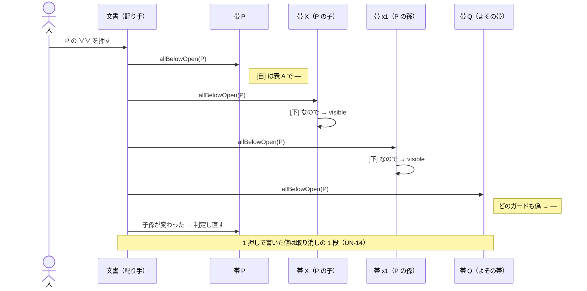
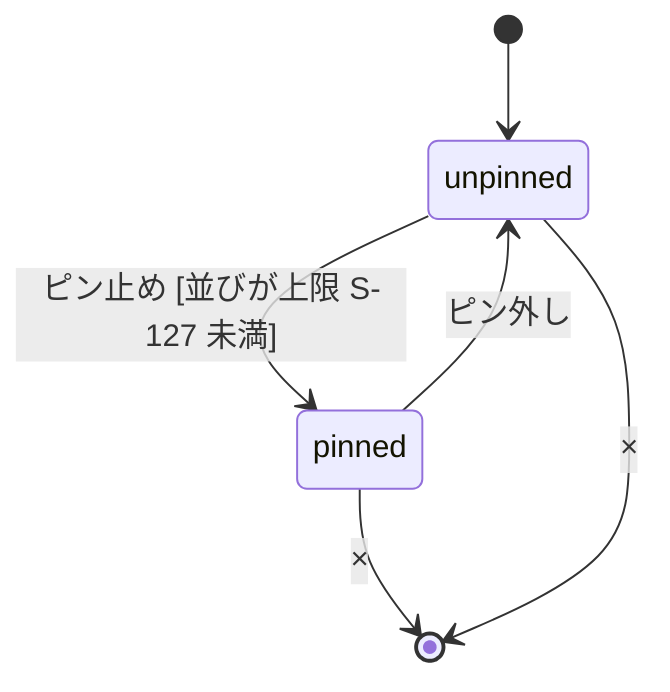

BGQA3T
# タスクグループの木の見え方（名の辞書 3 の枝）

> 「回答:」の後ろに答えを書いて保存し、1 行目の BGQA3T を切り取ってください。
> 凡例: ❓回答待 ✅回答済 🔄変化点 ★強調(ユーザー専用) ⏸後の段で問う

2026-11-20 に作った。あなたの指示「コンテキストを節約するため、タスクグループに関する部分を切り出したGQAをエージェントに作らせろ。今のGQAにはその結論だけをフィードバックしよう」に従い、BGQA3（`goodrelax-qa-b3-grs-json.md`）の 41 回目から、タスクグループの木の問いを切り出した。この紙は、タスクグループの帯をどう見せ、どう畳むか（帯ごとの状態機械と、その名）を決める。決まったら、結論だけを BGQA3 へ戻し、裁定の番号（JDG）はいつもどおり BGQA3 の側で付ける。

🔄 *残 9（❓ で検索）*

**これまでの経緯**（BGQA3 の 26〜41 回目。回ごとの記録は BGQA3 にある）
- 26 回目: 帯の木の形を 1 つの物 `taskGroupTreeView { rootTreeState, 深さ }` にまとめた（`JDG-3651`）。
- 27〜29 回目: 表示状態・折り畳み状態を仕様から読み集め、表示/非表示と折り畳み/展開の 2 つの概念で組み直した。
- 30〜32 回目: 値の名を `temporarilyExpanded` → `expandedUntilZoomOut`（`JDG-3653`）、`auto` → `automaticallyExpandedWithinDepth`（`JDG-3654`）に決めた。
- 33〜34 回目: 根の値、深さの変化と取り消し（問 6-12-7）、根の状態が配下の帯へ波及すること（表 T-328）を確かめた。
- 35 回目: チャットで `isCollapsedIntoParent`（`JDG-3655`）と `childrenExpansionState`（`JDG-3656`）に決めた。
- 36〜38 回目: 名の読み違い（親が子の畳みを持つように見えた）と隠すことの意味が分かり、帯ごとの値の案を、4 つの原則（OKPN・OMPV・NEIM・MECE）で整理し直した。
- 39 回目: あなたの 3 値案（見える・見えない・自動で決まる。帯は自分の状態だけを持つ）を 17 の場面で今の動作と比べ、足りないもの 4 つを問いにした。
- 40 回目: 足りないものの 1 つ（後から入った帯）を、操作ごとに整理し直した。
- 41 回目: 帯ごとの状態機械（外の状態 3・中の状態 2・出来事 20）を設計し、問 6-12-21〜6-12-25 を足した。
- 今: `JDG-3651`・`JDG-3653`〜`JDG-3656` の名と形は、この紙の答えで変わりうる。

2026-11-20 の 1 回目: BGQA3 の 41 回目から、タスクグループの木の問いをこの紙へ移しました。問いの中身は 41 回目のままです。

2026-11-20 の 2 回目: あなたの指示「一気に決めると手戻りが大きいので段階的に決めていく」に従い、決められる用語から 2 問だけ問います（問 6-12-26・6-12-27）。Opus の作業者 2 人が別々に検討し、同じ結論になりました。ほかの問いは後の段へ下げました。

2026-11-20 の 3 回目: あなたの答え（表示状態は visible / invisible で、GRS JSON には保存しない。保存するのは「画面に出せ・画面から消せ・自動で決めろ」の 3 状態）を JDG-3657 に記録しました。あなたの問い（v・vv・^・^^ の呼び名、collapsed/expanded/automaticallyCollapsed を持つ案、局所最適の名の負債）を、Opus の作業者 3 人が別々の角度（世の中の慣わし・リポジトリ全体の整合・原則）で検討しました。3 人とも同じ根の結論なので、それを 1 問目に置きます。

2026-11-20 の 4 回目: 外の AI に、ボタンの名の質問状（1 通目）を出しました。答えを照らして、ボタンの名の問いを組み直しました（問 6-12-29）。あなたの問い「Topレベルとそれ以外を分ける必要があるのか？」に、作業者の答えで問 6-12-31〜6-12-33 を足しました。

2026-11-20 の 5 回目: あなたの「putAway は唐突感がある」を受けて、外の AI に 2 通目の質問状を出しました。答えを照らして、∧ の名（問 6-12-29）を組み直しました。4 つの答え（Copilot と Gemini、新しい会話と前の会話）は、唐突さのいちばんの理由にそろって「語の層の違い」（Expand・Collapse は仕組みの語、Put Away は家の片付けの語）を挙げたので、推奨を Retract（日本語の札は「親へしまう」のまま）に替えました。あわせて、∨ の説明の文（新しい模型では嘘になる）と頭の ∨ の説明の文（原則 P4 に反して Show を使っていた）を直します。問 6-12-28・6-12-30・6-12-32・6-12-33 の推奨は変えていません（4 つの答えはどれも賛成か一部賛成で、決め手になる反対はありませんでした）。新しい問いはありません。

2026-11-20 の 6 回目: あなたの「^ retract あり！！！ 採用♪」で ∧ の名が Retract（親へしまう、retractPressed）に決まりました（JDG-3658）。あなたの指示「これをベースにGQAを再構築せよ」に従い、Retract を軸に問いを組み直しました。問 6-12-29 の残りのうち、画面の語（∨・∨∨・∧∧ の札、説明の文、和文の動詞）は問 6-12-28 で確かめます。出来事の名は、札と頭のボタンの形が決まってから問うほうが手戻りが少ないので、後の段の問 6-12-34 へ下げました。保存する値（問 6-12-30）は、Retract から導く `revealed`・`retracted`・`automatic` を新しく推します（5 回目の推奨 `show`・`hide` は、帯が消えることを言う語が hide と Retract の 2 つになるので下げました。あなたの前の案 `collapsed` などは、問 6-12-30 の案 d に並べました）。問 6-12-31・6-12-32 は Retract に合わせて言葉を直しました。後の段の問 6-12-17・6-12-18 は、消した 3 値案の仮の名（`shown`・`notShown`）を、3 つの意図の言葉（出せ・消せ）に直しました。後の段の問 6-12-16・6-12-21・6-12-22 は、JDG-3657 と問 6-12-28・6-12-30 で済むので消しました（6-12-22 の残り「入れ子で描くか」は問 6-12-25 へ移しました）。後の段から前へ出した問いはありません（残りはどれも、値の名か状態機械の形が決まってから問うほうが手戻りが少ない）。独立した作業者が点検し、数え違いとヒントの食い違いを直しました。

🔄 *2026-11-21 の 7 回目: あなたの「100万人に出せる品質の名称と構造を導き出せ」に従い、初見の AI に 2 段の質問状（3 通目）を出しました。初見で何割が当たったかと点数で、名を選び直しました。答えたのは外の AI 3 つ（Duck・Copilot・Gemini）と、こちらの試し読み手 1 人です。帯の ∨・∨∨・∧∧ と頭の ∨∨、出来事の名は 4 つとも当たりました。外れたのは頭の ∨（Expand One Level）と頭の ∧∧（Collapse All）で、4 つとも「今より 1 段深く」「最上位を残して畳む」と読みました（当たり 0 割）。∧ Retract は「帯が消える」は 4 つとも当て、「配下も一緒にしまう」は 4 つとも読めませんでした。そこで推奨を、頭の ∨ を Restore Top Level／最上位を戻す、頭の ∧∧ を Retract All／すべてしまう、∧ の日本語の札を「配下ごと親へしまう」、キーを `visibilityIntent`、深さを `automaticDepth` に替えました。値 `revealed`・`retracted`・`automatic` と構造（帯自身の意図を 1 つ・根に値なし・出来事の共有）は変えません（構造は 4 つとも賛成か一部賛成で、反対は 0）。問いを 1 問 1 決めに分け、頭の札（問 6-12-28-2）・キーの名（問 6-12-30-2）・深さの名（問 6-12-30-3）を足しました。問 6-12-31 は出来事の共有だけを問います。*

***

## 決定事項

### [tree] タスクグループの木の見え方

参照のための写しです。元は BGQA3 の決定事項で、ここで決まったことの裁定も BGQA3 に記録します。この紙の問いが頼る行だけを、元の区分ごとに写しました。

**[tg] タスクグループ（BGQA3 の表の全部）**

| 何 | 決め | 裁定 |
|:---|:---|:---|
| 帯が表す WBS のタスク（問 6-9-2） | `derivedFromTaskUid` → `representedTaskUid` | `JDG-3624` |

**[root]・[proj] の、帯の木に関わる行**

| 何 | 決め | 裁定 |
|:---|:---|:---|
| 似た字と根の並び（問 6-13-1） | `note` → `remarks`、`levelZeroTreeState` → `rootTreeState`（階層は「深さ」で数える）。根の並びは `$schema`・`schemaVersion`・`buildVersion`・`documentSettings`・`scheduleData`・`documentStamp`・`changeLogEntries` | `JDG-3602` |
| 外の AI が迷った GRS の名（問 6-8-16） | `delayDiagnosticsToleranceWorkingDays`・`taskGroupRootTreeState`。`fadeInCalendarDays`・`fadeOutCalendarDays`・`leaderTarget` は今のまま。★ の 3 行は続きの問い | `JDG-3635` |
| 帯の木の見え方（問 6-12-5-2） | `taskGroupTreeView { rootTreeState, 深さ }` にまとめる。深さの名は問 6-12-5-3 | `JDG-3651` |
| 一時の展開の名（問 6-12-6-2） | `temporarilyExpanded` → `expandedUntilZoomOut` | `JDG-3653` |
| 自動で展開する値の名（問 6-12-6-2） | `auto` → `automaticallyExpandedWithinDepth`（根も） | `JDG-3654` |

この紙で決めたこと

| 何 | 決め | 裁定 |
|:---|:---|:---|
| 帯の表示状態と、GRS JSON に保存するもの（問 6-12-26・6-12-27） | 表示状態は `visible`／`invisible`。導く結果で、GRS JSON に保存しない。保存するのは帯自身の意図 3 つ（画面に出せ・画面から消せ・自動で決めろ。あなたの 2-b）。自動の中の 2 つ（自動で見える・自動で見えない）は導き、保存しない。キーと値の名は問 6-12-28〜6-12-30 と後の段 | `JDG-3657` |
| 帯のボタン ∧ の名（問 6-12-29 の ∧） | 英語の札 Retract、日本語の札「親へしまう」、出来事 `retractPressed`（今は Collapse／折りたたむ、`hidePressed`。`IC-59`）。∨・∨∨・∧∧ の名と説明の文は問 6-12-28 | `JDG-3658` |

***

## QA

### [tree] 🔄 *タスクグループの木の見え方（❓ 8）*

🔄 ***初見の試し（3 通目）の結果.** 答えた者: 外の AI 3 つ（Duck・Copilot・Gemini。どれも新しい会話）と、こちらの試し読み手（Sonnet）1 人。「当たり」は、意味を明かさずに名とボタンだけを見せた 1 段目の読みが、2 段目で明かした意図と合ったか（合う 1・半分 0.5・外れ 0 で平均）。「点」は、意図を知った後に各自が付けた「100 万人の初見の利用者が正しく読めるか」（1〜10 の平均）。名と構造の全体の点は 5・6・7・7（平均 6.3）。*

| 🔄 *名* | 🔄 *初見の当たり* | 🔄 *点の平均* | 🔄 *勧め（問い）* |
|:---|:---|:---|:---|
| 🔄 *`taskGroupTreeView`* | 🔄 *100%* | 🔄 *8.3* | 🔄 *残す（決まり）* |
| 🔄 *`visibleDepth`* | 🔄 *75%* | 🔄 *6.8* | 🔄 *`automaticDepth` に替える（6-12-30-3）* |
| 🔄 *`visibilityRule`* | 🔄 *75%* | 🔄 *5.5* | 🔄 *`visibilityIntent` に替える（6-12-30-2）* |
| 🔄 *`revealed`* | 🔄 *75%* | 🔄 *4.8* | 🔄 *残す（6-12-30）* |
| 🔄 *`retracted`* | 🔄 *75%* | 🔄 *5.8* | 🔄 *残す（6-12-30）* |
| 🔄 *`automatic`* | 🔄 *100%* | 🔄 *7.5* | 🔄 *残す（6-12-30）* |
| 🔄 *帯 ∨ Expand One Level* | 🔄 *100%* | 🔄 *7.8* | 🔄 *残す（6-12-28）* |
| 🔄 *帯 ∨∨ Expand Below* | 🔄 *100%* | 🔄 *8.3* | 🔄 *残す（6-12-28）* |
| 🔄 *帯 ∧∧ Collapse Below* | 🔄 *100%* | 🔄 *7.8* | 🔄 *残す（6-12-28）* |
| 🔄 *帯 ∧ Retract（帯が消える）* | 🔄 *100%（確信は 5 段の 2・2・4・2）* | 🔄 *5.0* | 🔄 *英語は残す（`JDG-3658`）* |
| 🔄 *帯 ∧ Retract（配下も一緒にしまう）* | 🔄 *0%* | 🔄 *—* | 🔄 *日本語の札を「配下ごと親へしまう」に（6-12-28）* |
| 🔄 *頭 ∨ Expand One Level* | 🔄 *0%* | 🔄 *3.8* | 🔄 *Restore Top Level／最上位を戻す に替える（6-12-28-2）* |
| 🔄 *頭 ∨∨ Expand All* | 🔄 *100%* | 🔄 *8.5* | 🔄 *残す（6-12-28-2）* |
| 🔄 *頭 ∧∧ Collapse All* | 🔄 *0%* | 🔄 *5.5* | 🔄 *Retract All／すべてしまう に替える（6-12-28-2）* |
| 🔄 *出来事の名 4 つ* | 🔄 *100%* | 🔄 *6.3〜8.0* | 🔄 *残す（⏸ 6-12-34）* |
| 🔄 *説明の文 7 つ（2 段目で初めて見せた）* | 🔄 *—* | 🔄 *8.7〜9.3* | 🔄 *3 通目の文を採り、3 つ直す（6-12-28・6-12-28-2）* |

- 🔄 *構造は、帯自身の意図を 1 つ持つこと・根に値を持たせないことに 4 つとも賛成。頭が帯と出来事を共有することに 4 つとも賛成か一部賛成（反対 0）。*
- 🔄 *推奨をすべて採るなら、どれか 1 つの回答欄に「全部 a」と書けば足ります。*

#### 🔄 *❓ 問 6-12-28. 帯のボタンの札と説明の文 —— ∧ の日本語の札に「配下ごと」を足す*

🔄 *場面: 帯の名にポインタを乗せると、名の右に 4 つのボタンが 2 × 2 に並び、ボタンに乗せると札とその下に説明の文が出ます。`JDG-3658` で ∧ は Retract／親へしまう に決まりました。3 通目の初見の試しの結果:*
- 🔄 *∨・∨∨・∧∧ の札（Expand One Level・Expand Below・Collapse Below）は、4 つとも初見で当たりました（点 7.8・8.3・7.8）。変えません。*
- 🔄 *∧ は「押した帯が消える」を 4 つとも当てましたが、確信は 5 段の 2・2・4・2 で、日本語の札「親へしまう」に頼っていました。「配下も一緒にしまう（配下にも「消せ」を書く）」は 4 つとも読めず、B の ∧ の後の値に 4 つとも B だけを書きました。その帰結で、続けて親の ∨ を押す場面は 2 つが外れました（しまったはずの孫 B1 がまた出ると読んだ）。点は 5.0 で、帯のボタンで最も低い。*
- 🔄 *4 つとも「Retract の 1 語では、何を・どこへが無い」と書きました。代わりの英語は割れました（Retract Into Parent 2 つ、Retract Self 1 つ、Retract With Everything Below 1 つ）。動詞 Retract を替えようと言った者は 0 です。*
- 🔄 *説明の文は、外の AI 3 つが 8.7〜9.3 点。Gemini は、∨ の文に「しまった子も戻る」が無いので、∧ で消した帯の戻し方に気づけない人が出る、と書きました。*

🔄 ***案 a の札と説明の文***

| 🔄 *ボタン* | 🔄 *札（英／日）* | 🔄 *説明の文（英／日）* |
|:---|:---|:---|
| 🔄 *∨（`IC-90`）* | 🔄 *Expand One Level／1 階層だけ展開する（今のまま）* | 🔄 *Expand only this task group's own children, retracted ones included; deeper task groups stay as they are／このタスクグループの直下の子だけを展開する（しまった子も戻る）。孫より下は今のまま* |
| 🔄 *∨∨（`IC-58`）* | 🔄 *Expand Below／配下をすべて展開する（今のまま）* | 🔄 *Expand this task group all the way down, to its deepest task groups／このタスクグループを、いちばん深い段まで展開する* |
| 🔄 *∧∧（`IC-77`）* | 🔄 *Collapse Below／配下をすべて折りたたむ（今のまま）* | 🔄 *Collapse this task group: every task group below it disappears, and this one stays／このタスクグループを折りたたむ。配下のタスクグループはすべて消え、このタスクグループは残る* |
| 🔄 *∧（`IC-59`）* | 🔄 *Retract／**配下ごと親へしまう*** | 🔄 *Retract this task group, with everything under it, into its parent; the parent's Expand One Level (Restore Top Level for a top-level task group) brings it back／このタスクグループを配下ごと親へしまう。親の「1 階層だけ展開する」（最上位なら「最上位を戻す」）で戻る* |

- 🔄 *「配下ごと親へしまう」は、今の説明の文と同じ句です。`JDG-3658` の日本語の札に「配下ごと」を足すだけで、動詞「しまう」は変えません。試し読み手も 1 位にこの札を挙げました。*
- 🔄 *英語の札に Into Parent を足さない理由: 外れたのは行き先ではなく「配下ごと」で、Into Parent はそれを直しません。あなたは Collapse Into Parent を「Into Parent は 3 語で説明臭い」で退けています。英語の札の真下に、説明の文（with everything under it, into its parent）がいつも出ます。*
- 🔄 *∧ の説明の文の括弧（最上位の帯の戻し方）は、問 6-12-28-2 の頭の ∨ の札に合わせます（a なら Restore Top Level／最上位を戻す）。*
- 🔄 *今の説明の文を直す理由（6 回目と同じ）: 今の ∨ の文「leaving deeper task groups collapsed／孫より下は折りたたんだままにする」は、新しい模型では嘘です（∨ は孫より下を書かない）。今の ∨∨・∧∧ の文「every task group below this one」は目的語が配下のそれぞれで、1 階層ずれて読めます（仕様 01-04 の 1796 行が警告している絵）。3 通目では ∧∧ の「goes」を「disappears」に直しました（試し読み手の指摘）。*
- 🔄 *和文の動詞を用語集で固定します: 「展開する」は ∨・∨∨、「折りたたむ」は ∧∧ だけ、「しまう」は ∧ と頭の ∧∧（問 6-12-28-2 の a のとき）。仕様の「折りたたみ込む」（01-04 に 7 行、設定の表 `settings.json` に 1 行。Grep で数えた）は「しまう」に書き直します。*

用語集では、ボタンと値を 1 行ずつで結びます（値の名は問 6-12-30 の答えで入れる）: 「X を Expand ＝ X の子（∨）・子孫（∨∨）に「出せ」を書く」「X を Collapse ＝ X の子孫に「消せ」を書く」「X を Retract ＝ X と配下に「消せ」を書く」。説明の文も、この行と同じく目的語を X（押した帯）にします。

| 案 | 中身 |
|:---|:---|
| **a（推奨）** | 🔄 *上の表の全部（∨・∨∨・∧∧ の札は今のまま、∧ の日本語の札に「配下ごと」、説明の文 4 つ）と、和文の動詞の固定* |
| b | 🔄 *a のうち、∧ の日本語の札を「親へしまう」のまま（`JDG-3658` のとおり）にする。配下も消えることは説明の文だけが言う。初見の 0% は残る* |
| 🔄 *c（`JDG-3658` の見直し）* | 🔄 *a に加えて、∧ の英語の札も Retract Into Parent にする（Duck・Copilot の 1 位）。4 つがそろって「1 語では何を・どこへが無い」と書いたことを重く見る形。札は 3 語になる* |

🔄 *a から一部だけ外すときは、外す物を書いてください（例: a から ∨ の説明の文を外す）。*

回答:

##### 🔄 *❓ 問 6-12-28-2. 頭のボタンの札 —— 頭の ∨ は Restore Top Level、頭の ∧∧ は Retract All*

🔄 *場面: 帯の欄の見出し（いちばん上の行。根 ＝ 深さ 0 で、帯ではない）には、∧∧・∨・∨∨ の 3 つのボタンが 1 行に並びます。6 回目の推奨（問 6-12-31 の a）は、頭の ∨ を帯と同じ Expand One Level に、頭の ∧∧ を今の Collapse All のままにする形でした。3 通目の初見の試しで、この 2 つは 4 つとも外れました。*
- 🔄 ***頭の ∨ Expand One Level**（働き: 最上位の帯に「出せ」を書く。しまった最上位が戻り、その下は今のまま）: 4 つの読みは「親の帯それぞれの直下を出す」「全体を 1 段展開する」「深さを 1 増やす」「今より 1 段深く」。最上位を戻すと読んだ者は 0。点は 3.8 で、全部の名で最も低い。同じ札の帯の ∨ は 4 つとも当てたので、この札は見出しでは「今見えている木を 1 段深くする」と読まれる、と分かりました。*
- 🔄 ***頭の ∧∧ Collapse All**（働き: すべての帯に「消せ」を書く。最上位も消え、欄は空になる）: 4 つとも「最上位を残して配下を畳む」と読みました（ふつうの木の画面の Collapse All）。Gemini は最大の危険にこれを挙げ、3 点を付けました:「押した瞬間に欄が空になり、全部消えたと慌てる。隣の ∨ が Expand One Level では、戻す道だと気づかない」。*
- 🔄 ***代わりの名:** 頭の ∨ は 3 つ（Copilot・Gemini・試し読み手）が 1 位に Restore Top Level を挙げました。頭の ∧∧ は 3 つ（Duck・Gemini・試し読み手）が Retract All（Duck は Retract All Task Groups）を挙げました。*
- 🔄 ***頭の ∨∨ Expand All** は 4 つとも当てました（8.5）。今のままです。*

| 🔄 *ボタン* | 🔄 *今の札（英／日）* | 🔄 *案 a の札（英／日）* | 🔄 *説明の文（案 a、英／日）* |
|:---|:---|:---|:---|
| 🔄 *頭の ∨（`IC-92`）* | 🔄 *Show Top Level Only／最も浅い段を 1 階層展開する* | 🔄 ***Restore Top Level／最上位を戻す*** | 🔄 *Bring back the top-level task groups; what is under them stays as it is／最上位のタスクグループを戻す。その配下は今のまま* |
| 🔄 *頭の ∨∨（`IC-74`）* | 🔄 *Expand All／すべて展開する* | 🔄 *今のまま* | 🔄 *Expand the whole tree: every task group comes back, retracted ones included／木の全体を展開する。しまったタスクグループも含め、すべてが戻る* |
| 🔄 *頭の ∧∧（`IC-78`）* | 🔄 *Collapse All／すべて折りたたむ* | 🔄 ***Retract All／すべてしまう*** | 🔄 *Retract every task group, the top level included; Restore Top Level brings the top level back／最上位も含め、すべてのタスクグループをしまう。「最上位を戻す」で最上位が戻る* |

- 🔄 ***なぜこの語が働きに合うか.** 根で ∧∧ を押すと、押した物（根）は残りますが、根は画面に行を持たないので、残って見える物が何もありません。帯の Collapse（押した帯は残り、中身が消える）の絵にはならず、最上位の帯がそれぞれ根へしまわれる絵になります。それは帯の ∧ の Retract（帯そのものが親へしまわれる）と同じ動詞です。頭の ∨ は、しまった最上位を根から出すので、「1 段深く」ではなく「戻す」です。*
- 🔄 ***衝突を照らした.** Restore は窓の札にもあります（`IC-131` Restore／元のサイズに戻す、`IC-129` の説明の文）。意味は同じ「前の形へ戻す」で、対象（窓と最上位の帯）が違うだけなので、1 つの語に 2 つの意味（OMPV）にはならないと判断しました。Retract は ∧ の札のほかに 0 件。日本語の「最上位」は、今の製品の札では「最も浅い段」（`IC-92`、`IC-93`「最も浅い段に追加」）で、6 回目の説明の文の案から「最上位」を使っています。Gemini の和訳「すべて見出しへしまう」は採りません（製品の「タスクグループ見出し」は帯の名の札のこと。display-words・設定の表などに 5 行）。*
- 🔄 ***退けた名に当たらない.** Show Top Level Only（Show と Only）、Expand Top Level（最上位の帯の中身を出すと読める）のどちらでもありません。Bring Back Top Level（Gemini の 2 位）は句動詞で、Put Away を退けた理由（語の層）に当たります。Reveal Top Level（Copilot の 2 位）は、画面に reveal を初めて出します（今の画面の語に reveal は 0 件）。*
- 🔄 *a では頭の札が帯の札と違う語になりますが、出来事は帯と共有できます（問 6-12-31）。用語集に 1 行足します:「根で ∨ ＝ Restore Top Level、根で ∨∨ ＝ Expand All、根で ∧∧ ＝ Retract All（範囲語 Below は根では All。根での Collapse は最上位も消えるので Retract と言う）」。*

| 案 | 中身 |
|:---|:---|
| **a（推奨）** | 🔄 *頭の ∨ を Restore Top Level／最上位を戻す、頭の ∧∧ を Retract All／すべてしまう にする。∨∨ は Expand All のまま。説明の文は上の表* |
| b | 🔄 *頭の ∨ だけ Restore Top Level にする。∧∧ は Collapse All のままで、説明の文が「最上位も消える」を言う（Copilot は Collapse All に 8 点。試し読み手の 2 位）。初見の 0% は ∧∧ に残る* |
| c | 🔄 *6 回目の推奨のまま（頭の ∨ は帯と同じ Expand One Level、∧∧ は Collapse All）。初見で 4 つとも外れた形* |

回答:

#### 🔄 *❓ 問 6-12-30. 保存する 3 つの値の名 —— `revealed`・`retracted`・`automatic` のまま*

🔄 *場面: `JDG-3657` で、GRS JSON は帯ごとに帯自身の意図を 1 つ持つと決まりました（画面に出せ・画面から消せ・自動で決めろ）。画面の結果（導く値）は `visible`／`invisible` で、保存しません（同じ裁定）。6 回目に推した `revealed`・`retracted`・`automatic` を、3 通目の初見の試しで確かめました。*
- 🔄 ***初見.** 4 つとも、3 つの値が帯ごとの「出す・しまう・自動」だとは読み取りました。Gemini と試し読み手は場面の絵まで当てました。Duck と Copilot は、ズームの深さが値に勝つと読みました（しまった帯 C を描く、出した帯 B1 を深さの外だからと落とす）。当たりは 3 つとも 75%、`automatic` は 100%。*
- 🔄 ***点.** `revealed` 4.8（Duck 3・Copilot 3・Gemini 6・試し 7）、`retracted` 5.8（2・7・7・7）、`automatic` 7.5。`revealed` の弱さは「今見えている（結果）」とも「展開した」とも読めること。Copilot はこれを最大の危険に挙げました:「外の AI が `revealed` を今見えていると読み、深さや祖先を無視して描く」。*
- 🔄 ***代わりの値は割れ、2 つ以上の AI が推した語はありません。** どれも決まりに当たります: `alwaysDisplay`・`forceDisplay`（状態を動詞で言う。always は全体表示で自動へ戻るので嘘）、`forcedVisible`（visible は結果の語。`JDG-3657`）、`pinnedVisible`（ピン `pinnedTaskGroupIds` とぶつかる）、`exposed`（製品に無い動詞。「さらされた・漏れた」と読める）、`disclosed`（「情報を開示した」と読める）、`withdrawn`（`retracted` と同じく「取り下げ」と読め、得が無い）。*
- 🔄 ***読み違いの元（結果か意図か）は、値でなくキーで断ちます.** 問 6-12-30-2 の a（`visibilityIntent`）なら、「意図: revealed」と読めます。値は画面に出ず、読むのは外の AI と開発者で、スキーマの説明も読みます。*
- 🔄 *`revealed` は製品の動詞 reveal（飛ぶ `taskGroupRevealAsked`。先と道を見せる）の分詞で、飛ぶはまさにこの値を書きます。`retracted` は `JDG-3658` の Retract の分詞。3 つとも分詞・形容詞で、品詞がそろいます。reveal の 3 つ目の意味（表の行をスクロールする `rowRevealed`、18 行・3 ファイル）は改名します（下のお知らせ）。*

**案 a で書く値**

| 押す・起きる | 書く値 |
|:---|:---|
| ∨ | 子を `revealed`（押した帯は書かない） |
| ∨∨ | 子孫を `revealed` |
| ∧∧ | 子孫を `retracted`（押した帯は書かない） |
| ∧ | 自分と配下を `retracted` |
| 頭の ∨・∨∨・∧∧ | 最上位を `revealed`・全部を `revealed`・全部を `retracted` |
| 飛ぶ・入る | 先を `revealed`。道の `retracted` を `revealed`（⏸ 問 6-12-23 の a のとき） |
| 全体表示 | `revealed` を `automatic` へ戻し、`retracted` は残す（⏸ 問 6-12-17 の a のとき）。「見せた物は戻し、しまった物は残す」と名で読める |

- 使わない語: `auto`（命名の決まり N-2 が略を `uid`・`id`・`Px`・`Utc`・`dx`・`dy`・`min`・`max`・`hex` だけに限る）、`automaticByDepth`（自動は深さだけで決まらない。⏸ の「見える条件」4 つ）、`visible`・`invisible`（上の表）。
- 🔄 *6 回目の案 b `extended` と案 c `show`・`hide` は外しました。4 つの答えのどれも推さず、6 回目に書いた弱い所（`extended` を書く動詞が製品に無い。hide は帯が消えることを言う 3 つ目の語）が残ります。*

| 案 | 中身 |
|:---|:---|
| **a（推奨）** | 🔄 *`revealed`・`retracted`・`automatic`（6 回目の推奨のまま）* |
| b | 🔄 *`exposed`・`retracted`・`automatic`（Gemini の 1 位）* |
| c | 🔄 *`expanded`・`collapsed`・`automaticallyCollapsed`（あなたの前の案）。帯自身が消えることを collapse で言うので、問 6-12-28 で ∧∧ だけに絞った collapse に 2 つ目の意味が戻る。α 版の `collapsed`（中身を畳んだ。自分は見える。`HR-4`・`JDG-3656`）と同じ綴りで意味が変わる* |

回答:

##### 🔄 *❓ 問 6-12-30-2. 値を入れるキーの名 —— `visibilityIntent`*

🔄 *場面: GRS JSON の帯の行（`taskGroups` の 1 つずつ）に、問 6-12-30 の値を入れるキーが 1 つ要ります。6 回目は後の段のお知らせにして、作業者の案は `visibilityRule`（2 人）と `visibilityOverride`（1 人）でした。3 通目は `visibilityRule` で試しました。*
- 🔄 ***初見.** Gemini と試し読み手は「その帯自身の見え方の決め」と当てました。Duck は「帯や配下の規則」、Copilot は「visible か invisible かを決める規則」と読みました（当たり 75%）。*
- 🔄 ***点.** 5.5（Duck 5・Copilot 4・Gemini 6・試し 7）。4 つとも 2 段目で「Rule はアプリの仕組みの規則（自動の判定）に読め、人の意図に読めない」と書きました。Copilot は「最大の負債は revealed と visibilityRule の 2 語」。*
- 🔄 ***代わり.** Intent の形が 3 つ（Duck の 1 位 `displayIntent`、Gemini の 2 位 `displayIntent`、試し読み手の 1 位 `visibilityIntent`）。`visibilityOverride`（Gemini の 1 位）は、試し読み手が「`automatic` は上書きでない」と退けました。Copilot は `displayDirective`。*
- 🔄 ***照らした.** `visibilityIntent` は `JDG-3657` の言葉「帯自身の意図」そのもので、導く結果 `visible`／`invisible` と「意図／結果」の対になります。src と仕様の元（`docs/spec/_source`）に 0 件。素の `visibility`（命令 `setTableView` の中にすでにある）ではありません。`displayIntent` も意味は同じですが、display は製品で画面の表示一般を指す語です（画面の語の表 display-words など）。*
- 🔄 *書くとこうなります: `{ "id": "B1", "parentTaskGroupId": "B", "siblingOrder": 1, "visibilityIntent": "revealed" }`。*

| 案 | 中身 |
|:---|:---|
| **a（推奨）** | 🔄 *`visibilityIntent`* |
| b | 🔄 *`displayIntent`* |
| c | 🔄 *`visibilityOverride`（`automatic` は上書きでないので、3 つの値の 1 つが名に合わない）* |
| d | 🔄 *`visibilityRule`（3 通目で試した名。4 つとも Rule を退けた）* |

回答:

##### 🔄 *❓ 問 6-12-30-3. 深さの名 —— `visibleDepth` を `automaticDepth` に*

🔄 *場面: 文書に 1 つの値（`taskGroupTreeView` の中）で、縦のズームが 1 刻みごとに変えます。深さ N 以内の「自動」の帯を描き、範囲は 1〜5、既定は 4。取り消し（Ctrl+Z）の対象外です。今の製品の名は `taskGroupAutoExpandDepth`（`JDG-3296`）で、「深さ N まで開く ＝ 子は深さ N＋1 まで見える」と数え、＋1 がずれを生みます。3 通目は `visibleDepth` で試しました。*
- 🔄 ***初見.** 4 つとも「最上位を 1 と数え、2 段まで」と、数え方は当てました。しかし Duck は「深さを 5 にすると、しまった帯も戻る」、Copilot は「深さ 2 の外にある、出した帯 B1 は描かない」と読み、深さが人の意図（出せ・しまえ）に勝つと取りました（当たり 75%）。*
- 🔄 ***点.** 6.8（Duck 6・Copilot 6・Gemini 8・試し 7）。Duck・Copilot・試し読み手が「visible は、全部の帯がその深さまで見えると読める。自動の帯だけに効くことが名から分からない」と書きました。*
- 🔄 *visible は導く結果の語です（`JDG-3657`）。`visibleDepth` は「深さ N 以内の帯は見える」と言っていることになり、人が「しまえ」を書いた帯で嘘になります。*
- 🔄 ***代わり.** `automaticDepth`（Copilot の 1 位。Duck の `AutomaticDisplayDepthLimit` も中身は同じ）、`zoomDepth`（試し読み手）。`automaticDepth` は値 `automatic` と同じ語で結ばれ、「自動の帯を描く深さ」と読めます。「ズームが自動で決める深さ」とも読めますが、それも真です。src と仕様の元に 0 件。Limit や max は、構造の上限（深さ 5、`maxGroupDepth`）と紛れるので足しません。*
- 🔄 *どの名でも、範囲（1〜5）・既定（4）・数え方（N 以内を描く）は同じで、`CR-853` の既定（3 → 4）と範囲（0〜4 → 1〜5）を書き直すことも同じです。*

| 案 | 中身 |
|:---|:---|
| **a（推奨）** | 🔄 *`automaticDepth`* |
| b | 🔄 *`visibleDepth`（3 通目で試した名）。名は直さず、スキーマの説明で「自動の帯だけに効く」と補う（試し読み手の 2 位）* |
| c | 🔄 *`zoomDepth`。書き手（ズーム）の名で、全体表示も変える。意味（自動の帯の上限）は言わない* |

回答:

**後の段で決めること（お知らせ。今は答え不要）**
- reveal の改名（案 a のとき）: 表の行のスクロールの `rowRevealed` を `rowToScrollIntoView` などに改めます（`rowScrolledIntoView` は同じファイルに関数の名としてすでにあるので使えない）。飛ぶ先の `revealedRowId` は、値 `revealed` の帯と読み違えないよう `revealTargetRowId` などに改めます。
- 読むときの決まり: しまった祖先の下に「出せ」の帯があるファイルは、出来事では作れません（⏸ の不変条件 I1）。しかし GRS JSON は外の AI が書け（`importDocument`・`applyCommands`）、人も手で直せるので、ファイルでは作れます。その帯は描かれないのに「出した」と読めます。読むときに直す（「消せ」にそろえる）か、検証が断るかを決めます。🔄 *3 通目では 4 つのうち 3 つがこれを挙げました（Gemini: データは書き換えず、祖先に 1 つでも「消せ」があれば描かない。試し読み手: 読むときに補正し、1 度だけ知らせる）。*
- 自動の中の 2 つの名（今の案 `automaticallyVisible`・`automaticallyInvisible`）: GRS JSON には出ませんが、⏸ 問 6-12-25 の a で仕様の図と表に入れ子の状態として描くので、名が要ります。値の名が決まってから決めます。
- 🔄 *`automatic` を省かずに書く今の決まり（文書はすべてのキーを書く）は変えません。3 通目で 3 つが賛成、1 つが一部賛成でした（Duck: 省くなら、省いたときの意味をスキーマで固定せよ）。*
- 仕様の「⛔ 押したタスクグループの状態を書き換えずに、その配下の状態だけを書き換えてはならない（MUST NOT）」とその段落（仕様 01-04 の 1791〜1796 行）は、帯ごとの模型では取り下げます。∨ と ∧∧ は、押した帯を書かずに子・子孫だけを書くからです。
- 子についての値を決めた `JDG-3653`（`expandedUntilZoomOut`）・`JDG-3654`（`automaticallyExpandedWithinDepth`）・`JDG-3656`（`childrenExpansionState`）は取り下げます。`JDG-3655`（`isCollapsedIntoParent`。帯そのものが親へしまわれたか）も取り下げ、その意味は 3 つの値の「消せ」（問 6-12-30 の a なら `retracted`）が継ぎます。キーの名が Collapse を使っており、問 6-12-28 で ∧∧ だけに絞った collapse の 2 つ目の意味が残るからです。その句「親へ折りたたむ」は 4 回目の案の句で、出荷中の ∧ の札は「折りたたむ」（`IC-59`）でした。
- 導く値の名は `visible`／`invisible`（`JDG-3657`）。スケジュールフィルタやピンの溢れまで含めた最終の結果は「描く」`drawn` と言います（表 T-329「タスクグループを描くか」、コードの `drawnTaskGroupsOf`）。

#### 🔄 *❓ 問 6-12-31. 頭のボタンは「帯のボタンを根で押したもの」とし、出来事を帯と共有するか*

場面: あなたは「Topレベルとそれ以外を分ける必要があるのか？」と問いました。帯の欄の見出し（パネルの頭）には ∨・∨∨・∧∧ の 3 つのボタンがあります。仕様はすでに頭を「深さ 0 の根（タスクグループではない）」とし、頭のボタンを帯のボタンの「段 0 版」と書いています（`HF-16` は帯の ∨ を段 0 で押すもの、など）。頭に ∧ とピンは置きません（∧ の Retract は親へしまう操作で、根には親が無い。根は留められない。仕様 01-04 の 1801・1802 行）。それなのに、今の札と出来事の名は帯と別の系です。

- 🔄 *6 回目は、この問いで頭の札も決めていました（頭の ∨ を帯と同じ Expand One Level に）。初見の試しでそれが外れたので、札は問 6-12-28-2 へ移し、この問いは「頭のボタンの中身と出来事を帯と共有するか」だけにしました。*
- 🔄 ***初見.** 4 つとも「見出しは木の全体（根）を仮の親にして、帯と同じ働きを範囲だけ変えて使う」と読みました（当たり 100%）。2 段目は、共有に Duck・Copilot・Gemini が一部賛成、試し読み手が賛成（反対 0）。一部の理由は「名だけでは押した物が根か帯か分からない。根の印を必ず運べ」（Duck）、「画面の名は分けたい」（Copilot。問 6-12-28-2 の a で分かれる）、「札が分かれるなら出来事も `restoreTopLevelPressed`・`retractAllPressed` に分けたい」（Gemini）。*

| 🔄 *ボタン* | 🔄 *出来事 今 → 案 a* |
|:---|:---|
| 🔄 *頭の ∨（`IC-92`）* | 🔄 *`topLevelOpenPressed` → 帯と同じ `expandOneLevelPressed`（押した物 ＝ 根）* |
| 🔄 *頭の ∨∨（`IC-74`）* | 🔄 *`everyTaskGroupOpenPressed` → 帯と同じ `expandBelowPressed`（押した物 ＝ 根）* |
| 🔄 *頭の ∧∧（`IC-78`）* | 🔄 *`everyTaskGroupFoldPressed` → 帯と同じ `collapseBelowPressed`（押した物 ＝ 根）* |

- 🔄 ***札が帯と違っても出来事を共有する理由.** 根で ∨ を押すことの中身は「押した物の子に『出せ』を書く」で、帯の ∨ と同じです。違うのは、根の子が最上位の帯であることと、根が画面に行を持たないことだけです。出来事を分けると、同じ書き方を 2 か所に持ちます。札は利用者の語、出来事は開発者の語で、出来事の名は初見で 4 つとも当たり、点も 7.8〜8.0 でした。*
- 出来事の名は、⏸ 問 6-12-34 の a（札にそろえる）の名で書きました。問 6-12-34 が b なら、帯の今の名（`oneLevelOpenPressed`・`allBelowOpenPressed`・`allBelowFoldPressed`）を共有します。この問いで決めるのは「共有するか」です。
- 出来事を帯と共有するとき、根を「空の値」で運びません（レビューの決まりの悪い例「特別な値に意味を持たせる」に当たる）。押した物が根であることを、明示の印で運びます。

| 案 | 中身 |
|:---|:---|
| **a（推奨）** | 🔄 *頭のボタン ＝ 帯のボタンを根で押したもの。出来事は帯と共有し、押した物が根であることを明示の印で運ぶ。札は問 6-12-28-2 で決める* |
| b | 🔄 *中身は帯と同じだが、出来事は頭用に分ける（`restoreTopLevelPressed`・`expandAllPressed`・`retractAllPressed`。Gemini の案）。札と出来事が 1 対 1 になるが、同じ書き方を 2 か所に持つ* |
| c | 🔄 *頭は別の系のまま（今の製品。中身も出来事も帯と別）* |

回答:

#### ❓ 問 6-12-32. 根に、根だけの値を持たせないか

場面: 今の仕様は、根（深さ 0）の状態を別の値 `levelZeroTreeState`（BGQA3 で `rootTreeState` への改名を決めた。`JDG-3602`）に持たせています。この値は「根の子（最上位の帯）を出すか」を言い、帯の値（`JDG-3657` で「帯自身の意図」と決めた）と主語が違います。根を木の節の 1 つとして扱えば、この値は要りません: 根が畳まれた ＝ 最上位の帯が全部「消せ」。仕様の状態機械の根だけの升 7 つと、外の AI 向けの命令 `setLevelZeroTreeState` も消えます。後の段の問 6-12-25 の a のうち、根の部分を先に問う形です。

根は、Retract を持たない（親が無いのでしまえない）ことだけがほかの節と違います（問 6-12-31）。それはボタンが無いことで言え、値は要りません。

🔄 *3 通目の初見の試しの 2 段目で、4 つとも賛成でした（Gemini: 根の値をやめ、帯の値だけで完結させるほうが、二重の管理と矛盾を防げる）。Gemini と試し読み手は、頭の ∧∧ の後に空になった欄へ戻し方の案内を出すよう勧めました（画面の作りの話で、名の問いではないので後の段で）。*

**変わる絵があります。** 頭の ∧∧ ですべて畳んだ後に、次を押すと:

| 押す | 今（根の値あり） | 根の値なし（案 a） |
|:---|:---|:---|
| 頭で帯を足す | 根が自動へ戻り、最上位の帯が全部戻る | 足した帯だけが出る。ほかの最上位は畳まれたまま |
| 検索などで飛ぶ | 同じく全部戻る | 飛んだ先と、そこまでの道だけが出る |
| 全体表示 | 全部戻る | 後の段の問 6-12-17 が a なら、空のまま |

🔄 *残った帯は、頭の ∨（問 6-12-28-2 の a なら Restore Top Level／最上位を戻す）を 1 回押せば戻ります。*

| 案 | 中身 |
|:---|:---|
| **a（推奨）** | 根に値を持たせない。根もほかの親と同じに振る舞う（足した帯・飛んだ道だけが出る。⏸ 問 6-12-23 の a「兄弟は自分の値のまま」と同じ決まり） |
| b | 根に値を持たせないが、決まりを 1 行足す:「根の下へ入る出来事（頭で足す・飛ぶ）は、根の ∨ を兼ねる」。足す・飛ぶは今と同じに最上位が全部戻る。根だけの決まりが 1 つ残る |
| c | 今のまま根の値（`rootTreeState`）を持つ。帯が見えるかを知るのに 2 か所を読み、頭の ∧∧ に「根を畳む」と「最上位を全部消す」の 2 通りの書き方が残る |

回答:

#### ❓ 問 6-12-33. 最上位の帯（深さ 1）に、特別の決まりを置かないか

🔄 *場面: 縦に縮めても、最上位の帯は落ちません（仕様 `FR-055` の下限。01-04 の 6222・6223 行）。後の段の設計案は、これを「自動」の中の見える条件の 1 つ `isTopLevel` として、深さの条件 `isWithinDepth` とは別に置いています。しかし今の数え方（深さ ≤ `expandDepth`＋1。`expandDepth` は 0 以上）でも、新しい深さ（問 6-12-30-3 の名。3 通目では `visibleDepth`）の数え方でも、深さの条件は深さ 1 をいつも「範囲の内」にします。同じ事実を 2 か所で言うことになり、片方だけ直すと食い違います。*

🔄 *3 通目の質問状は、この決まり（最上位に特別の決まりを置かない）を前提に書き、4 つの答えに反対はありませんでした（問いとしては聞いていません）。*

| 案 | 中身 |
|:---|:---|
| **a（推奨）** | 特別の決まりを置かない。深さの範囲の下限（深さ 1 はいつも範囲の内）だけで言う。人の「消せ」は最上位にも勝つ（頭の ∧∧ はパネルを空にしうる。戻り道は頭の ∨。仕様 `HR-2`・`HF-16`） |
| b | 見える条件 `isTopLevel` も残す。同じ事実を 2 か所で持つ |
| c | 最上位は人の「消せ」にも勝ち、いつも見える。頭の ∧∧ で空にできず、仕様 `HR-2` に反する。仕様が実測で退けた読み（頭の ∨ がいつも効かない）に戻る |

回答:

### ⏸ 後の段で問う（今は答え不要）

後の段の問 6-12-16（あなたの 3 値案）・6-12-21（帯の見え方の名）・6-12-22（自動の中の 2 つ）は、この回で消しました。6-12-16 の向きと、6-12-22 の「中の 2 つは導き、保存しない」は `JDG-3657` で決まりました。名は問 6-12-28・6-12-30 で問います（中の 2 つの名は、問 6-12-30 の下のお知らせ）。6-12-16 が挙げた足りないもの 4 つは、問 6-12-17（全体表示）・6-12-18（縮めたら閉じるか）・6-12-23（入る・飛ぶ）に残っています。6-12-22 の残り（図と表で「自動の中」を入れ子の状態に描くか）は、問 6-12-25 に入れました。

#### ⏸ 問 6-12-34. 出来事の名を札にそろえるか

場面: ボタンを押したことを表す出来事の名は、今は札と違う動詞です（Open・Fold・hide）。∧ の `hidePressed` → `retractPressed` は `JDG-3658` で決まりました。残りを札（問 6-12-28）にそろえるかを、札と頭のボタンの形（問 6-12-31）が決まってから問います。

書き換える行（src・tests・docs/spec を Grep で数えた、名が現れる行）: 帯の 4 つの出来事（`oneLevelOpenPressed`・`allBelowOpenPressed`・`allBelowFoldPressed`・`hidePressed`）は 91 行・12 ファイル（src 2・試験 6・仕様 4）。頭の 3 つ（`topLevelOpenPressed`・`everyTaskGroupOpenPressed`・`everyTaskGroupFoldPressed`。問 6-12-31 の a なら帯と共有して消える）を足すと 152 行・13 ファイル（src 2・試験 7・仕様 4）。src で当たるのは `task-group-folding.ts` と `task-group-tree-entrances.ts` だけです。

| 案 | 中身 |
|:---|:---|
| **a（推奨）** | `oneLevelOpenPressed` → `expandOneLevelPressed`、`allBelowOpenPressed` → `expandBelowPressed`、`allBelowFoldPressed` → `collapseBelowPressed`。∧ の `retractPressed` と合わせて、出来事の動詞を札の動詞（Expand・Collapse・Retract）にそろえる |
| b | ∧ の `retractPressed` だけを変え、ほかは今のまま。書き換えは減るが、出来事の動詞（Open・Fold・Retract）が札（Expand・Collapse・Retract）と合わないまま残る |

回答:

***帯ごとの状態機械の設計（作業者の案。下の後の段の問いの材料）***

チャットでのあなたの指示「イベントと v, vv, ^, ^^, +, x, pin, 移動, 階層変更...の関係を整理して、 状態遷移図、状態遷移表にしたら？ タスクグループ毎にステートマシンを持って整理したら？ autoの場合にサブステートマシンか、内部ステートマシンにするか...」に従い、作業者が設計しました。値の名は前の案のまま書いてあり、問 6-12-30 が決まったら書き直します。対応: 外の状態 `visible` ＝ 出せ、`invisible` ＝ 消せ、`automaticByDepth` ＝ 自動で決めろ。保存するのはこの 3 つの意図で、画面の結果の `visible`／`invisible`（`JDG-3657`。保存しない）とは別物です。∧ の出来事 `hidePressed` は `retractPressed` になります（`JDG-3658`）。

**2. 1 本の帯の状態機械**

**状態**

| 状態 | 層 | 保存 | 意味 | 帯は描かれるか |
|:---|:---|:---|:---|:---|
| `visible` | 外 | する（意図「出せ」として） | 人か「飛ぶ・入る」が見せた | 描く |
| `invisible` | 外 | する（意図「消せ」として） | 人が「消せ」を書いた（∧・∧∧・頭の ∧∧） | 描かない |
| `automaticByDepth` | 外（入れ子） | する（意図「自動で決めろ」として） | 深さに任せる | 中の状態で決まる |
| └ `automaticallyVisible` | 中 | しない | 見える条件が真 | 描く |
| └ `automaticallyInvisible` | 中 | しない | 見える条件が偽 | 描かない |

**見える条件**（中の状態を決めるガード。どれか 1 つが真なら `automaticallyVisible`）
- `isTopLevel`: 最上位の帯である（深さ 1 は倍率で落とさない RQ:6223）[確]。
- `isWithinDepth`: 深さが文書の深さ `expandDepth` で見える範囲にある（今の決め JDG-3296 では深さ ≤ `expandDepth`＋1。SIM §0 の読み）[推]。
- `isPinned`: ピンの領域が `pinned`（§5）。
- `hasVisibleDescendant`: 子孫のどれかが `visible`（∨ の後に縮めても、開いた所が宙に浮かない。今の `TD-7` の役 RQ:6247）[確: TD-7 の文]。

**2 つの不変条件**（機械の外で、出来事の側が守る）
- **I1**: `invisible` の帯の子孫は、みな `invisible`。∧・∧∧・頭の ∧∧ は子孫にも書き、`visible` を書く出来事は道の `invisible` を `visible` に直す。だから「見えない帯の下に見える帯」は作れない。ただしファイル（外の AI が書いた・人が手で直した）では作れる。読むときの決まりは問 6-12-30 の下のお知らせ。
- **I2**: 描くのは `visible` か `automaticallyVisible` の帯で、しかもスケジュールフィルタを通る帯だけ（別の軸）。I1 があるので、祖先をたどる規則（今の `TD-3`）は要らない [推]。

**中を「導く」にする理由（保存しない）**
1. 中の状態は、深さ・木の形・ピン・子孫の値から必ず決まる。導けるものを保存すると、2 か所が食い違いうる（MECE）。
2. ホイール 1 刻みで中の状態が変わる。保存すると、ズームが文書の編集になり、未保存の印と取り消しの段が立つ。ズームは取り消しの対象外（RQ:2438 `UN-8`）[確] と合わない。
3. UML の言い方では、中の遷移は「条件が変わったとき（when）」に起きる変化の遷移であり、人の出来事ではない。入れ子の状態に入るたびに選択（◇）で行き先を決める。

**3. 出来事と的（全部の帯に配り、帯がガードで自分を選ぶ）**

ガードの略: **[自]** 押した帯。**[子]** 押した帯の子。**[下]** 押した帯の子孫。**[上位]** 最上位の帯。**[先]** 飛ぶ先・入る帯。**[道]** [先] の祖先。

| # | 出来事（今の名 SM:1140-1151 [確]） | 的 | 書く値 |
|:--|:---|:---|:---|
| 1 | ∨ 1 段展開（`oneLevelOpenPressed`） | [子] | `visible`（押した帯は書かない） |
| 2 | ∨∨ 子孫を全て展開（`allBelowOpenPressed`） | [下] | `visible` |
| 3 | ∧ 自分と子孫を畳む（`hidePressed`） | [自]・[下] | `invisible` |
| 4 | ∧∧ 子孫を全て畳む（`allBelowFoldPressed`） | [下] | `invisible`（押した帯は書かない） |
| 5 | 頭の ∨（`topLevelOpenPressed`） | [上位] | `visible` |
| 6 | 頭の ∨∨（`everyTaskGroupOpenPressed`） | 全部 | `visible` |
| 7 | 頭の ∧∧（`everyTaskGroupFoldPressed`） | 全部 | `invisible`。頭の ∧ は置かない（∧∧ と同じ絵）[確 RQ:1801] |
| 8 | ＋ 配下に足す・頭で足す（`childTaskGroupAddPressed`） | 新しい帯＝[先]、[道] | 入る（下の 20） |
| 9 | 命令で作る（`createTaskGroup` CM-26） | 同上 | 入る |
| 10 | 親を変える（掴んで落とす `HF-15`、`moveTaskGroup` CM-73） | 動いた帯＝[先]、新しい [道] | 入る。動いた帯の子孫は自分の値のまま |
| 11 | 並べ替え（同じ親のまま CM-73） | — | 書かない（深さが変わらない） |
| 12 | 貼る・複製（CM-28、`DU-2`） | 写しの根＝[先]、[道] | 入る。写しの子孫は `invisible` を保ち、`visible` は `automaticByDepth` にする（今の DU-2 と同じ考え RQ:2746）[推] |
| 13 | × 消す・頭で全て消す（`IC-82`・`HF-20`） | [自]・[下] | 機械が終わる。ほかの帯は書かない |
| 14 | ピン止め・外す（`IC-60`） | [自] | ピンの領域だけ（§5） |
| 15 | 全体表示（`fitPressed`） | 全部 | `visible` → `automaticByDepth`。`invisible` は残す（問 6-12-17 の a）。深さを測り直す |
| 16 | 縦を縮める・広げる（今は縮めるだけ `verticalZoomShrinkPressed`） | — | 書かない。`expandDepth` だけ変わり、中の状態が導き直される（問 6-12-18 の a） |
| 17 | 飛ぶ（`taskGroupRevealAsked`: 検索 `SJ-1`・`focusTask`・依存線の印 `EL-21`・表のチェック `TV-6`） | [先]・[道] | 入る と同じ（問 6-12-23 の a） |
| 18 | 取り消し・やり直し（`UN-14`） | 1 押しで書いた帯 | 記録した外の値に戻す。中は導き直す |
| 19 | 取り込み（MSPDI）・開く（GRS JSON） | 全部 | MSPDI は全部 `automaticByDepth`。GRS JSON は書いてある値 |
| 20 | **入る**（8・9・10・12・17 の共通の中身） | [先]・[道] | [先] を `visible`。[道] のうち `invisible` だけを `visible`。`automaticByDepth` の祖先は書かない（[先] に引かれて描かれる） |

- 命令 `setTaskGroupTreeState`（CM-85 DC:120）は `setTaskGroupVisibility` に改め、`invisible` は子孫にも書き、`visible` は 20 と同じく道も直す（I1 を守る）[推]。
- スケジュールフィルタは帯の値を読まず書かない（RQ:6248）[確]。この機械の出来事ではない。

**4. 状態遷移表**

「—」は変わらない。行は帯の今の状態、列は配られた出来事。セルに無いガードは「それ以外 → —」。

**表 A: ボタン**

| 今の状態 ＼ 出来事 | ∨ | ∨∨ | ∧ | ∧∧ | 頭の ∨ | 頭の ∨∨ | 頭の ∧∧ |
|:---|:---|:---|:---|:---|:---|:---|:---|
| `visible` | — | — | [自][下] → `invisible` | [下] → `invisible` | — | — | → `invisible` |
| `invisible` | [子] → `visible` | [下] → `visible` | — | — | [上位] → `visible` | → `visible` | — |
| `automaticallyVisible` | [子] → `visible` | [下] → `visible` | [自][下] → `invisible` | [下] → `invisible` | [上位] → `visible` | → `visible` | → `invisible` |
| `automaticallyInvisible` | [子] → `visible` | [下] → `visible` | [下] → `invisible` | [下] → `invisible` | [上位] → `visible` | → `visible` | → `invisible` |

**表 B: ボタン以外**（「判定」= 入れ子の選択 ◇ をやり直し、中の 2 つのどちらかへ）

| 今の状態 ＼ 出来事 | 入る（足す・作る・親を変える・貼る） | 飛ぶ | 並べ替え | × | 全体表示 | 縮める・広げる | ピン・外す | 取り消し |
|:---|:---|:---|:---|:---|:---|:---|:---|:---|
| （まだ無い） | 生まれる → `visible` | — | — | — | — | — | — | 記録の値で生まれ直す |
| `visible` | — | — | — | [自][下] → 終わり | → `automaticByDepth`（判定） | — | — | → 記録の値 |
| `invisible` | [先][道] → `visible` | [先][道] → `visible` | — | [自][下] → 終わり | — | — | — | → 記録の値 |
| `automaticallyVisible` | [先] → `visible`。[道] → —（引かれて描かれる） | 同左 | — | [自][下] → 終わり | 判定 | 判定 | 判定 | → 記録の値 |
| `automaticallyInvisible` | [先] → `visible`。[道] → 判定 | 同左 | — | [自][下] → 終わり | 判定 | 判定 | 判定 | → 記録の値 |

- 子孫の値が変わる出来事（表 A のどれでも）の後、祖先の `automaticByDepth` は `hasVisibleDescendant` が変わるので判定し直す。
- `invisible` の帯は描かれないので押されない。表 A の [自] は描かれた帯にしか来ない。∨ が薄く描かれる条件（`FR-029`）は「子がみな描かれている」と言い直せる [推]。

**図 1: 1 本の帯**

**図 2: P の ∨∨ が配られる様子**

**5. ピン止め —— 直交する領域**

- **判定**: ピンは帯ごとの事実（この帯は留めてあるか）なので、機械では直交する領域として描く。見え方の状態に混ぜると、1 つの名が 2 種類を取る（OKPN 違反。`visibleAndPinned` のような値が要る）[推]。
- **保存は文書の並び** `pinnedTaskGroupIds`（決まっている JDG-3651 の形）。固定した順に上から並べ（FR-098）、上限がある（`S-127`）[確 RQ:6267-6271]。帯ごとの真偽にすると、並び順を別の値で持つことになり、2 か所に分かれる。
- **見え方への効き方**: ピンは中の判定（`isPinned`）にだけ効く。`invisible` には勝たない（今の「ピンは人の畳みに勝たない」RQ:6253 と同じ）[確]。I1 があるので、この勝ち負けは状態の形だけで決まり、別の規則が要らない。

#### ⏸ 問 6-12-17. ① 全体表示は、畳んだ帯をどうするか

場面: X をしまい（∧）、別の帯 Q の中を畳み（∧∧）、全体表示を押す。今は Q の中身が戻り、X は隠れたまま。帯自身の 3 つの意図（`JDG-3657`）では、X も Q の子も同じ「消せ」なので、全体表示は両方を戻すか、両方を残すかしかありません。

| 案 | 中身 |
|:---|:---|
| **a（推奨）** | 人が出した帯（「出せ」）だけを自動へ戻す。畳んだ帯もしまった帯も残る。戻すのは頭か帯の ∨・∨∨。決まり:「全体表示の仕事は窓に収めること。開いた帯は行を増やして邪魔をするが、畳んだ帯は邪魔をしない」。変わる絵: 畳んだ Q は全体表示で開かなくなる。頭で全部畳んでから全体表示を押すと、空のまま |
| b | 全部を自動へ戻す。しまった帯も、押すたびに戻る |
| c | 今のまま（畳みは戻し、しまったのは残す）。そのために「消せ」を 2 つに分け、4 値にする（全体表示で戻る畳み と 戻らないしまい） |

回答:

#### ⏸ 問 6-12-18. ② 「子孫を全て展開」（∨∨）は、縦を縮めたら閉じるか

場面: 引いた倍率で P の中を覗こうと ∨∨ を押し、ホイールでさらに引く。今は P の中が、深さで決まる絵へ戻ります。帯自身の 3 つの意図（`JDG-3657`）では、全体表示か畳むボタンを押すまで開いたままです。この「縦を縮めるまで」の値は、あなたが JDG-596 で「[vv] を押して保存すると次に開いたとき変わる」と言って生まれました。その後 JDG-598 で値を全部保存すると決めたので、生まれた理由はもう残っていません。

| 案 | 中身 |
|:---|:---|
| **a（推奨）** | 閉じない。決まり:「ズームは値を書かない。値を書くのはボタンと全体表示と飛ぶだけ」。∨ と ∨∨ は範囲だけが違う。帯を足したときも同じ。縮めることが取り消しの段にならない |
| b | 今のまま閉じる。そのために「縦を縮めるまで出せ」の値を足し、4 値にする（前の案の名は `shownUntilZoomOut`） |
| c | ∨∨ だけ閉じ、帯を足したときは閉じない |

回答:

#### ⏸ 問 6-12-23. 後から入る帯（足す・作る・親を変える・貼る）は「その帯へ飛ぶ」と同じにするか

場面: 作業者の新しい見つけです。後から帯が入ることを、検索でその帯へ飛ぶのと同じに扱えば、前の回の問い 6-12-19（入った帯の状態）・6-12-19-2（足すと兄弟も開くか）・6-12-20（飛ぶ範囲）が 1 つの決まりになります。この 3 問は、ここへまとめて下げました。

| 案 | 中身 |
|:---|:---|
| **a（推奨）** | 「その帯へ飛ぶ」と同じ決まり: 入った帯は `visible`、道（祖先）の `invisible` も `visible` にする。飛ぶときも、開くのは道だけ（兄弟は自分の値のまま）。見えない親へ命令で入れても、その帯が見える |
| b | 入った帯だけ `visible`。見えない親へ入れる命令は断る（画面の操作では起きない） |
| c | 入った帯は自分の値のまま。引いた倍率で落とすと消えることがある |

回答:

#### ⏸ 問 6-12-24. ピン止めの置き場

| 案 | 中身 |
|:---|:---|
| **a（推奨）** | 見え方とは別の、直交する領域（ピンする・しない）。保存は文書の並び `pinnedTaskGroupIds`（並び順と上限があるので、今のまま）。見え方には、「自動」の中で見えるかの判定にだけ効く。`invisible` には勝たない |
| b | 帯ごとの真偽 `isPinned` と、並び順の値を持つ。並びが 2 か所に分かれる |
| c | 見え方の値に混ぜる（`visiblePinned` など）。OKPN に反する |

回答:

#### ⏸ 問 6-12-25. 仕様の状態機械の書き方

| 案 | 中身 |
|:---|:---|
| **a（推奨）** | 仕様の状態機械（表 T-328）を、帯ごとの機械（外の状態 3・中の状態 2・出来事 20）に書き換え、根だけの表と根のキー（`S-418`）を消す（根が畳まれた ＝ 最上位の帯が全部「消せ」）。図と表は、自動の中の 2 つ（自動で見える・自動で見えない）を入れ子の状態として描き直す（消した問 6-12-22 の a。入れ子にしないと、データは同じでも図と表で「自動の中」が見えなくなる） |
| b | 今の 5 状態の機械を残し、JSON だけ 3 値にして、対応表で結ぶ。2 つの模型を持つことになる |
| c | 問 6-12-17・6-12-18 の答えが出てから決める |

回答:

#### ⏸ 問 6-12-7. 深さの変化を Ctrl+Z で戻せるか

場面: 縦のホイールで深さ（`expandDepth`）が 1 ずつ変わったあと、Ctrl+Z（取り消し）で、その変化も戻すか。仕様は決めていません。今の縦の倍率は戻しません（仕様 `UN-8`、JDG-598）。

| 案 | 中身 |
|:---|:---|
| **a（推奨）** | 戻さない。ホイールを何刻み回しても、取り消しの段は増えない。縦の大きさ・横の幅・表示位置と同じ |
| b | 戻す。ホイールを続けて回した刻みを 1 段にまとめる決まりが要る |

回答:

***

## ❓ 自由

答えを読んで、ほかに聞きたいこと・違うと思う所があれば、ここに書いてください。

回答:
