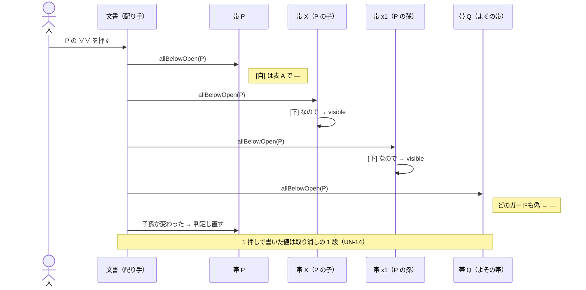
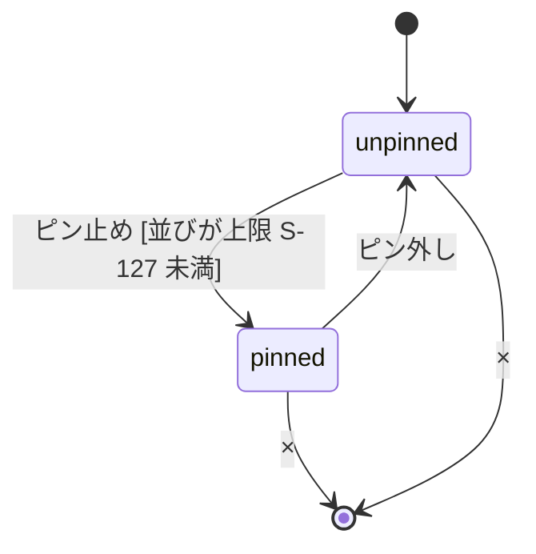

BGQA3T
# タスクグループの木の見え方（名の辞書 3 の枝）

> 「回答:」の後ろに答えを書いて保存し、1 行目の BGQA3T を切り取ってください。
> 凡例: ❓回答待 ✅回答済 🔄変化点 ★強調(ユーザー専用) ⏸後の段で問う

2026-11-20 に作った。あなたの指示「コンテキストを節約するため、タスクグループに関する部分を切り出したGQAをエージェントに作らせろ。今のGQAにはその結論だけをフィードバックしよう」に従い、BGQA3（`goodrelax-qa-b3-grs-json.md`）の 41 回目から、タスクグループの木の問いを切り出した。この紙は、タスクグループの帯をどう見せ、どう畳むか（帯ごとの状態機械と、その名）を決める。決まったら、結論だけを BGQA3 へ戻し、裁定の番号（JDG）はいつもどおり BGQA3 の側で付ける。

🔄 *残 6（❓ で検索）*

**これまでの経緯**（BGQA3 の 26〜41 回目。回ごとの記録は BGQA3 にある）
- 26 回目: 帯の木の形を 1 つの物 `taskGroupTreeView { rootTreeState, 深さ }` にまとめた（`JDG-3651`）。
- 27〜29 回目: 表示状態・折り畳み状態を仕様から読み集め、表示/非表示と折り畳み/展開の 2 つの概念で組み直した。
- 30〜32 回目: 値の名を `temporarilyExpanded` → `expandedUntilZoomOut`（`JDG-3653`）、`auto` → `automaticallyExpandedWithinDepth`（`JDG-3654`）に決めた。
- 33〜34 回目: 根の値、深さの変化と取り消し（問 6-12-7）、根の状態が配下の帯へ波及すること（表 T-328）を確かめた。
- 35 回目: チャットで `isCollapsedIntoParent`（`JDG-3655`）と `childrenExpansionState`（`JDG-3656`）に決めた。
- 36〜38 回目: 名の読み違い（親が子の畳みを持つように見えた）と隠すことの意味が分かり、帯ごとの値の案を、4 つの原則（OKPN・OMPV・NEIM・MECE）で整理し直した。
- 39 回目: あなたの 3 値案（見える・見えない・自動で決まる。帯は自分の状態だけを持つ）を 17 の場面で今の動作と比べ、足りないもの 4 つを問いにした。
- 40 回目: 足りないものの 1 つ（後から入った帯）を、操作ごとに整理し直した。
- 41 回目: 帯ごとの状態機械（外の状態 3・中の状態 2・出来事 20）を設計し、問 6-12-21〜6-12-25 を足した。
- 今: `JDG-3651`・`JDG-3653`〜`JDG-3656` の名と形は、この紙の答えで変わりうる。

2026-11-20 の 1 回目: BGQA3 の 41 回目から、タスクグループの木の問いをこの紙へ移しました。問いの中身は 41 回目のままです。

2026-11-20 の 2 回目: あなたの指示「一気に決めると手戻りが大きいので段階的に決めていく」に従い、決められる用語から 2 問だけ問います（問 6-12-26・6-12-27）。Opus の作業者 2 人が別々に検討し、同じ結論になりました。ほかの問いは後の段へ下げました。

2026-11-20 の 3 回目: あなたの答え（表示状態は visible / invisible で、GRS JSON には保存しない。保存するのは「画面に出せ・画面から消せ・自動で決めろ」の 3 状態）を JDG-3657 に記録しました。あなたの問い（v・vv・^・^^ の呼び名、collapsed/expanded/automaticallyCollapsed を持つ案、局所最適の名の負債）を、Opus の作業者 3 人が別々の角度（世の中の慣わし・リポジトリ全体の整合・原則）で検討しました。3 人とも同じ根の結論なので、それを 1 問目に置きます。

2026-11-20 の 4 回目: 外の AI に、ボタンの名の質問状（1 通目）を出しました。答えを照らして、ボタンの名の問いを組み直しました（問 6-12-29）。あなたの問い「Topレベルとそれ以外を分ける必要があるのか？」に、作業者の答えで問 6-12-31〜6-12-33 を足しました。

2026-11-20 の 5 回目: あなたの「putAway は唐突感がある」を受けて、外の AI に 2 通目の質問状を出しました。答えを照らして、∧ の名（問 6-12-29）を組み直しました。4 つの答え（Copilot と Gemini、新しい会話と前の会話）は、唐突さのいちばんの理由にそろって「語の層の違い」（Expand・Collapse は仕組みの語、Put Away は家の片付けの語）を挙げたので、推奨を Retract（日本語の札は「親へしまう」のまま）に替えました。あわせて、∨ の説明の文（新しい模型では嘘になる）と頭の ∨ の説明の文（原則 P4 に反して Show を使っていた）を直します。問 6-12-28・6-12-30・6-12-32・6-12-33 の推奨は変えていません（4 つの答えはどれも賛成か一部賛成で、決め手になる反対はありませんでした）。新しい問いはありません。

🔄 *2026-11-20 の 6 回目: あなたの「^ retract あり！！！ 採用♪」で ∧ の名が Retract（親へしまう、retractPressed）に決まりました（JDG-3658）。あなたの指示「これをベースにGQAを再構築せよ」に従い、Retract を軸に問いを組み直しました。問 6-12-29 の残りのうち、画面の語（∨・∨∨・∧∧ の札、説明の文、和文の動詞）は問 6-12-28 で確かめます。出来事の名は、札と頭のボタンの形が決まってから問うほうが手戻りが少ないので、後の段の問 6-12-34 へ下げました。保存する値（問 6-12-30）は、Retract から導く `revealed`・`retracted`・`automatic` を新しく推します（5 回目の推奨 `show`・`hide` は、帯が消えることを言う語が hide と Retract の 2 つになるので下げました。あなたの前の案 `collapsed` などは、問 6-12-30 の案 d に並べました）。問 6-12-31・6-12-32 は Retract に合わせて言葉を直しました。後の段の問 6-12-17・6-12-18 は、消した 3 値案の仮の名（`shown`・`notShown`）を、3 つの意図の言葉（出せ・消せ）に直しました。後の段の問 6-12-16・6-12-21・6-12-22 は、JDG-3657 と問 6-12-28・6-12-30 で済むので消しました（6-12-22 の残り「入れ子で描くか」は問 6-12-25 へ移しました）。後の段から前へ出した問いはありません（残りはどれも、値の名か状態機械の形が決まってから問うほうが手戻りが少ない）。独立した作業者が点検し、数え違いとヒントの食い違いを直しました。*

***

## 決定事項

### [tree] タスクグループの木の見え方

参照のための写しです。元は BGQA3 の決定事項で、ここで決まったことの裁定も BGQA3 に記録します。この紙の問いが頼る行だけを、元の区分ごとに写しました。

**[tg] タスクグループ（BGQA3 の表の全部）**

| 何 | 決め | 裁定 |
|:---|:---|:---|
| 帯が表す WBS のタスク（問 6-9-2） | `derivedFromTaskUid` → `representedTaskUid` | `JDG-3624` |

**[root]・[proj] の、帯の木に関わる行**

| 何 | 決め | 裁定 |
|:---|:---|:---|
| 似た字と根の並び（問 6-13-1） | `note` → `remarks`、`levelZeroTreeState` → `rootTreeState`（階層は「深さ」で数える）。根の並びは `$schema`・`schemaVersion`・`buildVersion`・`documentSettings`・`scheduleData`・`documentStamp`・`changeLogEntries` | `JDG-3602` |
| 外の AI が迷った GRS の名（問 6-8-16） | `delayDiagnosticsToleranceWorkingDays`・`taskGroupRootTreeState`。`fadeInCalendarDays`・`fadeOutCalendarDays`・`leaderTarget` は今のまま。★ の 3 行は続きの問い | `JDG-3635` |
| 帯の木の見え方（問 6-12-5-2） | `taskGroupTreeView { rootTreeState, 深さ }` にまとめる。深さの名は問 6-12-5-3 | `JDG-3651` |
| 一時の展開の名（問 6-12-6-2） | `temporarilyExpanded` → `expandedUntilZoomOut` | `JDG-3653` |
| 自動で展開する値の名（問 6-12-6-2） | `auto` → `automaticallyExpandedWithinDepth`（根も） | `JDG-3654` |

この紙で決めたこと

| 何 | 決め | 裁定 |
|:---|:---|:---|
| 帯の表示状態と、GRS JSON に保存するもの（問 6-12-26・6-12-27） | 表示状態は `visible`／`invisible`。導く結果で、GRS JSON に保存しない。保存するのは帯自身の意図 3 つ（画面に出せ・画面から消せ・自動で決めろ。あなたの 2-b）。自動の中の 2 つ（自動で見える・自動で見えない）は導き、保存しない。キーと値の名は問 6-12-28〜6-12-30 と後の段 | `JDG-3657` |
| 🔄 *帯のボタン ∧ の名（問 6-12-29 の ∧）* | 🔄 *英語の札 Retract、日本語の札「親へしまう」、出来事 `retractPressed`（今は Collapse／折りたたむ、`hidePressed`。`IC-59`）。∨・∨∨・∧∧ の名と説明の文は問 6-12-28* | 🔄 *`JDG-3658`* |

***

## QA

### [tree] 🔄 *タスクグループの木の見え方（❓ 5）*

#### 🔄 *❓ 問 6-12-28. 画面の語 —— Expand・Collapse は帯の中身に、Retract は帯そのものに（札・説明の文・和文の動詞）*

🔄 *場面: `JDG-3658` で ∧ の名が Retract（親へしまう、`retractPressed`）に決まりました。これで帯の 4 つのボタンの語は、次の 3 つの動詞になります。主語はどれも押した帯です。*

| 🔄 *動詞（英／日）* | 🔄 *効く物* | 🔄 *ボタン* |
|:---|:---|:---|
| 🔄 *Expand／展開する* | 🔄 *押した帯の子（∨）・子孫（∨∨）。押した帯は書かない* | 🔄 *∨（`IC-90`）・∨∨（`IC-58`）* |
| 🔄 *Collapse／折りたたむ* | 🔄 *押した帯の子孫。押した帯は残る* | 🔄 *∧∧（`IC-77`）* |
| 🔄 *Retract／しまう* | 🔄 *押した帯そのもの（配下ごと親へ）* | 🔄 *∧（`IC-59`）* |

🔄 *Retract で、5 回目のこの問いの考え（collapse／expand をボタンの動詞だけに使う）は強まりました:*
- 🔄 *出荷中の札は ∧ を「Collapse」と呼び、collapse が「自分が消える」と「中身が消える」の 2 つを指していました（`display-words.json` の `IC-59` と `IC-77`）。∧ が Retract になったので、collapse は ∧∧ の「中身が消える」の 1 つだけを指します。*
- 🔄 *5 回目の案 c（製品全体を show／hide にそろえる）と、問 6-12-29 の案 d（Show・Hide の対称の組）は、あなたが Retract を選んだことで消えました。*
- 🔄 *GRS JSON の値にこの語を使うか（あなたの前の案 `collapsed` など）は、問 6-12-30 で問います。出来事の名は後の段の問 6-12-34 です。この問いは画面の語だけです。*

🔄 *用語集では、ボタンと値を 1 行ずつで結びます（値の名は問 6-12-30 の答えで入れる）: 「X を Expand ＝ X の子（∨）・子孫（∨∨）に「出せ」を書く」「X を Collapse ＝ X の子孫に「消せ」を書く」「X を Retract ＝ X と配下に「消せ」を書く」。説明の文も、この行と同じく目的語を X（押した帯）にします。*

| 🔄 *#* | 🔄 *決め* | 🔄 *今 → 案* |
|:---|:---|:---|
| 🔄 *1* | 🔄 *∨・∨∨・∧∧ の札* | 🔄 *今のまま: Expand One Level／1 階層だけ展開する、Expand Below／配下をすべて展開する、Collapse Below／配下をすべて折りたたむ* |
| 🔄 *2* | 🔄 *∧ の説明の文（`IC-59`）* | 🔄 *「Collapse this task group itself／このタスクグループ自身を折りたたむ」→「Retract this task group, with everything under it, into its parent; the parent's Expand One Level brings it back.／このタスクグループを配下ごと親へしまう。親の「1 階層だけ展開する」で戻る」* |
| 🔄 *3* | 🔄 *∨ の説明の文（`IC-90`）* | 🔄 *「Expand only this task group's own children, leaving deeper task groups collapsed／このタスクグループの直下の子だけを展開する。孫より下は折りたたんだままにする」→「Expand only this task group's own children; deeper task groups stay as they are／このタスクグループの直下の子だけを展開する。孫より下は今のまま」。新しい模型の ∨ は孫より下を書かないので、今の文は嘘になる* |
| 🔄 *4* | 🔄 *∨∨・∧∧ の説明の文（`IC-58`・`IC-77`）* | 🔄 *∨∨「Expand every task group below this one／このタスクグループの配下をすべて展開する」→「Expand this task group all the way down, to its deepest task groups／このタスクグループを、いちばん深い段まで展開する」。∧∧「Collapse every task group below this one／このタスクグループの配下をすべて折りたたむ」→「Collapse this task group: every task group below it goes, and this one stays／このタスクグループを折りたたむ。配下のタスクグループはすべて消え、このタスクグループは残る」。今の文は目的語が「配下のそれぞれ」なので、上の用語集の行で読むと、∧∧ は配下のそれぞれの子孫を消し、直下の子が残る（∨∨ は直下の子が入らない）。1 階層ずれる形で、仕様 01-04 の 1796 行が警告している絵そのもの* |
| 🔄 *5* | 🔄 *和文の動詞を用語集で固定する* | 🔄 *「展開する」は ∨・∨∨、「折りたたむ」は ∧∧ だけ、「しまう」は ∧ だけ。仕様の「折りたたみ込む」（01-04 に 7 行、設定の表 `settings.json` に 1 行。Grep で数えた）は「しまう」に書き直す* |

| 案 | 中身 |
|:---|:---|
| **a（推奨）** | 🔄 *上の表の 1〜5 を全部* |
| b | 🔄 *1・2・5 だけ。∨・∨∨・∧∧ の説明の文は今のまま。∨ の文の嘘（孫より下を折りたたむとは限らない）と、∨∨・∧∧ の文の 1 階層ずれが残る* |

🔄 *a から一部だけ外すときは、外す番号を書いてください（例: a から 4 を外す）。*

回答:

#### 🔄 *❓ 問 6-12-30. 保存する 3 つの値の名 —— Retract から導く（キーの名は後の段）*

🔄 *場面: `JDG-3657` で、GRS JSON は帯自身の意図を 3 つ持つと決まりました（画面に出せ・画面から消せ・自動で決めろ）。画面の結果（導く値）は `visible`／`invisible` です（同じ裁定）。5 回目は `show`・`hide`・`automatic` を推しましたが、Retract が決まって、見直す理由が 3 つできました。*
- 🔄 ***帯そのものの動詞ができた。** Retract は、目的語が帯そのものです。「消せ」を書くのは ∧（自分と配下）・∧∧（子孫）・頭の ∧∧（全部）で、どれも「帯を親へしまう」と言えます（∧∧ ＝ 子孫をみな Retract）。だから値の「消せ」を `retracted` と呼ぶと、帯自身の状態を言う語になります（NEIM）。出来事 `retractPressed`（動詞）と状態 `retracted`（過去分詞）の対も、「出来事は動詞、状態は分詞」の形にそろいます。*
- 🔄 ***`hide` は 3 つ目の語になる。** 5 回目の `hide` のままだと、帯が消えることを、画面は Retract／しまう、GRS JSON は hide と、別の語で言います。`hide` は今の値 `hidden`（`HR-6`）と語幹が同じで、表の見え方の Hide（列の表示／非表示）とも同じ語です。*
- 🔄 ***「出せ」にも、帯そのものを主語にした語が要る。** 「出せ」を書くのは、親の ∨（子へ）・∨∨（子孫へ）、頭の ∨・∨∨、飛ぶ・入る（先と道へ）です。*

🔄 ***「出せ」の語の候補を照らした結果**（✓ 合う、△ 条件つき、✗ 反する。行の数は src・tests・docs/spec を Grep で数えた、名が現れる行）*

| 🔄 *語* | 🔄 *照らした結果* |
|:---|:---|
| 🔄 *`revealed`* | 🔄 *✓ 製品の動詞 reveal（飛ぶ `taskGroupRevealAsked`。先と道を見せる）の分詞で、飛ぶはまさにこの値を書く。∨ が子を出すことも、英語で「reveal the children」と言える。コードの `revealedRowId`・`isRevealedTaskGroupOrAncestor`（38 行・8 ファイル）は「飛ぶ先」の意味で、意味は同じ「見えるようにした」。ただし、reveal には 3 つ目の意味がある: 検索パネルと遅延診断の表の `rowRevealed` とそれを受ける局所の名（18 行・3 ファイル。src 2・試験 1。仕様に無い）は「表の行をスクロールして見える所へ出す」で、帯の木とは別の意味。`[Rr]evealed` の全 66 行の内訳は、飛ぶ先 38・表の行 18・試験の局所の名と注釈 10* |
| 🔄 *`extended`* | 🔄 *△ retract の対の語（脚・アンテナを出す・引っ込める）。しかし製品に extend の動詞は無く、どの出来事の分詞でもない。α 版の値 `expanded` と見た目が近い。GRS が読み書きする MSPDI に、独自の欄 `ExtendedAttribute` がある（src・仕様に 35 行）* |
| 🔄 *`shown`* | 🔄 *✗ あなたがチャットで「まず shown が変」と書いた（この紙の後の段にあった問 6-12-21 の場面）。窓（パレット・ヘルプなど）の状態機械が、導く状態に `shown` を使っている（`state-machines.json` に値 `"shown"` の行が 49）* |
| 🔄 *`visible`* | 🔄 *✗ 導く結果の語。あなたの「それはGRS JSONに直接保存すべきではない」（`JDG-3657`）に反する* |
| 🔄 *`expanded`* | 🔄 *✗ 中身の語（問 6-12-28）。α 版の値と同じ綴りで、意味が変わる（下の案 d）* |

| 案 | 出せ | 消せ | 自動で決めろ | 良い所 | 弱い所 |
|:---|:---|:---|:---|:---|:---|
| **a（推奨）** | 🔄 *`revealed`* | 🔄 *`retracted`* | `automatic` | 🔄 *3 つとも帯自身の状態を言う形容詞・分詞で、品詞がそろう（5 回目の弱い所が消える）。2 つは製品の動詞（reveal・Retract）の分詞で、新しい動詞を作らない。導く結果 `visible`／`invisible` と語が違い、「人の意図」と「画面の結果」が別の語になる（OKPN）。`hidden`（`HR-6`）・表の見え方の Hide・窓の `shown`／`hidden` とは別の語* | 🔄 *reveal に 3 つ目の意味（表の行のスクロール `rowRevealed`、18 行）があり、後の段で改名が要る。`revealed` は結果（見えている）とも読めるので、キーの名で人の意図だと示す。しまった祖先の下に `revealed` の帯があるファイルは作れるので、読むときの決まりが要る（下のお知らせの 3 つ）* |
| b | 🔄 *`extended`* | 🔄 *`retracted`* | `automatic` | 🔄 *機械の語の対（出す・引っ込める）で、語の上で完全に対になる* | 🔄 *上の表の △。`extended` を書く動詞が製品に無い* |
| c | `show` | `hide` | 🔄 *`automatic`* | 🔄 *5 回目の推奨* | 🔄 *上の 2 つ目の点（hide が 3 つ目の語になる）。`hidden` と語幹が同じ。状態に動詞で、品詞がそろわない* |
| d | 🔄 *`expanded`* | 🔄 *`collapsed`* | 🔄 *`automaticallyCollapsed`* | 🔄 *あなたの前の案。ボタンの語と同じ語で、ボタンから値が読みやすい* | 🔄 *帯自身が消えることを Collapse の語で言う。画面で帯自身を消すのは Retract なので、問 6-12-28 で ∧∧ だけに絞った collapse の 2 つ目の意味が、GRS JSON の値に戻る。α 版の `collapsed`（中身を畳んだ。自分は見える。`HR-4`・`JDG-3656`）と同じ綴りで意味が変わる。スキーマの説明と変換で補うことになる* |

🔄 ***案 a で書く値***

| 🔄 *押す・起きる* | 🔄 *書く値* |
|:---|:---|
| 🔄 *∨* | 🔄 *子を `revealed`（押した帯は書かない）* |
| 🔄 *∨∨* | 🔄 *子孫を `revealed`* |
| 🔄 *∧∧* | 🔄 *子孫を `retracted`（押した帯は書かない）* |
| 🔄 *∧* | 🔄 *自分と配下を `retracted`* |
| 🔄 *頭の ∨・∨∨・∧∧* | 🔄 *最上位を `revealed`・全部を `revealed`・全部を `retracted`* |
| 🔄 *飛ぶ・入る* | 🔄 *先を `revealed`。道の `retracted` を `revealed`（⏸ 問 6-12-23 の a のとき）* |
| 🔄 *全体表示* | 🔄 *`revealed` を `automatic` へ戻し、`retracted` は残す（⏸ 問 6-12-17 の a のとき）。「見せた物は戻し、しまった物は残す」と名で読める* |

- 🔄 *使わない語: `auto`（命名の決まり N-2 が略を `uid`・`id`・`Px`・`Utc`・`dx`・`dy`・`min`・`max`・`hex` だけに限る）、`automaticByDepth`（自動は深さだけで決まらない。⏸ の「見える条件」4 つ）、`visible`・`invisible`（上の表）。*

| 案 | 中身 |
|:---|:---|
| **a（推奨）** | 🔄 *`revealed`・`retracted`・`automatic`* |
| b | 🔄 *`extended`・`retracted`・`automatic`* |
| c | 🔄 *`show`・`hide`・`automatic`（5 回目の推奨）* |
| d | 🔄 *`expanded`・`collapsed`・`automaticallyCollapsed`（あなたの前の案）* |

回答:

**後の段で決めること（お知らせ。今は答え不要）**
- 🔄 *キーの名: `visibilityRule`（作業者 A・B）か `visibilityOverride`（作業者 C）。`visibility` だけの名は使いません。命令のスキーマの `setTableView` に、表の見え方の物 `visibility` がすでにあるからです。案 a なら、キーの名で「人が選んだ意図」であることを示します（`revealed` は結果とも読めるので、キーで補う）。*
- 🔄 *reveal の改名（案 a のとき）: 表の行のスクロールの `rowRevealed` を `rowToScrollIntoView` などに改めます（`rowScrolledIntoView` は同じファイルに関数の名としてすでにあるので使えない）。飛ぶ先の `revealedRowId` は、値 `revealed` の帯と読み違えないよう `revealTargetRowId` などに改めます。*
- 🔄 *読むときの決まり: しまった祖先の下に「出せ」の帯があるファイルは、出来事では作れません（⏸ の不変条件 I1）。しかし GRS JSON は外の AI が書け（`importDocument`・`applyCommands`）、人も手で直せるので、ファイルでは作れます。その帯は描かれないのに「出した」と読めます。読むときに直す（「消せ」にそろえる）か、検証が断るかを決めます。*
- 🔄 *自動の中の 2 つの名（今の案 `automaticallyVisible`・`automaticallyInvisible`）: GRS JSON には出ませんが、⏸ 問 6-12-25 の a で仕様の図と表に入れ子の状態として描くので、名が要ります。値の名が決まってから決めます。*
- 深さの欄の名: 今の `taskGroupAutoExpandDepth`（`JDG-3296`。この紙では `expandDepth` と書いた）は「深さ N まで開く ＝ 子は深さ N＋1 まで見える」と数えます。帯自身の数え方の `visibleDepth`（深さ N 以内の自動の帯が見える）にすると、＋1 が消えます。そのときは `CR-853` の既定（3 → 4）と範囲（0〜4 → 1〜5）を書き直します。
- 仕様の「⛔ 押したタスクグループの状態を書き換えずに、その配下の状態だけを書き換えてはならない（MUST NOT）」とその段落（仕様 01-04 の 1791〜1796 行）は、帯ごとの模型では取り下げます。∨ と ∧∧ は、押した帯を書かずに子・子孫だけを書くからです。
- 🔄 *子についての値を決めた `JDG-3653`（`expandedUntilZoomOut`）・`JDG-3654`（`automaticallyExpandedWithinDepth`）・`JDG-3656`（`childrenExpansionState`）は取り下げます。`JDG-3655`（`isCollapsedIntoParent`。帯そのものが親へしまわれたか）も取り下げ、その意味は 3 つの値の「消せ」（問 6-12-30 の a なら `retracted`）が継ぎます。キーの名が Collapse を使っており、問 6-12-28 で ∧∧ だけに絞った collapse の 2 つ目の意味が残るからです。その句「親へ折りたたむ」は 4 回目の案の句で、出荷中の ∧ の札は「折りたたむ」（`IC-59`）でした。*
- 導く値の名は `visible`／`invisible`（`JDG-3657`）。スケジュールフィルタやピンの溢れまで含めた最終の結果は「描く」`drawn` と言います（表 T-329「タスクグループを描くか」、コードの `drawnTaskGroupsOf`）。

#### ❓ 問 6-12-31. 頭のボタンは「帯のボタンを根で押したもの」とするか

🔄 *場面: あなたは「Topレベルとそれ以外を分ける必要があるのか？」と問いました。帯の欄の見出し（パネルの頭）には ∨・∨∨・∧∧ の 3 つのボタンがあります。仕様はすでに頭を「深さ 0 の根（タスクグループではない）」とし、頭のボタンを帯のボタンの「段 0 版」と書いています（`HF-16` は帯の ∨ を段 0 で押すもの、など）。頭に ∧ とピンは置きません（∧ の Retract は親へしまう操作で、根には親が無い。根は留められない。仕様 01-04 の 1801・1802 行）。それなのに、今の札と出来事の名は帯と別の系です。*

| ボタン | 今の札（英／日） | 案 a の札（英／日） | 出来事 今 → 案 a |
|:---|:---|:---|:---|
| 頭の ∨（`IC-92`） | Show Top Level Only／最も浅い段を 1 階層展開する | **Expand One Level／1 階層だけ展開する**（帯と同じ） | `topLevelOpenPressed` → 帯と同じ `expandOneLevelPressed`（押した物 ＝ 根） |
| 頭の ∨∨（`IC-74`） | Expand All／すべて展開する | 今のまま | `everyTaskGroupOpenPressed` → 帯と同じ `expandBelowPressed`（押した物 ＝ 根） |
| 頭の ∧∧（`IC-78`） | Collapse All／すべて折りたたむ | 今のまま | `everyTaskGroupFoldPressed` → 帯と同じ `collapseBelowPressed`（押した物 ＝ 根） |

- 🔄 *出来事の名は、⏸ 問 6-12-34 の a（札にそろえる）の名で書きました。問 6-12-34 が b なら、帯の今の名（`oneLevelOpenPressed`・`allBelowOpenPressed`・`allBelowFoldPressed`）を共有します。この問いで決めるのは「共有するか」です。*
- 頭の ∨ の説明の文: 「Bring back the top-level task groups; what is under them stays as it is.」／「最上位のタスクグループを戻す。その配下は今のまま」。4 回目の英語は「Show the top-level task groups …」で、原則 P4（ボタンの名・説明の文に show・hide・visible を使わない）に反していました（作業者の見落とし。外の AI も気づかなかった）。「戻す」は今の説明の文と仕様 `HF-16`（最も浅い段が戻る）の語です。
- 🔄 *頭の ∨∨・∧∧ の説明の文も、問 6-12-28 の用語集の行（目的語は押した物 ＝ 根）に合わせて直します（どの案でも）。∨∨（`IC-74`）「Expand every task group that was collapsed／折りたたんだタスクグループをすべて展開する」→「Expand the whole tree: every task group comes back, retracted ones included／木の全体を展開する。しまったタスクグループも含め、すべてが戻る」。∧∧（`IC-78`）「Collapse every task group／すべてのタスクグループを折りたたむ」→「Collapse the whole tree: every task group goes, the top level included／木の全体を折りたたむ。最上位も含め、すべてのタスクグループが消える」。今の ∨∨ の文は collapsed を状態の語に使い、しまった帯も戻ることを言いません。今の ∧∧ の文は、用語集の行で読むと「それぞれの帯の子孫を消す」になり、最上位が残って仕様 `HR-2`（頭の ∧∧ はパネルを空にしうる）に反します。*
- 今の「Show Top Level Only」の Only は嘘です。頭の ∨ は最上位の帯に「出せ」を書くだけで、深い帯を消しません（ある帯の ∨∨ の後に頭の ∨ を押しても、その配下は出たまま）。2 つの AI も同じ読みです。
- 外の AI は割れました。Gemini は「動詞は同じ、範囲語だけ変える」（頭の ∨ は Expand Top Level）、Copilot は「頭も帯と同じ名」（Expand One Level・Expand Below・Collapse Below）。案 a はその間です: ∨ の「One Level」は押した物から見た語なので根でもそのまま正しく、∨∨・∧∧ は見出しの慣わし（VS Code など）の Expand All・Collapse All を残します（根の下 ＝ 全部）。
- 外の AI の答えから: 2 通目の質問状では、新しい会話の Copilot と Gemini がどちらも案 a に賛成しました（Gemini: 頭の ∨ を Expand One Level にそろえたので「押した節の直下を出す」に例外がなくなった）。1 通目の割れは解けました。
- Gemini の「Expand Top Level」は採りません。問 6-12-28 の a の読み（Expand X ＝ X の中身が出る）では「最上位の帯の中身（深さ 2）を出す」と読めて、働きと逆になります。
- 出来事を帯と共有するとき、根を「空の値」で運びません（レビューの決まりの悪い例「特別な値に意味を持たせる」に当たる）。押した物が根であることを、明示の印で運びます。

| 案 | 中身 |
|:---|:---|
| **a（推奨）** | 頭のボタン ＝ 帯のボタンを根で押したもの。出来事は帯と共有する。札は頭の ∨ を帯と同じ「Expand One Level／1 階層だけ展開する」に直し、∨∨・∧∧ は今の「Expand All」「Collapse All」のまま（「範囲語 Below は、根では All」と用語集に 1 行） |
| b | 札も帯と全く同じにする（頭も Expand Below・Collapse Below。Copilot の案）。語の数は最も少ないが、見出しで「何の下か」を探させる |
| c | 🔄 *頭は別の系のまま。札は頭の ∨ だけ「Show Top Level」に直す（Only を外す）。出来事は頭用に `showTopLevelPressed`・`expandAllPressed`・`collapseAllPressed` の 3 つを持つ。札の Show は原則 P4（上の 1 つ目の点）に反する* |

回答:

#### ❓ 問 6-12-32. 根に、根だけの値を持たせないか

場面: 今の仕様は、根（深さ 0）の状態を別の値 `levelZeroTreeState`（BGQA3 で `rootTreeState` への改名を決めた。`JDG-3602`）に持たせています。この値は「根の子（最上位の帯）を出すか」を言い、帯の値（`JDG-3657` で「帯自身の意図」と決めた）と主語が違います。根を木の節の 1 つとして扱えば、この値は要りません: 根が畳まれた ＝ 最上位の帯が全部「消せ」。仕様の状態機械の根だけの升 7 つと、外の AI 向けの命令 `setLevelZeroTreeState` も消えます。後の段の問 6-12-25 の a のうち、根の部分を先に問う形です。

🔄 *根は、Retract を持たない（親が無いのでしまえない）ことだけがほかの節と違います（問 6-12-31）。それはボタンが無いことで言え、値は要りません。*

**変わる絵があります。** 頭の ∧∧ ですべて畳んだ後に、次を押すと:

| 押す | 今（根の値あり） | 根の値なし（案 a） |
|:---|:---|:---|
| 頭で帯を足す | 根が自動へ戻り、最上位の帯が全部戻る | 足した帯だけが出る。ほかの最上位は畳まれたまま |
| 検索などで飛ぶ | 同じく全部戻る | 飛んだ先と、そこまでの道だけが出る |
| 全体表示 | 全部戻る | 後の段の問 6-12-17 が a なら、空のまま |

残った帯は、頭の ∨ を 1 回押せば戻ります。

| 案 | 中身 |
|:---|:---|
| **a（推奨）** | 根に値を持たせない。根もほかの親と同じに振る舞う（足した帯・飛んだ道だけが出る。⏸ 問 6-12-23 の a「兄弟は自分の値のまま」と同じ決まり） |
| b | 根に値を持たせないが、決まりを 1 行足す:「根の下へ入る出来事（頭で足す・飛ぶ）は、根の ∨ を兼ねる」。足す・飛ぶは今と同じに最上位が全部戻る。根だけの決まりが 1 つ残る |
| c | 今のまま根の値（`rootTreeState`）を持つ。帯が見えるかを知るのに 2 か所を読み、頭の ∧∧ に「根を畳む」と「最上位を全部消す」の 2 通りの書き方が残る |

回答:

#### ❓ 問 6-12-33. 最上位の帯（深さ 1）に、特別の決まりを置かないか

🔄 *場面: 縦に縮めても、最上位の帯は落ちません（仕様 `FR-055` の下限。01-04 の 6222・6223 行）。後の段の設計案は、これを「自動」の中の見える条件の 1 つ `isTopLevel` として、深さの条件 `isWithinDepth` とは別に置いています。しかし今の数え方（深さ ≤ `expandDepth`＋1。`expandDepth` は 0 以上）でも、後の段の `visibleDepth` の数え方でも、深さの条件は深さ 1 をいつも「範囲の内」にします。同じ事実を 2 か所で言うことになり、片方だけ直すと食い違います。*

| 案 | 中身 |
|:---|:---|
| **a（推奨）** | 特別の決まりを置かない。深さの範囲の下限（深さ 1 はいつも範囲の内）だけで言う。人の「消せ」は最上位にも勝つ（頭の ∧∧ はパネルを空にしうる。戻り道は頭の ∨。仕様 `HR-2`・`HF-16`） |
| b | 見える条件 `isTopLevel` も残す。同じ事実を 2 か所で持つ |
| c | 最上位は人の「消せ」にも勝ち、いつも見える。頭の ∧∧ で空にできず、仕様 `HR-2` に反する。仕様が実測で退けた読み（頭の ∨ がいつも効かない）に戻る |

回答:

### ⏸ 後の段で問う（今は答え不要）

🔄 *後の段の問 6-12-16（あなたの 3 値案）・6-12-21（帯の見え方の名）・6-12-22（自動の中の 2 つ）は、この回で消しました。6-12-16 の向きと、6-12-22 の「中の 2 つは導き、保存しない」は `JDG-3657` で決まりました。名は問 6-12-28・6-12-30 で問います（中の 2 つの名は、問 6-12-30 の下のお知らせ）。6-12-16 が挙げた足りないもの 4 つは、問 6-12-17（全体表示）・6-12-18（縮めたら閉じるか）・6-12-23（入る・飛ぶ）に残っています。6-12-22 の残り（図と表で「自動の中」を入れ子の状態に描くか）は、問 6-12-25 に入れました。*

#### 🔄 *⏸ 問 6-12-34. 出来事の名を札にそろえるか*

🔄 *場面: ボタンを押したことを表す出来事の名は、今は札と違う動詞です（Open・Fold・hide）。∧ の `hidePressed` → `retractPressed` は `JDG-3658` で決まりました。残りを札（問 6-12-28）にそろえるかを、札と頭のボタンの形（問 6-12-31）が決まってから問います。*

🔄 *書き換える行（src・tests・docs/spec を Grep で数えた、名が現れる行）: 帯の 4 つの出来事（`oneLevelOpenPressed`・`allBelowOpenPressed`・`allBelowFoldPressed`・`hidePressed`）は 91 行・12 ファイル（src 2・試験 6・仕様 4）。頭の 3 つ（`topLevelOpenPressed`・`everyTaskGroupOpenPressed`・`everyTaskGroupFoldPressed`。問 6-12-31 の a なら帯と共有して消える）を足すと 152 行・13 ファイル（src 2・試験 7・仕様 4）。src で当たるのは `task-group-folding.ts` と `task-group-tree-entrances.ts` だけです。*

| 案 | 中身 |
|:---|:---|
| **a（推奨）** | 🔄 *`oneLevelOpenPressed` → `expandOneLevelPressed`、`allBelowOpenPressed` → `expandBelowPressed`、`allBelowFoldPressed` → `collapseBelowPressed`。∧ の `retractPressed` と合わせて、出来事の動詞を札の動詞（Expand・Collapse・Retract）にそろえる* |
| b | 🔄 *∧ の `retractPressed` だけを変え、ほかは今のまま。書き換えは減るが、出来事の動詞（Open・Fold・Retract）が札（Expand・Collapse・Retract）と合わないまま残る* |

回答:

🔄 ***帯ごとの状態機械の設計（作業者の案。下の後の段の問いの材料）***

🔄 *チャットでのあなたの指示「イベントと v, vv, ^, ^^, +, x, pin, 移動, 階層変更...の関係を整理して、 状態遷移図、状態遷移表にしたら？ タスクグループ毎にステートマシンを持って整理したら？ autoの場合にサブステートマシンか、内部ステートマシンにするか...」に従い、作業者が設計しました。値の名は前の案のまま書いてあり、問 6-12-30 が決まったら書き直します。対応: 外の状態 `visible` ＝ 出せ、`invisible` ＝ 消せ、`automaticByDepth` ＝ 自動で決めろ。保存するのはこの 3 つの意図で、画面の結果の `visible`／`invisible`（`JDG-3657`。保存しない）とは別物です。∧ の出来事 `hidePressed` は `retractPressed` になります（`JDG-3658`）。*

**2. 1 本の帯の状態機械**

**状態**

| 状態 | 層 | 保存 | 意味 | 帯は描かれるか |
|:---|:---|:---|:---|:---|
| `visible` | 外 | 🔄 *する（意図「出せ」として）* | 人か「飛ぶ・入る」が見せた | 描く |
| `invisible` | 外 | 🔄 *する（意図「消せ」として）* | 🔄 *人が「消せ」を書いた（∧・∧∧・頭の ∧∧）* | 描かない |
| `automaticByDepth` | 外（入れ子） | 🔄 *する（意図「自動で決めろ」として）* | 深さに任せる | 中の状態で決まる |
| └ `automaticallyVisible` | 中 | しない | 見える条件が真 | 描く |
| └ `automaticallyInvisible` | 中 | しない | 見える条件が偽 | 描かない |

**見える条件**（中の状態を決めるガード。どれか 1 つが真なら `automaticallyVisible`）
- `isTopLevel`: 最上位の帯である（深さ 1 は倍率で落とさない RQ:6223）[確]。
- `isWithinDepth`: 深さが文書の深さ `expandDepth` で見える範囲にある（今の決め JDG-3296 では深さ ≤ `expandDepth`＋1。SIM §0 の読み）[推]。
- `isPinned`: ピンの領域が `pinned`（§5）。
- `hasVisibleDescendant`: 子孫のどれかが `visible`（∨ の後に縮めても、開いた所が宙に浮かない。今の `TD-7` の役 RQ:6247）[確: TD-7 の文]。

**2 つの不変条件**（機械の外で、出来事の側が守る）
- **I1**: `invisible` の帯の子孫は、みな `invisible`。∧・∧∧・頭の ∧∧ は子孫にも書き、`visible` を書く出来事は道の `invisible` を `visible` に直す。だから「見えない帯の下に見える帯」は作れない。🔄 *ただしファイル（外の AI が書いた・人が手で直した）では作れる。読むときの決まりは問 6-12-30 の下のお知らせ。*
- **I2**: 描くのは `visible` か `automaticallyVisible` の帯で、しかもスケジュールフィルタを通る帯だけ（別の軸）。I1 があるので、祖先をたどる規則（今の `TD-3`）は要らない [推]。

**中を「導く」にする理由（保存しない）**
1. 中の状態は、深さ・木の形・ピン・子孫の値から必ず決まる。導けるものを保存すると、2 か所が食い違いうる（MECE）。
2. ホイール 1 刻みで中の状態が変わる。保存すると、ズームが文書の編集になり、未保存の印と取り消しの段が立つ。ズームは取り消しの対象外（RQ:2438 `UN-8`）[確] と合わない。
3. UML の言い方では、中の遷移は「条件が変わったとき（when）」に起きる変化の遷移であり、人の出来事ではない。入れ子の状態に入るたびに選択（◇）で行き先を決める。

**3. 出来事と的（全部の帯に配り、帯がガードで自分を選ぶ）**

ガードの略: **[自]** 押した帯。**[子]** 押した帯の子。**[下]** 押した帯の子孫。**[上位]** 最上位の帯。**[先]** 飛ぶ先・入る帯。**[道]** [先] の祖先。

| # | 出来事（今の名 SM:1140-1151 [確]） | 的 | 書く値 |
|:--|:---|:---|:---|
| 1 | ∨ 1 段展開（`oneLevelOpenPressed`） | [子] | `visible`（押した帯は書かない） |
| 2 | ∨∨ 子孫を全て展開（`allBelowOpenPressed`） | [下] | `visible` |
| 3 | ∧ 自分と子孫を畳む（`hidePressed`） | [自]・[下] | `invisible` |
| 4 | ∧∧ 子孫を全て畳む（`allBelowFoldPressed`） | [下] | `invisible`（押した帯は書かない） |
| 5 | 頭の ∨（`topLevelOpenPressed`） | [上位] | `visible` |
| 6 | 頭の ∨∨（`everyTaskGroupOpenPressed`） | 全部 | `visible` |
| 7 | 頭の ∧∧（`everyTaskGroupFoldPressed`） | 全部 | `invisible`。頭の ∧ は置かない（∧∧ と同じ絵）[確 RQ:1801] |
| 8 | ＋ 配下に足す・頭で足す（`childTaskGroupAddPressed`） | 新しい帯＝[先]、[道] | 入る（下の 20） |
| 9 | 命令で作る（`createTaskGroup` CM-26） | 同上 | 入る |
| 10 | 親を変える（掴んで落とす `HF-15`、`moveTaskGroup` CM-73） | 動いた帯＝[先]、新しい [道] | 入る。動いた帯の子孫は自分の値のまま |
| 11 | 並べ替え（同じ親のまま CM-73） | — | 書かない（深さが変わらない） |
| 12 | 貼る・複製（CM-28、`DU-2`） | 写しの根＝[先]、[道] | 入る。写しの子孫は `invisible` を保ち、`visible` は `automaticByDepth` にする（今の DU-2 と同じ考え RQ:2746）[推] |
| 13 | × 消す・頭で全て消す（`IC-82`・`HF-20`） | [自]・[下] | 機械が終わる。ほかの帯は書かない |
| 14 | ピン止め・外す（`IC-60`） | [自] | ピンの領域だけ（§5） |
| 15 | 全体表示（`fitPressed`） | 全部 | 🔄 *`visible` → `automaticByDepth`。`invisible` は残す（問 6-12-17 の a）。深さを測り直す* |
| 16 | 縦を縮める・広げる（今は縮めるだけ `verticalZoomShrinkPressed`） | — | 🔄 *書かない。`expandDepth` だけ変わり、中の状態が導き直される（問 6-12-18 の a）* |
| 17 | 飛ぶ（`taskGroupRevealAsked`: 検索 `SJ-1`・`focusTask`・依存線の印 `EL-21`・表のチェック `TV-6`） | [先]・[道] | 🔄 *入る と同じ（問 6-12-23 の a）* |
| 18 | 取り消し・やり直し（`UN-14`） | 1 押しで書いた帯 | 記録した外の値に戻す。中は導き直す |
| 19 | 取り込み（MSPDI）・開く（GRS JSON） | 全部 | MSPDI は全部 `automaticByDepth`。GRS JSON は書いてある値 |
| 20 | **入る**（8・9・10・12・17 の共通の中身） | [先]・[道] | [先] を `visible`。[道] のうち `invisible` だけを `visible`。`automaticByDepth` の祖先は書かない（[先] に引かれて描かれる） |

- 命令 `setTaskGroupTreeState`（CM-85 DC:120）は `setTaskGroupVisibility` に改め、`invisible` は子孫にも書き、`visible` は 20 と同じく道も直す（I1 を守る）[推]。
- スケジュールフィルタは帯の値を読まず書かない（RQ:6248）[確]。この機械の出来事ではない。

**4. 状態遷移表**

「—」は変わらない。行は帯の今の状態、列は配られた出来事。セルに無いガードは「それ以外 → —」。

**表 A: ボタン**

| 今の状態 ＼ 出来事 | ∨ | ∨∨ | ∧ | ∧∧ | 頭の ∨ | 頭の ∨∨ | 頭の ∧∧ |
|:---|:---|:---|:---|:---|:---|:---|:---|
| `visible` | — | — | [自][下] → `invisible` | [下] → `invisible` | — | — | → `invisible` |
| `invisible` | [子] → `visible` | [下] → `visible` | — | — | [上位] → `visible` | → `visible` | — |
| `automaticallyVisible` | [子] → `visible` | [下] → `visible` | [自][下] → `invisible` | [下] → `invisible` | [上位] → `visible` | → `visible` | → `invisible` |
| `automaticallyInvisible` | [子] → `visible` | [下] → `visible` | [下] → `invisible` | [下] → `invisible` | [上位] → `visible` | → `visible` | → `invisible` |

**表 B: ボタン以外**（「判定」= 入れ子の選択 ◇ をやり直し、中の 2 つのどちらかへ）

| 今の状態 ＼ 出来事 | 入る（足す・作る・親を変える・貼る） | 飛ぶ | 並べ替え | × | 全体表示 | 縮める・広げる | ピン・外す | 取り消し |
|:---|:---|:---|:---|:---|:---|:---|:---|:---|
| （まだ無い） | 生まれる → `visible` | — | — | — | — | — | — | 記録の値で生まれ直す |
| `visible` | — | — | — | [自][下] → 終わり | → `automaticByDepth`（判定） | — | — | → 記録の値 |
| `invisible` | [先][道] → `visible` | [先][道] → `visible` | — | [自][下] → 終わり | — | — | — | → 記録の値 |
| `automaticallyVisible` | [先] → `visible`。[道] → —（引かれて描かれる） | 同左 | — | [自][下] → 終わり | 判定 | 判定 | 判定 | → 記録の値 |
| `automaticallyInvisible` | [先] → `visible`。[道] → 判定 | 同左 | — | [自][下] → 終わり | 判定 | 判定 | 判定 | → 記録の値 |

- 子孫の値が変わる出来事（表 A のどれでも）の後、祖先の `automaticByDepth` は `hasVisibleDescendant` が変わるので判定し直す。
- `invisible` の帯は描かれないので押されない。表 A の [自] は描かれた帯にしか来ない。∨ が薄く描かれる条件（`FR-029`）は「子がみな描かれている」と言い直せる [推]。

**図 1: 1 本の帯**

**図 2: P の ∨∨ が配られる様子**

**5. ピン止め —— 直交する領域**

- **判定**: ピンは帯ごとの事実（この帯は留めてあるか）なので、機械では直交する領域として描く。見え方の状態に混ぜると、1 つの名が 2 種類を取る（OKPN 違反。`visibleAndPinned` のような値が要る）[推]。
- **保存は文書の並び** `pinnedTaskGroupIds`（決まっている JDG-3651 の形）。固定した順に上から並べ（FR-098）、上限がある（`S-127`）[確 RQ:6267-6271]。帯ごとの真偽にすると、並び順を別の値で持つことになり、2 か所に分かれる。
- **見え方への効き方**: ピンは中の判定（`isPinned`）にだけ効く。`invisible` には勝たない（今の「ピンは人の畳みに勝たない」RQ:6253 と同じ）[確]。I1 があるので、この勝ち負けは状態の形だけで決まり、別の規則が要らない。

#### ⏸ 問 6-12-17. ① 全体表示は、畳んだ帯をどうするか

🔄 *場面: X をしまい（∧）、別の帯 Q の中を畳み（∧∧）、全体表示を押す。今は Q の中身が戻り、X は隠れたまま。帯自身の 3 つの意図（`JDG-3657`）では、X も Q の子も同じ「消せ」なので、全体表示は両方を戻すか、両方を残すかしかありません。*

| 案 | 中身 |
|:---|:---|
| **a（推奨）** | 🔄 *人が出した帯（「出せ」）だけを自動へ戻す。畳んだ帯もしまった帯も残る。戻すのは頭か帯の ∨・∨∨。決まり:「全体表示の仕事は窓に収めること。開いた帯は行を増やして邪魔をするが、畳んだ帯は邪魔をしない」。変わる絵: 畳んだ Q は全体表示で開かなくなる。頭で全部畳んでから全体表示を押すと、空のまま* |
| b | 🔄 *全部を自動へ戻す。しまった帯も、押すたびに戻る* |
| c | 🔄 *今のまま（畳みは戻し、しまったのは残す）。そのために「消せ」を 2 つに分け、4 値にする（全体表示で戻る畳み と 戻らないしまい）* |

回答:

#### ⏸ 問 6-12-18. ② 「子孫を全て展開」（∨∨）は、縦を縮めたら閉じるか

🔄 *場面: 引いた倍率で P の中を覗こうと ∨∨ を押し、ホイールでさらに引く。今は P の中が、深さで決まる絵へ戻ります。帯自身の 3 つの意図（`JDG-3657`）では、全体表示か畳むボタンを押すまで開いたままです。この「縦を縮めるまで」の値は、あなたが JDG-596 で「[vv] を押して保存すると次に開いたとき変わる」と言って生まれました。その後 JDG-598 で値を全部保存すると決めたので、生まれた理由はもう残っていません。*

| 案 | 中身 |
|:---|:---|
| **a（推奨）** | 閉じない。決まり:「ズームは値を書かない。値を書くのはボタンと全体表示と飛ぶだけ」。∨ と ∨∨ は範囲だけが違う。帯を足したときも同じ。縮めることが取り消しの段にならない |
| b | 🔄 *今のまま閉じる。そのために「縦を縮めるまで出せ」の値を足し、4 値にする（前の案の名は `shownUntilZoomOut`）* |
| c | ∨∨ だけ閉じ、帯を足したときは閉じない |

回答:

#### ⏸ 問 6-12-23. 後から入る帯（足す・作る・親を変える・貼る）は「その帯へ飛ぶ」と同じにするか

場面: 作業者の新しい見つけです。後から帯が入ることを、検索でその帯へ飛ぶのと同じに扱えば、前の回の問い 6-12-19（入った帯の状態）・6-12-19-2（足すと兄弟も開くか）・6-12-20（飛ぶ範囲）が 1 つの決まりになります。この 3 問は、ここへまとめて下げました。

| 案 | 中身 |
|:---|:---|
| **a（推奨）** | 「その帯へ飛ぶ」と同じ決まり: 入った帯は `visible`、道（祖先）の `invisible` も `visible` にする。飛ぶときも、開くのは道だけ（兄弟は自分の値のまま）。見えない親へ命令で入れても、その帯が見える |
| b | 入った帯だけ `visible`。見えない親へ入れる命令は断る（画面の操作では起きない） |
| c | 入った帯は自分の値のまま。引いた倍率で落とすと消えることがある |

回答:

#### ⏸ 問 6-12-24. ピン止めの置き場

| 案 | 中身 |
|:---|:---|
| **a（推奨）** | 見え方とは別の、直交する領域（ピンする・しない）。保存は文書の並び `pinnedTaskGroupIds`（並び順と上限があるので、今のまま）。見え方には、「自動」の中で見えるかの判定にだけ効く。`invisible` には勝たない |
| b | 帯ごとの真偽 `isPinned` と、並び順の値を持つ。並びが 2 か所に分かれる |
| c | 見え方の値に混ぜる（`visiblePinned` など）。OKPN に反する |

回答:

#### ⏸ 問 6-12-25. 仕様の状態機械の書き方

| 案 | 中身 |
|:---|:---|
| **a（推奨）** | 🔄 *仕様の状態機械（表 T-328）を、帯ごとの機械（外の状態 3・中の状態 2・出来事 20）に書き換え、根だけの表と根のキー（`S-418`）を消す（根が畳まれた ＝ 最上位の帯が全部「消せ」）。図と表は、自動の中の 2 つ（自動で見える・自動で見えない）を入れ子の状態として描き直す（消した問 6-12-22 の a。入れ子にしないと、データは同じでも図と表で「自動の中」が見えなくなる）* |
| b | 今の 5 状態の機械を残し、JSON だけ 3 値にして、対応表で結ぶ。2 つの模型を持つことになる |
| c | 問 6-12-17・6-12-18 の答えが出てから決める |

回答:

#### ⏸ 問 6-12-7. 深さの変化を Ctrl+Z で戻せるか

場面: 縦のホイールで深さ（`expandDepth`）が 1 ずつ変わったあと、Ctrl+Z（取り消し）で、その変化も戻すか。仕様は決めていません。今の縦の倍率は戻しません（仕様 `UN-8`、JDG-598）。

| 案 | 中身 |
|:---|:---|
| **a（推奨）** | 戻さない。ホイールを何刻み回しても、取り消しの段は増えない。縦の大きさ・横の幅・表示位置と同じ |
| b | 戻す。ホイールを続けて回した刻みを 1 段にまとめる決まりが要る |

回答:

***

## ❓ 自由

答えを読んで、ほかに聞きたいこと・違うと思う所があれば、ここに書いてください。

回答:
