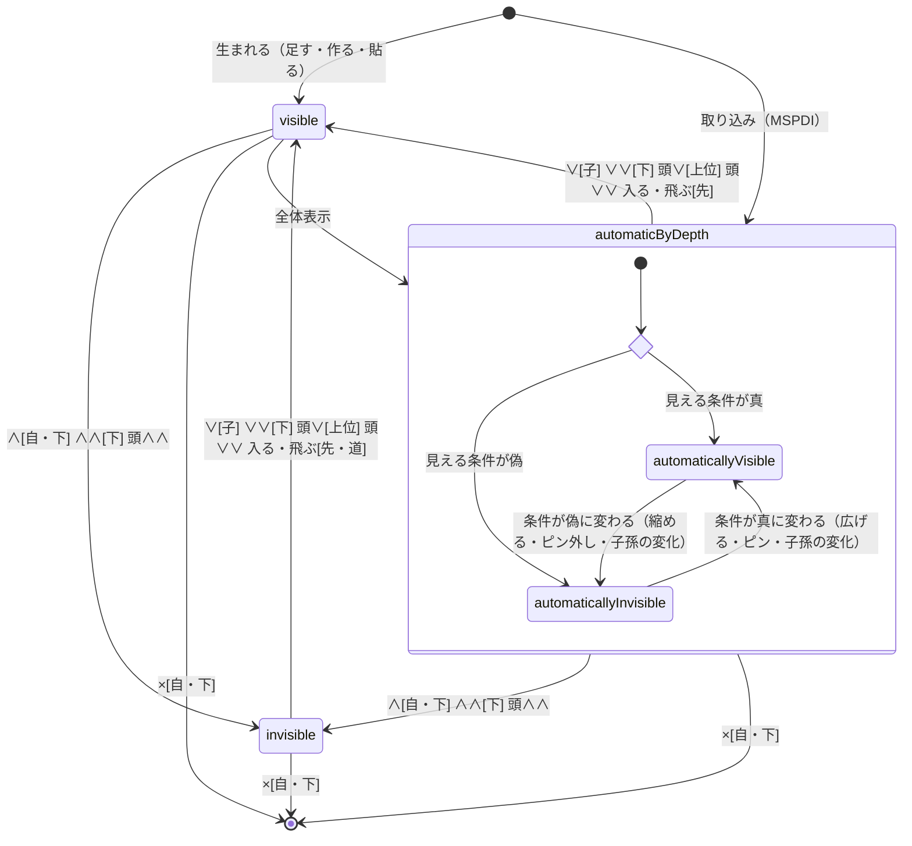
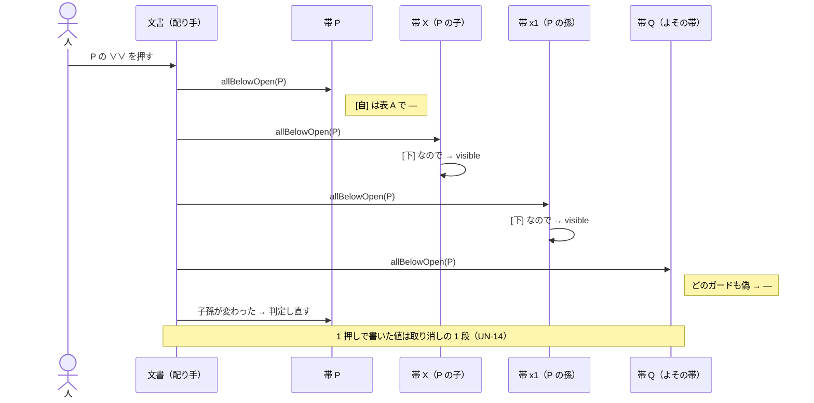
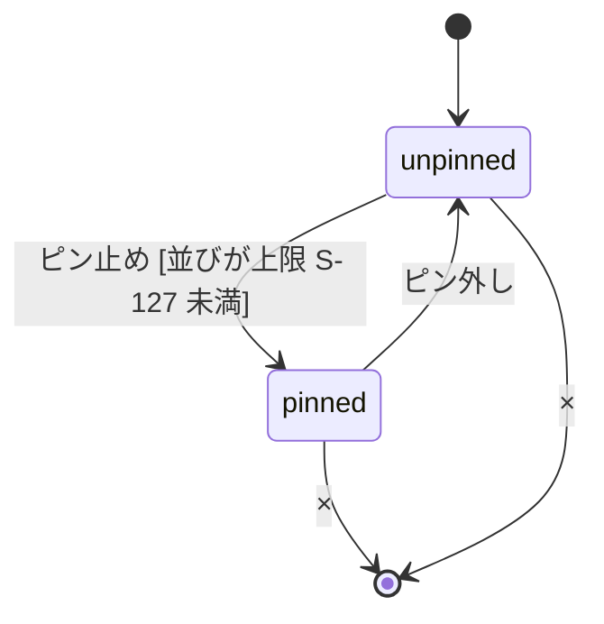

BGQA3T
# タスクグループの木の見え方（名の辞書 3 の枝）

> 「回答:」の後ろに答えを書いて保存し、1 行目の BGQA3T を切り取ってください。
> 凡例: ❓回答待 ✅回答済 🔄変化点 ★強調(ユーザー専用) ⏸後の段で問う

2026-11-20 に作った。あなたの指示「コンテキストを節約するため、タスクグループに関する部分を切り出したGQAをエージェントに作らせろ。今のGQAにはその結論だけをフィードバックしよう」に従い、BGQA3（`goodrelax-qa-b3-grs-json.md`）の 41 回目から、タスクグループの木の問いを切り出した。この紙は、タスクグループの帯をどう見せ、どう畳むか（帯ごとの状態機械と、その名）を決める。決まったら、結論だけを BGQA3 へ戻し、裁定の番号（JDG）はいつもどおり BGQA3 の側で付ける。

🔄 *残 4（❓ で検索）*

**これまでの経緯**（BGQA3 の 26〜41 回目。回ごとの記録は BGQA3 にある）
- 26 回目: 帯の木の形を 1 つの物 `taskGroupTreeView { rootTreeState, 深さ }` にまとめた（`JDG-3651`）。
- 27〜29 回目: 表示状態・折り畳み状態を仕様から読み集め、表示/非表示と折り畳み/展開の 2 つの概念で組み直した。
- 30〜32 回目: 値の名を `temporarilyExpanded` → `expandedUntilZoomOut`（`JDG-3653`）、`auto` → `automaticallyExpandedWithinDepth`（`JDG-3654`）に決めた。
- 33〜34 回目: 根の値、深さの変化と取り消し（問 6-12-7）、根の状態が配下の帯へ波及すること（表 T-328）を確かめた。
- 35 回目: チャットで `isCollapsedIntoParent`（`JDG-3655`）と `childrenExpansionState`（`JDG-3656`）に決めた。
- 36〜38 回目: 名の読み違い（親が子の畳みを持つように見えた）と隠すことの意味が分かり、帯ごとの値の案を、4 つの原則（OKPN・OMPV・NEIM・MECE）で整理し直した。
- 39 回目: あなたの 3 値案（見える・見えない・自動で決まる。帯は自分の状態だけを持つ）を 17 の場面で今の動作と比べ、足りないもの 4 つを問いにした。
- 40 回目: 足りないものの 1 つ（後から入った帯）を、操作ごとに整理し直した。
- 41 回目: 帯ごとの状態機械（外の状態 3・中の状態 2・出来事 20）を設計し、問 6-12-21〜6-12-25 を足した。
- 今: `JDG-3651`・`JDG-3653`〜`JDG-3656` の名と形は、この紙の答えで変わりうる。

2026-11-20 の 1 回目: BGQA3 の 41 回目から、タスクグループの木の問いをこの紙へ移しました。問いの中身は 41 回目のままです。

2026-11-20 の 2 回目: あなたの指示「一気に決めると手戻りが大きいので段階的に決めていく」に従い、決められる用語から 2 問だけ問います（問 6-12-26・6-12-27）。Opus の作業者 2 人が別々に検討し、同じ結論になりました。ほかの問いは後の段へ下げました。

🔄 *2026-11-20 の 3 回目: あなたの答え（表示状態は visible / invisible で、GRS JSON には保存しない。保存するのは「画面に出せ・画面から消せ・自動で決めろ」の 3 状態）を JDG-3657 に記録しました。あなたの問い（v・vv・^・^^ の呼び名、collapsed/expanded/automaticallyCollapsed を持つ案、局所最適の名の負債）を、Opus の作業者 3 人が別々の角度（世の中の慣わし・リポジトリ全体の整合・原則）で検討しました。3 人とも同じ根の結論なので、それを 1 問目に置きます。*

***

## 決定事項

### [tree] タスクグループの木の見え方

参照のための写しです。元は BGQA3 の決定事項で、ここで決まったことの裁定も BGQA3 に記録します。この紙の問いが頼る行だけを、元の区分ごとに写しました。

**[tg] タスクグループ（BGQA3 の表の全部）**

| 何 | 決め | 裁定 |
|:---|:---|:---|
| 帯が表す WBS のタスク（問 6-9-2） | `derivedFromTaskUid` → `representedTaskUid` | `JDG-3624` |

**[root]・[proj] の、帯の木に関わる行**

| 何 | 決め | 裁定 |
|:---|:---|:---|
| 似た字と根の並び（問 6-13-1） | `note` → `remarks`、`levelZeroTreeState` → `rootTreeState`（階層は「深さ」で数える）。根の並びは `$schema`・`schemaVersion`・`buildVersion`・`documentSettings`・`scheduleData`・`documentStamp`・`changeLogEntries` | `JDG-3602` |
| 外の AI が迷った GRS の名（問 6-8-16） | `delayDiagnosticsToleranceWorkingDays`・`taskGroupRootTreeState`。`fadeInCalendarDays`・`fadeOutCalendarDays`・`leaderTarget` は今のまま。★ の 3 行は続きの問い | `JDG-3635` |
| 帯の木の見え方（問 6-12-5-2） | `taskGroupTreeView { rootTreeState, 深さ }` にまとめる。深さの名は問 6-12-5-3 | `JDG-3651` |
| 一時の展開の名（問 6-12-6-2） | `temporarilyExpanded` → `expandedUntilZoomOut` | `JDG-3653` |
| 自動で展開する値の名（問 6-12-6-2） | `auto` → `automaticallyExpandedWithinDepth`（根も） | `JDG-3654` |

🔄 *この紙で決めたこと*

| 何 | 決め | 裁定 |
|:---|:---|:---|
| 🔄 *帯の表示状態と、GRS JSON に保存するもの（問 6-12-26・6-12-27）* | 🔄 *表示状態は `visible`／`invisible`。導く結果で、GRS JSON に保存しない。保存するのは帯自身の意図 3 つ（画面に出せ・画面から消せ・自動で決めろ。あなたの 2-b）。自動の中の 2 つ（自動で見える・自動で見えない）は導き、保存しない。キーと値の名は問 6-12-28〜6-12-30 と後の段* | 🔄 *`JDG-3657`* |

***

## QA

### [tree] 🔄 *タスクグループの木の見え方（❓ 3）*

#### 🔄 *❓ 問 6-12-28. collapse／expand を、ボタンの動詞だけに使うか（GRS JSON の値には使わないか）*

場面: あなたは「ユーザーはv, vv, ^, ^^をなんと呼ぶか？ collapse/expand が一般的では？」「collapsed/expanded/automaticallyCollapsedの3状態をGRS JSONに持つのはどうか？」「局所最適な名称を採用すると、技術的負債になりそうなスメルがある」と書きました。Opus の作業者 3 人が別々に調べ、3 人とも同じ根の結論になりました: **collapse／expand は、押した帯が自分の中身（子・子孫）に対して行う動詞として使う。`collapsed`・`expanded`・`automaticallyCollapsed` を GRS JSON の値には使わない。** これを最初に決めると、ボタンの名（問 6-12-29）と保存する値の名（問 6-12-30）が、互いにぶつからずに決まります。

**世の中の慣わし: collapsed／expanded は、親が「自分の子」について持つ**

| 系 | 語 | 状態を持つのは | 自分自身が見えるかを言う語 |
|:---|:---|:---|:---|
| Web のアクセシビリティの標準（WAI-ARIA の木） | `aria-expanded` | 子を持つ項目（親）。葉には付けない | `aria-hidden`・`hidden`（別の属性） |
| HTML の開閉の部品 `<details>` | `open` | 入れ物（見出しは常に見え、中身が開閉する） | `hidden` |
| MS Project | Show Subtasks／Hide Subtasks | 要約タスク（親） | — |
| VS Code・JetBrains・Qt・Java Swing の木 | Expand／Collapse、`isExpanded` | 親 | Swing は `isVisible`（祖先がみな開いていれば真。導く値で、保存しない） |
| Excel のアウトライン | 要約行に `collapsed`、明細行に `hidden` | 親と自分で別のキー | 行の `hidden`（手で隠した行と区別できないのが知られた難点） |

作業者 A が 18 の系（標準・UI の部品・Gantt の道具・表計算・アウトライナ）を、記憶と公開 API の知識で調べました（Web では確かめていません）。collapse／expand を「自分自身が消える」の意味で使う系はありませんでした（例外は CSS の表の行の `visibility: collapse` だけ）。B と C も同じ読みです。

**帯自身の値を `collapsed`／`expanded`／`automaticallyCollapsed` にすると起きること**

| 場面 | 保存される値 | 慣わしで読む人の読み | 画面 |
|:---|:---|:---|:---|
| 今の文書（α 版）を β 版へ変える | α の `collapsed` は「中身を畳んだ（自分は見える）」（`HR-4`、表 T-329 の `TD-3`・`TD-6`、あなたの裁定 `JDG-3656` が対象を子と決めた）。β の `collapsed` は「自分が消えた」 | 同じ綴りで、意味が木の 1 段ずれる | 変換（`CR-851`）が写し忘れても、綴りが同じなのでスキーマの検査を通ってしまう |
| X の ∧∧ を押す | X は `expanded`（か自動）のまま、子孫が `collapsed` | X は開いている | X は畳まれて見える |
| P の ∨ を押す | P の子 Y が `expanded` | Y の子が見える | Y の子は見えない（∨ は 1 段だけ） |
| 葉（子の無い帯）を見せる | 葉が `expanded` | 葉に開閉は無い | 意味が無い |
| 自動の帯が描かれている | `automaticallyCollapsed` | 畳まれている | 描かれている（値の名が嘘になる） |
| ∧（自分と子孫を消す）と ∧∧（子孫だけを消す） | どちらも「collapse した」 | 区別できない | — |

**あなたの感じたスメルは、すでに製品にあります。** 出荷中の ∧ の札は「Collapse／折りたたむ」、説明は「Collapse this task group itself／このタスクグループ自身を折りたたむ」です（画面の語の辞書 `display-words.json` の `IC-59`）。一方、保存する値 `collapsed` は「中身を畳んだ（自分は見える）」で、∧∧ の札は「Collapse Below」です。同じ collapse が「自分が消える」と「中身が消える」の 2 つを指しています。

理由:
- 層で語を分ければ、どちらも慣わしどおりに読めます。ボタン（動詞）は押した帯が主語で、効くのはその中身。値は帯自身の意図で、別の語にします（問 6-12-30）。対応は用語集の 1 行で閉じます（「X を expand ＝ X の子・子孫に『出せ』を書く」）。
- 綴りを変えれば、α の `collapsed` を写し忘れたとき、スキーマの検査（値の一覧）が落とします。
- 畳んだ・開いたの語は「中身」についての語なので、帯自身の 3 つの意図（出せ・消せ・自動で決めろ）を言えません。

| 案 | 中身 |
|:---|:---|
| **a（推奨）** | collapse／expand は、ボタンと出来事の動詞にだけ使う（主語は押した帯、効くのはその子・子孫）。`collapsed`・`expanded`・`automaticallyCollapsed` を GRS JSON の値に使わない。札は ∧ だけを直す（問 6-12-29） |
| b | あなたの案。値を `collapsed`・`expanded`・`automaticallyCollapsed` にする。上の表の食い違い（α 版と同じ綴りで意味が変わる、描かれている帯が `automaticallyCollapsed`、葉が `expanded`）を、スキーマの説明と変換で補う |
| c | 製品全体を show／hide の語にそろえ、collapse／expand を画面からも消す。動詞と値が同じ語になるが、札 7 つと仕様の和文の「展開／折りたたみ」を書き換える（作業者 B の数えで a の 3〜4 倍）。和文の「非表示」が表の見え方の Hide と同じ語になる |

回答:

#### 🔄 *❓ 問 6-12-29. ボタンと出来事の名（問 6-12-28 が a のとき）*

場面: 帯のボタン ∨・∨∨・∧∧・∧ と、パネルの頭のボタン（すべて展開する・すべて折りたたむ・最も浅い段だけ）、それに飛ぶ・全体表示・ピンの名です。札は画面に出る語（`display-words.json`）、出来事は状態機械の表 T-328 の入力の名です。今の出来事の名は、動詞が Open・Fold・hide の 3 つに割れていて（`oneLevelOpenPressed`・`allBelowFoldPressed`・`hidePressed` など）、札の Expand・Collapse と合っていません。案 a は出来事の名を札にそろえます。

| ボタン | 札（英） | 札（日） | 出来事 今 → 案 | 書くもの（JDG-3657 の 3 つの意図） |
|:---|:---|:---|:---|:---|
| ∨（`IC-90`） | Expand One Level（今のまま） | 1 階層だけ展開する（今のまま） | `oneLevelOpenPressed` → `expandOneLevelPressed` | 子に「出せ」（押した帯は書かない） |
| ∨∨（`IC-58`） | Expand Below（今のまま） | 配下をすべて展開する（今のまま） | `allBelowOpenPressed` → `expandBelowPressed` | 子孫に「出せ」 |
| ∧∧（`IC-77`） | Collapse Below（今のまま） | 配下をすべて折りたたむ（今のまま） | `allBelowFoldPressed` → `collapseBelowPressed` | 子孫に「消せ」（押した帯は残る） |
| ∧（`IC-59`） | **Collapse → Collapse Into Parent** | **折りたたむ → 親へ折りたたむ** | `hidePressed` → `collapseIntoParentPressed` | 自分と子孫に「消せ」 |
| 頭の ∨∨（`IC-74`） | Expand All（今のまま） | すべて展開する（今のまま） | `everyTaskGroupOpenPressed` → `expandAllPressed` | 全部に「出せ」 |
| 頭の ∧∧（`IC-78`） | Collapse All（今のまま） | すべて折りたたむ（今のまま） | `everyTaskGroupFoldPressed` → `collapseAllPressed` | 全部に「消せ」 |
| 頭の ∨（`IC-92`） | Show Top Level Only（今のまま） | 最も浅い段を 1 階層展開する（今のまま） | `topLevelOpenPressed` → `showTopLevelOnlyPressed` | 最上位に「出せ」 |
| 飛ぶ（検索・`focusTask` など） | —（入口ごと） | —（入口ごと） | `taskGroupRevealAsked`（今のまま） | 先と道に「出せ」 |
| 全体表示（`IC-10`） | Zoom to Fit（今のまま） | 全体を収める（今のまま） | `fitPressed`（今のまま） | 「出せ」を「自動で決めろ」へ戻す（後の段の問 6-12-17 で a のとき） |
| ピン（`IC-60`） | Pin（今のまま） | ピン止め（今のまま） | 命令 `pinTaskGroup`・`unpinTaskGroup`（今のまま） | 見え方は書かない。ピンの並びだけ |

∧ の説明も「Collapse this task group into its parent／このタスクグループを親へ折りたたむ」に直します。「親へ折りたたむ」は、あなたが良いとした `isCollapsedIntoParent`（`JDG-3655`）の句で、仕様の「隠すことは親へ 1 歩折りたたみ込むこと」（`HR-6`）と同じ意味です。

**作業者 B と C の食い違いと、選んだほう**: C は ∧∧ を「Collapse」、∨ を「Expand」、∨∨ を「Expand All Levels」にする案でした（慣わしの「X を collapse ＝ X は残り、中身が消える」が ∧∧ の絵だから）。B は ∧ 以外の札を今のまま残す案です。B を選びました。理由:
- C の案では、札「Collapse」が ∧ から ∧∧ へ移ります。同じ綴りの札が別のボタンを指すようになり、問 6-12-28 で避けた「同じ綴りで意味が変わる」を画面で起こします。今の札を覚えた人も、ヘルプも取り違えます。
- 「Expand All Levels」（帯）と「Expand All」（頭）は、範囲が違うのに語が近すぎます。今の「Expand Below」のほうが範囲（この帯の下）を言います。
- 変わる札は、B なら 1 つ（∧）、C なら 4 つです。

出来事の名を札にそろえる書き換えは、作業者 B の数えで 199 か所・18 ファイル（src 4・試験 9・仕様 5）です。

| 案 | 中身 |
|:---|:---|
| **a（推奨）** | 上の表。札は ∧ だけを「Collapse Into Parent／親へ折りたたむ」に直し、出来事の名を札にそろえる（Open・Fold・hide をやめ、expand・collapse にする） |
| b | 札も出来事の名も今のまま。∧ の札「Collapse」と値の語の食い違い、出来事の Open・Fold・hide と札の Expand・Collapse の食い違いが残る |
| c | 作業者 C の札（∧∧ を Collapse、∨ を Expand、∨∨ を Expand All Levels、∧ を Collapse Into Parent）。慣わしに最も近いが、札「Collapse」が ∧ から ∧∧ へ移る |

回答:

#### 🔄 *❓ 問 6-12-30. 保存する 3 つの値の名（キーの名は後の段）*

場面: `JDG-3657` で、GRS JSON は帯自身の意図を 3 つ持つと決まりました（画面に出せ・画面から消せ・自動で決めろ）。ここでは、その 3 つの値の英語の名を決めます。画面の結果（導く値）は `visible`／`invisible` と決まっています（同じ裁定）。

| 案 | 出せ | 消せ | 自動で決めろ | 良い所 | 弱い所 |
|:---|:---|:---|:---|:---|:---|
| **a（推奨）** | `show` | `hide` | `automatic` | あなたの「出せ・消せ・自動で決めろ」をそのまま英語にした。導く結果 `visible`／`invisible` と綴りが違うので、「人の意図」と「画面の結果」の 2 種類が同じ語を使わない（OKPN）。製品の表の見え方の指定（Visibility 列の Show／Hide = 表示／非表示）と同じ形（人の指定で、最終の結果ではない）。作業者 B の案（3 つ目だけ違う） | `hide` は今の値 `hidden`（`HR-6`）と語幹が同じ（下の注意）。`show`・`hide` は動詞、`automatic` は形容詞で、品詞がそろわない（作業者 C は「状態に動詞」と減点した） |
| b | `visible` | `invisible` | `automatic` | 形容詞でそろう。作業者 A の案、C の 2 番目の案 | 導く結果と同じ語。JSON の `"visible"` を「今、画面に出ている」と読み違えうる（`visible` でも、祖先が「消せ」・スケジュールフィルタ・ピンの溢れで描かれないことがある） |
| c | `visible` | `invisible` | キーを書かない | 命名の決まり N-12（「無い」はキーを書かないこと 1 つで言う）とレビューの決まり（値の無い物はキーごと省く）に合う。MSPDI から取り込んだ文書はキーが 1 つも出ない。作業者 C の 1 番目の案（キー `visibilityOverride`） | b と同じ読み違い。あなたの「3 状態を GRS JSON に保存する」を、3 つ目は「書かない」で満たすことになる |
| d | `show` | `hide` | `automaticByDepth` | 何が決めるかを言う。作業者 B の案 | 自動は深さだけでなく、最上位か・ピン止めか・見える子孫があるかでも決まる（下の ⏸ の「見える条件」4 つ）。`ByDepth` は嘘になる |

- `auto` は使えません。命名の決まり N-2 が、略を `uid`・`id`・`Px`・`Utc`・`dx`・`dy`・`min`・`max`・`hex` だけに限るからです（4 通目の質問状の決まりの表、優先 9）。
- **注意（a の `hide`）**: 今の仕様の値 `hidden` は「この帯を親へ折りたたみ込む。全体表示で戻らない」の意味です（`HR-6`）。新しい模型はこの値を廃しますが、`hide` と `hidden` は語幹が同じです。作業者 B は「意味が近い（自分が消える）ので変換で驚きが少なく、綴りが違うので写し忘れは検査が落とす」と見て、作業者 C は「α の `hidden` に近すぎる」と減点しました。また、パレット・ヘルプなどの窓の表示の状態機械（作業者 B の数えで 9 つ）が、導く状態に `shown`・`hidden` を使っています。そちらは窓の結果で、綴りも `show`・`hide` と違います。決め手になる反対の理由ではないと判断し、a を推します。

| 案 | 中身 |
|:---|:---|
| **a（推奨）** | `show`・`hide`・`automatic` |
| b | `visible`・`invisible`・`automatic` |
| c | `visible`・`invisible`。自動はキーを書かない |
| d | `show`・`hide`・`automaticByDepth` |

回答:

**後の段で決めること（お知らせ。今は答え不要）**
- キーの名: `visibilityRule`（作業者 A・B）か `visibilityOverride`（作業者 C）。`visibility` だけの名は使いません。命令のスキーマの `setTableView` に、表の見え方の物 `visibility` がすでにあるからです。
- 深さの欄の名: 今の `taskGroupAutoExpandDepth`（`JDG-3296`。この紙では `expandDepth` と書いた）は「深さ N まで開く ＝ 子は深さ N＋1 まで見える」と数えます。帯自身の数え方の `visibleDepth`（深さ N 以内の自動の帯が見える）にすると、＋1 が消えます。そのときは `CR-853` の既定（3 → 4）と範囲（0〜4 → 1〜5）を書き直します。
- 仕様の「⛔ 押したタスクグループの状態を書き換えずに、その配下の状態だけを書き換えてはならない（MUST NOT）」とその段落（仕様 01-04 の 1791〜1796 行）は、帯ごとの模型では取り下げます。∨ と ∧∧ は、押した帯を書かずに子・子孫だけを書くからです。
- 子についての値を決めた `JDG-3653`（`expandedUntilZoomOut`）・`JDG-3654`（`automaticallyExpandedWithinDepth`）・`JDG-3656`（`childrenExpansionState`）は取り下げます。`JDG-3655`（`isCollapsedIntoParent`）のキーも 3 つの値のキーに入りますが、その句は ∧ の札（問 6-12-29）に残ります。
- 導く値の名は `visible`／`invisible`（`JDG-3657`）。スケジュールフィルタやピンの溢れまで含めた最終の結果は「描く」`drawn` と言います（表 T-329「タスクグループを描くか」、コードの `drawnTaskGroupsOf`）。

### ⏸ 後の段で問う（今は答え不要）

🔄 *問 6-12-16（あなたの 3 値案）は、`JDG-3657` で向きが決まりました（帯は自分の意図だけを 3 つの値で持ち、表示状態は導く）。名は問 6-12-28〜6-12-30 で問います。*

**帯ごとの状態機械の設計（作業者の案。下の問い 6-12-21〜6-12-25 の材料）**

チャットでのあなたの指示「イベントと v, vv, ^, ^^, +, x, pin, 移動, 階層変更...の関係を整理して、 状態遷移図、状態遷移表にしたら？ タスクグループ毎にステートマシンを持って整理したら？ autoの場合にサブステートマシンか、内部ステートマシンにするか...」に従い、作業者が設計しました。名は問 6-12-21 の推奨（`visible`・`invisible`・`automaticByDepth`）で書いてあります。

**2. 1 本の帯の状態機械**

**状態**

| 状態 | 層 | 保存 | 意味 | 帯は描かれるか |
|:---|:---|:---|:---|:---|
| `visible` | 外 | する | 人か「飛ぶ・入る」が見せた | 描く |
| `invisible` | 外 | する | 人が畳んだ・隠した | 描かない |
| `automaticByDepth` | 外（入れ子） | する | 深さに任せる | 中の状態で決まる |
| └ `automaticallyVisible` | 中 | しない | 見える条件が真 | 描く |
| └ `automaticallyInvisible` | 中 | しない | 見える条件が偽 | 描かない |

**見える条件**（中の状態を決めるガード。どれか 1 つが真なら `automaticallyVisible`）
- `isTopLevel`: 最上位の帯である（深さ 1 は倍率で落とさない RQ:6223）[確]。
- `isWithinDepth`: 深さが文書の深さ `expandDepth` で見える範囲にある（今の決め JDG-3296 では深さ ≤ `expandDepth`＋1。SIM §0 の読み）[推]。
- `isPinned`: ピンの領域が `pinned`（§5）。
- `hasVisibleDescendant`: 子孫のどれかが `visible`（∨ の後に縮めても、開いた所が宙に浮かない。今の `TD-7` の役 RQ:6247）[確: TD-7 の文]。

**2 つの不変条件**（機械の外で、出来事の側が守る）
- **I1**: `invisible` の帯の子孫は、みな `invisible`。∧・∧∧・頭の ∧∧ は子孫にも書き、`visible` を書く出来事は道の `invisible` を `visible` に直す。だから「見えない帯の下に見える帯」は作れない。
- **I2**: 描くのは `visible` か `automaticallyVisible` の帯で、しかもスケジュールフィルタを通る帯だけ（別の軸）。I1 があるので、祖先をたどる規則（今の `TD-3`）は要らない [推]。

**中を「導く」にする理由（保存しない）**
1. 中の状態は、深さ・木の形・ピン・子孫の値から必ず決まる。導けるものを保存すると、2 か所が食い違いうる（MECE）。
2. ホイール 1 刻みで中の状態が変わる。保存すると、ズームが文書の編集になり、未保存の印と取り消しの段が立つ。ズームは取り消しの対象外（RQ:2438 `UN-8`）[確] と合わない。
3. UML の言い方では、中の遷移は「条件が変わったとき（when）」に起きる変化の遷移であり、人の出来事ではない。入れ子の状態に入るたびに選択（◇）で行き先を決める。

**3. 出来事と的（全部の帯に配り、帯がガードで自分を選ぶ）**

ガードの略: **[自]** 押した帯。**[子]** 押した帯の子。**[下]** 押した帯の子孫。**[上位]** 最上位の帯。**[先]** 飛ぶ先・入る帯。**[道]** [先] の祖先。

| # | 出来事（今の名 SM:1140-1151 [確]） | 的 | 書く値 |
|:--|:---|:---|:---|
| 1 | ∨ 1 段展開（`oneLevelOpenPressed`） | [子] | `visible`（押した帯は書かない） |
| 2 | ∨∨ 子孫を全て展開（`allBelowOpenPressed`） | [下] | `visible` |
| 3 | ∧ 自分と子孫を畳む（`hidePressed`） | [自]・[下] | `invisible` |
| 4 | ∧∧ 子孫を全て畳む（`allBelowFoldPressed`） | [下] | `invisible`（押した帯は書かない） |
| 5 | 頭の ∨（`topLevelOpenPressed`） | [上位] | `visible` |
| 6 | 頭の ∨∨（`everyTaskGroupOpenPressed`） | 全部 | `visible` |
| 7 | 頭の ∧∧（`everyTaskGroupFoldPressed`） | 全部 | `invisible`。頭の ∧ は置かない（∧∧ と同じ絵）[確 RQ:1801] |
| 8 | ＋ 配下に足す・頭で足す（`childTaskGroupAddPressed`） | 新しい帯＝[先]、[道] | 入る（下の 20） |
| 9 | 命令で作る（`createTaskGroup` CM-26） | 同上 | 入る |
| 10 | 親を変える（掴んで落とす `HF-15`、`moveTaskGroup` CM-73） | 動いた帯＝[先]、新しい [道] | 入る。動いた帯の子孫は自分の値のまま |
| 11 | 並べ替え（同じ親のまま CM-73） | — | 書かない（深さが変わらない） |
| 12 | 貼る・複製（CM-28、`DU-2`） | 写しの根＝[先]、[道] | 入る。写しの子孫は `invisible` を保ち、`visible` は `automaticByDepth` にする（今の DU-2 と同じ考え RQ:2746）[推] |
| 13 | × 消す・頭で全て消す（`IC-82`・`HF-20`） | [自]・[下] | 機械が終わる。ほかの帯は書かない |
| 14 | ピン止め・外す（`IC-60`） | [自] | ピンの領域だけ（§5） |
| 15 | 全体表示（`fitPressed`） | 全部 | `visible` → `automaticByDepth`。`invisible` は残す（① a）。深さを測り直す |
| 16 | 縦を縮める・広げる（今は縮めるだけ `verticalZoomShrinkPressed`） | — | 書かない。`expandDepth` だけ変わり、中の状態が導き直される（② a） |
| 17 | 飛ぶ（`taskGroupRevealAsked`: 検索 `SJ-1`・`focusTask`・依存線の印 `EL-21`・表のチェック `TV-6`） | [先]・[道] | 入る と同じ（④ a） |
| 18 | 取り消し・やり直し（`UN-14`） | 1 押しで書いた帯 | 記録した外の値に戻す。中は導き直す |
| 19 | 取り込み（MSPDI）・開く（GRS JSON） | 全部 | MSPDI は全部 `automaticByDepth`。GRS JSON は書いてある値 |
| 20 | **入る**（8・9・10・12・17 の共通の中身） | [先]・[道] | [先] を `visible`。[道] のうち `invisible` だけを `visible`。`automaticByDepth` の祖先は書かない（[先] に引かれて描かれる） |

- 命令 `setTaskGroupTreeState`（CM-85 DC:120）は `setTaskGroupVisibility` に改め、`invisible` は子孫にも書き、`visible` は 20 と同じく道も直す（I1 を守る）[推]。
- スケジュールフィルタは帯の値を読まず書かない（RQ:6248）[確]。この機械の出来事ではない。

**4. 状態遷移表**

「—」は変わらない。行は帯の今の状態、列は配られた出来事。セルに無いガードは「それ以外 → —」。

**表 A: ボタン**

| 今の状態 ＼ 出来事 | ∨ | ∨∨ | ∧ | ∧∧ | 頭の ∨ | 頭の ∨∨ | 頭の ∧∧ |
|:---|:---|:---|:---|:---|:---|:---|:---|
| `visible` | — | — | [自][下] → `invisible` | [下] → `invisible` | — | — | → `invisible` |
| `invisible` | [子] → `visible` | [下] → `visible` | — | — | [上位] → `visible` | → `visible` | — |
| `automaticallyVisible` | [子] → `visible` | [下] → `visible` | [自][下] → `invisible` | [下] → `invisible` | [上位] → `visible` | → `visible` | → `invisible` |
| `automaticallyInvisible` | [子] → `visible` | [下] → `visible` | [下] → `invisible` | [下] → `invisible` | [上位] → `visible` | → `visible` | → `invisible` |

**表 B: ボタン以外**（「判定」= 入れ子の選択 ◇ をやり直し、中の 2 つのどちらかへ）

| 今の状態 ＼ 出来事 | 入る（足す・作る・親を変える・貼る） | 飛ぶ | 並べ替え | × | 全体表示 | 縮める・広げる | ピン・外す | 取り消し |
|:---|:---|:---|:---|:---|:---|:---|:---|:---|
| （まだ無い） | 生まれる → `visible` | — | — | — | — | — | — | 記録の値で生まれ直す |
| `visible` | — | — | — | [自][下] → 終わり | → `automaticByDepth`（判定） | — | — | → 記録の値 |
| `invisible` | [先][道] → `visible` | [先][道] → `visible` | — | [自][下] → 終わり | — | — | — | → 記録の値 |
| `automaticallyVisible` | [先] → `visible`。[道] → —（引かれて描かれる） | 同左 | — | [自][下] → 終わり | 判定 | 判定 | 判定 | → 記録の値 |
| `automaticallyInvisible` | [先] → `visible`。[道] → 判定 | 同左 | — | [自][下] → 終わり | 判定 | 判定 | 判定 | → 記録の値 |

- 子孫の値が変わる出来事（表 A のどれでも）の後、祖先の `automaticByDepth` は `hasVisibleDescendant` が変わるので判定し直す。
- `invisible` の帯は描かれないので押されない。表 A の [自] は描かれた帯にしか来ない。∨ が薄く描かれる条件（`FR-029`）は「子がみな描かれている」と言い直せる [推]。

**図 1: 1 本の帯**



**図 2: P の ∨∨ が配られる様子**



**5. ピン止め —— 直交する領域**

- **判定**: ピンは帯ごとの事実（この帯は留めてあるか）なので、機械では直交する領域として描く。見え方の状態に混ぜると、1 つの名が 2 種類を取る（OKPN 違反。`visibleAndPinned` のような値が要る）[推]。
- **保存は文書の並び** `pinnedTaskGroupIds`（決まっている JDG-3651 の形）。固定した順に上から並べ（FR-098）、上限がある（`S-127`）[確 RQ:6267-6271]。帯ごとの真偽にすると、並び順を別の値で持つことになり、2 か所に分かれる。
- **見え方への効き方**: ピンは中の判定（`isPinned`）にだけ効く。`invisible` には勝たない（今の「ピンは人の畳みに勝たない」RQ:6253 と同じ）[確]。I1 があるので、この勝ち負けは状態の形だけで決まり、別の規則が要らない。




#### ⏸ 問 6-12-16. あなたの 3 値案 —— 帯は自分が見えるかだけを持つ

場面: チャットで、あなたは「展開されていて見える、折り畳まれて見えない、自動的に決まる の3値と 自動的に決まるのがどういう場合か？ で自分自身の状態だけを管理できないのか？ 手動による展開イベントも 子孫を全て展開、子孫を1つ展開、子孫を全て折り畳み、自分自身と子孫を折り畳みのように操作ボタンに紐付けられないか？ 足りないものはなんだ？」と書きました。作業者が、木（P・Q の下に X・Y、その下に x1・y1）で 17 の場面を走らせ、今の動作と比べました。前の回の問い（6-12-12〜6-12-15・6-12-8）は、この答えで形が変わるので下げました。

**あなたの案**

| 決め | 中身 |
|:---|:---|
| 帯の値（3 つ） | `shown`（見える）・`notShown`（見えない）・`automatic`（深さで決まる） |
| 自動の決まり | `automatic` の帯は、自分の深さが文書の深さ（`expandDepth`）以内なら見える |
| ボタン（帯にも頭にもある） | 子孫を全て展開（∨∨: 子孫の全部を `shown`）・子孫を 1 段展開（∨: 子を `shown`）・子孫を全て折り畳み（∧∧: 子孫の全部を `notShown`）・自分自身と子孫を折り畳み（∧: 自分と子孫の全部を `notShown`） |
| 書き足す決まり（無いと絵が壊れる） | `notShown` の帯は、自分と配下を必ず描かない。`shown` の帯は、祖先も描かせる（∨ の後に縦を縮めても、開いた所が宙に浮かない） |

```json
"taskGroupTreeView": { "expandDepth": 2, "pinnedTaskGroupIds": ["Y"] },
"taskGroups": [
  { "id": "P", "displayState": "automatic" },
  { "id": "X", "parentTaskGroupId": "P", "displayState": "notShown" },
  { "id": "Y", "parentTaskGroupId": "P", "displayState": "shown" } ]
```

（キーと値の名は仮です。形が決まってから問います。）

**今よりよい所**

| よい所 | 中身 |
|:---|:---|
| 1 行で分かる | 帯の 1 行を読めば、その帯が出るかがほぼ分かる。今は親の値を見ないと分からない |
| 段 0 の特別扱いが消える | 根（段 0）だけのキー（仕様 `S-418`）と、根だけの決まりが要らない。頭のボタンは最上位の帯の値を書くだけ |
| 値が減る | 5 つ（自動・縦を縮めるまで展開・人が展開・人が畳んだ・隠した）が 3 つになる |
| ボタンの格子とそろう | ∨ と ∨∨、∧ と ∧∧ は範囲だけが違う（向きが動作、本数が範囲） |
| 原則 | OKPN を満たす（1 つの名に 1 種類: この帯が見えるか、何が決めるか）。OMPV は問 6-12-17 で a か c に決めれば満たす |

**足りないもの（4 つ）**: どれも、3 値のまま決まりを 1 行足して受け入れる道（下の 4 問の a）と、値を足して今と同じにする道があります。③ だけは、値を足しても今と同じになりません（親の事実だから）。

| # | 足りないもの | 問い |
|:---|:---|:---|
| ① | 全体表示で、畳んだ帯は戻し、隠した帯は残す区別 | 問 6-12-17 |
| ② | 縦を縮めるまでだけ開く見せ方（∨∨・帯を足す） | 問 6-12-18 |
| ③ | 後から入った帯（足す・動かす・貼る）を、親が見せるか | 問 6-12-19 |
| ④ | 飛ぶとき、道の途中の兄弟と行き先の子も見せるか | 問 6-12-20 |

| 案 | 中身 |
|:---|:---|
| **a（推奨）** | あなたの 3 値案を採る。書き足す決まりを入れ、①〜④ は下の 4 問で 1 つずつ決める。Agent API の命令にも「`notShown` を書く命令は配下にも書く」と定める（「見えない帯の下に見える帯」を作らせない） |
| b | キー 2 つ（前の回の推奨。今の 5 状態を保つ） |
| c | キー 1 つ・5 値（前々回の推奨。OKPN に反する） |

回答:

#### ⏸ 問 6-12-17. ① 全体表示は、畳んだ帯をどうするか

場面: X を隠し（∧）、別の帯 Q の中を畳み（∧∧）、全体表示を押す。今は Q の中身が戻り、X は隠れたまま。3 値案では X も Q の子も同じ `notShown` なので、全体表示は両方を戻すか、両方を残すかしかありません。

| 案 | 中身 |
|:---|:---|
| **a（推奨）** | 開いた帯（`shown`）だけを自動へ戻す。畳んだ帯も隠した帯も残る。戻すのは頭か帯の ∨・∨∨。決まり:「全体表示の仕事は窓に収めること。開いた帯は行を増やして邪魔をするが、畳んだ帯は邪魔をしない」。変わる絵: 畳んだ Q は全体表示で開かなくなる。頭で全部畳んでから全体表示を押すと、空のまま |
| b | 全部を自動へ戻す。隠した帯も、押すたびに戻る |
| c | 今のまま（畳みは戻し、隠しは残す）。そのために `notShown` を 2 つに分け、4 値にする（全体表示で戻る畳み と 戻らない隠し） |

回答:

#### ⏸ 問 6-12-18. ② 「子孫を全て展開」（∨∨）は、縦を縮めたら閉じるか

場面: 引いた倍率で P の中を覗こうと ∨∨ を押し、ホイールでさらに引く。今は P の中が、深さで決まる絵へ戻ります。3 値案では、全体表示か畳むボタンを押すまで開いたままです。この「縦を縮めるまで」の値は、あなたが JDG-596 で「[vv] を押して保存すると次に開いたとき変わる」と言って生まれました。その後 JDG-598 で値を全部保存すると決めたので、生まれた理由はもう残っていません。

| 案 | 中身 |
|:---|:---|
| **a（推奨）** | 閉じない。決まり:「ズームは値を書かない。値を書くのはボタンと全体表示と飛ぶだけ」。∨ と ∨∨ は範囲だけが違う。帯を足したときも同じ。縮めることが取り消しの段にならない |
| b | 今のまま閉じる。そのために値 `shownUntilZoomOut` を足し、4 値にする |
| c | ∨∨ だけ閉じ、帯を足したときは閉じない |

回答:

#### ⏸ 問 6-12-21. 帯の見え方の名

場面: チャットで、あなたは「まず shown が変。 xxxState: collapsed, expanded, automaticallyCollapse, visible, invisible, automaticallyInvisibleとかじゃない？」と書きました。あなたの 3 値案の値は「その帯自身が描かれるか」を言います。`collapsed`・`expanded` は、フォルダの中身（子）を畳んだ・開いたを言う語なので、帯そのものが消える意味と食い違います。自動の値は、保存する値には決め手（深さ）を、中の 2 つの状態には結果（見える・見えない）を名にします。

| 案 | 中身 |
|:---|:---|
| **a（推奨）** | キー `visibility`、値 `visible`・`invisible`・`automaticByDepth`。中の状態の名は `automaticallyVisible`・`automaticallyInvisible`（JSON には出ない） |
| b | 値を `visible`・`invisible`・`automatic` にする。短いが、何が決めるかを言わない |
| c | 畳むの語（`collapseState`: `expanded`・`collapsed`・`automaticallyCollapsed`）。外の人はフォルダの開閉と読む |

回答:

#### ⏸ 問 6-12-22. 「自動」の中の 2 つ（自動で見える・自動で見えない）

| 案 | 中身 |
|:---|:---|
| **a（推奨）** | 入れ子の状態にし、深さ・木の形・ピン止めから導く（保存しない）。だから縦のズームは値を書かず、未保存の編集にも取り消しの段にもならない |
| b | 中の 2 つも保存する（値 4 つ）。導ける物を持ち、ホイールの 1 刻みが未保存の編集と取り消しの段になる |
| c | 入れ子にせず、外の 3 状態と「描く決まり」だけで書く。データは a と同じだが、図と表で「自動の中」が見えなくなる |

回答:

#### ⏸ 問 6-12-23. 後から入る帯（足す・作る・親を変える・貼る）は「その帯へ飛ぶ」と同じにするか

場面: 作業者の新しい見つけです。後から帯が入ることを、検索でその帯へ飛ぶのと同じに扱えば、前の回の問い 6-12-19（入った帯の状態）・6-12-19-2（足すと兄弟も開くか）・6-12-20（飛ぶ範囲）が 1 つの決まりになります。この 3 問は、ここへまとめて下げました。

| 案 | 中身 |
|:---|:---|
| **a（推奨）** | 「その帯へ飛ぶ」と同じ決まり: 入った帯は `visible`、道（祖先）の `invisible` も `visible` にする。飛ぶときも、開くのは道だけ（兄弟は自分の値のまま）。見えない親へ命令で入れても、その帯が見える |
| b | 入った帯だけ `visible`。見えない親へ入れる命令は断る（画面の操作では起きない） |
| c | 入った帯は自分の値のまま。引いた倍率で落とすと消えることがある |

回答:

#### ⏸ 問 6-12-24. ピン止めの置き場

| 案 | 中身 |
|:---|:---|
| **a（推奨）** | 見え方とは別の、直交する領域（ピンする・しない）。保存は文書の並び `pinnedTaskGroupIds`（並び順と上限があるので、今のまま）。見え方には、「自動」の中で見えるかの判定にだけ効く。`invisible` には勝たない |
| b | 帯ごとの真偽 `isPinned` と、並び順の値を持つ。並びが 2 か所に分かれる |
| c | 見え方の値に混ぜる（`visiblePinned` など）。OKPN に反する |

回答:

#### ⏸ 問 6-12-25. 仕様の状態機械の書き方

| 案 | 中身 |
|:---|:---|
| **a（推奨）** | 仕様の状態機械（表 T-328）を、帯ごとの機械（外の状態 3・中の状態 2・出来事 20）に書き換え、根だけの表と根のキー（`S-418`）を消す（根が畳まれた ＝ 最上位の帯が全部 `invisible`）。図も入れ子の状態で描き直す |
| b | 今の 5 状態の機械を残し、JSON だけ 3 値にして、対応表で結ぶ。2 つの模型を持つことになる |
| c | 問 6-12-17・6-12-18 の答えが出てから決める |

回答:

#### ⏸ 問 6-12-7. 深さの変化を Ctrl+Z で戻せるか

場面: 縦のホイールで深さ（`expandDepth`）が 1 ずつ変わったあと、Ctrl+Z（取り消し）で、その変化も戻すか。仕様は決めていません。今の縦の倍率は戻しません（仕様 `UN-8`、JDG-598）。

| 案 | 中身 |
|:---|:---|
| **a（推奨）** | 戻さない。ホイールを何刻み回しても、取り消しの段は増えない。縦の大きさ・横の幅・表示位置と同じ |
| b | 戻す。ホイールを続けて回した刻みを 1 段にまとめる決まりが要る |

回答:

***

## ❓ 自由

答えを読んで、ほかに聞きたいこと・違うと思う所があれば、ここに書いてください。

回答:
