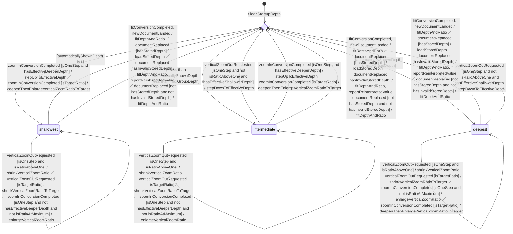

# タスクグループの表示/非表示 —— 仕様の下書き（色を除く）

2026-11-21 に作った下書き。持ち主の指示「タスクグループの表示/非表示関係（色は除く）について、各種要素、状態、イベント、プロパティ、キー、値の名称と機能、責務を一覧で整理して、ステートマシン図と状態遷移表で仕様化できるか？」に答える。
1・2 版は決まった裁定（`JDG-3657`〜`JDG-3663`）を土台にし、決まっていない所を **【案】** U-1〜U-16 と印した。3 版では、その 16 件のすべてが裁定（`JDG-3664`〜`JDG-3691`）か方針（`JDG-3686`）で決まった（8 節の表）。
この紙は下書きであり、仕様（`docs/spec`）にはまだ当てていない。
2026-11-21 の 2 版: 独立レビュー（H 3・M 11・L 10）を当てた。直した所は、頭のボタンの札（H1。持ち主の指示で、頭は帯と同じ札・同じ出来事を根で押したものとし、誤読は説明の文で防ぐ）、生まれ方と終わり方（H2）、取り消しのガードの重なり（H3）、図と表の一致と `[*]` の扱い（M1・M2）、命令で貼った根（M3）、端の処理の出典（M4）、`CR-853` の節の番号（M5）、比の書き手（M6）、深さの状態の名（M7）、`JDG-3663` の閉じた一覧（M8）、取り下げの一覧（M9）、拡大の出来事の名（M10）、畳んだ帯の定義（M11）と、安い L。
2026-11-22 の 3 版: JDG-3664〜3691 を当てた。深さの鍵を `automaticallyShownDepth`（閉じた範囲、既定値なし）に、ズームの出来事を指示（`…Requested`）と結果（`verticallyZoomedIn`・`verticallyZoomedOut`）に改め、`setZoom` から縦の値を外し、飛ぶ・落とす・貼る・既定の帯・全体表示・`Agent API` の命令を裁定のとおりに書き直した。裁定の無い細部（知らない値・合流・目印・薄く描く条件・変換と深さの順）は、`JDG-3686` の方針で決めた。

---

## 0. 結論 —— この文書でタスクグループの表示/非表示は完結できるか

**はい。** 構造は閉じる。1・2 版の 【案】 16 件はすべて決まった。残るのは名と置き場の未決（8 節の「まだ決まっていないもの」）と、仕様への当て込みである。

- **閉じたもの**: 要素・状態と値・出来事・キー・命令の一覧（5 表）、`taskGroupVisibility` と `drawn` を導く規則（10 行）、帯ごとの状態機械 `selfShowModeStateMachine`（状態 4・出来事 33）の図と状態遷移表と生まれ方の表、深さの状態機械 `automaticallyShownDepthStateMachine`（状態 3・出来事 8）の図と状態遷移表。
  どちらの表も、すべての交点に「次の状態 [ガード] / 処理」か `ignore` か `error` を決めた。NDD の章が求める形（1 節で引く）に合わせた。
- **決めたもの**: 16 件のうち 13 件は裁定が決め、2 件（U-14 の順序、U-15 の目印と薄く描く条件）と U-16 の一部（知らない値・合流の両側にある帯）は方針（`JDG-3686`）が決めた（8 節の表）。方針で決めた所は「方針による決め」と書き、物差しの裁定を添えた。
- **残るもの 1 —— 名と置き場の未決**: 例外の JSON の置き場、刻みの設定の名、命令の引数の形、深さと比の鍵の置き場など（8 節の末）。どれも表の升の中身を変えない。
- **残るもの 2 —— 当て込み（この文書の外）**: 仕様の 表 T-328・表 T-329・`HR-*`・`HF-*`（とくに `HF-8`・`HF-14`・`HF-15`・`HF-17`）・`UN-*`・`SJ-2`・`DU-2`・`OP-10` の注、`AT-153`・`S-418`・`S-125`（「根のタスクグループを深さ 1 と数える」が `JDG-3660` に反する）・`S-53`（刻みを 2 つの設定に分ける）、`CM-26`・`CM-28`・`CM-65`・`CM-72`・`CM-73`・`CM-85`・`CM-86`・`CM-102`、表 T-050 の直下の規則・`CD-6`・表 T-342、画面の語の辞書（`IC-58`・`IC-59`・`IC-74`・`IC-77`・`IC-78`・`IC-90`・`IC-92`）、`CR-851` のスキーマ、`CR-853` の深さの行への書き込み。
  当て込みでは、図と表を `docs/spec/_source/state-machines.json` の 1 つの原稿から刷る（`07-review-standards.md` と NDD 594 行の推奨）。この下書きは手で別々に書いたので、表を正とする。
  ほかに、取り下げの記録（9 節の「覆す裁定」）が要る。

---

## 1. 従った規則 —— NDD レビュー基準書のステートマシンの章

**使った版**: 開発の手順の本体にある `process-rules/review-standards-ja.md` の「R4: 並行性・状態遷移レビュー観点」の節「ステートマシン（STM: State Machine）」（504〜608 行）。
同じ章の写しが 3 つある。比べた結果:

- 手順の本体の版（上）を正とした。
- 変更の提案の紙（`review-standards-ja-changes.md`）は同じ章に履歴擬似状態の書き方の直しを持つだけで、この文書に効く違いは無い（この文書は履歴擬似状態を使わない）。
- このリポジトリの `docs/development-rules/07-review-standards.md` の「状態機械」の節（344〜355 行）は古い短い版で、何も変わらない交点を `-` と書く。この文書は本体の版の既定（`ignore`・`error`）に従い、凡例で読み替えを示す。

**当てた規則**（行は本体の版）:

| 規則（要旨） | 行 | この文書での当て方 |
|:---|:---|:---|
| 振る舞いは「今の状態 × イベント → 次の状態」の表だけで決める。表に無い振る舞いを作らない | 507 | 帯の値を書く者は、すべて 5.5 節の表の行（今ある帯の遷移と終わり）か 5.6 節の生まれ方の表の行（生まれる帯の値）に置いた（ボタン（人と `Agent API`）・縦のズームの指示・全体表示（人と `Agent API`）・飛ぶ・追加・移動・貼り付け・削除・ピン・取り消し・新しく始める・置き換え・合流・値を置く命令）。重ねる（`FR-015`）は文書を変えないので出来事にしない（3.3 節） |
| 次の状態は今の状態とイベント（とガード）だけで決まる。ほかのステートマシンの途中の状態に左右させない | 508 | ガードはイベントの運ぶ値と、その帯の木の位置だけを読む。3 版の表には、ほかの帯の値を読むガードが 1 つも無い（5.8 節） |
| 1 つの状態で 1 つのイベントが動かす遷移は多くても 1 つ | 510・585 | 升のガードは互いに重ならない（5.2 節・5.5 節・6.2 節）。取り消しの 3 つのガードは式で互いに排他にした（5.2 節） |
| 状態は形容詞か分詞、イベントは過去形。定義は `〜StateMachine`、状態の型は `〜State`、今の状態は `current〜State` | 523〜529 | 状態 `shown`・`hidden`・`automatic`・`hiddenUntilZoomIn`（分詞と形容詞）、深さの状態 `shallowest`・`intermediate`・`deepest`（形容詞）。イベントは `…Pressed`・`…Requested`・`…Applied`・`…Asked`・`…Completed` などの過去分詞。定義の名は camelCase、型は PascalCase（`JDG-3689`） |
| 名前で識別し、通し番号を振らない | 531 | 状態・イベント・ガード・処理はすべて名で書いた |
| 初期化（電源投入・再起動・復元）のそれぞれで入る状態が 1 つに決まる | 554 | 帯はディスパッチャが作る。初期の擬似状態からの遷移はトリガもガードも持たず（UML 2.5.1 の 14 章）、選択の擬似状態 `◇ byInitialSelfShowMode` で、生まれ方が運ぶ値ごとに入る状態が 1 つに決まる（5.6 節）。表は `[*]` の列を持たない |
| 複数の値の組み合わせで状態を定義しない | 555 | 帯の状態は 1 つの鍵 `selfShowMode` の値そのもの。`taskGroupVisibility` は状態ではなく導く値（4 節） |
| 履歴擬似状態を使わない | 564 | 使わない。取り消しは記録した値を運ぶイベントで、選択の擬似状態（◇）で行き先を決める |
| 1 つのイベントを複数のステートマシンで共有するのは、どの順序で処理しても結果が同じ場合だけ。相互作用があるなら、1 つが受け、その遷移が発生させるイベントでほかを動かす | 588〜590 | 帯どうしは順序に依らない（5.8 節）。深さは帯の結果に依るので、帯の遷移の後に発生させるイベント `zoomInConversionCompleted`・`fitConversionCompleted` で動かす（6 節） |
| ステートマシンごとに図と表が組。図と表の状態・イベント・遷移が一致し、名で辿れる。凡例で「無視」と「異常」の書き方を決める（既定は `ignore` と `error`） | 593・595・598 | 5 節・6 節。凡例は 5.4 節。選択の擬似状態の名は図と表で同じ。自己への遷移も図に描く（帯は ◇ から今と同じ状態へ戻る枝、深さは自己の矢印） |
| すべての交点に、次の状態か「無視」か「異常」を決める。ガードは重ならず漏れない | 597・599 | 「それ以外 → `ignore`」で各升を言い切った |
| 試験ケースの数を見積もる（ガードで分かれる交点は枝ごと） | 509・596 | 5.7 節・6.4 節 |
| 推奨: 行がイベント、列が今の状態、交点が「次の状態 [ガード] / 処理」 | 601 | 持ち主の指定（列 Source・行 Event・交点 target, guard, action）と同じ。この形で書いた |
| 故障時・フェールセーフの遷移を決める | 604〜607 | 5.9 節 |
| タイマーは独立したステートマシンにする | 568 | 時間で終わる値は無い（`hiddenUntilZoomIn` は縦のズームインの指示で終わる。時間ではない） |

---

## 2. 範囲と用語

**範囲**: タスクグループ（帯）を描くか描かないかを決めるもの全部。
保存する意図（`selfShowMode`・`automaticallyShownDepth`）、導く結果（`taskGroupVisibility`・`drawn`）、それを書くすべての入口、それを示す目印。
**範囲の外**: 色、帯の高さ、名前、編集の権限、日程の描き方そのもの。縦の比 `verticalZoomRatio` の働き（`CR-853` が持つ。ここでは深さと一緒に縦の 1 刻みを決める所だけ扱う）。横（日の幅）のズームと `setZoom`（`JDG-3675` で横だけを持つ）。
この文書は「段」を深さの別名に使わない（`JDG-3660`）。縦のズームの 1 回の入力は「刻み」、取り消しの単位は「取り消しの 1 段」と書く。

**木の用語**（`JDG-3660` のとおり）:

| 語 | 英語 | 定義 |
|:---|:---|:---|
| 根 | root | 木の頭。深さ 0。タスクグループではなく、行として描かない。いつも表示され、表示の値を持たず、Retract もピンもない（`JDG-3664`）。「最上位」「top level」と呼ばない |
| 深さ | depth | 根から数えた段の数。根が 0、根の直下が 1 |
| 最上位 | top level | 深さ 1。根を指さない |
| 最上位のタスクグループ | top-level task group | 深さ 1 のタスクグループ |
| 親 / 子 | parent / child | 1 段上 / 1 段下。最上位のタスクグループの親は根 |
| 配下 | below (descendants) | その帯より下のすべて。帯自身は含まない |
| 祖先 | ancestor | その帯より上のすべて。根を含む |

使わない語: 根を「最上位」と呼ぶこと、深さの別名の「段」「level」（段 0 など）、Lv0・Lv1、深さの意味の WBS（`JDG-3660`）。
この文書は仕様の今の行を引くときだけ「段 0」と書く（今の行の語だから）。

**この文書で使わない旧い名**（裁定で替わったもの。当て込みで消す）:
`treeState`（`AT-153`）とその値 `auto`・`collapsed`・`expanded`・`temporarilyExpanded`・`hidden`（旧い意味）、`expandedUntilZoomOut`（`JDG-3653`）、`automaticallyExpandedWithinDepth`（`JDG-3654`）、`isCollapsedIntoParent`（`JDG-3655`）、`childrenExpansionState`（`JDG-3656`）、`levelZeroTreeState`・`rootTreeState`（`S-418`）と命令 `setLevelZeroTreeState`（`CM-86`、`JDG-3664`）、`revealed`・`retracted`・`visibilityIntent`（BGQA3T の案）、出来事 `oneLevelOpenPressed`・`allBelowOpenPressed`・`allBelowFoldPressed`・`hidePressed`・`retractPressed`・`topLevelOpenPressed`・`everyTaskGroupOpenPressed`・`everyTaskGroupFoldPressed`、`verticalZoomExpandPressed`（`JDG-3663` で却下）、運ぶ値 `pressedRowId`（→ `pressedTarget`）・`revealedRowId`（→ `revealTargetId`）、この下書きの 1 版の名 `documentOpened`・`mspdiImported`（→ `documentReplaced`・`documentMerged`、5 節）・`atShallowestDepth`・`withinDepthRange`・`atDeepestDepth`（→ `shallowest`・`intermediate`・`deepest`）。
3 版で消した名: 鍵 `automaticDepth`（→ `automaticallyShownDepth`、`JDG-3665`）と機械 `automaticDepthStateMachine`（→ `automaticallyShownDepthStateMachine`、`JDG-3689`）、出来事 `verticalZoomShrinkPressed`（今の仕様の名）と 2 版の案 `verticalZoomInPressed`・`verticalZoomOutPressed`（→ `verticalZoomInRequested`・`verticalZoomOutRequested`、`JDG-3674`）、命令 `resetTaskGroupTreeStates`（今の `CM-72`）と 2 版の案 `resetTaskGroupSelfShowModes`（→ `setTaskGroupSelfShowModesToAutomaticExceptHidden`、`JDG-3690`）、出来事 `agentApi/resetTaskGroupSelfShowModesApplied`（AI に単独で見せない、`JDG-3691`）と `agentApi/setZoomApplied`（`setZoom` は縦を持たない、`JDG-3675`）、ガード `dropsIntoFoldedTaskGroup`（`JDG-3682`）・`hasHiddenAncestorOnPath`（`JDG-3679`）、処理 `stageConversionWrite`（`stageWrite` と同じになった、`JDG-3676`）・`setCommandedDepthAndRatio`（`JDG-3675`）・`setDefaultDepth`（既定値なし、`JDG-3668`）、判別子のキー `kind`（→ `type`、`JDG-3672`）、頭の札 Show Top Level Only・Expand All・Collapse All（`IC-92`・`IC-74`・`IC-78`、`JDG-3688`）。

---

## 3. 一覧

「出典」の列: 裁定の番号か仕様の行。方針で決めたものは「方針（`JDG-3686`）」と書く。

### 3.1 要素

| 名 | 日本語 | 種類 | 働き | 責務 | 出典 |
|:---|:---|:---|:---|:---|:---|
| `root` | 根 | 木の節（深さ 0） | 木の頭。最上位のタスクグループの親 | いつも表示され、値を持たない。頭のボタンの「押した物」になる。Retract とピンを持たない | `JDG-3660`・`JDG-3664`・`HF-*` の後の段落（RQ:1799〜1806） |
| `TaskGroup` | タスクグループ（帯） | 木の節（深さ 1 以上） | 日程を束ねる行 | 自分の表示の意図 `selfShowMode` を 1 つ持つ。帯ごとに 1 つの `selfShowModeStateMachine` を持つ | `JDG-3657`・`JDG-3662`・`JDG-3689` |
| `taskGroupTreeView` | タスクグループの木の見え方 | GRS JSON の物（文書に 1 つ） | 木全体の見え方の値を入れる | `automaticallyShownDepth` を持つ（鍵の置き場は未決、`JDG-3674`）。根の値は持たない | `JDG-3662`・`JDG-3664`・`JDG-3665` |
| task group panel | タスクグループパネル | 画面の面 | 帯の名と操作子を木の順に並べる | `drawn` の帯だけを行として描く | `HF-*` |
| panel head | パネルの頭 | 画面の行 | 根の操作子を 1 行に並べる | 根を押した物としてイベントを送る | `HF-10`・`HF-12`・`HF-16`・`HF-17`・`HF-20` |
| head ∨ (`IC-92`) | 頭の ∨ 1 階層展開する／Expand One Level | 操作子 | 帯の ∨ を根で押したもの（最上位のタスクグループを出す） | `expandOneLevelPressed`（`pressedTarget` ＝ `{ "type": "root" }`）を送る。札は帯と同じ。説明の文は「最上位のタスクグループを展開する。／Expand the top-level task groups.」 | `HF-16`・`JDG-3659`・`JDG-3687`・`JDG-3688` |
| head ∨∨ (`IC-74`) | 頭の ∨∨ 配下を展開する／Expand Below | 操作子 | 帯の ∨∨ を根で押したもの（すべてを出す） | `expandBelowPressed`（押した物 ＝ 根）を送る。説明の文は「すべてのタスクグループを展開する。／Expand every task group.」 | `HF-10`・`JDG-3659`・`JDG-3687`・`JDG-3688` |
| head ∧∧ (`IC-78`) | 頭の ∧∧ 配下を折りたたむ／Collapse Below | 操作子 | 帯の ∧∧ を根で押したもの（最上位も含めすべてを次の縦のズームインの指示まで隠す） | `collapseBelowPressed`（押した物 ＝ 根）を送る。説明の文は「すべてのタスクグループを折りたたむ。縦にズームインすると戻る。／Collapse every task group. Zoom in vertically to show them again.」 | `HF-12`・`JDG-3659`・`JDG-3687`・`JDG-3688` |
| head ＋ (`IC-93`) | 頭の ＋ | 操作子 | 最上位の末子にタスクグループを足す | `childTaskGroupAddPressed`（押した物 ＝ 根）を送る。帯の ＋ と同じ動作 | `HF-17`・`JDG-3664` |
| head × (`IC-106`) | 頭の × | 操作子 | すべてのタスクグループを消す | 問い（`QN-10`）の後に `everyTaskGroupDeletePressed` を送る | `HF-20` |
| band ∨ (`IC-90`) | 帯の ∨ 1 階層展開する／Expand One Level | 操作子 | 押した帯の子を出す | `expandOneLevelPressed` を送る | `JDG-3659`・`JDG-3661`・`JDG-3687`・`HF-13` |
| band ∨∨ (`IC-58`) | 帯の ∨∨ 配下を展開する／Expand Below | 操作子 | 押した帯の配下をすべて出す | `expandBelowPressed` を送る | `JDG-3659`・`JDG-3661`・`JDG-3687`・`HF-2` |
| band ∧∧ (`IC-77`) | 帯の ∧∧ 配下を折りたたむ／Collapse Below | 操作子 | 押した帯の配下を次の縦のズームインの指示まで隠す | `collapseBelowPressed` を送る | `JDG-3659`・`JDG-3661`・`JDG-3663`・`JDG-3687`・`HF-11` |
| band ∧ (`IC-59`) | 帯の ∧ 親へしまう／Retract Into Parent | 操作子 | 押した帯を配下ごと親へしまう | `retractIntoParentPressed` を送る。根には無い。ツールチップは短く、戻す手を ∨ の 1 つだけ書く: 英語の 2 文目「Press [∨] to show the task group again.」、日本語の 2 文目「[∨] を押すと、再び表示する。」（1 文目と記号の書き方は 8 節の未決） | `JDG-3658`・`JDG-3659`・`JDG-3661`・`JDG-3677`・`JDG-3678`・`HF-3` |
| band ＋ (`IC-91`) | 帯の ＋ | 操作子 | 押した帯の子の末子に足す | `childTaskGroupAddPressed` を送る | `HF-14`・`JDG-3664` |
| band × (`IC-82`) | 帯の × | 操作子 | 押した帯を配下ごと消す | `taskGroupDeletePressed` を送る | `CD-*`・`FR-032` |
| pin (`IC-60`) | ピン | 操作子 | 帯を画面の上端に留める・外す | `taskGroupPinToggled` を送る。`selfShowMode` に触らない | `FR-098`・`HF-4`・`HF-6` |
| grip (`GR-20`) | 掴み代 | 操作子 | 帯を掴んで位置と親を変える | 離したとき `taskGroupDropped` を送る | `HF-15`・`JDG-3682` |
| fit entry (`IC-10`・`SK-18`) | 全体表示 | 操作子とキー | 全体が収まる倍率と位置にし、帯の値を戻す | `fitPressed` を送る | `FR-055`・`HF-8`・`JDG-3677` |
| vertical zoom inputs | 縦のズームの入力 | ホイール（`MK-4`）・操作子（縮める `IC-14`、拡げる `IC-15`）・キー（縮める `SK-16c`、拡げる `SK-16a`）・ピンチ | 縦を縮める・拡げる指示を出す | `verticalZoomOutRequested`・`verticalZoomInRequested` を手段「1 刻み」で送る。範囲の端でも送る。ホイールの 1 回転分と (+)/(-) ボタンの 1 押し分の刻みは、それぞれ別の設定から読む（名は未決） | `CR-853`・`JDG-3674`・`JDG-3675`・`ZE-2`・`ZE-3` |
| jump sources | 飛ぶ入口 | 検索の行（`SJ-1`）・`focusTask`（`AM-16`）・依存線の続きの印（`EL-21`）・表の「表示」（`TV-6`） | 指した帯を見せる | `taskGroupRevealAsked` を送る | `SJ-2`・`JDG-3679`・`JDG-3680` |
| hidden-items indicator (band) | 折りたたみ込みの数（帯） | 目印 | 配下に人が隠した帯がいくつあるか示す（`▾` と数、左の帯） | 数えるのは、配下のうち、自分か途中の祖先が `hidden` か `hiddenUntilZoomIn` で `invisible` になった帯。深さで落ちた帯は数えない。新しい目印は足さない | `HF-18`・`JDG-3663`・方針（`JDG-3686`、U-15） |
| hidden-items indicator (head) | 折りたたみ込みの数（頭） | 目印 | 根の下に人が隠した帯がいくつあるか示す | 同上 | `HF-12`・`JDG-3663`・方針（`JDG-3686`、U-15） |
| schedule filter | スケジュールフィルタ | 別の軸 | 表の積で描くタスクを絞る | `selfShowMode` を読まず書かない。`drawn` にだけ効く | `TD-8`・`FR-151` |
| `taskGroupTreeDispatcher` | タスクグループの木のイベントディスパッチャ | 部品 | イベントを受けて状態機械へ配る | 待ち行列で 1 つずつ。帯の機械を作る（生まれる帯）・除く（終わった帯）。全帯の遷移が終わってから後続のイベントを発生させる（5.8 節） | NDD 576〜583 |

### 3.2 状態と値

| 名 | 日本語 | 種類 | 働き | 責務 | 出典 |
|:---|:---|:---|:---|:---|:---|
| `shown` | 出す | `selfShowMode` の値（保存） | 人がこの帯を出すと選んだ | 深さに依らず帯を `visible` にする（祖先が隠していなければ。祖先が勝つ、`JDG-3673`） | `JDG-3662` |
| `hidden` | しまう（隠す） | `selfShowMode` の値（保存） | 人がこの帯を出さないと選んだ（配下も隠れる） | 縦のズームインでもズームアウトでも、全体表示でも隠れたまま。帯を新しく見せる画面の操作は、親の ∨・祖先の ∨∨・その帯へ飛ぶ・配下へ飛ぶの 4 つだけ（`JDG-3663`・`JDG-3679`。根は最上位の親なので、頭の ∨・∨∨ もこの一覧に入る）。この一覧の外で値を戻すものが 2 つある: 取り消し・やり直し（記録した値をそのまま戻す復元、`JDG-3670`）と、値を直接置く命令（`setTaskGroupSelfShowMode` など、`JDG-3671`） | `JDG-3662`・`JDG-3663`・`JDG-3670`・`JDG-3671`・`JDG-3679` |
| `automatic` | 自動 | `selfShowMode` の値（保存） | 規則に任せる（意図が無い） | 深さ・ピン・出ている配下へ至る道で `visible` か決まる（4 節 V-6） | `JDG-3662` |
| `hiddenUntilZoomIn` | 拡大まで隠す | `selfShowMode` の値（保存） | 今は隠れている。次の縦のズームインの指示で `automatic` に変わる（範囲の端でも変わる） | ズームアウトでは隠れたまま | `JDG-3663`・`JDG-3674` |
| `visible` / `invisible` | 見える / 見えない | `taskGroupVisibility` の値（導く。保存しない） | 帯を描く資格があるか | 4 節の規則だけで決まる | `JDG-3657`・`JDG-3662` |
| `drawn` | 描く | 導く値（保存しない） | 最終の結果。`visible` かつスケジュールフィルタを通る | パネルと日程表が描く帯の集まり。人が押せるのは `drawn` の帯だけ | BGQA3T の後の段のお知らせ・`TD-8` |
| `shallowest` | 最も浅い | `automaticallyShownDepthStateMachine` の状態 | `automaticallyShownDepth` が 1（下の境） | 縮める向きの端（`ZE-2`）を決める | `JDG-3666`・`JDG-3689` |
| `intermediate` | 中ほど | 同上 | 1 < `automaticallyShownDepth` < `maxGroupDepth` | — | `JDG-3666`・`JDG-3689` |
| `deepest` | 最も深い | 同上 | `automaticallyShownDepth` が `maxGroupDepth`（上の境） | 拡げる向きで比へ移る所を決める | `JDG-3666`・`JDG-3689` |
| pinned / unpinned | ピン止め / 外し | 別の領域（`pinnedTaskGroupIds` に在るか） | 帯を上端に留めるか | `automatic` の帯の判定にだけ効く。`hidden`・`hiddenUntilZoomIn`（自分か祖先）には勝たない | `FR-098`・RQ:6224〜6228・BGQA3T 6-12-24 a |

### 3.3 出来事

ドメインの前置き: 画面の入力は `taskGroupTree/`、`Agent API` の命令は `agentApi/`（今の 表 T-328 の書き方）。下の表と 5 節の表では前置きを `agentApi/` だけ書く。
「押した物」は `pressedTarget` で運ぶ: `{ "type": "root" }` か `{ "type": "taskGroup", "taskGroupId": "A" }`。判別子のキーは `type` で、`kind` はどこでも使わない。根を `null` で運ばない（`JDG-3672`・`JDG-3564`・BGQA3T 6-12-31 a）。
縦のズームの指示は手段 `zoomMeans` を運ぶ: `{ "type": "oneStep", "step": <その入力の刻みの設定の値> }` か `{ "type": "targetRatio", "ratio": <目標の倍率> }`（`JDG-3675`。運ぶ値の名と、倍率を比で書くか百分率で書くかは未決）。

| 名 | 日本語 | 種類 | 働き | 責務（運ぶ値） | 出典 |
|:---|:---|:---|:---|:---|:---|
| `expandOneLevelPressed` | 1 階層展開するを押した | 入力（帯・頭の ∨） | 押した物の子を出す | `pressedTarget` | `JDG-3661`（規則による名）・`JDG-3687`・`HF-13`・`HF-16` |
| `expandBelowPressed` | 配下を展開するを押した | 入力（帯・頭の ∨∨） | 押した物の配下をすべて出す | `pressedTarget` | `JDG-3661`・`JDG-3687`・`HF-2`・`HF-10` |
| `collapseBelowPressed` | 配下を折りたたむを押した | 入力（帯・頭の ∧∧） | 押した物の配下を拡大まで隠す（`hidden` の帯は触らない） | `pressedTarget` | `JDG-3661`・`JDG-3663`・`JDG-3687`・`HF-11`・`HF-12` |
| `retractIntoParentPressed` | 親へしまうを押した | 入力（帯の ∧） | 押した帯と配下をしまう | `pressedTarget`（いつも帯） | `JDG-3661`・`JDG-3663`・`HF-3` |
| `childTaskGroupAddPressed` | 子を足すを押した | 入力（帯・頭の ＋） | 新しい帯を末子に立てる。新しい帯は `shown`、兄弟には触れない | `pressedTarget`・`addedTaskGroupId` | `HF-14`・`HF-17`・`JDG-3664` |
| `taskGroupDropped` | 帯を落とした | 入力（掴んで動かす） | 帯の親と並びを変える。親が変われば落とした帯は `shown` | `taskGroupId`・`isReparent` | `HF-15`・`JDG-3682` |
| `taskGroupSubtreePasted` | 部分木を貼った | 入力（貼り付け） | 部分木の写しを立てる | `pasteRootId`・写しと元の対応 | `FR-033`・`DU-2`・`JDG-3683` |
| `taskGroupDeletePressed` | 帯を消すを押した | 入力（帯の ×、問いの後） | 帯を配下ごと消す | `taskGroupId` | `FR-032` |
| `everyTaskGroupDeletePressed` | すべて消すを押した | 入力（頭の ×、問いの後） | すべての帯を消す | — | `HF-20` |
| `defaultTaskGroupCreated` | 既定の帯ができた | 内部（ディスパッチャが発生させる） | 帯の削除で帯が 0 になったとき、同じ操作の一部として `automatic` の帯を 1 つ立てる（取り消し 1 回で戻る） | `createdTaskGroupId` | 表 T-050 の直下の規則・`CD-6`・`JDG-3681` |
| `newDocumentLanded` | 新しく始めた | 読み込み（`FR-095`。表 T-290 の `fileFlow/newDocumentLanded` と同じ出来事） | 今の帯をすべて終わらせ、空の文書（表 T-342 の `BK-2`）の `automatic` の帯を 1 つ立て、深さと比を全体表示と同じ決め方で選ぶ。編集ではない（未保存にしない。取り消しの履歴ごと捨てる） | `createdTaskGroupId` | `FR-095`・表 T-342・`JDG-3668`・`JDG-3681` |
| `fitPressed` | 全体表示を押した | 入力 | `shown`・`hiddenUntilZoomIn` を `automatic` へ戻し、`hidden` は残す | — | `FR-055`・`HF-8`・`JDG-3677` |
| `verticalZoomOutRequested` | 縦のズームアウトの指示が出た | 指示（`MK-4` の縮める向き・`IC-14`・`SK-16c`・ピンチ・命令 `verticalZoomOut`） | 深さか比を縮める。帯の値は書かない。範囲の端でも出る | `zoomMeans` | `JDG-3674`・`JDG-3675`（今の名 `verticalZoomShrinkPressed`） |
| `verticalZoomInRequested` | 縦のズームインの指示が出た | 指示（`MK-4` の拡げる向き・`IC-15`・`SK-16a`・ピンチ・命令 `verticalZoomIn`） | `hiddenUntilZoomIn` を `automatic` に変える。そのあと深さの機械が手段の 1 つだけを行う。範囲の端でも出る | `zoomMeans` | `JDG-3674`・`JDG-3675`・`JDG-3676` |
| `taskGroupRevealAsked` | 帯を見せるよう求めた | 入力（飛ぶ） | 飛ぶ先を `shown` にし、道の `hidden`・`hiddenUntilZoomIn` を `automatic` に戻す | `revealTargetId` | `SJ-2`・`AM-16`・`EL-21`・`TV-6`・`JDG-3679`・`JDG-3680` |
| `taskGroupPinToggled` | ピンを押した | 入力 | ピンの並びに足す・除く | `taskGroupId` | `FR-098` |
| `editUndone` / `editRedone` | 取り消した / やり直した | 履歴 | 記録した値へそのまま戻す（`hidden` も戻す） | `recordedSelfShowModes`（帯の id → 戻す値）・`restoredIds`（生き返る帯）・`removedIds`（消える帯）。`restoredIds` と `removedIds` は交わらない | `UN-14`・`FR-031`・`JDG-3670` |
| `documentReplaced` | 文書を置き換えた | 読み込み（`OP-3` の置き換え。読み直し `OP-13`・ドロップ `OP-19`・起動のテンプレート `FR-027` を含む。β の GRS JSON も MSPDI も、`importDocument`・`requestOpenFile` も同じ） | 今の帯をすべて終わらせ、読んだ文書の帯を立てる。取り消しの履歴を引き継がない（`OP-4`・`UN-6`）。α の GRS JSON は出来事を起こさずに断り、α→β 変換ツールの案内を出す | 帯ごとの保存した値（鍵が無ければ `automatic`。MSPDI はみな `automatic`。4 つ以外の値は `automatic` に読み替える）・`automaticallyShownDepth`（無ければ全体表示と同じ決め方） | `OP-3`・`OP-4`・`JDG-3667`・`JDG-3669`・`JDG-3685`・方針（`JDG-3686`、U-16） |
| `documentMerged` | 文書を合流させた | 読み込み（`OP-3` の合流、`FR-022`） | 今の帯は値を保ち、入ってきた帯を立てる。合流 1 回で取り消しの 1 段 | 入ってきた帯ごとの保存した値 | `OP-3`・`FR-022`・`UN-6`・方針（`JDG-3686`、U-16） |
| `agentApi/createTaskGroupApplied` | 帯を作る命令を当てた | 命令（`CM-26`） | 帯を立てる | `taskGroupId`・`selfShowMode`（任意。省けば `automatic`） | `CM-26`・`JDG-3684` |
| `agentApi/moveTaskGroupApplied` | 帯を動かす命令を当てた | 命令（`CM-73`） | 親と並びを変える | `taskGroupId`・`selfShowMode`（任意。省けば値を保つ） | `CM-73`・`JDG-3684` |
| `agentApi/reorderTaskGroupSiblingsApplied` | 兄弟を並べ替える命令を当てた | 命令（`CM-35`） | 並びだけ変える | `parentTaskGroupId` | `CM-35` |
| `agentApi/pasteTaskGroupSubtreeApplied` | 部分木を貼る命令を当てた | 命令（`CM-28`） | 写しを立てる | 写しと元の対応・`selfShowMode`（任意。写しの根の値。省けば `automatic`） | `CM-28`・`JDG-3684` |
| `agentApi/deleteTaskGroupApplied` | 帯を消す命令を当てた | 命令（`CM-27`） | 帯を配下ごと消す | `taskGroupId` | `CM-27` |
| `agentApi/setTaskGroupSelfShowModeApplied` | 帯の表示の意図を置く命令を当てた | 命令（今の `CM-85` を改める） | 1 つの帯に 4 つの値のどれかを置く（配下に広げない。`hidden` の帯にも置ける） | `taskGroupId`・`selfShowMode` | `JDG-3662`・`JDG-3671`・`JDG-3672` |
| `agentApi/expandOneLevelApplied` | 1 階層展開する命令を当てた | 命令 `expandOneLevel` | 帯の ∨ を押したときと同じ | `pressedTarget` | `JDG-3672`・方針（`JDG-3686`、5.5 節） |
| `agentApi/expandBelowApplied` | 配下を展開する命令を当てた | 命令 `expandBelow` | 帯の ∨∨ を押したときと同じ | `pressedTarget` | 同上 |
| `agentApi/collapseBelowApplied` | 配下を折りたたむ命令を当てた | 命令 `collapseBelow` | 帯の ∧∧ を押したときと同じ | `pressedTarget` | 同上 |
| `agentApi/retractIntoParentApplied` | 親へしまう命令を当てた | 命令 `retractIntoParent` | 帯の ∧ を押したときと同じ | `pressedTarget`（いつも帯） | 同上 |
| `agentApi/fitScheduleToScreenOnPageApplied` | 画面の全体表示の命令を当てた | 命令（`CM-102`、ページは `CM-71` に置き換えて書く） | 人の全体表示と同じく、倍率と位置を置き、帯の値も戻す | — | `CM-102`・`CM-71`・`JDG-3691` |
| `agentApi/pinTaskGroupApplied` / `agentApi/unpinTaskGroupApplied` | ピンの命令を当てた | 命令（`CM-68`・`CM-69`） | ピンの並びに足す・除く | `taskGroupId` | `CM-68`・`CM-69` |
| `zoomInConversionCompleted` | 拡大の変換が終わった | 内部（ディスパッチャが発生させる） | 深さの状態機械に、`hiddenUntilZoomIn` を `automatic` に変えた後の木で、指示の手段の 1 つだけを行わせる | `zoomMeans` | `JDG-3675`・方針（`JDG-3686`、U-14） |
| `fitConversionCompleted` | 全体表示の戻しが終わった | 内部（`fitPressed` と `agentApi/fitScheduleToScreenOnPageApplied` の後に、同上） | 深さの状態機械に、戻した後の木で深さと比を選ばせる | — | `JDG-3677`・`JDG-3691` |
| `verticallyZoomedIn` / `verticallyZoomedOut` | 縦にズームインした / ズームアウトした | 結果（書いた後にシェルが送る） | 比か深さが実際に変わったことを伝える。1 回の指示で多くて 1 回。途中の刻みごとには出さない | — | `JDG-3674`・`JDG-3675` |
| `verticalZoomEndReached` | 縦のズームが端に当たった | 結果（今の出来事、`ZE-5`） | 範囲の端で値が変わらなかったことを伝える | `percent`・`end` | `ZE-5`・`JDG-3674` |

出来事でないもの: スケジュールフィルタを掛ける・外す（帯の値を読まず書かない、`TD-8` の MUST NOT）。重ねる（`OP-3` の 3 つ目、`FR-015`。文書を変えずに変更前の予定を描くので、帯の値も深さも変わらない）。並べ替えだけのドラッグは `taskGroupDropped` の `isReparent` が偽の場合。
`setZoom`（`CM-65`）は横の値だけを持つので、この文書の機械に届かない（`JDG-3675`）。命令 `verticalZoomIn`・`verticalZoomOut` は `agentApi/…Applied` の出来事を持たず、指示 `verticalZoomInRequested`・`verticalZoomOutRequested` を直接起こす（`JDG-3674`・`JDG-3675`）。`setTaskGroupSelfShowModesToAutomaticExceptHidden` は全体表示の部品で、自分の出来事を持たない（`JDG-3691`）。
結果の出来事（`verticallyZoomedIn`・`verticallyZoomedOut`・`verticalZoomEndReached`）は、どの機械も受けない。指示（`…Requested`）を起こすのは人の入力と命令だけで、値の変化や結果の出来事は指示を起こさない（一方通行、`JDG-3675`）。

### 3.4 プロパティとキー

| 名 | 日本語 | 型 | 既定 | 置き場 | 働きと責務 | 出典 |
|:---|:---|:---|:---|:---|:---|:---|
| `selfShowMode` | 表示の意図 | 文字列の列挙 `shown`・`hidden`・`automatic`・`hiddenUntilZoomIn` | 鍵は任意。無ければ `automatic` と読む（スキーマの既定 `automatic`）。生まれる帯の値は 5.6 節 | GRS JSON の `taskGroups` の各行 | 帯自身の今の意図。書く側はすべて 5.5 節の表の行か 5.6 節の生まれ方の行。保存のとき `automatic` を省くか書くかは未決 | `JDG-3662`・`JDG-3663`・`JDG-3685` |
| `taskGroupTreeView.automaticallyShownDepth` | 自動で出す深さ | 整数。閉じた範囲 [1, `maxGroupDepth`] | なし。β の GRS JSON は保存のとき必ず書く。新しい文書・MSPDI・鍵の無い β のファイルでは全体表示と同じ決め方で選ぶ | GRS JSON の `taskGroupTreeView`（置き場は未決） | `selfShowMode` が `automatic` の帯を、深さ ≤ この値まで出す（±1 を付けない）。縦のズームと全体表示でだけ変わり、AI も直接置かない。取り消しの対象外（`UN-8`） | `JDG-3665`〜`JDG-3669`・`JDG-3674`・`JDG-3675` |
| `pinnedTaskGroupIds` | ピン止めの並び | 帯の id の並び | 空 | GRS JSON の見せ方の群（`S-126`） | 留める順。上限は `S-127` | `FR-098`・BGQA3T 6-12-24 a |
| `verticalZoomRatio` | 縦の比 | 数（1 以上） | 1 | GRS JSON の見せ方の群（β の木では `documentSettings.verticalZoomRatio`。置き場は未決） | 深さと一緒に縦の 1 刻みを決める（6 節）。働きは `CR-853` | `CR-853`・`JDG-3296`・`JDG-3674` |
| 縦の刻みの設定 2 つ | ホイールの刻み・ボタンの刻み | 数 | 未決 | 設定（今の `zoomStep`、`S-53`、既定 1.1 を 2 つに分ける） | ホイールの 1 回転分と (+)/(-) ボタン（`IC-14`・`IC-15`）の 1 押し分の比の刻み。名・既定・範囲と、キーとピンチの刻みは未決 | `JDG-3675` |
| `parentTaskGroupId`・`siblingOrder` | 親・兄弟の順 | id・整数 | — | GRS JSON の `taskGroups` の各行 | 木の形。ガードが親・配下・祖先を読む | β の形の下書き |
| `maxGroupDepth` | 深さの上限 | 整数（今は 5） | — | 設定（`S-125`） | `automaticallyShownDepth` の上の境 | `FR-004`・`S-125`・`JDG-3666` |
| `taskGroupVisibility` | 表示の結果 | `visible`・`invisible` | — | 保存しない（導く） | 4 節の規則で毎回導く | `JDG-3657`・`JDG-3662` |
| `currentSelfShowModeState` | 今の表示の意図（コードの変数） | `SelfShowModeState` | — | 実装の中（GRS JSON の `selfShowMode` と 1 対 1） | NDD の命名で今の状態を持つ変数 | `JDG-3689` |
| 消すキー | — | — | — | — | `treeState`（`AT-153`）、`levelZeroTreeState`・`rootTreeState`（`S-418`、`taskGroupTreeView.rootTreeState`）、2 版の名 `automaticDepth` | `JDG-3662`・`JDG-3664`・`JDG-3665` |

### 3.5 命令（`Agent API`）

人が GRS でできることは、原則として AI にもできる。例外（人だけの操作、AI に見せない部品）は文章にばらまかず、JSON で管理する（置き場は未決、`JDG-3671`・`JDG-3691`）。AI だけの力は作らない（`JDG-3675`・`JDG-3691`）。

| 名 | 日本語 | 働き | 責務 | 出典 |
|:---|:---|:---|:---|:---|
| `setTaskGroupSelfShowMode` | 帯の表示の意図を置く | 1 つの帯に 4 つの値のどれかを置く | 配下にも祖先にも広げない。`hidden` の帯にも置ける。食い違いは描くときの祖先の優越（4 節 V-2）で守る | 今の `CM-85` `setTaskGroupTreeState` を改める。`JDG-3671`・`JDG-3672` |
| `expandOneLevel`・`expandBelow`・`collapseBelow`・`retractIntoParent` | 帯のボタンの命令 | 帯の ∨・∨∨・∧∧・∧ を押したときと同じ結果を作る | 押した物を `pressedTarget`（`{ "type": "root" }` か `{ "type": "taskGroup", "taskGroupId": "A" }`）で渡す。命令の検証は、根を指す `retractIntoParent` と、`drawn` でない帯を指す命令を断る（人は描かれた帯だけを押せる） | `JDG-3672`・方針（`JDG-3686`、5.5 節） |
| `setTaskGroupSelfShowModesToAutomaticExceptHidden` | 隠していない帯を自動に戻す | すべての帯の `shown`・`hiddenUntilZoomIn` を `automatic` へ。`hidden` は残す | 全体表示の部品。AI に単独では見せない（`applyCommands` で受けない） | 今の `CM-72` `resetTaskGroupTreeStates` を改める。`JDG-3677`・`JDG-3690`・`JDG-3691` |
| `setLevelZeroTreeState` | （消す） | — | 根は値を持たない | 今の `CM-86`。`JDG-3664` |
| `createTaskGroup` | 帯を作る | 帯を立てる | 任意の引数 `selfShowMode`。省けば `automatic`。画面の ＋ と同じ結果は引数 `"shown"` で作れる | `CM-26`・`JDG-3684` |
| `moveTaskGroup` | 動かす | 親と並びを変える | 任意の引数 `selfShowMode`。省けば値を保つ | `CM-73`・`JDG-3684` |
| `reorderTaskGroupSiblings` | 並べ替える | 並びを変える | 帯の値は書かない | `CM-35` |
| `pasteTaskGroupSubtree` | 部分木を貼る | 写しを立てる | 任意の引数 `selfShowMode` で写しの根の値を置く。省けば `automatic`。写しの配下は元の値のまま | `CM-28`・`DU-2`・`JDG-3684` |
| `deleteTaskGroup` | 帯を消す | 帯を配下ごと消す | 帯の状態機械は終わる。ピンの並びからも除く | `CM-27` |
| `pinTaskGroup`・`unpinTaskGroup` | ピン | 並びに足す・除く | `selfShowMode` に触らない | `CM-68`・`CM-69` |
| `setZoom` | 倍率を置く | 横（日の幅）の値だけを置く | 深さも縦の比も持たない | `CM-65`・`JDG-3675` |
| `verticalZoomIn`・`verticalZoomOut` | 縦にズームイン・ズームアウト | 指示 `verticalZoomInRequested`・`verticalZoomOutRequested` を起こす | 引数なしは人の 1 刻みと同じ。任意の引数は目標の倍率で、結果は人が 1 刻みを繰り返してその倍率に着いたときと同じ。向きに逆らう数（今の比より小さい数の `verticalZoomIn`、大きい数の `verticalZoomOut`）と範囲の外の数は命令を断る。今と同じ数は断らずに指示を起こす | `JDG-3674`・`JDG-3675` |
| `fitScheduleToScreenOnPage` | 画面の全体表示 | 人の全体表示と同じく、倍率と位置を置き、帯の値も戻す | 1 回呼ぶだけで人と同じ結果になる | `CM-102`・`JDG-3691` |
| `focusTask` | タスクへ飛ぶ | `taskGroupRevealAsked` を起こす | 飛ぶと同じ | `AM-16`・`JDG-3679`・`JDG-3680` |
| `undoEdit`・`redoEdit` | 取り消し・やり直し | `editUndone`・`editRedone` を起こす | 人の取り消しと同じ | `UN-14`・`JDG-3670` |
| `importDocument`・`requestOpenFile` | 文書を入れる・開く | 人が選んだ扱い（`OP-3`）で `documentReplaced` か `documentMerged` を起こす。重ねるは出来事を起こさない | 読む規則は 5.6 節・5.9 節 | `OP-3` |
| `readShownTasks` | 描いているタスクを読む | `drawn` の帯に載るタスクを返す | 導いた結果を読む唯一の道 | — |

---

## 4. 導く規則 —— `taskGroupVisibility` と `drawn`

帯 b について、上から順に当て、最初に当たった行で決める。`ancestors(b)` は根を含むが、根は値を持たないので、値を見るのは祖先のタスクグループだけである。

| 規則 | 条件 | 結果 | 出典 |
|:---|:---|:---|:---|
| V-1 | b の `selfShowMode` が `hidden` か `hiddenUntilZoomIn` | `invisible` | `JDG-3662`・`JDG-3663` |
| V-2（祖先の優越） | b の祖先のタスクグループのどれかの `selfShowMode` が `hidden` か `hiddenUntilZoomIn` | `invisible` | 今の `TD-3` の後継・`JDG-3673` |
| V-3 | b の `selfShowMode` が `shown` | `visible` | `JDG-3662` |
| V-4（以下 b は `automatic`） | b の深さ ≤ `automaticallyShownDepth` | `visible` | `JDG-3662`・`JDG-3665`・`TD-4` の後継 |
| V-5 | b が `pinnedTaskGroupIds` に在る | `visible` | `TD-5`・`FR-098` |
| V-6（出ている配下へ至る道） | b の配下に、V-1〜V-3 で `visible` になる帯 d がある | `visible` | `JDG-3662`・`TD-7` の後継 |
| V-7 | どれにも当たらない | `invisible` | — |

- **最上位の下限**: `automaticallyShownDepth` の下の境は 1 である（`JDG-3666`）。だから V-4 が `automatic` の最上位をいつも `visible` にし、ズームだけで自動の帯が全部消えることはない。最上位だけの規則は置かない（`JDG-3666` の ②）。人の `hidden`・`hiddenUntilZoomIn` は最上位にも勝つ（V-1）。頭の ∧∧ はパネルを空にしうる（`HR-2`）。
- **祖先の優越**: `shown` の帯が `hidden`・`hiddenUntilZoomIn` の祖先の下にあっても、GRS は読むときにも命令の後にも直さず、拒みもしない。描くときに祖先が勝つ（V-2）。保存した値は書かれたままで、祖先がまた見えれば子孫は前と同じに現れる（`JDG-3673`）。この場合のための読み込みの検査（`IV-*`）は足さない。
- **ピン**: V-5 は V-1・V-2 より後なので、ピンは人の隠しに勝たない（RQ:6228・6253 と同じ）。
- **道**: V-6 の d は V-2 を通った帯だけ数える（今の `TD-7` の「`TD-2` と `TD-3` を満たす」と同じ）。だから `shown` の帯は、`automatic` の祖先を深さの外でも描かせ、木が宙に浮かない。
- **不変の単調性**: 縦のズームアウトの指示（`verticalZoomOutRequested`）は `automaticallyShownDepth` を減らすか比を縮めるだけで、`selfShowMode` を書かない。V-1〜V-7 で `visible` の集まりは `automaticallyShownDepth` について単調（深さが減れば増えない）。
- **D-1 `drawn`**: `drawn` ＝ `taskGroupVisibility` が `visible`、かつスケジュールフィルタを掛けているあいだは、その帯か配下に描くタスクが載っている（`TD-8`）。フィルタのために `selfShowMode` を書いてはならない（`TD-8` の MUST NOT のまま）。
- **D-2 描かない帯のタスク**: `drawn` でない帯に載るタスクは描かない。親の帯に載せ替えない（`HR-1a` のまま）。
- **D-3 段割当と全体表示の測定**: `drawn` の帯だけを対象にする（`HR-1a` のまま）。

---

## 5. 帯の状態機械 `selfShowModeStateMachine`

帯ごとに 1 つ。状態は `selfShowMode` の 4 つの値そのもの（保存する値が状態である。今の 表 T-328 の頭の「本領域の状態は文書に保存する値である」と同じ）。状態の型は `SelfShowModeState`、コードで今の状態を持つ変数は `currentSelfShowModeState`（`JDG-3689`）。
全帯の機械は同じ定義で、ディスパッチャが 1 つのイベントを全帯へ配り、帯はガードで自分が的かを選ぶ。

### 5.1 図

図と表の内容（状態・遷移）は同じ。正は 5.5 節の表とする（NDD 595 行。手で別々に書くので、どちらかを正と決める）。
同じ 2 つの状態を結ぶ遷移は 1 本の矢印にまとめ、ガードの違う組を「／」で並べた。コンマで並べた出来事は同じガードを持つ。`ignore` の交点は描かない。
選択の擬似状態は表と同じ名の 3 つ: `byInitialSelfShowMode`（生まれる帯、5.6 節）、`byCommandedSelfShowMode`（命令の値）、`byRecordedSelfShowMode`（取り消し・やり直しの記録の値）。
自己への遷移は、◇ から今と同じ状態へ戻る枝として描いた（たとえば `shown` で命令が `shown` を運ぶ）。それ以外の自己への遷移は無い。
初期の擬似状態からの遷移はトリガもガードも持たない。帯を作るのはディスパッチャで、作るときに生まれ方の値を渡す。

```mermaid
stateDiagram-v2
    state byInitialSelfShowMode <<choice>>
    state byCommandedSelfShowMode <<choice>>
    state byRecordedSelfShowMode <<choice>>

    [*] --> byInitialSelfShowMode
    byInitialSelfShowMode --> shown : [initialValue is shown]
    byInitialSelfShowMode --> hidden : [initialValue is hidden]
    byInitialSelfShowMode --> automatic : [initialValue is automatic]
    byInitialSelfShowMode --> hiddenUntilZoomIn : [initialValue is hiddenUntilZoomIn]

    automatic --> shown : expandOneLevelPressed, agentApi/expandOneLevelApplied [isChildOfPressedTarget] ／ expandBelowPressed, agentApi/expandBelowApplied [isBelowPressedTarget] ／ taskGroupRevealAsked [isRevealTarget] ／ taskGroupDropped [isDroppedTaskGroup and isReparent]
    hidden --> shown : expandOneLevelPressed, agentApi/expandOneLevelApplied [isChildOfPressedTarget] ／ expandBelowPressed, agentApi/expandBelowApplied [isBelowPressedTarget] ／ taskGroupRevealAsked [isRevealTarget]
    hiddenUntilZoomIn --> shown : expandOneLevelPressed, agentApi/expandOneLevelApplied [isChildOfPressedTarget] ／ expandBelowPressed, agentApi/expandBelowApplied [isBelowPressedTarget] ／ taskGroupRevealAsked [isRevealTarget]

    shown --> hiddenUntilZoomIn : collapseBelowPressed, agentApi/collapseBelowApplied [isBelowPressedTarget]
    automatic --> hiddenUntilZoomIn : collapseBelowPressed, agentApi/collapseBelowApplied [isBelowPressedTarget]

    shown --> hidden : retractIntoParentPressed, agentApi/retractIntoParentApplied [isPressedTaskGroup or isBelowPressedTarget]
    automatic --> hidden : retractIntoParentPressed, agentApi/retractIntoParentApplied [isPressedTaskGroup or isBelowPressedTarget]
    hiddenUntilZoomIn --> hidden : retractIntoParentPressed, agentApi/retractIntoParentApplied [isBelowPressedTarget]

    hiddenUntilZoomIn --> automatic : verticalZoomInRequested ／ fitPressed, agentApi/fitScheduleToScreenOnPageApplied ／ taskGroupRevealAsked [isAncestorOfRevealTarget]
    hidden --> automatic : taskGroupRevealAsked [isAncestorOfRevealTarget]
    shown --> automatic : fitPressed, agentApi/fitScheduleToScreenOnPageApplied

    shown --> byCommandedSelfShowMode : agentApi/setTaskGroupSelfShowModeApplied [isCommandTarget] ／ agentApi/moveTaskGroupApplied [isCommandTarget and hasCommandedSelfShowMode]
    hidden --> byCommandedSelfShowMode : agentApi/setTaskGroupSelfShowModeApplied [isCommandTarget] ／ agentApi/moveTaskGroupApplied [isCommandTarget and hasCommandedSelfShowMode]
    automatic --> byCommandedSelfShowMode : agentApi/setTaskGroupSelfShowModeApplied [isCommandTarget] ／ agentApi/moveTaskGroupApplied [isCommandTarget and hasCommandedSelfShowMode]
    hiddenUntilZoomIn --> byCommandedSelfShowMode : agentApi/setTaskGroupSelfShowModeApplied [isCommandTarget] ／ agentApi/moveTaskGroupApplied [isCommandTarget and hasCommandedSelfShowMode]
    byCommandedSelfShowMode --> shown : [commandedValue is shown]
    byCommandedSelfShowMode --> hidden : [commandedValue is hidden]
    byCommandedSelfShowMode --> automatic : [commandedValue is automatic]
    byCommandedSelfShowMode --> hiddenUntilZoomIn : [commandedValue is hiddenUntilZoomIn]

    shown --> byRecordedSelfShowMode : editUndone, editRedone [isRecordedTaskGroup]
    hidden --> byRecordedSelfShowMode : editUndone, editRedone [isRecordedTaskGroup]
    automatic --> byRecordedSelfShowMode : editUndone, editRedone [isRecordedTaskGroup]
    hiddenUntilZoomIn --> byRecordedSelfShowMode : editUndone, editRedone [isRecordedTaskGroup]
    byRecordedSelfShowMode --> shown : [recordedValue is shown]
    byRecordedSelfShowMode --> hidden : [recordedValue is hidden]
    byRecordedSelfShowMode --> automatic : [recordedValue is automatic]
    byRecordedSelfShowMode --> hiddenUntilZoomIn : [recordedValue is hiddenUntilZoomIn]

    shown --> [*] : delete [isDeletedTaskGroup] ／ everyTaskGroupDeletePressed ／ editUndone, editRedone [isRemovedByHistory] ／ newDocumentLanded ／ documentReplaced
    hidden --> [*] : delete [isDeletedTaskGroup] ／ everyTaskGroupDeletePressed ／ editUndone, editRedone [isRemovedByHistory] ／ newDocumentLanded ／ documentReplaced
    automatic --> [*] : delete [isDeletedTaskGroup] ／ everyTaskGroupDeletePressed ／ editUndone, editRedone [isRemovedByHistory] ／ newDocumentLanded ／ documentReplaced
    hiddenUntilZoomIn --> [*] : delete [isDeletedTaskGroup] ／ everyTaskGroupDeletePressed ／ editUndone, editRedone [isRemovedByHistory] ／ newDocumentLanded ／ documentReplaced
```

図の `delete` は `taskGroupDeletePressed` と `agentApi/deleteTaskGroupApplied` の 2 つ。
処理（`/ stageWrite` など）は図では省き、表に書いた。
3 版で図を次のとおり改めた: `hidden --> automatic : taskGroupRevealAsked [isAncestorOfRevealTarget]` を戻した（飛ぶ道の `hidden` を `automatic` に戻す、`JDG-3679`）。飛ぶ枝からガード `hasHiddenAncestorOnPath` を除いた。落とす枝から `dropsIntoFoldedTaskGroup` と、落として `hiddenUntilZoomIn` になる 2 本の矢印を除いた（`JDG-3682`）。命令 `resetTaskGroupSelfShowModes` の枝を、AI の全体表示 `agentApi/fitScheduleToScreenOnPageApplied` に替えた（`JDG-3691`）。帯のボタンの命令 4 つと、値を運ぶ `moveTaskGroup` の枝を足した（`JDG-3672`・`JDG-3684`）。

### 5.2 ガード

条件は今の仕様の「ガードの条件の書き方」に合わせた式で書く。`taskGroup` はイベントを受ける帯（今の仕様の書き方）。
`nodeOf(target)` は印 `pressedTarget` を木の節に直す（`{ "type": "root" }` → 根、`{ "type": "taskGroup", "taskGroupId": … }` → その帯）。`parentNodeOf(x)`・`ancestorNodesOf(x)` は木の節（根を含む）を返す。

| ガード | 条件 | 出典 |
|:---|:---|:---|
| `isPressedTaskGroup` | `event.pressedTarget.type == "taskGroup" && taskGroup.id == event.pressedTarget.taskGroupId` | 表 T-328 の今の行・`JDG-3672` |
| `isChildOfPressedTarget` | `parentNodeOf(taskGroup) == nodeOf(event.pressedTarget)`（最上位の帯の親は根なので、頭の ∨ で最上位が当たる） | `JDG-3660`・`HR-7`・`HF-16` |
| `isBelowPressedTarget` | `nodeOf(event.pressedTarget) in ancestorNodesOf(taskGroup)`（祖先は根を含むので、頭のボタンですべての帯が当たる） | `JDG-3660`・`HR-3`・`HR-4` |
| `isDroppedTaskGroup` | `taskGroup.id == event.taskGroupId`（掴んだ 1 つだけ。配下は自分の値のまま） | `HF-15`・`JDG-3682` |
| `isReparent` | `event.isReparent`（親が変わった） | `HF-15`・`JDG-3682` |
| `isDeletedTaskGroup` | `taskGroup.id == event.taskGroupId \|\| event.taskGroupId in ancestorIdsOf(taskGroup)` | `FR-032` |
| `isRevealTarget` | `taskGroup.id == event.revealTargetId` | `SJ-2`・`JDG-3680` |
| `isAncestorOfRevealTarget` | `taskGroup.id in ancestorIdsOf(event.revealTargetId)`（`isRevealTarget` と同時に真にならない。帯は自分の祖先ではない） | `SJ-2`・`JDG-3679`・`JDG-3680` |
| `isCommandTarget` | `taskGroup.id == event.taskGroupId` | `CM-85` の後継・`CM-73` |
| `hasCommandedSelfShowMode` | `event.selfShowMode` が在る（命令が任意の引数 `selfShowMode` を渡した） | `JDG-3684` |
| `isRemovedByHistory` | `taskGroup.id in event.removedIds` | `UN-14` |
| `isRecordedTaskGroup` | `taskGroup.id in keys(event.recordedSelfShowModes) && !(taskGroup.id in event.removedIds)` —— 消える帯は除く。だから `isRemovedByHistory` と同時に真にならない（帯を足す編集の取り消しで、足したときの値が記録にあっても、その帯は消える側だけに当たる） | `UN-14` |

`ancestorIdsOf(x)` は x の祖先のタスクグループの id（根を含まない。根は id を持たない）。
生まれる帯を選ぶ判定（`isAddedTaskGroup`・`isPasteRoot`・`isPasteCopy`・`isRestoredByHistory`）は、もう帯のガードではない。ディスパッチャが生まれる帯を決める（5.6 節）。
3 版で除いたガード: `dropsIntoFoldedTaskGroup`（落とした帯はいつも `shown`、`JDG-3682`）と `hasHiddenAncestorOnPath`（飛ぶ道の `hidden` も `automatic` に戻す、`JDG-3679`）。足したガード: `hasCommandedSelfShowMode`（`JDG-3684`）。

**押した物の前提**: 人が押せるのは描かれた帯だけである（`HF-6`・`HF-*` の後の段落「対象とするのは、いま描かれているタスクグループ」）。V-1 により、`hidden`・`hiddenUntilZoomIn` の帯は描かれないので、その列の `isPressedTaskGroup`・`isDroppedTaskGroup` の枝は起こりえない。表はそれを `error` と書く。
帯のボタンの命令（`expandOneLevel` など）も同じ前提に立つ: 命令の検証が、`drawn` でない帯を指す命令を、配る前に断る。だから命令の行でも、その枝は `error` のままである（方針による決め。物差しは、人にできることは AI にもできる、ただし AI だけの力は作らない —— `JDG-3671`・`JDG-3675`・`JDG-3691`。隠れた帯を見せたい AI は、`focusTask` か `setTaskGroupSelfShowMode` を使える）。
根を押した物にする `retractIntoParentPressed`・`agentApi/retractIntoParentApplied` も起こりえない（根に ∧ は無い）。画面ではディスパッチャが配る前に `error` として扱い、命令では検証が断る。

### 5.3 処理

| 処理 | 中身 | 出典 |
|:---|:---|:---|
| `stageWrite` | この帯の新しい値を、そのイベントの書き込みの束に入れる。束は未保存の編集（`FR-100`）で、取り消しの 1 段（`UN-14`）。1 つも変わらなければ段を積まない。縦のズームインの指示で `hiddenUntilZoomIn` から `automatic` に変わった値も、全体表示で戻った値も、同じく 1 段である（深さと比は段にしない、`UN-8`）。帯が 0 になって立つ既定の帯は、消した操作と同じ束に入る（`CD-6`。別の段を積まない） | 表 T-328 の頭・`SJ-2`・`CD-6`・`JDG-3676`・`JDG-3677` |
| `reportReinterpretedValue` | 読んだ値を読み替えた帯（または深さ）を人に知らせ、文書を未保存にする。取り消しの段は積まない（読み込みは履歴を引き継がない）。知らせの文は当て込みで決める | 方針（`JDG-3686`、5.9 節） |
| `—` | 何も書かない（記録や文書から値を入れるだけで、新しい段を積まない）。新しく始める・置き換えは取り消しの履歴ごと捨てるので、ここに当たる | `UN-14`・`OP-4`・`FR-095` |

2 版の `stageConversionWrite` は、`JDG-3676` で変換も 1 段と決まり、`stageWrite` と同じ中身になったので除いた。

### 5.4 凡例

- 升は「→ 次の状態 [ガード] / 処理」。枝が複数あるときは ` ` で並べ、最後に「それ以外 → `ignore`」を添えて升を言い切る。
- `ignore` —— 遷移しない。処理もしない（同じ参照のまま）。仕様の今の書き方の「—」と同じ意味で、当て込みのときは「—」へ読み替えてよい。
- `error` —— 起こりえない組み合わせ（押せない帯が押された、など）。起きたら不具合として記録し、状態を変えない（5.9 節）。
- `◇ by…` —— 選択の擬似状態（図と同じ名）。運ぶ値で `shown`・`hidden`・`automatic`・`hiddenUntilZoomIn` のどれかへ行く（値が今と同じなら自己への遷移で、書き込みは積まない）。
- `[*]`（行き先） —— 終了状態（帯が無くなる。ディスパッチャがその帯の機械を除く）。表は初期の擬似状態の列を持たない。生まれる帯は 5.6 節の表に書く。
- 1 つの升で枝が 2 つ以上あるときは、ガードを互いに重ならないように書き、最後の「それ以外 → `ignore`」が残りをすべて受ける（漏れない）。枝が 1 つでガードが無い升は、その帯すべてに当たる。
- 列は Source（今の状態）、行は Event、交点は target・guard・action（持ち主の指定、NDD 601 行の推奨と同じ）。

### 5.5 状態遷移表

| Event ＼ Source | `shown` | `hidden` | `automatic` | `hiddenUntilZoomIn` |
|:---|:---|:---|:---|:---|
| `expandOneLevelPressed` | `ignore`（子は出たまま、押した帯は書かない） | → `shown` [`isChildOfPressedTarget`] / `stageWrite` `error` [`isPressedTaskGroup`] それ以外 → `ignore` | → `shown` [`isChildOfPressedTarget`] / `stageWrite` それ以外 → `ignore` | → `shown` [`isChildOfPressedTarget`] / `stageWrite` `error` [`isPressedTaskGroup`] それ以外 → `ignore` |
| `expandBelowPressed` | `ignore` | → `shown` [`isBelowPressedTarget`] / `stageWrite` `error` [`isPressedTaskGroup`] それ以外 → `ignore` | → `shown` [`isBelowPressedTarget`] / `stageWrite` それ以外 → `ignore` | → `shown` [`isBelowPressedTarget`] / `stageWrite` `error` [`isPressedTaskGroup`] それ以外 → `ignore` |
| `collapseBelowPressed` | → `hiddenUntilZoomIn` [`isBelowPressedTarget`] / `stageWrite` それ以外 → `ignore` | `error` [`isPressedTaskGroup`] それ以外 → `ignore`（配下でも触れない、`JDG-3663`） | → `hiddenUntilZoomIn` [`isBelowPressedTarget`] / `stageWrite` それ以外 → `ignore` | `error` [`isPressedTaskGroup`] それ以外 → `ignore` |
| `retractIntoParentPressed` | → `hidden` [`isPressedTaskGroup` or `isBelowPressedTarget`] / `stageWrite` それ以外 → `ignore` | `error` [`isPressedTaskGroup`] それ以外 → `ignore` | → `hidden` [`isPressedTaskGroup` or `isBelowPressedTarget`] / `stageWrite` それ以外 → `ignore` | `error` [`isPressedTaskGroup`] → `hidden` [`isBelowPressedTarget`] / `stageWrite` それ以外 → `ignore` |
| `childTaskGroupAddPressed` | `ignore`（生まれる帯は 5.6 節。兄弟には触れない、`JDG-3664`） | `ignore` | `ignore` | `ignore` |
| `taskGroupDropped` | `ignore`（落とした帯なら `shown` のまま。配下と兄弟は値を保つ、`JDG-3682`） | `error` [`isDroppedTaskGroup`] それ以外 → `ignore` | → `shown` [`isDroppedTaskGroup` and `isReparent`] / `stageWrite` それ以外 → `ignore`（並びだけのドラッグは値を変えない） | `error` [`isDroppedTaskGroup`] それ以外 → `ignore`（畳んだ親の他の子も隠れたまま、`JDG-3682`） |
| `taskGroupSubtreePasted` | `ignore`（生まれる帯は 5.6 節） | `ignore` | `ignore` | `ignore` |
| `taskGroupDeletePressed` | → `[*]` [`isDeletedTaskGroup`] / `—` それ以外 → `ignore` | → `[*]` [`isDeletedTaskGroup`] / `—` それ以外 → `ignore` | → `[*]` [`isDeletedTaskGroup`] / `—` それ以外 → `ignore` | → `[*]` [`isDeletedTaskGroup`] / `—` それ以外 → `ignore` |
| `everyTaskGroupDeletePressed` | → `[*]` / `—`（残る 1 つは `defaultTaskGroupCreated`、5.6 節） | → `[*]` / `—` | → `[*]` / `—` | → `[*]` / `—` |
| `defaultTaskGroupCreated` | `ignore`（生まれる帯は 5.6 節） | `ignore` | `ignore` | `ignore` |
| `fitPressed` | → `automatic` / `stageWrite` | `ignore`（しまった帯は残す、`JDG-3677`） | `ignore` | → `automatic` / `stageWrite` |
| `verticalZoomOutRequested` | `ignore` | `ignore` | `ignore` | `ignore`（縮めても隠れたまま、`JDG-3663`） |
| `verticalZoomInRequested` | `ignore` | `ignore`（拡大でも隠れたまま、`JDG-3663`） | `ignore` | → `automatic` / `stageWrite`（範囲の端でも変わる、`JDG-3674`。1 段、`JDG-3676`） |
| `taskGroupRevealAsked` | `ignore`（飛ぶ先なら `shown` のまま。道なら触れない、`JDG-3680`） | → `shown` [`isRevealTarget`] / `stageWrite` → `automatic` [`isAncestorOfRevealTarget`] / `stageWrite`（`JDG-3679`） それ以外 → `ignore` | → `shown` [`isRevealTarget`] / `stageWrite` それ以外 → `ignore`（道の `automatic` には触れない。祖先は V-6 で描かれる） | → `shown` [`isRevealTarget`] / `stageWrite` → `automatic` [`isAncestorOfRevealTarget`] / `stageWrite` それ以外 → `ignore` |
| `taskGroupPinToggled` | `ignore` | `ignore` | `ignore` | `ignore` |
| `editUndone` | → ◇ `byRecordedSelfShowMode` [`isRecordedTaskGroup`] / `—` → `[*]` [`isRemovedByHistory`] / `—` それ以外 → `ignore` | 同左 | 同左 | 同左 |
| `editRedone` | → ◇ `byRecordedSelfShowMode` [`isRecordedTaskGroup`] / `—` → `[*]` [`isRemovedByHistory`] / `—` それ以外 → `ignore` | 同左 | 同左 | 同左 |
| `newDocumentLanded` | → `[*]` / `—`（今の文書の帯は終わる。空の文書の帯は 5.6 節） | → `[*]` / `—` | → `[*]` / `—` | → `[*]` / `—` |
| `documentReplaced` | → `[*]` / `—`（今の文書の帯は終わる。読んだ文書の帯は 5.6 節） | → `[*]` / `—` | → `[*]` / `—` | → `[*]` / `—` |
| `documentMerged` | `ignore`（今の帯は値を保つ。両側にある帯も今の値を保つ、方針。入ってきた帯は 5.6 節） | `ignore` | `ignore` | `ignore` |
| `agentApi/createTaskGroupApplied` | `ignore`（生まれる帯は 5.6 節） | `ignore` | `ignore` | `ignore` |
| `agentApi/moveTaskGroupApplied` | → ◇ `byCommandedSelfShowMode` [`isCommandTarget` and `hasCommandedSelfShowMode`] / `stageWrite` それ以外 → `ignore`（引数を省けば値を保つ、`JDG-3684`） | 同左 | 同左 | 同左 |
| `agentApi/reorderTaskGroupSiblingsApplied` | `ignore` | `ignore` | `ignore` | `ignore` |
| `agentApi/pasteTaskGroupSubtreeApplied` | `ignore`（生まれる帯は 5.6 節） | `ignore` | `ignore` | `ignore` |
| `agentApi/deleteTaskGroupApplied` | → `[*]` [`isDeletedTaskGroup`] / `—` それ以外 → `ignore` | 同左 | 同左 | 同左 |
| `agentApi/setTaskGroupSelfShowModeApplied` | → ◇ `byCommandedSelfShowMode` [`isCommandTarget`] / `stageWrite` それ以外 → `ignore`（無い id は命令の検証が断る。`hidden` の帯にも置ける、`JDG-3671`） | 同左 | 同左 | 同左 |
| `agentApi/expandOneLevelApplied` | `ignore` | → `shown` [`isChildOfPressedTarget`] / `stageWrite` `error` [`isPressedTaskGroup`] それ以外 → `ignore` | → `shown` [`isChildOfPressedTarget`] / `stageWrite` それ以外 → `ignore` | → `shown` [`isChildOfPressedTarget`] / `stageWrite` `error` [`isPressedTaskGroup`] それ以外 → `ignore` |
| `agentApi/expandBelowApplied` | `ignore` | → `shown` [`isBelowPressedTarget`] / `stageWrite` `error` [`isPressedTaskGroup`] それ以外 → `ignore` | → `shown` [`isBelowPressedTarget`] / `stageWrite` それ以外 → `ignore` | → `shown` [`isBelowPressedTarget`] / `stageWrite` `error` [`isPressedTaskGroup`] それ以外 → `ignore` |
| `agentApi/collapseBelowApplied` | → `hiddenUntilZoomIn` [`isBelowPressedTarget`] / `stageWrite` それ以外 → `ignore` | `error` [`isPressedTaskGroup`] それ以外 → `ignore` | → `hiddenUntilZoomIn` [`isBelowPressedTarget`] / `stageWrite` それ以外 → `ignore` | `error` [`isPressedTaskGroup`] それ以外 → `ignore` |
| `agentApi/retractIntoParentApplied` | → `hidden` [`isPressedTaskGroup` or `isBelowPressedTarget`] / `stageWrite` それ以外 → `ignore` | `error` [`isPressedTaskGroup`] それ以外 → `ignore` | → `hidden` [`isPressedTaskGroup` or `isBelowPressedTarget`] / `stageWrite` それ以外 → `ignore` | `error` [`isPressedTaskGroup`] → `hidden` [`isBelowPressedTarget`] / `stageWrite` それ以外 → `ignore` |
| `agentApi/fitScheduleToScreenOnPageApplied` | → `automatic` / `stageWrite` | `ignore`（しまった帯は残す） | `ignore` | → `automatic` / `stageWrite`（人の全体表示と同じ、`JDG-3691`） |
| `agentApi/pinTaskGroupApplied` | `ignore` | `ignore` | `ignore` | `ignore` |
| `agentApi/unpinTaskGroupApplied` | `ignore` | `ignore` | `ignore` | `ignore` |

表に無い出来事（`zoomInConversionCompleted`・`fitConversionCompleted`、結果の出来事 `verticallyZoomedIn`・`verticallyZoomedOut`・`verticalZoomEndReached`、横だけの `setZoom` と、表示/非表示に関係しないすべての出来事）は `selfShowModeStateMachine` を変えない（`ignore`）。

**頭のボタン**: 頭の ∨・∨∨・∧∧ は帯のボタンを根で押したもので、札も出来事も帯と同じ（∨ 1 階層展開する／Expand One Level・∨∨ 配下を展開する／Expand Below・∧∧ 配下を折りたたむ／Collapse Below。根に親は無いので ∧ は無い。`JDG-3688`）。上の 3 行を `pressedTarget` ＝ `{ "type": "root" }` で送るだけで、別の行を持たない。
`isChildOfPressedTarget` は最上位に、`isBelowPressedTarget` はすべての帯に当たる。だから頭の ∨ は最上位を `shown`、頭の ∨∨ はすべてを `shown`、頭の ∧∧ は `hidden` 以外のすべてを `hiddenUntilZoomIn` にする（最上位も消え、欄は空になりうる）。

**帯のボタンの命令**（方針による決め）: 命令 `expandOneLevel`・`expandBelow`・`collapseBelow`・`retractIntoParent`（`JDG-3672`）は、ほかの命令と同じく `agentApi/…Applied` の出来事を持ち、その行の升は帯のボタンの行と 1 字も違わない。物差しは、人と AI で結果が同じになること（`JDG-3671`）。行を分けたのは、ドメインの前置き（画面 `taskGroupTree/`、命令 `agentApi/`）を今の 表 T-328 の書き方のまま保つためで、升を同じにしたので結果は人が押したときと同じになる。

### 5.6 生まれ方の表 —— `◇ byInitialSelfShowMode` の枝（NDD 554 行）

帯はディスパッチャが作り、初期の擬似状態 → `◇ byInitialSelfShowMode` → 下の「入る状態」へ進む（トリガもガードも持たない遷移）。
どの帯が生まれるかはディスパッチャが出来事の運ぶ値で決め、作るときに `initialValue` を渡す。生まれ方ごとに入る状態が 1 つに決まる。
人が帯を入れた所（足す・落とす・貼る）は見え、中身はそのまま、兄弟には触れない（`JDG-3664`・`JDG-3682`・`JDG-3683`）。GRS が人の押しによらずに立てる帯は `automatic` を得る（`JDG-3681`）。

| 出来事（生まれ方） | 生まれる帯 | 入る状態（`initialValue`） | 処理 | 出典 |
|:---|:---|:---|:---|:---|
| `childTaskGroupAddPressed`（帯・頭の ＋） | `event.addedTaskGroupId`（その段の末子） | `shown` | `stageWrite` | `HF-14`「立てたタスクグループは見える（MUST）」・`HF-17`・`JDG-3664` |
| `defaultTaskGroupCreated`（削除で帯が 0 になった） | `event.createdTaskGroupId` | `automatic`（深さ 1 なので、深さの下の境でいつも見える） | `stageWrite`（消した操作と同じ束。取り消し 1 回で戻る） | 表 T-050 の直下の規則・`CD-6`・`JDG-3681` |
| `newDocumentLanded`（新しく始める） | 空の文書の 1 つ（表 T-342 の `BK-2`） | `automatic` | `—`（取り消しの履歴ごと捨てる。段を積まない） | `FR-095`・`JDG-3681` |
| `taskGroupSubtreePasted`（画面で貼る） | 写しの根 `event.pasteRootId` | `shown` | `stageWrite` | `JDG-3683` |
| 同上 | 写しの配下 | 元の値をそのまま（`shown` → `shown`、`hidden` → `hidden`、`automatic` → `automatic`、`hiddenUntilZoomIn` → `hiddenUntilZoomIn`） | `stageWrite` | `JDG-3683` |
| `agentApi/pasteTaskGroupSubtreeApplied`（命令で貼る） | 写しの根 | 命令の `selfShowMode`。省けば `automatic` | `stageWrite` | `CM-28`・`JDG-3684` |
| 同上 | 写しの配下 | 元の値をそのまま（画面で貼るのと同じ） | `stageWrite` | `JDG-3683`・`JDG-3684` |
| `agentApi/createTaskGroupApplied` | `event.taskGroupId` | 命令の `selfShowMode`。省けば `automatic` | `stageWrite` | `CM-26`・`JDG-3684` |
| `documentReplaced`（置き換え） | 読んだ文書のすべての帯 | 保存した値。鍵が無ければ `automatic`（MSPDI はいつも `automatic`） | `—`（読むことは文書を変えない） | `JDG-3662`・`JDG-3667`・`JDG-3673`・`JDG-3685` |
| 同上 | 4 つ以外の値を持つ帯 | `automatic`（読み替え） | `reportReinterpretedValue` | 方針（`JDG-3686`、5.9 節） |
| `documentMerged`（合流） | 入ってきた帯（今の文書に無いもの） | 保存した値。鍵が無ければ `automatic` | `stageWrite`（合流 1 回で取り消しの 1 段） | `FR-022`・`UN-6`・`JDG-3685` |
| 同上 | 入ってきた帯で 4 つ以外の値を持つもの | `automatic`（読み替え） | `stageWrite`・`reportReinterpretedValue` | 方針（`JDG-3686`、5.9 節） |
| `editUndone`・`editRedone` | `event.restoredIds` | 記録した値（`event.recordedSelfShowModes`） | `—` | `UN-14`・`JDG-3670` |

合流で両側にある帯（今の文書にも入ってきた文書にもあるもの）は生まれず、今の文書の `selfShowMode` を保つ（5.5 節の `documentMerged` の行）。方針による決め。物差しは、優しくあれ（`JDG-3670`）—— 人が今見ている絵を、合流が知らせずに変えない。見せ方の意図は読む人の都合で、日程の内容ではない。合流はどの道でも取り消しの 1 段なので、戻し方も 1 つで済む（`JDG-3676`）。
入ってきた帯が保存した値をそのまま持つのは、読む規則（`JDG-3685`）と、保存した値を書かれたままにする規則（`JDG-3673`）による。

### 5.7 試験の数の見積もり（NDD 509・596 行）

数え方: 交点ごとに、ガードで分かれる枝と `ignore`・`error`・「それ以外」の枝を 1 つずつ数え（選択の擬似状態の枝は行き先の値ごとに 1 つ）、表を行ごとに足した。

| 行 | 枝 | 行 | 枝 |
|:---|---:|:---|---:|
| `expandOneLevelPressed` | 9 | `documentReplaced` | 4 |
| `expandBelowPressed` | 9 | `documentMerged` | 4 |
| `collapseBelowPressed` | 8 | `agentApi/createTaskGroupApplied` | 4 |
| `retractIntoParentPressed` | 9 | `agentApi/moveTaskGroupApplied` | 20 |
| `childTaskGroupAddPressed` | 4 | `agentApi/reorderTaskGroupSiblingsApplied` | 4 |
| `taskGroupDropped` | 7 | `agentApi/pasteTaskGroupSubtreeApplied` | 4 |
| `taskGroupSubtreePasted` | 4 | `agentApi/deleteTaskGroupApplied` | 8 |
| `taskGroupDeletePressed` | 8 | `agentApi/setTaskGroupSelfShowModeApplied` | 20 |
| `everyTaskGroupDeletePressed` | 4 | `agentApi/expandOneLevelApplied` | 9 |
| `defaultTaskGroupCreated` | 4 | `agentApi/expandBelowApplied` | 9 |
| `fitPressed` | 4 | `agentApi/collapseBelowApplied` | 8 |
| `verticalZoomOutRequested` | 4 | `agentApi/retractIntoParentApplied` | 9 |
| `verticalZoomInRequested` | 4 | `agentApi/fitScheduleToScreenOnPageApplied` | 4 |
| `taskGroupRevealAsked` | 9 | `agentApi/pinTaskGroupApplied` | 4 |
| `taskGroupPinToggled` | 4 | `agentApi/unpinTaskGroupApplied` | 4 |
| `editUndone` | 24 | | |
| `editRedone` | 24 | | |
| `newDocumentLanded` | 4 | | |

**状態遷移表 258 枝**（行 33 × 列 4 ＝ 交点 132、ガードの枝で 258）。内訳は遷移（終了状態と ◇ の行き先を含む）125、`ignore` 115、`error` 18。
**生まれ方の表 38 枝**（`◇ byInitialSelfShowMode` の行き先ごと。＋ 1・既定の帯 1・新しく始める 1・画面で貼る 1＋4・命令で貼る 4＋4・命令で作る 4・置き換え 4＋読み替え 1・合流 4＋読み替え 1・取り消し 4・やり直し 4）。
**帯の機械の合計 296 枝**（2 版は 247 枝）。増えたのは、帯のボタンの命令 4 行（35 枝）、値を運ぶ `moveTaskGroup`（＋16）、飛ぶ道の `hidden`（＋1）、写しの配下が元の値をそのまま持つこと（＋2）、読み替え（＋2）。減ったのは、落とすの `dropsIntoFoldedTaskGroup`（−2）と、行ごと消えた `agentApi/resetTaskGroupSelfShowModesApplied`・`agentApi/setZoomApplied`（−8）。
数を減らす手: `editUndone`・`editRedone`（48 枝）は同じ升なので 1 つの試験の表で回せる。帯のボタンの命令 4 行（35 枝）と AI の全体表示（4 枝）は画面の行と升が同じなので、画面の行の試験の表を命令でも回せる。`ignore` だけの行 11（44 枝）は「値が 1 つも変わらない」を 1 つの性質の試験で全状態に当てられる。

### 5.8 複数のステートマシンとディスパッチャ（NDD 576〜590 行）

- 機械は 3 種: 帯ごとの `selfShowModeStateMachine`（帯の数だけ）、文書に 1 つの `automaticallyShownDepthStateMachine`（6 節）、ピンの並び（`FR-098` が持つ直交の領域。この文書は値を読むだけ）。
- **帯どうしは順序に依らない**: 帯の升のガードは、イベントの運ぶ値と、その帯自身の木の位置（親・祖先）だけを読む。ほかの帯の `selfShowMode` を読まない。イベントは木の形を変えない（形を変える `taskGroupDropped`・削除・貼り付けは、形の書き込みと値の書き込みを同じ束に入れ、ガードは配る前の形とイベントの値で決まる）。だから 1 つのイベントを全帯へ配ってよい（NDD 590 行「どの順序で処理しても結果が同じ動作だけ」に当たる）。
- **ほかの帯の値に依る判定は配る前に**: 3 版の表のガードは、ほかの帯の値を 1 つも読まない。2 版にあった `dropsIntoFoldedTaskGroup`（`JDG-3682`）と `hasHiddenAncestorOnPath`（`JDG-3679`）は、裁定で要らなくなった。命令の検証（`drawn` でない帯を指す帯のボタンの命令を断る）は配る前に行うので、帯のガードに入らない。
- **深さは帯の結果に依る**: 拡大の 1 刻みが深さをいくつ動かすか（効く深さを飛ばす、`CR-853` の 0 節 ③ の 4 番）と、全体表示が選ぶ深さ（`CR-853` の `I-5`）は、`hiddenUntilZoomIn` から `automatic` に変えた後、または全体表示で戻した後の木で決めねばならない。
  ⇒ `automaticallyShownDepthStateMachine` は `verticalZoomInRequested`・`fitPressed`・`agentApi/fitScheduleToScreenOnPageApplied` を直接受けない。ディスパッチャが全帯の遷移を終えた後に `zoomInConversionCompleted`（指示の `zoomMeans` を運ぶ）・`fitConversionCompleted` を発生させ、深さの機械はそれで動く（NDD 587 行の `PowerLost` → `ShutdownStarted` の形）。
  この順（変換が先、深さが後）は方針による決め（U-14）。物差しはペライチ（`JDG-3666`・`JDG-3667`）: 先に深さを動かすと、頭の ∧∧ の後は `automatic` の帯が 0 で効く深さが無く、刻みがすべて比へ飛び、欄が空のまま比だけが跳ぶ。`JDG-3675` で持ち主に示した形（帯の `hiddenUntilZoomIn` を `automatic` に戻した後、深さの機械は手段の 1 つだけを行う）とも同じである。
- **指示は一方通行**: 指示（`verticalZoomInRequested`・`verticalZoomOutRequested`）を起こすのは人の入力と命令 `verticalZoomIn`・`verticalZoomOut` だけである。値の変化と結果の出来事（`verticallyZoomedIn`・`verticallyZoomedOut`・`verticalZoomEndReached`）は指示を起こさない。だからループは生まれない（`JDG-3675`）。
- **縮める指示は直接**: `verticalZoomOutRequested` で帯は何もしない（どの升も `ignore`）ので、深さの機械が直接受けても順序の問題は無い。
- **帯と深さが共に受ける出来事**（`newDocumentLanded`・`documentReplaced`・`documentMerged`・`editUndone`・`editRedone`）: 帯の機械は `selfShowMode` だけを、深さの機械は `automaticallyShownDepth` と `verticalZoomRatio` だけを書く。深さの機械は、`newDocumentLanded`・`documentReplaced` で深さを持たない文書のとき、読んだ文書の木（保存した `selfShowMode`）で深さを選ぶ。帯の機械は深さを読まない。読んだ木は出来事が運ぶ文書そのもので、帯の機械が途中で書く値ではないので、どの順序で処理しても結果が同じで、共有してよい（NDD 590 行）。帯の結果に依る 2 つ（拡大・全体表示）だけを後続のイベントに分けた。
- 1 つのイベントの処理を最後まで終えてから次を取り出す（run-to-completion）。ドラッグ中・その場の入力中・問いの間に来た `Agent API` の書き込みは今までどおり断る（GRS Relay の決まり）。
- **待ち行列のあふれ**（NDD 583 行）: 積むのは人の入力と命令の束だけで、1 つずつ同期に処理するので、あふれは起こりえない。上限は置かず、もし起きたら `error`（5.9 節）とし、新しいものを捨てる（文書は変えない）。

### 5.9 故障時と読み込みの誤り（NDD 604〜607 行）

| 故障 | 入る状態 | 戻り方 | 2 次被害の検討 |
|:---|:---|:---|:---|
| `error` の交点が起きた（押せない帯が押された、根で ∧、待ち行列のあふれ） | 状態を変えない | 何もしない（次の正しいイベントで普通に動く） | 何も書かないので、文書を壊さない。不具合として記録する（開発の版では assert）。命令は検証が先に断るので、ここに来るのは画面の不具合だけ |
| ファイルや `Agent API` が、`hidden`・`hiddenUntilZoomIn` の祖先の下に `shown` を置いた | 書いた値のまま（直さない。拒まない） | 祖先の優越（V-2）で描かない。祖先がまた見えれば前の絵に戻る | 読むだけで未保存にならない。読み込みの検査（`IV-*`）を足さない（`JDG-3673`） |
| ファイルの帯の `selfShowMode` が 4 つのどれでもない | 文書を開き、その帯を `automatic` で立てる | `reportReinterpretedValue` が、どの帯を読み替えたかを知らせ、文書を未保存にする。人はそのまま保存するか、正しいファイルを開き直す | 方針による決め。物差しは、優しくあれ（`JDG-3670`）—— 値 1 つの誤りで文書が開けないと、人はどこを直せばよいか分からない。鍵が無いときを `automatic` と読む規則（`JDG-3685`）と同じ向きで、意図の無い値 `automatic` に寄せる。未保存にするのは、保存すれば値が `automatic` に変わることを人に見せるためである |
| β のファイルの `automaticallyShownDepth` が整数でないか、[1, `maxGroupDepth`] の外にある | 文書を開き、深さと比を全体表示と同じ決め方で選ぶ（鍵が無いときと同じ） | `reportReinterpretedValue` が深さを読み替えたことを知らせ、文書を未保存にする | 方針による決め。物差しは、優しくあれ（`JDG-3670`）と、鍵が無くてもファイルを断らない規則（`JDG-3669`）。深さは見るための設定にすぎず、データは何も失われない |
| α の GRS JSON を開いた | 文書を開かない（出来事を起こさない） | α→β 変換ツールの案内を出す | `JDG-3667`。β の読み手は α のための既定値を持たない |
| MSPDI を開いた（深さも `selfShowMode` も持たない） | 帯はみな `automatic`、深さと比は全体表示と同じ決め方 | 何もしない | 開くことは編集ではない: 未保存にせず、取り消しの段も積まない（`JDG-3667`）。折りたたみ（`selfShowMode`）を捨てる話ではないので `OP-10` に反しない |

---

## 6. 深さの状態機械 `automaticallyShownDepthStateMachine`

文書に 1 つ。保存する値は整数 `automaticallyShownDepth`（閉じた範囲 [1, `maxGroupDepth`]、`JDG-3665`・`JDG-3666`）で、状態はその範囲の 3 つの区分（`shallowest` ＝ 下の境 1、`intermediate` ＝ 中、`deepest` ＝ 上の境 `maxGroupDepth`。形容詞、NDD 528 行）。端で振る舞いが変わるので、区分を状態として図と表に出す（NDD 593 行）。名は `JDG-3689` のとおり。
`verticalZoomRatio` の刻み（`CR-853` の 0 節 ③ の 4 番）もこの機械の処理が書く。縦の 1 刻みを決める者を 1 つにして、比と深さが同じイベントで別々に動くアトサキ問題を作らないためである（NDD 586 行）。比を書くのは `shrinkVerticalZoomRatio`・`enlargeVerticalZoomRatio`・`shrinkVerticalZoomRatioToTarget`・`deepenThenEnlargeVerticalZoomRatioToTarget`・`fitDepthAndRatio`・`loadStoredDepth`・`loadStartupDepth` で、ほかに比を書く者は無い。AI も `setZoom` で縦を書かない（`JDG-3675`）。
比の区分（1 か、1 より大きいか、上限か）は状態に上げずガードに置いた。上げると深さの区分との組で状態を作ることになり（3 × 3）、NDD 555 行「複数の値の組み合わせで状態を定義しない」に反する。比は区分を持つ値ではなく連続の数で、ガードは今の値を読むだけである。
この機械は文書と一緒に始まり、文書を置き換えても終わらない（置き換えは全状態から ◇ へ戻る遷移）。初期の擬似状態からの遷移は、起動のときの 1 本だけで、トリガもガードも持たない（処理 `loadStartupDepth`）。

### 6.1 図

自己への遷移（比だけを動かす）も矢印で描いた。端で何も書かない指示は `ignore` で、遷移ではないので描かない。

### 6.2 ガードと処理

| 名 | 種類 | 中身 | 出典 |
|:---|:---|:---|:---|
| `isOneStep` | ガード | `event.zoomMeans.type == "oneStep"`（人の 1 刻み、または引数なしの命令） | `JDG-3675` |
| `isTargetRatio` | ガード | `event.zoomMeans.type == "targetRatio"`（命令の目標の倍率）。`isOneStep` と互いに排他 | `JDG-3675` |
| `isRatioAboveOne` | ガード | `verticalZoomRatio > 1` | `CR-853` の 0 節 ③ の 4 番 |
| `isRatioAtMaximum` | ガード | `verticalZoomRatio` が上限 | `ZE-3`・`CR-853` の `I-6` |
| `hasEffectiveShallowerDepth` | ガード | 1 ≤ n < `automaticallyShownDepth` のある n で、`visibleSetAt(n) != visibleSetAt(automaticallyShownDepth)`。`visibleSetAt(n)` は、`automaticallyShownDepth` だけを n に替えて 4 節で導いた `visible` の帯の集まり | `CR-853` の 0 節 ③ の 4 番「押しても何も変わらない刻みを作らない」 |
| `hasEffectiveDeeperDepth` | ガード | `automaticallyShownDepth` < n ≤ `maxGroupDepth` のある n で、`visibleSetAt(n) != visibleSetAt(automaticallyShownDepth)` | 同上 |
| `hasStoredDepth` | ガード | 読んだ文書が `automaticallyShownDepth` を持ち、その値が [1, `maxGroupDepth`] の整数である | `JDG-3667`・`JDG-3669` |
| `hasInvalidStoredDepth` | ガード | 読んだ文書が `automaticallyShownDepth` を持つが、[1, `maxGroupDepth`] の整数でない。`hasStoredDepth` と互いに排他 | 方針（`JDG-3686`、5.9 節） |
| `stepDownToEffectiveDepth` | 処理 | `automaticallyShownDepth` ← 上の条件を満たす最大の n | 同上 |
| `stepUpToEffectiveDepth` | 処理 | `automaticallyShownDepth` ← 上の条件を満たす最小の n | 同上 |
| `shrinkVerticalZoomRatio` / `enlargeVerticalZoomRatio` | 処理 | 比を、指示が運ぶ刻み（`zoomMeans.step`。ホイールとボタンで別の設定）で 1 刻み縮める / 拡げる | `CR-853` の 0 節 ③ の 4 番・`JDG-3675` |
| `shrinkVerticalZoomRatioToTarget` | 処理 | 比を目標の倍率に置く。深さは変えない（深さを浅くするには、引数なしの縮小を繰り返すか全体表示） | `JDG-3675` |
| `deepenThenEnlargeVerticalZoomRatioToTarget` | 処理 | 目標が今の比より大きいとき、深さを効く深さの最も深いもの（`hasEffectiveDeeperDepth` が偽になるまで `stepUpToEffectiveDepth` を繰り返した所）に置き、そのあと比を目標に置く。人が 1 刻みを繰り返してその倍率に着いたときと同じ結果になる。目標が今の比と同じときは何も書かない | `JDG-3675` |
| `fitDepthAndRatio` | 処理 | その時の木で、`CR-853` の `I-5` のとおり「画面に収まる最も深い深さ」を `automaticallyShownDepth` に、1 を `verticalZoomRatio` に置く。`fitConversionCompleted` では戻した後の木、`newDocumentLanded`・`documentReplaced` では読んだ文書の木で選ぶ。新しく始める・開くでは、未保存にせず取り消しの段も積まない | `CR-853` の `I-5`・`JDG-3667`〜`JDG-3669`・`JDG-3677` |
| `loadStoredDepth` | 処理 | 文書が保存した `automaticallyShownDepth` と `verticalZoomRatio`（比が無ければ 1、表 T-342 の `BK-5`）を置く | `JDG-3667`・`JDG-3669` |
| `loadStartupDepth` | 処理 | 起動のテンプレート（`FR-027`）が保存した深さと比を置く。テンプレートは GRS が書いた β の GRS JSON で、いつも深さの鍵を持つ（`JDG-3669`）。テンプレートを持たない `.html`（`BT-4`）は空の文書を始めるので、その木で `fitDepthAndRatio` と同じ決め方で選ぶ（`JDG-3668`） | `FR-027`・`BT-4`・`JDG-3668`・`JDG-3669` |
| `reportReinterpretedValue` | 処理 | 5.3 節と同じ（深さを読み替えたことを知らせ、文書を未保存にする） | 方針（`JDG-3686`） |

端の指示（縮める側の端 `ZE-2`、拡げる側の端 `ZE-3`）は、この機械では `ignore` とした（値を書かない）。端に当たったことは、書いた後にシェルが今の結果の出来事 `verticalZoomEndReached`（`ZE-5`）で伝える。深さか比が実際に変わったときは、シェルが `verticallyZoomedIn`・`verticallyZoomedOut` を送る（`JDG-3674`）。1 回の指示でどれも多くて 1 回で、途中の刻みごとには出さない（`JDG-3675`）。1 版の処理 `raiseZoomEdgeNotice` は消したまま。
深さと比の書き込みは、どれも取り消しの対象外（`UN-8`。BGQA3T 6-12-7 a・`JDG-3676`）。未保存の印は今の縦の倍率と同じ扱い。

### 6.3 状態遷移表

| Event ＼ Source | `shallowest` | `intermediate` | `deepest` |
|:---|:---|:---|:---|
| `verticalZoomOutRequested` | → 自己 [`isOneStep` and `isRatioAboveOne`] / `shrinkVerticalZoomRatio` → 自己 [`isTargetRatio`] / `shrinkVerticalZoomRatioToTarget` それ以外 → `ignore`（縮める側の端、`ZE-2`） | → 自己 [`isOneStep` and `isRatioAboveOne`] / `shrinkVerticalZoomRatio` → ◇ `byDepth` [`isOneStep` and not `isRatioAboveOne` and `hasEffectiveShallowerDepth`] / `stepDownToEffectiveDepth` → 自己 [`isTargetRatio`] / `shrinkVerticalZoomRatioToTarget` それ以外 → `ignore`（`ZE-2`） | `intermediate` と同じ |
| `zoomInConversionCompleted` | → ◇ `byDepth` [`isOneStep` and `hasEffectiveDeeperDepth`] / `stepUpToEffectiveDepth` → 自己 [`isOneStep` and not `hasEffectiveDeeperDepth` and not `isRatioAtMaximum`] / `enlargeVerticalZoomRatio` → ◇ `byDepth` [`isTargetRatio`] / `deepenThenEnlargeVerticalZoomRatioToTarget` それ以外 → `ignore`（拡げる側の端、`ZE-3`） | `shallowest` と同じ | → 自己 [`isOneStep` and not `isRatioAtMaximum`] / `enlargeVerticalZoomRatio` → 自己 [`isTargetRatio`] / `deepenThenEnlargeVerticalZoomRatioToTarget`（深さは上の境のまま） それ以外 → `ignore`（`ZE-3`） |
| `fitConversionCompleted` | → ◇ `byDepth` / `fitDepthAndRatio` | 同左 | 同左 |
| `newDocumentLanded` | → ◇ `byDepth` / `fitDepthAndRatio`（空の文書の木で選ぶ、`JDG-3668`） | 同左 | 同左 |
| `documentReplaced` | → ◇ `byDepth` [`hasStoredDepth`] / `loadStoredDepth` → ◇ `byDepth` [`hasInvalidStoredDepth`] / `fitDepthAndRatio`・`reportReinterpretedValue` → ◇ `byDepth` [not `hasStoredDepth` and not `hasInvalidStoredDepth`] / `fitDepthAndRatio`（MSPDI・鍵の無い β、`JDG-3667`・`JDG-3669`） | 同左 | 同左 |
| `documentMerged` | `ignore`（今の文書の深さと比を保つ、方針） | `ignore` | `ignore` |
| `editUndone` | `ignore`（`UN-8`） | `ignore` | `ignore` |
| `editRedone` | `ignore` | `ignore` | `ignore` |

`◇ byDepth` は置いた後の `automaticallyShownDepth` で行き先を決める（1 → `shallowest`、`maxGroupDepth` → `deepest`、それ以外 → `intermediate`）。
表に無い出来事（帯のボタンとその命令・追加・移動・削除・ピン・飛ぶ・`verticalZoomInRequested`・`fitPressed`・`agentApi/fitScheduleToScreenOnPageApplied`・横だけの `setZoom` など）は `automaticallyShownDepthStateMachine` を変えない（`ignore`）。
`verticalZoomInRequested` と 2 つの全体表示を直接受けないのは 5.8 節の理由による。
合流で深さと比を保つのは方針による決め。物差しは、優しくあれ（`JDG-3670`）—— 人が今見ている絵の縮尺を、合流が知らせずに変えない。深さを変えたければ、人は全体表示 1 回で選び直せる。

### 6.4 試験の数

数え方: 交点ごとに、ガードで分かれる枝と「それ以外」の枝を 1 つずつ数え、表を行ごとに足した。
`verticalZoomOutRequested` 3＋4＋4 ＝ 11、`zoomInConversionCompleted` 4＋4＋3 ＝ 11、`documentReplaced` 3＋3＋3 ＝ 9、`fitConversionCompleted`・`newDocumentLanded`・`documentMerged`・`editUndone`・`editRedone` が 3 ずつで 15。**状態遷移表 46 枝**（行 8 × 列 3 ＝ 交点 24。遷移 31、`ignore` 15、`error` 0）と、起動のときの初期の遷移 1 で、**合計 47 枝**（2 版は 41 枝）。`◇ byDepth` の行き先まで数えるなら、◇ を持つ 21 枝（と初期の遷移）がそれぞれ多くて 3 つに分かれる。
2 版から、行 `agentApi/fitScheduleToScreenOnPageApplied`（`fitConversionCompleted` で受ける）と `agentApi/setZoomApplied`（`setZoom` は縦を持たない）が消え（−6）、手段で分かれる目標の倍率の枝（＋6）と、深さの鍵の有無と読み替えで分かれる置き換えの枝（＋6）が増えた。

---

## 7. 【案】 U-1〜U-16 の行き先

番号 U-n は 1・2 版のまま。3 版では、どの U-n も裁定か方針で決まった。決まった形は上の表の升に書き込んだので、ここでは何が決めたかと、2 版の 【案】 から変わった所だけを書く。

- **U-1 帯の ∨・∨∨・∧∧ の日本語の札.** `JDG-3687` が決めた: ∨ 1 階層展開する（`IC-90`）、∨∨ 配下を展開する（`IC-58`）、∧∧ 配下を折りたたむ（`IC-77`）。∧ は「親へしまう」のまま（`JDG-3658`）。2 版の案の「すべて」を落とした。「配下」がすでに「その帯より下のすべて」を言うからである。「すべて」は説明の文に書く。
- **U-2 頭のボタンの札と説明の文.** `JDG-3688` が決めた: 頭の ∨・∨∨・∧∧ は帯と同じ札・同じ出来事で、根だけの札は付けない。頭に ∧ は無い。説明の文は頭で起きることを書く: 頭の ∨「最上位のタスクグループを展開する。／Expand the top-level task groups.」、頭の ∨∨「すべてのタスクグループを展開する。／Expand every task group.」、頭の ∧∧「すべてのタスクグループを折りたたむ。縦にズームインすると戻る。／Collapse every task group. Zoom in vertically to show them again.」。今の札 `IC-92` Show Top Level Only・`IC-74` Expand All・`IC-78` Collapse All は帯と同じ札に改める。
- **U-3 頭のイベントを帯と共有し、押した物を明示の印で運ぶ.** `JDG-3672`・`JDG-3688` が決めた: 頭は帯と同じ出来事を `pressedTarget` ＝ `{ "type": "root" }` で送る。判別子のキーは `type` で、`kind` はどこでも使わない（`JDG-3564`）。2 版の判別子のキー `kind` を `type` に改めた。
- **U-4 NDD の命名の当て方.** `JDG-3689` が決めた: 定義の名は camelCase（`selfShowModeStateMachine`・`automaticallyShownDepthStateMachine`）、状態の型は PascalCase（`SelfShowModeState`）、今の状態の変数は camelCase（`currentSelfShowModeState`）。2 版の深さの機械の名 `automaticDepthStateMachine` を改めた。
- **U-5 縦のズームの出来事の名と定義.** `JDG-3674`・`JDG-3675` が決めた: 指示の出来事 `verticalZoomInRequested`・`verticalZoomOutRequested`（拡大系・縮小系の入力と命令をすべて抽象化し、範囲の端でも出る）、結果の出来事 `verticallyZoomedIn`・`verticallyZoomedOut`（実際に変わったときだけ。端では今の `verticalZoomEndReached`）、命令 `verticalZoomIn`・`verticalZoomOut`（任意の目標の倍率）。今の `verticalZoomShrinkPressed` は `verticalZoomOutRequested` に改める。2 版の案 `verticalZoomInPressed`・`verticalZoomOutPressed` は退けた（ホイールは「押す」ではない）。ホイールと (+)/(-) ボタンの刻みは別の設定にする（名は未決）。
- **U-6 `Agent API` の命令の名.** `JDG-3672` が `setTaskGroupSelfShowMode`（1 つの帯だけ）と帯のボタンの命令 4 つ（`retractIntoParent`・`expandOneLevel`・`expandBelow`・`collapseBelow`）を、`JDG-3690` が今の `CM-72` の名 `setTaskGroupSelfShowModesToAutomaticExceptHidden` を、`JDG-3691` がそれを全体表示の部品にして AI に単独で見せないことを、`JDG-3664` が `CM-86` `setLevelZeroTreeState` を除くことを決めた。2 版の案 `resetTaskGroupSelfShowModes` は退けた（`reset` は「すべてを初期の値に戻す」と読める）。
- **U-7 `automaticallyShownDepth` の名・範囲・既定・数え方.** `JDG-3665` が名を `automaticallyShownDepth` に改め、数え方を「深さ ≤ この値の `automatic` の帯を出す」（閉じた範囲、±1 なし）と決めた。`JDG-3666` が範囲を [1, `maxGroupDepth`] と決めた。`JDG-3667`〜`JDG-3669` が固定の既定値を持たないと決めた: β の GRS JSON は保存のとき必ず書き、MSPDI・新しい文書・鍵の無い β のファイルでは全体表示と同じ決め方で選び、α の GRS JSON は開かずに変換ツールの案内を出す。2 版の案の既定 4 は退けた。
- **U-8 根の値を持たない.** `JDG-3664` が決めた: 根はいつも表示され、値を持たない。`S-418`・`CM-86`・表 T-328 の根のセルは適用のときに除く。頭の ∧∧ の後に頭の ＋ を押すと、新しい帯だけが描かれ、残りは今の目印が数で示す（HF-17 は深さ 0 を広げなくなる）。
- **U-9 最上位に特別の規則を置かない.** `JDG-3666`（の ②）が決めた: 深さの下の境 1 が「自動の最上位は常に描く」を言い、最上位だけの規則は置かない。
- **U-10 全体表示.** `JDG-3677` が決めた: `shown` と `hiddenUntilZoomIn` を `automatic` へ戻し、`hidden` は残す。そのあと、戻した後の木で深さと比を選ぶ。値が変われば取り消しの 1 段。`JDG-3691` が、AI の全体表示 `fitScheduleToScreenOnPage`（`CM-102`）も帯の値を同じく戻すと決めた（2 版の「`CM-102` は木を戻さない」を改めた）。
- **U-11 飛ぶ.** `JDG-3679`・`JDG-3680` が決めた: 飛ぶ先の帯を `shown` にする（もとが `hidden`・`hiddenUntilZoomIn` でも）。道（飛ぶ先の祖先）の `hidden` と `hiddenUntilZoomIn` を `automatic` に戻し、道の `automatic`・`shown` と兄弟には触れない。値が変われば取り消しの 1 段。2 版の案（道に `hidden` があれば何も書かずに入口が知らせる）と、そのためのガード `hasHiddenAncestorOnPath` と入口の知らせを除いた。`JDG-3663` の閉じた一覧に「配下へのジャンプ」が加わった。
- **U-12 帯に入る動作.** `JDG-3664`（＋ は根でも帯でも `shown`、兄弟に触れない、末子）、`JDG-3681`（既定の帯 2 つは `automatic`）、`JDG-3682`（別の親へ落とした帯は `shown`。畳んだ親へ落としても同じ。兄弟に触れない。配下は値を保つ）、`JDG-3683`（画面で貼ると写しの根は `shown`、配下は元の値をそのまま）、`JDG-3684`（`createTaskGroup`・`pasteTaskGroupSubtree`・`moveTaskGroup` は任意の引数 `selfShowMode`。省けば作る帯と写しの根は `automatic`、動かす帯は値を保つ）が決めた。2 版の案のうち、既定の帯の `shown`、畳んだ帯へ落とすと `hiddenUntilZoomIn`（とガード `dropsIntoFoldedTaskGroup`）、写しの配下の `shown` を `automatic` にする写し方を改めた。
- **U-13 拡大の変換の取り消し.** `JDG-3676` が決めた: 縦のズームインの指示で `hiddenUntilZoomIn` から `automatic` に変わった値は、取り消しの 1 段（変わる帯が無ければ段を積まない）。深さと比は段にしない（`UN-8`）。値が変われば未保存の印が立ち、`documentStamp` が変わる。あわせて `JDG-3670` が、取り消しは記録した値をそのまま戻す（`hidden` も戻る）と決めた。
- **U-14 拡大の順序 —— 変換してから深さ.** 方針による決め（`JDG-3686`）。物差しはペライチ（`JDG-3666`・`JDG-3667`）。ディスパッチャは `verticalZoomInRequested` を全帯へ配り、終わってから `zoomInConversionCompleted` を発生させ、深さの機械は変換の後の木で、指示の手段の 1 つだけを行う（5.8 節）。`JDG-3675` で持ち主に示した形と同じ。
- **U-15 目印の数え方と、薄く描く条件.** 方針による決め（`JDG-3686`）。
  目印: 帯の目印（`HF-18`）と頭の数（`HF-12`）は「配下のうち、自分か途中の祖先が `hidden` か `hiddenUntilZoomIn` で `invisible` の帯の数」を示す。深さで落ちた帯は数えない。物差しは、優しくあれ（`JDG-3670`）—— 目印は、人が自分で隠した帯がどこにあるかを示し、どう戻すかの手がかりになる。深さで落ちた帯はズームで戻るので、数えると人の隠しと区別できない。`JDG-3664` も「残りは今の隠れている数の目印が示す」と言う。新しい目印は足さない（`JDG-3663`）。
  薄く描く: ボタンを薄く描く（`FR-029`）のは「押しても、どの帯の値も変わらないとき」だけ。∨ は子がみな `shown`、∨∨ は配下がみな `shown`、∧∧ は配下がみな `hidden` か `hiddenUntilZoomIn`（子が無い帯では、この 3 つはいつも薄い）、∧ は薄くならない（`HF-3` のまま）、頭の ∨ は最上位がみな `shown`、頭の ∨∨ は全帯がみな `shown`、頭の ∧∧ は全帯がみな `hidden` か `hiddenUntilZoomIn`。物差しは、値が変われば取り消しの 1 段（`JDG-3676`）—— 値が変わる押しは編集なので、絵が同じでも「何かを行う」押しに数え、薄くしない。
- **U-16 読む規則と `Agent API` の書き込み.** 次の裁定と方針が決めた。
  `setTaskGroupSelfShowMode` は 1 つの帯だけに書き（`JDG-3672`）、`hidden` の帯にも 4 つのどの値でも置ける（`JDG-3671`）。食い違い（`hidden` の祖先の下の `shown` など）は、読むときにも命令の後にも直さず拒まず、描くときに祖先が勝つ（`JDG-3673`）。
  取り消し・やり直しは記録した値をそのまま戻す（`JDG-3670`）。`JDG-3663` の閉じた一覧は「帯を新しく見せる画面の操作」の一覧で、取り消し（復元）と値を置く命令（別の層）はその外にある（`JDG-3670`・`JDG-3671`）。2 版の ⚠️ の確かめは、この 2 つの裁定で閉じた。
  鍵 `selfShowMode` が無い帯は `automatic` と読む（`JDG-3685`）。深さの鍵が無ければ全体表示と同じ決め方（`JDG-3669`）。MSPDI は帯がみな `automatic` で、深さは全体表示と同じ決め方（`JDG-3667`）。α の GRS JSON は開かない（`JDG-3667`）。
  方針による決め: 4 つ以外の値は、文書を開き、その帯を `automatic` で描き、どの帯を読み替えたかを知らせ、文書を未保存にする（物差し `JDG-3670`）。範囲の外の深さも同じ向きで、全体表示と同じ決め方で選び、知らせ、未保存にする（物差し `JDG-3670`・`JDG-3669`）。合流で両側にある帯は今の文書の値を保ち、合流は深さと比も保つ（物差し `JDG-3670`・`JDG-3676`）。
  読み込みの 3 つの扱い（置き換え・合流・重ねる）の分け方は 2 版のまま。

**決まっていて動かないもの**（念のため）: ∨・∨∨ は `shown` を書く、∧∧ は配下（`hidden` を除く）に `hiddenUntilZoomIn`、∧ は自分と配下に `hidden`、`hidden` はズームで戻らない、出ている側の一時の値は持たない、今の目印で足りる（以上 `JDG-3663`）。
**後で受け入れを確かめる絵**（裁定の帰結。決めは要らないが、見せておく）: 頭の ∨∨ の後はすべてが `shown` で、縮めても畳まれない。畳むのは利用者の ∧∧ か全体表示（`JDG-3663`・`JDG-3677`）。頭の ∧∧ の後は欄が空になり、縦のズームインの指示 1 回（端でも）か頭の ∨ で戻る（頭の ∧∧ の説明の文がそれを告げる、`JDG-3688`）。頭の ∧∧ の後に頭の ＋ を押すと、新しい帯だけが描かれる（`JDG-3664`）。∨∨ の後の大量の `shown` は全体表示 1 回で `automatic` に戻る（`JDG-3677`）。

---

## 8. 決めた形と、まだ決まっていないもの

1・2 版の 【案】 16 件は、次のとおり決まった。「覆す裁定」は、この決めで取り下げる（か広げる・改める）裁定。「なし」は既存の裁定を覆さない。

| 番号 | 決めたこと（1 行） | 決めた所 | 覆す裁定 |
|:---|:---|:---|:---|
| U-1 | 帯の札は ∨ 1 階層展開する・∨∨ 配下を展開する・∧∧ 配下を折りたたむ（∧ は親へしまう） | `JDG-3687` | なし（2 版の案の「すべて」を落とす） |
| U-2 | 頭は帯と同じ札・同じ出来事。頭に ∧ は無い。説明の文は頭で起きることを書く | `JDG-3688`（・`JDG-3687`） | なし |
| U-3 | 頭は帯の出来事を `pressedTarget` ＝ `{ "type": "root" }` で送る。判別子は `type` | `JDG-3672`・`JDG-3688` | なし |
| U-4 | 定義は camelCase（`selfShowModeStateMachine`・`automaticallyShownDepthStateMachine`）、型は PascalCase、変数は `currentSelfShowModeState` | `JDG-3689` | なし |
| U-5 | 指示 `verticalZoomInRequested`・`verticalZoomOutRequested`（端でも出る）、結果 `verticallyZoomedIn`・`verticallyZoomedOut`、命令 `verticalZoomIn`・`verticalZoomOut`（任意の目標の倍率）。刻みはホイールとボタンで別 | `JDG-3674`・`JDG-3675` | なし（今の `verticalZoomShrinkPressed` を改め、2 版の案 `…Pressed` を退ける） |
| U-6 | `setTaskGroupSelfShowMode`（1 つの帯）、帯のボタンの命令 4 つ、`setTaskGroupSelfShowModesToAutomaticExceptHidden`（全体表示の部品で AI に単独で見せない）、`setLevelZeroTreeState` を除く | `JDG-3672`・`JDG-3690`・`JDG-3691`・`JDG-3664` | `JDG-3677` の「AI は値を戻す命令を送ってから `CM-102` を送る」の部分 |
| U-7 | 鍵 `automaticallyShownDepth`、閉じた範囲 [1, `maxGroupDepth`]、深さ ≤ 値を出す。既定値なし（新しい文書・MSPDI・鍵なしは全体表示の決め方。α は開かない） | `JDG-3665`〜`JDG-3669` | `JDG-3662`（鍵の名だけ）・`JDG-3296`（名 `taskGroupAutoExpandDepth`）。`CR-853` の既定 3・範囲 0〜4 を改める |
| U-8 | 根はいつも表示され、値を持たない | `JDG-3664` | `JDG-3651`（根の値）・`JDG-969`（根の部分） |
| U-9 | 最上位に特別の規則を置かない（下の境 1 が言う） | `JDG-3666` | なし |
| U-10 | 全体表示は `shown`・`hiddenUntilZoomIn` を `automatic` へ、`hidden` は残す。深さと比は戻した後の木で選ぶ。AI の全体表示も同じ | `JDG-3677`・`JDG-3691` | なし（`HF-8` の名替え。`CM-102` の「木を戻さない」を改める） |
| U-11 | 飛ぶ先は `shown`。道の `hidden`・`hiddenUntilZoomIn` は `automatic`。道の `automatic`・`shown` と兄弟には触れない | `JDG-3679`・`JDG-3680` | `JDG-3663` を広げる（「配下へのジャンプ」を足す）。今の `SJ-2`（すべてを `expanded`）を改める |
| U-12 | ＋・落とす（別の親）・画面で貼る根は `shown`、兄弟に触れない、中身はそのまま。既定の帯は `automatic`。命令は任意の引数（省けば作る・貼るの根は `automatic`、動かすは値を保つ） | `JDG-3664`・`JDG-3681`・`JDG-3682`・`JDG-3683`・`JDG-3684` | `JDG-967`（足した帯は暫定で開く部分）・`JDG-969`（暫定で開いて立てる部分）。今の `HF-15` の「畳んだまま保つ」を改める |
| U-13 | 変換（`hiddenUntilZoomIn` → `automatic`）は取り消しの 1 段。深さと比は段にしない。取り消しは `hidden` も戻す | `JDG-3676`・`JDG-3670` | なし |
| U-14 | 変換が先、深さが後（後続のイベント `zoomInConversionCompleted`） | 方針（`JDG-3686`）。物差し ペライチ `JDG-3666`・`JDG-3667` | なし |
| U-15 | 目印は人の値で見えない配下を数え、深さで落ちた帯は数えない。値が 1 つも変わらない押しだけ薄く描く | 方針（`JDG-3686`）。物差し `JDG-3670`・`JDG-3664`・`JDG-3676` | なし |
| U-16 | 1 つの帯だけに書き、`hidden` の帯にも置ける。祖先が勝ち、直さず拒まない。鍵なしは `automatic`。知らない値と範囲の外の深さは読み替えて知らせ未保存に。合流の両側の帯は今の値 | `JDG-3670`〜`JDG-3673`・`JDG-3667`・`JDG-3669`・`JDG-3685`、方針（`JDG-3686`）。物差し `JDG-3670`・`JDG-3669`・`JDG-3676` | `JDG-3663` の一覧の読み（画面の操作の一覧と読み、取り消しと値の命令をその外に置く） |

**まだ決まっていないもの**（どれも表の升の中身を変えない。名と置き場の問いは用語集の席が持ち主に問い、ほかは適用の席が決める）:

- 例外の JSON（人だけの操作の一覧）と、AI に見せない命令（`setTaskGroupSelfShowModesToAutomaticExceptHidden` など）の印の置き場。2 つを同じ置き場で持つか（`JDG-3671`・`JDG-3691`）。
- ホイールの刻みとボタンの刻みの設定の名・既定・範囲、キー（`SK-16a`・`SK-16c`）とピンチの刻み、引数なしの命令 `verticalZoomIn`・`verticalZoomOut` がどの刻みを使うか（`JDG-3675`）。
- 命令 `verticalZoomIn`・`verticalZoomOut` の引数の形（比か百分率か）と名、指示が運ぶ `zoomMeans` の値の名（`JDG-3674`・`JDG-3675`）。
- 深さと比の鍵の置き場: 両方を `documentSettings` の下／深さを `taskGroupTreeView` の下／`documentSettings.verticalZoom { ratio, automaticallyShownDepth }`（`JDG-3674`）。
- `Agent API` 全体の名の見直しで、すべての命令が `JDG-3672` の方針（`type` の中で平らな名、名 ＝ イベント名から接尾辞を除いたもの、set 系は値を 1 つ置く、人の操作には同じ働きの命令がある、対象は `type` で判別するオブジェクト）で統一できるかの確認（`JDG-3672`・`JDG-3684`）。帯のボタンの命令の出来事を `agentApi/…Applied` とした 5.5 節の形も、そのときに確かめる。
- GRS が保存するとき、`selfShowMode` の `automatic` を省くか書くか（`JDG-3685`）。
- ∧ のツールチップの 1 文目（席の案「Retract this task group into its parent.」／「このタスクグループを配下ごと親へしまう。」）と、記号の書き方（[∨]・∨）（`JDG-3678`）。
- 読み替えを知らせる文と、出す所（5.3 節の `reportReinterpretedValue`。適用の席）。

---

## 9. 出典

**裁定**: `JDG-3657`（結果は `visible`／`invisible`、保存しない）、`JDG-3658`（∧ の日本語の札「親へしまう」）、`JDG-3659`（4 つのボタンの英語の札）、`JDG-3660`（木の用語）、`JDG-3661`（`retractIntoParentPressed` と出来事の名の規則）、`JDG-3662`（`selfShowMode`・深さの鍵・`taskGroupVisibility`）、`JDG-3663`（`hiddenUntilZoomIn`、書く側、`hidden` はズームで戻らない、一時の展開の値を持たない、今の目印で足りる）。
3 版で当てた裁定: `JDG-3664`（根は値を持たない、＋ は `shown`・兄弟に触れない・末子）、`JDG-3665`（鍵の名 `automaticallyShownDepth`、閉じた範囲）、`JDG-3666`（範囲 [1, `maxGroupDepth`]、最上位の特別の規則なし）、`JDG-3667`（MSPDI を開くと全体表示の決め方、α の GRS JSON は開かない）、`JDG-3668`（新しい文書も全体表示の決め方）、`JDG-3669`（固定の既定値なし、鍵なしの β は全体表示の決め方）、`JDG-3670`（取り消しは記録した値をそのまま戻す。物差し「優しくあれ」）、`JDG-3671`（`setTaskGroupSelfShowMode` は `hidden` の帯にも置ける。人にできることは AI にも、例外は JSON）、`JDG-3672`（帯の表示の命令 5 つの名と形、判別子 `type`）、`JDG-3673`（祖先が勝ち、直さず拒まない）、`JDG-3674`（ズームの命令・指示・結果の名）、`JDG-3675`（AI は深さを直接置かない、`setZoom` は横だけ、目標の倍率、刻みの設定 2 つ）、`JDG-3676`（変換は取り消しの 1 段）、`JDG-3677`（全体表示が戻す値、∧ のツールチップに戻し方）、`JDG-3678`（∧ のツールチップの文言）、`JDG-3679`（飛ぶ道の `hidden` を戻す）、`JDG-3680`（飛ぶ先は `shown`、道と兄弟の扱い）、`JDG-3681`（既定の帯は `automatic`）、`JDG-3682`（落とした帯は `shown`）、`JDG-3683`（画面で貼った写しの値）、`JDG-3684`（命令の任意の引数 `selfShowMode`）、`JDG-3685`（`selfShowMode` が無ければ `automatic`）、`JDG-3686`（振る舞いの細部は方針で決める）、`JDG-3687`（帯の日本語の札）、`JDG-3688`（頭のボタンの札と説明の文）、`JDG-3689`（状態機械の名の大文字）、`JDG-3690`（`setTaskGroupSelfShowModesToAutomaticExceptHidden`）、`JDG-3691`（AI の全体表示も帯の値を戻し、部品は AI に見せない）。ほかに `JDG-3564`（`kind` のキーを使わない）。
覆す予定（正式な取り下げは後で）: `JDG-3653`・`JDG-3654`・`JDG-3655`・`JDG-3656`、`JDG-590` の「∨∨ は縮めたら畳む」の部分、`JDG-967` の「足した帯は暫定で開く」の部分、`JDG-3651` の根の値（`JDG-3664`）、`JDG-3296` の名 `taskGroupAutoExpandDepth`、`JDG-3662` の鍵の名 `automaticDepth`（`JDG-3665`）、`JDG-969` の「段 0 を開き、暫定で開いて立てる」の部分（`JDG-3664`・`JDG-3681`）、`JDG-598` の「5 つの値」の部分（値の集合が 4 つに替わる。「どの値も保存し、Ctrl+Z の対象」は残る）、`JDG-3677` の「AI は値を戻す命令を送ってから `CM-102` を送る」の部分（`JDG-3690`・`JDG-3691`）。広げる・読み替える: `JDG-3663` の閉じた一覧（「配下へのジャンプ」を足し、画面の操作の一覧と読む。`JDG-3670`・`JDG-3671`・`JDG-3679`）。

**仕様の行**: 表 T-328（`_assets/tbl-state-machines.md` の「タスクグループの木」）、表 T-329（`FR-018`、`TD-1`〜`TD-8`）、表 T-015（`HR-1`〜`HR-8`・`HR-1a`）、表 T-051（`HF-1`〜`HF-20`）と後の段落、`HM-6`、`HF-15`、`FR-055`・`HF-8`、`FR-098`、`SJ-2`、`DU-2`、`UN-8`・`UN-14`・`UN-17`、`CM-26`〜`CM-28`・`CM-35`・`CM-65`・`CM-68`・`CM-69`・`CM-72`・`CM-71`・`CM-73`・`CM-85`・`CM-86`・`CM-102`、`OP-3`・`OP-4`・`OP-10`・`FR-022`・`FR-015`・`FR-027`・`BT-4`・`FR-095` と表 T-342、表 T-050 の直下の規則と `CD-6`、`UN-6`・`UN-18`、表 T-262 の `ZE-2`・`ZE-3`・`ZE-5`、`SE-5`、`S-53`、`IC-58`・`IC-59`・`IC-74`・`IC-77`・`IC-78`・`IC-90`・`IC-92`、`CR-853` の 0 節 ③ の 3・4 番と `I-4`〜`I-6`。

**検討の紙**: BGQA3T（`studies/76-grs-json-beta-shape/terms/goodrelax-qa-b3t-task-group-tree.md`。問 6-12-17・6-12-23・6-12-24・6-12-28-2・6-12-30-3・6-12-31〜6-12-33・6-12-7 と、帯ごとの状態機械の設計）、名の試しの紙 2 つ（`grs-tree-button-naming-request-2.md`・`grs-tree-naming-blind-3-stage2.md`）、この下書きの独立レビュー（リポジトリの外の作業用の紙）、作業者の検証メモ 5 つ（`hiddenUntilZoomIn` の検証、一時の展開の要否 2 つ、意図の名、最上位を分けるか。リポジトリの外の作業用の紙）。

**規則**: 開発の手順の本体の `process-rules/review-standards-ja.md` の「ステートマシン（STM: State Machine）」（504〜608 行）、同じ本体の境界とインデックスの節（閉じた範囲を名で示す、`JDG-3665` が引く）。
