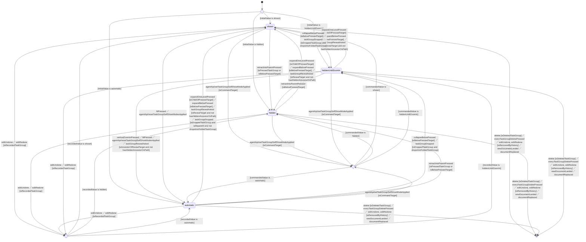
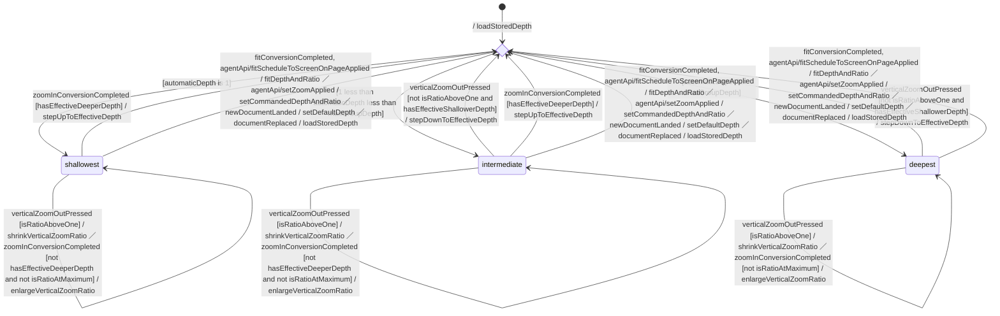

# タスクグループの表示/非表示 —— 仕様の下書き（色を除く）

2026-11-21 に作った下書き。持ち主の指示「タスクグループの表示/非表示関係（色は除く）について、各種要素、状態、イベント、プロパティ、キー、値の名称と機能、責務を一覧で整理して、ステートマシン図と状態遷移表で仕様化できるか？」に答える。
決まった裁定（`JDG-3657`〜`JDG-3663`）を土台にし、決まっていない所はすべて **【案】** と印し、最後の「オーナーが決めること」の表に集めた。
この紙は下書きであり、仕様（`docs/spec`）にはまだ当てていない。
2026-11-21 の 2 版: 独立レビュー（H 3・M 11・L 10）を当てた。直した所は、頭のボタンの札（H1。持ち主の指示で、頭は帯と同じ札・同じ出来事を根で押したものとし、誤読は説明の文で防ぐ）、生まれ方と終わり方（H2）、取り消しのガードの重なり（H3）、図と表の一致と `[*]` の扱い（M1・M2）、命令で貼った根（M3）、端の処理の出典（M4）、`CR-853` の節の番号（M5）、比の書き手（M6）、深さの状態の名（M7）、`JDG-3663` の閉じた一覧（M8）、取り下げの一覧（M9）、拡大の出来事の名（M10）、畳んだ帯の定義（M11）と、安い L。

---

## 0. 結論 —— この文書でタスクグループの表示/非表示は完結できるか

**はい（条件付き）。** 構造は閉じる。残るのはオーナーの決め 16 件と、仕様への当て込みである。

- **閉じたもの**: 要素・状態と値・出来事・キー・命令の一覧（5 表）、`taskGroupVisibility` を導く規則（10 行）、帯ごとの状態機械（状態 4・出来事 31）の図と状態遷移表と生まれ方の表、深さ `automaticDepth` の状態機械（状態 3・出来事 10）の図と状態遷移表。
  どちらの表も、すべての交点に「次の状態 [ガード] / 処理」か `ignore` か `error` を決めた。NDD の章が求める形（1 節で引く）に合わせた。
- **残るもの 1 —— オーナーの決め**: 裁定が無い 16 件を 【案】 で埋めた（8 節の表。依存する組ごとに寄せ、各行に推奨・次点・覆す裁定を書いた）。
  【案】 が覆っても、表の形（列・行・ガードの名）は変わらない。変わるのは升の中身だけである。
- **残るもの 2 —— 当て込み（この文書の外）**: 仕様の 表 T-328・表 T-329・`HR-*`・`HF-*`・`UN-*`・`SJ-2`・`DU-2`、`AT-153`・`S-418`・`S-125`（「根のタスクグループを深さ 1 と数える」が `JDG-3660` に反する）・`CM-72`・`CM-85`・`CM-86`、画面の語の辞書（`IC-*`）、`CR-851` のスキーマ、`CR-853` の深さの行への書き込み。
  当て込みでは、図と表を `docs/spec/_source/state-machines.json` の 1 つの原稿から刷る（`07-review-standards.md` と NDD 594 行の推奨）。この下書きは手で別々に書いたので、表を正とする。
  ほかに、取り下げの記録（`JDG-3653`・`JDG-3654`・`JDG-3655`・`JDG-3656`、`JDG-590` の「∨∨ は縮めたら畳む」の部分、`JDG-967` の「足した帯は暫定で開く」の部分、`JDG-3651` の根の値、`JDG-3296` の名 `taskGroupAutoExpandDepth`、`JDG-969` の「段 0 を開き、暫定で開いて立てる」の部分、`JDG-598` の「5 つの値」の部分）が要る。

---

## 1. 従った規則 —— NDD レビュー基準書のステートマシンの章

**使った版**: 開発の手順の本体にある `process-rules/review-standards-ja.md` の「R4: 並行性・状態遷移レビュー観点」の節「ステートマシン（STM: State Machine）」（504〜608 行）。
同じ章の写しが 3 つある。比べた結果:

- 手順の本体の版（上）を正とした。
- 変更の提案の紙（`review-standards-ja-changes.md`）は同じ章に履歴擬似状態の書き方の直しを持つだけで、この文書に効く違いは無い（この文書は履歴擬似状態を使わない）。
- このリポジトリの `docs/development-rules/07-review-standards.md` の「状態機械」の節（344〜355 行）は古い短い版で、何も変わらない交点を `-` と書く。この文書は本体の版の既定（`ignore`・`error`）に従い、凡例で読み替えを示す。

**当てた規則**（行は本体の版）:

| 規則（要旨） | 行 | この文書での当て方 |
|:---|:---|:---|
| 振る舞いは「今の状態 × イベント → 次の状態」の表だけで決める。表に無い振る舞いを作らない | 507 | 帯の値を書く者は、すべて 5.5 節の表の行（今ある帯の遷移と終わり）か 5.6 節の生まれ方の表の行（生まれる帯の値）に置いた（ボタン・ズーム・全体表示・飛ぶ・追加・移動・貼り付け・削除・ピン・取り消し・新しく始める・置き換え・合流・`Agent API`）。重ねる（`FR-015`）は文書を変えないので出来事にしない（3.3 節） |
| 次の状態は今の状態とイベント（とガード）だけで決まる。ほかのステートマシンの途中の状態に左右させない | 508 | ガードはイベントの運ぶ値と、その帯の木の位置だけを読む。ほかの帯の値を読む判定（「畳んだ帯へ落とした」など）は、配る前にイベントの値に入れる（5.8 節） |
| 1 つの状態で 1 つのイベントが動かす遷移は多くても 1 つ | 510・585 | 升のガードは互いに重ならない（5.2 節・5.5 節）。取り消しの 3 つのガードは式で互いに排他にした（5.2 節） |
| 状態は形容詞か分詞、イベントは過去形。定義は `〜StateMachine`、状態の型は `〜State`、今の状態は `current〜State` | 523〜529 | 状態 `shown`・`hidden`・`automatic`・`hiddenUntilZoomIn`（分詞と形容詞）、深さの状態 `shallowest`・`intermediate`・`deepest`（形容詞）。イベントは `…Pressed`・`…Applied`・`…Asked`・`…Completed` などの過去分詞。命名の当て方は 【案】 U-4 |
| 名前で識別し、通し番号を振らない | 531 | 状態・イベント・ガード・処理はすべて名で書いた |
| 初期化（電源投入・再起動・復元）のそれぞれで入る状態が 1 つに決まる | 554 | 帯はディスパッチャが作る。初期の擬似状態からの遷移はトリガもガードも持たず（UML 2.5.1 の 14 章）、選択の擬似状態 `◇ byInitialSelfShowMode` で、生まれ方が運ぶ値ごとに入る状態が 1 つに決まる（5.6 節）。表は `[*]` の列を持たない |
| 複数の値の組み合わせで状態を定義しない | 555 | 帯の状態は 1 つの鍵 `selfShowMode` の値そのもの。`taskGroupVisibility` は状態ではなく導く値（4 節） |
| 履歴擬似状態を使わない | 564 | 使わない。取り消しは記録した値を運ぶイベントで、選択の擬似状態（◇）で行き先を決める |
| 1 つのイベントを複数のステートマシンで共有するのは、どの順序で処理しても結果が同じ場合だけ。相互作用があるなら、1 つが受け、その遷移が発生させるイベントでほかを動かす | 588〜590 | 帯どうしは順序に依らない（5.8 節）。深さは帯の結果に依るので、帯の遷移の後に発生させるイベント `zoomInConversionCompleted`・`fitConversionCompleted` で動かす（6 節） |
| ステートマシンごとに図と表が組。図と表の状態・イベント・遷移が一致し、名で辿れる。凡例で「無視」と「異常」の書き方を決める（既定は `ignore` と `error`） | 593・595・598 | 5 節・6 節。凡例は 5.4 節。選択の擬似状態の名は図と表で同じ。自己への遷移も図に描く（帯は ◇ から今と同じ状態へ戻る枝、深さは自己の矢印） |
| すべての交点に、次の状態か「無視」か「異常」を決める。ガードは重ならず漏れない | 597・599 | 「それ以外 → `ignore`」で各升を言い切った |
| 試験ケースの数を見積もる（ガードで分かれる交点は枝ごと） | 509・596 | 5.7 節・6.4 節 |
| 推奨: 行がイベント、列が今の状態、交点が「次の状態 [ガード] / 処理」 | 601 | 持ち主の指定（列 Source・行 Event・交点 target, guard, action）と同じ。この形で書いた |
| 故障時・フェールセーフの遷移を決める | 604〜607 | 5.9 節 |
| タイマーは独立したステートマシンにする | 568 | 時間で終わる値は無い（`hiddenUntilZoomIn` はズームの入力で終わる。時間ではない） |

---

## 2. 範囲と用語

**範囲**: タスクグループ（帯）を描くか描かないかを決めるもの全部。
保存する意図（`selfShowMode`・`automaticDepth`）、導く結果（`taskGroupVisibility`・`drawn`）、それを書くすべての入口、それを示す目印。
**範囲の外**: 色、帯の高さ、名前、編集の権限、日程の描き方そのもの。縦の比 `verticalZoomRatio` の働き（`CR-853` が持つ。ここでは深さと一緒に縦の 1 刻みを決める所だけ扱う）。
この文書は「段」を深さの別名に使わない（`JDG-3660`）。縦のズームの 1 回の入力は「刻み」、取り消しの単位は「取り消しの 1 段」と書く。

**木の用語**（`JDG-3660` のとおり）:

| 語 | 英語 | 定義 |
|:---|:---|:---|
| 根 | root | 木の頭。深さ 0。タスクグループではなく、行として描かない。値を持たず、Retract もピンもない。「最上位」「top level」と呼ばない |
| 深さ | depth | 根から数えた段の数。根が 0、根の直下が 1 |
| 最上位 | top level | 深さ 1。根を指さない |
| 最上位のタスクグループ | top-level task group | 深さ 1 のタスクグループ |
| 親 / 子 | parent / child | 1 段上 / 1 段下。最上位のタスクグループの親は根 |
| 配下 | below (descendants) | その帯より下のすべて。帯自身は含まない |
| 祖先 | ancestor | その帯より上のすべて。根を含む |

使わない語: 根を「最上位」と呼ぶこと、深さの別名の「段」「level」（段 0 など）、Lv0・Lv1、深さの意味の WBS（`JDG-3660`）。
この文書は仕様の今の行を引くときだけ「段 0」と書く（今の行の語だから）。

**この文書で使わない旧い名**（裁定で替わったもの。当て込みで消す）:
`treeState`（`AT-153`）とその値 `auto`・`collapsed`・`expanded`・`temporarilyExpanded`・`hidden`（旧い意味）、`expandedUntilZoomOut`（`JDG-3653`）、`automaticallyExpandedWithinDepth`（`JDG-3654`）、`isCollapsedIntoParent`（`JDG-3655`）、`childrenExpansionState`（`JDG-3656`）、`levelZeroTreeState`・`rootTreeState`（`S-418`）、`revealed`・`retracted`・`visibilityIntent`（BGQA3T の案）、出来事 `oneLevelOpenPressed`・`allBelowOpenPressed`・`allBelowFoldPressed`・`hidePressed`・`retractPressed`・`topLevelOpenPressed`・`everyTaskGroupOpenPressed`・`everyTaskGroupFoldPressed`、`verticalZoomExpandPressed`（`JDG-3663` で却下）、運ぶ値 `pressedRowId`（→ `pressedTarget`）・`revealedRowId`（→ `revealTargetId`）、この下書きの 1 版の名 `documentOpened`・`mspdiImported`（→ `documentReplaced`・`documentMerged`、5 節）・`atShallowestDepth`・`withinDepthRange`・`atDeepestDepth`（→ `shallowest`・`intermediate`・`deepest`）。`verticalZoomShrinkPressed` は 【案】 U-5 で `verticalZoomOutPressed` に改める。

---

## 3. 一覧

「出典」の列: 裁定の番号か仕様の行。裁定の無いものは `proposal`（【案】）。

### 3.1 要素

| 名 | 日本語 | 種類 | 働き | 責務 | 出典 |
|:---|:---|:---|:---|:---|:---|
| `root` | 根 | 木の節（深さ 0） | 木の頭。最上位のタスクグループの親 | 値を持たない。頭のボタンの「押した物」になる。Retract とピンを持たない | `JDG-3660`・`HF-*` の後の段落（RQ:1799〜1806） |
| `TaskGroup` | タスクグループ（帯） | 木の節（深さ 1 以上） | 日程を束ねる行 | 自分の表示の意図 `selfShowMode` を 1 つ持つ。帯ごとに 1 つの `selfShowModeStateMachine` を持つ | `JDG-3657`・`JDG-3662` |
| `taskGroupTreeView` | タスクグループの木の見え方 | GRS JSON の物（文書に 1 つ） | 木全体の見え方の値を入れる | `automaticDepth` を持つ。根の値は持たない（【案】 U-8） | `JDG-3651`・`JDG-3662` |
| task group panel | タスクグループパネル | 画面の面 | 帯の名と操作子を木の順に並べる | `taskGroupVisibility` が `visible` の帯だけを行として描く | `HF-*` |
| panel head | パネルの頭 | 画面の行 | 根の操作子を 1 行に並べる | 根を押した物としてイベントを送る | `HF-10`・`HF-12`・`HF-16`・`HF-17`・`HF-20` |
| head ∨ (`IC-92`) | 頭の ∨ Expand One Level | 操作子 | 帯の ∨ を根で押したもの（最上位のタスクグループを出す） | `expandOneLevelPressed`（押した物 ＝ 根）を送る。札は帯と同じ、説明の文は 【案】 U-2 | `HF-16`・`JDG-3659`・proposal |
| head ∨∨ (`IC-74`) | 頭の ∨∨ Expand Below | 操作子 | 帯の ∨∨ を根で押したもの（すべてを出す） | `expandBelowPressed`（押した物 ＝ 根）を送る | `HF-10`・`JDG-3659`・proposal |
| head ∧∧ (`IC-78`) | 頭の ∧∧ Collapse Below | 操作子 | 帯の ∧∧ を根で押したもの（最上位も含めすべてを次の縦のズームインまで隠す） | `collapseBelowPressed`（押した物 ＝ 根）を送る | `HF-12`・`JDG-3659`・proposal |
| head ＋ (`IC-93`) | 頭の ＋ | 操作子 | 最上位にタスクグループを足す | `childTaskGroupAddPressed`（押した物 ＝ 根）を送る | `HF-17` |
| head × (`IC-106`) | 頭の × | 操作子 | すべてのタスクグループを消す | 問い（`QN-10`）の後に `everyTaskGroupDeletePressed` を送る | `HF-20` |
| band ∨ (`IC-90`) | 帯の ∨ Expand One Level | 操作子 | 押した帯の子を出す | `expandOneLevelPressed` を送る | `JDG-3659`・`JDG-3661`・`HF-13` |
| band ∨∨ (`IC-58`) | 帯の ∨∨ Expand Below | 操作子 | 押した帯の配下をすべて出す | `expandBelowPressed` を送る | `JDG-3659`・`JDG-3661`・`HF-2` |
| band ∧∧ (`IC-77`) | 帯の ∧∧ Collapse Below | 操作子 | 押した帯の配下を次の縦のズームインまで隠す | `collapseBelowPressed` を送る | `JDG-3659`・`JDG-3661`・`JDG-3663`・`HF-11` |
| band ∧ (`IC-59`) | 帯の ∧ Retract Into Parent／親へしまう | 操作子 | 押した帯を配下ごと親へしまう | `retractIntoParentPressed` を送る。根には無い | `JDG-3658`・`JDG-3659`・`JDG-3661`・`HF-3` |
| band ＋ (`IC-91`) | 帯の ＋ | 操作子 | 押した帯の配下に足す | `childTaskGroupAddPressed` を送る | `HF-14` |
| band × (`IC-82`) | 帯の × | 操作子 | 押した帯を配下ごと消す | `taskGroupDeletePressed` を送る | `CD-*`・`FR-032` |
| pin (`IC-60`) | ピン | 操作子 | 帯を画面の上端に留める・外す | `taskGroupPinToggled` を送る。`selfShowMode` に触らない | `FR-098`・`HF-4`・`HF-6` |
| grip (`GR-20`) | 掴み代 | 操作子 | 帯を掴んで位置と親を変える | 離したとき `taskGroupDropped` を送る | `HF-15` |
| fit entry (`IC-10`・`SK-18`) | 全体表示 | 操作子とキー | 全体が収まる倍率と位置にする | `fitPressed` を送る | `FR-055`・`HF-8` |
| vertical zoom inputs | 縦のズームの入力 | ホイール（`MK-4`）・操作子（縮める `IC-14`、拡げる `IC-15`）・キー（縮める `SK-16c`、拡げる `SK-16a`） | 縦を縮める・拡げる | `verticalZoomOutPressed`・`verticalZoomInPressed`（【案】 U-5）を送る | `CR-853`・表 T-328 の今の行・`ZE-2`・`ZE-3` |
| jump sources | 飛ぶ入口 | 検索の行（`SJ-1`）・`focusTask`（`AM-16`）・依存線の続きの印（`EL-21`）・表の「表示」（`TV-6`） | 指した帯を見せる | `taskGroupRevealAsked` を送る | `SJ-2`・表 T-328 の今の行 |
| hidden-items indicator (band) | 折りたたみ込みの数（帯） | 目印 | 配下に人が隠した帯がいくつあるか示す（`▾` と数、左の帯） | 数え方は 【案】 U-15。新しい目印は足さない | `HF-18`・`JDG-3663` |
| hidden-items indicator (head) | 折りたたみ込みの数（頭） | 目印 | 根の下に人が隠した帯がいくつあるか示す | 同上 | `HF-12`・`JDG-3663` |
| schedule filter | スケジュールフィルタ | 別の軸 | 表の積で描くタスクを絞る | `selfShowMode` を読まず書かない。`drawn` にだけ効く | `TD-8`・`FR-151` |
| `taskGroupTreeDispatcher` | タスクグループの木のイベントディスパッチャ | 部品 | イベントを受けて状態機械へ配る | 待ち行列で 1 つずつ。帯の機械を作る（生まれる帯）・除く（終わった帯）。全帯の遷移が終わってから後続のイベントを発生させる（5.8 節） | NDD 576〜583・proposal |

### 3.2 状態と値

| 名 | 日本語 | 種類 | 働き | 責務 | 出典 |
|:---|:---|:---|:---|:---|:---|
| `shown` | 出す | `selfShowMode` の値（保存） | 人がこの帯を出すと選んだ | 深さに依らず帯を `visible` にする（祖先が隠していなければ） | `JDG-3662` |
| `hidden` | しまう（隠す） | `selfShowMode` の値（保存） | 人がこの帯を出さないと選んだ（配下も隠れる） | 縦のズームインでもズームアウトでも隠れたまま。人の操作で戻るのは、親の ∨・祖先の ∨∨・その帯へ飛ぶの 3 つだけ（`JDG-3663`。根は最上位の親なので、頭の ∨・∨∨ もこの 3 つに入る）。ほかに値を書き換えるのは、取り消し・やり直し（前の値を戻す、`UN-14`）と `Agent API` の `setTaskGroupSelfShowMode`（値を直接置く）で、この 2 つはオーナーの確認が要る（【案】 U-16） | `JDG-3662`・`JDG-3663` |
| `automatic` | 自動 | `selfShowMode` の値（保存） | 規則に任せる | 深さ・ピン・出ている配下へ至る道で `visible` か決まる（4 節 V-6） | `JDG-3662` |
| `hiddenUntilZoomIn` | 拡大まで隠す | `selfShowMode` の値（保存） | 今は隠れている。次の縦のズームインで `automatic` に溶ける | ズームアウトでは隠れたまま | `JDG-3663` |
| `visible` / `invisible` | 見える / 見えない | `taskGroupVisibility` の値（導く。保存しない） | 帯を描く資格があるか | 4 節の規則だけで決まる | `JDG-3657`・`JDG-3662` |
| `drawn` | 描く | 導く値（保存しない） | 最終の結果。`visible` かつスケジュールフィルタを通る | パネルと日程表が描く帯の集まり | BGQA3T の後の段のお知らせ・`TD-8` |
| `shallowest` | 最も浅い | `automaticDepthStateMachine` の状態 | `automaticDepth` が 1 | 縮める向きの端（`ZE-2`）を決める | proposal |
| `intermediate` | 中ほど | 同上 | 1 < `automaticDepth` < 上限 | — | proposal |
| `deepest` | 最も深い | 同上 | `automaticDepth` が上限 | 拡げる向きで比へ移る所を決める | proposal |
| pinned / unpinned | ピン止め / 外し | 別の領域（`pinnedTaskGroupIds` に在るか） | 帯を上端に留めるか | `automatic` の帯の判定にだけ効く。`hidden`・`hiddenUntilZoomIn`（自分か祖先）には勝たない | `FR-098`・RQ:6224〜6228・BGQA3T 6-12-24 a・proposal |

### 3.3 出来事

ドメインの前置き: 画面の入力は `taskGroupTree/`、`Agent API` の命令は `agentApi/`（今の 表 T-328 の書き方）。下の表と 5 節の表では前置きを `agentApi/` だけ書く。
「押した物」は `pressedTarget` で運ぶ（【案】 U-3）: `{ kind: "root" }` か `{ kind: "taskGroup", taskGroupId }`。根を `null` で運ばない（BGQA3T 6-12-31 a）。

| 名 | 日本語 | 種類 | 働き | 責務（運ぶ値） | 出典 |
|:---|:---|:---|:---|:---|:---|
| `expandOneLevelPressed` | 1 階層展開を押した | 入力（帯・頭の ∨） | 押した物の子を出す | `pressedTarget` | `JDG-3661`（規則による名）・`HF-13`・`HF-16` |
| `expandBelowPressed` | 配下をすべて展開を押した | 入力（帯・頭の ∨∨） | 押した物の配下をすべて出す | `pressedTarget` | `JDG-3661`・`HF-2`・`HF-10` |
| `collapseBelowPressed` | 配下をすべて折りたたむを押した | 入力（帯・頭の ∧∧） | 押した物の配下を拡大まで隠す（`hidden` の帯は触らない） | `pressedTarget` | `JDG-3661`・`JDG-3663`・`HF-11`・`HF-12` |
| `retractIntoParentPressed` | 親へしまうを押した | 入力（帯の ∧） | 押した帯と配下をしまう | `pressedTarget`（いつも帯） | `JDG-3661`・`JDG-3663`・`HF-3` |
| `childTaskGroupAddPressed` | 配下に足すを押した | 入力（帯・頭の ＋） | 新しい帯を末子に立てる | `pressedTarget`・`addedTaskGroupId` | `HF-14`・`HF-17` |
| `taskGroupDropped` | 帯を落とした | 入力（掴んで動かす） | 帯の親と並びを変える | `taskGroupId`・`isReparent`・`dropsIntoFoldedTaskGroup`（落とす前にパネルが決める。定義は 5.2 節） | `HF-15`・proposal |
| `taskGroupSubtreePasted` | 部分木を貼った | 入力（貼り付け） | 部分木の写しを立てる | `pasteRootId`・写しと元の対応 | `FR-033`・`DU-2` |
| `taskGroupDeletePressed` | 帯を消すを押した | 入力（帯の ×、問いの後） | 帯を配下ごと消す | `taskGroupId` | `FR-032` |
| `everyTaskGroupDeletePressed` | すべて消すを押した | 入力（頭の ×、問いの後） | すべての帯を消す | — | `HF-20` |
| `defaultTaskGroupCreated` | 既定の帯ができた | 内部（ディスパッチャが発生させる） | 帯の削除で帯が 0 になったとき、同じ操作の一部として 1 つ立てる（取り消し 1 回で戻る） | `createdTaskGroupId` | 表 T-050 の直下の規則・`CD-6`・`JDG-969` |
| `newDocumentLanded` | 新しく始めた | 読み込み（`FR-095`。表 T-290 の `fileFlow/newDocumentLanded` と同じ出来事） | 今の帯をすべて終わらせ、空の文書（表 T-342 の `BK-2`）の 1 つの帯を立て、深さを既定にする。取り消しの履歴ごと捨てるので、段を積まない | `createdTaskGroupId` | `FR-095`・表 T-342・proposal（U-12） |
| `fitPressed` | 全体表示を求めた | 入力 | 人が出した帯と拡大まで隠した帯を自動へ戻す | — | `FR-055`・`HF-8`・proposal |
| `verticalZoomOutPressed` | 縦を縮める入力 | 入力（`MK-4` の縮める向き・`IC-14`・`SK-16c`） | 深さか比を 1 刻み縮める。帯の値は書かない | — | 表 T-328 の今の行（今の名 `verticalZoomShrinkPressed`）・`JDG-3663`・proposal（U-5） |
| `verticalZoomInPressed` | 縦を拡げる入力 | 入力（`MK-4` の拡げる向き・`IC-15`・`SK-16a`） | `hiddenUntilZoomIn` を溶かす。その後に深さか比を 1 刻み拡げる | — | proposal（U-5） |
| `taskGroupRevealAsked` | 帯を見せるよう求めた | 入力（飛ぶ） | 指した帯を見せる | `revealTargetId`・`hasHiddenAncestorOnPath`（飛ぶ入口が配る前に決める） | `SJ-2`・`AM-16`・`EL-21`・`TV-6`・proposal（U-11） |
| `taskGroupPinToggled` | ピンを押した | 入力 | ピンの並びに足す・除く | `taskGroupId` | `FR-098` |
| `editUndone` / `editRedone` | 取り消した / やり直した | 履歴 | 記録した値へ戻す | `recordedSelfShowModes`（帯の id → 戻す値）・`restoredIds`（生き返る帯）・`removedIds`（消える帯）。`restoredIds` と `removedIds` は交わらない | `UN-14`・`FR-031` |
| `documentReplaced` | 文書を置き換えた | 読み込み（`OP-3` の置き換え。読み直し `OP-13`・ドロップ `OP-19`・起動のテンプレート `FR-027` を含む。GRS JSON も MSPDI も、`importDocument`・`requestOpenFile` も同じ） | 今の帯をすべて終わらせ、読んだ文書の帯を立てる。取り消しの履歴を引き継がない（`OP-4`・`UN-6`） | 帯ごとの保存した値（MSPDI は値を持たないので `automatic`、【案】 U-16）・`automaticDepth` | `OP-3`・`OP-4`・BGQA3T 出来事 19・proposal |
| `documentMerged` | 文書を合流させた | 読み込み（`OP-3` の合流、`FR-022`） | 今の帯は残し、入ってきた帯を立てる。取り消しの 1 段（【案】 U-16） | 入ってきた帯ごとの保存した値 | `OP-3`・`FR-022`・`UN-6`・proposal（U-16） |
| `agentApi/createTaskGroupApplied` | 帯を作る命令を当てた | 命令（`CM-26`） | 帯を立てる | `taskGroupId`・`selfShowMode`（任意。【案】 U-12） | `CM-26`・proposal |
| `agentApi/moveTaskGroupApplied` | 帯を動かす命令を当てた | 命令（`CM-73`） | 親と並びを変える | `taskGroupId` | `CM-73`・proposal |
| `agentApi/reorderTaskGroupSiblingsApplied` | 兄弟を並べ替える命令を当てた | 命令（`CM-35`） | 並びだけ変える | `parentTaskGroupId` | `CM-35` |
| `agentApi/pasteTaskGroupSubtreeApplied` | 部分木を貼る命令を当てた | 命令（`CM-28`） | 写しを立てる | 写しと元の対応 | `CM-28` |
| `agentApi/deleteTaskGroupApplied` | 帯を消す命令を当てた | 命令（`CM-27`） | 帯を配下ごと消す | `taskGroupId` | `CM-27` |
| `agentApi/setTaskGroupSelfShowModeApplied` | 帯の表示の意図を置く命令を当てた | 命令（今の `CM-85` を改める） | 1 つの帯の値を置く（配下に広げない） | `taskGroupId`・`selfShowMode` | `JDG-3662`・proposal（U-6・U-16） |
| `agentApi/resetTaskGroupSelfShowModesApplied` | 表示の意図を戻す命令を当てた | 命令（今の `CM-72` を改める） | 全体表示と同じく自動へ戻す | — | `CM-72`・proposal（U-6） |
| `agentApi/setZoomApplied` | 倍率を置く命令を当てた | 命令（`CM-65`） | 比と深さを置く。帯の値は書かない | `verticalZoomRatio`・`automaticDepth` | `CM-65`・`CR-853`・proposal |
| `agentApi/fitScheduleToScreenOnPageApplied` | 画面の全体表示の命令を当てた | 命令（`CM-102`、ページは `CM-71` に置き換えて書く） | 倍率と位置だけ置く。木は戻さない。深さと比は今の木で全体表示と同じく選ぶ | — | `CM-102`・`CM-71`・`CR-853` の `I-5` |
| `agentApi/pinTaskGroupApplied` / `agentApi/unpinTaskGroupApplied` | ピンの命令を当てた | 命令（`CM-68`・`CM-69`） | ピンの並びに足す・除く | `taskGroupId` | `CM-68`・`CM-69` |
| `zoomInConversionCompleted` | 拡大の溶かしが終わった | 内部（ディスパッチャが発生させる） | 深さの状態機械に、溶かした後の木で拡げる 1 刻みを決めさせる | — | proposal（U-14） |
| `fitConversionCompleted` | 全体表示の戻しが終わった | 内部（同上） | 深さの状態機械に、戻した後の木で深さを選ばせる | — | proposal（U-10） |

出来事でないもの: スケジュールフィルタを掛ける・外す（帯の値を読まず書かない、`TD-8` の MUST NOT）。重ねる（`OP-3` の 3 つ目、`FR-015`。文書を変えずに変更前の予定を描くので、帯の値も深さも変わらない）。並べ替えだけのドラッグは `taskGroupDropped` の `isReparent` が偽の場合。

### 3.4 プロパティとキー

| 名 | 日本語 | 型 | 既定 | 置き場 | 働きと責務 | 出典 |
|:---|:---|:---|:---|:---|:---|:---|
| `selfShowMode` | 表示の意図 | 文字列の列挙 `shown`・`hidden`・`automatic`・`hiddenUntilZoomIn` | 生まれ方で決まる（5.6 節）。キーが無い文書は 【案】 U-16 | GRS JSON の `taskGroups` の各行 | 帯自身の今の意図。書く側はすべて 5.5 節の表の行か 5.6 節の生まれ方の行 | `JDG-3662`・`JDG-3663` |
| `taskGroupTreeView.automaticDepth` | 自動の深さ | 整数 | 【案】 4（U-7） | GRS JSON の `taskGroupTreeView` | `automatic` の帯を深さ何まで出すか。縦のズームで変わる。取り消しの対象外（`UN-8`） | `JDG-3662`・proposal |
| `pinnedTaskGroupIds` | ピン止めの並び | 帯の id の並び | 空 | GRS JSON の見せ方の群（`S-126`） | 留める順。上限は `S-127` | `FR-098`・BGQA3T 6-12-24 a |
| `verticalZoomRatio` | 縦の比 | 数（1 以上） | 1 | GRS JSON の見せ方の群 | 深さと一緒に縦の 1 刻みを決める（6 節）。働きは `CR-853` | `CR-853`・`JDG-3296` |
| `parentTaskGroupId`・`siblingOrder` | 親・兄弟の順 | id・整数 | — | GRS JSON の `taskGroups` の各行 | 木の形。ガードが親・配下・祖先を読む | β の形の下書き |
| `maxGroupDepth` | 深さの上限 | 整数（今は 5） | — | 設定（`S-125`） | `automaticDepth` の上限 | `FR-004`・`S-125` |
| `taskGroupVisibility` | 表示の結果 | `visible`・`invisible` | — | 保存しない（導く） | 4 節の規則で毎回導く | `JDG-3657`・`JDG-3662` |
| `currentSelfShowModeState` | 今の表示の意図（コードの変数） | `SelfShowModeState` | — | 実装の中（GRS JSON の `selfShowMode` と 1 対 1） | NDD の命名で今の状態を持つ変数 | proposal（U-4） |
| 消すキー | — | — | — | — | `treeState`（`AT-153`）、`levelZeroTreeState`・`rootTreeState`（`S-418`、`taskGroupTreeView.rootTreeState`） | `JDG-3662`・proposal（U-8） |

### 3.5 命令（`Agent API`）

| 名 | 日本語 | 働き | 責務 | 出典 |
|:---|:---|:---|:---|:---|
| `setTaskGroupSelfShowMode` | 帯の表示の意図を置く | 1 つの帯に 4 つの値のどれかを置く | 配下にも祖先にも広げない。食い違いは描くときの祖先の優越（4 節 V-2）で守る | 今の `CM-85` `setTaskGroupTreeState` を改める。proposal（U-6） |
| `resetTaskGroupSelfShowModes` | 表示の意図を戻す | `shown`・`hiddenUntilZoomIn` を `automatic` へ。`hidden` は残す | 全体表示の木の部分と同じ | 今の `CM-72` を改める。proposal（U-6・U-10） |
| `setLevelZeroTreeState` | （消す） | — | 根は値を持たない | 今の `CM-86`。proposal（U-8） |
| `createTaskGroup` | 帯を作る | 帯を立てる | 任意の引数 `selfShowMode` を足す。無ければ `automatic` | `CM-26`・proposal（U-12） |
| `moveTaskGroup`・`reorderTaskGroupSiblings` | 動かす・並べ替える | 親と並び / 並びを変える | 帯の値は書かない | `CM-73`・`CM-35`・proposal（U-12） |
| `pasteTaskGroupSubtree` | 部分木を貼る | 写しを立てる | 写しの値は 5.6 節（写しの根は `automatic`。画面で貼る根の `shown` とは違う、【案】 U-12） | `CM-28`・`DU-2` |
| `deleteTaskGroup` | 帯を消す | 帯を配下ごと消す | 帯の状態機械は終わる。ピンの並びからも除く | `CM-27` |
| `pinTaskGroup`・`unpinTaskGroup` | ピン | 並びに足す・除く | `selfShowMode` に触らない | `CM-68`・`CM-69` |
| `setZoom` | 倍率を置く | 比と深さを置く | 帯の値は書かない（溶かさない） | `CM-65`・`CR-853`・proposal |
| `focusTask` | タスクへ飛ぶ | `taskGroupRevealAsked` を起こす | 飛ぶと同じ | `AM-16` |
| `undoEdit`・`redoEdit` | 取り消し・やり直し | `editUndone`・`editRedone` を起こす | 人の取り消しと同じ | `UN-14` |
| `importDocument`・`requestOpenFile` | 文書を入れる・開く | 人が選んだ扱い（`OP-3`）で `documentReplaced` か `documentMerged` を起こす。重ねるは出来事を起こさない | 読む規則は 【案】 U-16 | `OP-3` |
| `readShownTasks` | 描いているタスクを読む | `drawn` の帯に載るタスクを返す | 導いた結果を読む唯一の道 | — |

---

## 4. 導く規則 —— `taskGroupVisibility` と `drawn`

帯 b について、上から順に当て、最初に当たった行で決める。`ancestors(b)` は根を含むが、根は値を持たないので、値を見るのは祖先のタスクグループだけである。

| 規則 | 条件 | 結果 | 出典 |
|:---|:---|:---|:---|
| V-1 | b の `selfShowMode` が `hidden` か `hiddenUntilZoomIn` | `invisible` | `JDG-3662`・`JDG-3663` |
| V-2（祖先の優越） | b の祖先のタスクグループのどれかの `selfShowMode` が `hidden` か `hiddenUntilZoomIn` | `invisible` | 今の `TD-3` の後継・proposal（U-16） |
| V-3 | b の `selfShowMode` が `shown` | `visible` | `JDG-3662` |
| V-4（以下 b は `automatic`） | b の深さ ≤ `automaticDepth` | `visible` | `JDG-3662`・`TD-4` の後継 |
| V-5 | b が `pinnedTaskGroupIds` に在る | `visible` | `TD-5`・`FR-098` |
| V-6（出ている配下へ至る道） | b の配下に、V-1〜V-3 で `visible` になる帯 d がある | `visible` | `JDG-3662`・`TD-7` の後継 |
| V-7 | どれにも当たらない | `invisible` | — |

- **最上位の下限**: `automaticDepth` の下限を 1 にする（【案】 U-7）ので、V-4 が `automatic` の最上位をいつも `visible` にする。最上位だけの規則は置かない（BGQA3T 6-12-33 a、【案】 U-9）。人の `hidden`・`hiddenUntilZoomIn` は最上位にも勝つ（V-1）。頭の ∧∧ はパネルを空にしうる（`HR-2`）。
- **ピン**: V-5 は V-1・V-2 より後なので、ピンは人の隠しに勝たない（RQ:6228・6253 と同じ）。
- **道**: V-6 の d は V-2 を通った帯だけ数える（今の `TD-7` の「`TD-2` と `TD-3` を満たす」と同じ）。だから `shown` の帯は、`automatic` の祖先を深さの外でも描かせ、木が宙に浮かない。
- **不変の単調性**: 縦を縮める入力（`verticalZoomOutPressed`）は `automaticDepth` を減らすか比を縮めるだけで、`selfShowMode` を書かない。V-1〜V-7 で `visible` の集まりは `automaticDepth` について単調（深さが減れば増えない）。
- **D-1 `drawn`**: `drawn` ＝ `taskGroupVisibility` が `visible`、かつスケジュールフィルタを掛けているあいだは、その帯か配下に描くタスクが載っている（`TD-8`）。フィルタのために `selfShowMode` を書いてはならない（`TD-8` の MUST NOT のまま）。
- **D-2 描かない帯のタスク**: `drawn` でない帯に載るタスクは描かない。親の帯に載せ替えない（`HR-1a` のまま）。
- **D-3 段割当と全体表示の測定**: `drawn` の帯だけを対象にする（`HR-1a` のまま）。

---

## 5. 帯の状態機械 `selfShowModeStateMachine`

帯ごとに 1 つ。状態は `selfShowMode` の 4 つの値そのもの（保存する値が状態である。今の 表 T-328 の頭の「本領域の状態は文書に保存する値である」と同じ）。
全帯の機械は同じ定義で、ディスパッチャが 1 つのイベントを全帯へ配り、帯はガードで自分が的かを選ぶ。

### 5.1 図

図と表の内容（状態・遷移）は同じ。正は 5.5 節の表とする（NDD 595 行。手で別々に書くので、どちらかを正と決める）。
同じ 2 つの状態を結ぶ遷移は 1 本の矢印にまとめ、出来事を「／」で並べた。`ignore` の交点は描かない。
選択の擬似状態は表と同じ名の 3 つ: `byInitialSelfShowMode`（生まれる帯、5.6 節）、`byCommandedSelfShowMode`（命令の値）、`byRecordedSelfShowMode`（取り消し・やり直しの記録の値）。
自己への遷移は、◇ から今と同じ状態へ戻る枝として描いた（たとえば `shown` で命令が `shown` を運ぶ）。それ以外の自己への遷移は無い。
初期の擬似状態からの遷移はトリガもガードも持たない。帯を作るのはディスパッチャで、作るときに生まれ方の値を渡す。

図の `delete` は `taskGroupDeletePressed` と `agentApi/deleteTaskGroupApplied` の 2 つ。図の `editUndone ／ editRedone [isRecordedTaskGroup]` は、2 つの出来事がどちらも同じガードを持つ意味。
処理（`/ stageWrite` など）は図では省き、表に書いた。
1 版の図にあった `hidden --> automatic : taskGroupRevealAsked [isAncestorOfRevealTarget]` は消した（`JDG-3663` の閉じた一覧の外で `hidden` を戻すため。【案】 U-11）。

### 5.2 ガード

条件は今の仕様の「ガードの条件の書き方」に合わせた式で書く。`taskGroup` はイベントを受ける帯（今の仕様の書き方）。
`nodeOf(target)` は印 `pressedTarget` を木の節に直す（`{ kind: "root" }` → 根、`{ kind: "taskGroup", taskGroupId }` → その帯）。`parentNodeOf(x)`・`ancestorNodesOf(x)` は木の節（根を含む）を返す。

| ガード | 条件 | 出典 |
|:---|:---|:---|
| `isPressedTaskGroup` | `event.pressedTarget.kind == "taskGroup" && taskGroup.id == event.pressedTarget.taskGroupId` | 表 T-328 の今の行 |
| `isChildOfPressedTarget` | `parentNodeOf(taskGroup) == nodeOf(event.pressedTarget)`（最上位の帯の親は根なので、頭の ∨ で最上位が当たる） | `JDG-3660`・`HR-7`・`HF-16` |
| `isBelowPressedTarget` | `nodeOf(event.pressedTarget) in ancestorNodesOf(taskGroup)`（祖先は根を含むので、頭のボタンですべての帯が当たる） | `JDG-3660`・`HR-3`・`HR-4` |
| `isDroppedTaskGroup` | `taskGroup.id == event.taskGroupId`（掴んだ 1 つだけ。配下は自分の値のまま） | `HF-15` |
| `isReparent` | `event.isReparent`（親が変わった） | `HF-15` |
| `dropsIntoFoldedTaskGroup` | `event.dropsIntoFoldedTaskGroup`。パネルが落とす前に、落とす前の木で次のとおり決める: 新しい親 p がタスクグループ（根でない）で、p の子（落とす帯を除く）が 1 つ以上あり、そのすべての `taskGroupVisibility` が `invisible`（4 節で導く）。「畳んだ」を、無くなった値 `collapsed` ではなく導く結果で言う | `HF-15`・`JDG-3657`・proposal（U-12） |
| `isDeletedTaskGroup` | `taskGroup.id == event.taskGroupId \|\| event.taskGroupId in ancestorIdsOf(taskGroup)` | `FR-032` |
| `isRevealTarget` | `taskGroup.id == event.revealTargetId` | `SJ-2` |
| `isAncestorOfRevealTarget` | `taskGroup.id in ancestorIdsOf(event.revealTargetId)` | `SJ-2`・proposal（U-11） |
| `hasHiddenAncestorOnPath` | `event.hasHiddenAncestorOnPath`。飛ぶ入口が配る前に決める: `ancestorIdsOf(event.revealTargetId)` のどれかの `selfShowMode` が `hidden` | `JDG-3663`・proposal（U-11） |
| `isCommandTarget` | `taskGroup.id == event.taskGroupId` | `CM-85` の後継 |
| `isRemovedByHistory` | `taskGroup.id in event.removedIds` | `UN-14` |
| `isRecordedTaskGroup` | `taskGroup.id in keys(event.recordedSelfShowModes) && !(taskGroup.id in event.removedIds)` —— 消える帯は除く。だから `isRemovedByHistory` と同時に真にならない（帯を足す編集の取り消しで、足したときの値が記録にあっても、その帯は消える側だけに当たる） | `UN-14` |

`ancestorIdsOf(x)` は x の祖先のタスクグループの id（根を含まない。根は id を持たない）。
生まれる帯を選ぶ判定（`isAddedTaskGroup`・`isPasteRoot`・`isPasteCopy`・`isRestoredByHistory`）は、もう帯のガードではない。ディスパッチャが生まれる帯を決める（5.6 節）。

**押した物の前提**: 押せるのは描かれた帯だけである（`HF-6`・`HF-*` の後の段落「対象とするのは、いま描かれているタスクグループ」）。V-1 により、`hidden`・`hiddenUntilZoomIn` の帯は描かれないので、その列の `isPressedTaskGroup`・`isDroppedTaskGroup` の枝は起こりえない。表はそれを `error` と書く。
根を押した物にする `retractIntoParentPressed` も起こりえない（根に ∧ は無い）。ディスパッチャが配る前に `error` として扱う。

### 5.3 処理

| 処理 | 中身 | 出典 |
|:---|:---|:---|
| `stageWrite` | この帯の新しい値を、そのイベントの書き込みの束に入れる。束は未保存の編集（`FR-100`）で、取り消しの 1 段（`UN-14`）。1 つも変わらなければ段を積まない。帯が 0 になって立つ既定の帯は、消した操作と同じ束に入る（`CD-6`。別の段を積まない） | 表 T-328 の頭・`SJ-2`・`CD-6` |
| `stageConversionWrite` | 拡大の溶かしの書き込みを束に入れる。束は取り消しの 1 段（【案】 U-13）。溶かす帯が無ければ段を積まない | `JDG-598` の鏡・proposal |
| `—` | 何も書かない（記録や文書から値を入れるだけで、新しい段を積まない）。新しく始める・置き換えは取り消しの履歴ごと捨てるので、ここに当たる | `UN-14`・`OP-4`・`FR-095` |

### 5.4 凡例

- 升は「→ 次の状態 [ガード] / 処理」。枝が複数あるときは ` ` で並べ、最後に「それ以外 → `ignore`」を添えて升を言い切る。
- `ignore` —— 遷移しない。処理もしない（同じ参照のまま）。仕様の今の書き方の「—」と同じ意味で、当て込みのときは「—」へ読み替えてよい。
- `error` —— 起こりえない組み合わせ（押せない帯が押された、など）。起きたら不具合として記録し、状態を変えない（5.9 節）。
- `◇ by…` —— 選択の擬似状態（図と同じ名）。運ぶ値で `shown`・`hidden`・`automatic`・`hiddenUntilZoomIn` のどれかへ行く（値が今と同じなら自己への遷移で、書き込みは積まない）。
- `[*]`（行き先） —— 終了状態（帯が無くなる。ディスパッチャがその帯の機械を除く）。表は初期の擬似状態の列を持たない。生まれる帯は 5.6 節の表に書く。
- 1 つの升で枝が 2 つ以上あるときは、ガードを互いに重ならないように書き、最後の「それ以外 → `ignore`」が残りをすべて受ける（漏れない）。枝が 1 つでガードが無い升は、その帯すべてに当たる。
- 列は Source（今の状態）、行は Event、交点は target・guard・action（持ち主の指定、NDD 601 行の推奨と同じ）。

### 5.5 状態遷移表

| Event ＼ Source | `shown` | `hidden` | `automatic` | `hiddenUntilZoomIn` |
|:---|:---|:---|:---|:---|
| `expandOneLevelPressed` | `ignore`（子は出たまま、押した帯は書かない） | → `shown` [`isChildOfPressedTarget`] / `stageWrite` `error` [`isPressedTaskGroup`] それ以外 → `ignore` | → `shown` [`isChildOfPressedTarget`] / `stageWrite` それ以外 → `ignore` | → `shown` [`isChildOfPressedTarget`] / `stageWrite` `error` [`isPressedTaskGroup`] それ以外 → `ignore` |
| `expandBelowPressed` | `ignore` | → `shown` [`isBelowPressedTarget`] / `stageWrite` `error` [`isPressedTaskGroup`] それ以外 → `ignore` | → `shown` [`isBelowPressedTarget`] / `stageWrite` それ以外 → `ignore` | → `shown` [`isBelowPressedTarget`] / `stageWrite` `error` [`isPressedTaskGroup`] それ以外 → `ignore` |
| `collapseBelowPressed` | → `hiddenUntilZoomIn` [`isBelowPressedTarget`] / `stageWrite` それ以外 → `ignore` | `error` [`isPressedTaskGroup`] それ以外 → `ignore`（配下でも触れない、`JDG-3663`） | → `hiddenUntilZoomIn` [`isBelowPressedTarget`] / `stageWrite` それ以外 → `ignore` | `error` [`isPressedTaskGroup`] それ以外 → `ignore` |
| `retractIntoParentPressed` | → `hidden` [`isPressedTaskGroup` or `isBelowPressedTarget`] / `stageWrite` それ以外 → `ignore` | `error` [`isPressedTaskGroup`] それ以外 → `ignore` | → `hidden` [`isPressedTaskGroup` or `isBelowPressedTarget`] / `stageWrite` それ以外 → `ignore` | `error` [`isPressedTaskGroup`] → `hidden` [`isBelowPressedTarget`] / `stageWrite` それ以外 → `ignore` |
| `childTaskGroupAddPressed` | `ignore`（生まれる帯は 5.6 節） | `ignore` | `ignore` | `ignore` |
| `taskGroupDropped` | → `hiddenUntilZoomIn` [`isDroppedTaskGroup` and `dropsIntoFoldedTaskGroup`] / `stageWrite` それ以外 → `ignore` | `error` [`isDroppedTaskGroup`] それ以外 → `ignore` | → `hiddenUntilZoomIn` [`isDroppedTaskGroup` and `dropsIntoFoldedTaskGroup`] / `stageWrite` → `shown` [`isDroppedTaskGroup` and `isReparent` and not `dropsIntoFoldedTaskGroup`] / `stageWrite` それ以外 → `ignore` | `error` [`isDroppedTaskGroup`] それ以外 → `ignore` |
| `taskGroupSubtreePasted` | `ignore`（生まれる帯は 5.6 節） | `ignore` | `ignore` | `ignore` |
| `taskGroupDeletePressed` | → `[*]` [`isDeletedTaskGroup`] / `—` それ以外 → `ignore` | → `[*]` [`isDeletedTaskGroup`] / `—` それ以外 → `ignore` | → `[*]` [`isDeletedTaskGroup`] / `—` それ以外 → `ignore` | → `[*]` [`isDeletedTaskGroup`] / `—` それ以外 → `ignore` |
| `everyTaskGroupDeletePressed` | → `[*]` / `—`（残る 1 つは `defaultTaskGroupCreated`、5.6 節） | → `[*]` / `—` | → `[*]` / `—` | → `[*]` / `—` |
| `defaultTaskGroupCreated` | `ignore`（生まれる帯は 5.6 節） | `ignore` | `ignore` | `ignore` |
| `fitPressed` | → `automatic` / `stageWrite` | `ignore`（しまった帯は残す、`HF-8`） | `ignore` | → `automatic` / `stageWrite` |
| `verticalZoomOutPressed` | `ignore` | `ignore` | `ignore` | `ignore`（縮めても隠れたまま、`JDG-3663`） |
| `verticalZoomInPressed` | `ignore` | `ignore`（拡大でも隠れたまま、`JDG-3663`） | `ignore` | → `automatic` / `stageConversionWrite` |
| `taskGroupRevealAsked` | `ignore` | → `shown` [`isRevealTarget` and not `hasHiddenAncestorOnPath`] / `stageWrite` それ以外 → `ignore`（道の `hidden` は書かない、`JDG-3663`） | → `shown` [`isRevealTarget` and not `hasHiddenAncestorOnPath`] / `stageWrite` それ以外 → `ignore`（祖先は V-6 で描かれる） | → `shown` [`isRevealTarget` and not `hasHiddenAncestorOnPath`] / `stageWrite` → `automatic` [`isAncestorOfRevealTarget` and not `hasHiddenAncestorOnPath`] / `stageWrite` それ以外 → `ignore` |
| `taskGroupPinToggled` | `ignore` | `ignore` | `ignore` | `ignore` |
| `editUndone` | → ◇ `byRecordedSelfShowMode` [`isRecordedTaskGroup`] / `—` → `[*]` [`isRemovedByHistory`] / `—` それ以外 → `ignore` | 同左 | 同左 | 同左 |
| `editRedone` | → ◇ `byRecordedSelfShowMode` [`isRecordedTaskGroup`] / `—` → `[*]` [`isRemovedByHistory`] / `—` それ以外 → `ignore` | 同左 | 同左 | 同左 |
| `newDocumentLanded` | → `[*]` / `—`（今の文書の帯は終わる。空の文書の帯は 5.6 節） | → `[*]` / `—` | → `[*]` / `—` | → `[*]` / `—` |
| `documentReplaced` | → `[*]` / `—`（今の文書の帯は終わる。読んだ文書の帯は 5.6 節） | → `[*]` / `—` | → `[*]` / `—` | → `[*]` / `—` |
| `documentMerged` | `ignore`（今の帯は値を保つ、【案】 U-16。入ってきた帯は 5.6 節） | `ignore` | `ignore` | `ignore` |
| `agentApi/createTaskGroupApplied` | `ignore`（生まれる帯は 5.6 節） | `ignore` | `ignore` | `ignore` |
| `agentApi/moveTaskGroupApplied` | `ignore`（値は保つ） | `ignore` | `ignore` | `ignore` |
| `agentApi/reorderTaskGroupSiblingsApplied` | `ignore` | `ignore` | `ignore` | `ignore` |
| `agentApi/pasteTaskGroupSubtreeApplied` | `ignore`（生まれる帯は 5.6 節） | `ignore` | `ignore` | `ignore` |
| `agentApi/deleteTaskGroupApplied` | → `[*]` [`isDeletedTaskGroup`] / `—` それ以外 → `ignore` | 同左 | 同左 | 同左 |
| `agentApi/setTaskGroupSelfShowModeApplied` | → ◇ `byCommandedSelfShowMode` [`isCommandTarget`] / `stageWrite` それ以外 → `ignore`（無い id は命令の検証が断る） | 同左 | 同左 | 同左 |
| `agentApi/resetTaskGroupSelfShowModesApplied` | → `automatic` / `stageWrite` | `ignore` | `ignore` | → `automatic` / `stageWrite` |
| `agentApi/setZoomApplied` | `ignore` | `ignore` | `ignore` | `ignore`（命令は溶かさない） |
| `agentApi/fitScheduleToScreenOnPageApplied` | `ignore` | `ignore` | `ignore` | `ignore`（木は戻さない、`CM-102`） |
| `agentApi/pinTaskGroupApplied` | `ignore` | `ignore` | `ignore` | `ignore` |
| `agentApi/unpinTaskGroupApplied` | `ignore` | `ignore` | `ignore` | `ignore` |

表に無い出来事（`zoomInConversionCompleted`・`fitConversionCompleted` と、表示/非表示に関係しないすべての出来事）は `selfShowModeStateMachine` を変えない（`ignore`）。

**頭のボタン**（【案】 U-3）: 頭の ∨・∨∨・∧∧ は帯のボタンを根で押したもので、札も出来事も帯と同じ（∨ Expand One Level・∨∨ Expand Below・∧∧ Collapse Below。根に親は無いので ∧ は無い）。上の 3 行を `pressedTarget` ＝ `{ kind: "root" }` で送るだけで、別の行を持たない。
`isChildOfPressedTarget` は最上位に、`isBelowPressedTarget` はすべての帯に当たる。だから頭の ∨ は最上位を `shown`、頭の ∨∨ はすべてを `shown`、頭の ∧∧ は `hidden` 以外のすべてを `hiddenUntilZoomIn` にする（最上位も消え、欄は空になりうる）。

### 5.6 生まれ方の表 —— `◇ byInitialSelfShowMode` の枝（NDD 554 行）

帯はディスパッチャが作り、初期の擬似状態 → `◇ byInitialSelfShowMode` → 下の「入る状態」へ進む（トリガもガードも持たない遷移）。
どの帯が生まれるかはディスパッチャが出来事の運ぶ値で決め、作るときに `initialValue` を渡す。生まれ方ごとに入る状態が 1 つに決まる。

| 出来事（生まれ方） | 生まれる帯 | 入る状態（`initialValue`） | 処理 | 出典 |
|:---|:---|:---|:---|:---|
| `childTaskGroupAddPressed`（帯・頭の ＋） | `event.addedTaskGroupId` | `shown` | `stageWrite` | `HF-14`「立てたタスクグループは見える（MUST）」・`JDG-3662`・proposal（U-12） |
| `defaultTaskGroupCreated`（削除で帯が 0 になった） | `event.createdTaskGroupId` | `shown` | `stageWrite`（消した操作と同じ束。取り消し 1 回で戻る） | 表 T-050 の直下の規則・`CD-6`・proposal（U-12） |
| `newDocumentLanded`（新しく始める） | 空の文書の 1 つ（表 T-342 の `BK-2`） | `shown` | `—`（取り消しの履歴ごと捨てる。段を積まない） | `FR-095`・proposal（U-12） |
| `taskGroupSubtreePasted`（画面で貼る） | 写しの根 `event.pasteRootId` | `shown` | `stageWrite` | proposal（U-12） |
| 同上 | 写しの配下 | 元が `hidden` → `hidden`、`hiddenUntilZoomIn` → `hiddenUntilZoomIn`、`shown`・`automatic` → `automatic` | `stageWrite` | `DU-2` の今の考え・BGQA3T 出来事 12 |
| `agentApi/pasteTaskGroupSubtreeApplied`（命令で貼る） | 写しの根 | `automatic`（命令は見せない。見せるのは `focusTask`） | `stageWrite` | `CM-28`・proposal（U-12） |
| 同上 | 写しの配下 | 画面で貼るのと同じ写し方 | `stageWrite` | `DU-2` |
| `agentApi/createTaskGroupApplied` | `event.taskGroupId` | 命令の `selfShowMode`。無ければ `automatic` | `stageWrite` | `CM-26`・proposal（U-12） |
| `documentReplaced`（置き換え） | 読んだ文書のすべての帯 | 保存した値。キーが無ければ `automatic`（MSPDI はいつも `automatic`） | `—` | `JDG-3662`・BGQA3T 出来事 19・proposal（U-16） |
| `documentMerged`（合流） | 入ってきた帯（今の文書に無いもの） | 保存した値。キーが無ければ `automatic` | `stageWrite`（合流 1 回で取り消しの 1 段） | `FR-022`・`UN-6`・proposal（U-16） |
| `editUndone`・`editRedone` | `event.restoredIds` | 記録した値（`event.recordedSelfShowModes`） | `—` | `UN-14` |

### 5.7 試験の数の見積もり（NDD 509・596 行）

交点の枝（`ignore`・`error`・「それ以外」も 1 枝）を数えた。選択の擬似状態の枝は、行き先の値ごとに 1 枝。

| 行 | 枝 | 行 | 枝 |
|:---|---:|:---|---:|
| `expandOneLevelPressed` | 9 | `editRedone` | 24 |
| `expandBelowPressed` | 9 | `newDocumentLanded` | 4 |
| `collapseBelowPressed` | 8 | `documentReplaced` | 4 |
| `retractIntoParentPressed` | 9 | `documentMerged` | 4 |
| `childTaskGroupAddPressed` | 4 | `agentApi/createTaskGroupApplied` | 4 |
| `taskGroupDropped` | 9 | `agentApi/moveTaskGroupApplied` | 4 |
| `taskGroupSubtreePasted` | 4 | `agentApi/reorderTaskGroupSiblingsApplied` | 4 |
| `taskGroupDeletePressed` | 8 | `agentApi/pasteTaskGroupSubtreeApplied` | 4 |
| `everyTaskGroupDeletePressed` | 4 | `agentApi/deleteTaskGroupApplied` | 8 |
| `defaultTaskGroupCreated` | 4 | `agentApi/setTaskGroupSelfShowModeApplied` | 20 |
| `fitPressed` | 4 | `agentApi/resetTaskGroupSelfShowModesApplied` | 4 |
| `verticalZoomOutPressed` | 4 | `agentApi/setZoomApplied` | 4 |
| `verticalZoomInPressed` | 4 | `agentApi/fitScheduleToScreenOnPageApplied` | 4 |
| `taskGroupRevealAsked` | 8 | `agentApi/pinTaskGroupApplied` | 4 |
| `taskGroupPinToggled` | 4 | `agentApi/unpinTaskGroupApplied` | 4 |
| `editUndone` | 24 | | |

**状態遷移表 216 枝**（行 31 × 列 4 ＝ 交点 124、ガードの枝で 216）。内訳は遷移（終了状態と ◇ の行き先を含む）99、`ignore` 107、`error` 10。
**生まれ方の表 31 枝**（`◇ byInitialSelfShowMode` の行き先ごと。＋ 1・既定の帯 1・新しく始める 1・画面で貼る 1＋3・命令で貼る 1＋3・命令で作る 4・置き換え 4・合流 4・取り消し 4・やり直し 4）。
**帯の機械の合計 247 枝**（1 版は 261 枝。`[*]` の列を生まれ方の表へ移し、読み込みを置き換えと合流に分け、飛ぶの `hidden` の祖先の枝を消した）。
数を減らす手: `editUndone`・`editRedone`（48 枝）は同じ升なので 1 つの試験の表で回せる。`ignore` だけの行 14 つ（56 枝）は「値が 1 つも変わらない」を 1 つの性質の試験で全状態に当てられる。

### 5.8 複数のステートマシンとディスパッチャ（NDD 576〜590 行）

- 機械は 3 種: 帯ごとの `selfShowModeStateMachine`（帯の数だけ）、文書に 1 つの `automaticDepthStateMachine`（6 節）、ピンの並び（`FR-098` が持つ直交の領域。この文書は値を読むだけ）。
- **帯どうしは順序に依らない**: 帯の升のガードは、イベントの運ぶ値と、その帯自身の木の位置（親・祖先）だけを読む。ほかの帯の `selfShowMode` を読まない。イベントは木の形を変えない（形を変える `taskGroupDropped`・削除・貼り付けは、形の書き込みと値の書き込みを同じ束に入れ、ガードは配る前の形とイベントの値で決まる）。だから 1 つのイベントを全帯へ配ってよい（NDD 590 行「どの順序で処理しても結果が同じ動作だけ」に当たる）。
- **ほかの帯の値に依る判定はイベントに入れる**: 「畳んだ帯の真下へ落とした」（`dropsIntoFoldedTaskGroup`）は、落とす前にパネルが決めてイベントに入れる。帯のガードは他の帯を読まない。
- **深さは帯の結果に依る**: 拡大の 1 刻みが深さをいくつ動かすか（効く深さを飛ばす、`CR-853` の 0 節 ③ の 4 番）と、全体表示が選ぶ深さ（`CR-853` の `I-5`）は、溶かした・戻した後の木で決めねばならない（先に深さを動かすと、頭の ∧∧ の後に刻みがすべて飛び、比だけが跳ぶ。作業者の検証の H1）。
  ⇒ `automaticDepthStateMachine` は `verticalZoomInPressed`・`fitPressed` を直接受けない。ディスパッチャが全帯の遷移を終えた後に `zoomInConversionCompleted`・`fitConversionCompleted` を発生させ、深さの機械はそれで動く（NDD 587 行の `PowerLost` → `ShutdownStarted` の形）。
- **縮める入力は直接**: `verticalZoomOutPressed` で帯は何もしない（どの升も `ignore`）ので、深さの機械が直接受けても順序の問題は無い。
- **帯と深さが共に受ける出来事**（`newDocumentLanded`・`documentReplaced`・`documentMerged`・`editUndone`・`editRedone`・`agentApi/setZoomApplied`・`agentApi/fitScheduleToScreenOnPageApplied`）: 帯の機械は `selfShowMode` だけを、深さの機械は `automaticDepth` と `verticalZoomRatio` だけを書き、互いの値を読まない（深さが読むのは文書の保存した値か命令の値で、帯の結果ではない。`agentApi/fitScheduleToScreenOnPageApplied` では帯は何もしない）。だからどの順序で処理しても結果が同じで、共有してよい（NDD 590 行）。帯の結果に依る 2 つ（拡大・全体表示）だけを後続のイベントに分けた。
- 1 つのイベントの処理を最後まで終えてから次を取り出す（run-to-completion）。ドラッグ中・その場の入力中・問いの間に来た `Agent API` の書き込みは今までどおり断る（GRS Relay の決まり）。
- **待ち行列のあふれ**（NDD 583 行）: 積むのは人の入力と命令の束だけで、1 つずつ同期に処理するので、あふれは起こりえない。上限は置かず、もし起きたら `error`（5.9 節）とし、新しいものを捨てる（文書は変えない）。

### 5.9 故障時（NDD 604〜607 行）

| 故障 | 入る状態 | 戻り方 | 2 次被害の検討 |
|:---|:---|:---|:---|
| `error` の交点が起きた（押せない帯が押された、根で ∧、待ち行列のあふれ） | 状態を変えない | 何もしない（次の正しいイベントで普通に動く） | 何も書かないので、文書を壊さない。不具合として記録する（開発の版では assert） |
| ファイルや `Agent API` が、`hidden` の祖先の下に `shown` を置いた | 書いた値のまま（直さない） | 祖先の優越（V-2）で描かない | 読むだけで未保存にならない（読むときに直すと未保存の印が立つ）。【案】 U-16 |
| ファイルの `selfShowMode` が 4 つのどれでもない | 文書を開かない | 利用者が正しいファイルを開く | 黙って `automatic` にすると、人の隠しが消える。検証が断り、どの値かを知らせる（`IV-*` の形）。【案】 U-16 |

---

## 6. 深さの状態機械 `automaticDepthStateMachine`

文書に 1 つ。保存する値は整数 `automaticDepth` で、状態はその範囲の 3 つの区分（`shallowest` ＝ 下限、`intermediate` ＝ 中、`deepest` ＝ 上限。形容詞、NDD 528 行）。端で振る舞いが変わるので、区分を状態として図と表に出す（NDD 593 行）。
`verticalZoomRatio` の刻み（`CR-853` の 0 節 ③ の 4 番）もこの機械の処理が書く。縦の 1 刻みを決める者を 1 つにして、比と深さが同じイベントで別々に動くアトサキ問題を作らないためである（NDD 586 行）。比を書くのは `shrinkVerticalZoomRatio`・`enlargeVerticalZoomRatio`・`fitDepthAndRatio`・`setCommandedDepthAndRatio` で、ほかに比を書く者は無い。
比の区分（1 か、1 より大きいか、上限か）は状態に上げずガードに置いた。上げると深さの区分との組で状態を作ることになり（3 × 3）、NDD 555 行「複数の値の組み合わせで状態を定義しない」に反する。比は区分を持つ値ではなく連続の数で、ガードは今の値を読むだけである。
この機械は文書と一緒に始まり、文書を置き換えても終わらない（置き換えは全状態から ◇ へ戻る遷移）。初期の擬似状態からの遷移は、起動のときの 1 本だけで、トリガもガードも持たない（処理 `loadStoredDepth` は起動のテンプレート `FR-027` の値を読む）。

### 6.1 図

自己への遷移（比だけを動かす）も矢印で描いた。端で何も書かない入力は `ignore` で、遷移ではないので描かない。

### 6.2 ガードと処理

| 名 | 種類 | 中身 | 出典 |
|:---|:---|:---|:---|
| `isRatioAboveOne` | ガード | `verticalZoomRatio > 1` | `CR-853` の 0 節 ③ の 4 番 |
| `isRatioAtMaximum` | ガード | `verticalZoomRatio` が上限 | `ZE-3`・`CR-853` の `I-6` |
| `hasEffectiveShallowerDepth` | ガード | 1 ≤ n < `automaticDepth` のある n で、`visibleSetAt(n) != visibleSetAt(automaticDepth)`。`visibleSetAt(n)` は、`automaticDepth` だけを n に替えて 4 節で導いた `visible` の帯の集まり | `CR-853` の 0 節 ③ の 4 番「押しても何も変わらない刻みを作らない」・proposal |
| `hasEffectiveDeeperDepth` | ガード | `automaticDepth` < n ≤ `maxGroupDepth` のある n で、`visibleSetAt(n) != visibleSetAt(automaticDepth)` | 同上 |
| `stepDownToEffectiveDepth` | 処理 | `automaticDepth` ← 上の条件を満たす最大の n | 同上 |
| `stepUpToEffectiveDepth` | 処理 | `automaticDepth` ← 上の条件を満たす最小の n | 同上 |
| `shrinkVerticalZoomRatio` / `enlargeVerticalZoomRatio` | 処理 | 比を `S-53` の刻みで 1 刻み縮める / 拡げる | `CR-853` の 0 節 ③ の 4 番 |
| `fitDepthAndRatio` | 処理 | その時の木で、`CR-853` の `I-5` のとおり「描ける最も深い深さ」を `automaticDepth` に、1 を `verticalZoomRatio` に置く。`fitConversionCompleted` では戻した後の木、`agentApi/fitScheduleToScreenOnPageApplied` では今の木（`CM-102` は木を戻さない） | `CR-853` の `I-5`・`CM-102`・proposal（U-10） |
| `setCommandedDepthAndRatio` | 処理 | 命令が運ぶ `automaticDepth` と `verticalZoomRatio` を置く（範囲の外は命令の検証が断る） | `CM-65`・proposal |
| `loadStoredDepth` / `setDefaultDepth` | 処理 | 文書が保存した `automaticDepth` と `verticalZoomRatio`（無ければ既定）/ 既定（深さは 【案】 4、比は 1）を置く | proposal（U-7・U-16）・表 T-342 の `BK-5` |

端の入力（縮める側の端 `ZE-2`、拡げる側の端 `ZE-3`）は `ignore` とした。`ZE-2`・`ZE-3` は「書き換えない」と言うだけで知らせを定めず、`SE-5`（`FR-029` の通知を端の入口に出してはならない、MUST NOT）が知らせを禁じる。1 版の処理 `raiseZoomEdgeNotice`（出典を表 T-262 とした）は誤りなので消した。
深さと比の書き込みは、どれも取り消しの対象外（`UN-8`。BGQA3T 6-12-7 a）。未保存の印は今の縦の倍率と同じ扱い。

### 6.3 状態遷移表

| Event ＼ Source | `shallowest` | `intermediate` | `deepest` |
|:---|:---|:---|:---|
| `verticalZoomOutPressed` | → 自己 [`isRatioAboveOne`] / `shrinkVerticalZoomRatio` それ以外 → `ignore`（縮める側の端、`ZE-2`） | → 自己 [`isRatioAboveOne`] / `shrinkVerticalZoomRatio` → ◇ `byDepth` [not `isRatioAboveOne` and `hasEffectiveShallowerDepth`] / `stepDownToEffectiveDepth` それ以外 → `ignore`（`ZE-2`） | `intermediate` と同じ |
| `zoomInConversionCompleted` | → ◇ `byDepth` [`hasEffectiveDeeperDepth`] / `stepUpToEffectiveDepth` → 自己 [not `hasEffectiveDeeperDepth` and not `isRatioAtMaximum`] / `enlargeVerticalZoomRatio` それ以外 → `ignore`（拡げる側の端、`ZE-3`） | `shallowest` と同じ | → 自己 [not `isRatioAtMaximum`] / `enlargeVerticalZoomRatio` それ以外 → `ignore`（`ZE-3`） |
| `fitConversionCompleted` | → ◇ `byDepth` / `fitDepthAndRatio` | 同左 | 同左 |
| `agentApi/fitScheduleToScreenOnPageApplied` | → ◇ `byDepth` / `fitDepthAndRatio`（今の木で） | 同左 | 同左 |
| `agentApi/setZoomApplied` | → ◇ `byDepth` / `setCommandedDepthAndRatio` | 同左 | 同左 |
| `newDocumentLanded` | → ◇ `byDepth` / `setDefaultDepth` | 同左 | 同左 |
| `documentReplaced` | → ◇ `byDepth` / `loadStoredDepth` | 同左 | 同左 |
| `documentMerged` | `ignore`（今の文書の深さと比を保つ、【案】 U-16） | `ignore` | `ignore` |
| `editUndone` | `ignore`（`UN-8`） | `ignore` | `ignore` |
| `editRedone` | `ignore` | `ignore` | `ignore` |

`◇ byDepth` は置いた後の `automaticDepth` で行き先を決める（1 → `shallowest`、上限 → `deepest`、それ以外 → `intermediate`）。
表に無い出来事（帯のボタン・追加・移動・削除・ピン・飛ぶ・`verticalZoomInPressed`・`fitPressed` など）は `automaticDepthStateMachine` を変えない（`ignore`）。
`verticalZoomInPressed` と `fitPressed` を直接受けないのは 5.8 節の理由による。

### 6.4 試験の数

`verticalZoomOutPressed` 2＋3＋3 ＝ 8、`zoomInConversionCompleted` 3＋3＋2 ＝ 8、`fitConversionCompleted`・`agentApi/fitScheduleToScreenOnPageApplied`・`agentApi/setZoomApplied`・`newDocumentLanded`・`documentReplaced`・`documentMerged`・`editUndone`・`editRedone` が 3 ずつで 24。**状態遷移表 40 枝**（行 10 × 列 3 ＝ 交点 30。遷移 25、`ignore` 15、`error` 0）と、起動のときの初期の遷移 1 で、**合計 41 枝**（1 版は 42 枝）。`◇ byDepth` の行き先まで数えるなら、◇ を持つ 19 枝がそれぞれ多くて 3 つに分かれる。

---

## 7. 未決の点と 【案】

番号 U-n は 1 版のまま（1 版は小さいものから並べた）。8 節の表は依存する組ごとに寄せ直した。どの 【案】 も、上の表の升の中身を決めるだけで、表の形は変えない。

- **U-1 帯の ∨・∨∨・∧∧ の日本語の札.** 【案】 ∨ 1 階層展開する、∨∨ 配下をすべて展開する、∧∧ 配下をすべて折りたたむ（∧ は「親へしまう」で決まり、`JDG-3658`）。理由: 英語の札の動詞（Expand・Collapse）と範囲語（Below ＝ 配下）を 1 対 1 で写す。
- **U-2 頭のボタンの札と説明の文.** 【案】（持ち主の指示による） 頭のボタンに根だけの札を付けない。頭の ∨・∨∨・∧∧ は帯のボタンを根で押したもので、札は帯と同じ **∨ Expand One Level／1 階層展開する**、**∨∨ Expand Below／配下をすべて展開する**、**∧∧ Collapse Below／配下をすべて折りたたむ**（`JDG-3659` の英語の札。日本語は U-1）。根に親は無いので ∧ は無い。
  初見の誤読（3 通目の試しで頭の ∨ Expand One Level と頭の ∧∧ Collapse All が 4 つとも外れた、BGQA3T 135〜137 行）は、札でなく説明の文で防ぐ: 頭の ∨ は「最上位のタスクグループを展開する／Expands the top-level task groups」、頭の ∧∧ は「最上位も含め、すべてのタスクグループを次の縦のズームインまで隠す／Hides every task group, the top level included, until the next vertical zoom-in」。頭の ∨∨ は「すべてのタスクグループを展開する／Expands every task group」。
  理由: 1 つの働きに 1 つの名（OMPV、持ち主の規則）。頭のボタンは帯のボタンと同じ働き（押した物の子・配下に同じ値を書く）なので、同じ名を持つ。
  退けた名: Expand Top Level（「最上位の帯の中身（深さ 2）を出す」と読めて働きと逆。BGQA3T 149 行・`grs-tree-button-naming-request-2.md` 145 行・`grs-tree-naming-blind-3-stage2.md` 106 行の 3 か所で退けた）、Expand to Top Level、Expand All、Collapse All、Restore Top Level、Retract All（どれも同じ働きに 2 つ目の名を付ける。Retract All はさらに、`hidden` を書く Retract の動詞で `hiddenUntilZoomIn` を書くことになり、1 つの動詞が 2 つの値を指す）。
- **U-3 頭のイベントを帯と共有し、押した物を明示の印で運ぶ.** 【案】 頭の ∨・∨∨・∧∧ は帯と同じ出来事 `expandOneLevelPressed`・`expandBelowPressed`・`collapseBelowPressed` を `pressedTarget = { kind: "root" }` で送る。理由: 札も働きも帯と同じ（U-2）で、ガードが根を含む祖先で自然に当たる。根を `null` で運ばない（BGQA3T 6-12-31 a）。
- **U-4 NDD の命名の当て方.** 【案】 定義 `selfShowModeStateMachine`、状態の型 `SelfShowModeState`、コードで今の状態を持つ変数 `currentSelfShowModeState`。GRS JSON のキーは `selfShowMode` のまま（`JDG-3662`）。深さは `automaticDepthStateMachine`（状態 `shallowest`・`intermediate`・`deepest`）。定義の名を camelCase にするのは今の仕様の `treeStateMachine` に倣うため（NDD の例 `ConnectionStateMachine` は PascalCase。型の名だけ PascalCase にする）。理由: NDD 525〜527 行はコードの名の規則で、文書のキーは裁定済みなので、両者を 1 対 1 の対応で結ぶ。
- **U-5 縦のズームの出来事の名と定義.** 【案】 名を **`verticalZoomInPressed`・`verticalZoomOutPressed`** の対にする（今の `verticalZoomShrinkPressed` を `verticalZoomOutPressed` に改める）。理由: 値 `hiddenUntilZoomIn` の ZoomIn と出来事の名が同じ語になり、値の名が存在する出来事を指す（OKPN）。Expand は ∨ の動詞なので使わない（`JDG-3663`）。改める費用: 今の名 `verticalZoomShrinkPressed` は生きたファイル 10 個に 17 回（仕様 4 ファイル 6 回 —— `01-04-requirements.md` 1・`state-machines.json` 2・`tbl-state-machines.md` 2・`fig-sm-treeStateMachine.svg` 1、コード 2 ファイル 3 回、試験 4 ファイル 8 回。記録・検討の紙・`dist` は数えない）。
  定義:「縦を拡げる入力（`MK-4` の拡げる向き・`IC-15`・`SK-16a`）。深さを増やす刻みでも、比を拡げる刻みでも、拡げる側の端で何も変わらないとき（`ZE-3`）も送る。日付の軸のズームと `Agent API` の `setZoom` では送らない」。縮める側（`MK-4` の縮める向き・`IC-14`・`SK-16c`）も同じ形で `verticalZoomOutPressed`。端でも送るのは、深さが上限のときや頭の ∧∧ の後で溶かしが起きず、欄が空のまま固まるのを防ぐため。
  次点: `verticalZoomEnlargePressed`・今の `verticalZoomShrinkPressed`（英語の反対語の対で、今の名を書き換えない）。採るなら、用語集に「ZoomIn ＝ Enlarge の入力」を 1 行置く。
- **U-6 `Agent API` の命令の名.** 【案】 `CM-85` `setTaskGroupTreeState` → `setTaskGroupSelfShowMode`（引数 `taskGroupId`・`selfShowMode`）、`CM-72` `resetTaskGroupTreeStates` → `resetTaskGroupSelfShowModes`、`CM-86` `setLevelZeroTreeState` は消す。理由: 命令の名を、書くキーの名にそろえる（`JDG-3662`）。根には値が無い（U-8）。
- **U-7 `automaticDepth` の範囲・既定・数え方.** 【案】 範囲 1〜`maxGroupDepth`（今は 5）、既定 4、「深さ N 以内の `automatic` の帯を描く」と数える。理由: BGQA3T 6-12-30-3 の書き方で、`CR-853` の「深さ N まで開く ＝ 子は N＋1 まで見える」の ＋1 のずれを消す。下限 1 が最上位の下限（`FR-055`）をそのまま言う（U-9）。既定 4 は今の既定の絵（`CR-853` の既定 3 は ＋1 の数え方で深さ 4 まで描く）と同じ。`CR-853` の 0 節 ③ の 3 番（既定 3・範囲 0〜4）と 4 番（ホイールの道筋の名 `taskGroupAutoExpandDepth`）を書き直す。
- **U-8 根の値を持たない.** 【案】 `S-418`（`levelZeroTreeState`・`rootTreeState`）、表 T-328 の根の升 7 つ、`CM-86` を消す。根が畳まれた ＝ 最上位の帯が全部 `hiddenUntilZoomIn` か `hidden`。理由: 根の値だけ主語が子になり（`JDG-3662` が嫌った形）、同じ絵が 2 通りに書ける。変わる絵: 頭の ∧∧ の後に、頭で足す・飛ぶと、足した帯・飛んだ先と道だけが出る（今は最上位が全部戻る）。残りは頭の ∨ か縦の拡大 1 刻みで戻る（BGQA3T 6-12-32 a）。`JDG-3651`（`taskGroupTreeView` の中の根の値）と `JDG-969` の「段 0 を開く」の部分を覆す。
- **U-9 最上位に特別の規則を置かない.** 【案】 置かない。U-7 の下限 1 だけで言う（BGQA3T 6-12-33 a）。理由: 同じ事実を 2 か所で言わない。人の隠しは最上位にも勝つ（`HR-2`）。
- **U-10 全体表示.** 【案】 `shown` と `hiddenUntilZoomIn` を `automatic` へ戻し、`hidden` は残す。その後に `fitConversionCompleted` で、戻した後の木で深さを選ぶ（`CR-853` の `I-5`）。`Agent API` の `resetTaskGroupSelfShowModes` も木の部分は同じ。理由: 今の `HF-8`（`hidden` 以外は `auto` へ）が名を替えるだけで残る —— 今の ∧∧ の `collapsed` の後継が `hiddenUntilZoomIn`、今の `hidden` の後継が `hidden` である。`JDG-3663` で `hidden` は「親の ∨・祖先の ∨∨・ジャンプでだけ戻る」と決まったので、全体表示で戻さない。
- **U-11 飛ぶ.** 【案】 先を `shown`。道（祖先）の `hiddenUntilZoomIn` を `automatic` にする。道の `automatic`・`shown` と、兄弟は書かない。道に `hidden` の帯があるとき（`hasHiddenAncestorOnPath`）は、どの帯も書かず、飛ぶ入口が「しまった帯の中にある。親の ∨ で出す」と知らせる（知らせの形は飛ぶ入口の行が持つ）。先の帯そのものが `hidden` なら、それは「その帯へ飛ぶ」なので `shown` にする。
  理由: `JDG-3663` は `hidden` の帯が再び見える道を「親の ∨・祖先の ∨∨・その帯へのジャンプ」の 3 つに閉じた。子孫へ飛んで `hidden` の祖先を書き換えるのは、その一覧を広げる。`hiddenUntilZoomIn` はこの一覧の外（ズームインで溶ける値）なので、道で溶かしてよい。道は先のために描かれるので、自分の意図（`shown`）を持たせず、V-6（出ている配下へ至る道）で描く。先が後で隠されれば、道は深さの絵へ戻る。
  次点（`JDG-3663` を広げる新しい裁定が要る）: 道の `hidden` も `automatic` にする（1 版の案。今の `SJ-2`「今の値が `hidden` でも、確かめを問わない」と同じ振る舞い）。その次: 道も `shown`（BGQA3T 6-12-23 a。道が残り続ける）。
- **U-12 帯に入る動作（足す・落とす・貼る・命令・既定の帯）.** 【案】 画面で足す（帯・頭の ＋）と既定の帯（削除で 0 になった後の 1 つと、新しく始めた空の文書の 1 つ）は `shown`。既定の帯は新しい段を積まない（削除の後は消した操作と同じ束、新しく始めたときは履歴ごと捨てるので書かない）。掴んで落とすは、畳んだ帯（5.2 節の `dropsIntoFoldedTaskGroup`）へ落としたら `hiddenUntilZoomIn`（今の `HF-15`「畳んだまま保つ」の後継）、親を変えて普通に落としたら `automatic` を `shown` に（落とした所で見える）、`shown` はそのまま。画面で貼ると写しの根は `shown`、配下は 5.6 節の写し方。`Agent API` の `createTaskGroup` は引数 `selfShowMode`（無ければ `automatic`）、`pasteTaskGroupSubtree` の写しの根は `automatic`（`createTaskGroup` と同じ）、`moveTaskGroup` は値を保つ、道は書き換えない（見せたいときは `focusTask`）。`JDG-967` の「足した帯は暫定で開く」と `JDG-969` の「暫定で開いて立てる」の部分を覆す。理由: 人の操作は「足した・落とした所が見える」（`HF-14`・`HF-17`）を守る。命令はまとめて流れるので、全部を `shown` にすると深さの絵に永久に逆らう帯が増える。見せるのは別の明示の操作（飛ぶ）に任せる。
- **U-13 拡大の溶かしの取り消し.** 【案】 溶かしは文書の編集で、取り消しの 1 段（溶かす帯が無ければ段を積まない）。深さの変化は段にしない（`UN-8`）。拡大の後の Ctrl+Z は溶かしだけを戻し、深さは戻らない。理由: 表 T-328 の頭「値が変われば、起こしたものによらず未保存の編集であり、取り消しの 1 段」と `JDG-598`（縮めたときの書き戻しも Ctrl+Z の対象）の鏡。拡大するだけで未保存の印が立ち、文書の印（`documentStamp`）が変わり、`Agent API` の `expectedStamp` が断られることを承認してほしい。
- **U-14 拡大の順序 —— 溶かしてから深さ.** 【案】 ディスパッチャは `verticalZoomInPressed` を全帯へ配り、終わってから `zoomInConversionCompleted` を発生させ、深さの機械は溶かした後の木で効く深さを選ぶ。理由: 先に深さを動かすと、頭の ∧∧ の後は `automatic` の帯が 0 で刻みがすべて飛び、比だけが跳ぶ（5.8 節）。
- **U-15 目印の数え方と、薄く描く条件.** 【案】 帯の目印（`HF-18`）と頭の数（`HF-12`）は「配下のうち、自分か途中の祖先が `hidden` か `hiddenUntilZoomIn` で `invisible` の帯の数」。深さで落ちた帯は数えない。ボタンを薄く描く（`FR-029`）のは「押しても、どの帯の値も変わらないとき」: ∨ は子がみな `shown`、∨∨ は配下がみな `shown`、∧∧ は配下がみな `hidden` か `hiddenUntilZoomIn`、∧ は薄くならない（`HF-3` のまま）、頭の ∨ は最上位がみな `shown`。理由: 今の `HF-18`「数えるのは人が折りたたんだ分だけ」を新しい値へ写す。値が変わる押しは編集（取り消しの 1 段）なので、絵が同じでも「何かを行う」に数える（今の `HF-13` の「`temporarilyExpanded` があるから描かれているだけの子」と同じ考え）。新しい目印は足さない（`JDG-3663`）。
- **U-16 読む規則と `Agent API` の書き込み.** 【案】 `setTaskGroupSelfShowMode` は 1 つの帯だけに書き、配下にも祖先にも広げない。食い違い（`hidden` の祖先の下の `shown` など）は描くときの祖先の優越（V-2）で守り、読むときに直さず断らない。ファイルに `selfShowMode` が無い帯は `automatic`、4 つ以外の値は文書を開かない（`IV-*` の形で知らせる）。`automaticDepth` が無ければ既定、範囲の外なら開かない。MSPDI は `selfShowMode` を持たないので、置き換えでも合流でも帯は `automatic`、置き換えの深さは既定になる（BGQA3T 出来事 19 と同じ結果）。
  読み込みは `OP-3` の 3 つの扱いで分ける: 置き換え（`documentReplaced`）は今の帯をすべて終わらせ、読んだ帯を保存した値で立て、深さと比を読む（取り消しの履歴は引き継がない、`OP-4`）。合流（`documentMerged`、`FR-022`）は今の帯の値と深さと比を保ち、入ってきた帯（今の文書に無いもの）を保存した値で立て、合流 1 回を取り消しの 1 段にする。両側にある帯は今の文書の `selfShowMode` を保つ（見せ方の意図は読む人の都合で、日程の内容ではない）。重ねる（`FR-015`）は文書を変えないので出来事にしない。
  ⚠️ `JDG-3663` の閉じた一覧（`hidden` が戻るのは親の ∨・祖先の ∨∨・その帯へ飛ぶの 3 つ）の外で `hidden` を書き換える道が 2 つ残る: 取り消し・やり直し（前の値を戻すだけで、新しく出すのではない）と、`setTaskGroupSelfShowMode`（値を直接置く命令）。この 2 つを一覧の外として残すかを確かめてほしい。
  理由: 直すと読むだけで未保存になる。黙って直すと人の隠しが消える。

**決まっていて 【案】 にしないもの**（念のため）: ∨・∨∨ は `shown` を書く、∧∧ は配下（`hidden` を除く）に `hiddenUntilZoomIn`、∧ は自分と配下に `hidden`、`hidden` はズームで戻らない、出ている側の一時の値は持たない、今の目印で足りる（以上 `JDG-3663`）。
**後で受け入れを確かめる絵**（裁定の帰結。決めは要らないが、見せておく）: 頭の ∨∨ の後はすべてが `shown` で、縮めても畳まれない。畳むのは利用者の ∧∧（`JDG-3663`「のぞき見を終えるのは利用者が ∧∧ で行う」）。頭の ∧∧ の後は欄が空になり、縦の拡大 1 刻みか頭の ∨ で戻る（頭の ∧∧ の説明の文がそれを告げる、U-2）。

---

## 8. オーナーが決めること（依存する組ごと）

組の中の行は互いに依存する。組どうしは独立で、どの順に決めてもよい。「覆す裁定」は、推奨を採ると取り下げる（か広げる）裁定。「なし」は既存の裁定を覆さない。

| 組 | 番号 | 決めること | 【案】（推奨） | 次点 | 覆す裁定 |
|:---|:---|:---|:---|:---|:---|
| A 札と名 | U-1 | 帯の ∨・∨∨・∧∧ の日本語の札 | 1 階層展開する／配下をすべて展開する／配下をすべて折りたたむ | 1 階層だけ展開する（今の ∨ の札、BGQA3T 110 行） | なし（`JDG-3659` の英語の札を写す） |
| A 札と名 | U-2 | 頭のボタンの札 | 帯と同じ札（∨ Expand One Level・∨∨ Expand Below・∧∧ Collapse Below。∧ は無い）。誤読は説明の文で防ぐ（頭の ∨「最上位のタスクグループを展開する」、頭の ∧∧「最上位も含め、すべてを次の縦のズームインまで隠す」） | なし —— 根だけの札（Expand Top Level・Expand to Top Level・Expand All・Collapse All・Restore Top Level・Retract All）は、1 つの働きに 2 つの名を付けるので退けた（OMPV、持ち主の規則）。初見の試しでは頭の ∨ Expand One Level と頭の ∧∧ Collapse All が 0/4 だった（BGQA3T 135〜137 行）。説明の文がその危険を受け持つ | なし（BGQA3T 6-12-28-2 の推奨 Restore Top Level・Retract All を退ける） |
| A 札と名 | U-3 | 頭の出来事を帯と共有するか | 共有し、`pressedTarget = { kind: "root" }` で根を明示する | 頭用に別の出来事（同じ升の行が 3 つ増える） | なし |
| A 札と名 | U-4 | NDD の命名の当て方 | `selfShowModeStateMachine`・`SelfShowModeState`・`currentSelfShowModeState`、深さの状態 `shallowest`・`intermediate`・`deepest` | 定義を PascalCase（`SelfShowModeStateMachine`。NDD の例に合わせ、今の `treeStateMachine` と揃わない） | なし |
| A 札と名 | U-5 | 縦のズームの出来事の名と定義 | `verticalZoomInPressed`・`verticalZoomOutPressed`（今の `verticalZoomShrinkPressed` を改める。生きたファイル 10 個・17 回）。拡げる入力すべて（端を含む）。日付の軸と `setZoom` は除く | `verticalZoomEnlargePressed`・今の `verticalZoomShrinkPressed`（書き換え 0。用語集に「ZoomIn ＝ Enlarge の入力」を 1 行） | なし |
| A 札と名 | U-6 | `Agent API` の命令の名 | `setTaskGroupSelfShowMode`・`resetTaskGroupSelfShowModes`。`setLevelZeroTreeState` は消す | 今の名を残す（キーの名とずれる） | なし |
| B 根と深さ | U-8 | 根の値を持たないか | 持たない（`S-418`・根の升・`CM-86` を消す） | 根に `selfShowMode` を持たせる（同じ絵が 2 通りに書ける） | `JDG-3651`（根の値）・`JDG-969`（段 0 を開く部分） |
| B 根と深さ | U-7 | `automaticDepth` の範囲・既定・数え方 | 1〜5、既定 4、「N 以内を描く」 | 範囲 0〜4・既定 3（`CR-853` の ＋1 の数え方） | なし（`CR-853` の 0 節 ③ の 3・4 番を書き直す。名は `JDG-3662` が `JDG-3296` の `taskGroupAutoExpandDepth` を替え済み） |
| B 根と深さ | U-9 | 最上位に特別の規則を置かないか | 置かない（深さの下限 1 だけ） | 最上位は `automatic` ならいつも描く、と別に書く | なし |
| C ズームと全体表示 | U-14 | 拡大で溶かしと深さのどちらが先か | 溶かしが先。後続のイベントで深さを動かす | 深さが先（頭の ∧∧ の後に比だけが跳ぶ） | なし |
| C ズームと全体表示 | U-13 | 拡大の溶かしを取り消しの 1 段にするか | する（深さと比は段にしない）。拡大で未保存の印が立つことも承認を | 段にしない（「値が変われば 1 段」の例外を作る） | なし（`JDG-598` の鏡） |
| C ズームと全体表示 | U-10 | 全体表示が何を戻すか | `shown`・`hiddenUntilZoomIn` → `automatic`、`hidden` は残す。深さと比は戻した後の木で選ぶ（`CM-102` は木を戻さず今の木で選ぶ） | `hidden` も戻す（`JDG-3663` を広げる） | なし |
| D 帯に入る値と飛ぶ | U-12 | 帯に入る動作の値 | 画面で足す・既定の帯・画面で貼った根は `shown`（既定の帯は新しい段を積まない）。畳んだ帯へ落とすと `hiddenUntilZoomIn`。命令は値を保つか引数（無ければ `automatic`）。命令で貼った根は `automatic` | 命令も画面と同じく `shown` | `JDG-967`（足した帯は暫定で開く部分）・`JDG-969`（暫定で開いて立てる部分） |
| D 帯に入る値と飛ぶ | U-11 | 飛ぶときの道の値 | 先 `shown`、道の `hiddenUntilZoomIn` → `automatic`。道に `hidden` があれば帯を書かず、入口が知らせる | 道の `hidden` も `automatic`（1 版の案。今の `SJ-2` と同じ） | 推奨はなし。次点は `JDG-3663` を広げる |
| E 目印 | U-15 | 目印の数え方と薄く描く条件 | 人の値で見えない配下を数える。値が 1 つも変わらない押しだけ薄く描く | 深さで落ちた帯も数える（今の `HF-18` と食い違う） | なし |
| F 読む・書く | U-16 | 読む規則・読み込みの 3 つの扱い・`Agent API` の書き込み | 1 つの帯だけに書く。食い違いは祖先の優越で守り、読むときに直さない。無い値は `automatic`、知らない値は開かない。置き換えは帯を終わらせて読む、合流は今の帯を保ち入ってきた帯を立てる（1 段）、重ねるは何もしない | 読むときに食い違いを直す（読むだけで未保存になる） | なし。⚠️ 取り消しと `setTaskGroupSelfShowMode` が `JDG-3663` の一覧の外で `hidden` を書き換える。残すか確かめを |

---

## 9. 出典

**裁定**: `JDG-3657`（結果は `visible`／`invisible`、保存しない）、`JDG-3658`（∧ の日本語の札「親へしまう」）、`JDG-3659`（4 つのボタンの英語の札）、`JDG-3660`（木の用語）、`JDG-3661`（`retractIntoParentPressed` と出来事の名の規則）、`JDG-3662`（`selfShowMode`・`automaticDepth`・`taskGroupVisibility`）、`JDG-3663`（`hiddenUntilZoomIn`、書く側、`hidden` はズームで戻らない、一時の展開の値を持たない、今の目印で足りる）。
覆す予定（正式な取り下げは後で）: `JDG-3653`・`JDG-3654`・`JDG-3655`・`JDG-3656`、`JDG-590` の「∨∨ は縮めたら畳む」の部分、`JDG-967` の「足した帯は暫定で開く」の部分、`JDG-3651` の根の値（U-8）、`JDG-3296` の名 `taskGroupAutoExpandDepth`（`JDG-3662` の `automaticDepth` が替えた）、`JDG-969` の「段 0 を開き、暫定で開いて立てる」の部分（U-8・U-12）、`JDG-598` の「5 つの値」の部分（値の集合が 4 つに替わる。「どの値も保存し、Ctrl+Z の対象」は残る）。

**仕様の行**: 表 T-328（`_assets/tbl-state-machines.md` の「タスクグループの木」）、表 T-329（`FR-018`、`TD-1`〜`TD-8`）、表 T-015（`HR-1`〜`HR-8`・`HR-1a`）、表 T-051（`HF-1`〜`HF-20`）と後の段落、`HM-6`、`HF-15`、`FR-055`・`HF-8`、`FR-098`、`SJ-2`、`DU-2`、`UN-8`・`UN-14`・`UN-17`、`CM-26`〜`CM-28`・`CM-35`・`CM-65`・`CM-68`・`CM-69`・`CM-72`・`CM-71`・`CM-73`・`CM-85`・`CM-86`・`CM-102`、`OP-3`・`OP-4`・`FR-022`・`FR-015`・`FR-095` と表 T-342、表 T-050 の直下の規則と `CD-6`、`UN-6`・`UN-18`、表 T-262 の `ZE-2`・`ZE-3`、`SE-5`、`CR-853` の 0 節 ③ の 3・4 番と `I-4`〜`I-6`。

**検討の紙**: BGQA3T（`studies/76-grs-json-beta-shape/terms/goodrelax-qa-b3t-task-group-tree.md`。問 6-12-17・6-12-23・6-12-24・6-12-28-2・6-12-30-3・6-12-31〜6-12-33・6-12-7 と、帯ごとの状態機械の設計）、名の試しの紙 2 つ（`grs-tree-button-naming-request-2.md`・`grs-tree-naming-blind-3-stage2.md`）、この下書きの独立レビュー（リポジトリの外の作業用の紙）、作業者の検証メモ 5 つ（`hiddenUntilZoomIn` の検証、一時の展開の要否 2 つ、意図の名、最上位を分けるか。リポジトリの外の作業用の紙）。

**規則**: 開発の手順の本体の `process-rules/review-standards-ja.md` の「ステートマシン（STM: State Machine）」（504〜608 行）。
